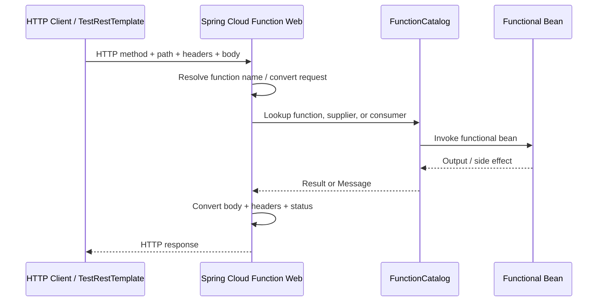
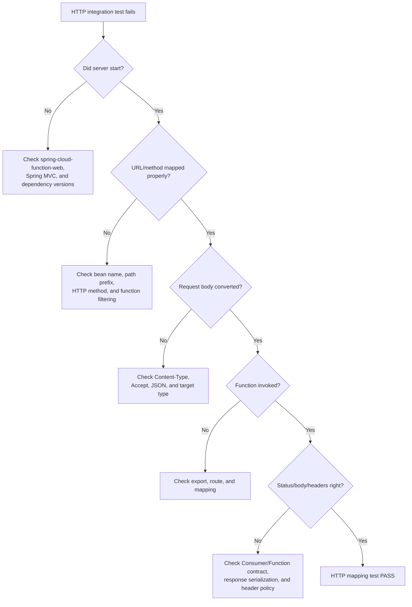

# Testing HTTP Mapping, Methods, Headers, and Response Status Codes

**Chapter:** Testing  
**Module:** Spring Cloud Function (`SPRING_CLOUD_FUNCTION`)

Spring Cloud Function lets you declare business logic using `Supplier`, `Function`, and `Consumer`, then expose those functional beans over HTTP using the `spring-cloud-function-web` module. When the Web adapter is enabled in a Spring Boot application with Spring MVC, bean names can become part of the URL. A `Function<String,String>` can accept a request body and return a result, a `Supplier<String>` can serve data via GET, and a `Consumer<String>` can accept recording commands via POST, PUT, or DELETE.

Testing HTTP therefore requires inspecting **paths, HTTP methods, request bodies, `Content-Type`, `Accept`, headers, response bodies, and status codes**. A unit test calling `function.apply("hello")` does not prove that the endpoint was mapped properly, that the adapter converted headers into a Spring `Message<?>`, or that the response returned the right HTTP status code.

This lesson walks through building integration tests with `@SpringBootTest(webEnvironment = RANDOM_PORT)` and `TestRestTemplate`. We test default Function/Supplier/Consumer mappings, GET/POST/PUT/DELETE methods, JSON and text payloads, request/response headers, query parameters, function composition, function filtering, CRUD method mapping configuration, and status code verification. Examples run against a real embedded HTTP server in tests without calling external services.

## 1. Learning Objectives

After this lesson, you will be able to:

1. Explain how Spring Cloud Function Web maps functional beans to HTTP endpoints.
2. Test URLs by function, supplier, or consumer name.
3. Verify GET, POST, PUT, and DELETE behavior along with their status codes.
4. Distinguish request bodies, path variables, query parameters, and HTTP headers.
5. Verify `Content-Type`/`Accept` and response serialization.
6. Test headers flowing into `Message<?>` and output headers turned into HTTP response headers.
7. Test function composition, root-path mapping, and function filtering.
8. Use `spring.cloud.function.http.<method-name>` to map functions per HTTP method.
9. Test malformed JSON, nonexistent routes, and disallowed methods at the right layer.
10. Distinguish default status contracts of Spring Cloud Function Web from custom statuses defined via MVC advice or dedicated adapters.

## 2. How Does Spring Cloud Function Web Create Endpoints?

The `spring-cloud-function-web` module provides auto-configuration to expose functional beans in the Spring context as HTTP endpoints when Spring MVC is present. By default, endpoints use the root path `/`; you can customize it with:

```properties
spring.cloud.function.web.path=/api/functions
```

Functional bean names typically become part of the URL:

```text
GET  /api/functions/greeting
POST /api/functions/uppercase
POST /api/functions/audit
```

The adapter supports plain text and JSON payloads. It focuses on providing a lightweight HTTP layer for stateless functions; **it does not fully replace Spring MVC or Spring WebFlux**. If an application needs complex REST routing, resource-level authorization, multipart uploads, contract-strict validation, or rich dynamic status codes, consider dedicated controllers.

### 2.1. Default Mapping Table

The table below summarizes the contract documented by Spring Cloud Function Web in current lines:

| Functional Bean | HTTP Method | Path | Request | Response | Status |
| --- | --- | --- | --- | --- | --- |
| `Supplier<T>` | GET | `/{supplier}` | No body needed | Value emitted by supplier | **200 OK** |
| `Consumer<T>` | POST | `/{consumer}` | JSON object or text | Mirrors input and invokes consumer | **202 Accepted** |
| `Consumer<T>` | PUT | `/{consumer}` | JSON object or text | Mirrors input and invokes consumer | **202 Accepted** |
| `Consumer<T>` | DELETE | `/{consumer}` | JSON object or text | No body | **204 No Content** |
| `Function<I,O>` | POST | `/{function}` | JSON object or text | Function result | **200 OK** |
| `Function<I,O>` | PUT | `/{function}` | JSON object or text | Function result | **200 OK** |
| `Function<I,O>` | GET | `/{function}/{item}` | Value taken from path | Function result | **200 OK** |

This is the adapter's default behavior, not a universal rule for every REST API. When an application configures method mappings, function filtering, custom controllers, or uses another version, verify the running contract.

### 2.2. Request and Response Flow



An HTTP integration test exercises this entire flow. It catches bugs that function unit tests cannot see: unexported endpoints, wrong URLs, wrong methods, content negotiation mismatches, missing headers, or unexpected response statuses.

## 3. Choosing the Right Dependencies

To run HTTP integration tests, you need Spring Cloud Function Web and Spring MVC. Spring Boot and Spring Cloud Function versions must be compatible; use the Spring Cloud BOM or your project's dependency management rather than picking individual versions arbitrarily.

**Maven** (dependencies excerpt):

```xml
<dependencies>
    <dependency>
        <groupId>org.springframework.cloud</groupId>
        <artifactId>spring-cloud-function-web</artifactId>
    </dependency>
    <dependency>
        <groupId>org.springframework.boot</groupId>
        <artifactId>spring-boot-starter-web</artifactId>
    </dependency>
    <dependency>
        <groupId>org.springframework.boot</groupId>
        <artifactId>spring-boot-starter-test</artifactId>
        <scope>test</scope>
    </dependency>
</dependencies>
```

**Gradle Kotlin DSL** (versions managed by project):

```kotlin
dependencies {
    implementation("org.springframework.cloud:spring-cloud-function-web")
    implementation("org.springframework.boot:spring-boot-starter-web")
    testImplementation("org.springframework.boot:spring-boot-starter-test")
}

tasks.test {
    useJUnitPlatform()
}
```

In an app that wants the Web adapter only for testing, `spring-boot-starter-web` can be scoped appropriately. If the application actually serves HTTP in production, web runtime dependencies must be on the runtime classpath.

## 4. Sample Application: Function, Supplier, Consumer, and Message

We declare several beans to test multiple endpoint kinds in a single Spring Boot application:

- `uppercase` and `reverse` are string-processing functions.
- `greeting` is a supplier returning a value.
- `audit` is a consumer recording data in memory.
- `assessOrder` accepts a JSON DTO and returns a DTO.
- `headerEcho` accepts/returns `Message<String>` to test headers.
- `requestInfo` reads query parameters placed into message headers by the adapter.

**File:** `src/main/java/example/http/HttpMappingApplication.java`

```java
package example.http;

import java.util.List;
import java.util.Locale;
import java.util.Map;
import java.util.concurrent.CopyOnWriteArrayList;
import java.util.function.Consumer;
import java.util.function.Function;
import java.util.function.Supplier;

import org.springframework.boot.SpringApplication;
import org.springframework.boot.autoconfigure.SpringBootApplication;
import org.springframework.context.annotation.Bean;
import org.springframework.messaging.Message;
import org.springframework.messaging.support.MessageBuilder;

@SpringBootApplication(proxyBeanMethods = false)
public class HttpMappingApplication {

    public static void main(String[] args) {
        SpringApplication.run(HttpMappingApplication.class, args);
    }

    public record OrderRequest(String orderCode, int quantity) {}

    public record OrderResult(
        String normalizedCode, boolean accepted) {}

    public static final class AuditRecorder {
        private final List<String> values =
            new CopyOnWriteArrayList<>();

        public void record(String value) {
            values.add(value);
        }

        public List<String> snapshot() {
            return List.copyOf(values);
        }

        public void clear() {
            values.clear();
        }
    }

    @Bean
    AuditRecorder auditRecorder() {
        return new AuditRecorder();
    }

    @Bean("uppercase")
    Function<String, String> uppercase() {
        return value -> value.toUpperCase(Locale.ROOT);
    }

    @Bean("reverse")
    Function<String, String> reverse() {
        return value -> new StringBuilder(value)
            .reverse().toString();
    }

    @Bean("greeting")
    Supplier<String> greeting() {
        return () -> "hello-from-supplier";
    }

    @Bean("audit")
    Consumer<String> audit(AuditRecorder recorder) {
        return recorder::record;
    }

    @Bean("assessOrder")
    Function<OrderRequest, OrderResult> assessOrder() {
        return request -> {
            if (request.orderCode() == null
                    || request.orderCode().isBlank()) {
                throw new IllegalArgumentException(
                    "orderCode must not be blank");
            }
            String normalized =
                request.orderCode().trim().toUpperCase(Locale.ROOT);
            return new OrderResult(
                normalized, request.quantity() > 0);
        };
    }

    @Bean("headerEcho")
    Function<Message<String>, Message<String>> headerEcho() {
        return input -> {
            Object clientId =
                input.getHeaders().get("x-client-id");
            String result = String.valueOf(clientId)
                + ":" + input.getPayload();

            return MessageBuilder.withPayload(result)
                .setHeader("x-function-result", "processed")
                .build();
        };
    }

    @Bean("requestInfo")
    Function<Message<String>, String> requestInfo() {
        return input -> {
            Object params =
                input.getHeaders().get("http_request_param");
            return input.getPayload() + "|" + params;
        };
    }
}
```

### 4.1. Why Include `AuditRecorder`?

`Consumer<String>` returns `void`, so it has no business return value like a function. `AuditRecorder` lets tests verify **which values the consumer received**, while HTTP responses are verified separately per the adapter contract.

Do not write to a real database or send real messages in this lesson. When verifying persistence or brokers, use dedicated integration tests for those adapters and resources.

### 4.2. Multiple Functions in the Catalog Means Explicit Paths

The fixture has multiple functional beans. Hence, tests always use named paths such as `/uppercase`, `/greeting`, or `/audit`. Omitting the function name from the path applies only when the catalog contains a single eligible function/consumer/supplier per configuration.

## 5. Testing an HTTP Server with `RANDOM_PORT` and `TestRestTemplate`

Spring Cloud Function documents testing functional applications with `@SpringBootTest(webEnvironment = RANDOM_PORT)` and `TestRestTemplate`. This starts an embedded server on a random port, avoiding port collisions across tests.

**File:** `src/test/java/example/http/FunctionHttpMappingTest.java`

```java
package example.http;

import static org.junit.jupiter.api.Assertions.*;

import java.net.URI;
import java.util.List;

import org.junit.jupiter.api.BeforeEach;
import org.junit.jupiter.api.Test;
import org.springframework.beans.factory.annotation.Autowired;
import org.springframework.boot.test.context.SpringBootTest;
import org.springframework.boot.test.web.client.TestRestTemplate;
import org.springframework.http.HttpMethod;
import org.springframework.http.HttpStatus;
import org.springframework.http.MediaType;
import org.springframework.http.RequestEntity;
import org.springframework.http.ResponseEntity;

import example.http.HttpMappingApplication.AuditRecorder;
import example.http.HttpMappingApplication.OrderResult;

@SpringBootTest(
    classes = HttpMappingApplication.class,
    webEnvironment = SpringBootTest.WebEnvironment.RANDOM_PORT
)
class FunctionHttpMappingTest {

    @Autowired
    TestRestTemplate rest;

    @Autowired
    AuditRecorder recorder;

    @BeforeEach
    void resetRecorder() {
        recorder.clear();
    }

    @Test
    void postFunctionMapsBodyAndReturnsOk() {
        RequestEntity<String> request =
            RequestEntity.post(URI.create("/uppercase"))
                .contentType(MediaType.TEXT_PLAIN)
                .accept(MediaType.TEXT_PLAIN)
                .body("hello");

        ResponseEntity<String> response =
            rest.exchange(request, String.class);

        assertEquals(HttpStatus.OK, response.getStatusCode());
        assertEquals("HELLO", response.getBody());
    }

    @Test
    void putFunctionAlsoReturnsOk() {
        RequestEntity<String> request =
            RequestEntity.put(URI.create("/uppercase"))
                .contentType(MediaType.TEXT_PLAIN)
                .accept(MediaType.TEXT_PLAIN)
                .body("hello");

        ResponseEntity<String> response =
            rest.exchange(request, String.class);

        assertEquals(HttpStatus.OK, response.getStatusCode());
        assertEquals("HELLO", response.getBody());
    }

    @Test
    void getSupplierReturnsItsValue() {
        ResponseEntity<String> response =
            rest.getForEntity("/greeting", String.class);

        assertEquals(HttpStatus.OK, response.getStatusCode());
        assertEquals("hello-from-supplier", response.getBody());
    }

    @Test
    void getFunctionPathVariableBecomesFunctionInput() {
        ResponseEntity<String> response =
            rest.getForEntity("/uppercase/hello", String.class);

        assertEquals(HttpStatus.OK, response.getStatusCode());
        assertEquals("HELLO", response.getBody());
    }

    @Test
    void postConsumerReturnsAcceptedAndMirrorsInput() {
        RequestEntity<String> request =
            RequestEntity.post(URI.create("/audit"))
                .contentType(MediaType.TEXT_PLAIN)
                .accept(MediaType.TEXT_PLAIN)
                .body("order-42");

        ResponseEntity<String> response =
            rest.exchange(request, String.class);

        assertEquals(HttpStatus.ACCEPTED, response.getStatusCode());
        assertEquals("order-42", response.getBody());
        assertEquals(List.of("order-42"), recorder.snapshot());
    }

    @Test
    void putConsumerReturnsAccepted() {
        RequestEntity<String> request =
            RequestEntity.put(URI.create("/audit"))
                .contentType(MediaType.TEXT_PLAIN)
                .body("order-43");

        ResponseEntity<String> response =
            rest.exchange(request, String.class);

        assertEquals(HttpStatus.ACCEPTED, response.getStatusCode());
        assertEquals(List.of("order-43"), recorder.snapshot());
    }

    @Test
    void deleteConsumerReturnsNoContent() {
        RequestEntity<String> request =
            RequestEntity.method(
                    HttpMethod.DELETE, URI.create("/audit"))
                .contentType(MediaType.TEXT_PLAIN)
                .body("order-44");

        ResponseEntity<String> response =
            rest.exchange(request, String.class);

        assertEquals(HttpStatus.NO_CONTENT, response.getStatusCode());
        assertNull(response.getBody());
        assertEquals(List.of("order-44"), recorder.snapshot());
    }

    @Test
    void postJsonConvertsDtoAndReturnsJson() {
        String json = """
            {"orderCode":" ord-42 ","quantity":3}
            """;
        RequestEntity<String> request =
            RequestEntity.post(URI.create("/assessOrder"))
                .contentType(MediaType.APPLICATION_JSON)
                .accept(MediaType.APPLICATION_JSON)
                .body(json);

        ResponseEntity<OrderResult> response =
            rest.exchange(request, OrderResult.class);

        assertEquals(HttpStatus.OK, response.getStatusCode());
        assertNotNull(response.getBody());
        assertEquals("ORD-42",
            response.getBody().normalizedCode());
        assertTrue(response.getBody().accepted());
    }
}
```

These are integration tests running through a real in-JVM HTTP server. Tests do not invoke functions via `FunctionCatalog.lookup(...)`; instead, they go through the HTTP adapter to verify mapping and responses.

### 5.1. Why Use `RequestEntity`?

`RequestEntity` lets you declare method, URI, headers, content type, accept, and body in a single request. That makes tests express the HTTP contract explicitly instead of relying on simpler overloads that might send unexpected default headers.

### 5.2. `TestRestTemplate` Does Not Throw on Every 4xx/5xx Status

`TestRestTemplate` is built for integration tests; by default, its error handler does not throw exceptions on error responses like some other clients do. Tests can receive `ResponseEntity<?>` and inspect status and body directly. Still, check any custom configuration if your project overrides the test client's error handler.

## 6. Testing HTTP Headers and `Message<?>`

Spring Cloud Function Web converts request headers into message headers when a functional bean declares `Message<?>` as input/output. If the output is also a `Message<?>`, output message headers can be copied to HTTP response headers.

`headerEcho` in Section 4 reads `x-client-id` and returns `x-function-result`. Test:

```java
@Test
void requestHeaderBecomesMessageHeaderAndOutputHeaderBecomesHttpHeader() {
    RequestEntity<String> request =
        RequestEntity.post(URI.create("/headerEcho"))
            .contentType(MediaType.TEXT_PLAIN)
            .accept(MediaType.TEXT_PLAIN)
            .header("x-client-id", "client-7")
            .header("x-request-id", "req-42")
            .body("hello");

    ResponseEntity<String> response =
        rest.exchange(request, String.class);

    assertEquals(HttpStatus.OK, response.getStatusCode());
    assertEquals("client-7:hello", response.getBody());
    assertEquals(
        "processed",
        response.getHeaders().getFirst("x-function-result"));
    assertEquals(
        "req-42",
        response.getHeaders().getFirst("x-request-id"));
}
```

Place this method in `FunctionHttpMappingTest` to reuse `rest`. The assertions verify:

1. Request header `x-client-id` reached the function as a message header.
2. The function read the header value and used it in its output.
3. The header added by the function was mirrored into the HTTP response.
4. Ordinary request headers such as `x-request-id` were forwarded per default policy.

Documentation notes that **most** request `HttpHeaders` are copied to response headers by default. Do not assume every header is allowed back out; certain headers may be filtered or managed separately by the HTTP server.

### 6.1. Ignoring Headers You Do Not Want Returned

You can configure a list of headers to omit from responses:

```properties
spring.cloud.function.http.ignored-headers=x-request-id,x-internal-token
```

Names are comma-separated. To test this property, use a separate context:

```java
package example.http;

import static org.junit.jupiter.api.Assertions.*;

import java.net.URI;

import org.junit.jupiter.api.Test;
import org.springframework.beans.factory.annotation.Autowired;
import org.springframework.boot.test.context.SpringBootTest;
import org.springframework.boot.test.web.client.TestRestTemplate;
import org.springframework.http.HttpStatus;
import org.springframework.http.MediaType;
import org.springframework.http.RequestEntity;
import org.springframework.http.ResponseEntity;

@SpringBootTest(
    classes = HttpMappingApplication.class,
    webEnvironment = SpringBootTest.WebEnvironment.RANDOM_PORT,
    properties = {
        "spring.cloud.function.http.ignored-headers=x-request-id"
    }
)
class IgnoredHttpHeadersTest {

    @Autowired
    TestRestTemplate rest;

    @Test
    void configuredRequestHeaderIsNotCopiedToResponse() {
        RequestEntity<String> request =
            RequestEntity.post(URI.create("/headerEcho"))
                .contentType(MediaType.TEXT_PLAIN)
                .header("x-client-id", "client-7")
                .header("x-request-id", "req-42")
                .body("hello");

        ResponseEntity<String> response =
            rest.exchange(request, String.class);

        assertEquals(HttpStatus.OK, response.getStatusCode());
        assertNull(
            response.getHeaders().getFirst("x-request-id"));
        assertEquals(
            "processed",
            response.getHeaders().getFirst("x-function-result"));
    }
}
```

This is a separate test class so the property is loaded **before the Spring context initializes**. Do not edit properties in a running context expecting the adapter to update its header policy immediately.

### 6.2. Do Not Unconditionally Echo Every Request Header

Headers can hold tokens, cookies, or internal metadata. Before copying headers to responses, define which headers belong to the API contract. `spring.cloud.function.http.ignored-headers` is a header-filtering setting; it does not replace authentication, authorization, or masking sensitive data in logs.

## 7. Testing Query Parameters and Path Variables

### 7.1. Path Variables as Function Input

The path:

```text
GET /uppercase/hello
```

passes `hello` into the `uppercase` function. This is a different mapping from a POST body:

```text
POST /uppercase
Content-Type: text/plain

hello
```

Both requests can produce the same output yet require separate tests because the input sources differ.

### 7.2. Query Parameters Placed in Message Headers

Spring Cloud Function Web places request parameters into the `http_request_param` header as a `Map`. Thus, if a function needs query parameters, its input signature should accept `Message<?>`:

```java
@Bean("requestInfo")
Function<Message<String>, String> requestInfo() {
    return input -> {
        Object params =
            input.getHeaders().get("http_request_param");
        return input.getPayload() + "|" + params;
    };
}
```

Test:

```java
@Test
void queryParametersAreAvailableInMessageHeaders() {
    ResponseEntity<String> response =
        rest.getForEntity(
            "/requestInfo/hello?name=Bill",
            String.class);

    assertEquals(HttpStatus.OK, response.getStatusCode());
    assertNotNull(response.getBody());
    assertTrue(response.getBody().contains("name=Bill"));
}
```

Place this method inside `FunctionHttpMappingTest`. The exact Map representation depends on adapter/version; test the required content rather than forcing `Map.toString()` to match a non-contractual format.

In production code, you can use `HeaderUtils.HTTP_REQUEST_PARAM` instead of hardcoding the header string; import the constant from the proper package for your Spring Cloud Function version.

## 8. `Content-Type` and `Accept`: Request Body Is Not Response Body

Two frequently confused headers:

- **`Content-Type`**: the format of the request body sent by the client.
- **`Accept`**: the response format the client wants to receive.

Example with a string function:

```http
POST /uppercase
Content-Type: text/plain
Accept: text/plain

hello
```

Response:

```http
HTTP/1.1 200 OK
Content-Type: text/plain

HELLO
```

For DTOs, use JSON:

```http
POST /assessOrder
Content-Type: application/json
Accept: application/json

{"orderCode":" ord-42 ","quantity":3}
```

The response is JSON representing `OrderResult`. If a test sends a JSON body without setting `Content-Type`, the converter may not interpret the payload as intended. Without `Accept`, the response format is left to client/server content negotiation defaults.

### 8.1. Checking Response `Content-Type`

Add to a function test:

```java
assertTrue(
    response.getHeaders().getContentType()
        .isCompatibleWith(MediaType.TEXT_PLAIN));
```

For JSON responses:

```java
assertTrue(
    response.getHeaders().getContentType()
        .isCompatibleWith(MediaType.APPLICATION_JSON));
```

Checking MIME-type compatibility is better than literal string equality when responses include a `charset` parameter.

### 8.2. Consumer with JSON Array or Multi-Line Text

The adapter supports JSON array or multi-line text bodies for a `Consumer`; items are passed to the consumer one by one. Test this with:

```java
@Test
void consumerReceivesItemsFromJsonArray() {
    RequestEntity<String> request =
        RequestEntity.post(URI.create("/audit"))
            .contentType(MediaType.APPLICATION_JSON)
            .accept(MediaType.APPLICATION_JSON)
            .body("[\"order-1\",\"order-2\"]");

    ResponseEntity<String> response =
        rest.exchange(request, String.class);

    assertEquals(HttpStatus.ACCEPTED, response.getStatusCode());
    assertEquals(
        List.of("order-1", "order-2"),
        recorder.snapshot());
}
```

Place this test in `FunctionHttpMappingTest`, where `@BeforeEach` clears the recorder. If an application declares a DTO or collection input type on the consumer, conversion behavior depends on the function signature; adjust the body and expectations accordingly.

## 9. Path Mapping, Root Path, and Composition

### 9.1. When the Catalog Has a Single Function

When only one eligible functional bean exists in the catalog, the function name in the path may be omitted:

```bash
curl -H "Content-Type: text/plain" \
     -H "Accept: text/plain" \
     -d "hello" \
     http://localhost:8080/uppercase

curl -H "Content-Type: text/plain" \
     -H "Accept: text/plain" \
     -d "hello" \
     http://localhost:8080/
```

Both requests can reach the same function when the catalog has only that function. **Do not rely on this rule in our multi-function fixture**; always specify the path name explicitly.

### 9.2. Function Composition in the URL

You can invoke a composition using a pipe or comma in the path:

```bash
curl -H "Content-Type: text/plain" \
     -H "Accept: text/plain" \
     -d "hello" \
     http://localhost:8080/uppercase,reverse
```

The result is `OLLEH`. Commas are easier to pass in shells than pipes because pipe characters have special meaning in most command lines.

### 9.3. Mapping a Composition to the Root Path

When multiple functions exist and you want to map a composition onto `/`, configure:

```properties
spring.cloud.function.definition=uppercase|reverse
```

Then a test can POST to root:

```java
RequestEntity<String> request =
    RequestEntity.post(URI.create("/"))
        .contentType(MediaType.TEXT_PLAIN)
        .accept(MediaType.TEXT_PLAIN)
        .body("hello");

ResponseEntity<String> response =
    rest.exchange(request, String.class);

assertEquals(HttpStatus.OK, response.getStatusCode());
assertEquals("OLLEH", response.getBody());
```

This tests **a separate context with its own composition property**. Do not add that property to the shared test class and still expect all functions to retain individual root mappings.

### 9.4. Function Filtering with Semicolons

When exposing only a subset of functions/compositions, `spring.cloud.function.definition` can list multiple definitions separated by `;`:

```properties
spring.cloud.function.definition=uppercase;reverse
```

Only the two listed functions are exported; the root path is not mapped to a composition in this case. A list such as:

```properties
spring.cloud.function.definition=uppercase|reverse;greeting
```

exports the `uppercase|reverse` composition and the `greeting` function.

**Distinction:**

| Syntax | Meaning |
| --- | --- |
| `uppercase|reverse` | A single function composition where the second step receives the first's output |
| `uppercase;reverse` | Two independently exported definitions |

Filtering tests should use an isolated context and verify both exported and non-exported endpoints. Do not assume non-exported paths return the exact same status across versions without fixing MVC error mapping.

## 10. Mapping Functions by HTTP Method with `spring.cloud.function.http`

Beyond default mappings, Spring Cloud Function supports mapping functions by HTTP method:

```properties
spring.cloud.function.http.GET=uppercase;reverse;foo|bar
spring.cloud.function.http.POST=reverse
spring.cloud.function.http.DELETE=deleteById
```

Meaning:

- GET permits the functions/compositions listed under the GET property.
- POST permits the functions/compositions under the POST property.
- DELETE can bind to a consumer or function matching the business contract.
- `;` lists multiple definitions for the same method; `|` composes steps into one pipeline.

This is a Web-adapter method-mapping mechanism, not `@GetMapping`/`@PostMapping` controller annotations.

### 10.1. Method-Mapping Test Context

A dedicated test class can enable:

```java
package example.http;

import static org.junit.jupiter.api.Assertions.*;

import java.net.URI;

import org.junit.jupiter.api.Test;
import org.springframework.beans.factory.annotation.Autowired;
import org.springframework.boot.test.context.SpringBootTest;
import org.springframework.boot.test.web.client.TestRestTemplate;
import org.springframework.http.HttpStatus;
import org.springframework.http.MediaType;
import org.springframework.http.RequestEntity;
import org.springframework.http.ResponseEntity;

@SpringBootTest(
    classes = HttpMappingApplication.class,
    webEnvironment = SpringBootTest.WebEnvironment.RANDOM_PORT,
    properties = {
        "spring.cloud.function.http.GET=uppercase",
        "spring.cloud.function.http.POST=reverse"
    }
)
class HttpMethodMappingTest {

    @Autowired
    TestRestTemplate rest;

    @Test
    void configuredGetMappingInvokesUppercase() {
        ResponseEntity<String> response =
            rest.getForEntity(
                "/uppercase/hello", String.class);

        assertEquals(HttpStatus.OK, response.getStatusCode());
        assertEquals("HELLO", response.getBody());
    }

    @Test
    void configuredPostMappingInvokesReverse() {
        RequestEntity<String> request =
            RequestEntity.post(URI.create("/reverse"))
                .contentType(MediaType.TEXT_PLAIN)
                .accept(MediaType.TEXT_PLAIN)
                .body("hello");

        ResponseEntity<String> response =
            rest.exchange(request, String.class);

        assertEquals(HttpStatus.OK, response.getStatusCode());
        assertEquals("olleh", response.getBody());
    }
}
```

This is a **separate context example** requiring the Spring HTTP imports shown in Section 5. Functions not listed for a given method lack a mapping under that configuration. To assert exact responses for disallowed methods, record the actual status produced by your version (typically handled at the MVC layer as 404/405); do not turn an unguaranteed status into a universal cross-version expectation.

## 11. Testing a Custom Web Path

If the application configures:

```properties
spring.cloud.function.web.path=/api/functions
```

paths must include the prefix:

```text
POST /api/functions/uppercase
GET  /api/functions/greeting
```

A separate test class:

```java
package example.http;

import static org.junit.jupiter.api.Assertions.*;

import org.junit.jupiter.api.Test;
import org.springframework.beans.factory.annotation.Autowired;
import org.springframework.boot.test.context.SpringBootTest;
import org.springframework.boot.test.web.client.TestRestTemplate;
import org.springframework.http.HttpStatus;
import org.springframework.http.ResponseEntity;

@SpringBootTest(
    classes = HttpMappingApplication.class,
    webEnvironment = SpringBootTest.WebEnvironment.RANDOM_PORT,
    properties = {
        "spring.cloud.function.web.path=/api/functions"
    }
)
class CustomWebPathTest {

    @Autowired
    TestRestTemplate rest;

    @Test
    void endpointUsesConfiguredPrefix() {
        ResponseEntity<String> response =
            rest.getForEntity(
                "/api/functions/greeting", String.class);

        assertEquals(HttpStatus.OK, response.getStatusCode());
        assertEquals("hello-from-supplier", response.getBody());
    }
}
```

If an older test calls `/greeting` after the prefix changed, the bug is usually in the test URL rather than the `Supplier` bean.

## 12. Testing Success Response Codes

Status codes are part of the HTTP contract. With Spring Cloud Function Web, assert both status code and body:

| Behavior | Expected Status | Body |
| --- | --- | --- |
| GET Supplier | `200 OK` | Supplier value |
| POST Function | `200 OK` | Function result |
| PUT Function | `200 OK` | Function result |
| GET Function with path item | `200 OK` | Function result |
| POST Consumer | `202 Accepted` | Mirrored input |
| PUT Consumer | `202 Accepted` | Mirrored input |
| DELETE Consumer | `204 No Content` | No body |

**Do not check only the status code.** A `200` with the wrong body is still broken; a `204` carrying an unexpected body also violates the HTTP contract.

### 12.1. Consumer POST/PUT vs. DELETE Have Different Body Contracts

POST/PUT Consumer mirrors the input in the response and passes the body to the consumer. DELETE Consumer returns `204 No Content` with no body. That is why Section 5's test asserts:

```java
assertEquals(HttpStatus.ACCEPTED, response.getStatusCode());
assertEquals("order-42", response.getBody());
```

for POST/PUT, but:

```java
assertEquals(HttpStatus.NO_CONTENT, response.getStatusCode());
assertNull(response.getBody());
```

for DELETE.

### 12.2. Do Not Assume Custom Status Codes Across Every Adapter

The `200`, `202`, and `204` statuses above are defaults for **Spring Cloud Function Web**. If your API must return custom statuses such as `422 Unprocessable Entity` for domain rules, use an appropriate Spring MVC mechanism (e.g., `@RestControllerAdvice`) or dedicated endpoints/controllers, and test the real HTTP response.

Do not treat a serverless-adapter-specific header as a universal contract for the Web adapter. For example, `FunctionInvoker.HTTP_STATUS_CODE` is a GCP-adapter mechanism; do not assume it controls `spring-cloud-function-web` status codes.

## 13. Testing HTTP Errors: Bad JSON and Business Errors

There are at least two distinct error layers:

1. **Errors before calling the function:** unparseable JSON, unsupported content type, or invalid request mapping.
2. **Errors inside the function:** data converted into a Java object successfully, then violated a business rule.

Tests should distinguish these two cases instead of asserting only "the request failed."

### 13.1. Malformed JSON

Add to `FunctionHttpMappingTest`:

```java
@Test
void malformedJsonReturnsBadRequest() {
    RequestEntity<String> request =
        RequestEntity.post(URI.create("/assessOrder"))
            .contentType(MediaType.APPLICATION_JSON)
            .accept(MediaType.APPLICATION_JSON)
            .body("{\"orderCode\":");

    ResponseEntity<String> response =
        rest.exchange(request, String.class);

    assertEquals(
        HttpStatus.BAD_REQUEST,
        response.getStatusCode());
}
```

Spring MVC cannot deserialize malformed JSON into the DTO; unreadable request bodies normally map to `400 Bad Request`. If the app registers a custom exception resolver, test against the app's explicit contract.

### 13.2. Business Error Thrown by a Function

`assessOrder` throws `IllegalArgumentException` when the order code is blank. The HTTP status for function-thrown exceptions can be customized by Spring MVC/application error handling; do not treat one generic status as guaranteed across every version.

If your API should return `422 Unprocessable Entity`, you can define an advice:

**File:** `src/main/java/example/http/FunctionHttpErrorAdvice.java`

```java
package example.http;

import java.util.Map;

import org.springframework.http.HttpStatus;
import org.springframework.http.ResponseEntity;
import org.springframework.web.bind.annotation.ExceptionHandler;
import org.springframework.web.bind.annotation.RestControllerAdvice;

@RestControllerAdvice
public class FunctionHttpErrorAdvice {

    @ExceptionHandler(IllegalArgumentException.class)
    public ResponseEntity<Map<String, String>> invalidInput(
            IllegalArgumentException error) {
        return ResponseEntity
            .status(HttpStatus.UNPROCESSABLE_ENTITY)
            .body(Map.of("error", error.getMessage()));
    }
}
```

Test:

```java
@Test
void domainValidationErrorUsesConfigured422Response() {
    RequestEntity<String> request =
        RequestEntity.post(URI.create("/assessOrder"))
            .contentType(MediaType.APPLICATION_JSON)
            .accept(MediaType.APPLICATION_JSON)
            .body("""
                {"orderCode":"  ","quantity":2}
                """);

    ResponseEntity<String> response =
        rest.exchange(request, String.class);

    assertEquals(
        HttpStatus.UNPROCESSABLE_ENTITY,
        response.getStatusCode());
    assertNotNull(response.getBody());
    assertTrue(response.getBody().contains("orderCode"));
}
```

This example verifies an **application-defined error policy**, not a custom status automatically inferred by Spring Cloud Function from exceptions. Without the advice registered, the default status depends on active MVC/error-handling configuration.

### 13.3. Unsupported Media Type and Disallowed Methods

A request with a `Content-Type` unsupported by the adapter may receive `415 Unsupported Media Type`. An unmapped method may receive `405 Method Not Allowed` or another response depending on endpoint registration, Spring Boot/MVC, and filtering configuration.

Write negative tests matching your exact version:

- Send XML to a JSON/text-only function and assert actual status/body.
- Send GET to a Consumer endpoint exposed only for other methods and verify status.
- Assert the `Allow` header if required by your API contract.

Do not hardcode a status code not promised by the adapter's mapping docs; pin your version and application error-handling policy before making that assertion a regression contract.

## 14. Testing Response Headers and Header Filtering

In addition to headers returned by the function, Spring Cloud Function Web copies most request HTTP headers to the response by default. To suppress specific headers, configure:

```properties
spring.cloud.function.http.ignored-headers=x-request-id,x-internal-token
```

Test matrix:

| Request Header | In Output `Message`? | In HTTP Response? |
| --- | --- | --- |
| Header read directly by function (e.g., `x-client-id`) | Yes if adapter forwards to `Message<?>` | Not automatically from function return; depends on request-header copy policy |
| Header created by function (e.g., `x-function-result`) | Yes | Copied from output Message to HTTP header |
| Header listed in `ignored-headers` | May appear on input | Stripped from response per config |
| Server-managed HTTP headers | Depends on server | May be normalized/overwritten |

### 14.1. Avoid Asserting the Entire Response Headers Map

HTTP servers add headers such as `Date`, `Content-Length`, or connection headers. Those values are non-deterministic. Assert only contract headers, for example:

```java
assertEquals(
    "processed",
    response.getHeaders().getFirst("x-function-result"));
```

Do not compare the entire `HttpHeaders` object against a literal map.

## 15. Testing Function Filtering and Unexported Endpoints

When multiple beans exist in the catalog, an app may export only a subset:

```properties
spring.cloud.function.definition=uppercase;reverse
```

This restricts exposed endpoints. Tests must verify:

1. `/uppercase` and `/reverse` work.
2. `/greeting` is not exported in this context.
3. The root path is not treated as a default composition when a filter list is used.

Example test:

```java
package example.http;

import static org.junit.jupiter.api.Assertions.*;

import org.junit.jupiter.api.Test;
import org.springframework.beans.factory.annotation.Autowired;
import org.springframework.boot.test.context.SpringBootTest;
import org.springframework.boot.test.web.client.TestRestTemplate;
import org.springframework.http.HttpStatus;
import org.springframework.http.ResponseEntity;

@SpringBootTest(
    classes = HttpMappingApplication.class,
    webEnvironment = SpringBootTest.WebEnvironment.RANDOM_PORT,
    properties = {
        "spring.cloud.function.definition=uppercase;reverse"
    }
)
class FunctionFilteringHttpTest {

    @Autowired
    TestRestTemplate rest;

    @Test
    void listedFunctionIsExported() {
        ResponseEntity<String> response =
            rest.postForEntity(
                "/uppercase", "hello", String.class);
        assertEquals(HttpStatus.OK, response.getStatusCode());
        assertEquals("HELLO", response.getBody());
    }

    @Test
    void unlistedSupplierIsNotAnExportedEndpoint() {
        ResponseEntity<String> response =
            rest.getForEntity("/greeting", String.class);
        assertTrue(response.getStatusCode().is4xxClientError());
    }
}
```

The second test asserts a 4xx client error because how Spring MVC handles unmapped paths can vary by version and config. If your API explicitly guarantees `404`, switch to asserting `NOT_FOUND` after verifying runtime behavior.

## 16. Security: HTTP Mapping Does Not Provide Business Authorization

When functions are exported as HTTP endpoints, bean names become an attack surface. Control:

- Which functions are exported via `spring.cloud.function.definition`.
- Who may invoke endpoints via authentication/authorization.
- Whether clients may supply routing headers or routing expressions.
- Whether sensitive data leaks through echoed headers, error messages, or response bodies.
- Which consumers trigger side effects and whether replay/idempotency protection is required.

Spring Cloud Function Web does not replace Spring Security or full Spring MVC security controls. For production endpoints, write security tests covering both authorized and unauthorized requests.

In particular, never expose every functional bean simply because it lives in the catalog. Function filtering limits exported mappings, yet per-function access control must still be enforced at the web/security layer.

## 17. HTTP Mapping Test Matrix

| ID | Request | Expected Status | Expected Body/Header |
| --- | --- | --- | --- |
| H01 | GET `/greeting` | 200 | Supplier value |
| H02 | POST `/uppercase` text/plain | 200 | Uppercased string |
| H03 | PUT `/uppercase` text/plain | 200 | Uppercased string |
| H04 | GET `/uppercase/hello` | 200 | Path item becomes input |
| H05 | POST `/audit` text/plain | 202 | Mirrored body; recorder has input |
| H06 | PUT `/audit` text/plain | 202 | Recorder has input |
| H07 | DELETE `/audit` text/plain | 204 | No body; recorder has input |
| H08 | POST `/assessOrder` JSON | 200 | Expected JSON DTO |
| H09 | POST `/headerEcho` + x-client-id | 200 | Expected payload and output header |
| H10 | GET `/requestInfo/hello?name=Bill` | 200 | Query parameter in message header |
| H11 | POST `/assessOrder` malformed JSON | 400 | Request fails deserialization |
| H12 | Function throws IllegalArgumentException + advice | 422 | Error body per app contract |
| H13 | Function filtering omits `greeting` | 4xx | Endpoint not exported |
| H14 | `ignored-headers=x-request-id` | 200 | Filtered header absent from response |
| H15 | `web.path=/api/functions` | 200 | Endpoint served under prefix |
| H16 | CRUD mapping GET/POST | 200 | Expected method-mapped function called |
| H17 | Unmapped method | Per MVC/version | Check 404/405 and `Allow` if needed |
| H18 | Unsupported Content-Type | Typically 415 | Verify actual error mapping |

This matrix is a recommended regression suite. H01–H10 and H12–H16 have code examples in this lesson; H17–H18 should be pinned to your app's MVC/version configuration.

## 18. Diagnosing Failed HTTP Tests



| Symptom | Common Cause | Remediation |
| --- | --- | --- |
| Context fails to start | Missing Web MVC or incompatible dependencies | Check dependency tree and auto-configuration |
| `404 Not Found` | Wrong path, prefix, or function not exported | Check bean name, `web.path`, function filtering |
| `405 Method Not Allowed` | Method not in mapping | Check default method table and `spring.cloud.function.http.*` |
| `415 Unsupported Media Type` | Unsupported Content-Type | Check request headers and converters |
| `400 Bad Request` | Bad JSON or unconvertible request | Check body, Content-Type, DTO |
| `500 Internal Server Error` | Unhandled exception thrown by function | Check root cause and exception advice |
| Status 202, empty recorder | Consumer not called as expected or wrong bean | Assert side effects and bean name |
| Response body wrong format | Accept/content negotiation | Set `Accept` explicitly, check `Content-Type` |
| Header absent from response | Function does not return Message/header or filtered | Check `Message` signature, output headers, `ignored-headers` |
| Query param unreadable | Function does not accept Message or wrong header key | Use `http_request_param` |
| Root path returns 404 | Multiple functions in catalog or definition not mapped to root | Call named endpoint or configure definition |
| Status test unstable across versions | Relies on unspecified error mapping | Pin Spring Boot/Spring Cloud versions |

### 18.1. Reading Server Logs and Responses Together

When a test receives 4xx/5xx, inspect all of:

- Actual URL and HTTP method.
- Request `Content-Type`, `Accept`, and body.
- Response status, `Content-Type`, body, and contract headers.
- Server logs and root cause if a function or converter threw an exception.
- Bean recorder to see whether the function/consumer ran at all.

Do not change function logic just by looking at a status code. `404` is usually mapping/export; `400` usually happens before or during conversion; business errors appear after the function is invoked.

### 18.2. Checking Dependency Versions

Maven:

```bash
./mvnw dependency:tree -Dincludes=org.springframework.cloud:spring-cloud-function-web
```

Gradle:

```bash
./gradlew dependencyInsight --dependency spring-cloud-function-web --configuration runtimeClasspath
```

Compare versions of `spring-cloud-function-web`, Spring Boot, Spring MVC, and `spring-cloud-function-context`. Do not guess versions from starter names or outdated online snippets.

## 19. How to Run the Tests

Illustrative file layout:

```text
src/
  main/java/example/http/
    HttpMappingApplication.java
    FunctionHttpErrorAdvice.java       (optional)
  test/java/example/http/
    FunctionHttpMappingTest.java
    IgnoredHttpHeadersTest.java
    HttpMethodMappingTest.java
    CustomWebPathTest.java
    FunctionFilteringHttpTest.java
```

Maven Wrapper:

```bash
./mvnw -Dtest=FunctionHttpMappingTest test
```

Gradle Wrapper:

```bash
./gradlew test --tests "example.http.FunctionHttpMappingTest"
```

Run all separate configuration test classes:

```bash
./mvnw -Dtest=FunctionHttpMappingTest,IgnoredHttpHeadersTest,HttpMethodMappingTest,CustomWebPathTest,FunctionFilteringHttpTest test
```

These commands are guidance for learners, not build results executed while authoring this lesson.

## 20. Practice Exercises and Interview Questions

### 20.1. Exercises

1. **Supplier:** add a `Supplier<List<String>>` and test GET returning a JSON array and `Content-Type`.
2. **Function:** add a validating `Function<OrderRequest,OrderResult>`; test POST JSON and PUT JSON.
3. **Consumer:** add a POST JSON array test verifying the consumer receives each item.
4. **DELETE:** verify status 204 and empty body; verify the consumer is invoked per contract.
5. **Headers:** send `x-tenant-id` in the request and return `x-result-code` from the output `Message`.
6. **Header filtering:** set `spring.cloud.function.http.ignored-headers=x-tenant-id` and verify the response does not echo it.
7. **Query parameters:** add multiple query parameters and read them from `http_request_param`.
8. **Content negotiation:** send the same input with `Accept: text/plain` vs. `application/json`; explain how responses differ.
9. **Composition:** map `uppercase|reverse` to the root path and test the output.
10. **Filtering:** export only `uppercase;reverse` and verify `greeting` is not exported.
11. **CRUD methods:** map GET to a read function, POST to a write function, and DELETE to a delete consumer; test each status.
12. **Custom status:** use `@RestControllerAdvice` to map domain errors to 422 and write HTTP integration tests.
13. **Invalid method:** POST to a GET-only endpoint; record status and `Allow` header for your version.
14. **Security:** protect a function with Spring Security; test both authorized and unauthorized requests.
15. **Web path:** change root to `/api/functions` and update test URLs.

### 20.2. Interview Questions

**Q:** What status code does POSTing to a `Function<String,String>` normally return?

**A:** Spring Cloud Function Web's default mapping returns `200 OK` with the function result as the body.

**Q:** What status code does POSTing to a `Consumer<String>` return?

**A:** The default mapping returns `202 Accepted` and mirrors the input in the response while passing the request body to the consumer.

**Q:** Does DELETE on a Consumer return a response body?

**A:** The default mapping returns `204 No Content` with no response body.

**Q:** How can a function read HTTP request headers?

**A:** Declare the input as `Message<?>`; the adapter turns request headers into message headers. If the function returns `Message<?>`, output headers can become HTTP response headers.

**Q:** Where are query parameters placed?

**A:** In the `http_request_param` message header as a `Map`; the function must accept `Message` to read them.

**Q:** How does `spring.cloud.function.definition=foo|bar` differ from `foo;bar`?

**A:** The pipe builds an ordered composition pipeline; the semicolon lists independently exported functions or compositions.

**Q:** If a function throws `IllegalArgumentException`, does Spring Cloud Function Web always return 400?

**A:** Never assume that. Status codes depend on Spring MVC and application exception handling. If your API needs 422 or another specific code, define exception advice/controller contracts and test over HTTP.

## 21. Summary

- Spring Cloud Function Web exposes functional beans as HTTP endpoints when appropriate Web MVC configuration is present.
- URLs typically include bean names: `/{function}`, `/{supplier}`, or `/{consumer}`; `Function` also supports GET with a path item.
- Default mapping: Supplier GET returns 200; Function POST/PUT returns 200; Consumer POST/PUT returns 202; Consumer DELETE returns 204.
- Use `@SpringBootTest(RANDOM_PORT)` and `TestRestTemplate` to test through a real in-JVM HTTP server.
- Always set `Content-Type`/`Accept` explicitly when testing JSON/text; check both response body and `Content-Type`.
- Functions accepting/returning `Message<?>` can read request headers and set response headers. Most request headers are copied by default; filter them with `spring.cloud.function.http.ignored-headers`.
- Query parameters live in `http_request_param`; path variables can act as function input.
- Use `spring.cloud.function.definition` for root-path composition or export filtering; use `spring.cloud.function.http.<method-name>` for CRUD method mapping.
- Error status codes are not always a fixed Spring Cloud Function contract; define and test your application's error-handling policy.
- HTTP integration tests do not replace authorization, database, message broker, or serverless adapter tests.

### References

- [Spring Cloud Function — Standalone Web Applications](https://docs.spring.io/spring-cloud-function/reference/spring-cloud-function/standalone-web-applications.html): method/path/status mapping, content negotiation, header propagation, query parameters, function filtering, and CRUD method mapping.
- [Spring Cloud Function — Functional Bean Definitions / Testing Functional Applications](https://docs.spring.io/spring-cloud-function/reference/functional.html): `@SpringBootTest(RANDOM_PORT)`, `TestRestTemplate`, and testing via `FunctionCatalog`.
- [Spring Cloud Function — Programming Model](https://docs.spring.io/spring-cloud-function/reference/spring-cloud-function/programming-model.html): functional beans, `Message` headers, conversion, and `FunctionCatalog`.
- [Spring Boot — Testing Spring Boot Applications](https://docs.spring.io/spring-boot/reference/testing/spring-boot-applications.html): web test environments, embedded servers, and Spring Boot test utilities.
- [Spring Framework — TestRestTemplate API](https://docs.spring.io/spring-boot/api/java/org/springframework/boot/test/web/client/TestRestTemplate.html): sending requests and receiving `ResponseEntity` in integration tests.
