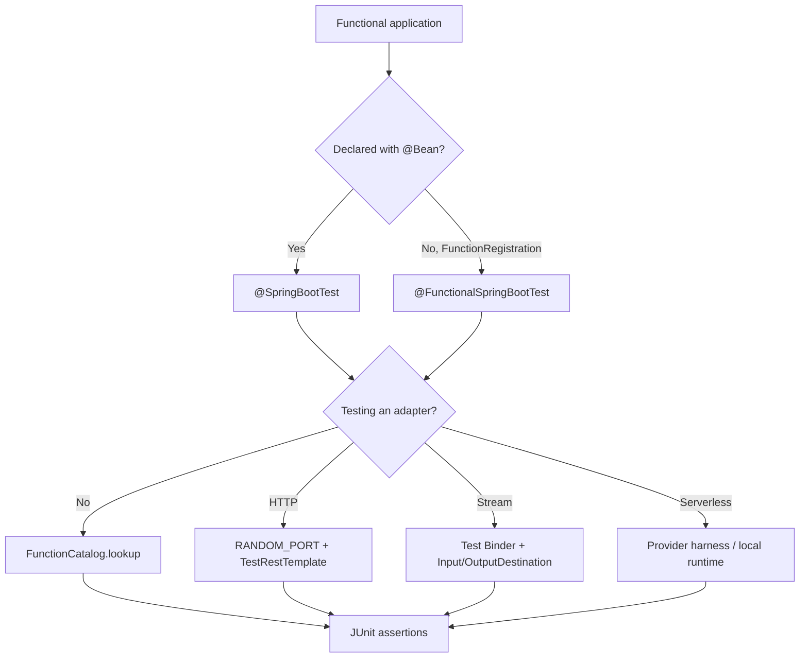

# Testing Functional Applications with Version-Appropriate Utilities

**Chapter:** Testing  
**Module:** Spring Cloud Function (`SPRING_CLOUD_FUNCTION`)

Spring Cloud Function lets you build applications from `Supplier`, `Function`, and `Consumer` functional beans and then run that same logic across multiple execution environments such as Java, HTTP, Spring Cloud Stream, or serverless. A solid test suite must verify not only the function's output, but also how Spring registers the function in the context, how `FunctionCatalog` resolves and wraps it, and how adapters pass data in and out.

Spring Cloud Function supports two declaration styles: **traditional Spring Boot beans** using `@Bean` and **functional bean definitions** using `FunctionRegistration` alongside `FunctionalSpringApplication`. These two styles initialize test contexts differently. For traditional beans, use `@SpringBootTest`; for functional bean definitions, Spring Cloud Function provides `@FunctionalSpringBootTest`. If the application exposes HTTP endpoints, add `TestRestTemplate` with a random-port server; if it uses Spring Cloud Stream, use the test binder and simulated destinations matching your version.

This lesson focuses on **selecting the right testing utilities for how your application is registered and which adapters it uses**. We write tests for `FunctionCatalog`, inspect function wrappers, functional bean definitions, the HTTP server, the Stream Test Binder, and serverless boundaries. Examples use JUnit 5, Spring Boot Test, and current Spring Cloud Function lines; no real broker or cloud deployment is required to test core logic.

## 1. Learning Objectives

After this lesson, you will be able to:

1. Distinguish plain Java function testing, Spring context testing, and adapter testing.
2. Choose `@SpringBootTest` for apps declaring functional beans with `@Bean`.
3. Choose `@FunctionalSpringBootTest` for apps using functional bean definitions/registrations.
4. Use `FunctionCatalog.lookup(...)` to test functions the way Spring Cloud Function resolves them.
5. Distinguish raw beans in `ApplicationContext` from function wrappers returned by `FunctionCatalog`.
6. Test HTTP applications with `@SpringBootTest(RANDOM_PORT)` and `TestRestTemplate`.
7. Test message handlers with the Spring Cloud Stream Test Binder, `InputDestination`, and `OutputDestination`.
8. Select APIs according to your Spring Cloud Function, Spring Boot, and Spring Cloud Stream versions.
9. Distinguish in-JVM logic tests from packaging, serverless adapter, and real deployment tests.
10. Avoid false-positive green tests caused by single-function fallback, wrong functional registration, wrong function definitions, or missing converters.

## 2. Choosing the Right Testing Layer

A functional application can be tested at several layers. Not every test needs to boot the entire Spring context or adapter stack.

| Layer | Appropriate Tool | What Is Verified |
| --- | --- | --- |
| Plain Java logic | JUnit 5 | Business rules of `Function.apply`, `Supplier.get`, `Consumer.accept` |
| Spring bean/context | `@SpringBootTest` | Bean creation, dependency injection, configuration |
| Functional bean definition | `@FunctionalSpringBootTest` | Functional registration and `FunctionCatalog` |
| Function wrapper | `FunctionCatalog.lookup(...)` | Type conversion, composition, and Spring Cloud Function wrapper |
| HTTP adapter | `RANDOM_PORT` + `TestRestTemplate` | Endpoint, method, headers, body, status, and serialization |
| Stream adapter | Test Binder + destinations | Binding, message conversion, output, and function definition |
| Serverless adapter | Adapter-specific harness/local runtime | Event envelope, handler, and provider serialization |
| Packaging/deployment | Artifact smoke test or staging environment | JAR/package, entry point, runtime config, and infrastructure |

**Selection principle:** test at the lowest layer capable of proving the contract of interest, then add boundary tests at adapters whenever data crosses a protocol.

```mermaid
flowchart TD
    A["What are you testing?"] --> B{"Pure business logic only?"}
    B -->|Yes| C["Plain Java JUnit 5"]
    B -->|No| D{"Need Spring bean / catalog?"}
    D -->|@Bean style| E["@SpringBootTest"]
    D -->|Functional bean registration| F["@FunctionalSpringBootTest"]
    E --> G{"Using an adapter?"}
    F --> G
    G -->|HTTP| H["RANDOM_PORT + TestRestTemplate"]
    G -->|Spring Cloud Stream| I["Test Binder + Input/OutputDestination"]
    G -->|Serverless| J["Adapter harness / local runtime"]
    G -->|No| K["FunctionCatalog lookup"]
```

Do not use one tool for every layer. For instance, `FunctionCatalog.lookup(...)` does not prove HTTP routes were exported; the Test Binder does not prove a real Kafka broker is configured properly; and testing a plain Java function does not prove Spring registered the right bean name.

## 3. Two Styles of Declaring a Functional Application

### 3.1. Traditional Beans with `@Bean`

This is the standard style in Spring Boot applications:

```java
@SpringBootApplication
public class SampleFunctionApplication {

    @Bean
    public Function<String, String> uppercase() {
        return value -> value.toUpperCase(Locale.ROOT);
    }
}
```

Spring Boot initializes the application context and registers beans, and Spring Cloud Function discovers `Supplier`, `Function`, and `Consumer` beans for `FunctionCatalog`.

With this style, tests typically start with:

```java
@SpringBootTest(
    classes = SampleFunctionApplication.class,
    webEnvironment = SpringBootTest.WebEnvironment.NONE
)
class SampleFunctionTest {
    // Inject FunctionCatalog and required dependencies.
}
```

### 3.2. Functional Bean Definitions with `FunctionRegistration`

Spring Cloud Function also supports a functional declaration style where the app registers functional beans directly with `GenericApplicationContext`. Input/output type metadata is supplied via `FunctionRegistration`:

```java
@SpringBootConfiguration
public class FunctionalSampleApplication
        implements ApplicationContextInitializer<GenericApplicationContext> {

    public Function<String, String> uppercase() {
        return value -> value.toUpperCase(Locale.ROOT);
    }

    @Override
    public void initialize(GenericApplicationContext context) {
        context.registerBean(
            "uppercase",
            FunctionRegistration.class,
            () -> new FunctionRegistration<>(uppercase())
                .type(FunctionTypeUtils.functionType(
                    String.class, String.class))
        );
    }
}
```

Key differences:

| Traditional Beans | Functional Bean Definitions |
| --- | --- |
| Uses `@SpringBootApplication` / `@Bean` | Uses `@SpringBootConfiguration` and an initializer or functional class |
| Spring Boot creates beans from configuration | Application explicitly calls `context.registerBean(...)` |
| Generics can often be inferred via bean method reflection | Type metadata should be registered explicitly via `FunctionRegistration.type(...)` |
| Test context typically uses `@SpringBootTest` | Test context provides `@FunctionalSpringBootTest` |

The functional style can reduce startup overhead in small apps. If you need extensive Spring Boot auto-configuration or datastore integrations, you can use hybrid configuration and re-enable auto-configuration per Spring Cloud Function docs. Do not switch to the functional style just to change a test annotation if the real application still uses traditional beans.

When switching to hybrid mode, verify your version's functional-mode settings carefully. Spring Cloud Function docs describe using `@EnableAutoConfiguration` when Boot integrations are needed; if Boot should drive initialization in a hybrid config, `spring.functional.enabled=false` may be required.

## 4. Choosing Utilities by Version

Testing APIs in Spring Cloud Function and Spring Cloud Stream evolve alongside their corresponding Spring Boot releases. Do not take an annotation or dependency from preview documentation and apply it to a stable release without checking your actual resolved artifacts.

| Scenario | Utility | Usage |
| --- | --- | --- |
| Spring Cloud Function bean style | `@SpringBootTest` | Builds context from `@SpringBootApplication` class |
| Spring Cloud Function functional bean style | `@FunctionalSpringBootTest` | Uses test context loader for functional definitions |
| HTTP integration test | `TestRestTemplate` | Uses `RANDOM_PORT` to call a real in-JVM server |
| Spring Cloud Stream stable docs | `TestChannelBinderConfiguration` | Imports test binder config, injects destinations |
| Spring Cloud Stream 5.1 preview docs | `@EnableTestBinder` | Use only if the API exists in your resolved dependency version |
| Legacy JUnit 4 project | `@RunWith(SpringRunner.class)` | Requires JUnit 4 Spring test runner |
| JUnit Jupiter | `@Test` + Spring Boot test annotation | Spring Boot annotations already integrate the extension |

### 4.1. Is `@FunctionalSpringBootTest` a Drop-In Replacement for Every `@SpringBootTest`?

No. `@FunctionalSpringBootTest` is designed for the functional bean definition style. It uses a dedicated test context loader to activate functional mode and register functions the way a functional application declares them. For regular `@Bean` applications, `@SpringBootTest` is the right choice.

Current Spring Cloud Function docs continue to document both approaches. `@FunctionalSpringBootTest` has existed since early Spring Cloud Function versions and remains used in the 5.0.x reference guide for functional bean definitions.

### 4.2. Checking Resolved Versions

Maven:

```bash
./mvnw dependency:tree -Dincludes=org.springframework.cloud:spring-cloud-function-context,org.springframework.cloud:spring-cloud-function-web,org.springframework.cloud:spring-cloud-stream
```

Gradle:

```bash
./gradlew dependencyInsight --dependency spring-cloud-function-context --configuration testRuntimeClasspath
```

When using the Stream Test Binder, also check:

```bash
./gradlew dependencyInsight --dependency spring-cloud-stream-test-binder --configuration testRuntimeClasspath
```

Match resolved dependencies against your project's Spring Cloud BOM and Spring Boot version. Do not force a newer version of `spring-cloud-function-context` or `spring-cloud-stream-test-binder` into an application using an older release train.

## 5. Dependencies for Functional Application Tests

When testing only `FunctionCatalog` in a Spring Boot app, the primary dependency is `spring-cloud-function-context`. To test HTTP or Stream, add the matching adapter or test binder.

**Maven** (POM excerpt, versions managed by BOM):

```xml
<dependencies>
    <dependency>
        <groupId>org.springframework.cloud</groupId>
        <artifactId>spring-cloud-function-context</artifactId>
    </dependency>

    <!-- Needed only when testing the HTTP adapter -->
    <dependency>
        <groupId>org.springframework.cloud</groupId>
        <artifactId>spring-cloud-function-web</artifactId>
    </dependency>
    <dependency>
        <groupId>org.springframework.boot</groupId>
        <artifactId>spring-boot-starter-web</artifactId>
        <scope>test</scope>
    </dependency>

    <!-- Used for JUnit 5 / Spring Boot integration tests -->
    <dependency>
        <groupId>org.springframework.boot</groupId>
        <artifactId>spring-boot-starter-test</artifactId>
        <scope>test</scope>
    </dependency>

    <!-- Needed only when testing Spring Cloud Stream -->
    <dependency>
        <groupId>org.springframework.cloud</groupId>
        <artifactId>spring-cloud-stream-test-binder</artifactId>
        <scope>test</scope>
    </dependency>
</dependencies>
```

**Gradle Kotlin DSL:**

```kotlin
dependencies {
    implementation("org.springframework.cloud:spring-cloud-function-context")

    // HTTP adapter tests
    testImplementation("org.springframework.cloud:spring-cloud-function-web")
    testImplementation("org.springframework.boot:spring-boot-starter-web")

    // Spring Boot / JUnit tests
    testImplementation("org.springframework.boot:spring-boot-starter-test")

    // Stream binder tests
    testImplementation("org.springframework.cloud:spring-cloud-stream-test-binder")
}

tasks.test {
    useJUnitPlatform()
}
```

In real projects, add only the dependencies required by that module's test layers. For example, a module using only `FunctionCatalog` does not need the HTTP adapter or Stream binder. When an app serves HTTP in production, `spring-cloud-function-web` and the web runtime must be on the runtime classpath, not only the test classpath.

## 6. Testing Traditional Beans with `@SpringBootTest`

We create an application with two functions to avoid false positives from single-function fallback:

**File:** `src/main/java/example/testing/SampleFunctionApplication.java`

```java
package example.testing;

import java.util.Locale;
import java.util.function.Function;

import org.springframework.boot.SpringApplication;
import org.springframework.boot.autoconfigure.SpringBootApplication;
import org.springframework.context.annotation.Bean;

@SpringBootApplication
public class SampleFunctionApplication {

    public static void main(String[] args) {
        SpringApplication.run(
            SampleFunctionApplication.class, args);
    }

    @Bean("uppercase")
    public Function<String, String> uppercase() {
        return value -> value.toUpperCase(Locale.ROOT);
    }

    @Bean("reverse")
    public Function<String, String> reverse() {
        return value -> new StringBuilder(value)
            .reverse().toString();
    }
}
```

**File:** `src/test/java/example/testing/FunctionCatalogSpringBootTest.java`

```java
package example.testing;

import static org.junit.jupiter.api.Assertions.*;

import java.util.Set;
import java.util.function.Function;

import org.junit.jupiter.api.Test;
import org.springframework.beans.factory.annotation.Autowired;
import org.springframework.boot.test.context.SpringBootTest;
import org.springframework.cloud.function.context.FunctionCatalog;

@SpringBootTest(
    classes = SampleFunctionApplication.class,
    webEnvironment = SpringBootTest.WebEnvironment.NONE
)
class FunctionCatalogSpringBootTest {

    @Autowired
    FunctionCatalog catalog;

    @Test
    void catalogContainsNamedFunctions() {
        Set<String> names = catalog.getNames(Function.class);

        assertTrue(names.contains("uppercase"));
        assertTrue(names.contains("reverse"));
    }

    @Test
    void lookupInvokesFunctionByItsName() {
        Function<String, String> uppercase =
            catalog.lookup(Function.class, "uppercase");

        assertNotNull(uppercase);
        assertEquals("HELLO", uppercase.apply("hello"));
    }

    @Test
    void catalogComposesFunctionsInDeclaredOrder() {
        Function<String, String> pipeline =
            catalog.lookup(
                Function.class, "uppercase|reverse");

        assertNotNull(pipeline);
        assertEquals("OLLEH", pipeline.apply("hello"));
    }
}
```

### 6.1. Why Does the Context Test Use `WebEnvironment.NONE`?

This test only needs a Spring context to register beans and populate `FunctionCatalog`. Without HTTP requirements, starting a web server is unnecessary. Using `NONE` keeps tests fast and matches the target scope.

### 6.2. Why Check `getNames` Before or Alongside `lookup`?

When the catalog contains only one eligible functional bean, some Spring Cloud Function configurations allow lookups with mismatched names via fallback. Checking only `lookup(...) != null` could pass even if a bean name is misspelled.

In a multi-function fixture, asserting `catalog.getNames(Function.class)` confirms the exact registered names. For apps with multiple functional kinds, check `Supplier.class` and `Consumer.class` as well.

### 6.3. Looking Up via Catalog Differs from Direct Bean Injection

You can inject the raw bean:

```java
@Autowired
@Qualifier("uppercase")
Function<String, String> rawFunction;
```

or retrieve the wrapper:

```java
Function<String, String> catalogFunction =
    catalog.lookup(Function.class, "uppercase");
```

The direct bean is the implementation declared by your application. The function retrieved from `FunctionCatalog` is instrumented/wrapped by Spring Cloud Function to support type conversion, composition, and framework features. Thus:

- Direct bean unit tests are great for Java business logic.
- Catalog tests verify how the framework resolves and invokes the function.
- Never assert that both objects must share the same reference identity or exact class.

## 7. Testing Functional Bean Definitions with `@FunctionalSpringBootTest`

When an application registers functions via `FunctionRegistration`, tests should use the test context loader built for functional mode.

**File:** `src/main/java/example/testing/FunctionalSampleApplication.java`

```java
package example.testing;

import java.util.Locale;
import java.util.function.Function;

import org.springframework.boot.SpringBootConfiguration;
import org.springframework.cloud.function.context.FunctionRegistration;
import org.springframework.cloud.function.context.FunctionTypeUtils;
import org.springframework.cloud.function.context.FunctionalSpringApplication;
import org.springframework.context.ApplicationContextInitializer;
import org.springframework.context.support.GenericApplicationContext;

@SpringBootConfiguration
public class FunctionalSampleApplication
        implements ApplicationContextInitializer<GenericApplicationContext> {

    public static void main(String[] args) {
        FunctionalSpringApplication.run(
            FunctionalSampleApplication.class, args);
    }

    private Function<String, String> uppercase() {
        return value -> value.toUpperCase(Locale.ROOT);
    }

    @Override
    public void initialize(GenericApplicationContext context) {
        context.registerBean(
            "uppercase",
            FunctionRegistration.class,
            () -> new FunctionRegistration<>(uppercase())
                .type(FunctionTypeUtils.functionType(
                    String.class, String.class))
        );
    }
}
```

**File:** `src/test/java/example/testing/FunctionalDefinitionTest.java`

```java
package example.testing;

import static org.junit.jupiter.api.Assertions.*;

import java.util.Set;
import java.util.function.Function;

import org.junit.jupiter.api.Test;
import org.springframework.beans.factory.annotation.Autowired;
import org.springframework.cloud.function.context.FunctionCatalog;
import org.springframework.cloud.function.context.test.FunctionalSpringBootTest;

@FunctionalSpringBootTest(
    classes = FunctionalSampleApplication.class
)
class FunctionalDefinitionTest {

    @Autowired
    FunctionCatalog catalog;

    @Test
    void functionalRegistrationAppearsInCatalog() {
        Set<String> names = catalog.getNames(Function.class);
        assertTrue(names.contains("uppercase"));
    }

    @Test
    void functionalRegistrationCanBeLookedUpAndInvoked() {
        Function<String, String> function =
            catalog.lookup(Function.class, "uppercase");

        assertNotNull(function);
        assertEquals("HELLO", function.apply("hello"));
    }
}
```

### 7.1. Role of `@FunctionalSpringBootTest`

`@FunctionalSpringBootTest` is a utility provided by Spring Cloud Function in package:

```java
org.springframework.cloud.function.context.test.FunctionalSpringBootTest
```

It uses a test context loader for functional applications and enables functional mode appropriately. Ordinary test utilities such as `@Autowired`, JUnit, and `FunctionCatalog` work just like in Spring Boot Test.

In its annotation API, it integrates with Spring Boot Test and the functional test context loader; thus, it is not a standalone test runner. Historical API docs note this annotation since Spring Cloud Function 2.0, and the 5.0.x reference guide still uses it for functional bean definitions. Always check your current artifact if using an older release or custom dependency set.

### 7.2. When Not to Use This Annotation

If the application simply declares:

```java
@Bean
Function<String, String> uppercase() {
    return value -> value.toUpperCase(Locale.ROOT);
}
```

then use `@SpringBootTest`. Do not replace every test with `@FunctionalSpringBootTest` merely because the app uses functional interfaces. The word "functional" in this annotation refers to **functional bean definition mode**, not simply that a bean has type `Function`.

### 7.3. Type Metadata Is Part of Functional Registration

In functional bean definitions, the framework cannot always infer generics the way it can from a `@Bean` method. Therefore, `FunctionRegistration.type(...)` supplies input/output metadata:

```java
.type(FunctionTypeUtils.functionType(
    OrderRequest.class, OrderResult.class))
```

If metadata is missing or wrong, lookup tests may still pass while conversion or composition fails on real payloads. Add typed input/output tests rather than checking only the bean name.

## 8. Testing HTTP Functional Applications

When verifying that a function is exposed as an HTTP endpoint, use Spring Cloud Function Web with Spring MVC. For bean-style apps, tests use `@SpringBootTest`; for functional bean definitions, Spring Cloud Function docs illustrate `@FunctionalSpringBootTest` with `TestRestTemplate`.

**Additional dependencies for HTTP testing:**

```xml
<dependency>
    <groupId>org.springframework.cloud</groupId>
    <artifactId>spring-cloud-function-web</artifactId>
</dependency>
<dependency>
    <groupId>org.springframework.boot</groupId>
    <artifactId>spring-boot-starter-web</artifactId>
    <scope>test</scope>
</dependency>
```

Example test for bean style:

**File:** `src/test/java/example/testing/HttpFunctionIntegrationTest.java`

```java
package example.testing;

import static org.junit.jupiter.api.Assertions.*;

import java.net.URI;

import org.junit.jupiter.api.Test;
import org.springframework.beans.factory.annotation.Autowired;
import org.springframework.boot.test.context.SpringBootTest;
import org.springframework.boot.test.web.client.TestRestTemplate;
import org.springframework.http.HttpStatus;
import org.springframework.http.MediaType;
import org.springframework.http.RequestEntity;
import org.springframework.http.ResponseEntity;

@SpringBootTest(
    classes = SampleFunctionApplication.class,
    webEnvironment = SpringBootTest.WebEnvironment.RANDOM_PORT
)
class HttpFunctionIntegrationTest {

    @Autowired
    TestRestTemplate rest;

    @Test
    void httpRequestInvokesFunctionAndReturnsResponse() {
        RequestEntity<String> request =
            RequestEntity.post(URI.create("/uppercase"))
                .contentType(MediaType.TEXT_PLAIN)
                .accept(MediaType.TEXT_PLAIN)
                .body("hello");

        ResponseEntity<String> response =
            rest.exchange(request, String.class);

        assertEquals(HttpStatus.OK, response.getStatusCode());
        assertEquals("HELLO", response.getBody());
    }
}
```

### 8.1. HTTP Tests for Functional Bean Definitions

For the functional app in Section 7, you can follow the same HTTP testing model:

```java
package example.testing;

import static org.junit.jupiter.api.Assertions.*;

import org.junit.jupiter.api.Test;
import org.springframework.beans.factory.annotation.Autowired;
import org.springframework.boot.test.context.SpringBootTest;
import org.springframework.boot.test.web.client.TestRestTemplate;
import org.springframework.http.HttpStatus;
import org.springframework.http.ResponseEntity;
import org.springframework.cloud.function.context.test.FunctionalSpringBootTest;

@FunctionalSpringBootTest(
    classes = FunctionalSampleApplication.class,
    webEnvironment = SpringBootTest.WebEnvironment.RANDOM_PORT
)
class FunctionalHttpIntegrationTest {

    @Autowired
    TestRestTemplate rest;

    @Test
    void functionalRegistrationIsAvailableThroughHttp() {
        ResponseEntity<String> response =
            rest.postForEntity(
                "/uppercase", "hello", String.class);

        assertEquals(HttpStatus.OK, response.getStatusCode());
        assertEquals("HELLO", response.getBody());
    }
}
```

This test assumes the HTTP dependencies above are on the test runtime classpath. If your project's `@FunctionalSpringBootTest` version does not accept `webEnvironment` or does not spin up a web context in that configuration, check the Javadoc for your exact version; you can use `@SpringBootTest` with functional configuration loaded properly. Do not invent annotations absent from your artifacts.

### 8.2. Why Use `RANDOM_PORT`?

`RANDOM_PORT` starts a real embedded server on an ephemeral port. Tests hit the server via an HTTP client and verify the full path from request to function to response. This differs from MockMvc/WebTestClient tests using a mock web environment; the two options serve different purposes.

Do not use `@SpringBootTest(RANDOM_PORT)` when you only want to test logic or `FunctionCatalog`. Starting a web server slows tests down and increases the number of moving parts.

## 9. Testing Spring Cloud Stream with the Test Binder

Spring Cloud Stream uses Spring Cloud Function functional beans to process messages over binders. To verify bindings, message conversion, and outputs without connecting to a real Kafka/RabbitMQ broker, use the **Spring Integration Test Binder**.

**Test dependency:**

```xml
<dependency>
    <groupId>org.springframework.cloud</groupId>
    <artifactId>spring-cloud-stream-test-binder</artifactId>
    <scope>test</scope>
</dependency>
```

In current stable docs, configuration typically uses `@Import(TestChannelBinderConfiguration.class)` alongside `InputDestination` and `OutputDestination`.

**File:** `src/test/java/example/testing/StreamFunctionIntegrationTest.java`

```java
package example.testing;

import static org.junit.jupiter.api.Assertions.*;

import java.nio.charset.StandardCharsets;

import org.junit.jupiter.api.Test;
import org.springframework.beans.factory.annotation.Autowired;
import org.springframework.boot.test.context.SpringBootTest;
import org.springframework.context.annotation.Import;
import org.springframework.messaging.Message;
import org.springframework.messaging.support.GenericMessage;
import org.springframework.cloud.stream.binder.test.InputDestination;
import org.springframework.cloud.stream.binder.test.OutputDestination;
import org.springframework.cloud.stream.binder.test.TestChannelBinderConfiguration;

@SpringBootTest(
    classes = SampleFunctionApplication.class,
    properties = "spring.cloud.function.definition=uppercase"
)
@Import(TestChannelBinderConfiguration.class)
class StreamFunctionIntegrationTest {

    @Autowired
    InputDestination input;

    @Autowired
    OutputDestination output;

    @Test
    void inputMessageIsProcessedAndPublishedToOutput() {
        byte[] payload =
            "hello".getBytes(StandardCharsets.UTF_8);
        input.send(new GenericMessage<>(payload));

        Message<byte[]> result = output.receive();

        assertNotNull(result);
        assertArrayEquals(
            "HELLO".getBytes(StandardCharsets.UTF_8),
            result.getPayload());
    }
}
```

### 9.1. What Does the Test Binder Verify?

- The function definition is selected and bindings are created.
- Messages enter the input destination.
- The framework converts payloads into the function's input type based on content type.
- Outputs are sent to the output destination.
- Message headers and payloads can be inspected after processing.

The Test Binder is an in-JVM broker backed by Spring Integration. It is ideal for testing your app as a Spring Cloud Stream application without real middleware.

### 9.2. Test Binder APIs Change Across Releases

Never copy annotations from preview docs into a stable project:

| Doc Line / API | Typical Configuration |
| --- | --- |
| Stable Spring Cloud Stream docs | `spring-cloud-stream-test-binder` dependency + `@Import(TestChannelBinderConfiguration.class)` |
| Functional binding test API | `InputDestination` and `OutputDestination` |
| Spring Cloud Stream 5.1 preview docs | Shows `@EnableTestBinder` |
| Legacy channel-API projects | May use `MessageCollector` or older test binder APIs; check exact release docs |

If compilation cannot find `@EnableTestBinder`, do not invent a stub annotation. Use the test binder API actually present in your resolved dependency. Conversely, if your project uses a release that provides that annotation, follow the guide for that release line.

### 9.3. Testing Explicitly Named Destinations

When multiple functions/bindings exist, avoid relying on default destinations if a test must prove a specific function ran. Send and receive by binding name:

```java
input.send(message, "uppercase-in-0");
Message<byte[]> result =
    output.receive(0, "uppercase-out-0");
```

Binding names typically follow `<functionName>-in-0` and `<functionName>-out-0`; if custom destination names are configured, pass the destination name instead of the binding name. Verify binding names against your configuration and version docs.

### 9.4. The Test Binder Does Not Replace a Real Broker

The Test Binder does not verify:

- Broker connections, credentials, TLS, or networking.
- Consumer groups, partition assignments, rebalances, and offsets.
- Broker-level retries/DLQs, acknowledgments, and real Kafka/RabbitMQ semantics.
- Serialization configured on a specific production broker or binder.

When you need to verify these, write separate integration tests against real middleware or a staging environment. Spring Cloud Stream docs also warn against mixing the test binder and a real middleware binder in the same test module when they compete for default binder configuration; separate those test groups appropriately.

### 9.5. Why Specify the Function Definition?

In an example with multiple functions, the property:

```properties
spring.cloud.function.definition=uppercase
```

explicitly selects which function is bound. With multiple functions and no definition specified, the framework may not know which function to bind or may apply version-dependent default selection rules. Always specify the definition in tests for unambiguous results.

### 9.6. Isolating the Test Binder from Real Broker Tests

The Test Binder runs in-JVM. If both the test binder and a Kafka/RabbitMQ binder are on the same module's classpath, the Test Binder can take over as the default binder for tests. For tests targeting real middleware, exclude/configure the test binder properly or split modules/test suites so messages are never silently routed to in-memory channels when you think you are testing a broker.

## 10. Testing Serverless Applications by Adapter

Spring Cloud Function decouples business functions from runtimes. However, when packaging for serverless, the adapter translates cloud-provider events into function inputs and turns outputs back into provider responses/events.

For instance, AWS Lambda uses the generic handler:

```text
org.springframework.cloud.function.adapter.aws.FunctionInvoker
```

This adapter connects AWS Lambda requests/events to functions inside the Spring context. When an app has multiple functions, selection happens via `spring.cloud.function.definition` or an appropriate routing mechanism.

### 10.1. Three Serverless Test Groups

| Group | Tool | Goal |
| --- | --- | --- |
| Business function | JUnit 5 + `FunctionCatalog` | Business logic and outputs |
| Adapter/event mapping | Provider-specific test harness or local runtime | Event envelope, headers, serialization, and handler |
| Package/deployment smoke test | Built artifact + local provider runtime/staging | Manifest, entry point, dependency packaging, and runtime config |

### 10.2. You Do Not Need Real Cloud Calls to Test Everything

Catalog tests need no AWS/Azure/GCP credentials. Business logic and function definitions can be tested in-JVM. When testing adapters, use provider-shaped event fixtures or local runtimes/harnesses. Only run real cloud deployment tests in integration/staging environments to verify IAM permissions, triggers, networking, timeouts, and cloud settings.

### 10.3. Example AWS Testing Workflow

1. Unit test business functions with JUnit.
2. Spring context test: `catalog.lookup(...)` returns the right function.
3. Adapter test: feed a sample AWS event and check output/exceptions per the adapter.
4. Packaging test: verify the Lambda artifact contains the required adapter and sets handler entry point to `FunctionInvoker`.
5. Staging smoke test: invoke the deployed Lambda with a safe test event.

Never treat a passing `FunctionCatalog.lookup(...)` test as proof that the JAR is properly packaged for Lambda. Likewise, do not use the Stream Test Binder to prove serverless event envelopes map properly.

## 11. Testing Each Functional Kind

A functional application can register `Supplier`, `Function`, and `Consumer`. Tests must call the right method and verify the right outcome type.

| Functional Bean | Java Invocation | What to Assert |
| --- | --- | --- |
| `Supplier<O>` | `get()` | Produced value or returned stream |
| `Function<I,O>` | `apply(input)` | Output matching input |
| `Consumer<I>` | `accept(input)` | Side effect or collaborator invocation |
| `Function<Flux<I>,Flux<O>>` | `apply(flux)` then subscribe | Publisher signals and elements |
| `Function<Mono<I>,Mono<O>>` | `apply(mono)` then subscribe | Value, empty, or error signal |

Consumer example:

```java
@Bean
Consumer<String> audit(AuditRecorder recorder) {
    return recorder::record;
}
```

In tests, inject a fake `AuditRecorder` and assert recorded entries. Never expect `Consumer.accept(...)` to return a business value.

For reactive functions, test publishers with `StepVerifier` instead of calling `block()` inside tests; that topic is covered in detail in the `Mono`/`Flux` testing lesson.

## 12. Inspecting `FunctionCatalog` and Metadata

`FunctionCatalog` is the entry point for finding functional beans by name and obtaining wrappers managed by Spring Cloud Function.

```java
FunctionCatalog catalog = /* injected from Spring context */;

Set<String> allNames = catalog.getNames(null);
Function<String, String> uppercase =
    catalog.lookup(Function.class, "uppercase");
```

Tests should cover:

1. Function names appear in the catalog.
2. Lookup by kind and name returns a function.
3. Invoking the wrapper produces expected outputs.
4. Composition resolves in the right order when used.
5. For DTO/`Message` functions, conversion and headers are tested appropriately.

### 12.1. Why Does Looking Up the Wrapper Matter?

Fetching a bean directly from `ApplicationContext` gives you the raw implementation as declared. Looking up via the catalog returns an instrumented wrapper supporting type conversion, composition, and Spring Cloud Function features.

Thus, two tests serve different purposes:

| Check | How Written | Goal |
| --- | --- | --- |
| Pure logic | `rawFunction.apply("hello")` | Verifies business implementation |
| Function framework | `catalog.lookup(...).apply(...)` | Verifies catalog and wrapper |
| HTTP | Sends request to endpoint | Verifies web adapter |
| Stream | Sends message via Test Binder | Verifies binding and message adapter |

Do not assume a raw-bean test proves JSON conversion or catalog composition works.

### 12.2. Watch Out for Single-Function Fallback

In a context with only one eligible functional bean, Spring Cloud Function may allow lookups with arbitrary or empty names via catalog fallback. Therefore, a negative wrong-name test should not write only:

```java
assertNotNull(catalog.lookup(Function.class, "wrongName"));
```

Instead, inspect the name set:

```java
assertTrue(
    catalog.getNames(Function.class).contains("uppercase"));
assertFalse(
    catalog.getNames(Function.class).contains("wrongName"));
```

When verifying that an unknown name fails lookup, build fixtures with multiple eligible functions or check the name set first. Never let fallback turn a failing condition into a false green test.

## 13. Test Configuration and Isolating Spring Contexts

Functional application tests commonly depend on:

- Which functional beans are registered.
- Which function definition is selected.
- Whether functional mode is enabled.
- Which Web/Stream adapters are on the classpath.
- Which profiles or properties are loaded.

Declare configuration directly on the test class or in test configuration so results stay repeatable.

### 13.1. Setting `function.definition` in Test Properties

```java
@SpringBootTest(
    classes = SampleFunctionApplication.class,
    properties = {
        "spring.cloud.function.definition=uppercase"
    },
    webEnvironment = SpringBootTest.WebEnvironment.NONE
)
class SelectedFunctionTest {
    // Inject FunctionCatalog or binder destinations.
}
```

This works well when an app defines multiple functions and a test focuses on just one. Never mutate `System.setProperty(...)` between tests expecting an already-initialized Spring context to reload properties automatically.

### 13.2. Using `@TestConfiguration` for Collaborators

If a function depends on a repository, clock, or client, inject a fake/mock test bean instead of a live connection. For example:

```java
@TestConfiguration(proxyBeanMethods = false)
class FunctionTestConfig {

    @Bean
    Clock testClock() {
        return Clock.fixed(
            Instant.parse("2026-01-01T00:00:00Z"),
            ZoneOffset.UTC);
    }
}
```

Test configurations can be loaded with `@Import(FunctionTestConfig.class)`. Keep test fixtures scoped to the test classes needing them; avoid leaking fakes into production application configs.

### 13.3. Avoiding Shared Mutable State Across Tests

If a function holds state or a test recorder stores events, reset state in `@BeforeEach` or create a fresh fixture per test. Spring Test caches contexts, so singleton beans can survive across multiple test methods.

Never store test results in static fields across tests. When parallel execution is enabled, two tests sharing a singleton recorder can interleave writes and produce flaky results. Separate contexts or synchronize/isolate test resources appropriately.

### 13.4. JUnit 4 vs. JUnit Jupiter

With JUnit Jupiter, Spring Boot Test annotations already include the Spring Extension; explicitly declaring `@ExtendWith(SpringExtension.class)` is normally unnecessary.

For legacy JUnit 4 projects, Spring tests require:

```java
@RunWith(SpringRunner.class)
@SpringBootTest(classes = SampleFunctionApplication.class)
public class LegacyFunctionTest {
    // JUnit 4 test methods
}
```

Do not mix JUnit 4 and JUnit 5 annotations arbitrarily. Verify which test engine is on your dependencies and match the syntax to your test runtime.

## 14. Utility Selection Matrix by Application Type

| Declaration Style / Adapter | Test Context | Primary Tool | Assertions |
| --- | --- | --- | --- |
| Plain Java function | No Spring needed | JUnit 5 | Input/output and side effects |
| `@Bean Function` | `@SpringBootTest` | `FunctionCatalog` | Name, lookup, wrapper, output |
| Functional bean registration | `@FunctionalSpringBootTest` | `FunctionCatalog` | Registration, metadata, output |
| Bean style + HTTP | `@SpringBootTest(RANDOM_PORT)` | `TestRestTemplate` | Status, body, headers |
| Functional style + HTTP | `@FunctionalSpringBootTest(RANDOM_PORT)` if supported | `TestRestTemplate` | Endpoint and response |
| Stream function | `@SpringBootTest` + Test Binder | `InputDestination` / `OutputDestination` | Input/output messages, binding |
| Reactive function | Context test or direct function | `StepVerifier` | Signals, errors, completion |
| Serverless | Context test + adapter harness | Provider-specific fixture | Event mapping and handler |
| Packaged artifact | Smoke test outside unit suite | Local runtime / staging | Entry point, packaging, runtime |

### 14.1. Quick Decision Tree



## 15. Troubleshooting Functional Application Tests

| Symptom | Possible Cause | Remediation |
| --- | --- | --- |
| `@FunctionalSpringBootTest` cannot find app | Missing or wrong functional config class | Specify `classes=...` and check initializer |
| Using `@FunctionalSpringBootTest` but `@Bean` beans do not load as expected | Wrong test loader for bean style | Use `@SpringBootTest` for traditional bean apps |
| `FunctionCatalog.lookup(...)` returns null | Bean unregistered or wrong name | Check `getNames(...)` and functional registration |
| Wrong-name lookup still returns function | Single-function fallback | Check name list and multi-function fixture |
| Catalog lookup succeeds but conversion fails | Missing generic metadata or converter | Check signature, `FunctionRegistration.type(...)`, content type |
| Direct function works, catalog test differs | Catalog wrapper/conversion/composition | Compare raw bean against catalog wrapper |
| HTTP test returns 404 | Missing Web adapter or function not exported | Check `spring-cloud-function-web`, path, and definition |
| HTTP test does not start server | Wrong web dependency or `webEnvironment` | Check MVC/WebFlux and `RANDOM_PORT` |
| Test Binder yields no output | Missing `function.definition`/binding or wrong destination | Check `spring.cloud.function.definition` and binding name |
| `@EnableTestBinder` not found | Using preview annotation on stable release | Use the test binder API in your resolved version |
| Test Binder passes, real Kafka fails | Test binder does not test network/broker | Write integration tests with a real broker |
| Serverless test passes, deploy fails | Artifact/handler/runtime untested | Add packaging smoke test and provider staging test |
| Flaky test results | Singleton state or parallel test interference | Reset state, isolate contexts, or synchronize |

### 15.1. When `lookup` Returns `null`

Check in order:

1. Did the application context initialize the expected configuration?
2. Is the bean truly a `Supplier`, `Function`, or `Consumer`?
3. Does the functional registration provide the right name and metadata?
4. Was the bean filtered by configuration or ineligible for the catalog?
5. Did the test query the right lookup kind (`Function`/`Supplier`/`Consumer`)?

### 15.2. When the Context Fails to Start

Do not rush to swap annotations. Read the root cause first:

- Does the functional app class have `@SpringBootConfiguration` and an initializer?
- Does `FunctionalSpringApplication.run(...)` reference the right class?
- Is the test mixing `@SpringBootTest` and `@FunctionalSpringBootTest` on the same fixture?
- Are Spring Boot and Spring Cloud Function dependencies aligned via the same BOM?
- Is required auto-configuration missing because functional mode disabled it?

## 16. Practice Exercises

1. **Bean style:** write a `Function<String,String>` and test it with `@SpringBootTest` + `FunctionCatalog.lookup(...)`.
2. **Functional registration:** register the same function using `FunctionRegistration`, then move the test to `@FunctionalSpringBootTest`.
3. **Metadata:** change the function to `Function<OrderRequest,OrderResult>` and declare types with `FunctionTypeUtils.functionType(...)`.
4. **Bad metadata:** remove or alter the type metadata; observe lookup or conversion errors and explain the root cause.
5. **Composition:** register two functions and test `normalize|uppercase` through the catalog.
6. **Supplier/Consumer:** register a supplier and a consumer, verifying `get()` and the side effects of `accept(...)`.
7. **HTTP:** add `spring-cloud-function-web`, launch a random-port server, and test endpoints with `TestRestTemplate`.
8. **Stream:** add the Test Binder, send a message through `InputDestination`, and inspect `OutputDestination`.
9. **Named destinations:** customize binding destinations in properties and update the test to use the exact destination names.
10. **Version API:** inspect your project's Stream Test Binder version; note whether it supports `@Import(TestChannelBinderConfiguration.class)` or `@EnableTestBinder`.
11. **Reactive:** test a `Flux`-returning function using `StepVerifier` instead of `block()`.
12. **Serverless:** build an AWS/Azure/GCP event fixture and test adapter mapping without deploying to the cloud.
13. **Packaging:** build the adapter artifact and write a smoke test verifying the handler/entry point.
14. **Isolation:** run tests in parallel against a shared recorder, observe race conditions, and then isolate the fixture.

### Interview Questions

**Q:** When do you use `@FunctionalSpringBootTest` instead of `@SpringBootTest`?

**A:** Use `@FunctionalSpringBootTest` when an application declares functional beans via Spring Cloud Function's functional bean definition/registration style. For Spring Boot applications declaring beans with `@Bean`, use `@SpringBootTest`.

**Q:** Why test functions through `FunctionCatalog` instead of fetching beans directly?

**A:** The catalog returns a function wrapper instrumented by Spring Cloud Function that provides type conversion and composition. Fetching the bean directly only tests your raw implementation.

**Q:** Why check `getNames(...)` before concluding a wrong-name lookup failed or succeeded?

**A:** Single-function fallback can make a lookup with an unrecognized name return the sole eligible function. Inspecting the catalog's name list catches false-positive tests.

**Q:** Does the Test Binder prove production Kafka works?

**A:** No. The Test Binder uses in-JVM Spring Integration channels. It tests function bindings and message flow, not brokers, networking, TLS, partitions, consumer groups, or offsets.

**Q:** Why does serverless testing need an extra adapter harness?

**A:** `FunctionCatalog` tests only verify the function inside the Spring context. An adapter harness verifies provider-specific event envelopes, serialization, and handler mapping; packaging/staging tests verify the built artifact and real runtime.

## 17. Summary

- Choose test utilities according to **functional bean declaration style**: `@SpringBootTest` for traditional beans, `@FunctionalSpringBootTest` for functional bean definitions.
- Use `FunctionCatalog.lookup(...)` to test wrappers and names the way Spring Cloud Function resolves them; inspect `getNames(...)` to prevent single-function fallback false positives.
- Use `RANDOM_PORT` + `TestRestTemplate` to verify HTTP adapters; use Test Binder + destinations to verify Spring Cloud Stream.
- Test Binder APIs evolve across releases; stable and preview docs may use different annotations. Always check resolved dependencies.
- The Test Binder does not replace a real broker; context tests do not replace HTTP/Stream/serverless adapter tests; function tests do not replace packaging smoke tests.
- For reactive functions, verify publishers with `StepVerifier`; for `Consumer`, verify side effects rather than outputs.
- Isolate contexts and state between tests, manage dependencies with a BOM, and keep test configurations explicit.

### References

- [Spring Cloud Function — Functional Bean Definitions / Testing Functional Applications](https://docs.spring.io/spring-cloud-function/reference/functional.html): `@FunctionalSpringBootTest`, `@SpringBootTest`, `FunctionCatalog`, and functional bean registration.
- [Spring Cloud Function — Programming Model](https://docs.spring.io/spring-cloud-function/reference/spring-cloud-function.html): `FunctionCatalog`, function wrappers, type conversion, composition, and adapters.
- [Spring Boot — Testing Spring Boot Applications](https://docs.spring.io/spring-boot/reference/testing/spring-boot-applications.html): `@SpringBootTest`, context loading, and web environments.
- [Spring Cloud Stream — Testing](https://docs.spring.io/spring-cloud-stream/reference/spring-cloud-stream.html): Spring Integration Test Binder, `TestChannelBinderConfiguration`, `InputDestination`, and `OutputDestination`.
- [Spring Cloud Stream 5.1 Preview — Test Binder](https://docs.spring.io/spring-cloud-stream/reference/5.1/spring-cloud-stream/spring_integration_test_binder.html): reference for preview APIs such as `@EnableTestBinder`.
- [Spring Cloud Function — AWS Lambda Adapter](https://docs.spring.io/spring-cloud-function/reference/adapters/aws-intro.html): `FunctionInvoker`, handlers, and function definitions in AWS Lambda.
