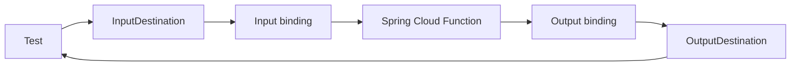
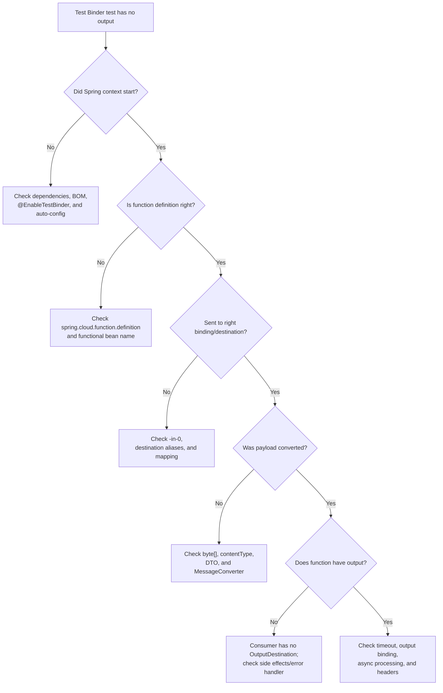

# Testing Binders with Spring Cloud Stream Test Binder

**Chapter:** Testing  
**Module:** Spring Cloud Function (`SPRING_CLOUD_FUNCTION`)

Spring Cloud Function lets you write business logic with `Supplier`, `Function`, and `Consumer`. When functions connect to messaging systems, Spring Cloud Stream binds function inputs and outputs to external destinations through a binder. To test message-driven applications without installing Kafka, RabbitMQ, or connecting to a real broker, Spring Cloud Stream provides the **Spring Integration Test Binder**.

The Test Binder runs inside the JVM and simulates destinations using Spring Integration channels. Tests can send a `Message<?>` into `InputDestination`, let the framework invoke the function, and read output messages from `OutputDestination`. This covers much of the in-app message path: bindings, function selection, conversion, headers, and output. It bridges unit tests and full integration tests without requiring networking or real middleware.

This lesson walks through configuring dependencies, enabling the Test Binder per version API, testing single-input/single-output functions, multiple functions and custom destinations, verifying payloads/headers/content types, testing consumers and suppliers, async messages, pollable sources, and the boundaries between the Test Binder and real brokers. We also distinguish the modern Test Binder from the legacy `TestSupportBinder`, and identify scenarios requiring separate integration tests.

## 1. Learning Objectives

After this lesson, you will be able to:

1. Explain the role of binders in Spring Cloud Stream.
2. Distinguish the modern Test Binder from the legacy `TestSupportBinder`.
3. Add the `spring-cloud-stream-test-binder` dependency in the proper scope.
4. Enable the Test Binder using the API matching your Spring Cloud Stream version.
5. Send and receive messages via `InputDestination` and `OutputDestination`.
6. Test function definitions, binding names, and custom destinations.
7. Verify payloads, content types, headers, and conversions.
8. Test functions, consumers, suppliers, and reactive functions at the binder boundary.
9. Test multiple functions and bindings within a single application.
10. Recognize Test Binder limits regarding brokers, partitions, consumer groups, retries, DLQs, and networking.

## 2. What Are Binders and the Test Binder?

Spring Cloud Stream provides a message-driven programming model built on Spring Cloud Function functional beans. A function connects to input/output bindings; the binder connects those bindings to middleware such as Kafka or RabbitMQ.

Example:

```text
Kafka topic / Rabbit exchange
          |
          v
     Input binding
          |
          v
    Function<String,String>
          |
          v
     Output binding
          |
          v
Kafka topic / Rabbit exchange
```

In production, a concrete binder talks to a broker. In tests, the **Spring Integration Test Binder** replaces the broker with in-JVM channels:



The Test Binder is built on Spring Integration and acts as an in-memory message broker. It lets you test an application through Spring Cloud Stream abstractions without a real broker. This tests application/binding behavior inside the JVM; it does not emulate every operational behavior of Kafka or RabbitMQ.

### 2.1. Modern Test Binder vs. Legacy `TestSupportBinder`

Two similarly named libraries have different APIs:

| Aspect | Spring Integration Test Binder | Legacy `TestSupportBinder` |
| --- | --- | --- |
| Dependency | `spring-cloud-stream-test-binder` | `spring-cloud-stream-test-support` |
| How tested | `InputDestination` / `OutputDestination` | Bound channels / `MessageCollector` |
| Goal | Closer to real binder API and integration flow | Lightweight check of messaging components |
| Recommendation | Use for modern applications | Use only when maintaining legacy apps |

**Do not add both dependencies to the same test suite out of habit.** They have different auto-configurations and interaction models. If a legacy project still uses `TestSupportBinder`, keep tests aligned with the current release and plan migration separately.

### 2.2. What Can the Test Binder Verify?

- Function definition selection and binding creation.
- Messages sent into the right input destination.
- Payload conversion into the functional bean's input type per data type/content type.
- Function or consumer processing of the message.
- Output messages delivered to the output destination.
- Processed payload and headers matching the contract.

The Test Binder **does not** verify broker connectivity, TLS, credentials, partitions, consumer groups, rebalances, offsets, or networking. Those require integration tests with production binders and real brokers.

## 3. Selecting the API by Spring Cloud Stream Version

The API for enabling the Test Binder has evolved across releases. When writing tests, check the docs matching your resolved dependency.

| Release Line | Typical Configuration | Notes |
| --- | --- | --- |
| Spring Cloud Stream 5.1.x | `@EnableTestBinder` | Newer API used in current docs on test classes |
| Spring Cloud Stream 4.3.x | `@EnableTestBinder` | Similar examples in 4.3 reference |
| Some older lines | `@Import(TestChannelBinderConfiguration.class)` or `getCompleteConfiguration(...)` | Follow matching release docs |
| Very old Spring Cloud Stream | `spring-cloud-stream-test-support` + `MessageCollector` | Legacy `TestSupportBinder` API |

Current stable docs show `@EnableTestBinder` with `@SpringBootTest`, `InputDestination`, and `OutputDestination`. Some older docs/apps use `@Import(TestChannelBinderConfiguration.class)`. Do not copy an old-example annotation into a new project when a cleaner activation exists; conversely, do not use `@EnableTestBinder` if your project's artifact does not include that annotation yet.

`@EnableTestBinder` was introduced in the Spring Cloud Stream 4.1.x line; if an app runs on an older release, use the Test Binder setup supported by that version.

### 3.1. Checking Resolved Dependencies

Maven:

```bash
./mvnw dependency:tree -Dincludes=org.springframework.cloud:spring-cloud-stream,org.springframework.cloud:spring-cloud-stream-test-binder
```

Gradle:

```bash
./gradlew dependencyInsight --dependency spring-cloud-stream-test-binder --configuration testRuntimeClasspath
```

Compare versions against your project's Spring Cloud BOM and Spring Boot version. Avoid forcing a newer Test Binder version into an app using an older Spring Cloud release train.

## 4. Adding the Test Binder Dependency

The Test Binder is needed only in **test scope**:

**Maven:**

```xml
<dependency>
    <groupId>org.springframework.cloud</groupId>
    <artifactId>spring-cloud-stream-test-binder</artifactId>
    <scope>test</scope>
</dependency>
```

**Gradle Kotlin DSL:**

```kotlin
dependencies {
    testImplementation(
        "org.springframework.cloud:spring-cloud-stream-test-binder")
}
```

If tests use Spring Boot and JUnit Jupiter, the project also needs the appropriate test starter, typically:

```kotlin
testImplementation("org.springframework.boot:spring-boot-starter-test")
```

Do not put the Test Binder on the production runtime classpath just to support tests. When the Test Binder is on the test classpath, Spring Cloud Stream may pick it for tests instead of a real middleware binder; keep this in mind if the same module also contains Kafka/RabbitMQ tests.

## 5. Sample Application: `Function<String,String>`

We start with a string-uppercasing function:

**File:** `src/main/java/example/stream/UppercaseStreamApplication.java`

```java
package example.stream;

import java.util.Locale;
import java.util.function.Function;

import org.springframework.boot.SpringApplication;
import org.springframework.boot.autoconfigure.SpringBootApplication;
import org.springframework.context.annotation.Bean;

@SpringBootApplication
public class UppercaseStreamApplication {

    public static void main(String[] args) {
        SpringApplication.run(
            UppercaseStreamApplication.class, args);
    }

    @Bean
    public Function<String, String> uppercase() {
        return value -> value.toUpperCase(Locale.ROOT);
    }
}
```

The function has one input binding and one output binding. By convention, the binding names are:

```text
uppercase-in-0
uppercase-out-0
```

`uppercase` is the functional bean name; `in-0` is the first input and `out-0` is the first output.

## 6. Basic Test Binder Setup with `@EnableTestBinder`

With the current API, place `@EnableTestBinder` on a configuration class loaded into the test context. To keep the production application class independent of the Test Binder, create a separate `@TestConfiguration` and import it into tests.

**Shared file:** `src/test/java/example/stream/StreamTestBinderConfiguration.java`

```java
package example.stream;

import org.springframework.boot.test.context.TestConfiguration;
import org.springframework.cloud.stream.binder.test.EnableTestBinder;

@TestConfiguration(proxyBeanMethods = false)
@EnableTestBinder
public class StreamTestBinderConfiguration {
}
```

Tests use `@SpringBootTest` and `@Import(StreamTestBinderConfiguration.class)` to boot the Spring context with the Test Binder.

The example test classes below assume the same `example.stream` package; if placed in another package, import `StreamTestBinderConfiguration` from its declared package.

**File:** `src/test/java/example/stream/UppercaseStreamTest.java`

```java
package example.stream;

import static org.junit.jupiter.api.Assertions.*;

import java.nio.charset.StandardCharsets;

import org.junit.jupiter.api.Test;
import org.springframework.beans.factory.annotation.Autowired;
import org.springframework.boot.test.context.SpringBootTest;
import org.springframework.cloud.stream.binder.test.InputDestination;
import org.springframework.cloud.stream.binder.test.OutputDestination;
import org.springframework.context.annotation.Import;
import org.springframework.messaging.MessageHeaders;
import org.springframework.messaging.support.MessageBuilder;
import org.springframework.util.MimeTypeUtils;

@SpringBootTest(
    classes = UppercaseStreamApplication.class,
    properties = "spring.cloud.function.definition=uppercase"
)
@Import(StreamTestBinderConfiguration.class)
class UppercaseStreamTest {

    @Autowired
    InputDestination input;

    @Autowired
    OutputDestination output;

    @Test
    void inputMessageIsConvertedProcessedAndPublished() {
        byte[] payload =
            "hello".getBytes(StandardCharsets.UTF_8);

        input.send(MessageBuilder.withPayload(payload)
            .setHeader(MessageHeaders.CONTENT_TYPE, MimeTypeUtils.TEXT_PLAIN)
            .build());

        Message<byte[]> result = output.receive(1000);

        assertNotNull(result);
        assertArrayEquals(
            "HELLO".getBytes(StandardCharsets.UTF_8),
            result.getPayload());
    }
}
```

In releases that have this annotation, import `org.springframework.cloud.stream.binder.test.EnableTestBinder` in the test configuration class. For older releases lacking it, use the Test Binder setup documented for that release, usually `@Import(TestChannelBinderConfiguration.class)`.

### 6.1. Why Set `spring.cloud.function.definition`?

When an app has only one function, the framework may pick it automatically. Even so, tests should declare it explicitly:

```properties
spring.cloud.function.definition=uppercase
```

This keeps tests stable as new functions are added to the app. Without an explicit definition, function selection can shift depending on configuration or eligible bean count.

### 6.2. Why Does `receive` Have a Timeout?

`OutputDestination.receive(...)` reads messages published to the output destination. For synchronous processing, the message may arrive immediately; for async flows or schedulers, the test needs a bounded wait. An explicit timeout lets the test fail cleanly instead of returning `null` prematurely or blocking forever.

Do not call `Thread.sleep(...)` before `receive` when `receive` already supports a timeout. Use conditional waiting mechanisms only when truly synchronizing with asynchronous work.

## 7. Multiple Functions in One Application

When an app defines multiple functions, specify definitions and destinations explicitly. Example:

```java
@SpringBootApplication
public class MultiFunctionApplication {

    @Bean
    Function<String, String> uppercase() {
        return value -> value.toUpperCase(Locale.ROOT);
    }

    @Bean
    Function<String, String> reverse() {
        return value -> new StringBuilder(value)
            .reverse().toString();
    }
}
```

The `enrich` function requires importing `java.util.Locale`, `java.util.function.Function`, `org.springframework.messaging.Message`, `org.springframework.messaging.MessageHeaders`, `org.springframework.util.MimeTypeUtils`, and `org.springframework.messaging.support.MessageBuilder`.

Test:

```java
package example.stream;

import static org.junit.jupiter.api.Assertions.*;

import java.nio.charset.StandardCharsets;

import org.junit.jupiter.api.Test;
import org.springframework.beans.factory.annotation.Autowired;
import org.springframework.boot.test.context.SpringBootTest;
import org.springframework.cloud.stream.binder.test.InputDestination;
import org.springframework.cloud.stream.binder.test.OutputDestination;
import org.springframework.context.annotation.Import;
import org.springframework.messaging.Message;
import org.springframework.messaging.MessageHeaders;
import org.springframework.messaging.support.MessageBuilder;
import org.springframework.util.MimeTypeUtils;

@SpringBootTest(
    classes = MultiFunctionApplication.class,
    properties = "spring.cloud.function.definition=uppercase;reverse"
)
@Import(StreamTestBinderConfiguration.class)
class MultiFunctionStreamTest {

    @Autowired
    InputDestination input;

    @Autowired
    OutputDestination output;

    @Test
    void sendsToEachNamedInputAndReadsMatchingOutput() {
        Message<byte[]> message = MessageBuilder
            .withPayload(
                "Hello".getBytes(StandardCharsets.UTF_8))
            .setHeader(MessageHeaders.CONTENT_TYPE, MimeTypeUtils.TEXT_PLAIN)
            .build();

        input.send(message, "uppercase-in-0");
        input.send(message, "reverse-in-0");

        Message<byte[]> upper =
            output.receive(1000, "uppercase-out-0");
        Message<byte[]> reversed =
            output.receive(1000, "reverse-out-0");

        assertNotNull(upper);
        assertNotNull(reversed);
        assertEquals("HELLO",
            new String(upper.getPayload(), StandardCharsets.UTF_8));
        assertEquals("olleH",
            new String(reversed.getPayload(), StandardCharsets.UTF_8));
    }
}
```

Here, the semicolon in `spring.cloud.function.definition=uppercase;reverse` means **two independent definitions** bound separately. It does not compose them. Composition uses a pipe:

```properties
spring.cloud.function.definition=uppercase|reverse
```

In that case only one pipeline is bound; input enters `uppercase` and then `reverse`. The test sends to the configured definition's input binding and verifies the end-to-end pipeline output.

### 7.1. Why Specify Binding Names?

`InputDestination.send(message)` and `OutputDestination.receive()` target the default destination. When multiple bindings exist, explicit names prevent reading another function's output:

| Function | Input Binding | Output Binding |
| --- | --- | --- |
| `uppercase` | `uppercase-in-0` | `uppercase-out-0` |
| `reverse` | `reverse-in-0` | `reverse-out-0` |

Binding names follow `<functionName>-in-0` and `<functionName>-out-0`. With multiple input/output arguments, indices increment accordingly; use the actual binding names created by the framework or configured by your app.

## 8. Custom Destinations

Binding names and destinations are two distinct concepts:

- **Binding name** is the internal Spring Cloud Stream name used to configure a binding.
- **Destination** is the logical topic/queue/exchange name the production binder connects to.

Example:

```properties
spring.cloud.function.definition=uppercase
spring.cloud.stream.bindings.uppercase-in-0.destination=orders-in
spring.cloud.stream.bindings.uppercase-out-0.destination=orders-out
```

When destinations are configured as above, the Test Binder sends and receives by destination name:

```java
input.send(message, "orders-in");
Message<byte[]> result = output.receive(1000, "orders-out");
```

Test:

```java
import org.springframework.context.annotation.Import;

@SpringBootTest(
    classes = UppercaseStreamApplication.class,
    properties = {
        "spring.cloud.function.definition=uppercase",
        "spring.cloud.stream.bindings.uppercase-in-0.destination=orders-in",
        "spring.cloud.stream.bindings.uppercase-out-0.destination=orders-out"
    }
)
@Import(StreamTestBinderConfiguration.class)
class CustomDestinationTest {

    @Autowired
    InputDestination input;

    @Autowired
    OutputDestination output;

    @Test
    void usesConfiguredDestinationNames() {
        Message<byte[]> message = MessageBuilder
            .withPayload("hello".getBytes(StandardCharsets.UTF_8))
            .setHeader(MessageHeaders.CONTENT_TYPE, MimeTypeUtils.TEXT_PLAIN)
            .build();

        input.send(message, "orders-in");
        Message<byte[]> result = output.receive(1000, "orders-out");

        assertNotNull(result);
        assertEquals("HELLO",
            new String(result.getPayload(), StandardCharsets.UTF_8));
    }
}
```

This test class requires importing `org.springframework.context.annotation.Import`; `StreamTestBinderConfiguration` is the shared test config from Section 6.

`CustomDestinationTest` requires importing `StandardCharsets`, `Message`, `MessageBuilder`, `MessageHeaders`, `MimeTypeUtils`, `InputDestination`, `OutputDestination`, `SpringBootTest`, `Import`, `Autowired`, and JUnit.

Without a destination override, use the binding name. With an override, use the configured destination name. Forgetting this is a common reason a test receives no messages even when the function is registered properly.

## 9. Verifying Payloads, Content Types, and Message Headers

The Test Binder lets you send a Spring `Message<?>` rather than just raw byte arrays, allowing tests to check both payloads and headers.

### 9.1. Sending JSON to a DTO-Accepting Function

Example:

```java
public record Order(String id, int quantity) {}
public record OrderSummary(String id, boolean accepted) {}

@Bean
Function<Order, OrderSummary> validateOrder() {
    return order -> new OrderSummary(
        order.id(), order.quantity() > 0);
}
```

Test sending JSON with an explicit content type:

```java
Message<byte[]> message = MessageBuilder
    .withPayload("""
        {"id":"ORD-42","quantity":2}
        """.getBytes(StandardCharsets.UTF_8))
    .setHeader(MessageHeaders.CONTENT_TYPE, MimeTypeUtils.APPLICATION_JSON)
    .build();

input.send(message);
Message<byte[]> result = output.receive(1000);

assertNotNull(result);
String json = new String(result.getPayload(), StandardCharsets.UTF_8);
assertTrue(json.contains("\"id\":\"ORD-42\""));
assertTrue(json.contains("\"accepted\":true"));
```

This test requires importing `MessageHeaders`, `MimeTypeUtils`, and `MessageBuilder` from Spring Messaging/Spring Core, along with `InputDestination`, `OutputDestination`, and JUnit assertions.

This test verifies that the message converter deserializes JSON into the DTO for the function and serializes the output back into a message. If the project uses a custom converter, include it in the Spring context and test the matching MIME type.

The DTO/function snippet requires importing `java.util.function.Function`, `org.springframework.context.annotation.Bean`, `org.springframework.messaging.MessageHeaders`, `org.springframework.util.MimeTypeUtils`, and `org.springframework.messaging.support.MessageBuilder`.

### 9.2. Headers Traveling with Messages

A function can accept `Message<String>` and read headers:

```java
@Bean
Function<Message<String>, Message<String>> enrich() {
    return input -> MessageBuilder
        .withPayload(input.getPayload().toUpperCase(Locale.ROOT))
        .setHeader("processed-by", "uppercase")
        .setHeader("correlation-id",
            input.getHeaders().get("correlation-id"))
        .setHeader(MessageHeaders.CONTENT_TYPE, MimeTypeUtils.TEXT_PLAIN)
        .build();
}
```

`MultiFunctionApplication` requires importing `java.util.Locale`, `java.util.function.Function`, `org.springframework.context.annotation.Bean`, and `org.springframework.boot.autoconfigure.SpringBootApplication`.

Test:

```java
Message<String> message = MessageBuilder
    .withPayload("hello")
    .setHeader("correlation-id", "corr-42")
    .setHeader(MessageHeaders.CONTENT_TYPE, MimeTypeUtils.TEXT_PLAIN)
    .build();

input.send(message);
Message<byte[]> result = output.receive(1000);

assertNotNull(result);
assertEquals("HELLO",
    new String(result.getPayload(), StandardCharsets.UTF_8));
assertEquals("uppercase",
    result.getHeaders().get("processed-by"));
assertEquals("corr-42",
    result.getHeaders().get("correlation-id"));
```

When a function returns a `Message<?>`, its output headers belong to the published message. The framework also applies rules for forwarding or filtering headers; do not assume every input header automatically appears on the output. Assert the headers required by your application's contract.

The header test snippet requires importing `MessageHeaders`, `MimeTypeUtils`, and `MessageBuilder`; setting content type to `text/plain` keeps the test focused on business headers rather than JSON string serialization.

### 9.3. Checking Content Types

Spring Cloud Stream uses `MessageConverter` to convert payloads. Content type can come from:

1. The message header.
2. The binding property `spring.cloud.stream.bindings.<bindingName>.content-type`.
3. The default `application/json`.

Example configuration:

```properties
spring.cloud.stream.bindings.uppercase-in-0.content-type=text/plain
spring.cloud.stream.bindings.uppercase-out-0.content-type=text/plain
```

If a test sends a byte-array payload while the function expects `String`, make sure the content type matches. When conversion fails, inspect the exception/root cause and actual payload type rather than only comparing output byte arrays.

## 10. Testing `Consumer` and Side Effects

A `Consumer` returns no business output. When testing a consumer binding, verify side effects through a collaborator or recorder; do not wait for `OutputDestination` when the app defines no output binding.

**Sample application:**

```java
@Bean
Consumer<String> audit(AuditRecorder recorder) {
    return recorder::record;
}
```

Recorder used in tests:

```java
public static class AuditRecorder {
    private final List<String> records =
        new CopyOnWriteArrayList<>();

    public void record(String value) {
        records.add(value);
    }

    public List<String> snapshot() {
        return List.copyOf(records);
    }

    public void clear() {
        records.clear();
    }
}
```

Test sending a message to the binding:

```java
@Test
void consumerReceivesInputAndPerformsSideEffect() {
    input.send(
        new GenericMessage<>("order-42"),
        "audit-in-0");

    await().atMost(Duration.ofSeconds(2))
        .untilAsserted(() ->
            assertEquals(
                List.of("order-42"),
                recorder.snapshot()));
}
```

Example using Awaitility:

```kotlin
testImplementation("org.awaitility:awaitility")
```

In Java tests, import `org.awaitility.Awaitility.await`, `java.time.Duration`, `java.util.List`, and `java.util.concurrent.CopyOnWriteArrayList`.

If the consumer runs on a listener thread, side effects can happen after `send(...)` returns. Use Awaitility or a timeout-bounded synchronization mechanism instead of `Thread.sleep(...)` with a guessed duration. For synchronous flows in the test binder, side effects may appear immediately, yet timeout-bounded assertions remain clearer and more resilient.

In Java tests, import `org.awaitility.Awaitility.await`, `java.time.Duration`, `java.util.List`, and `java.util.concurrent.CopyOnWriteArrayList`.

### 10.1. Resetting the Recorder Between Tests

If the recorder is a singleton Spring bean, clear its state in `@BeforeEach`:

```java
@BeforeEach
void reset() {
    recorder.clear();
}
```

If tests run in parallel, test methods should not share a mutable recorder without isolation. Separate Spring contexts or disable parallel execution for tests sharing that fixture.

### 10.2. Errored Consumers Produce No Output

For consumers, test errors according to the active adapter and error-handling setup. Do not assume every exception thrown by a consumer bubbles directly back to the thread calling `InputDestination.send(...)`; listeners, error channels, retries, and binder settings can all affect error propagation.

To test a simple business exception, unit test `consumer.accept(input)` directly. To test Stream's error channel, configure an explicit error handler/error destination and test it with the Test Binder using your version's API. Retries and DLQs for real Kafka/Rabbit binders require separate integration tests.

## 11. Testing `Supplier` and Output Bindings

A `Supplier` produces data for an output binding. The Test Binder lets you receive messages emitted by a supplier via `OutputDestination`.

**Sample supplier:**

```java
@Bean
Supplier<String> orderHeartbeat() {
    return () -> "heartbeat";
}
```

To test the supplier, declare the function definition:

```properties
spring.cloud.function.definition=orderHeartbeat
```

Suppliers can be polled according to Spring Cloud Stream configuration; tests must control how the poller is triggered and bound message counts. Do not call `Supplier.get()` directly and conclude that the output binding works. Test Binder tests must verify that messages actually arrive at `OutputDestination`.

### 11.1. Testing a Supplier with a Poller

Illustrative test configuring a supplier and output binding. Polling mechanics may vary by version and config:

```java
@SpringBootTest(
    classes = HeartbeatApplication.class,
    properties = {
        "spring.cloud.function.definition=orderHeartbeat",
        "spring.cloud.stream.bindings.orderHeartbeat-out-0.producer.poller.fixed-delay=100"
    }
)
@Import(StreamTestBinderConfiguration.class)
@DirtiesContext(classMode = DirtiesContext.ClassMode.AFTER_CLASS)
class HeartbeatSupplierTest {

    @Autowired
    OutputDestination output;

    @Test
    void supplierPublishesToOutputBinding() {
        Message<byte[]> result = output.receive(3000);

        assertNotNull(result);
        assertEquals(
            "heartbeat",
            new String(result.getPayload(), StandardCharsets.UTF_8));
    }
}
```

This example targets a polled imperative supplier. The global `spring.cloud.stream.poller.*` properties have been deprecated since Spring Cloud Stream 3.2; default pollers now use `spring.integration.poller.*`, while this example uses per-output-binding properties to avoid global settings. Check the poller API for your Spring Boot/Spring Cloud Stream release; do not apply this test as-is to a reactive `Supplier<Flux<T>>` without designing matching reactive lifecycle tests.

This test imports `org.springframework.context.annotation.Import` and `org.springframework.test.annotation.DirtiesContext`; closing the context after the test class stops the poller so it does not keep emitting messages if Spring Test caches the context. It also uses `StreamTestBinderConfiguration` from Section 6.

The example requires importing `java.util.function.Supplier`, `org.springframework.context.annotation.Bean`, `org.springframework.boot.test.context.SpringBootTest`, `org.springframework.context.annotation.Import`, `org.springframework.test.annotation.DirtiesContext`, `StreamTestBinderConfiguration`, `org.springframework.cloud.stream.binder.test.OutputDestination`, `org.springframework.messaging.Message`, `org.junit.jupiter.api.Test`, and `java.nio.charset.StandardCharsets`.

### 11.2. Avoiding Unbounded Supplier Emissions in Tests

A continuously polled supplier can emit many messages while tests run. To keep tests deterministic:

- Use a bounded source.
- Use a recorder/counter to observe supplier invocation counts.
- Stop the poller or close the context once required messages arrive.
- Set a timeout on `receive`.

Never leave an unbounded supplier running without a stop mechanism, as it can destabilize the test suite.

## 12. Testing `StreamBridge` and Dynamic Destinations

Not every message enters through an input binding. An app may receive an HTTP request or external event and actively send a message via `StreamBridge`.

Example:

```java
@Bean
ApplicationRunner publisher(StreamBridge streamBridge) {
    return args -> streamBridge.send(
        "audit-out-0", "order-created");
}
```

The Test Binder can verify that the output destination was bound and the message was sent:

If you want to verify a plain-text `String` payload, configure the output binding:

```properties
spring.cloud.stream.bindings.audit-out-0.content-type=text/plain
```

The `StreamBridge` example requires importing `org.springframework.boot.ApplicationRunner` and `org.springframework.cloud.stream.function.StreamBridge`.

```java
Message<byte[]> result = output.receive(
    1000, "audit-out-0");

assertNotNull(result);
assertEquals(
    "order-created",
    new String(result.getPayload(), StandardCharsets.UTF_8));
```

If the app declares explicit output bindings, use the matching binding name. If using dynamic destinations, configure destination limits or binders carefully so tests do not accidentally create unintended destinations.

### 12.1. Testing the Boolean Returned by `StreamBridge`

`StreamBridge.send(...)` returns a boolean indicating whether the send was accepted by the underlying outbound path. You can assert both the return value and the message at output:

```java
boolean sent = streamBridge.send("audit-out-0", payload);
assertTrue(sent);
```

However, `true` does not prove a production broker persisted the message or a consumer received it. The Test Binder verifies only the send path inside the test binder environment.

## 13. Testing Multiple Inputs/Outputs and Binding Names

A function can accept multiple inputs or emit multiple outputs depending on its signature. In such cases, avoid default destinations so tests do not read the wrong message.

### 13.1. Two Independent Functions

With:

```properties
spring.cloud.function.definition=uppercase;reverse
```

tests send each message to its intended input:

```java
input.send(message, "uppercase-in-0");
input.send(message, "reverse-in-0");
```

and receive matching outputs:

```java
Message<byte[]> upper =
    output.receive(1000, "uppercase-out-0");
Message<byte[]> reverse =
    output.receive(1000, "reverse-out-0");
```

### 13.2. Binding Aliases

Spring Cloud Stream allows aliasing binding names via:

```properties
spring.cloud.stream.function.bindings.uppercase-in-0=input
spring.cloud.stream.function.bindings.uppercase-out-0=output
```

Once aliased, binding configs and the Test Binder must use the aliased names per the mapping:

```java
input.send(message, "input");
Message<byte[]> result = output.receive(1000, "output");
```

Aliases can make tests readable, yet they also increase the number of names to keep in sync. Unless there is a clear reason, sticking to default binding names is simpler.

### 13.3. Messages Without Outputs

Consumers have no output binding. Functions have output bindings; suppliers have output bindings and no input bindings. Check the signature before deciding whether to use `InputDestination` or `OutputDestination`.

| Bean Type | Input Binding | Output Binding |
| --- | --- | --- |
| `Function<I,O>` | Yes | Yes |
| `Consumer<I>` | Yes | No |
| `Supplier<O>` | No | Yes |
| `Function<Flux<I>,Flux<O>>` | Yes | Yes |

For multi-input/multi-output functions or specialized reactive signatures, exact binding counts and names depend on the signature. Inspect the actual bindings registered by the framework and test using those names.

## 14. Testing Errors and `ErrorMessage`

When an imperative message handler (a `Function` or `Consumer` processing per message) throws an exception, Spring Cloud Stream passes the error to the binder. The framework can retry the message per config; once retries exhaust, the message follows the application's or binder's error-handling policy.

The Test Binder helps verify:

- Whether the function throws on bad inputs.
- Whether the application's error handler receives an `ErrorMessage`.
- Whether the original message and failure cause are recorded properly.

Still, the Test Binder does not prove a production broker will requeue, commit offsets, or route to a DLQ identically to Kafka or RabbitMQ.

### 14.1. Registering a Custom Error Handler

Spring Cloud Stream lets you register a `Consumer<ErrorMessage>` as the error handler for an input binding:

```java
@Bean
Consumer<ErrorMessage> orderErrorHandler(ErrorRecorder recorder) {
    return error -> recorder.record(error);
}
```

Configuration:

```properties
spring.cloud.stream.bindings.uppercase-in-0.error-handler-definition=orderErrorHandler
```

The custom handler receives an `ErrorMessage` containing the exception and the original failing message. When writing tests, verify:

1. The handler was called.
2. The error payload/exception has the right type.
3. The original message matches the input message.
4. No unexpected successful business output was emitted.

Recorder example:

```java
public class ErrorRecorder {
    private final List<ErrorMessage> errors =
        new CopyOnWriteArrayList<>();

    public void record(ErrorMessage message) {
        errors.add(message);
    }

    public List<ErrorMessage> snapshot() {
        return List.copyOf(errors);
    }

    public void clear() {
        errors.clear();
    }
}
```

The recorder requires importing `java.util.List`, `java.util.concurrent.CopyOnWriteArrayList`, and `org.springframework.messaging.support.ErrorMessage`.

### 14.2. Configuring a Custom Error Handler in Tests

```java
@SpringBootTest(
    classes = FailingStreamApplication.class,
    properties = {
        "spring.cloud.function.definition=uppercase",
        "spring.cloud.stream.bindings.uppercase-in-0.error-handler-definition=orderErrorHandler"
    }
)
@Import(StreamTestBinderConfiguration.class)
class StreamErrorHandlerTest {

    @Autowired
    InputDestination input;

    @Autowired
    ErrorRecorder errors;

    @BeforeEach
    void reset() {
        errors.clear();
    }

    @Test
    void handlerReceivesErrorForFailedMessage() {
        input.send(new GenericMessage<>("bad"), "uppercase-in-0");

        await().atMost(Duration.ofSeconds(2))
            .untilAsserted(() -> assertEquals(1, errors.snapshot().size()));

        ErrorMessage error = errors.snapshot().get(0);
        assertNotNull(error.getPayload());
        assertNotNull(error.getOriginalMessage());
        assertEquals("bad", error.getOriginalMessage().getPayload());
    }
}
```

The `FailingStreamApplication` fixture needs an `uppercase` function that throws when given `"bad"` and an `ErrorRecorder` bean. This example focuses on a **custom application error handler**; it does not claim the Test Binder emulates broker-specific retries/DLQs.

The test class requires importing JUnit `@BeforeEach`/`@Test`, `InputDestination`, `StreamTestBinderConfiguration`, `Import`, `ErrorMessage`, `GenericMessage`, `Duration`, and Awaitility. Ensure the function is actually bound with `uppercase` and the `error-handler-definition` property points to the right bean name.

### 14.3. Custom Error Handlers and DLQs Do Not Automatically Co-Execute

An application's custom error handler replaces the corresponding default error handler; Spring Cloud Stream docs note that when a custom handler is used, default DLQ publishing for failed messages may no longer apply as before. Therefore:

- For in-app business handling, test `Consumer<ErrorMessage>`.
- For broker-specific DLQs, test with the real binder for that broker.
- If you need both, design the flow explicitly and test each boundary.

Never assert that a message appeared in a Kafka/Rabbit DLQ using `OutputDestination` alone. The Test Binder does not create production DLQ topics or queues.

## 15. Testing Application-Level Retries

Spring Cloud Stream supports retries for imperative message handlers. Configure attempts via binding properties:

```properties
spring.cloud.stream.bindings.uppercase-in-0.consumer.max-attempts=3
```

`max-attempts=3` means up to three total attempts including the initial try, per the framework's retry policy. Count invocations with a recorder:

```java
@Bean
Function<String, String> uppercase(AttemptRecorder recorder) {
    return value -> {
        int attempt = recorder.increment();
        if ("temporary".equals(value) && attempt < 3) {
            throw new IllegalStateException("try again");
        }
        return value.toUpperCase(Locale.ROOT);
    };
}
```

A minimal test-only implementation:

```java
static final class AttemptRecorder {
    private final AtomicInteger count = new AtomicInteger();

    int increment() {
        return count.incrementAndGet();
    }

    int value() {
        return count.get();
    }

    void reset() {
        count.set(0);
    }
}
```

Place the recorder in test configuration or the test fixture, inject it into the function, and call `reset()` before each test. The class requires importing `java.util.concurrent.atomic.AtomicInteger`.

Test:

```java
@Test
void retriesImperativeHandlerAndEventuallyPublishesOutput() {
    input.send(new GenericMessage<>("temporary"), "uppercase-in-0");

    Message<byte[]> result = output.receive(3000, "uppercase-out-0");

    assertNotNull(result);
    assertEquals("TEMPORARY",
        new String(result.getPayload(), StandardCharsets.UTF_8));
    assertEquals(3, attempts.value());
}
```

This is a pattern for testing **imperative handler** retries. In a real fixture, reset the counter before the test and ensure only one message is sent. Retries may use backoff; avoid `Thread.sleep(...)` and use timeouts or conditional assertions.

`AttemptRecorder` is a test collaborator with `increment()` (thread-safe increment) and `value()` (current count); reset it before each test. The function snippet requires importing `java.util.Locale` and `java.util.function.Function`.

### 15.1. Do Not Apply Imperative Retry Templates to Reactive Functions

Spring Cloud Stream distinguishes imperative message handlers from reactive functions. A reactive function receives a publisher and manages error signals itself; retries should be designed with Reactor operators like `retryWhen(...)` inside the pipeline. Do not assume binder `consumer.max-attempts` retries individual reactive elements the way it retries imperative message listeners.

### 15.2. The Test Binder Does Not Test Broker Delivery Semantics

The Test Binder verifies that the function is invoked, outputs are emitted, and framework-level retry/error-handling logic runs. It does not test:

- When Kafka offsets are committed.
- RabbitMQ delivery tags, ack/nack, or requeueing.
- Consumer restarts and redeliveries after process crashes.
- DLQ creation, binding, and broker persistence.
- Exactly-once or at-least-once semantics over the network.

Those depend on production binders and real brokers. Write separate integration tests with Kafka/RabbitMQ or a staging environment.

## 16. Testing `PollableMessageSource`

Alongside event-driven consumers, Spring Cloud Stream supports `PollableMessageSource` so apps can actively call `poll(...)`. The Test Binder supports this as well.

Polling does not happen automatically just because a `PollableMessageSource` bean exists. The app decides how often to poll, on which thread, and what to do when no message is available.

Logic example:

```java
boolean received = source.poll(message -> {
    String value = (String) message.getPayload();
    streamBridge.send("processed-out-0", value.toUpperCase(Locale.ROOT));
});
```

Returning `true` means the poll fetched a message; `false` means no message was available. The handler runs only when a message is polled.

### 16.1. Default `MessageSource` in the Test Binder

The Test Binder can provide a default `MessageSource` for pollable sources, typically emitting test payload `"POLLED DATA"`. To supply custom data, register a `MessageSource<?>` bean in test configuration:

```java
@Bean
MessageSource<?> testOrderSource() {
    AtomicInteger sequence = new AtomicInteger();
    return () -> new GenericMessage<>(
        "order-" + sequence.incrementAndGet());
}
```

Do not name this bean `messageSource`, because Spring Boot may already define a bean with that name and a different type.

The custom source bean requires importing `org.springframework.integration.core.MessageSource`, `java.util.concurrent.atomic.AtomicInteger`, and `org.springframework.messaging.support.GenericMessage`.

### 16.2. Testing a Bounded Pollable Source

Pollable source tests should:

1. Create a context with `spring.cloud.stream.pollable-source=myDestination`.
2. Inject `PollableMessageSource` with the right binding qualifier.
3. Call `poll(...)` explicitly.
4. Assert the received payload and side effects/outputs.
5. Close the context or stop the poller after the desired iterations.

Example testing one poll:

```java
@Autowired
PollableMessageSource source;

@Test
void pollReadsOneMessageFromTestSource() {
    AtomicReference<String> received = new AtomicReference<>();

    boolean found = source.poll(message ->
        received.set((String) message.getPayload()));

    assertTrue(found);
    assertEquals("order-1", received.get());
}
```

This example assumes the custom `MessageSource<?>` from Section 16.1 is registered to emit `order-1` on the first poll. When only one pollable source exists, you can inject by type; with multiple sources, use a qualifier matching the binding name. The test requires importing `org.springframework.cloud.stream.binder.PollableMessageSource`, `org.springframework.beans.factory.annotation.Autowired`, `java.util.concurrent.atomic.AtomicReference`, and JUnit.

If a test uses `ApplicationRunner` and a scheduler for continuous polling, retain a handle to cancel the task and await completion with a timeout. Never let an infinite polling thread run across other tests.

## 17. Testing Reactive Functions via the Test Binder

Spring Cloud Stream supports reactive functions such as:

```java
@Bean
Function<Flux<String>, Flux<String>> uppercaseFlux() {
    return flux -> flux.map(
        value -> value.toUpperCase(Locale.ROOT));
}
```

For reactive functions, the framework connects the binding's publisher to the publisher returned by the function. The Test Binder helps verify message streams at the binding boundary, while signal emission, error handling, cancellation, and backpressure rules should be tested separately with `StepVerifier`.

Distinction:

| Test | What It Proves |
| --- | --- |
| `StepVerifier.create(function.apply(inputFlux))` | Reactive pipeline emits the right signals and items |
| Test Binder + `InputDestination`/`OutputDestination` | Binding feeds messages to the reactive function and receives output |
| Kafka/Rabbit integration test | Real broker processes messages per binder config |

Do not infer production cancellation/backpressure behavior from the Test Binder alone. In-memory channels may not reflect real broker scheduling, buffering, or demand.

## 18. Test Binder Limits and When a Real Broker Is Needed

The Test Binder is a great tool, not a full broker emulator. Use it within its scope.

| Capability | Test Binder | Real Broker |
| --- | --- | --- |
| Function selection and binding creation | Yes | Yes |
| Message payloads and conversion | Yes | Yes |
| In-JVM input/output destinations | Yes | Yes |
| Message header mapping | Yes | Yes, binder-dependent |
| Kafka partition assignment | No | Yes |
| Consumer groups/rebalance | No | Yes |
| Offset commits and replay | No | Yes |
| Rabbit ack/nack/requeue | Not fully emulated | Yes |
| Network/TLS/credentials | No | Yes |
| Broker persistence and durability | No | Yes |
| Broker-specific retries/DLQs | Cannot prove | Yes |

### 18.1. Do Not Mix the Test Binder and Production Binders in the Same Test Module

When the Test Binder is on the test classpath, Spring Cloud Stream may select it for bindings in tests. Consequently, if the same module contains tests expecting real Kafka/RabbitMQ, those tests risk accidentally running against the in-memory binder.

Recommendations:

- Keep fast Test Binder tests in the main test module.
- Isolate integration tests needing a real broker into a separate module or explicit classpath/test profile configuration.
- Do not assume merely adding the Kafka binder makes tests use Kafka when the Test Binder is also present.

### 18.2. When to Use Testcontainers or a Real Broker Environment

Use a real broker when verifying:

- Topics/queues/exchanges are created and bound properly.
- Consumer groups and concurrency behave as expected.
- Partition keys, partition assignments, or ordering.
- Offsets, acknowledgments, redeliveries, and requeues.
- TLS, authentication, network policies, and credentials.
- DLQs, retries, or dead-letter routing per broker config.

Testcontainers can launch ephemeral Kafka/RabbitMQ instances for integration tests. That is a different testing layer from the Test Binder; you do not need to replace every Test Binder test with a real broker.

## 19. Diagnosing When the Test Binder Receives No Messages



| Symptom | Common Cause | Remediation |
| --- | --- | --- |
| `InputDestination` bean not found | Test Binder not enabled or wrong dependency | Check test binder artifact and annotation/config |
| `OutputDestination` bean not found | Context has no output binding or binder config missing | Check functional signature and auto-configuration |
| Test starts, but output is `null` | No message yet, wrong destination, or async processing | Check send target, timeout, and function definition |
| Function never invoked | Wrong definition or input binding name | Check `spring.cloud.function.definition` and `-in-0` |
| Output received from wrong function | Using default destination with multiple bindings | Send/receive with explicit names |
| Payload is `byte[]` instead of DTO | Mismatched content type or target type | Set content-type header/property and check converter |
| Headers missing | Function created a fresh message or headers filtered | Check output `Message` and header propagation |
| Consumer test waits forever for output | Consumer has no output binding | Assert recorder/side effects instead of `OutputDestination` |
| Consumer side effect not visible yet | Listener processes asynchronously | Use Awaitility or timeout-bounded synchronization |
| Retry count mismatch | Property set on wrong binding or non-retryable exception | Check `max-attempts` and retryable exceptions |
| Error handler never invoked | Wrong `error-handler-definition` or binding name | Check input-binding property and `Consumer<ErrorMessage>` |
| Test Binder runs instead of Kafka test | Test Binder on test classpath | Separate test module/classpath for real brokers |
| Pollable source always returns false | No source message or poller unconfigured | Check `pollable-source` and `MessageSource` fixture |

### 19.1. Checklist Before Editing Function Code

1. Verify the test binder dependency resolved to the expected version.
2. Verify `@EnableTestBinder` or the matching Test Binder configuration is loaded.
3. Verify `spring.cloud.function.definition`.
4. Verify binding names and destination aliases.
5. Verify message payload, content type, and headers.
6. Verify whether the function produces output or is a `Consumer`.
7. Verify `output.receive` has an adequate timeout for async flows.
8. Only then inspect the function's business logic.

## 20. Recommended Test Matrix

| ID | Scenario | Tool | Expectation |
| --- | --- | --- | --- |
| TB01 | Single-input/output function | `InputDestination` + `OutputDestination` | Payload transformed properly |
| TB02 | Multiple independent functions | Explicit destination names | Output from matching function |
| TB03 | Function composition | Definition using `|` | Steps run in order |
| TB04 | Custom destinations | Binding destination properties | Send/receive via configured destinations |
| TB05 | JSON → DTO | `Content-Type: application/json` | Converter builds expected type |
| TB06 | Function accepting `Message` | Message headers | Headers and payload match |
| TB07 | Function returning `Message` | Output `Message` | Output headers match |
| TB08 | `Consumer` | Recorder/Awaitility | Side effects match; no output expected |
| TB09 | `Supplier` | `OutputDestination` | Messages polled and published |
| TB10 | `StreamBridge` | `OutputDestination` | Messages sent to output/destination |
| TB11 | Error handler | `Consumer<ErrorMessage>` | Error and original message recorded |
| TB12 | Imperative retries | `AttemptRecorder` | Attempt count matches config |
| TB13 | `PollableMessageSource` | `poll()` + `MessageSource` | Message fetched and processed |
| TB14 | Reactive function | Test Binder + `StepVerifier` | Bindings and publisher outputs match |
| TB15 | Production Kafka/Rabbit | Testcontainers/real broker | Networking, partitions, acks, DLQ per broker |

TB01–TB10 fit the Test Binder well. TB11–TB14 require specific fixtures/configurations verified for your release. TB15 is a production-binder integration test and should not be executed with the Test Binder.

## 21. How to Run Tests

Run a single test class with Maven Wrapper:

```bash
./mvnw -Dtest=UppercaseStreamTest test
```

Run a group of Stream tests:

```bash
./mvnw -Dtest=UppercaseStreamTest,MultiFunctionStreamTest,CustomDestinationTest test
```

With Gradle Wrapper:

```bash
./gradlew test --tests "example.stream.UppercaseStreamTest"
```

Run all tests in the package:

```bash
./gradlew test --tests "example.stream.*"
```

These commands are guidance for learners. This article did not run Maven, Gradle, or a real broker while being authored.

## 22. Practice Exercises and Interview Questions

### 22.1. Exercises

1. **Basic function:** create a `Function<String,String>` and verify input/output with the Test Binder.
2. **Multiple functions:** register `uppercase` and `reverse`, send to two separate input bindings, and verify both outputs.
3. **Composition:** change the definition to `uppercase|reverse` and contrast it with two semicolon-separated independent definitions.
4. **Custom destinations:** map input/output to custom topic names and use those names in the Test Binder.
5. **DTO conversion:** send JSON with an explicit content type to a function accepting a record/POJO.
6. **Headers:** send a correlation ID and verify the function returns the header per contract.
7. **Consumer:** create a fake recorder and verify side effects with Awaitility.
8. **Supplier:** configure a bounded poller and verify outputs are published.
9. **`StreamBridge`:** send a message to a dynamic output binding/destination and receive it via `OutputDestination`.
10. **Error handler:** register a `Consumer<ErrorMessage>` and verify both original message and exception.
11. **Retries:** create a function that fails twice then succeeds; count attempts and verify final output.
12. **Pollable source:** register a `MessageSource<?>` fixture, call `PollableMessageSource.poll(...)`, and verify output.
13. **Reactive:** verify reactive bindings with the Test Binder and the pipeline with `StepVerifier`.
14. **Real broker:** run Kafka or RabbitMQ with Testcontainers to verify a behavior the Test Binder does not emulate.
15. **Test isolation:** run tests sharing a recorder in parallel, then isolate the fixture to eliminate state leaks.

### 22.2. Interview Questions

**Q:** What is the Spring Integration Test Binder?

**A:** It is a testing binder built on Spring Integration that simulates destinations in-JVM. It lets tests send and receive messages through Spring Cloud Stream abstractions without a real broker.

**Q:** Why must the Test Binder dependency be in test scope?

**A:** The Test Binder replaces middleware binders during tests. Including it on the production runtime classpath can cause the app to pick the wrong binder and fail to connect to the intended broker.

**Q:** What are `InputDestination` and `OutputDestination` used for?

**A:** `InputDestination` sends messages into an input binding; `OutputDestination` reads messages published from an output binding. Both support explicit destination names when an app has multiple bindings.

**Q:** How do pipes and semicolons differ in a function definition?

**A:** Pipes create ordered function composition. Semicolons list multiple independent function definitions to bind separately.

**Q:** Can the Test Binder verify Kafka partitions or consumer groups?

**A:** No. The Test Binder runs in-JVM and does not emulate networking, partition assignment, consumer groups, rebalances, or offsets. Those require integration tests with a real Kafka binder.

**Q:** Why does a `Consumer` have no output to receive?

**A:** `Consumer.accept(...)` returns no business value and creates no output binding. Consumer tests must verify side effects, collaborators, or error handling.

**Q:** Does the Test Binder replace DLQ testing?

**A:** No. DLQs depend on production binders and broker capabilities. The Test Binder can test an application's custom error handler, yet cannot prove messages persist to a Kafka/RabbitMQ DLQ.

## 23. Summary

- The Spring Cloud Stream Test Binder is a Spring Integration-based in-JVM broker for testing message flows without Kafka or RabbitMQ.
- Add `spring-cloud-stream-test-binder` in test scope and enable it with `@EnableTestBinder` or your release's matching configuration.
- Use `InputDestination` to send messages and `OutputDestination` to receive outputs; with multiple bindings, always pass explicit names.
- Verify function definitions, payloads, content types, headers, and conversions; `Consumer` requires side-effect assertions instead of output assertions.
- `Supplier`, `StreamBridge`, and `PollableMessageSource` require testing their specific triggering and publishing flows.
- Error handlers and imperative retries can be tested at the application level; DLQs, acks, requeues, and broker delivery semantics require a real binder.
- The Test Binder does not replace production-middleware integration tests; do not mix the Test Binder and real binders in the same test module when they compete for auto-configuration.
- Pick the Test Binder activation API matching your resolved Spring Cloud Stream version; never copy annotations/dependencies blindly from a different release.

### References

- [Spring Cloud Stream — Testing / Spring Integration Test Binder](https://docs.spring.io/spring-cloud-stream/reference/spring-cloud-stream/spring_integration_test_binder.html): Test Binder, `@EnableTestBinder`, `InputDestination`, `OutputDestination`, multiple bindings, custom destinations, and `PollableMessageSource`.
- [Spring Cloud Stream — Functional Binding Names](https://docs.spring.io/spring-cloud-stream/reference/spring-cloud-stream/functional-binding-names.html): binding naming conventions and aliases.
- [Spring Cloud Stream — Content Type Negotiation](https://docs.spring.io/spring-cloud-stream/reference/spring-cloud-stream/content-type.html): message converters, content types, and conversion.
- [Spring Cloud Stream — Error Handling](https://docs.spring.io/spring-cloud-stream/reference/spring-cloud-stream/overview-error-handling.html): retries, custom error handlers, `ErrorMessage`, and DLQs.
- [Spring Cloud Stream — Producing and Consuming Messages](https://docs.spring.io/spring-cloud-stream/reference/spring-cloud-stream/producing-and-consuming-messages.html): function bindings, `StreamBridge`, reactive functions, and pollable consumers.
- [Spring Cloud Stream 4.3 Reference](https://docs.spring.io/spring-cloud-stream/reference/4.3/spring-cloud-stream.html): stable 4.3 API reference.
- [Spring Cloud Stream 5.1 Reference](https://docs.spring.io/spring-cloud-stream/reference/5.1/spring-cloud-stream.html): 5.1 API reference.
