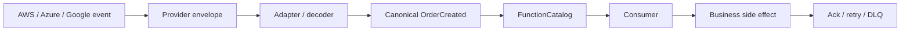
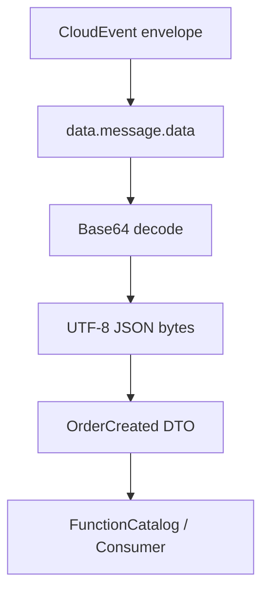
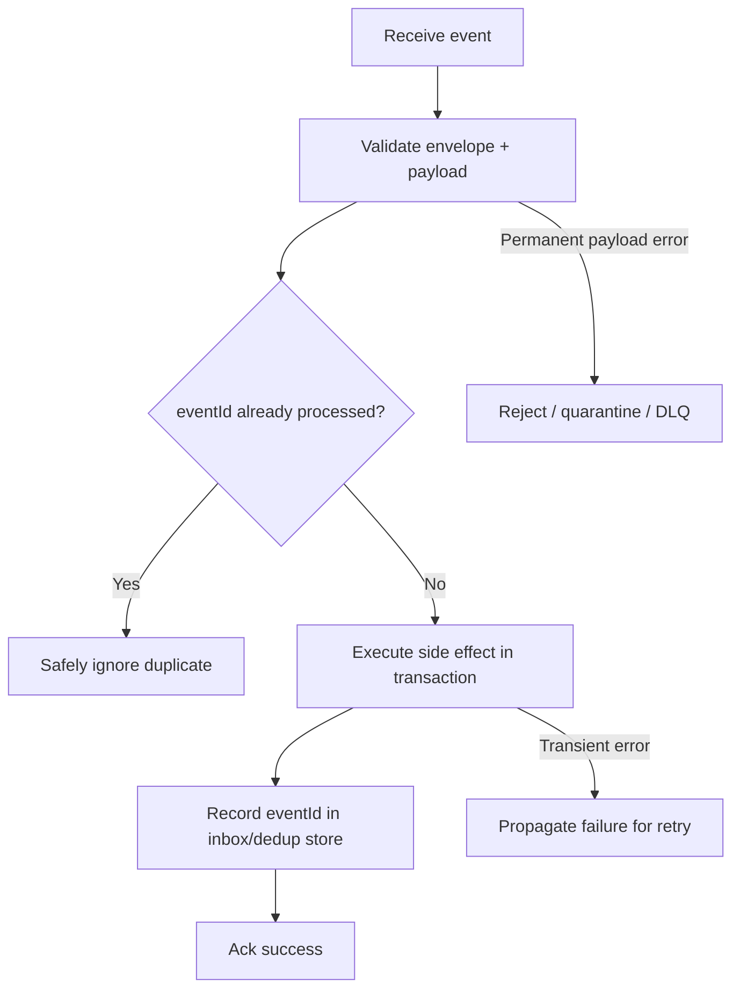
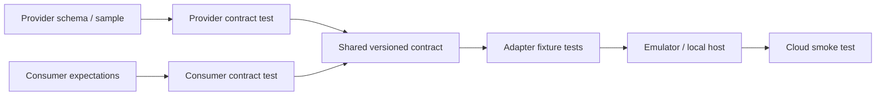

# Testing AWS, Azure, and Google Cloud Event Contracts

## Learning Objectives

Spring Cloud Function lets you write business logic as `Supplier<O>`, `Function<I,O>`, and `Consumer<I>`, register it in a Spring context, and look it up via `FunctionCatalog`. That logic can be reused over HTTP, messaging, or serverless environments. However, **each cloud provider has its own event contract**: envelope structure, metadata, payload encoding, batching, acknowledgement, and retries can all differ.

This lesson uses the same business event **`OrderCreated`** to test three ecosystems:

- **AWS:** SQS event source mapping and EventBridge events; distinguishing the Lambda event envelope from message contents.
- **Microsoft Azure:** Event Grid schema and CloudEvents 1.0; recognizing differences from Service Bus/Event Hubs messages.
- **Google Cloud:** Pub/Sub delivered via Eventarc as a CloudEvent; decoding Base64 `message.data` and distinguishing it from legacy background events.

After this lesson, you will be able to:

1. Distinguish **business contracts**, **provider transport contracts**, **adapter contracts**, and **function contracts**.
2. Design a canonical domain event, version its schema, and test backward/forward compatibility.
3. Build fixtures representing AWS SQS/EventBridge, Azure Event Grid/CloudEvents, and Google Pub/Sub CloudEvents.
4. Write decoders/mappers from each provider's envelope into the same domain model.
5. Test Spring Cloud Function via `FunctionCatalog`, composition, and `Consumer`.
6. Test batching, retries, duplicates, dead-lettering, ordering, and idempotency according to each platform's semantics.
7. Combine unit tests, contract tests, emulators/local runtimes, and cloud smoke tests.

**Scope:** examples use Java, JUnit 5, and Jackson to illustrate testing techniques. Adapters for Spring Cloud Function, AWS Lambda, Azure Functions, and Google Functions Framework may accept different Java types depending on version and trigger. Do not assume an adapter automatically converts every envelope into the same DTO without verifying the actual contract.

## 1. Why Test Event Contracts?

A message can be published successfully yet still be mishandled by the consumer because:

- The provider sends a different envelope from the JSON the application expects.
- The payload sits inside `body`, `detail`, `data`, or `message.data` rather than at the root object.
- The payload is Base64-encoded or delivered as raw bytes.
- A single invocation contains one event, an array of events, or a batch of multiple records.
- Routing metadata, event ID, source, timestamp, or schema version gets dropped during conversion.
- The adapter picks the wrong bean, wrong generic type, or wrong function definition.
- Retry/batch semantics cause an event to be delivered multiple times or part of a batch to fail.
- The producer upgrades the schema, and an older consumer fails to read it.

**Contract testing** confirms that a producer and consumer agree on the structure, data types, and meaning of messages. For event-driven systems, test at least four layers:

| Contract Layer | Question to Answer | Example |
| --- | --- | --- |
| **Domain contract** | What does the business event mean? | `OrderCreated(orderId, quantity)` |
| **Provider/transport contract** | Which envelope does the cloud send? | SQS `Records[].body`, EventBridge `detail`, Eventarc CloudEvent |
| **Adapter contract** | Which Java type does the handler convert the event into? | `CloudEventsFunction.accept(CloudEvent)`, AWS Lambda event DTO |
| **Function contract** | What does app logic accept and what side effects does it trigger? | `Consumer<OrderCreated>` saves order |



A unit test calling `Consumer.accept(...)` directly verifies only the business layer. It **does not** verify that an SQS record, Azure Event Grid event, or Google CloudEvent parses cleanly. Conversely, testing only a JSON fixture verifies only the decoder unless it runs through the function and side effects.

## 2. Designing a Provider-Independent Canonical Domain Event

Do not couple business logic to `SQSEvent.SQSMessage`, Azure Event Grid SDK types, or Google CloudEvent SDK types. Instead, define **a single domain event** that all three adapters can produce.

### 2.1. Business Contract

Example `OrderCreated` event:

```json
{
  "eventId": "evt-order-001",
  "eventType": "com.example.orders.created.v1",
  "source": "orders-service",
  "occurredAt": "2026-11-24T09:30:00Z",
  "schemaVersion": "1.0",
  "data": {
    "orderId": "ORD-42",
    "quantity": 2
  }
}
```

Meaning:

- `eventId`: stable ID for tracing and idempotency.
- `eventType`: versioned business event type.
- `source`: event-producing system per application convention.
- `occurredAt`: when the business event occurred, not necessarily when the broker delivered the message.
- `schemaVersion`: payload version managed by the domain owner.
- `data`: the business payload.

With CloudEvents, the **`source` + `id`** pair uniquely identifies an event; when storing deduplication keys across multiple sources, use that pair or map to a unique domain ID guaranteed stable by the producer. Do not assume `id` alone is globally unique across the entire system.

Do not confuse `schemaVersion` with the provider envelope version. For example, EventBridge has an envelope `version` field; CloudEvents has `specversion`; Azure Event Grid has `dataVersion`. These fields do not automatically substitute for the business version.

### 2.2. Java Records for the Domain

```java
package example.events;

import java.time.Instant;

public record OrderCreated(
        String orderId,
        int quantity) {
}

public record EventMetadata(
        String eventId,
        String eventType,
        String source,
        Instant occurredAt,
        String schemaVersion) {
}

public record NormalizedEvent<T>(
        EventMetadata metadata,
        T data) {
}
```

For standard Java compilation, place the three public records in **three separate files**: `OrderCreated.java`, `EventMetadata.java`, and `NormalizedEvent.java` (or organize them as nested records inside a class). A single code block is used here solely to keep the definitions side-by-side for readability.

Separating metadata from payload helps:

- Use event ID as an idempotency key without leaking provider SDK types into the domain.
- Track event source/type/time independently of business data.
- Reuse the same `Consumer<NormalizedEvent<OrderCreated>>` across multiple adapters.
- Add tracing/correlation without changing the business payload structure.

### 2.3. Validation Rules

At minimum, a valid event must satisfy:

| Field | Suggested Rule |
| --- | --- |
| `eventId` | Non-blank; stable across retries |
| `eventType` | Present in the consumer's supported event type list |
| `source` | Belongs to a trusted/configured source |
| `occurredAt` | Valid ISO-8601 timestamp; explicit policy for stale/future events |
| `schemaVersion` | Version supported by the consumer |
| `orderId` | Non-blank, length within bounds |
| `quantity` | Greater than 0 and within business limits |

Do not fall back to defaults like `eventId="unknown"` when an ID is missing. That causes malformed events to collide on the same idempotency key and hinders tracing.

## 3. AWS: SQS and EventBridge Have Two Different Envelopes

AWS Lambda does not receive every event in the same structure. The trigger type determines the payload shape the handler receives.

### 3.1. SQS Event Source Mapping

When SQS triggers Lambda via event source mapping, Lambda receives an object containing a **`Records`** array. Each record carries SQS metadata and a `body` string containing the message:

```json
{
  "Records": [
    {
      "messageId": "sqs-msg-001",
      "receiptHandle": "example-receipt-handle",
      "body": "{\"eventId\":\"evt-order-001\",\"eventType\":\"com.example.orders.created.v1\",\"source\":\"orders-service\",\"occurredAt\":\"2026-11-24T09:30:00Z\",\"schemaVersion\":\"1.0\",\"data\":{\"orderId\":\"ORD-42\",\"quantity\":2}}",
      "attributes": {
        "ApproximateReceiveCount": "1",
        "SentTimestamp": "1795512600000"
      },
      "messageAttributes": {},
      "eventSource": "aws:sqs",
      "eventSourceARN": "arn:aws:sqs:ap-southeast-1:123456789012:orders",
      "awsRegion": "ap-southeast-1"
    }
  ]
}
```

Points to test:

- `Records` can contain **multiple records**.
- `body` is a string; if the body is JSON, it requires a second parse step.
- SQS `messageId` differs from the business `eventId` inside `body`.
- `ApproximateReceiveCount` tracks delivery attempts; it is not a business version.
- `SentTimestamp` is when the broker sent the message, not `occurredAt`.
- `eventSourceARN` identifies the source queue; do not derive the domain source solely from the ARN.

A test sending only the JSON body at the root does not accurately test the SQS Lambda contract.

### 3.2. EventBridge Event

EventBridge sends events in its own envelope where business data lives inside **`detail`**:

```json
{
  "version": "0",
  "id": "eb-event-001",
  "detail-type": "com.example.orders.created.v1",
  "source": "com.example.orders",
  "account": "123456789012",
  "time": "2026-11-24T09:30:00Z",
  "region": "ap-southeast-1",
  "resources": [],
  "detail": {
    "schemaVersion": "1.0",
    "data": {
      "orderId": "ORD-42",
      "quantity": 2
    }
  }
}
```

In this example, **`detail.data`** is the domain payload after applying the producer's wrapper; a contract may use another structure, so decoder and fixtures must agree.

Do not confuse:

- `id` is the EventBridge event ID.
- `detail-type` is the event type declared by the producer.
- `source` is the EventBridge contract source.
- `time` is the envelope timestamp.
- `detail` is the business payload.
- `version` is the EventBridge envelope version, not `schemaVersion` inside `detail`.

### 3.3. Kinesis Is a Different Contract

When Lambda is triggered by Kinesis Data Streams, records typically carry Base64-encoded `kinesis.data`. This is neither SQS `body` nor EventBridge `detail`. Keep dedicated fixtures and test:

- Partition key and sequence number.
- Shard/ordering semantics.
- Base64 decoding and charset/binary format.
- Batch failure behavior per event source mapping configuration.

**Do not write one generic AWS decoder** that guesses structure from a `data` field. Pick the decoder matching the deployed trigger.

## 4. Azure: Event Grid Schema and CloudEvents 1.0

Azure supports both the Event Grid schema and CloudEvents 1.0. An application must know which schema the endpoint/trigger is configured to send. Both carry event metadata, yet field names and payload locations differ.

### 4.1. Event Grid Event Schema

The Event Grid schema normally delivers events as a **JSON array**. Example single event:

```json
[
  {
    "id": "az-event-001",
    "eventType": "com.example.orders.created.v1",
    "subject": "/orders/ORD-42",
    "eventTime": "2026-11-24T09:30:00Z",
    "data": {
      "orderId": "ORD-42",
      "quantity": 2
    },
    "dataVersion": "1.0",
    "metadataVersion": "1"
  }
]
```

Fields:

- `id`: event ID.
- `eventType`: publisher-defined event type.
- `subject`: subject/resource the event refers to.
- `eventTime`: event timestamp.
- `data`: payload.
- `dataVersion`: payload schema version.
- `metadataVersion`: Event Grid schema metadata version.

Event Grid can deliver **multiple events in one batch**. A decoder test handling only a single JSON object will miss the batch contract when an endpoint receives an array.

### 4.2. Azure Event Grid with CloudEvents 1.0

When the endpoint uses the CloudEvents schema, the envelope carries CloudEvents attributes:

```json
[
  {
    "specversion": "1.0",
    "id": "az-event-002",
    "source": "/subscriptions/example/resourceGroups/orders",
    "type": "com.example.orders.created.v1",
    "subject": "orders/ORD-42",
    "time": "2026-11-24T09:30:00Z",
    "datacontenttype": "application/json",
    "data": {
      "schemaVersion": "1.0",
      "data": {
        "orderId": "ORD-42",
        "quantity": 2
      }
    }
  }
]
```

Key CloudEvents attributes include:

- `specversion`: CloudEvents specification version.
- `id`: event ID within the source's scope.
- `source`: event producer source.
- `type`: event type.
- `subject`: related subject.
- `time`: event timestamp.
- `datacontenttype`: content type of `data`.
- `dataschema`: schema URI if supplied by the producer.
- `data`: business payload.

**`specversion=1.0` does not mean the domain payload is version 1.0.** When a domain schema version is needed, place it in `data`, `dataschema`, or an extension attribute per the agreed contract.

### 4.3. Do Not Confuse Event Grid with Service Bus or Event Hubs

Azure also provides other messaging triggers:

| Source | Typical Content | Specific Metadata |
| --- | --- | --- |
| Event Grid | Event Grid schema or CloudEvent | `id`, `eventType/type`, `subject`, `dataVersion` |
| Service Bus | Message body/bytes | `messageId`, `deliveryCount`, `subject`, application properties, lock/session |
| Event Hubs | EventData body/bytes or batch | partition, offset, sequence number, enqueued time, properties |
| Storage Queue | Queue message text | pop receipt, dequeue count, message ID per binding |

A Java Azure Function using `@EventGridTrigger` has a different contract from `@ServiceBusQueueTrigger` or `@EventHubTrigger`. Check your exact Java binding/extension version and verify the actual input type; do not assume Spring Cloud Function automatically normalizes all of those bindings.

### 4.4. Event Grid Subscription Validation

When creating a webhook subscription, Event Grid can send a **subscription validation event**. The endpoint must return the validation response matching the contract to complete registration. This is a control-plane/handshake request, not an `OrderCreated` event.

Contract tests should include fixtures for:

- Normal business events.
- Multi-event batches.
- Subscription validation events.
- Unsupported event types.
- Payloads missing fields or having invalid schema versions.

When using Azure Functions' Event Grid trigger, the host/binding may handle the handshake itself; check the extension/host contract instead of adding webhook validation code at the wrong layer.

## 5. Google Cloud: Pub/Sub via Eventarc Is a CloudEvent

Cloud Run functions receive events from Eventarc following the **CloudEvents 1.0** contract. For Pub/Sub, the CloudEvent envelope holds outer metadata while `data` contains a `message` object:

```json
{
  "specversion": "1.0",
  "id": "gcp-event-001",
  "source": "//pubsub.googleapis.com/projects/demo-project/topics/orders",
  "type": "google.cloud.pubsub.topic.v1.messagePublished",
  "time": "2026-11-24T09:30:00Z",
  "datacontenttype": "application/json",
  "data": {
    "message": {
      "data": "eyJvcmRlcklkIjoiT1JELTQyIiwicXVhbnRpdHkiOjJ9",
      "messageId": "1234567890",
      "publishTime": "2026-11-24T09:30:00Z",
      "attributes": {
        "eventType": "com.example.orders.created.v1",
        "domainSource": "orders-service",
        "schemaVersion": "1.0"
      }
    },
    "subscription": "projects/demo-project/subscriptions/orders-sub"
  }
}
```

The Base64 string `eyJvcmRlcklkIjoiT1JELTQyIiwicXVhbnRpdHkiOjJ9` decodes to JSON:

```json
{
  "orderId": "ORD-42",
  "quantity": 2
}
```

Conversion path:



Points to test:

- `id`, `source`, `type`, `time` belong to the **CloudEvent envelope**.
- `message.messageId` belongs to the Pub/Sub message; the two IDs are not synonymous.
- `message.data` is Base64, not raw JSON text.
- `message.attributes` are Pub/Sub attributes.
- `subscription` belongs to the Pub/Sub notification event data.
- Event type must match `google.cloud.pubsub.topic.v1.messagePublished` when using direct Pub/Sub events.

### 5.1. Legacy Background Events Differ from CloudEvents

Some older Spring Cloud Function GCP adapter docs describe `Consumer<PubSubMessage>` and `GcfJarLauncher`. That is a historical background-adapter contract. Modern Cloud Run functions use Java's `CloudEventsFunction` for event-driven handlers.

| Model | Handler-Layer Input | Pub/Sub Payload |
| --- | --- | --- |
| Legacy background adapter | Background DTO such as `PubSubMessage` | Mapped from legacy background schema directly |
| Cloud Run functions/Eventarc | `CloudEvent` | `event.data.message.data` |

Do not use a legacy background-adapter root JSON fixture `{"data":"..."}` to test a CloudEvent decoder; the nested structures differ. Nor should you assume `GcfJarLauncher` supports every CloudEvents signature unless your adapter version explicitly documents support.

## 6. Three-Provider Comparison Table

| Aspect | AWS SQS | Azure Event Grid | Google Pub/Sub/Eventarc |
| --- | --- | --- | --- |
| Envelope | `Records[]` | Event Grid array or CloudEvents array | CloudEvent |
| Payload location | `Records[].body` | `data` | `data.message.data` |
| Encoding | Body is typically string; may be JSON | JSON object | Base64 bytes |
| Event ID | SQS `messageId` and business `eventId` | `id` | CloudEvent `id` and Pub/Sub `messageId` |
| Event type | Defined by body/route or event source mapping | `eventType` or CloudEvents `type` | CloudEvents `type` |
| Source | Queue ARN/metadata or body contract | Event Grid `topic`/subject or CloudEvents `source` | CloudEvents `source` |
| Batch | Lambda event has `Records[]` | Event Grid may deliver arrays/batches | Eventarc sends CloudEvents per delivery; batching differs from SQS records |
| Retry | SQS visibility/redelivery and Lambda event source mapping | Event Grid retry/dead-letter policy; other bindings have separate semantics | Eventarc/Pub/Sub retry/delivery policy |

The `source` field in `NormalizedEvent` requires an explicit mapping rule. AWS EventBridge `source` may be a producer namespace; Azure Event Grid `topic` and Google CloudEvent `source` typically identify infrastructure resources/topics. If the domain needs the event-producing system name, pass `domainSource` in the payload/attributes or map by verified trigger; never assign an ARN/topic as domain source without agreed semantics.
| Partial failure | SQS Lambda supports partial batch responses when enabled | Trigger/binding-dependent; does not use SQS response format | CloudEvent invocation handled per trigger delivery |

**Conclusion:** the same business event does not imply identical transport envelopes. Test each provider adapter individually, then test the shared domain consumer.

## 7. Writing Decoders from Provider Envelopes to the Domain Event

### 7.1. JSON Envelope for SQS

Because an SQS body can carry the application's event wrapper, such as:

```json
{
  "eventId": "evt-order-001",
  "eventType": "com.example.orders.created.v1",
  "source": "orders-service",
  "occurredAt": "2026-11-24T09:30:00Z",
  "schemaVersion": "1.0",
  "data": {
    "orderId": "ORD-42",
    "quantity": 2
  }
}
```

the decoder must parse the **SQS envelope**, extract `body`, and then parse the **business event wrapper**. If the app publishes raw `OrderCreated` JSON instead, adjust the mapping to match that producer contract.

Helper example:

```java
import com.fasterxml.jackson.databind.JsonNode;
import com.fasterxml.jackson.databind.ObjectMapper;
import java.time.Instant;

NormalizedEvent<OrderCreated> fromSqsRecord(
        JsonNode record, ObjectMapper mapper) throws Exception {

    if (!"aws:sqs".equals(record.path("eventSource").asText())) {
        throw new IllegalArgumentException("Not an SQS record");
    }

    JsonNode body = mapper.readTree(record.path("body").asText());
    OrderCreated payload = mapper.treeToValue(
            body.path("data"), OrderCreated.class);

    JsonNode attributes = record.path("attributes");
    Instant receivedAt = Instant.ofEpochMilli(
            Long.parseLong(attributes.path("SentTimestamp").asText()));

    EventMetadata metadata = new EventMetadata(
            body.path("eventId").asText(),
            body.path("eventType").asText(),
            body.path("source").asText(),
            Instant.parse(body.path("occurredAt").asText()),
            body.path("schemaVersion").asText());

    return new NormalizedEvent<>(metadata, payload);
}
```

Here `receivedAt` illustrates the broker send time; if needed, keep it in separate transport metadata. Never replace `occurredAt` with `SentTimestamp`.

### 7.2. EventBridge Decoder

```java
NormalizedEvent<OrderCreated> fromEventBridge(
        JsonNode event, ObjectMapper mapper) throws Exception {

    OrderCreated payload = mapper.treeToValue(
            event.path("detail").path("data"), OrderCreated.class);

    String schemaVersion =
            event.path("detail").path("schemaVersion").asText();

    EventMetadata metadata = new EventMetadata(
            event.path("id").asText(),
            event.path("detail-type").asText(),
            event.path("source").asText(),
            Instant.parse(event.path("time").asText()),
            schemaVersion);

    return new NormalizedEvent<>(metadata, payload);
}
```

This example assumes `detail` has a `schemaVersion` field; if the producer omits it, resolve the schema version via a dedicated registry/contract rather than grabbing envelope `version=0` by mistake.

### 7.3. Azure Event Grid Schema Decoder

```java
NormalizedEvent<OrderCreated> fromAzureEventGrid(
        JsonNode event, ObjectMapper mapper) throws Exception {

    OrderCreated payload = mapper.treeToValue(
            event.path("data"), OrderCreated.class);

    EventMetadata metadata = new EventMetadata(
            event.path("id").asText(),
            event.path("eventType").asText(),
            event.path("topic").asText(),
            Instant.parse(event.path("eventTime").asText()),
            event.path("dataVersion").asText());

    return new NormalizedEvent<>(metadata, payload);
}
```

If the publisher omits `topic` from event fixtures or a binding strips that metadata, derive the source from trusted trigger configuration or preserve separate metadata. Do not fabricate a dummy source just to fill the field.

### 7.4. Azure CloudEvents Decoder

```java
NormalizedEvent<OrderCreated> fromAzureCloudEvent(
        JsonNode event, ObjectMapper mapper) throws Exception {

    if (!"1.0".equals(event.path("specversion").asText())) {
        throw new IllegalArgumentException(
                "Unsupported CloudEvents specversion");
    }

    OrderCreated payload = mapper.treeToValue(
            event.path("data").path("data"), OrderCreated.class);

    EventMetadata metadata = new EventMetadata(
            event.path("id").asText(),
            event.path("type").asText(),
            event.path("source").asText(),
            Instant.parse(event.path("time").asText()),
            event.path("data").path("schemaVersion").asText());

    return new NormalizedEvent<>(metadata, payload);
}
```

`dataschema` is the schema URI if supplied by the producer; otherwise, the application can use an extension attribute or a version inside `data`. Do not treat `specversion` as the domain version.

### 7.5. Google Pub/Sub CloudEvent Decoder

```java
import java.nio.charset.StandardCharsets;
import java.util.Base64;

NormalizedEvent<OrderCreated> fromGooglePubSubCloudEvent(
        JsonNode event, ObjectMapper mapper) throws Exception {

    if (!"1.0".equals(event.path("specversion").asText())) {
        throw new IllegalArgumentException(
                "Unsupported CloudEvents specversion");
    }
    if (!"google.cloud.pubsub.topic.v1.messagePublished"
            .equals(event.path("type").asText())) {
        throw new IllegalArgumentException(
                "CloudEvent type is not Pub/Sub messagePublished");
    }

    JsonNode message = event.path("data").path("message");
    String encoded = message.path("data").asText(null);
    if (encoded == null) {
        throw new IllegalArgumentException("Missing Pub/Sub message.data");
    }

    byte[] bytes = Base64.getDecoder().decode(encoded);
    OrderCreated payload = mapper.readValue(
            new String(bytes, StandardCharsets.UTF_8),
            OrderCreated.class);

    JsonNode attrs = message.path("attributes");
    EventMetadata metadata = new EventMetadata(
            event.path("id").asText(),
            attrs.path("eventType").asText(),
            attrs.path("domainSource").asText(),
            Instant.parse(event.path("time").asText()),
            attrs.path("schemaVersion").asText());

    return new NormalizedEvent<>(metadata, payload);
}
```

This example uses the CloudEvent `id` as the primary event ID and preserves Pub/Sub `messageId` in separate transport metadata/logs if needed. A system may choose another idempotency key per contract; keep it consistent across retries and replays.

In this fixture, CloudEvent `type` remains the **transport type** `google.cloud.pubsub.topic.v1.messagePublished`; the domain's `eventType` and `domainSource` arrive via Pub/Sub attributes. If the publisher omits those attributes, the decoder must read domain metadata from a JSON wrapper inside `message.data` or an agreed mapping configuration. Never default the CloudEvent transport type as the domain event type.

**Note:** the methods above illustrate each decoder. They require `ObjectMapper`, the domain records, and matching Java imports; add thorough validation and null handling for production. Their goal is to clarify mappings, not to claim all cloud adapters pass raw `JsonNode` directly.

## 8. Testing All Three Providers' Fixtures with JUnit

Create provider-organized test resource directories so fixtures can be reviewed and versioned:

```text
src/test/resources/contracts/
├── aws/
│   ├── sqs-order-created.json
│   ├── eventbridge-order-created.json
│   └── sqs-two-records.json
├── azure/
│   ├── eventgrid-order-created.json
│   ├── cloudevents-order-created.json
│   └── eventgrid-batch.json
└── google/
    ├── pubsub-order-created-cloudevent.json
    └── pubsub-invalid-base64.json
```

Each fixture should carry metadata in tests or filenames specifying:

- Provider, trigger, and schema mode.
- Schema/event version.
- Capture date and reference doc/sample source.
- Anonymized values if derived from production.
- Expected domain output.

### 8.1. Testing an SQS Record

```java
import static org.junit.jupiter.api.Assertions.assertEquals;
import static org.junit.jupiter.api.Assertions.assertNotNull;
import static org.junit.jupiter.api.Assertions.assertTrue;
import static org.junit.jupiter.api.Assertions.assertThrows;

import com.fasterxml.jackson.databind.JsonNode;
import com.fasterxml.jackson.databind.ObjectMapper;
import java.io.InputStream;
import java.time.Instant;
import java.util.Base64;
import org.junit.jupiter.api.Test;

class AwsEventContractTest {

    private final ObjectMapper mapper = new ObjectMapper();

    @Test
    void decodesSqsRecordBody() throws Exception {
        try (InputStream in = getClass().getResourceAsStream(
                "/contracts/aws/sqs-order-created.json")) {
            JsonNode root = mapper.readTree(in);
            JsonNode record = root.path("Records").get(0);

            NormalizedEvent<OrderCreated> event =
                    fromSqsRecord(record, mapper);

            assertEquals("evt-order-001",
                    event.metadata().eventId());
            assertEquals("ORD-42", event.data().orderId());
            assertEquals(2, event.data().quantity());
        }
    }
}
```

The test methods in Sections 8.2–8.6 are additional methods in the same test class or separate classes with matching imports and fixture helpers. `fromSqsRecord`, `fromEventBridge`, `fromAzureEventGrid`, `fromAzureCloudEvent`, and `fromGooglePubSubCloudEvent` are the decoders shown in Section 7; in a real project, place them in a dedicated decoder/helper class called by tests.

SQS fixtures must test `body` as a JSON string. A test that builds a Java object directly and skips `body` parsing bypasses an essential conversion step.

### 8.2. Testing EventBridge `detail`

```java
@Test
void decodesEventBridgeDetail() throws Exception {
    try (InputStream in = getClass().getResourceAsStream(
            "/contracts/aws/eventbridge-order-created.json")) {
        JsonNode root = mapper.readTree(in);

        NormalizedEvent<OrderCreated> event =
                fromEventBridge(root, mapper);

        assertEquals("eb-event-001", event.metadata().eventId());
        assertEquals("com.example.orders.created.v1",
                event.metadata().eventType());
        assertEquals("ORD-42", event.data().orderId());
    }
}
```

### 8.3. Testing an Azure Event Grid Array

```java
@Test
void decodesAzureEventGridBatchItem() throws Exception {
    try (InputStream in = getClass().getResourceAsStream(
            "/contracts/azure/eventgrid-order-created.json")) {
        JsonNode batch = mapper.readTree(in);
        assertTrue(batch.isArray());

        NormalizedEvent<OrderCreated> event =
                fromAzureEventGrid(batch.get(0), mapper);

        assertEquals("az-event-001", event.metadata().eventId());
        assertEquals("ORD-42", event.data().orderId());
    }
}
```

Alongside single-event fixtures, maintain multi-event fixtures to verify that code processes **every item in the batch** and preserves ordering when required by contract.

### 8.4. Testing Azure CloudEvents

```java
@Test
void decodesAzureCloudEvent() throws Exception {
    try (InputStream in = getClass().getResourceAsStream(
            "/contracts/azure/cloudevents-order-created.json")) {
        JsonNode batch = mapper.readTree(in);
        JsonNode eventNode = batch.isArray() ? batch.get(0) : batch;

        NormalizedEvent<OrderCreated> event =
                fromAzureCloudEvent(eventNode, mapper);

        assertEquals("az-event-002", event.metadata().eventId());
        assertEquals("com.example.orders.created.v1",
                event.metadata().eventType());
    }
}
```

Accepting either an array or an object in a test is appropriate only if **the binding/endpoint actually permits both shapes**. When the contract fixes an array, assert an array rather than making the decoder overly permissive and masking misconfiguration.

### 8.5. Testing Google Pub/Sub CloudEvents

```java
@Test
void decodesGooglePubSubCloudEvent() throws Exception {
    try (InputStream in = getClass().getResourceAsStream(
            "/contracts/google/pubsub-order-created-cloudevent.json")) {
        JsonNode root = mapper.readTree(in);

        NormalizedEvent<OrderCreated> event =
                fromGooglePubSubCloudEvent(root, mapper);

        assertEquals("gcp-event-001", event.metadata().eventId());
        assertEquals("ORD-42", event.data().orderId());
        assertEquals(2, event.data().quantity());
    }
}
```

This fixture must carry `data.message.data` in Base64 form. Placing raw JSON directly in `data` does not accurately simulate a Pub/Sub CloudEvent.

### 8.6. Testing Payload Errors

```java
@Test
void rejectsInvalidPubSubBase64() throws Exception {
    String invalid = "not-base64!";
    assertThrows(IllegalArgumentException.class,
            () -> Base64.getDecoder().decode(invalid));
}
```

Production decoder tests should verify error messages and exception types at the boundary. Never swallow a Base64 error as an empty success or silently drop records.

## 9. Testing Spring Cloud Function and `FunctionCatalog`

Once provider decoders produce `NormalizedEvent<OrderCreated>`, business logic does not need to know whether an event came from AWS, Azure, or Google.

### 9.1. Business Bean

```java
@Configuration
public class OrderEventFunctions {

    @Bean
    public Consumer<NormalizedEvent<OrderCreated>> processOrderCreated(
            OrderService orderService) {
        return event -> orderService.createOrder(
                event.metadata().eventId(),
                event.data());
    }
}
```

`OrderService` is an application-defined business service. It must handle idempotency by `eventId`, transactions, and durable side effects.

### 9.2. Looking Up and Invoking the Consumer

```java
import static org.junit.jupiter.api.Assertions.assertNotNull;

import java.time.Instant;
import java.util.function.Consumer;
import org.junit.jupiter.api.Test;
import org.springframework.beans.factory.annotation.Autowired;
import org.springframework.boot.test.context.SpringBootTest;
import org.springframework.cloud.function.context.FunctionCatalog;

@SpringBootTest
class OrderFunctionCatalogTest {

    @Autowired
    FunctionCatalog catalog;

    @Test
    void exposesOrderConsumer() {
        Consumer<NormalizedEvent<OrderCreated>> consumer =
                catalog.lookup("processOrderCreated");

        assertNotNull(consumer);
        consumer.accept(new NormalizedEvent<>(
                new EventMetadata(
                        "evt-test-1",
                        "com.example.orders.created.v1",
                        "test",
                        Instant.parse("2026-11-24T09:30:00Z"),
                        "1.0"),
                new OrderCreated("ORD-42", 2)));
    }
}
```

This test verifies that the bean is registered and resolvable via the catalog. To verify side effects, inject a mock/fake `OrderService` and assert invocations, arguments, and idempotency keys.

### 9.3. Composition per Provider

If using composition:

```properties
spring.cloud.function.definition=decodeOrder|processOrderCreated
```

compose only when output/input types align and the adapter passes the right input to the first function. AWS SQS decoders, Azure Event Grid decoders, and Google Pub/Sub decoders have different input types; you may need **three edge decoders/handlers** delegating to one shared domain consumer. Do not build a single `Object`-accepting function that guesses the provider from arbitrary fields when the system can select handlers explicitly.

## 10. Testing Schema Evolution and Compatibility

Event contracts outlive a single deployment. Producers and consumers typically deploy independently, requiring explicit versioning rules.

### 10.1. Safe Change Rules

| Change | Usually Compatible? | Condition |
| --- | --- | --- |
| Add optional field | Backward-compatible | Old consumers ignore unknown fields; new field has a sensible default |
| Add required field | Usually breaking | Old producers/consumers may not supply it |
| Remove field | Potentially breaking | Old consumers may still read it |
| Rename field | Breaking without aliasing | Use dual-write/alias period or bump version |
| Change `quantity` from integer to string | Breaking | Create a new schema/version or converter |
| Change field semantics while keeping name/type | Semantically breaking | Bump event type/version and update docs |
| Add enum value | Can break strict consumers | Consumers need an unknown-value strategy |
| Change timestamp timezone/format | Potentially breaking | Stick to ISO-8601 and consistent semantics |

**Additive changes are not automatically safe** if consumers enforce strict schema validation, exhaustive switches, or mappers rejecting unknown properties.

### 10.2. Where Does Version Live?

| Provider | Provider Metadata | Where to Place Domain Schema Version |
| --- | --- | --- |
| AWS EventBridge | Envelope `version`, `detail-type`, `source` | `detail.schemaVersion`, versioned event type suffix, or registry |
| AWS SQS | `messageId`, attributes, ARN; producer-defined body | Body wrapper or message attribute per contract |
| Azure Event Grid schema | `metadataVersion`, `dataVersion`, `eventType` | `dataVersion` or event type/version |
| Azure CloudEvents | `specversion`, `type`, `dataschema` | `dataschema`, extension, or payload |
| Google Pub/Sub CloudEvent | `specversion`, `type`, Pub/Sub attributes | Pub/Sub attribute or payload schema version |

Never repurpose `specversion` as a domain version. CloudEvents 1.0 can carry any number of business payload versions.

### 10.3. JSON Schema for the Business Payload

Domain schemas can be stored independently of provider envelopes. Example JSON Schema for the `data` section of `OrderCreated`:

```json
{
  "$schema": "https://json-schema.org/draft/2020-12/schema",
  "$id": "https://schemas.example.com/orders/order-created-1.0.json",
  "title": "OrderCreatedData",
  "type": "object",
  "required": ["orderId", "quantity"],
  "properties": {
    "orderId": {"type": "string", "minLength": 1, "maxLength": 64},
    "quantity": {"type": "integer", "minimum": 1},
    "currency": {"type": "string", "minLength": 3, "maxLength": 3}
  },
  "additionalProperties": true
}
```

`additionalProperties: true` lets older consumers ignore extended fields; setting `false` causes strict contract tests to fail whenever a producer adds a field. Even when allowing extra fields, consumers must validate required fields and data bounds. JSON Schema validates structure only; business rules such as permissions, inventory, or order state require separate tests.

### 10.3. Testing Old Consumers Against New Events

Maintain representative fixtures for:

- The event version currently in production.
- The producer's upcoming event version.
- Events omitting optional fields.
- Events carrying unknown fields.
- Events with new enum values.
- Events missing required fields or having wrong types.

With Jackson, toggling `FAIL_ON_UNKNOWN_PROPERTIES` must be an intentional contract decision. Never disable validation globally just to make a test pass; you may ignore extension fields while still enforcing required fields and semantics.

## 11. Batching, Retries, Acknowledgements, and Idempotency

Multi-cloud contract tests must verify **delivery behavior**, not just JSON shapes.

### 11.1. AWS SQS and Partial Batch Failure

Lambda can receive multiple SQS records in a single invocation. If one record fails, default behavior can cause the entire batch to be redelivered. With an event source mapping configured for **partial batch responses**, the handler returns the list of failed message IDs per the `ReportBatchItemFailures` response contract.

Example response:

```json
{
  "batchItemFailures": [
    {
      "itemIdentifier": "sqs-msg-002"
    }
  ]
}
```

Contract tests should verify:

- Successful records are not marked failed.
- Failed records report the exact SQS message ID in `itemIdentifier`.
- The handler does not swallow exceptions and accidentally ack failed events.
- The queue has appropriate visibility timeout/DLQ/redrive policies.
- Side effects from successful records remain safe if the batch retries.

Partial batch responses require enabling `ReportBatchItemFailures` on the event source mapping. Returning that JSON from a function without enabling it on the mapping does not make Lambda honor it.

### 11.2. AWS EventBridge

EventBridge has target delivery retry policies and supports dead-letter queues. Contract/integration tests should verify that the target receives the right envelope, rejected events or target errors follow retry/DLQ policy, and consumers do not duplicate side effects on redelivery.

Do not apply SQS partial batch responses to EventBridge targets; the two triggers have different delivery contracts.

### 11.3. Azure Event Grid

Event Grid offers retry and dead-letter options. Consumers must:

- Deduplicate by event `id`.
- Distinguish transient failures from permanently invalid payloads.
- Return responses matching the Event Grid/Functions host contract.
- Test subscription validation separately.
- Verify the dead-letter destination and alerts on sustained delivery failures.

Azure Service Bus triggers have their own lock, delivery count, and dead-letter semantics; do not transfer Event Grid retry behavior onto Service Bus.

### 11.4. Google Pub/Sub/Eventarc

Eventarc/Pub/Sub applies retry and delivery policies per trigger and configuration. Handlers normally signal success upon completing per contract; exceptions or error responses can trigger retries. Test:

- Redelivery of the same CloudEvent ID.
- Permanently invalid payloads vs. transient dependency errors.
- Dead-letter topics/policies if configured.
- Idempotency keys and durable state.
- That the consumer does not report success before side effects commit.

### 11.5. General Idempotency Rules

One approach:



**Do not use process memory** such as a `static Set<String>` as your sole deduplication store. Serverless functions scale across instances, restart, and run concurrently. Use database unique constraints, an inbox table, idempotency keys, or a transactional outbox suited to your system.

## 12. Local Testing Tools and Emulator Limits

| Platform | Common Tools | Can Test | Does Not Fully Prove |
| --- | --- | --- | --- |
| AWS Lambda | AWS SAM CLI, Lambda Runtime Interface Emulator | Handler contract, event fixtures, local invocation | Production IAM, real retries, all AWS service behaviors |
| AWS SQS/EventBridge | LocalStack or AWS test environment | Publish/receive, emulator-level event routing | Full quota, IAM, and production semantics |
| Azure Functions | Azure Functions Core Tools | Host, bindings, and local function invocation | Full Azure identity/roles and cloud delivery |
| Azure Storage | Azurite | Blob/Queue/Table APIs supported by Azurite | Event Grid/Service Bus behavior |
| Azure Service Bus | Service Bus emulator or test namespace per version | Queues/topics, basic messages/locks | All production Azure scale/security features |
| Google Cloud | Functions Framework | Local Java HTTP/CloudEvents handlers | Production Eventarc/IAM |
| Google Pub/Sub | Pub/Sub emulator | Local publish/subscribe and payload transport | Full cloud Eventarc routing/IAM/retries |

Emulators accelerate feedback, **not perfect cloud replicas**. In particular, emulators may not reproduce IAM permissions, service agents, retry schedules, ordering, DLQs, or quota limits accurately. Always run a smoke test in a controlled cloud project before release.

### 12.1. Sharing Fixtures with Emulators

Use the same JSON fixtures as inputs across:

1. Decoder unit tests.
2. Handler-boundary contract tests.
3. Local Functions Framework/host tests.
4. Emulator-published messages when testing brokers.
5. Cloud smoke tests using safe synthetic data.

Keeping aligned canonical and provider-specific fixtures helps spot mapping discrepancies across every layer.

## 13. Contract Testing: Consumer-Driven and Provider Verification

Two complementary approaches:

### 13.1. Provider Contract Tests

Producers verify emitted events match the published schema:

- JSON Schema/Avro/Protobuf validation.
- Event type, required fields, enums, timestamps, and version.
- Golden fixtures or sample event snapshots.
- No credentials or PII inside fixtures.

### 13.2. Consumer Contract Tests

Consumers verify the events they **actually need to support**:

- Provider envelopes parse properly.
- Unknown fields follow policy.
- Event versions are supported.
- Metadata and payload mapping are accurate.
- Side effects execute with canonical events.

### 13.3. Consumer-Driven Contracts

Tools such as **Pact message contracts** or **Spring Cloud Contract messaging** capture producer/consumer expectations and verify message exchanges. However, contract tools do not replace provider adapter fixtures: you must verify exact AWS/Azure/GCP envelopes, not only self-authored canonical messages.

A sound workflow:



## 14. Security and Fixture Hygiene

Events can contain customer data, access tokens, payment metadata, or resource identifiers. When storing fixtures:

- Use **synthetic/anonymized** IDs, accounts, emails, ARNs, subscriptions, and buckets.
- Never commit real secrets or tokens inside test JSON.
- Enforce allowlists on source/type/tenant/account/topic if required by contract.
- Never treat metadata sent by an event publisher as authentication proof.
- Bound payload sizes and validate before deep parsing.
- Handle malformed Base64, deeply nested JSON, unknown fields, and anomalous timestamps safely.
- Log event ID, type, source, and correlation safely; avoid logging full bodies.

CloudEvent `source` or AWS `eventSourceARN` can be used for routing or contract validation, yet real access control must still be enforced via platform IAM, identity, and trust boundaries.

## 15. Minimum Recommended Test Matrix

| Test Group | AWS | Azure | Google Cloud |
| --- | --- | --- | --- |
| Happy path | SQS body, EventBridge detail | Event Grid schema, CloudEvents | Pub/Sub CloudEvent Base64 |
| Batch | Multiple SQS records | Event Grid event array | Batch contract if trigger/adapter supports |
| Missing required field | body/detail missing `orderId` | data missing `orderId` | `message.data` missing field |
| Invalid encoding | Non-JSON body | Bad data/content type | Invalid Base64 or non-JSON bytes |
| Unknown event type | Unsupported `detail-type` | Unknown `eventType`/`type` | Unknown CloudEvent `type` |
| Version | body/detail `schemaVersion` | `dataVersion`/`dataschema` | Pub/Sub attributes/payload version |
| Duplicate | SQS retry / EventBridge redelivery | Event Grid duplicate | CloudEvent redelivery |
| Failure handling | Partial batch/DLQ | Retry/dead-letter | Retry/dead-letter |
| Metadata | `messageId`, ARN, receive count | `id`, `source`, `subject`, `time` | CloudEvent `id`/`source`/`type`, Pub/Sub `messageId` |
| Adapter integration | Lambda handler / event source mapping | Functions host/binding | Functions Framework / `CloudEventsFunction` |

## 16. Implementation Workflow in a Spring Cloud Function Project

1. **Finalize domain event:** define `OrderCreated`, event type, and schema version.
2. **Collect provider contracts:** gather samples/docs matching your exact triggers and adapter versions.
3. **Store fixtures:** one file per provider/schema mode; never share guessed envelopes.
4. **Write decoders:** map provider metadata/payload to `NormalizedEvent<OrderCreated>`.
5. **Unit test decoders:** cover happy paths, batches, missing fields, unknown types, bad Base64, and versions.
6. **Test `FunctionCatalog`:** verify the `Consumer` bean is registered and handles canonical events.
7. **Test adapters:** run handlers/local hosts to prove live inputs convert into the types decoders expect.
8. **Test brokers/emulators:** publish/receive and verify delivery/batching as needed.
9. **Cloud smoke test:** send safe synthetic events, inspect logs, side effects, retries, and IAM.
10. **Version contracts:** update schemas/fixtures and check compatibility before releasing producers or consumers.

## 17. Practice Exercises

### Exercise 1 — Normalize Three Events

Take the SQS, Azure Event Grid, and Google Pub/Sub CloudEvent fixtures from this lesson. Write decoders producing the same `NormalizedEvent<OrderCreated>`. Assert that `orderId`, `quantity`, event type, event ID, and business timestamp are semantically consistent.

### Exercise 2 — Distinguish IDs

An SQS record has `messageId=sqs-001` with `eventId=evt-001` in its body; a Google CloudEvent has `id=gcp-001` with Pub/Sub `messageId=pubsub-001` inside. Choose an idempotency key and explain why these IDs must not be conflated without explicit rules.

### Exercise 3 — Batch Testing

Create an SQS fixture with three records: two valid and one failing. Write a test confirming the failing record appears in `batchItemFailures` when partial batch response is enabled, while the two successful records are not marked failed.

### Exercise 4 — Azure Schema Modes

Write tests for both Event Grid schema and CloudEvents 1.0. Compare `eventType/dataVersion` with `type/dataschema/specversion`. Verify the decoder rejects the unconfigured schema mode.

### Exercise 5 — Google Base64

Create a Pub/Sub CloudEvent fixture with Base64 `data.message.data`. Test valid payloads, invalid Base64, non-JSON bytes, and missing `message.data`.

### Exercise 6 — Schema Evolution

Have the producer add an optional `currency` field to `OrderCreated`. Run the contract test against the old consumer. Next, change `quantity` from integer to string and explain why that is a breaking change.

### Exercise 7 — Retries and Idempotency

Simulate a consumer that writes an order and times out before acknowledgement. Redeliver the same event ID. Verify the database holds only one order and logs record the duplicate.

### Self-Check Questions

1. **Where does an SQS Lambda event store the business payload?** Inside `Records[].body`, typically as a string needing parsing.
2. **Where does EventBridge place the business payload?** `detail`.
3. **Are Azure Event Grid schema and CloudEvents identical?** No; metadata fields and versioning differ.
4. **Is CloudEvents `specversion` the domain schema version?** No.
5. **Where does a Pub/Sub CloudEvent store Base64 data?** `data.message.data`.
6. **Is SQS `messageId` the same as business `eventId`?** No, unless a producer enforces a specific mapping rule.
7. **Does one canonical fixture replace provider fixtures?** No; each adapter's envelope and mapping must be tested.
8. **Does a `Consumer.accept` unit test prove Eventarc/SQS triggers work?** No.
9. **Why test batching and partial failures?** Because one invocation can carry multiple events where only a subset fails.
10. **Why do consumers need idempotency?** Providers can redeliver events after timeouts, errors, or retries.
11. **Do emulators prove production IAM is correct?** No.
12. **Is adding an optional field always compatible?** No; it depends on schema validation and consumer behavior.

## 18. Summary and References

Testing multi-cloud event contracts requires separating the **domain contract** from **provider envelopes**. AWS SQS wraps messages in `Records[].body` and EventBridge uses `detail`; Azure Event Grid uses either the Event Grid schema or CloudEvents 1.0; Google Pub/Sub via Eventarc uses a CloudEvent with Base64 `data.message.data`. Each envelope must be tested independently before mapping into a shared domain event for Spring Cloud Function.

A thorough test suite follows **provider-specific fixtures → decoders/mappers → schema/version validation → `FunctionCatalog`/Consumer → batch/retry/idempotency → emulators/local hosts → cloud smoke tests**. This catches contract mismatches before production messages are lost, retried endlessly, or cause duplicate side effects.

Official documentation:

- [AWS Lambda — Using AWS services as event sources](https://docs.aws.amazon.com/lambda/latest/dg/lambda-services.html): event sources and how Lambda receives events.
- [AWS Lambda — SQS event source mapping](https://docs.aws.amazon.com/lambda/latest/dg/with-sqs.html): SQS records, batching, retries, and partial batch responses.
- [Amazon EventBridge — Event structure](https://docs.aws.amazon.com/eventbridge/latest/userguide/eb-events-structure.html): `id`, `source`, `detail-type`, `time`, and `detail` envelope.
- [Azure Event Grid — Event schema](https://learn.microsoft.com/azure/event-grid/event-schema): Event Grid schema, batching, and data version.
- [Azure Event Grid — CloudEvents schema](https://learn.microsoft.com/azure/event-grid/cloud-event-schema): CloudEvents 1.0 and event attributes.
- [Azure Functions — Event Grid trigger](https://learn.microsoft.com/azure/azure-functions/functions-bindings-event-grid-trigger): Java/host binding and trigger contract.
- [Google Cloud — Pub/Sub events for Cloud Run functions](https://cloud.google.com/eventarc/docs/cloudevents-json): CloudEvent envelope and Pub/Sub event data.
- [Google Cloud — Pub/Sub CloudEvent Java sample](https://cloud.google.com/functions/docs/samples/functions-cloudevent-pubsub): Java `CloudEventsFunction`, nested message, and Base64.
- [CloudEvents specification](https://github.com/cloudevents/spec/blob/v1.0.2/cloudevents/spec.md): context attributes, data, and event identity.
- [Spring Cloud Function Reference](https://docs.spring.io/spring-cloud-function/reference/): `FunctionCatalog`, composition, adapters, and message conversion.
- [Spring Cloud Contract](https://docs.spring.io/spring-cloud-contract/reference/): contract testing and messaging.
- [Pact — Asynchronous messages](https://docs.pact.io/implementation_guides/javascript/docs/messages): consumer/provider message contracts.

**Version note:** schemas and adapter signatures depend on trigger type, host/extension, and SDK version. Fixtures in this lesson are anonymized examples with stripped identifiers; when implementing, save official/anonymized samples from the exact trigger you use and verify through both local hosts and cloud tests. This content completes the Knowledge authoring step and does not replace the subsequent Content QA/domain review pass.
