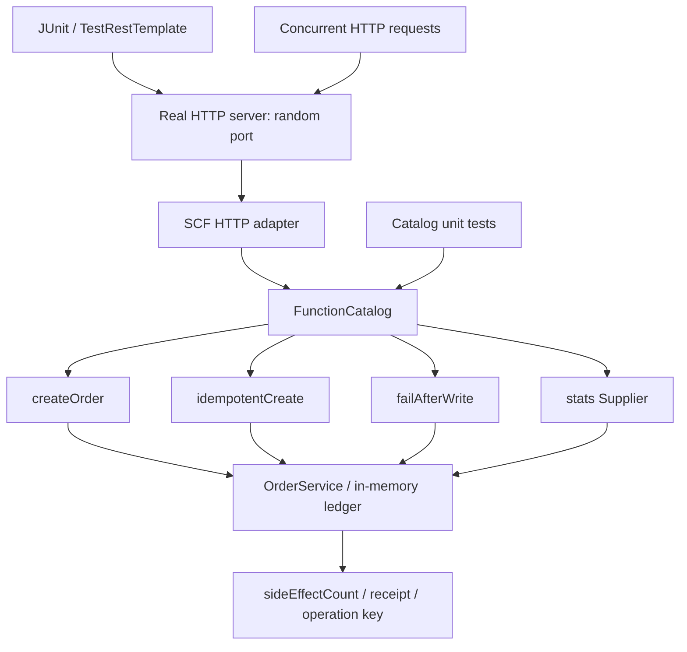

# End-to-End, Repeated-Call, and Concurrency Testing in Spring Cloud Function

## 1. Goals and Context

**Spring Cloud Function (SCF)** lets you express business logic using `Supplier<T>`, `Function<I,O>`, and `Consumer<T>`, register them via `FunctionCatalog`, and connect them to HTTP, events, or serverless runtimes. A function passing direct calls is not enough to conclude the system works end-to-end: requests also pass through adapters, routing, data conversion, security, networking, transactions, and caller retry policies.

This hands-on lab focuses on three testing levels:

1. **Function and catalog testing:** verifying business logic, function names, composition, and data types.
2. **End-to-end HTTP testing:** launching a real Spring Boot server on a random port, sending JSON through the SCF HTTP adapter, and verifying responses.
3. **Repeated-call and concurrency testing:** sending the same operation multiple times, simulating a lost response after writing data, generating concurrency, and verifying idempotency.

You will build an in-memory order-creation service. One endpoint is intentionally non-idempotent to expose duplicates; another uses an idempotency key to return the saved receipt. Another endpoint intentionally throws **after the side effect has already occurred**, testing the case where a client does not know how far the previous call got.

### Test Diagram



### Target Outcomes

| Code | Outcome | Evidence |
| --- | --- | --- |
| TEST-01 | Function can be looked up and executed via `FunctionCatalog` | Lookup and output unit tests |
| TEST-02 | Composition runs in the right order | Output of the function chain |
| TEST-03 | HTTP adapter accepts and returns expected JSON | Random-port test, not calling lambdas directly |
| TEST-04 | Calling a non-idempotent function twice produces two effects | `sideEffectCount` equals 2 |
| TEST-05 | Error after write does not prove the write failed | Naive retry creates a second effect |
| TEST-06 | Retry after error with the same idempotency key creates one effect | Stored receipt returned |
| TEST-07 | Multiple concurrent requests with the same key create one effect | Identical responses, count equals 1 |
| TEST-08 | Same key with a different payload is rejected | Conflict, zero new effects |
| TEST-09 | Tests do not depend on order or another test's state | Reset state / isolated keys |
| TEST-10 | Distinguish HTTP testing from event/serverless testing | Per-adapter test matrix |

**Scope:** examples use Java 17+, Spring Boot, SCF HTTP adapter, JUnit 5, and in-memory state. There is no real database or payment gateway. The lab demonstrates behavior within a single JVM; limits across restarts or multi-instance scaling are analyzed separately.

## 2. Project Setup

### 2.1. Tools

- JDK 17 or newer.
- Maven 3.9+ or Maven Wrapper.
- IDE/editor and terminal.
- A Spring Boot project with a compatible Spring Cloud BOM.
- No Docker or broker needed for the HTTP section; event-adapter extensions can use a dedicated test broker.

**Pick versions by release train:** Spring Boot and Spring Cloud Function must come from compatible release trains. Do not add custom versions onto individual starters. Keep your project's BOM; before shipping to production CI, review release notes and organization-approved security patches.

### 2.2. Maven Dependencies

Add these dependencies to `pom.xml`. Spring Cloud starter versions are managed by the Spring Cloud BOM:

```xml
<dependencies>
    <dependency>
        <groupId>org.springframework.cloud</groupId>
        <artifactId>spring-cloud-starter-function-web</artifactId>
    </dependency>

    <dependency>
        <groupId>org.springframework.boot</groupId>
        <artifactId>spring-boot-starter-test</artifactId>
        <scope>test</scope>
    </dependency>
</dependencies>
```

`spring-boot-starter-test` provides JUnit Jupiter, Spring Test, and `TestRestTemplate` for web integration tests. Do not pin arbitrary versions on SCF dependencies when managed by the BOM.

### 2.3. Project Structure

```text
scf-testing-lab/
├── pom.xml
└── src/
    ├── main/
    │   ├── java/demo/
    │   │   ├── TestingApplication.java
    │   │   ├── OrderCommand.java
    │   │   ├── OrderReceipt.java
    │   │   ├── TestStats.java
    │   │   └── OrderService.java
    │   └── resources/
    │       └── application.properties
    └── test/
        └── java/demo/
            ├── FunctionCatalogTest.java
            └── FunctionHttpE2ETest.java
```

These files are authored by the learner in a standalone lab project.

## 3. Defining the Business Contract to Test

An order-creation command:

```json
{
  "requestId": "req-100",
  "orderId": "order-42",
  "quantity": 2
}
```

The three fields play distinct roles:

- `requestId`: used in this lab as a stable **idempotency key** for an operation; every retry of that operation must resend the same value.
- `orderId`: business resource identifier.
- `quantity`: input data for the command.

A per-HTTP-attempt request ID is not necessarily an idempotency key. If a client generates a fresh UUID on every retry, the server treats each attempt as a distinct operation. Production contracts must scope keys properly, typically by tenant, operation type, and caller.

### 3.1. Endpoint Contracts

| Method | Endpoint | Function | Behavior |
| --- | --- | --- | --- |
| POST | `/functions/createOrder` | `createOrder` | Creates a side effect on every call |
| POST | `/functions/failAfterWrite` | `failAfterWrite` | First call writes then throws |
| POST | `/functions/idempotentCreate` | `idempotentCreate` | Same key/payload returns stored receipt |
| POST | `/functions/idempotentFailAfterWrite` | `idempotentFailAfterWrite` | First call commits key/effect then throws; retry returns stored receipt |
| GET | `/functions/stats` | `stats` | Reads side-effect count and key counts |

In this example, endpoints use JSON via the SCF HTTP adapter. When upgrading release trains, verify exact mappings against adapter docs and integration tests.

### 3.2. What Else Must Be Verified Beyond Business Outputs?

An end-to-end HTTP test does more than compare bodies. It must check:

- Is the HTTP status in the expected family?
- Did the request route to the right function name and path?
- Do `Content-Type` and response converters work?
- Did the DTO deserialize to the right type?
- Did any unintended side effects happen?
- Do repeated calls return the same receipt?
- Do two concurrent requests create two side effects?
- After an exception or timeout, does state reflect only what actually committed?

## 4. Writing DTOs for Requests, Responses, and Stats

Create `src/main/java/demo/OrderCommand.java`:

```java
package demo;

public record OrderCommand(
        String requestId,
        String orderId,
        int quantity) {}
```

Create `src/main/java/demo/OrderReceipt.java`:

```java
package demo;

public record OrderReceipt(
        String requestId,
        String orderId,
        int quantity,
        int effectSequence,
        String status) {}
```

Create `src/main/java/demo/TestStats.java`:

```java
package demo;

public record TestStats(
        int sideEffectCount,
        int orderCount,
        int idempotencyKeyCount) {}
```

These DTOs are public records so Jackson can serialize/deserialize them over HTTP and tests can use them directly. `effectSequence` is an in-JVM side-effect counter strictly for lab observation, not a production transaction ID.

## 5. Building Services With and Without Idempotency

### 5.1. `OrderService.java`

Create `src/main/java/demo/OrderService.java`:

```java
package demo;

import java.util.concurrent.ConcurrentHashMap;
import java.util.concurrent.ConcurrentMap;
import java.util.concurrent.atomic.AtomicBoolean;
import java.util.concurrent.atomic.AtomicInteger;

import org.springframework.stereotype.Service;

@Service
public class OrderService {

    private final AtomicInteger sideEffectCount =
            new AtomicInteger();

    private final ConcurrentMap<String, OrderReceipt> orders =
            new ConcurrentHashMap<>();

    private final ConcurrentMap<String, StoredOperation> processed =
            new ConcurrentHashMap<>();

    private final AtomicBoolean failFirstAfterWrite =
            new AtomicBoolean(true);

    private final AtomicBoolean failFirstIdempotentAfterWrite =
            new AtomicBoolean(true);

    public OrderReceipt create(OrderCommand command) {
        validate(command);

        int sequence = sideEffectCount.incrementAndGet();
        OrderReceipt receipt = new OrderReceipt(
                command.requestId(),
                command.orderId(),
                command.quantity(),
                sequence,
                "CREATED");

        orders.put(command.orderId(), receipt);
        return receipt;
    }

    public OrderReceipt failAfterWrite(OrderCommand command) {
        OrderReceipt receipt = create(command);

        if (failFirstAfterWrite.compareAndSet(true, false)) {
            throw new SimulatedFailureException(
                    "Response failed after side effect");
        }

        return receipt;
    }

    public OrderReceipt createIdempotently(OrderCommand command) {
        validate(command);

        StoredOperation stored = processed.compute(
                command.requestId(),
                (key, existing) -> {
                    if (existing != null) {
                        if (!existing.command().equals(command)) {
                            throw new IdempotencyConflictException(
                                    "Idempotency key reused with another payload");
                        }
                        return existing;
                    }

                    OrderReceipt receipt = create(command);
                    return new StoredOperation(command, receipt);
                });

        return stored.receipt();
    }

    public OrderReceipt idempotentFailAfterWrite(
            OrderCommand command) {

        OrderReceipt receipt = createIdempotently(command);

        if (failFirstIdempotentAfterWrite.compareAndSet(true, false)) {
            throw new SimulatedFailureException(
                    "Response failed after idempotency state was stored");
        }

        return receipt;
    }

    public TestStats stats() {
        return new TestStats(
                sideEffectCount.get(),
                orders.size(),
                processed.size());
    }

    public void resetForTest() {
        orders.clear();
        processed.clear();
        sideEffectCount.set(0);
        failFirstAfterWrite.set(true);
        failFirstIdempotentAfterWrite.set(true);
    }

    private static void validate(OrderCommand command) {
        if (command == null
                || command.requestId() == null
                || command.requestId().isBlank()
                || command.orderId() == null
                || command.orderId().isBlank()
                || command.quantity() <= 0) {
            throw new IllegalArgumentException(
                    "requestId, orderId and positive quantity are required");
        }
    }

    private record StoredOperation(
            OrderCommand command,
            OrderReceipt receipt) {}
}

class SimulatedFailureException extends RuntimeException {
    SimulatedFailureException(String message) {
        super(message);
    }
}

class IdempotencyConflictException extends RuntimeException {
    IdempotencyConflictException(String message) {
        super(message);
    }
}
```

### 5.2. Explaining the Processing Branches

- `create()` always increments the side-effect counter; calling it twice with the same command produces two receipts with different sequences.
- `failAfterWrite()` invokes `create()` first and then throws on the first invocation. The client sees an error even though the side effect succeeded.
- `createIdempotently()` uses `ConcurrentHashMap.compute()` to claim a key and store the receipt in an atomic per-key JVM operation.
- If the same key arrives with a different payload, the function throws `IdempotencyConflictException` and creates no new effect.
- `idempotentFailAfterWrite()` persists the key and receipt before throwing the first error; retries find the stored key and return the original receipt.
- `resetForTest()` is strictly for test isolation. Never invoke this reset method in production.

**Critical limit:** `ConcurrentHashMap` shares state only within a single JVM. It does not protect across multiple pods, Lambda instances, or process restarts. The `compute()` callback in this example performs only in-memory work; never call payment/email APIs or hold long-running remote calls inside a `compute()` callback in production.

### 5.3. Side Effects and Business Uniqueness Are Two Different Metrics

`orders` is keyed by `orderId`, so writing the same order ID again overwrites the stored receipt. Meanwhile `sideEffectCount` still increments on every execution. Thus:

- `orderCount` counts distinct order IDs currently in the map.
- `sideEffectCount` counts how many times the write effect ran.
- `idempotencyKeyCount` counts stored operation keys.

Do not rely on a single metric to assume all duplicates were eliminated.

## 6. Registering Functional Beans and Configuring the SCF HTTP Adapter

### 6.1. `TestingApplication.java`

Create `src/main/java/demo/TestingApplication.java`:

```java
package demo;

import java.util.function.Function;
import java.util.function.Supplier;

import org.springframework.boot.SpringApplication;
import org.springframework.boot.autoconfigure.SpringBootApplication;
import org.springframework.context.annotation.Bean;

@SpringBootApplication
public class TestingApplication {

    public static void main(String[] args) {
        SpringApplication.run(TestingApplication.class, args);
    }

    @Bean
    public Function<OrderCommand, OrderReceipt> createOrder(
            OrderService service) {
        return service::create;
    }

    @Bean
    public Function<OrderCommand, OrderReceipt> failAfterWrite(
            OrderService service) {
        return service::failAfterWrite;
    }

    @Bean
    public Function<OrderCommand, OrderReceipt> idempotentCreate(
            OrderService service) {
        return service::createIdempotently;
    }

    @Bean
    public Function<OrderCommand, OrderReceipt> idempotentFailAfterWrite(
            OrderService service) {
        return service::idempotentFailAfterWrite;
    }

    @Bean
    public Function<String, String> normalize() {
        return value -> value.trim().replaceAll("\\s+", " ");
    }

    @Bean
    public Function<String, String> uppercase() {
        return value -> value.toUpperCase(java.util.Locale.ROOT);
    }

    @Bean
    public Supplier<TestStats> stats(OrderService service) {
        return service::stats;
    }
}
```

### 6.2. `application.properties`

Create `src/main/resources/application.properties`:

```properties
spring.application.name=scf-testing-lab
server.port=8080

spring.cloud.function.web.path=/functions

# Only these functions are exposed through the HTTP adapter.
spring.cloud.function.definition=createOrder;failAfterWrite;idempotentCreate;idempotentFailAfterWrite;stats
```

`spring.cloud.function.web.path` sets the endpoint prefix. `spring.cloud.function.definition` lists exported functions; `;` separates independent functions. Each function is invoked by name in the path.

Expected paths:

- `POST /functions/createOrder`
- `POST /functions/failAfterWrite`
- `POST /functions/idempotentCreate`
- `POST /functions/idempotentFailAfterWrite`
- `GET /functions/stats`

Run the lab app only on a developer machine or trusted test network; never expose data-mutating or intentionally failing endpoints to the public internet. When running tests with `@SpringBootTest(webEnvironment = RANDOM_PORT)`, Spring Boot picks an available port and `TestRestTemplate` targets it automatically.

**Release-train note:** the SCF web adapter supports HTTP function mapping, yet exact URL, method, filtering, and converter details must be verified against your BOM's version via docs and adapter integration tests. Do not substitute checking bean existence for adapter testing.

## 7. Testing Functions and `FunctionCatalog`

### 7.1. Why Write Dedicated Catalog Tests?

Testing `service.create()` directly verifies Java logic, but does not verify Spring registered the functions. `FunctionCatalog` resolves functions by definition, so verify:

- Function names are registered properly.
- Functions have the expected input/output types.
- Compositions resolve and execute in the right order.
- Functions are not accidentally renamed or duplicated.

### 7.2. `FunctionCatalogTest.java`

Test example:

```java
package demo;

import java.util.function.Function;

import org.junit.jupiter.api.Test;
import org.springframework.beans.factory.annotation.Autowired;
import org.springframework.boot.test.context.SpringBootTest;
import org.springframework.cloud.function.context.FunctionCatalog;

import static org.junit.jupiter.api.Assertions.assertEquals;
import static org.junit.jupiter.api.Assertions.assertNotNull;

@SpringBootTest(properties = {
    "spring.cloud.function.definition=createOrder;failAfterWrite;idempotentCreate;idempotentFailAfterWrite;stats;normalize|uppercase"
})
class FunctionCatalogTest {

    @Autowired
    FunctionCatalog catalog;

    @Autowired
    OrderService service;

    @Test
    void createOrderCanBeLookedUp() {
        Function<OrderCommand, OrderReceipt> function =
                catalog.lookup(Function.class, "createOrder");

        assertNotNull(function);

        OrderReceipt receipt = function.apply(
                new OrderCommand("unit-1", "order-1", 2));

        assertEquals("order-1", receipt.orderId());
        assertEquals(1, service.stats().sideEffectCount());
    }

    @Test
    void compositionExecutesInOrder() {
        Function<String, String> composition =
                catalog.lookup(Function.class, "normalize|uppercase");

        assertEquals("HELLO WORLD",
                composition.apply("  hello   world  "));
    }
}
```

`compositionExecutesInOrder()` looks up `normalize|uppercase` directly in `FunctionCatalog`, verifying SCF composition rather than plain Java `Function.andThen()`.

**Type safety:** `FunctionCatalog.lookup()` returns a function with erased runtime generics. When assigning to a typed variable, stay mindful of unchecked assignments and ensure input/output DTOs match the registered function.

## 8. End-to-End Testing Through a Real HTTP Server

### 8.1. Why Use `RANDOM_PORT`?

`@SpringBootTest(webEnvironment = RANDOM_PORT)` starts the application context and a real web server on an OS-assigned ephemeral port. Test requests traverse:

```text
TestRestTemplate
  -> HTTP serialization
  -> loopback socket/network
  -> Spring Security/filter chain (if configured)
  -> SCF HTTP adapter
  -> FunctionCatalog
  -> functional bean
  -> HTTP response conversion
```

This is end-to-end testing at the **application's HTTP boundary**. It still does not exercise a reverse proxy, load balancer, production database, or real broker.

### 8.2. `FunctionHttpE2ETest.java`

Create `src/test/java/demo/FunctionHttpE2ETest.java`:

```java
package demo;

import static org.junit.jupiter.api.Assertions.assertEquals;
import static org.junit.jupiter.api.Assertions.assertFalse;
import static org.junit.jupiter.api.Assertions.assertNotNull;
import static org.junit.jupiter.api.Assertions.assertTrue;

import java.util.ArrayList;
import java.util.List;
import java.util.concurrent.CountDownLatch;
import java.util.concurrent.ExecutorService;
import java.util.concurrent.Executors;
import java.util.concurrent.Future;
import java.util.concurrent.TimeUnit;

import org.junit.jupiter.api.BeforeEach;
import org.junit.jupiter.api.Test;
import org.springframework.beans.factory.annotation.Autowired;
import org.springframework.boot.test.context.SpringBootTest;
import org.springframework.boot.test.web.client.TestRestTemplate;
import org.springframework.http.ResponseEntity;

@SpringBootTest(
    webEnvironment = SpringBootTest.WebEnvironment.RANDOM_PORT,
    properties = {
        "spring.cloud.function.web.path=/functions",
        "spring.cloud.function.definition=createOrder;failAfterWrite;idempotentCreate;idempotentFailAfterWrite;stats"
    }
)
class FunctionHttpE2ETest {

    @Autowired
    TestRestTemplate http;

    @Autowired
    OrderService service;

    @BeforeEach
    void resetState() {
        service.resetForTest();
    }

    @Test
    void httpAdapterConvertsJsonAndInvokesFunction() {
        OrderCommand command =
                new OrderCommand("http-1", "order-http-1", 3);

        ResponseEntity<OrderReceipt> response =
                http.postForEntity(
                        "/functions/createOrder",
                        command,
                        OrderReceipt.class);

        assertTrue(response.getStatusCode().is2xxSuccessful());
        assertNotNull(response.getBody());
        assertEquals("order-http-1",
                response.getBody().orderId());
        assertEquals(3, response.getBody().quantity());
        assertEquals(1, response.getBody().effectSequence());

        ResponseEntity<TestStats> stats =
                http.getForEntity(
                        "/functions/stats",
                        TestStats.class);

        assertTrue(stats.getStatusCode().is2xxSuccessful());
        assertEquals(1, stats.getBody().sideEffectCount());
    }

    @Test
    void repeatedNonIdempotentCallCreatesTwoEffects() {
        OrderCommand command =
                new OrderCommand("repeat-1", "order-repeat", 1);

        ResponseEntity<OrderReceipt> first =
                http.postForEntity(
                        "/functions/createOrder",
                        command,
                        OrderReceipt.class);

        ResponseEntity<OrderReceipt> second =
                http.postForEntity(
                        "/functions/createOrder",
                        command,
                        OrderReceipt.class);

        assertTrue(first.getStatusCode().is2xxSuccessful());
        assertTrue(second.getStatusCode().is2xxSuccessful());
        assertEquals(1, first.getBody().effectSequence());
        assertEquals(2, second.getBody().effectSequence());

        assertEquals(2, service.stats().sideEffectCount());
    }

    @Test
    void failureAfterWriteThenRetryCreatesDuplicate() {
        OrderCommand command =
                new OrderCommand("failure-1", "order-failure", 1);

        ResponseEntity<String> first =
                http.postForEntity(
                        "/functions/failAfterWrite",
                        command,
                        String.class);

        // Adapter exception mapping can vary across release trains.
        assertFalse(first.getStatusCode().is2xxSuccessful());
        assertEquals(1, service.stats().sideEffectCount());

        ResponseEntity<OrderReceipt> retry =
                http.postForEntity(
                        "/functions/failAfterWrite",
                        command,
                        OrderReceipt.class);

        assertTrue(retry.getStatusCode().is2xxSuccessful());
        assertEquals(2, service.stats().sideEffectCount());
    }

    @Test
    void idempotentRetryAfterFailureReturnsStoredReceipt() {
        OrderCommand command =
                new OrderCommand("idem-fail-1", "order-idem-fail", 2);

        ResponseEntity<String> first =
                http.postForEntity(
                        "/functions/idempotentFailAfterWrite",
                        command,
                        String.class);

        assertFalse(first.getStatusCode().is2xxSuccessful());
        assertEquals(1, service.stats().sideEffectCount());
        assertEquals(1, service.stats().idempotencyKeyCount());

        ResponseEntity<OrderReceipt> retry =
                http.postForEntity(
                        "/functions/idempotentFailAfterWrite",
                        command,
                        OrderReceipt.class);

        assertTrue(retry.getStatusCode().is2xxSuccessful());
        assertNotNull(retry.getBody());
        assertEquals(1, retry.getBody().effectSequence());
        assertEquals(1, service.stats().sideEffectCount());
    }

    @Test
    void repeatedIdempotentCallReturnsSameReceipt() {
        OrderCommand command =
                new OrderCommand("idem-2", "order-idem-2", 5);

        ResponseEntity<OrderReceipt> first =
                http.postForEntity(
                        "/functions/idempotentCreate",
                        command,
                        OrderReceipt.class);

        ResponseEntity<OrderReceipt> second =
                http.postForEntity(
                        "/functions/idempotentCreate",
                        command,
                        OrderReceipt.class);

        assertTrue(first.getStatusCode().is2xxSuccessful());
        assertTrue(second.getStatusCode().is2xxSuccessful());
        assertEquals(first.getBody(), second.getBody());
        assertEquals(1, service.stats().sideEffectCount());
    }

    @Test
    void sameKeyWithDifferentPayloadDoesNotCreateAnotherEffect() {
        http.postForEntity(
                "/functions/idempotentCreate",
                new OrderCommand("idem-conflict", "order-a", 1),
                OrderReceipt.class);

        ResponseEntity<String> conflict =
                http.postForEntity(
                        "/functions/idempotentCreate",
                        new OrderCommand("idem-conflict", "order-b", 9),
                        String.class);

        assertFalse(conflict.getStatusCode().is2xxSuccessful());
        assertEquals(1, service.stats().sideEffectCount());
    }

    @Test
    void concurrentRequestsWithSameKeyCreateOneEffect()
            throws Exception {

        int workers = 12;
        OrderCommand command =
                new OrderCommand(
                        "idem-parallel-1",
                        "order-parallel",
                        4);

        List<OrderReceipt> receipts = runConcurrently(
                workers,
                () -> {
                    ResponseEntity<OrderReceipt> response =
                            http.postForEntity(
                                    "/functions/idempotentCreate",
                                    command,
                                    OrderReceipt.class);

                    if (!response.getStatusCode().is2xxSuccessful()
                            || response.getBody() == null) {
                        throw new IllegalStateException(
                                "Unexpected HTTP response: " +
                                response.getStatusCode());
                    }
                    return response.getBody();
                });

        assertEquals(workers, receipts.size());
        assertTrue(receipts.stream().allMatch(
                receipt -> receipt.equals(receipts.get(0))));

        ResponseEntity<TestStats> stats =
                http.getForEntity(
                        "/functions/stats",
                        TestStats.class);

        assertTrue(stats.getStatusCode().is2xxSuccessful());
        assertEquals(1, stats.getBody().sideEffectCount());
        assertEquals(1, stats.getBody().idempotencyKeyCount());
    }

    @Test
    void concurrentNonIdempotentCallsCreateOneEffectPerRequest()
            throws Exception {

        int workers = 8;

        List<OrderReceipt> receipts = runConcurrently(
                workers,
                new java.util.concurrent.atomic.AtomicInteger(),
                index -> {
                    OrderCommand command = new OrderCommand(
                            "attempt-" + index,
                            "same-business-order",
                            1);

                    ResponseEntity<OrderReceipt> response =
                            http.postForEntity(
                                    "/functions/createOrder",
                                    command,
                                    OrderReceipt.class);

                    if (!response.getStatusCode().is2xxSuccessful()
                            || response.getBody() == null) {
                        throw new IllegalStateException(
                                "Unexpected HTTP response: " +
                                response.getStatusCode());
                    }
                    return response.getBody();
                });

        assertEquals(workers, receipts.size());
        assertEquals(workers, service.stats().sideEffectCount());
    }

    private static <T> List<T> runConcurrently(
            int workers,
            java.util.concurrent.Callable<T> action)
            throws Exception {
        return runConcurrently(
                workers,
                new java.util.concurrent.atomic.AtomicInteger(),
                ignored -> action.call());
    }

    private static <T> List<T> runConcurrently(
            int workers,
            java.util.concurrent.atomic.AtomicInteger sequence,
            java.util.function.Function<Integer, T> action)
            throws Exception {

        ExecutorService pool =
                Executors.newFixedThreadPool(workers);
        CountDownLatch ready = new CountDownLatch(workers);
        CountDownLatch start = new CountDownLatch(1);
        List<Future<T>> futures = new ArrayList<>();

        try {
            for (int i = 0; i < workers; i++) {
                futures.add(pool.submit(() -> {
                    ready.countDown();

                    if (!start.await(10, TimeUnit.SECONDS)) {
                        throw new IllegalStateException(
                                "Workers did not receive start signal");
                    }

                    return action.apply(sequence.getAndIncrement());
                }));
            }

            if (!ready.await(10, TimeUnit.SECONDS)) {
                throw new IllegalStateException(
                        "Workers did not become ready");
            }

            start.countDown();

            List<T> results = new ArrayList<>();
            for (Future<T> future : futures) {
                results.add(future.get(20, TimeUnit.SECONDS));
            }
            return results;
        }
        finally {
            start.countDown();
            pool.shutdownNow();
            pool.awaitTermination(10, TimeUnit.SECONDS);
        }
    }
}
```

### 8.3. Synchronizing Workers in Concurrency Tests

The `runConcurrently()` helper uses two latches: `ready` waits until all workers are ready, and `start` fires the start signal. The second overload takes an `AtomicInteger` to assign unique indices when a test needs distinct IDs per request. HTTP assertions run on the test thread after collecting `Future` results; if any worker fails, `Future.get()` surfaces the error so the suite fails.

**Concurrency note:** `TestRestTemplate` is configured at context startup and shared concurrently afterward. If custom client interceptors or request factories are not thread-safe, create one client per worker or use `java.net.http.HttpClient` concurrently per its thread-safety contract.

## 9. Interpreting End-to-End Test Results

### 9.1. A Successful Request

`httpAdapterConvertsJsonAndInvokesFunction()` verifies several things at once:

1. Spring Boot context and HTTP server start up.
2. The JSON request hits the right path.
3. The SCF HTTP adapter routes to `createOrder`.
4. The input converts into `OrderCommand`.
5. The function calls the service and produces a receipt.
6. The response serializes into `OrderReceipt`.
7. The `stats` supplier returns the recorded side-effect state.

If a test calls `service.create(command)` directly, steps 2, 3, and 6 go untested.

### 9.2. Repeated Calls to a Non-Idempotent Function

`repeatedNonIdempotentCallCreatesTwoEffects()` sends the same request body twice. The two responses have different `effectSequence` values, and the side-effect counter reaches 2.

That is the expected behavior of a non-idempotent function. Do not "fix" the test to expect identical responses when the current contract does not promise that.

### 9.3. Error After Side Effect and Retry

`failureAfterWriteThenRetryCreatesDuplicate()` verifies:

- The first request returns non-2xx because the function threw after writing.
- The service counter is already 1 after the error response.
- Retrying the same command enters the function a second time.
- The counter rises to 2.

Do not hardcode a specific status code for this exception unless HTTP exception mapping is explicitly defined. SCF/web runtimes may map exceptions differently across versions. When production APIs need a stable 4xx/5xx contract, register an adapter-appropriate exception handler and test it separately.

### 9.4. Error After Idempotency State Is Stored

`idempotentRetryAfterFailureReturnsStoredReceipt()` simulates a critical window:

```text
Attempt 1:
  idempotency key absent
  -> create side effect
  -> store key + receipt
  -> response fails

Retry:
  same idempotency key
  -> stored key found
  -> return prior receipt
  -> zero new side effects
```

Expected outcome: across two attempts, the client sees one error and one success, while `sideEffectCount` stays at 1.

In real database-backed systems, store the key and business record in a durable transaction. An in-memory map does not prove behavior across restarts.

### 9.5. Same Key, Different Payload

An idempotency key is meaningful only when bound to a specific command. If a client reuses the key while changing the order ID or quantity, the function must reject it. The test asserts only a non-2xx response and no counter increase; exact HTTP status codes should be defined at the HTTP boundary.

## 10. Testing Concurrent Requests

### 10.1. Same Key and Same Payload

`concurrentRequestsWithSameKeyCreateOneEffect()` dispatches 12 parallel HTTP requests with the same key and DTO. All responses must return the identical receipt while the side-effect counter increments only once.

This tests concurrency at the **HTTP boundary**, not merely driving `ConcurrentHashMap` from raw threads. It simultaneously verifies web server request concurrency, SCF adapter routing, and state consistency inside the function.

### 10.2. Different Keys with the Same Order ID

`concurrentNonIdempotentCallsCreateOneEffectPerRequest()` sends distinct keys sharing the same business order ID to the non-idempotent endpoint. Every call executes and the counter grows with the request count.

This illustrates:

- Deduplicating by operation key only deduplicates **the same operation**.
- If business rules allow only one order per order ID, enforce a unique constraint on the business key in the database.
- A fresh request ID must not bypass business uniqueness constraints.

### 10.3. Why Use `CountDownLatch` in Tests?

The helper aligns workers before issuing requests. Without a latch, threads can run staggered in time and fail to trigger true contention. Still, a start latch only aligns launch times closely; it does not guarantee every request hits the server at the exact same nanosecond. Tests must assert final invariants rather than relying on exact timing.

### 10.4. Do Not Enable Parallel JUnit Methods Carelessly

This test class shares one Spring context and one singleton `OrderService`. `@BeforeEach resetState()` clears state before each method. Therefore, do not enable JUnit parallel execution across methods in this class while they share context state; one test could wipe state mid-flight while another is sending requests.

When parallel test methods are needed:

- Use unique keys per test and drop global resets.
- Provision separate application contexts or database schemas per test.
- Or run suites with controlled parallelism and explicit isolation.

## 11. Test Isolation, Determinism, and Test Data

### 11.1. Why Must Tests Be Independent?

Repeating a test multiple times must produce identical results regardless of which tests ran beforehand. If a test relies on side-effect counts left by an earlier test, outcomes become order-dependent and CI turns flaky.

This lab uses `resetForTest()` inside `@BeforeEach` to:

- Clear the orders map.
- Clear processed keys.
- Reset the side-effect counter.
- Restore fault-injection flags to their initial state.

Never expose a reset endpoint over HTTP. Tests access the service directly solely to reset state, while business flows run through HTTP.

### 11.2. Use Per-Test Keys

In environments sharing a persistent database, give each test its own namespace:

```text
test run: ci-4821
test case: concurrent-idempotency
operation key: ci-4821-concurrent-idempotency
tenant: test-tenant
```

Never reuse fixed keys on a long-lived staging environment if idempotency state persists; subsequent runs may replay cached results instead of executing the code under test.

### 11.3. Scoped Cleanup

When using a real database in integration tests:

- Use isolated schemas/databases or proper transaction rollbacks.
- Use Testcontainers or disposable databases when verifying transactions and unique constraints.
- Never delete production data to "reset tests."
- Do not rely on an outer test transaction when HTTP requests execute on separate server threads outside the test thread's transaction.

That last point is especially critical: `@Transactional` on a test method does not roll back work committed on a separate HTTP server thread.

## 12. Distinguishing Unit, Integration, End-to-End, and Contract Tests

| Test Kind | Scope | SCF Example |
| --- | --- | --- |
| Unit | Single class/function, no Spring startup | Testing `OrderService` and validation |
| Catalog test | Spring context + function registry | `FunctionCatalog.lookup()` and composition |
| Adapter integration | Spring context + HTTP adapter | JSON mapping, paths, methods, responses |
| E2E | App running as clients see it in test env | `RANDOM_PORT`, HTTP requests, and state |
| Contract | Agreement between client and service | DTOs, statuses, headers, error schemas |
| Component test | Single service with dependency test doubles | Mock/container DB, external API stubs |
| System test | Multiple real services/brokers/databases | End-to-end event workflow in staging |

A `FunctionCatalog` test does not replace HTTP E2E. An HTTP E2E test does not replace broker integration. Each layer provides its own scope of evidence.

### 12.1. Testing SCF Composition

Suppose you have two beans:

```java
@Bean
Function<String, String> normalize() {
    return value -> value.trim().replaceAll("\\s+", " ");
}

@Bean
Function<String, String> uppercase() {
    return value -> value.toUpperCase(Locale.ROOT);
}
```

Test the catalog with the composed name:

```java
Function<String, String> chain =
        catalog.lookup(Function.class, "normalize|uppercase");

assertEquals("HELLO WORLD",
        chain.apply("  hello   world  "));
```

Verify all of:

- Lookup by function name.
- Composition order.
- Input/output types and conversion.
- Errors on wrong function names or incompatible compositions.
- Whether the function is exported by the target adapter.

### 12.2. Event Adapters Need Separate Tests

HTTP E2E does not test message serialization, consumer groups, acks/offsets, retries, or DLQs. For Spring Cloud Stream or broker adapters:

- Use binder test support when checking basic binding logic.
- Use Testcontainers/real brokers when verifying delivery, partitions, acks, or redelivery semantics.
- Send the same event ID repeatedly to verify consumer idempotency.
- Test crashes after commit before ack, and redelivery.
- Test dead-letter routing and controlled replay.

Do not infer "exactly-once events" because an HTTP endpoint returned the same receipt twice.

## 13. Fault Injection and Timeout Testing

### 13.1. Injecting Failures in the Right Places

Useful fault-injection points:

| Failure Point | Question to Answer |
| --- | --- |
| Before function starts | Did the request reach the application? |
| After deserialization, before side effect | Is retrying safe? |
| After side effect, before response | Was data already persisted? |
| After DB commit, before broker ack | Is the message redelivered? |
| After external API success, before saving result | Can the transaction be queried/reconciled? |
| When multiple requests share a key | Is only one worker allowed to execute? |

Keep fault injection intentional, restricted to test profiles, and self-resetting. Never expose failure-triggering endpoints in production.

### 13.2. Client Timeouts Do Not Prove Server Rollback

Example using `curl` with a timeout:

```bash
curl --max-time 1 -i \
  -X POST 'http://localhost:8080/functions/failAfterWrite' \
  -H 'Content-Type: application/json' \
  --data '{"requestId":"timeout-1","orderId":"timeout-order","quantity":1}'
```

In this lab, `failAfterWrite` fails fast rather than timing out the client. To test real client timeouts, add a test-only delay or controlled fault-injection proxy. After the timeout, query `/functions/stats` to see if the side effect occurred, then retry with the same key against the idempotent endpoint.

**Do not** set a 1-second timeout and conclude the server cancelled the function. A client giving up does not mean the server thread, database transaction, or outbound API call aborted.

### 13.3. Measuring Latency at the HTTP Boundary

```bash
curl -sS -o /dev/null \
  -w 'status=%{http_code} connect=%{time_connect}s ttfb=%{time_starttransfer}s total=%{time_total}s\n' \
  -X POST 'http://localhost:8080/functions/idempotentCreate' \
  -H 'Content-Type: application/json' \
  --data '{"requestId":"measure-1","orderId":"measure-order","quantity":1}'
```

- `time_connect`: TCP connect time observed from the client.
- `time_starttransfer`: time to first response byte.
- `time_total`: total request duration.
- Measurements include network and adapter overhead, not pure function duration.

Measure repeatedly and compare p50/p95/p99 under consistent conditions. A single local call is not a production benchmark.

## 14. Running Tests and Reading Results

Run the full suite:

```bash
mvn -B -ntp clean test
```

Or run catalog tests alone:

```bash
mvn -Dtest=FunctionCatalogTest test
```

Run E2E tests alone:

```bash
mvn -Dtest=FunctionHttpE2ETest test
```

When tests fail, inspect in order:

1. Did the Spring context start?
2. Did the HTTP server bind the random port?
3. Did SCF register the expected function definitions?
4. Did the request hit the right path and method?
5. Did the JSON converter match the DTO?
6. Did the function throw an exception?
7. Was state reset before the test?
8. Were concurrent requests throttled by server or client pools?
9. Do assertions rely on a status code the adapter does not guarantee?

Never weaken assertions just to turn a test green before understanding the root cause.

### 14.1. Expected Outcome Table

| Test | Expectation | Meaning |
| --- | --- | --- |
| `createOrder` via HTTP | 2xx, valid receipt | Adapter + function work |
| Calling `createOrder` twice | effect count 2 | Non-idempotent endpoint |
| `failAfterWrite` first call | non-2xx, count 1 | Side effect before exception |
| Retry `failAfterWrite` | 2xx, count 2 | Naive retry creates duplicate |
| `idempotentCreate` twice | identical receipts, count 1 | Key-based deduplication |
| `idempotentFailAfterWrite` retry | 2nd response succeeds, count 1 | Replays stored result |
| Same key, different payload | non-2xx, count unchanged | Key conflict |
| 12 concurrent requests, same key | 12 identical receipts, count 1 | In-JVM per-key atomicity |
| 8 distinct keys, same order ID | count 8 on non-idempotent endpoint | Operation key differs from business unique key |

These outcomes are the **expected behavior of the lab code**. Learners must run Maven and capture actual test reports; this guide does not claim a specific build was executed here.

## 15. Limits to Verify Before Production

### 15.1. In-Memory State Is Not Durable

Once the JVM restarts, `processed` is empty. Two separate instances hold separate maps. Single-process E2E tests cannot prove deduplication across restarts or scale-outs.

Production typically requires:

- An idempotency table or shared state store.
- A unique constraint scoped by tenant + operation type + key.
- Request payload hashing to detect key reuse with differing payloads.
- A state machine (`PROCESSING`, `SUCCEEDED`, `FAILED_RETRYABLE`).
- Leases/timeouts and recovery for workers that crash mid-flight.
- Stored responses/results so retries receive the prior outcome.
- Retention/TTL sized beyond maximum retry and replay windows.

### 15.2. Unique Keys Do Not Create Cross-System Atomicity

A database transaction does not commit atomically with a payment API, email provider, or message broker. When external side effects exist:

1. Persist the order and outbox event in one DB transaction.
2. Have a worker read the outbox and publish events.
3. Pass a stable event ID/idempotency key downstream.
4. Deduplicate by ID in the consumer and persist processing state.
5. Reconcile when an external outcome is ambiguous after a timeout.

An outbox worker can still publish an event more than once if it crashes after publishing but before marking the row sent. Consumers must still be idempotent.

### 15.3. Single-JVM Concurrency Tests Are Insufficient Alone

Add tests across multiple instances or a real database for:

- Two app instances racing to claim the same key.
- Process restart between two requests.
- Crash after DB commit before HTTP response or broker ack.
- Event redelivery after an external side effect.
- Two requests with the same order ID and different idempotency keys.
- Concurrent unique-constraint conflicts.
- Lease expiration while a slow worker is still running.
- Replaying events from a DLQ.

Use Testcontainers or a dedicated integration environment to verify real database and broker semantics.

## 16. CI Pipeline and Test Gates

| Stage | Check | Failure Condition |
| --- | --- | --- |
| Compile | Maven compile | Compilation errors |
| Unit | Service validation and business rules | Assertion failure |
| Catalog | Lookup and composition | Missing function or wrong order |
| HTTP E2E | Random port, JSON, routes, responses | Wrong status or body |
| Retry | Error after effect and retry | Uncontracted duplicate side effects |
| Concurrency | N requests with same key | More than one effect |
| Conflict | Same key, different payload | New effect created anyway |
| Persistence | Restart/multi-instance with real DB | Keys not durable |
| Event adapter | Redelivery/ack/DLQ | Duplicate message creates duplicate effect |
| Performance | Latency and throughput | Exceeds defined SLO |

Minimum CI command sequence:

```bash
mvn -B -ntp clean verify
```

Archive test reports, commit SHA, image digests, and environment metadata. Never write credentials, raw payment details, or sensitive payloads into test logs.

### 16.1. Tests Must Re-Run Reliably

- Each test prepares its own state without depending on other tests.
- Concurrency tests use start barriers and sensible deadlines.
- Avoid arbitrary sleeps assuming threads have reached a line of code.
- Do not set test timeouts tightly coupled to local machine speed.
- Do not enable JUnit parallelism unless shared state is isolated.
- When a test flakes, capture thread dumps/logs and fix synchronization; never mask bugs with infinite test retries.

## 17. Runbook When E2E or Concurrency Tests Fail

1. **Confirm the request:** URL, HTTP method, content type, payload, and response status.
2. **Check routing:** function definition, web path, and function name.
3. **Correlate traces/logs:** invocation ID, operation key hash, attempt number, and side-effect timestamp.
4. **Inspect state:** side-effect count, receipts, and stored idempotency keys.
5. **Check concurrency:** same key vs. distinct keys; same order ID vs. distinct resources.
6. **Check reset/isolation:** did another test clear state while this test was running?
7. **Check the adapter:** JSON converters, exception mappings, thread pools, and request timeouts.
8. **Minimal reproducer:** run the failing test method alone with identical data and keys.
9. **Check database/broker:** if the failure appears only in multi-instance or event tests.
10. **Fix the root cause and keep a regression test:** never just relax assertions or bump timeouts.

### Useful Log Fields

```json
{
  "event": "function.test",
  "function": "idempotentCreate",
  "operationKeyHash": "sha256:...",
  "attemptId": "attempt-2",
  "traceId": "trace-abc",
  "instanceId": "test-app-1",
  "stage": "side_effect_committed",
  "durationMs": 12,
  "outcome": "success"
}
```

Never log secrets or sensitive payloads. `attemptId` may vary across retries; the operation key hash must stay stable to link attempts of the same business operation.

## 18. Practice Exercises

1. Write unit tests for `OrderService.create()` with valid and invalid inputs.
2. Use `FunctionCatalog.lookup()` to fetch `createOrder` and invoke the function.
3. Write the SCF composition `normalize|uppercase` and verify execution order.
4. Write an HTTP E2E test with `RANDOM_PORT` sending JSON.
5. Call `createOrder` twice with the same request body. Explain why two side effects occur.
6. Simulate a failure after writing data but before returning a response; check counters before and after retry.
7. Write a test proving `idempotentCreate` returns the identical receipt on repeated calls.
8. Send 20 concurrent requests with the same idempotency key. Verify only one side effect occurs.
9. Send 10 concurrent requests with different keys and the same order ID. Explain why idempotency keys do not replace business unique constraints.
10. Reuse the same key with a different payload. Design an appropriate error contract.
11. Disable `resetForTest()` and observe how tests become order-dependent.
12. Enable JUnit parallel execution. Fix test isolation so test methods no longer race.
13. Write a Testcontainers test with a PostgreSQL unique constraint for two app instances claiming the same key.
14. Simulate a crash after DB commit before HTTP response. Retries must return the stored receipt.
15. Simulate event redelivery after commit before ack. How should the consumer deduplicate?
16. Propose tests for DLQ replay and outbox worker restarts.
17. Measure p95/p99 latency as concurrency increases; separate HTTP adapter overhead from function duration.
18. Write contract tests ensuring response schemas remain unchanged across Spring Cloud release-train upgrades.

## Official References

- [Spring Cloud Function — Programming Model](https://docs.spring.io/spring-cloud-function/reference/spring-cloud-function/programming-model.html): `Supplier`, `Function`, `Consumer`, `FunctionCatalog`, and composition.
- [Spring Cloud Function — Standalone Web Applications](https://docs.spring.io/spring-cloud-function/reference/spring-cloud-function/standalone-web-applications.html): HTTP adapter, function mapping, composition, and message conversion.
- [Spring Boot — Testing](https://docs.spring.io/spring-boot/reference/testing/spring-boot-applications.html): `@SpringBootTest`, random ports, and test contexts.
- [Spring Boot — TestRestTemplate API](https://docs.spring.io/spring-boot/api/java/org/springframework/boot/test/web/client/TestRestTemplate.html): HTTP integration testing in Spring Boot apps.
- [JUnit 5 — User Guide](https://junit.org/junit5/docs/current/user-guide/): lifecycle, assertions, and test execution.
- [Java — ConcurrentHashMap](https://docs.oracle.com/en/java/javase/17/docs/api/java.base/java/util/concurrent/ConcurrentHashMap.html): per-key atomic map operations.
- [Java — CountDownLatch](https://docs.oracle.com/en/java/javase/17/docs/api/java.base/java/util/concurrent/CountDownLatch.html): coordinating multiple workers in concurrency tests.
- [PostgreSQL — INSERT / ON CONFLICT](https://www.postgresql.org/docs/current/sql-insert.html): unique conflicts and atomic claims.
- [Spring Framework — Transaction Management](https://docs.spring.io/spring-framework/reference/data-access/transaction.html): transaction boundaries and rollbacks.
- [Spring for Apache Kafka — Testing](https://docs.spring.io/spring-kafka/reference/testing.html): testing Kafka listeners and broker integration.
- [Spring for Apache Kafka — Exactly Once Semantics](https://docs.spring.io/spring-kafka/reference/kafka/exactly-once.html): scope and limits of exactly-once delivery.
- [AWS Lambda — Retry behavior](https://docs.aws.amazon.com/lambda/latest/dg/invocation-retries.html): retry differences across synchronous, asynchronous, and event-source invocations.

> **Key takeaway:** Direct function tests verify only logic; end-to-end tests must traverse real adapters; repeated-call tests must check side effects; concurrency tests must verify final invariants. Keep **idempotency keys stable**, verify **both responses and state**, and test retries and acknowledgements separately for each HTTP, event, and serverless adapter.
