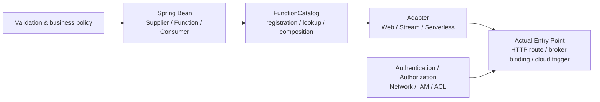
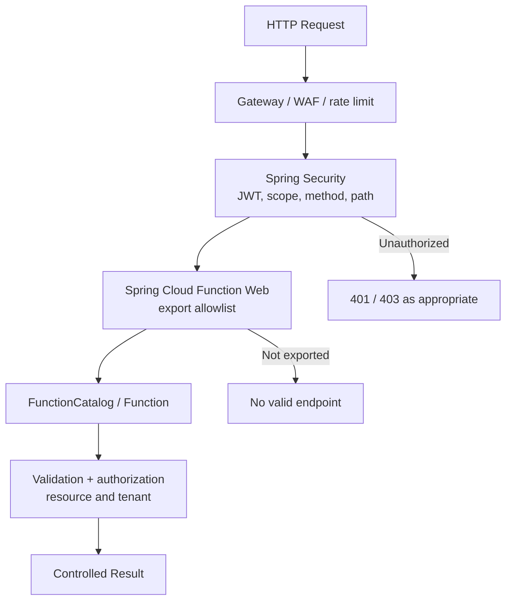

# Expose Only the Functions Needed for Each Entry Point

## 1. The Security Problem in Spring Cloud Function

In **SPRING_CLOUD_FUNCTION (Spring Cloud Function)**, logic is written as `Supplier`, `Function`, and `Consumer` beans, looked up via `FunctionCatalog`, optionally chained with *composition*, and deployed with the same logic across HTTP, event streams, or serverless environments. This reusability is valuable, but it also raises a security question: **which function is allowed to be invoked from which entry point?**

An application might contain three functions:

- `publicUppercase`: normalizes a user-submitted string.
- `publicPreview`: generates a preview for customers.
- `internalRebuild`: a maintenance operation that should only be triggered by a high-privilege internal process.

If the application uses `spring-cloud-function-web` and lets every eligible bean be published as an HTTP endpoint, a function originally designed for internal use risks having an unintended **network invocation path**. Having `internal` in the function name or placing the logic in a package named `admin` is **not an access boundary**.

Core principle:

> **Each entry point should expose only the functions it truly needs, and every exposed invocation must still undergo appropriate authentication, authorization, and input validation.**

This is the *least privilege* principle applied to the function invocation surface, not just to accounts or network systems.

### Learning Objectives

After this lesson, you will be able to:

1. Distinguish between Java beans, `FunctionCatalog`, adapters, and external entry points.
2. Specify published endpoints in Spring Cloud Function Web using `spring.cloud.function.definition` and a semicolon-separated (`;`) list.
3. Use `spring.cloud.function.ineligible-definitions` for beans that should not be registered in the catalog, and understand its limitations.
4. Apply Spring Security on the HTTP path and enforce per-function access permissions.
5. Avoid risks from dynamic routing, composition, single-function fallback, and caller-controlled headers.
6. Separately select function definitions, triggers, and infrastructure permissions for Spring Cloud Stream and serverless.
7. Write negative tests to prove that internal functions **cannot** be invoked through public entry points.

## 2. Four Layers Often Mistaken for One



| Layer | Responsibility | What Must **Not** Be Inferred |
|---|---|---|
| Spring Bean | Defines `Function`, `Consumer`, `Supplier` logic | `@Bean` does not mean every client is allowed to call it |
| `FunctionCatalog` | Discovery, lookup, invocation wrapping, conversion, composition | Being discoverable in the catalog does not mean it is allowed to be exposed over the Internet |
| Adapter | Connects logic to HTTP, a broker, Lambda, or another environment | Having an adapter available is not proof that the endpoint is protected |
| Entry point / transport | URL, method, topic/subscription, event trigger | A hard-to-guess path name does not replace authorization |
| Security layer | Authentication, authorization, network policy, IAM/ACL, rate limiting | An allowlisted function can still be abused without permission controls |

**"Not exposed" and "not in the catalog" are different.** A bean can still be used internally by the application even if it is not exposed by the Web adapter. Conversely, excluding a bean from the catalog reduces the chance that an adapter or `FunctionCatalog.lookup(...)` can look it up, but it is not an access-control mechanism against actors that can still call the Java bean or internal service directly.

## 3. Build an Entry-Point Matrix Before Configuring

To avoid applying a single property to every deployment type, build a matrix for your application:

| Function | Public HTTP | Admin HTTP | `orders.in` Broker | Serverless Trigger | Notes |
|---|---:|---:|---:|---:|---|
| `publicUppercase` | Yes, if the API actually needs it | Not needed | No | No | Per-API authentication and quota |
| `publicPreview` | Yes | Not needed | No | No | Does not perform state-changing operations |
| `processOrderEvent` | No | No | Yes | Possibly in **another deployment** | Accepts events only from authorized sources |
| `internalRebuild` | No | Only via a dedicated admin API, if required | No | Dedicated admin trigger only, if needed | High privilege, auditing, and network isolation |

The matrix should be evaluated for **each deployment/profile**, not just for the repository as a whole. Having multiple beans in one JAR does not mean every environment running that JAR should open every entry path.

For example, the Web deployment only needs `publicUppercase` and `publicPreview`, while the Stream deployment only needs `processOrderEvent`. Use environment-specific configuration or split applications if privilege differences are significant.

## 4. Example: Multiple Beans, Only a Subset Allowed Over HTTP

Create a small Spring Boot application with three beans. Java 17+ example:

```java
package com.example.securefunctions;

import java.util.Locale;
import java.util.function.Function;

import org.springframework.boot.SpringApplication;
import org.springframework.boot.autoconfigure.SpringBootApplication;
import org.springframework.context.annotation.Bean;

@SpringBootApplication
public class SecureFunctionApplication {

    public static void main(String[] args) {
        SpringApplication.run(SecureFunctionApplication.class, args);
    }

    @Bean
    public Function<String, String> publicUppercase() {
        return value -> value.toUpperCase(Locale.ROOT);
    }

    @Bean
    public Function<String, String> publicPreview() {
        return value -> "[PREVIEW] " + value;
    }

    // Example internal task function; must not be exposed as an HTTP endpoint.
    @Bean
    public Function<String, String> internalRebuild() {
        return value -> "INTERNAL:" + value;
    }
}
```

All three beans have the type `Function<String, String>`, so this is a multi-candidate scenario in `FunctionCatalog`. In a real application, **sensitive administrative operations are best implemented as plain services** rather than `Function` beans sitting in a shared public catalog; here we intentionally make `internalRebuild` a function bean to demonstrate how to reduce exposure risk.

Assume the application has Spring Cloud Function Web on the classpath. The Web adapter can publish function beans as HTTP endpoints by function name; without restriction rules, developers must not assume that only one URL is open.

## 5. Restricting Web Exports with `spring.cloud.function.definition`

In Spring Cloud Function Web, the official documentation describes **Function Filtering rules**: when multiple functions exist in the catalog, use `spring.cloud.function.definition` with a **semicolon (`;`)**-separated list to expose only a specific set of functions/compositions.

```properties
spring.cloud.function.web.path=/functions
spring.cloud.function.definition=publicUppercase;publicPreview
```

Meaning:

- `publicUppercase` and `publicPreview` are the **two** entry points permitted to be published.
- `internalRebuild` is not in the list; the Web adapter should not publish it as an endpoint under this filtering configuration.
- When using a `;`-separated list according to the Web adapter rules, **there is no automatic mapping for the root path**.
- `spring.cloud.function.web.path=/functions` sets the HTTP path prefix of the Web adapter; changing the prefix is **not a security measure**.

Example invocation:

```bash
curl -i -X POST http://localhost:8080/functions/publicUppercase \
  -H "Content-Type: text/plain" \
  -d "hello"
```

With valid configuration and authentication in place, the logical output will be `HELLO`. **Do not use this command to infer that the endpoint is secure**, because export filtering is only one layer in a security strategy.

### 5.1. Distinguishing `;` and `|`

| Configuration | Meaning for the Web Adapter | Security Note |
|---|---|---|
| `publicUppercase;publicPreview` | List of two published functions | Suitable for a multi-function allowlist example |
| `publicUppercase\|publicPreview` | A **composition** chaining two functions; may map at root per Web rules | **Not** a list of two endpoints |
| `publicUppercase\|publicPreview;publicPreview` | Allowlist of one composition and one standalone function | Composition is also an invocation path requiring permission review |
| `publicUppercase` | Selects a single definition, which may map at root | **Do not infer** that other invocation paths are locked down solely from this property |

In the table, `;` is the **separator between definitions**; `|` connects **the steps of a function composition**. Over HTTP, `,` can also be used to represent composition in the URL, depending on the Web adapter mechanism.

In particular, setting:

```properties
spring.cloud.function.definition=publicUppercase
```

is **not equivalent** to an access-control policy allowing only `/publicUppercase` in every case. The documentation distinguishes choosing a composition/root mapping from **Function Filtering rules**; you must verify the exact published endpoints and apply security rules at the URL level.

### 5.2. Additional Configuration to Exclude Candidates from the Catalog

In the example's `application.properties`:

```properties
spring.cloud.function.web.path=/functions
spring.cloud.function.definition=publicUppercase;publicPreview
spring.cloud.function.ineligible-definitions=internalRebuild
spring.cloud.function.single-function-fallback-enabled=false
```

The last two lines serve specific purposes:

- `spring.cloud.function.ineligible-definitions=internalRebuild` instructs the framework not to register the bean named `internalRebuild` as a candidate in `FunctionCatalog`. The Java bean can still exist and be injected/called inside the application. This is a **catalog filtering** mechanism, not Spring Security.
- `spring.cloud.function.single-function-fallback-enabled=false` disables the fallback behavior: when there is only a single function candidate, the catalog by default can succeed on lookup with an empty or unmatched name. When you want to prevent an arbitrary name from resolving to the single function, consider disabling fallback.

Whether these properties are needed in practice depends on the Spring Cloud Function version and how the application registers beans. Both properties help reduce accidental function discovery, **do not stop an actor with in-process privileges from calling the service/bean directly**, and do not replace network security.

## 6. Protect URLs with Spring Security, Not Only a Function List

A legitimately exposed function may still require authentication, role checks, and rate limiting. In a stateless application using JWT bearer tokens, you can create a dedicated `SecurityFilterChain` for the `/functions/**` prefix and **deny by default** every HTTP path/method outside the contract.

Spring Security 6 / Spring Boot 3 example (assuming Web, Security, and OAuth2 Resource Server dependencies are present):

```java
package com.example.securefunctions;

import org.springframework.context.annotation.Bean;
import org.springframework.context.annotation.Configuration;
import org.springframework.core.annotation.Order;
import org.springframework.http.HttpMethod;
import org.springframework.security.config.Customizer;
import org.springframework.security.config.annotation.web.builders.HttpSecurity;
import org.springframework.security.web.SecurityFilterChain;

@Configuration
public class SecurityConfiguration {

    @Bean
    @Order(1)
    SecurityFilterChain functionApi(HttpSecurity http) throws Exception {
        http.securityMatcher("/functions/**")
            // Appropriate only for stateless APIs authenticated with bearer tokens,
            // not relying on browser cookies.
            .csrf(csrf -> csrf.disable())
            .authorizeHttpRequests(auth -> auth
                .requestMatchers(
                    HttpMethod.POST, "/functions/publicUppercase")
                    .hasAuthority("SCOPE_functions.uppercase")
                .requestMatchers(
                    HttpMethod.POST, "/functions/publicPreview")
                    .hasAuthority("SCOPE_functions.preview")
                .anyRequest().denyAll()
            )
            .oauth2ResourceServer(oauth -> oauth.jwt(Customizer.withDefaults()));

        return http.build();
    }

    @Bean
    @Order(2)
    SecurityFilterChain denyOtherRequests(HttpSecurity http)
            throws Exception {
        // In this single-app example containing only the HTTP endpoints above:
        // all other URLs are denied.
        http.authorizeHttpRequests(auth -> auth
                .anyRequest().denyAll());
        return http.build();
    }
}
```

Explanation:

1. **`POST /functions/publicUppercase`** requires a token with the `SCOPE_functions.uppercase` authority.
2. **`POST /functions/publicPreview`** requires a token with the `SCOPE_functions.preview` authority.
3. Paths `/functions/internalRebuild`, `/functions/functionRouter`, non-allowlisted composition URLs, or undeclared HTTP methods are rejected by `denyAll()` in the functions chain.
4. The second chain **denies the remaining URLs** in the sample application; real applications may need separate policies for health checks, actuator, or admin APIs, but every exception must be explicitly listed.
5. `oauth2ResourceServer(...jwt...)` requires the application to configure a JWT issuer/verification key and validate tokens properly. This example does **not** provision an identity provider or grant permissions to users.

**Do not enable/disable CSRF arbitrarily.** In the example, CSRF is disabled only for a stateless API using bearer tokens and **not using cookies for authentication**. If an endpoint uses browser login sessions/cookies, appropriate CSRF protection is required rather than copying this configuration.

Beyond URLs, functions processing user data need input validation, resource-level authorization at the business layer, request size limits, and rate limiting at the gateway/reverse proxy. A scope allowing a function call **does not automatically authorize access to every tenant's data**.

## 7. Dynamic Routing and Caller-Controlled Headers

Spring Cloud Function supports `functionRouter`, property-based routing, and several routing headers such as:

```text
spring.cloud.function.definition
spring.cloud.function.routing-expression
```

Headers carrying routing instructions require extra caution because a client might request invoking a different function or composition. For the Web adapter, the Spring Cloud Function documentation notes that HTTP headers can be converted into `MessageHeaders`; therefore, **you should not allow untrusted clients to arbitrarily decide which function definition runs**.

Example of a suspicious request in a system with a public router:

```http
POST /functions/functionRouter HTTP/1.1
Content-Type: text/plain
spring.cloud.function.definition: internalRebuild

some-input
```

This is a **risk scenario for analysis**, not an endpoint that should exist in deployment. If an application genuinely needs dynamic routing:

- Only expose a router that is explicitly designed and authorized.
- Do not accept arbitrary function names or compositions from untrusted senders.
- Use a server-managed **destination allowlist**, authorize each destination, and map only valid business selections.
- Filter/strip routing headers from clients at the gateway/adapter if the API does not need them.
- Never allow a token meant for a low-privilege function to route to a high-privilege administrative operation.

### SpEL Risks in Routing

`spring.cloud.function.routing-expression` uses Spring Expression Language. The Spring Cloud Function documentation explains that expressions taken from a **Message header** are evaluated in a more restricted `SimpleEvaluationContext`, whereas expressions from application/system properties may use the more flexible `StandardEvaluationContext`.

That **does not mean** a client may choose any target function in the catalog. Restricting expression evaluation capabilities and **controlling permission to invoke a function** are two separate security questions.

Protect property configuration sources, environment variables, and administrative endpoints that could expose or alter configuration (for example, Actuator endpoints enabled by the application). Spring Cloud Function does not automatically expose all of those administrative endpoints, but the combination of application dependencies and configuration can create unintended access paths.

## 8. Composition Is Also an Exposure Surface

`FunctionCatalog` supports creating composed functions such as:

```properties
spring.cloud.function.definition=publicUppercase|publicPreview
```

With the Web adapter, a composition can be invoked via its corresponding path if published. Therefore:

1. **Treat a composition as a new function** when listing endpoints: review the inputs, outputs, and side effects of the entire chain.
2. Do not allow a low-privilege function to become a stepping stone to a high-privilege administrative step.
3. If you expose a composition, allowlist **that exact combined definition**, not just the individual beans.
4. Reject URL paths that dynamically chain function names if the HTTP contract only allows two separate functions.
5. Test both comma-separated and URL-encoded pipe variants when the framework supports URL-based composition.

Example configuration with **one composition and one single function**:

```properties
spring.cloud.function.definition=publicUppercase|publicPreview;publicPreview
```

`|` creates a composed function, while `;` separates the function definitions allowed to be published. If a composition needs to be published in a real API, add its corresponding path to the `SecurityFilterChain` policy; if not needed, leave it off the allowlist.

## 9. When Should Internal Tasks Be Separated from `FunctionCatalog`?

`spring.cloud.function.ineligible-definitions` is useful when an application has a bean matching the `Function` interface that you **do not want registered in the catalog**. For example:

```properties
spring.cloud.function.ineligible-definitions=internalRebuild
```

An even safer design for administrative operations is **not declaring them as discoverable `Function` beans at all**. Instead, use a regular service:

```java
package com.example.securefunctions;

import org.springframework.stereotype.Service;

@Service
public class InternalMaintenanceService {

    public String rebuildIndex(String jobId) {
        // Illustration: execute the maintenance task after the caller is authorized.
        return "Rebuilt for job " + jobId;
    }
}
```

This service does not automatically become a `Supplier`/`Function`/`Consumer` candidate simply because it has a Java method returning `String`. If an administrative adapter is needed to invoke the service, build a **dedicated** endpoint/trigger with strong authentication, authorization, and clear auditing.

Important note: this code organization reduces the risk of **accidental exposure**. It does not replace runtime security, because any code running in-process with sufficient privileges can still call the service; additionally, a vulnerability in a public endpoint can lead to unintended data access. Permission design across the entire system must still follow least privilege.

## 10. Spring Cloud Stream: Choose the Right Function and the Right Binding

The entry point of a Spring Cloud Stream application is **not an HTTP URL**. It is the subscription/topic/queue connected by the binder to the selected function. Therefore, you must restrict both the **function definition and the destination** per Stream deployment.

Example of a *separate* deployment dedicated to order events:

```java
package com.example.stream;

import java.util.function.Function;
import org.springframework.context.annotation.Bean;
import org.springframework.context.annotation.Configuration;

@Configuration
public class StreamFunctions {

    @Bean
    public Function<String, String> processOrderEvent() {
        return event -> "processed:" + event;
    }
}
```

```yaml
# application-stream.yml — configuration for the event-processing deployment.
spring:
  cloud:
    function:
      definition: processOrderEvent
    stream:
      bindings:
        processOrderEvent-in-0:
          destination: orders.requests
        processOrderEvent-out-0:
          destination: orders.responses
```

Items to verify:

- `spring.cloud.function.definition=processOrderEvent` selects the function for the binder to use. Do not rely on single-bean auto-detection to define a critical entry path.
- `processOrderEvent-in-0` and `processOrderEvent-out-0` are the binding names generated by the single-function convention in this example; they map to actual destinations.
- Broker configuration requires **credentials/ACLs** that allow reading only `orders.requests` and writing only `orders.responses`. Simply choosing a function definition does not prevent credentials from having access to other topics.
- Do not package the Web adapter into a Stream deployment if the application does not need Spring Cloud Function HTTP endpoints. An unnecessary dependency/auto-configuration can increase the attack surface.
- Do not let untrusted message header data arbitrarily select function names, destinations, or administrative privileges.

In multi-function deployments, a list of definitions can be declared for Stream per framework rules, but you must map out a matrix for each binding. Stream configuration is not automatically a **Web HTTP allowlist** if the same application enables multiple adapters simultaneously; all actual entry points must be tested.

## 11. Serverless: One Trigger, One Permission, One Selected Function

In AWS Lambda or similar serverless environments, the same Spring Cloud Function bean can be invoked through the platform adapter. With the AWS adapter using `FunctionInvoker`, when multiple function beans exist, the function definition can be specified via the corresponding configuration or environment variable.

Illustrative principle:

```properties
# Configuration of the Lambda deployment for the order event stream.
spring.cloud.function.definition=processOrderEvent
```

Never let a client-supplied event payload decide to invoke `internalRebuild` or another privileged bean. You should:

1. Define an explicit **event trigger**: API Gateway route, EventBridge rule, queue, or topic.
2. Specify the **function definition** to use for the deployment and verify function-selection behavior when the catalog has multiple candidates.
3. Grant a **least-privilege IAM role** to the runtime and event emitter; restrict who can invoke, publish events, or update configuration/triggers.
4. Verify the event source, payload schema, and metadata before performing sensitive operations.
5. Separate deployments/roles for administrative tasks and public tasks; do not share an overly broad role simply because they live in the same repository.

In serverless runtimes, permission to enter the trigger and permissions used by the function are two different directions. For example, a public API must not be allowed to arbitrarily trigger every administrative function; conversely, a Lambda that only processes order events does not need admin privileges over the entire database.

## 12. Function Filtering, Authentication, and Business Authorization Are Three Independent Barriers

Recommended defense diagram for HTTP:



| Barrier | What Problem Does It Block? | What Can It Not Block? |
|---|---|---|
| Web function allowlist | A different bean being accidentally published as a URL | Clients can still call allowlisted functions |
| `ineligible-definitions` | Unwanted beans being registered as catalog candidates | Does not provide authn/authz for remaining beans |
| Spring Security / gateway | Unauthenticated callers, wrong scope, wrong path, or wrong method | A caller with a valid scope could still request resources they do not own |
| Business checks | Cross-tenant/object privilege escalation, invalid data, forbidden operations | Does not shrink the URL surface if the adapter still exposes too much |
| Broker ACL / cloud IAM | Sources without permission to publish/consume/invoke | Payloads from an authorized principal can still be malformed or malicious |
| Process/deployment isolation | Isolates runtime resources and permissions by task | Does not replace testing, dependency updates, or proper configuration |

**The best approach is defense in depth**: restrict the number of published functions, restrict callers, restrict actions, and restrict infrastructure permissions for each entry point.

## 13. Testing the HTTP Allowlist and Authorization

Testing only the happy path such as `POST /functions/publicUppercase` is not enough. The test suite must prove that **disallowed paths do not execute sensitive functions**.

### 13.1. Spring MVC + Spring Security Tests

The JUnit 5 / MockMvc example below assumes Spring Boot Test, Spring Security Test, Spring Cloud Function Web, and the `SecureFunctionApplication` and `SecurityConfiguration` classes above are present in the application. The mocked `jwt()` token provides authorities to the request for testing purposes; production still requires an issuer and JWT signature verification:

```java
package com.example.securefunctions;

import static org.springframework.security.test.web.servlet.request
        .SecurityMockMvcRequestPostProcessors.jwt;
import static org.junit.jupiter.api.Assertions.assertNull;
import static org.springframework.test.web.servlet.request
        .MockMvcRequestBuilders.post;
import static org.springframework.test.web.servlet.result
        .MockMvcResultMatchers.*;

import org.junit.jupiter.api.Test;
import org.springframework.beans.factory.annotation.Autowired;
import org.springframework.boot.test.autoconfigure.web.servlet.AutoConfigureMockMvc;
import org.springframework.boot.test.context.SpringBootTest;
import org.springframework.boot.test.mock.mockito.MockBean;
import org.springframework.cloud.function.context.FunctionCatalog;
import org.springframework.http.MediaType;
import org.springframework.security.core.authority.SimpleGrantedAuthority;
import org.springframework.security.oauth2.jwt.JwtDecoder;
import org.springframework.test.web.servlet.MockMvc;

@SpringBootTest(
    classes = SecureFunctionApplication.class,
    properties = {
        "spring.cloud.function.web.path=/functions",
        "spring.cloud.function.definition=publicUppercase;publicPreview",
        "spring.cloud.function.ineligible-definitions=internalRebuild",
        "spring.cloud.function.single-function-fallback-enabled=false"
    }
)
@AutoConfigureMockMvc
class FunctionExposureSecurityTest {

    @Autowired
    MockMvc mvc;

    @Autowired
    FunctionCatalog catalog;

    // Create a mock decoder bean for the test Spring context; jwt() tests
    // the authorization path rather than real JWT signature verification.
    @MockBean
    JwtDecoder jwtDecoder;

    @Test
    void untrustedCallerCannotInvokeFunction() throws Exception {
        mvc.perform(post("/functions/publicUppercase")
                .contentType(MediaType.TEXT_PLAIN)
                .content("hello"))
            .andExpect(status().isUnauthorized());
    }

    @Test
    void correctScopeCanInvokeOnlyItsFunction() throws Exception {
        mvc.perform(post("/functions/publicUppercase")
                .with(jwt().authorities(
                    new SimpleGrantedAuthority("SCOPE_functions.uppercase")))
                .contentType(MediaType.TEXT_PLAIN)
                .content("hello"))
            .andExpect(status().isOk())
            .andExpect(content().string("HELLO"));
    }

    @Test
    void wrongScopeIsForbidden() throws Exception {
        mvc.perform(post("/functions/publicPreview")
                .with(jwt().authorities(
                    new SimpleGrantedAuthority("SCOPE_functions.uppercase")))
                .contentType(MediaType.TEXT_PLAIN)
                .content("hello"))
            .andExpect(status().isForbidden());
    }

    @Test
    void internalEndpointIsForbidden() throws Exception {
        mvc.perform(post("/functions/internalRebuild")
                .with(jwt().authorities(
                    new SimpleGrantedAuthority("SCOPE_functions.uppercase")))
                .contentType(MediaType.TEXT_PLAIN)
                .content("rebuild"))
            .andExpect(status().isForbidden());
    }

    @Test
    void dynamicRouterPathIsForbidden() throws Exception {
        mvc.perform(post("/functions/functionRouter")
                .with(jwt().authorities(
                    new SimpleGrantedAuthority("SCOPE_functions.uppercase")))
                .contentType(MediaType.TEXT_PLAIN)
                .content("internalRebuild"))
            .andExpect(status().isForbidden());
    }

    @Test
    void internalBeanIsIneligibleForCatalogLookup() {
        assertNull(catalog.lookup("internalRebuild"));
    }
}
```

**Test significance:** a `403` test confirms that *SecurityFilterChain* rejects the URL, **and by itself does not prove that the Web adapter did not register the endpoint**. `@MockBean JwtDecoder` only serves to initialize the Spring Boot 3 test context when no real token issuer is present; `jwt()` tests authorization using a mock token and does **not** verify signatures or production JWT issuer configuration. To verify **Function Filtering rules** independently of Spring Security, use an integration test/profile that inspects the adapter's route table or runs an HTTP test in a controlled environment with a test-only permissive auth policy, confirming that unexported endpoints yield the expected "no route" result.

Never change the production policy to allow-all in order to run tests. Keep test profiles separate and do not ship broadened permission configurations into production builds.

### 13.2. Verifying `FunctionCatalog` Excludes Internal Functions

With `spring.cloud.function.ineligible-definitions=internalRebuild` and single-function fallback disabled, the `internalBeanIsIneligibleForCatalogLookup()` method in `FunctionExposureSecurityTest` uses `FunctionCatalog.lookup("internalRebuild")` to verify the function is excluded from the catalog. Unlike the `403` test, this check measures **catalog lookup eligibility**, not just the outcome of the HTTP filter. If a separate test is needed, declare a Spring context with the corresponding properties.

### 13.3. Negative Test Checklist Across Surfaces

| Test Case | Outcome to Assert |
|---|---|
| `POST /functions/publicUppercase` without token | `401 Unauthorized` if the API requires JWT |
| Token missing required scope | `403 Forbidden` |
| `GET` instead of `POST` for a function exposed only via POST in security policy | Function is not executed |
| `/functions/internalRebuild` | Inaccessible via both export filter and authorization |
| `/functions/functionRouter` | Inaccessible if the router is not published |
| Composition URL `publicUppercase,internalRebuild` or encoded variants | Internal step is not executed |
| HTTP header `spring.cloud.function.definition: internalRebuild` | Does not redirect the call to a non-allowlisted function |
| Catalog `lookup("internalRebuild")` | `null` when the bean is marked ineligible |
| Root `/` or `/functions/` | Does not silently map a function due to unintended fallback/root mapping |
| Stream event sent by a principal without ACL | Broker/adapter rejects per policy |
| Serverless invoke from an unauthorized principal | Runtime/IAM rejects per policy |

Do not assert solely on status codes. When you need certainty that no side effects occurred, use a spy or state check to verify the internal function **was never actually executed**.

## 14. Observing and Auditing Invocations

Even after restricting exposed functions, you should still record **security events**:

- Which function definition was requested by the client; is it in the entry point's allowlist?
- Which HTTP method, route, or destination received the request?
- How was the caller authenticated, which scopes/roles were granted, and what was the `allow/deny` decision?
- Was a request blocked due to missing permissions, a non-existent endpoint, or invalid input?
- Were there suspicious requests targeting `functionRouter`, URL composition, or internal beans?

Do not log JWT bearer tokens, `Authorization` headers, cookies, full message payloads, or sensitive data purely for investigation. Use validated correlation IDs and observability-managed trace IDs to correlate logs; high-traffic systems need appropriate log throttling and alerting.

Useful metrics to monitor include `401/403` counts, requests to unexposed endpoints, blocked router accesses, and route/binding changes after each deployment. Do not treat a high `404` count as an attack automatically; inspect the context and controlled log data.

## 15. Common Pitfalls and Remedies

| Pitfall | Why It Is Dangerous | Remedy |
|---|---|---|
| "The bean is named `internalRebuild`, so nobody can call it" | Naming is not a security boundary | Do not export it; exclude from catalog if appropriate; restrict triggers/routes |
| Setting only `spring.cloud.function.definition=publicUppercase` and assuming all other functions are locked | Root mapping and Web filtering behave differently | Use the documented Web allowlist and verify all routes |
| Using `\|` instead of `;` when wanting two endpoints | `\|` means composition and can create unintended invocation paths | Understand the syntax and test actual URLs |
| Changing `spring.cloud.function.web.path` to a hard-to-guess string and treating it as secure | Paths can be discovered | Use authentication, authorization, and network controls |
| Using only `ineligible-definitions` without Spring Security | Other functions in the catalog can still be called | Separate catalog filtering from authorization |
| Publishing `functionRouter` and letting clients pick any function | Can route to operations that should never be exposed | Router accepts only selections from a server-managed allowlist |
| Trusting `spring.cloud.function.routing-expression` from external sources | Both expression evaluation and function selection carry risk | Protect routing headers and configuration sources |
| Same JAR opens both Web and unnecessary broker bindings | Increases entry points and infrastructure privileges | Separate deployments/profiles and remove unused adapters |
| One JWT scope for every function | Low-privilege callers can invoke high-privilege operations | Per-function scopes/roles and resource-level auth |
| Testing only HTTP 200 on public functions | Misses hidden invocation paths via root/router/composition | Add negative tests for unexposed functions |
| Placing authorization logic only in the gateway | Broker/serverless calls can bypass the HTTP gateway | Authenticate sources and authorize at each entry point |
| Treating `403` as proof a function was not registered over HTTP | Status only proves the Security Filter is blocking it | Verify the Web allowlist/route table independently |

## 16. Hands-On Exercise

Build a Spring Cloud Function application containing:

- `previewOrder`: `Function<OrderRequest, OrderPreview>`, allowed to be exposed over HTTP for signed-in customer accounts.
- `submitOrder`: `Function<OrderRequest, OrderReceipt>`, restricted to the `orders.submit` scope.
- `reconcileLedger`: internal task, must not be published over public HTTP.
- `handleOrderEvent`: processes broker messages in a separate deployment.

Requirements:

1. Create an entry-point and permission matrix for the four functions. Decide which functions must be `Function` beans and which should be plain services.
2. In the Web configuration, use `;` to export only `previewOrder` and `submitOrder`. Disable single-function fallback if you do not want arbitrary-name lookups. Consider `ineligible-definitions` for internal tasks.
3. Use Spring Security to protect `POST /functions/previewOrder` and `POST /functions/submitOrder` with two distinct scopes, defaulting to `denyAll` for out-of-contract paths/methods.
4. Write tests for missing token, wrong scope, `/functions/reconcileLedger`, `/functions/functionRouter`, and a composition URL attempting to inject the internal function.
5. Write a Stream configuration that selects only `handleOrderEvent` and binds the right topic/queue; describe the broker ACL for the deployment's account.
6. Describe a serverless deployment with only the necessary trigger and role. Explain why database admin permissions should not be granted to a Lambda that only reads events.
7. Examine what happens if a client sends the HTTP headers `spring.cloud.function.definition` or `spring.cloud.function.routing-expression`. Propose header checks/stripping and a router policy.
8. Add an endpoint-export verification checklist to the deployment pipeline. How could a release adding a new `Function` bean change the access surface if no allowlist is configured?

## 17. Pre-Production Checklist

| Check Question | Required Status |
|---|---|
| Have all `Supplier`, `Function`, `Consumer` beans and compositions selectable by adapters been listed? | Yes |
| Does the HTTP Web adapter export only the required definitions? | Yes; proper allowlist used and tested |
| Are unintended root mapping and single-function fallback disabled/avoided? | Verified |
| Is an arbitrary dynamic router closed to uncontrolled clients? | Blocked or destination-allowlisted |
| Are authentication, authorization, and method/path deny-by-default in place? | Yes |
| Are administrative functions separated from the public catalog/endpoints whenever possible? | Yes |
| Does the Stream binder attach only required bindings/destinations and use least-privilege ACLs? | Yes |
| Are serverless triggers, invoke permissions, and IAM roles following least privilege? | Yes |
| Have compositions, encoded paths, and header routing been tested? | Yes |
| Are there negative tests proving internal functions do not execute from external entry points? | Yes |
| Are Actuator, configuration management, logs, and secrets protected? | Yes |
| Is everything re-verified after adding beans or changing adapters/dependencies? | Yes |

## 18. Summary

**Expose only the functions needed** means turning every HTTP route, broker binding, and serverless trigger into a **controlled invocation contract**, not merely naming beans or setting a default function.

For **Spring Cloud Function Web**, the documentation supports `spring.cloud.function.definition=foo;bar` to filter published function definitions; `|` is for composition rather than listing two endpoints. `spring.cloud.function.ineligible-definitions` reduces candidates in `FunctionCatalog`, and `spring.cloud.function.single-function-fallback-enabled=false` prevents looking up a single function by arbitrary names. These settings **do not replace** Spring Security, business authorization, broker ACLs, IAM, and negative tests.

Keep `FunctionCatalog` as a registry of reusable logic, while designing **each adapter and each deployment** around least privilege. When privileged capabilities are needed, prefer dedicated administrative services/triggers over exposing them through shared HTTP or routing paths.

**Official references:**

- [Spring Cloud Function – Standalone Web Applications](https://docs.spring.io/spring-cloud-function/reference/spring-cloud-function/standalone-web-applications.html) — Web export, Function Filtering rules, composition, and HTTP.
- [Spring Cloud Function – Programming model](https://docs.spring.io/spring-cloud-function/reference/spring-cloud-function/programming-model.html) — `FunctionCatalog`, ineligible definitions, single-function fallback, and routing.
- [Spring Cloud Stream – Producing and Consuming Messages](https://docs.spring.io/spring-cloud-stream/reference/spring-cloud-stream/producing-and-consuming-messages.html) — function definition and bindings.
