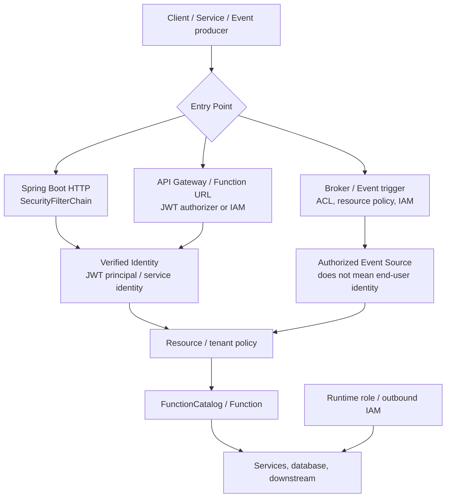
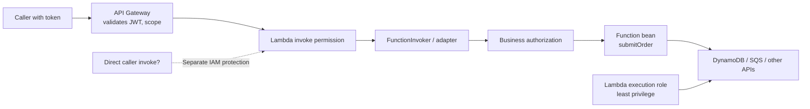

# Authentication and Authorization for HTTP or Serverless Platforms

## 1. Why Does Spring Cloud Function Need Its Own Security Boundary?

In **SPRING_CLOUD_FUNCTION (Spring Cloud Function)**, business logic is written as `Supplier`, `Function`, or `Consumer` beans, registered and looked up via `FunctionCatalog`, optionally chained via *composition*, and reused across HTTP, events, or serverless environments. This protocol independence creates an important security principle:

> **`FunctionCatalog` provides a function invocation mechanism; it does not authenticate who is calling or authorize which resources that caller can act on.**

Consider a `submitOrder` function that receives an order request. The same logic can be invoked:

- From `POST /api/functions/submitOrder` in a Spring Boot Web application.
- Via Spring Cloud Function Web when the bean is exposed as an HTTP endpoint.
- Through API Gateway → AWS Lambda running `FunctionInvoker`.
- From SQS, EventBridge, or an event broker.
- From internal code calling the bean directly or `FunctionCatalog.lookup("submitOrder")`.

**A JWT check on HTTP only protects the HTTP path it actually covers.** If the same bean also has an event ingestion path or a Lambda that can be invoked directly, that path needs its own security policy.

The goal of this lesson is to design **authentication** and **authorization** for each entry point, without turning business logic into a place that manually parses JWTs, signs requests, or enforces IAM.

### Learning Outcomes

After this lesson, you will be able to:

1. Distinguish authentication, endpoint authorization, resource authorization, and serverless runtime execution permissions.
2. Protect HTTP endpoints using Spring Security OAuth2 Resource Server and JWT with a **deny-by-default** policy.
3. Enforce **order/tenant ownership** checks before invoking a `Function`.
4. Identify bypass paths if the same function is unexpectedly exposed by Spring Cloud Function Web, the dynamic router, `FunctionCatalog`, or another adapter.
5. Distinguish API Gateway JWT authorizer, Lambda Function URL `AWS_IAM`, IAM invoke permission, and execution role.
6. Never trust self-asserted identity fields sent by clients in `MessageHeaders` or event envelopes.
7. Write tests covering `401`, `403`, wrong scope, wrong owner, out-of-allowlist paths, and alternative serverless entry points.

## 2. Threat Model: "Who Is Calling?" vs. "What Are They Allowed to Do?"



| Question | Appropriate Control | Common Failure |
|---|---|---|
| Who is the caller? | JWT signature, issuer/audience, valid session, mTLS, IAM/SigV4 | Trusting a self-asserted `X-User-ID` header |
| Is the caller allowed to invoke this function? | JWT scope/role, HTTP route policy, API Gateway authorizer, IAM invoke permission | Allowing any valid token |
| Is the caller authorized for **this order**? | Owner, tenant, and resource-relationship authorization | Having the `orders.submit` scope allows acting on any `customerId` |
| Is the entry point allowed to invoke the right function? | Web export allowlist, handler/definition, trigger binding | A router or another endpoint can reach an internal bean |
| Which downstream resources can the function access? | IAM execution role, DB credentials, outbound service scopes | Granting `*` to every Lambda role |
| Is the event data trustworthy? | Broker ACL, source policy, webhook verification, schema and business validation | Treating `event.userId` as a verified identity |

**Authentication** verifies the caller using a trusted mechanism. **Authorization** decides what the caller is allowed to do, for which action type and specific resource. **Input validation** checks data shape and values; it does **not** replace the two controls above.

A JWT bearer token with a valid signature that was issued for a different API can still be unauthorized for this API. A JWT that is valid for the API but lacks the required scope or tries to place an order on someone else's behalf must also be rejected.

## 3. Choose the Entry-Point Architecture Before Writing Code

There is no single "Spring Cloud Function security" setting that covers every adapter. Build a matrix:

| Deployment / Entry Point | Caller | Authentication | Function Authorization | Data Authorization |
|---|---|---|---|---|
| HTTP Spring MVC / controller | Browser / mobile / backend | Spring Security JWT Resource Server or session/mTLS by design | HTTP method + path + scope | Controller/service checks ownership/tenant |
| Spring Cloud Function Web | HTTP client | Spring Security covering **every exposed URL** | Function allowlist + security matchers | Called bean/service still needs policy |
| API Gateway HTTP API → Lambda | HTTP client | API Gateway JWT authorizer or IAM depending on route type | Route scopes/authorizer + Lambda invoke policy | Handler/service checks resource permissions |
| Lambda Function URL | Authorized caller | `AWS_IAM` via SigV4 or additional app auth if left public | Resource-based policy + IAM | Handler/service checks business permissions |
| SQS / EventBridge → Lambda | Broker / rule / service producer | IAM / resource policy on source, queue / event bus | Publish and trigger invoke permissions | Event source **does not prove end-user identity** |

The operational principle is that **each deployment has an explicit list of permitted functions and triggers**, rather than packaging all beans together and assuming that because one entry point authenticates callers, all others are safe.

## 4. Shared Business Example: Two Functions with Different Privilege Levels

Let's build a Java 17+ example on Spring Boot 3 and Spring Cloud Function. Two functions share `OrderRequest`:

- `previewOrder` generates a preview and requires only the `orders.preview` scope.
- `submitOrder` creates a confirmation receipt and requires the `orders.submit` scope.

The two functions **know nothing about HTTP, JWT, API Gateway, or Lambda**. Authentication and authorization happen in an adapter before applying the bean.

```java
package com.example.secureorders;

import java.util.UUID;
import java.util.function.Function;

import org.springframework.context.annotation.Bean;
import org.springframework.context.annotation.Configuration;

@Configuration
public class OrderFunctions {

    public record OrderRequest(
            String customerId, String sku, int quantity) {}

    public record OrderPreview(
            String sku, int quantity, long estimatedTotal) {}

    public record OrderReceipt(
            String receiptId, String status) {}

    private static void validate(OrderRequest request) {
        if (request == null
                || request.customerId() == null
                || request.customerId().isBlank()
                || request.sku() == null
                || request.sku().isBlank()
                || request.quantity() < 1
                || request.quantity() > 100) {
            throw new IllegalArgumentException(
                    "Invalid order request");
        }
    }

    @Bean
    public Function<OrderRequest, OrderPreview> previewOrder() {
        return request -> {
            validate(request);
            return new OrderPreview(
                    request.sku(),
                    request.quantity(),
                    request.quantity() * 1_000L
            );
        };
    }

    @Bean
    public Function<OrderRequest, OrderReceipt> submitOrder() {
        return request -> {
            validate(request);
            // Simple illustration: production needs persistence, transactions,
            // idempotency, and retry handling before returning a receipt.
            return new OrderReceipt(
                    UUID.randomUUID().toString(), "SUBMITTED");
        };
    }
}
```

The `Function<OrderRequest, OrderReceipt>` signature makes `submitOrder` easy to reuse. **However, the bean itself does not authorize callers**, so it must never be exposed via a path that bypasses the authentication layer without equivalent checks.

In a real system, all invocation paths into the same sensitive operation can be routed through a shared **application service** that enforces authorization, idempotency, and transactions. Separating the HTTP layer in this example only illustrates how to protect an endpoint; **it does not imply that other invocations are automatically safe**.

## 5. HTTP: Authenticating JWTs with Spring Security Resource Server

For stateless APIs using bearer access tokens, Spring Security OAuth2 Resource Server can verify JWTs issued by an identity provider. Minimum configuration requires:

- Spring Security, OAuth2 Resource Server, and JOSE dependencies appropriate for your Spring Boot/Spring Security version.
- Trusted **issuer** address and how to fetch public signing keys (typically via OIDC/JWK).
- Validation of **signature, issuer, validity timestamps**, and **audience** intended for this API.
- Mapping claims to authorities/scopes used in HTTP policies.
- Deny-by-default rules for paths and methods outside the API.

Example `application.yml` (illustrative `.invalid` address; replace with a real IdP):

```yaml
spring:
  security:
    oauth2:
      resourceserver:
        jwt:
          issuer-uri: https://idp.example.invalid/realms/orders
          audiences: orders-api
```

Per current Spring Security documentation, `issuer-uri` supports validating the `iss` claim; Spring Boot provides the `audiences` property to validate the `aud` claim. Do not assume that setting `issuer-uri` alone is enough to ensure tokens are accepted only for the **right API**. If your system has multiple issuers, custom algorithms/keys, or non-default token structures, configure an appropriate validator/decoder.

**Access tokens and ID tokens do not serve the same purpose.** An API should accept tokens conforming to its resource server contract, not treat a user-login ID token as a valid access token for every resource.

### 5.1. Configuring `SecurityFilterChain` Per Function

```java
package com.example.secureorders;

import org.springframework.context.annotation.Bean;
import org.springframework.context.annotation.Configuration;
import org.springframework.http.HttpMethod;
import org.springframework.security.config.Customizer;
import org.springframework.security.config.annotation.web.builders.HttpSecurity;
import org.springframework.security.config.http.SessionCreationPolicy;
import org.springframework.security.web.SecurityFilterChain;

@Configuration
public class ApiSecurityConfiguration {

    @Bean
    SecurityFilterChain apiSecurity(HttpSecurity http) throws Exception {
        return http
            // Only for stateless APIs using bearer tokens,
            // not relying on browser cookies/sessions.
            .csrf(csrf -> csrf.disable())
            .sessionManagement(session -> session
                .sessionCreationPolicy(SessionCreationPolicy.STATELESS))
            .authorizeHttpRequests(auth -> auth
                .requestMatchers(
                    HttpMethod.POST, "/api/functions/previewOrder")
                    .hasAuthority("SCOPE_orders.preview")
                .requestMatchers(
                    HttpMethod.POST, "/api/functions/submitOrder")
                    .hasAuthority("SCOPE_orders.submit")
                .anyRequest().denyAll()
            )
            .oauth2ResourceServer(oauth ->
                oauth.jwt(Customizer.withDefaults()))
            .build();
    }
}
```

The policy above states that:

1. Only `POST /api/functions/previewOrder` with the `SCOPE_orders.preview` authority may proceed.
2. Only `POST /api/functions/submitOrder` with `SCOPE_orders.submit` may proceed.
3. Any other method/URL, including a router URL or hidden function, is rejected by `anyRequest().denyAll()`.
4. A missing token on a protected path typically yields `401 Unauthorized`; an authenticated token lacking the required permission typically yields `403 Forbidden`.
5. In the default configuration, Spring Security maps scopes from the JWT `scope` or `scp` claim to authorities prefixed with `SCOPE_`. For other claims or IdP formats, define a matching `JwtAuthenticationConverter` instead of guessing from role names.

**CSRF note:** `csrf.disable()` is used here only because the sample API does not rely on browser cookies/sessions for authentication. If your application uses cookie-based sessions, apply proper CSRF protection instead of copying this configuration. CORS is not an authentication mechanism; configuring CORS for browsers does not prevent other HTTP tools from calling the API.

If the application has legitimate Actuator, health, or admin endpoints, design a separate `SecurityFilterChain` with explicit policies; the example above intentionally denies all undeclared URLs.

## 6. Resource Authorization: A Valid JWT Is Still Not Enough

The `orders.submit` scope only proves the caller is allowed to **attempt this type of action**. It does not assert that the caller owns the `customerId` in the request.

A dangerous example:

```http
POST /api/functions/submitOrder HTTP/1.1
Authorization: Bearer <access-token-for-user-A>
Content-Type: application/json

{"customerId":"user-B","sku":"BOOK","quantity":1}
```

If you only check that the JWT has the `orders.submit` scope and then invoke the bean, caller A can trigger actions on account B. This is **Broken Object Level Authorization (BOLA/IDOR)** at the business layer.

Add a policy that verifies the authenticated principal:

```java
package com.example.secureorders;

import org.springframework.security.access.AccessDeniedException;
import org.springframework.security.oauth2.jwt.Jwt;
import org.springframework.stereotype.Service;

@Service
public class OrderAccessPolicy {

    public void requireOwner(Jwt principal, String customerId) {
        if (principal == null
                || customerId == null
                || !customerId.equals(principal.getSubject())) {
            throw new AccessDeniedException(
                    "Not allowed to access this customer");
        }
    }
}
```

This example **intentionally simplifies** by assuming `customerId` equals JWT `sub`. In real production systems, `sub` is usually the IdP account identifier, not necessarily the database customer ID. Replace this comparison with a **verified mapping** and repository/tenant policy, while supporting service accounts or delegation when workflows require it.

Never take `principal` from a self-asserted `userId` or `role` field in the JSON body or an `X-User-ID` header sent by the client. The policy must obtain identity from the **authenticated Spring Security context**.

## 7. Thin HTTP Controller Calling `Function` Beans

When an application wants full control over HTTP paths and access permissions, one option is to use a **Spring MVC controller** to enforce authentication/authorization before calling the business bean. The following example assumes **only MVC endpoints exist**, without simultaneously enabling the automatic Web adapter for the same beans.

```java
package com.example.secureorders;

import java.util.function.Function;

import org.springframework.beans.factory.annotation.Qualifier;
import org.springframework.http.MediaType;
import org.springframework.security.core.annotation.AuthenticationPrincipal;
import org.springframework.security.oauth2.jwt.Jwt;
import org.springframework.web.bind.annotation.PostMapping;
import org.springframework.web.bind.annotation.RequestBody;
import org.springframework.web.bind.annotation.RestController;

import com.example.secureorders.OrderFunctions.OrderRequest;
import com.example.secureorders.OrderFunctions.OrderPreview;
import com.example.secureorders.OrderFunctions.OrderReceipt;

@RestController
public class OrderHttpController {

    private final Function<OrderRequest, OrderPreview> previewOrder;
    private final Function<OrderRequest, OrderReceipt> submitOrder;
    private final OrderAccessPolicy accessPolicy;

    public OrderHttpController(
            @Qualifier("previewOrder")
            Function<OrderRequest, OrderPreview> previewOrder,
            @Qualifier("submitOrder")
            Function<OrderRequest, OrderReceipt> submitOrder,
            OrderAccessPolicy accessPolicy) {
        this.previewOrder = previewOrder;
        this.submitOrder = submitOrder;
        this.accessPolicy = accessPolicy;
    }

    @PostMapping(
        path = "/api/functions/previewOrder",
        consumes = MediaType.APPLICATION_JSON_VALUE,
        produces = MediaType.APPLICATION_JSON_VALUE)
    public OrderPreview preview(
            @RequestBody OrderRequest request,
            @AuthenticationPrincipal Jwt authenticatedJwt) {

        // Check resource permissions before executing the function.
        accessPolicy.requireOwner(authenticatedJwt, request.customerId());
        return previewOrder.apply(request);
    }

    @PostMapping(
        path = "/api/functions/submitOrder",
        consumes = MediaType.APPLICATION_JSON_VALUE,
        produces = MediaType.APPLICATION_JSON_VALUE)
    public OrderReceipt submit(
            @RequestBody OrderRequest request,
            @AuthenticationPrincipal Jwt authenticatedJwt) {

        accessPolicy.requireOwner(authenticatedJwt, request.customerId());
        return submitOrder.apply(request);
    }
}
```

Note each layer:

- **Spring Security** decodes/verifies the JWT and enforces endpoint scopes **before the controller runs**.
- **OrderAccessPolicy** checks permission for `customerId` after identity has been verified.
- **Function bean** processes payload logic and does not receive `Authorization` or raw JWTs as business data.
- **Controller** is the sole HTTP entry point described in this example; to guarantee that, do not accidentally include a Web adapter or router that exposes the same beans outside the controller.

Example API request:

```bash
curl -i -X POST http://localhost:8080/api/functions/previewOrder \
  -H "Authorization: Bearer <valid-access-token>" \
  -H "Content-Type: application/json" \
  -d '{"customerId":"user-A","sku":"BOOK","quantity":2}'
```

A `200` response occurs only when the token has the right issuer/audience, is unexpired, holds the `orders.preview` scope, and its `sub` matches `customerId` under the sample policy. If the token/scope is missing or resource access is denied, the request must be rejected; **a valid JSON payload is not sufficient to grant access**.

## 8. Spring Cloud Function Web: Avoiding Controller Bypass Paths

If you use `spring-cloud-function-web`, the Web adapter can create HTTP endpoints from function definitions in `FunctionCatalog`. This is **different** from the controller in Section 7: protecting only `/api/functions/**` does not ensure URLs generated by the Web adapter under another prefix are covered by the same policy.

Three design options:

| Deployment Approach | How to Protect |
|---|---|
| MVC controller + Function beans, **without** auto-exporting Web adapter | HTTP policy applies to the controller; verify the app has no unexpected endpoints |
| Using Spring Cloud Function Web directly | Allowlist definitions, fix the Web path, protect all URLs/methods with Spring Security |
| Both MVC and SCF Web for special requirements | Inventory **all** routes from both adapters, protect every path, and test against bypasses |

Example properties **dedicated to a deployment using the Web adapter**:

```properties
spring.cloud.function.web.path=/functions
spring.cloud.function.definition=previewOrder;submitOrder
spring.cloud.function.single-function-fallback-enabled=false
```

In Spring Cloud Function Web, `;` separates the list of definitions when filtering published functions; `|` represents **composition**, not two independent endpoints. Changing the prefix from `/functions` to a secret path is **not security**.

Do not allow client-sent HTTP headers `spring.cloud.function.definition` or `spring.cloud.function.routing-expression` to freely select beans or function chains. In particular, **`functionRouter`** and composition create flexible invocation paths that need strict allowlisting if reachable externally.

Be cautious about placing `@PreAuthorize` on a **`@Bean` method returning a `Function` lambda**: an annotation on the factory method does not automatically turn every `Function.apply(...)` invocation into a permission check. To protect all entry paths, enforce authorization in a **business service invoked through a security proxy** or at each adapter, and test the actual invocation paths.

## 9. Additional HTTP Principles: Tokens, CSRF, CORS, Errors, and Abuse

### 9.1. Protecting Access Tokens and Trust Boundaries

- **Never manually read `Authorization` and `Base64.decode` a JWT payload to trust its claims.** The Resource Server must verify signature, algorithm/key, issuer, audience, timestamps, and applicable constraints.
- Never trust `X-User-ID`, `X-Tenant-ID`, `X-Roles`, or a `MessageHeaders` entry named like a security claim just because the client sent it.
- Forward access tokens downstream only when there is an explicit contract and delegation mechanism; avoid copying bearer tokens into `MessageHeaders` and publishing them to Kafka/SQS or logs.
- Every API must specify whether tokens represent users or service-to-service callers. With `client_credentials`, `sub` may be a client rather than a customer ID; the ownership policy in Section 6 must be adapted, not arbitrarily relaxed.
- Use HTTPS/TLS; internally you may also need mTLS or service mesh identity. TLS protects the transport channel, but alone does not replace business-level authorization.

### 9.2. Do Not Confuse CORS with Authorization

`Access-Control-Allow-Origin` controls browser behavior; it does not stop `curl` or a backend from calling the API. Allow only necessary origins, while still verifying tokens and permissions. Never use an overly permissive CORS policy to "fix 401/403 errors."

### 9.3. CSRF Depends on the Authentication Model

If the API relies on **cookies/sessions** automatically sent by browsers, apply appropriate CSRF protection. The `SecurityFilterChain` in Section 5 disables CSRF only because it uses **stateless bearer tokens** and does not rely on cookies. When the architecture changes, revisit this decision.

### 9.4. HTTP Errors and Data-Hiding Policies

| Result | Common Cause | Note |
|---|---|---|
| `401 Unauthorized` | Unauthenticated or missing/expired/invalid token | Do not leak token, key, or account details |
| `403 Forbidden` | Authenticated but missing scope or resource ownership | `404` may be used to avoid revealing resource existence if the contract calls for it |
| `400 Bad Request` | Malformed request syntax/schema | Provide explicit validation handlers; do not turn every error into 500 |
| `429 Too Many Requests` | Exceeded gateway/API rate limit | Prevents abuse and runaway costs |
| `5xx` | Application/infrastructure error | Never return stack traces or secrets to the caller |

If `Function.apply(...)` throws `IllegalArgumentException`, Spring MVC does not automatically guarantee a `400` in every configuration. Use validation and `@ControllerAdvice` or proper error mapping to distinguish client errors from system failures.

## 10. Testing HTTP: Right Scope, Right Owner, and Blocking Bypass Paths

For testing, assume the Spring Boot application contains the classes from Sections 4–7 along with Spring Security Test. You can define a minimal `@SpringBootApplication`:

```java
package com.example.secureorders;

import org.springframework.boot.SpringApplication;
import org.springframework.boot.autoconfigure.SpringBootApplication;

@SpringBootApplication
public class SecureOrderApplication {
    public static void main(String[] args) {
        SpringApplication.run(SecureOrderApplication.class, args);
    }
}
```

JUnit 5 / MockMvc test class:

```java
package com.example.secureorders;

import static org.springframework.security.test.web.servlet.request
        .SecurityMockMvcRequestPostProcessors.jwt;
import static org.springframework.test.web.servlet.request
        .MockMvcRequestBuilders.post;
import static org.springframework.test.web.servlet.result
        .MockMvcResultMatchers.*;

import org.junit.jupiter.api.Test;
import org.springframework.beans.factory.annotation.Autowired;
import org.springframework.boot.test.autoconfigure.web.servlet.AutoConfigureMockMvc;
import org.springframework.boot.test.context.SpringBootTest;
import org.springframework.boot.test.mock.mockito.MockBean;
import org.springframework.http.MediaType;
import org.springframework.security.core.authority.SimpleGrantedAuthority;
import org.springframework.security.oauth2.jwt.JwtDecoder;
import org.springframework.test.web.servlet.MockMvc;

@SpringBootTest(
    classes = SecureOrderApplication.class,
    properties = {
        "spring.security.oauth2.resourceserver.jwt.issuer-uri="
                + "https://idp.example.invalid/realms/orders",
        "spring.security.oauth2.resourceserver.jwt.audiences=orders-api"
    }
)
@AutoConfigureMockMvc
class OrderHttpSecurityTest {

    @Autowired
    MockMvc mvc;

    // Use a mock JWT to test authorization; does not verify real JWT signatures.
    @MockBean
    JwtDecoder jwtDecoder;

    private static final String BODY =
            "{\"customerId\":\"user-A\",\"sku\":\"BOOK\",\"quantity\":2}";

    @Test
    void anonymousRequestIsRejected() throws Exception {
        mvc.perform(post("/api/functions/previewOrder")
                .contentType(MediaType.APPLICATION_JSON)
                .content(BODY))
            .andExpect(status().isUnauthorized());
    }

    @Test
    void previewScopeAllowsOnlyOwnOrder() throws Exception {
        mvc.perform(post("/api/functions/previewOrder")
                .with(jwt().jwt(j -> j.subject("user-A"))
                    .authorities(new SimpleGrantedAuthority(
                        "SCOPE_orders.preview")))
                .contentType(MediaType.APPLICATION_JSON)
                .content(BODY))
            .andExpect(status().isOk())
            .andExpect(jsonPath("$.estimatedTotal").value(2000));
    }

    @Test
    void previewScopeCannotSubmit() throws Exception {
        mvc.perform(post("/api/functions/submitOrder")
                .with(jwt().jwt(j -> j.subject("user-A"))
                    .authorities(new SimpleGrantedAuthority(
                        "SCOPE_orders.preview")))
                .contentType(MediaType.APPLICATION_JSON)
                .content(BODY))
            .andExpect(status().isForbidden());
    }

    @Test
    void submitScopeCannotActForAnotherCustomer() throws Exception {
        mvc.perform(post("/api/functions/submitOrder")
                .with(jwt().jwt(j -> j.subject("user-B"))
                    .authorities(new SimpleGrantedAuthority(
                        "SCOPE_orders.submit")))
                .contentType(MediaType.APPLICATION_JSON)
                .content(BODY))
            .andExpect(status().isForbidden());
    }

    @Test
    void undocumentedFunctionRouteIsRejected() throws Exception {
        mvc.perform(post("/functions/submitOrder")
                .with(jwt().jwt(j -> j.subject("user-A"))
                    .authorities(new SimpleGrantedAuthority(
                        "SCOPE_orders.submit")))
                .contentType(MediaType.APPLICATION_JSON)
                .content(BODY))
            .andExpect(status().isForbidden());
    }
}
```

Spring Security Test's `jwt()` creates a mock `Authentication` in MockMvc, which is suitable for testing **authorization rules**. `@MockBean JwtDecoder` keeps the test context from contacting an IdP; newer Spring Boot versions may use the corresponding replacement mock bean mechanism. **This test suite does not prove signature, issuer/audience, or TLS validation in a real environment**: add separate integration tests covering the JWT decoder/IdP and gateway.

The `403` test for `/functions/submitOrder` only proves Spring Security blocks the unexpected path in this configuration. If the goal is also to guarantee no automatic endpoint exists from Spring Cloud Function Web, inspect the **route table and dependencies** independently rather than relying on a single HTTP status code.

## 11. Serverless: Four Permission Layers Often Conflated

In AWS Lambda or other serverless platforms, a request to a function may pass through a gateway, a Function URL, a queue, an event bus, or direct function invocation APIs. In all cases, distinguish:

| Control | What Is Checked | AWS Example |
|---|---|---|
| **Caller HTTP authentication** | User or application sending the request | API Gateway JWT authorizer, Lambda authorizer, IAM/SigV4 |
| **Function invocation permission** | Service or principal allowed to invoke Lambda | Lambda resource-based policy, identity-based IAM |
| **Runtime permissions** | Resources that code inside Lambda can access | Lambda execution role for S3, DynamoDB, SQS, Secrets Manager |
| **Business resource permissions** | Is the caller/tenant allowed to act on this order? | Application authorization service checking ownership and tenant |

**Lambda invoke permission and Lambda execution role are two different things.** A principal allowed to send requests to Lambda does not automatically inherit the execution role's IAM permissions; however, if the Lambda executes an action on that caller's behalf without business authorization checks, the caller can exploit the runtime's broader privileges. This is a *confused deputy* risk.



If API Gateway protects an HTTP route while the Lambda can also be invoked directly via the AWS API with overly broad permissions, another caller can **bypass API Gateway's JWT authorizer**. Security must therefore cover **both the route and the underlying function invocation permissions**.

## 12. AWS API Gateway → Lambda: Authenticating JWTs at the Gateway

With **API Gateway HTTP API**, a JWT authorizer can verify JWTs before requests reach Lambda. Key settings include:

1. **Issuer**: identifier of the trusted identity provider.
2. **Audience**: the API/client the token was issued for, matching authorizer configuration.
3. **Identity source**: where the token is extracted from, typically the `Authorization` header.
4. **Route**: e.g., `POST /orders` must have the authorizer attached; do not configure an authorizer and forget to bind it to the route.
5. **Authorization scopes**: require `orders.submit` only on the submit route and `orders.preview` on the preview route.

Illustrative matrix:

| HTTP Route | Authorization Type | Scope | Lambda / Function Definition |
|---|---|---|---|
| `POST /orders/preview` | `JWT` | `orders.preview` | `previewOrder` in the appropriate deployment |
| `POST /orders` | `JWT` | `orders.submit` | `submitOrder` in the appropriate deployment |
| `POST /admin/reconcile` | Not published in public API | — | Dedicated admin deployment/trigger |

Example **configuration sketch**, not a complete IaC template:

```yaml
httpApi:
  jwtAuthorizer:
    issuer: https://idp.example.invalid/realms/orders
    audiences:
      - orders-api
    identitySource: "$request.header.Authorization"
  routes:
    - method: POST
      path: /orders
      authorizationType: JWT
      authorizationScopes:
        - orders.submit
      target: SubmitOrderLambda
```

This is a configuration sketch expressing the contract. When using CloudFormation, AWS SAM, CDK, or Terraform, field names, syntax, and authorizer attachment depend on the tool; verify the actual IaC and test-deploy in a controlled environment.

**A JWT authorizer does not perform object-level authorization.** A token with the `orders.submit` scope does not prove the caller owns the `customerId` in the body; the application must still enforce ownership/tenant checks. Do not rely on client-supplied `X-User-ID` or `role` headers to replace verified claims.

### 12.1. Claims in Request Context: Trust Only After the Right Entry Point

For an HTTP API route using a JWT authorizer, API Gateway can place verified token information into `requestContext.authorizer.jwt.claims` of the event sent to Lambda. The handler/adapter can build an "authenticated actor" object from that context to call the **authorization service**.

```text
API Gateway HTTP route with JWT authorizer
        |
        v
requestContext.authorizer.jwt.claims
  sub = "user-A"
  iss = "https://idp.example.invalid/realms/orders"
  scope = "orders.submit"
        |
        v
Adapter accepts context only from a verified invocation source
        |
        v
OrderAccessPolicy / application service
        |
        v
Function submitOrder receives business payload
```

**This is not standalone proof of authentication.** Event JSON can be **forged** by a caller if they have permission to invoke the Lambda directly or inject events through an unprotected path. Therefore, the handler should trust authorizer context only when **the event source is guaranteed to be the authenticated API Gateway route**, and other invoke paths are properly restricted by IAM/resource policies.

Never read `sub` from `event.body.userId`, `event.headers['X-User-ID']`, or a `MessageHeaders["userId"]` forwarded from external data and treat it as the principal.

### 12.2. API Gateway JWT vs. Lambda Authorizer vs. IAM

| Mechanism | Best When | Note |
|---|---|---|
| HTTP API JWT authorizer | JWT tokens from an IdP following issuer/audience/scopes | Route contract must declare scopes; downstream still checks resource permissions |
| Lambda authorizer | Custom token/identity rules not supported by the JWT authorizer | The authorizer is also code that must be secured, with caching/policies designed properly |
| `AWS_IAM` on API Gateway | Service-to-service or AWS principals signing with SigV4 | Do not automatically treat an IAM principal as a database end-user |
| Public route without authorizer | Intentionally public endpoints such as health/landing pages | Never use for sensitive actions without another security layer |

For API Gateway REST APIs, authorizer types and configuration structures differ from HTTP APIs; do not copy an HTTP API JWT authorizer configuration verbatim to a REST API and assume it is protected.

A practical note: an API Gateway JWT authorizer validates claims, while distinguishing whether a token is an access token or an ID token also depends on your IdP contract and scopes. To reduce the risk of accepting the wrong token type, enforce **explicit authorization scopes** and test with the exact token types issued for the API rather than checking signatures alone.

## 13. Lambda Function URL: `AWS_IAM` Is Completely Different from `NONE`

AWS Lambda Function URLs provide a direct HTTPS endpoint for a function without API Gateway. The two main authentication modes are:

| `AuthType` | Invocation Requirement | Risk / Meaning |
|---|---|---|
| `AWS_IAM` | Request is SigV4-signed and the caller is permitted by IAM/resource policy | Suitable for services/clients with managed AWS credentials |
| `NONE` | Lambda Function URL **performs no IAM authentication**; if resource policy allows public access, anyone with the URL can call it | Unsuitable as a protective boundary for sensitive APIs relying solely on URL obscurity |

Example **CloudFormation snippet** (assuming the `OrderFunction` resource is declared elsewhere):

```yaml
OrderFunctionUrl:
  Type: AWS::Lambda::Url
  Properties:
    TargetFunctionArn: !GetAtt OrderFunction.Arn
    AuthType: AWS_IAM
```

Setting `AWS_IAM` alone is not enough: the principal needs the right IAM permissions, and the resource-based policy and invoke conditions must match the access model. According to current AWS Lambda documentation, **new Function URLs starting October 2025** require both `lambda:InvokeFunctionUrl` and `lambda:InvokeFunction` under the relevant permissions. When authoring policies, check current rules, cross-account sources, and the `lambda:InvokedViaFunctionUrl` condition where appropriate.

If `NONE` is used because a gateway/authorizer sits in front, you must still block **direct access** to the Function URL with an appropriate defense-in-depth approach. Simply assuming "clients only know the gateway URL" is insufficient: URLs can be discovered or leaked. When per-user permissions are required, prefer an API Gateway with an explicit authorizer over a public Function URL that guesses identity.

**Function URL CORS is not authentication.** Restricting browser origins does not block direct HTTP clients.

## 14. Lambda Invoke Permission Is Different from Execution Role Permissions

To protect the API Gateway → Lambda path, you typically need a **resource-based permission** allowing the API Gateway service to invoke the specific function, scoped by an appropriate source (such as the API/stage/route ARN in `SourceArn` when supported by the model).

Do not use policies that allow arbitrary principals to invoke the function or allow another API Gateway in another account to invoke it without context. Likewise, permissions allowing Lambda invocation via `lambda:InvokeFunction` through the AWS SDK/IAM API must be tightly controlled, since they can bypass the HTTP route's JWT authorizer.

In the **outbound** direction, the Lambda execution role should match the exact task:

| Need of `submitOrder` | Appropriate Runtime Permission | Unnecessary Permission |
|---|---|---|
| Write to a specific orders table | DynamoDB write permission on the specific table/resource | `dynamodb:*` across all tables |
| Send results to a specific queue | `sqs:SendMessage` on the specified queue | `sqs:*` across all queues |
| Read one required secret | `secretsmanager:GetSecretValue` on the specific secret | Access to every secret in the account |
| Write logs and telemetry | Minimal logs/observability permissions | IAM admin or management permissions on other resources |

Beyond actions, evaluate **resource ARNs**, conditions, KMS permissions, cross-account policies, network egress, and secret rotation per deployment. Do not reuse the same overly broad execution role for `previewOrder` and `submitOrder` if the two tasks have different risks and needs.

**Easy mistake:** an HTTP caller with the `orders.submit` scope can trigger a function granted database write access. That scope only indicates the caller may **attempt the business request**; the function must still validate the order, check ownership, and enforce replay protection/idempotency before writing.

## 15. When the Entry Point Is an Event: Broker ACLs Are Not End-User Authentication

A Lambda processing SQS or EventBridge does not receive an HTTP request with a user's JWT the way an API Gateway route does. Instead, the event source is controlled via IAM, queue/bus policies, event source mappings, and producer/consumer permissions.

Example flow:

```text
Application permitted to publish events
      |
  SQS SendMessage / EventBridge PutEvents
      |
Queue or event bus with resource policy
      |
Event source mapping / rule + IAM
      |
Event-processing Lambda
      |
Function<OrderEvent, OrderResult>
```

From "the event arrived from a trusted queue," you **cannot automatically infer** that `event.customerId`, `event.isAdmin`, or `event.roles` is a verified user identity. A producer could have a bug, publisher credentials could be abused, or an event could be replayed. You must distinguish:

1. **Producer identity:** which system is authorized to send events?
2. **Event integrity:** could the payload/envelope be tampered with, forged, or created out of workflow?
3. **End-user delegation:** if the event represents a user request, what authorization proof is verified and preserved across this boundary?
4. **Business authorization:** is the consumer allowed to act on that specific resource?

Appropriate design patterns depending on the system include carrying **business commands already approved by a trusted service**, having the consumer verify state/permissions against a trusted data source, or passing a signed, time-bounded authorization token/proof when identity must cross trust boundaries. Avoid sending raw user JWTs over queues by default due to token exposure, expiration while queued, replay, and scope propagation risks.

With Spring Cloud Stream, add Kafka/RabbitMQ binder ACLs and protect header mapping; with serverless, control `Lambda::EventSourceMapping`, subscriptions, EventBridge rules, queue permissions, and invoke permissions. **A Spring `Message<T>` with a `tenantId` header does not become trustworthy simply because Spring Cloud Function converted it.**

## 16. `FunctionCatalog` and the Spring Cloud Function Adapter in Lambda

Spring Cloud Function allows using adapters such as `FunctionInvoker` in AWS Lambda to select/invoke application beans. In deployments with multiple functions, specify the **function definition** explicitly and restrict which triggers can invoke it:

```properties
# Dedicated example for the order-processing deployment.
spring.cloud.function.definition=submitOrder
```

If an API Gateway deployment has a JWT authorizer while the same artifact also contains `internalRebuild` or `previewOrder`, merely selecting `submitOrder` does not replace:

- **IAM resource policies** restricting invocation sources.
- **Excluding other endpoints** accidentally exposed by a Web adapter or runtime.
- **Business authorization** after identity is verified at the entry point.
- **Least-privilege runtime permissions** for the function.

**Never let an event payload or header dynamically select a function definition or SpEL route to arbitrary beans.** Spring Cloud Function's dynamic router should only be enabled for controlled sources and allowlisted targets, especially when one bean carries higher privileges.

### 16.1. Pattern for Converting Verified Identity into Application Context

An architecture can separate:

```text
Verified API Gateway JWT / verified Spring Security Authentication
                  |
        Trusted adapter (HTTP / handler)
                  |
    AuthenticatedActor(subject, scopes)
                  |
          OrderAccessPolicy
                  |
       Function<OrderRequest, OrderReceipt>
```

Here, `AuthenticatedActor` is an **internal data type** constructed only by an entry point that has already verified identity. **Never deserialize it directly from an external request body** and treat it as authenticated. If a Lambda has multiple triggers, each trigger type must have its own converter/source verification; never reuse "trust API Gateway `requestContext`" logic for payloads coming from SQS.

To keep business permissions consistent across HTTP and serverless, you can build an `OrderApplicationService.submit(actor, request)` that enforces `OrderAccessPolicy` and transactions, and have different adapters call that service with a verified actor. A pure-business `Function<OrderRequest, OrderReceipt>` bean can still be reused, as long as it sits **behind** this layer with no external invocation path bypassing the security boundary.

## 17. Other Platforms: Same Principles, Different Mechanisms

Other clouds have their own HTTP/serverless protection mechanisms. Do not force AWS property names onto every platform:

| Platform / Deployment Style | Common Mechanisms | Warning |
|---|---|---|
| **Azure Functions** | Function authorization levels/keys, Microsoft Entra ID, or App Service Authentication by architecture | **A Function key is a shared secret**, not per-end-user or per-resource authorization |
| **Google Cloud Run functions / Cloud Run** | IAM invoker, OIDC identity tokens, and per-service policies | Services allowed to invoke must still enforce business authorization |
| **AWS Lambda + API Gateway** | JWT/Lambda authorizer or IAM, plus Lambda resource policy | Do not forget direct invoke paths or Function URLs |
| **Serverless behind a private reverse proxy** | Gateway authenticates, service-to-service mTLS/identity, downstream policy | Proxy-injected principal headers are trustworthy only if the proxy cannot be bypassed |

For example, a reverse proxy that validates a JWT and attaches `X-Authenticated-User` to backend requests **is only meaningful if** the proxy → backend link is locked down, clients cannot connect directly, and the proxy strips/overwrites client-supplied headers. Otherwise, an attacker can forge the same header as the proxy.

Across all platforms: **gateway authentication does not automatically protect secondary function entry points**, and runtime permissions are not user permissions.

## 18. Tracing, Logging, Secrets, and Abuse Prevention

Record sufficient security information for investigations:

- Entry point used (HTTP route, Function URL, queue/event trigger), selected function definition, and `allow/deny` decision.
- Validated `correlationId`, observability-managed trace ID, and authenticated caller type (without logging raw tokens).
- Missing scopes, cross-tenant access attempts, untrusted event sources, or denied actions.
- Changes to routes/authorizers, Lambda policies, API Gateway stages, security configuration, and execution roles on each release.

Never log `Authorization`, raw JWTs, API keys, Function keys, session cookies, secrets, or payloads containing sensitive data. `traceparent`, tracing baggage, and `MessageHeaders` also need policies to avoid carrying or leaking PII/tokens.

Additional controls:

| Risk | Control |
|---|---|
| Brute force / API abuse | Gateway throttling, WAF/rate limiting, request-size limits |
| Serverless cost spikes | Concurrency limits, quotas, budget alerts, event batching/backoff |
| Duplicate orders on retry | Idempotency keys, transactions, and contract-defined deduplication |
| Token exposure | TLS, secrets management, short-lived tokens, rotation, and no token logging |
| JWT key rotation | IdP-aware JWKS/decoder updates, authentication failure monitoring |
| Clock skew | Configure acceptable clock skew per library/IdP, validate `exp`/`nbf` |
| Caller missing required scope | Enforce at gateway/Spring Security and service authorization |
| Wrong function definition / trigger | IaC review, allowlists, negative integration tests |

## 19. Cross-Entry-Point Security Testing Plan

A solid test plan must prove both **authorized** and **denied** paths:

| Test Case | HTTP Spring Security | API Gateway / Lambda | What to Verify |
|---|---|---|---|
| Missing credentials | No token | Route without authorizer context/token | `401` or rejected prior to invocation |
| Token with wrong issuer/audience | Rejected by JWT decoder | Rejected by JWT authorizer | Business logic does not run |
| Valid token, missing scope | `403` at filter | Route scope rejected | `submitOrder` is not called |
| Right scope, wrong owner/tenant | Rejected by `OrderAccessPolicy` | Rejected by Lambda service policy | Order is not created for someone else |
| Spoofed `X-User-ID` header | Does not affect principal | Does not replace JWT claims | No privilege escalation |
| Accessing hidden endpoint or router | `denyAll` + export allowlist | Trigger/function definition blocks | Admin function is not called |
| Invoking Lambda directly | N/A | IAM resource policy blocks unauthorized principals | Cannot bypass API Gateway |
| Unintended public Function URL | N/A | Verify `AuthType` and resource policy | No accidental public `NONE` URL |
| Event from unauthorized publisher | N/A | Queue/event bus policy/ACL rejects | Forged event is not processed |
| Authorized event with bad payload | Rejected by bean/validation | Rejected by consumer validation | Bad metadata is not treated as authority |
| Over-privileged runtime role | N/A | IAM policy tests / IAM Access Analyzer | Cannot read/write unneeded resources |

### 19.1. Two Test Types Do Not Replace Each Other

**MockMvc + `jwt()`** verifies authorization logic in Spring Security and the controller, **but does not** verify real token signatures. Add integration tests against a configured JWT decoder, JWKS/issuer, or test IdP capable of issuing valid and invalid tokens.

**Lambda unit tests** verify the handler/bean, **but do not** prove that an API Gateway authorizer is attached to every route, that resource policies block direct invocation, or that the execution role is sufficiently scoped. Those require IaC tests, IAM/resource policy analysis, and controlled invocation tests under different principals.

For a function with side effects such as creating an order, beyond the HTTP status or error response, tests should assert that **no side effect occurred** when the caller is unauthorized.

## 20. Common Mistakes

| Mistake | Consequence | Fix |
|---|---|---|
| "Having a valid JWT allows everything" | Wrong scope or object-level privilege escalation | Verify scopes/roles and ownership/tenant |
| Setting only issuer and skipping audience | May accept tokens issued for a different resource | Configure audience validation |
| Trusting client-sent `X-User-ID` | Identity spoofing | Read principal from Security context or verified authorizer |
| Protecting controllers while leaving SCF Web auto-exporting beans | Another HTTP path can bypass policy | Remove unused adapter or apply allowlists/filters across all routes |
| Thinking `@PreAuthorize` on `@Bean` protects every `Function.apply` | Lambda calls may not be intercepted as expected | Enforce policy on the invoked service/adapter and test it |
| API Gateway has an authorizer but Lambda allows direct invocation | Bypass of the JWT route | Restrict Lambda resource policy / IAM invoke permissions |
| Using Function URL `NONE` as a secret endpoint | Any HTTP client with the URL can call it if policy permits | Use `AWS_IAM` or an appropriate auth architecture |
| Treating the execution role as the HTTP caller's permissions | Function can be abused to access downstream resources | Object authorization and least-privilege role |
| Using SQS `userId` metadata as principal | Producer can spoof or replay it | Control publishers and require separate authorization proof |
| Using CORS to "block unauthorized access" | Non-browser clients can still call the API | Authn/authz/rate limiting |
| Disabling CSRF on cookie-based APIs | Increases risk of forged user-context requests | Enable proper CSRF protection or switch auth model |
| Testing only `200` happy paths | Misses missing scopes, wrong owners, and bypasses | Add negative tests and side-effect assertions |
| Logging raw tokens for debugging | Credential exposure | Log redacted metadata and correlation IDs |

## 21. Hands-On Exercise

Design a Spring Cloud Function system with three beans:

- `previewPayment`: `Function<PaymentRequest, PaymentPreview>`.
- `submitPayment`: `Function<PaymentRequest, PaymentReceipt>`.
- `internalReconcile`: administrative task that must not be published over public HTTP.

Tasks:

1. Create a `SecurityFilterChain` allowing only `POST /api/payments/preview` with scope `payments.preview` and `POST /api/payments` with `payments.submit`; deny all other URLs by default.
2. Design `PaymentAccessPolicy` so callers can only act on a `customerId`/tenant they own. Never trust client-supplied IDs without comparing against the verified identity.
3. Write unit tests for the `Function` beans and MockMvc tests for missing token, missing scope, wrong owner, valid owner, non-existent URL, and a spoofed `X-User-ID` header.
4. If using Spring Cloud Function Web, try exporting beans without an allowlist and inspect the route list; then restrict exports to only the needed functions and protect them with HTTP security.
5. Design an API Gateway HTTP API for `POST /payments` using a JWT authorizer with issuer, audience, and scope `payments.submit`. Verify the route actually has the authorizer attached.
6. Restrict Lambda resource-based invoke permissions so a caller cannot bypass API Gateway via the AWS SDK. If using a Function URL, compare `AWS_IAM` with `NONE` and inspect the policy.
7. Grant the execution role permission to write only to one payments table and send to one result queue; explain why this role should not have IAM admin or all-bucket permissions.
8. Add an SQS event flow for asynchronous payment processing. Define publisher identity and a business authorization strategy without trusting `event.userId` as the principal.
9. Test replay/deduplication and verify that unauthorized requests **cause no side effects**, even when sent through an alternate trigger.

## 22. Production Deployment Checklist

| Question to Answer | Passing Criteria |
|---|---|
| Has every HTTP/broker/serverless entry point been inventoried? | Yes; including direct invoke paths and Function URLs |
| Are exported functions and compositions restricted? | Only the required functions |
| Are HTTP tokens checked for issuer, audience, signature, and validity time? | Yes; configured and tested against a real IdP |
| Are scopes/roles checked per HTTP method and route? | Yes; deny-by-default |
| Does tenant/ownership policy run before side effects? | Yes; never trust self-asserted headers/bodies |
| Does every API Gateway route have the right authorizer attached? | Yes; verified in IaC and deployment |
| Are Lambda direct invocation and Function URLs restricted? | Yes; IAM/resource policies reviewed |
| Does the execution role have only required downstream permissions? | Yes; resource ARNs/conditions verified |
| Are event producers/consumers governed by ACLs/resource policies? | Yes; event input is still validated |
| Are tokens/raw claims kept out of arbitrary `MessageHeaders`? | Yes; clear trust boundaries |
| Are CORS and CSRF configured appropriately for the client model? | Yes; CORS is not treated as authorization |
| Do negative tests cover 401/403, bypasses, wrong tenant, and side effects? | Yes |
| Are secrets, logs, tracing, and alerting free of leaked tokens/PII? | Yes |

## 23. Summary and References

**Spring Cloud Function authentication and authorization must be enforced at every entry point**: HTTP can use Spring Security OAuth2 Resource Server, JWTs, and per-route/scope policies; serverless can use API Gateway authorizers, IAM/SigV4, Lambda invoke permissions, and resource policies. In both cases, an authenticated caller must still pass **business authorization checks for the specific resource** before invoking a `Function` with side effects.

Keep `Supplier`/`Function`/`Consumer` logic reusable via `FunctionCatalog` and composition, but **never treat a Java bean, a `userId` header, or Lambda execution permissions as proof that a caller can perform any action**. HTTP routes, broker triggers, and serverless invocations are distinct boundaries: each requires allowlists, least privilege, validation, monitoring, and negative tests.

Official references:

- [Spring Security — OAuth2 Resource Server JWT](https://docs.spring.io/spring-security/reference/servlet/oauth2/resource-server/jwt.html) — JWT validation, issuer, audience, and Spring Security.
- [Spring Cloud Function — Programming model](https://docs.spring.io/spring-cloud-function/reference/spring-cloud-function/programming-model.html) — `FunctionCatalog`, composition, and function definition.
- [Spring Cloud Function — Standalone Web Applications](https://docs.spring.io/spring-cloud-function/reference/spring-cloud-function/standalone-web-applications.html) — Web export and filtering.
- [AWS API Gateway — JWT authorizers for HTTP APIs](https://docs.aws.amazon.com/apigateway/latest/developerguide/http-api-jwt-authorizer.html) — authorizers, scopes, and routes.
- [AWS Lambda — Control access to function URLs](https://docs.aws.amazon.com/lambda/latest/dg/urls-auth.html) — `AWS_IAM`, `NONE`, and resource-based policies.
- [AWS Lambda — Working with resource-based policies](https://docs.aws.amazon.com/lambda/latest/dg/access-control-resource-based.html) — invoke permissions, principals, and resource policies.
