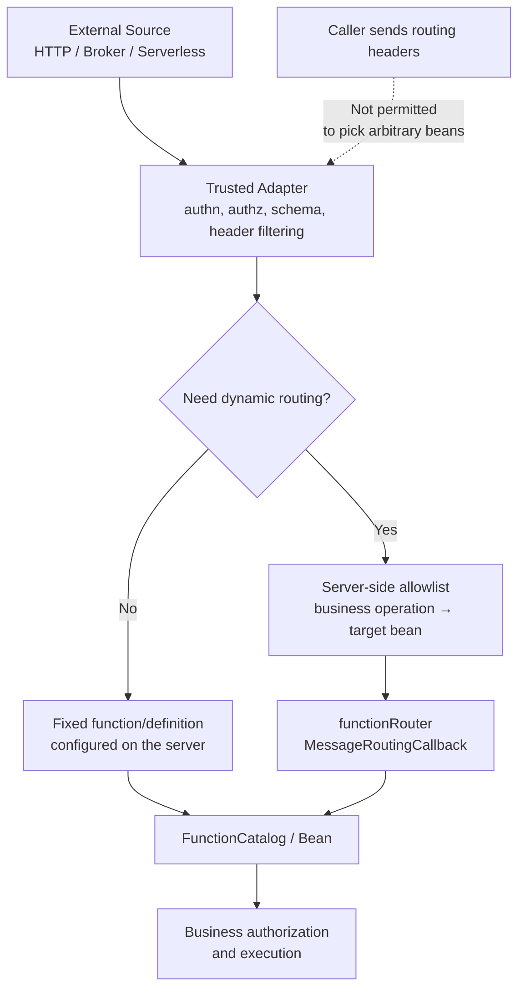

# Controlling Externally Supplied Routing Headers

## 1. The Problem: A Header Can Change Which Function Gets Invoked

**SPRING_CLOUD_FUNCTION (Spring Cloud Function)** lets you write business logic as `Supplier`, `Function`, and `Consumer` beans, look them up via `FunctionCatalog`, chain multiple functions via *composition*, and invoke the same logic over HTTP, event brokers, or serverless. That flexibility comes with a critical security boundary: **externally supplied data must not implicitly have permission to decide which bean gets executed**.

Suppose an application has:

- `quoteShipping`: calculates shipping quotes for public display.
- `quoteTax`: calculates estimated tax for public display.
- `internalReconcile`: an internal audit/maintenance task not intended for public users.

Spring Cloud Function registers a router named `functionRouter` in `FunctionCatalog`. When the router receives a message, headers such as `spring.cloud.function.definition` or `spring.cloud.function.routing-expression` can serve as **function-selection instructions**. The Spring Cloud Function documentation also notes that the Web adapter can convert matching HTTP headers into Spring `MessageHeaders`. This creates the following scenario:

```text
HTTP request to routing entry point
  body = "SKU-41"
  headers:
    spring.cloud.function.definition: internalReconcile
                         |
                   Web adapter
                         |
                     Message
                         |
                    functionRouter
                         |
                which function is selected?
```

If the entry point accepts that instruction unchecked, the sender can request a function **outside the endpoint's contract**. The function name `internalReconcile` is not a secret; choosing hard-to-guess names, checking payload types, or restricting SpEL **does not solve the function-selection authorization problem**.

Lesson objectives:

1. Understand the exact role of `functionRouter`, the two routing headers, and the precedence of configuration sources.
2. Distinguish **server-decided** routing headers from headers supplied by HTTP clients, message producers, or serverless events.
3. Design an **allowlist** of callable targets without letting clients pass raw bean names or composition strings directly.
4. Understand the difference between `SimpleEvaluationContext` and `StandardEvaluationContext` in SpEL, without confusing engine restrictions with authorization.
5. Apply Spring Security, ACLs/IAM, metadata filtering, and negative testing at each entry point.
6. Know when **not to use dynamic routing** and replace it with fixed function invocations instead.

## 2. Three Distinct Layers: Function Selection, Endpoint Exposure, and Authorization



| Concept | Question It Answers | What It Does **Not** Solve |
|---|---|---|
| Function definition | Which single function or composition chain should be invoked? | Is the caller allowed to invoke that function? |
| `FunctionCatalog` | How are `Supplier`/`Function`/`Consumer` beans registered and looked up? | Authenticating callers; checking owner/tenant |
| `functionRouter` | Which instruction selects the target function definition? | Blocking a privileged bean name if arbitrary instructions are accepted |
| Web export filtering | Which functions/definitions have endpoints via the Web adapter? | Any invocation paths from brokers, serverless, or internal code |
| Authentication/authorization | Who is the caller and what are their permissions? | Preventing untrusted metadata from being forwarded wrongly if the adapter is poorly configured |
| Allowlist routing | Which target names can be selected at an entry point? | Checking permissions on **each specific resource** the target operates on |

**Proper control** combines multiple layers: exposing only required functions, authenticating/authorizing at the entry point, selecting only allowlisted beans, and validating data and business permissions before side effects occur.

## 3. Where Does Spring Cloud Function Get Routing Instructions?

According to the official documentation, `RoutingFunction` is registered in the catalog under the name `functionRouter`. For `Message<?>` invocations on *imperative* functions, the router can use one of these mechanisms:

| Instruction Source | Example | Trustworthiness |
|---|---|---|
| `MessageRoutingCallback` | Java bean resolving `"quoteShipping"` | Application-defined; can be safe if the callback enforces an allowlist |
| `MessageHeaders["spring.cloud.function.definition"]` | `"quoteShipping"` or `"a\|b"` | **Untrusted** if coming from external HTTP/broker/events |
| `MessageHeaders["spring.cloud.function.routing-expression"]` | `"headers['operation']"` | Externally chosen expressions should never be freely accepted |
| Application/system properties | `spring.cloud.function.definition=quoteShipping` | Deployment configuration; changes must be access-controlled |

Example message:

```java
import org.springframework.messaging.Message;
import org.springframework.messaging.support.MessageBuilder;

Message<String> input = MessageBuilder.withPayload("SKU-41")
        .setHeader("spring.cloud.function.definition", "quoteShipping")
        .build();
```

If `functionRouter` is active and no higher-precedence strategy takes over, `spring.cloud.function.definition` can act as the **target function identifier**, not merely descriptive metadata. Its value can also be a **composition** such as `quoteShipping|anotherFunction`, so validating individual tokens with a function-name regex is not enough to secure the entire string.

### 3.1. Routing Precedence Order

The Spring Cloud Function documentation defines this precedence order:

1. **`MessageRoutingCallback`**, if registered for the imperative router, has the highest priority.
2. **`Message` routing headers**, for imperative routing when no callback is present.
3. **Application/system properties**, applicable according to the corresponding function model.

Consequently, an application property like `spring.cloud.function.routing-expression=...` **must not be treated as the final safeguard** if the application also accepts instructions from message headers. That is why you need header filtering at the adapter or a callback that enforces an explicit whitelist.

> The order above describes **target function selection precedence**, not `SecurityFilterChain` order or IAM permissions. Function invocation authorization must still be handled separately.

### 3.2. Imperative Routing vs. Reactive Routing

- For `Function<Message<I>, Message<O>>` or similar imperative functions, the unit of processing is one message; routing headers can apply **per message**.
- For reactive functions accepting `Flux`/`Publisher`, the unit of processing is the stream; the documentation notes that per-message header routing instructions do **not** apply in the same way. Stream-wide routing must go through appropriate application properties/definitions.
- Do not assume "the first item's header determines the route for all items" unless the framework defines that contract.

## 4. Analyzing Untrusted Sources and Risks

| External Source | Path to Router | Common Mistake | Mitigation |
|---|---|---|---|
| HTTP client | HTTP headers → Web adapter → `MessageHeaders` | Letting clients set `spring.cloud.function.definition` directly | Do not expose the router if unnecessary; use server-side mapping and HTTP authorization |
| Kafka/RabbitMQ producer | Broker record headers → binder → `MessageHeaders` | Trusting every publisher to send only valid function names | Broker ACLs, header filtering, and allowlist callback |
| Webhook/CloudEvent | Event attributes/headers → serverless adapter | Treating caller-constructed event envelopes as system metadata | Verify event source and map fields in a controlled way |
| Direct Lambda invoke | Payload/event → `FunctionInvoker` | Securing API Gateway while leaving IAM direct invoke overly broad | Resource policy/IAM and fixed definition |
| Internal client | Builds `Message` and calls `FunctionCatalog.lookup("functionRouter")` | Equating "in-JVM call" with permission to do anything | Service-to-service permissions and business authorization |
| Configuration/admin endpoint | Alters `routing-expression` or `definition` via properties | Letting untrusted users control app-level expressions | Protect config/Actuator/secrets and review changes |

Three impact patterns should be evaluated:

**Wrong function selected:** a quoting endpoint reaches a state-changing or administrative step.

**Unapproved chaining:** a composition instruction made of individually valid function names whose execution order produces unauthorized behavior.

**Expression or target data manipulation:** an arbitrary SpEL header or a spoofed header like `operation`/`tenantId` selects a different route. Even if an expression only reads data, **its return value can still name a privileged function**.

## 5. Safest Option: Do Not Use a Router for Endpoints That Do Not Need One

If a URL only needs to call `quoteShipping`, there is no reason to let clients supply a function name. A fixed adapter can inject the exact bean by name:

```java
package com.example.quotes;

import java.util.Locale;
import java.util.function.Function;

import org.springframework.context.annotation.Bean;
import org.springframework.context.annotation.Configuration;

@Configuration
public class QuoteFunctions {

    @Bean
    public Function<String, String> quoteShipping() {
        return sku -> "SHIP:" + sku.strip().toUpperCase(Locale.ROOT);
    }

    @Bean
    public Function<String, String> quoteTax() {
        return sku -> "TAX:" + sku.strip().toUpperCase(Locale.ROOT);
    }
}
```

A thin Spring MVC controller:

```java
package com.example.quotes;

import java.util.function.Function;

import org.springframework.beans.factory.annotation.Qualifier;
import org.springframework.http.HttpStatus;
import org.springframework.http.MediaType;
import org.springframework.http.ResponseEntity;
import org.springframework.web.bind.annotation.PathVariable;
import org.springframework.web.bind.annotation.PostMapping;
import org.springframework.web.bind.annotation.RequestBody;
import org.springframework.web.bind.annotation.RequestMapping;
import org.springframework.web.bind.annotation.RestController;
import org.springframework.web.server.ResponseStatusException;

@RestController
@RequestMapping("/api/quotes")
public class QuoteHttpController {

    private final Function<String, String> shipping;
    private final Function<String, String> tax;

    public QuoteHttpController(
            @Qualifier("quoteShipping") Function<String, String> shipping,
            @Qualifier("quoteTax") Function<String, String> tax) {
        this.shipping = shipping;
        this.tax = tax;
    }

    @PostMapping(
            path = "/{operation}",
            consumes = MediaType.TEXT_PLAIN_VALUE,
            produces = MediaType.TEXT_PLAIN_VALUE
    )
    public ResponseEntity<String> quote(
            @PathVariable String operation,
            @RequestBody String sku) {

        if (!sku.matches("[A-Za-z0-9-]{1,32}")) {
            throw new ResponseStatusException(
                    HttpStatus.BAD_REQUEST, "Invalid SKU");
        }

        String answer = switch (operation) {
            case "shipping" -> shipping.apply(sku);
            case "tax" -> tax.apply(sku);
            default -> throw new ResponseStatusException(
                    HttpStatus.NOT_FOUND, "Unknown quote operation");
        };
        return ResponseEntity.ok(answer);
    }
}
```

**Why does this prevent header routing injection?**

- The controller selects beans via **two fixed Java references**, never reading a function name or SpEL from the HTTP request.
- The URL's `operation` maps only through two values: `shipping`/`tax`. It is a **business operation**, not an arbitrary Spring bean name.
- The controller does not copy all HTTP headers into a `Message` passed to `functionRouter`. Therefore, an unexpected header like `spring.cloud.function.definition` cannot change the bean selected by this controller.
- A URL such as `/api/quotes/internalReconcile` has no matching branch.

This is an **illustrative design using Spring MVC**, not a claim that Spring Cloud Function Web automatically behaves like this controller. If the application also enables `spring-cloud-function-web`, inspect the URLs exposed by the Web adapter, as they can create **another invocation path** outside the controller.

**Note:** a function allowlist does not replace authentication/authorization. If two operations have different privilege levels, enforce Spring Security rules and business authorization before invoking the bean.

## 6. When Dynamic Routing Is Required: Use `MessageRoutingCallback` for Allowlisting

Some systems have a single consumer or serverless entry point that needs to dispatch among **permitted operations**. In that case, an application-managed `MessageRoutingCallback` can translate a **business operation** (such as `"shipping"` or `"tax"`) into the exact function name. Never let clients supply `"quoteShipping"` or `"quoteShipping|internalReconcile"` directly.

Example for modern Spring Cloud Function APIs where `MessageRoutingCallback.routingResult(Message<?>)` returns a `String`:

```java
package com.example.quotes;

import org.springframework.cloud.function.context.MessageRoutingCallback;
import org.springframework.context.annotation.Bean;
import org.springframework.context.annotation.Configuration;
import org.springframework.messaging.Message;

@Configuration
public class ApprovedRouting {

    // The businessOperation header is populated by the adapter after validation.
    // Even if a caller can influence its value, targets remain strictly bounded.
    @Bean
    public MessageRoutingCallback approvedRoute() {
        return message -> {
            Object raw = message.getHeaders().get("businessOperation");
            if (!(raw instanceof String operation)) {
                throw new IllegalArgumentException(
                        "businessOperation must be a String");
            }

            return switch (operation) {
                case "shipping" -> "quoteShipping";
                case "tax" -> "quoteTax";
                default -> throw new IllegalArgumentException(
                        "Operation is not allowed");
            };
        };
    }
}
```

Per Spring Cloud Function's precedence rules, a callback registered as a bean is prioritized by `RoutingFunction` over `spring.cloud.function.definition` or `spring.cloud.function.routing-expression` headers for imperative routing. Because the callback **returns only two reviewed literals**, an unknown operation value can never turn into an unintended bean name or composition.

**Version differences:** current Spring Cloud Function 4.x documentation describes the callback method returning `String`; some 3.x branches describe `FunctionRoutingResult` or a different method name. **Do not copy the snippet verbatim to another version without checking the actual interface in your dependencies.** The allowlist and authorization principle remains identical, but the Java signature must match your version.

### 6.1. Place the Callback in the Right Deployment

`MessageRoutingCallback` is an **application-wide routing strategy**, not a per-HTTP-request policy. If multiple entry points in the same Spring context share the router, this callback can be picked up for those invocations. Therefore:

1. Place the callback in a deployment containing only routes sharing the same privilege level.
2. If a route has elevated privileges, enforce authentication/authorization before invoking the router and/or split deployments.
3. If different entry points need different allowlists, consider fixed controllers/adapters or separate routers with tested designs.
4. Never write a callback that simply does `return (String) headers.get("spring.cloud.function.definition")`: that is **not an allowlist**, only an indirect way to trust the same unverified input.

### 6.2. Testing the Callback with Spoofed Headers

```java
package com.example.quotes;

import static org.junit.jupiter.api.Assertions.assertEquals;
import static org.junit.jupiter.api.Assertions.assertThrows;

import org.junit.jupiter.api.Test;
import org.springframework.cloud.function.context.MessageRoutingCallback;
import org.springframework.messaging.Message;
import org.springframework.messaging.support.MessageBuilder;

class ApprovedRoutingTest {

    private final MessageRoutingCallback callback =
            new ApprovedRouting().approvedRoute();

    @Test
    void ignoresExternalFunctionNameAndUsesServerAllowlist() {
        Message<String> request = MessageBuilder.withPayload("SKU-41")
                .setHeader("businessOperation", "shipping")
                .setHeader("spring.cloud.function.definition",
                        "internalReconcile")
                .setHeader("spring.cloud.function.routing-expression",
                        "'internalReconcile'")
                .build();

        assertEquals("quoteShipping", callback.routingResult(request));
    }

    @Test
    void rejectsUnknownBusinessOperation() {
        Message<String> request = MessageBuilder.withPayload("SKU-41")
                .setHeader("businessOperation", "internalReconcile")
                .build();

        assertThrows(IllegalArgumentException.class,
                () -> callback.routingResult(request));
    }

    @Test
    void rejectsNonStringOperation() {
        Message<String> request = MessageBuilder.withPayload("SKU-41")
                .setHeader("businessOperation", 42)
                .build();

        assertThrows(IllegalArgumentException.class,
                () -> callback.routingResult(request));
    }
}
```

These are **unit tests of the target-selection policy**. They do not prove that the full Web adapter, binder, or `FunctionCatalog` prioritizes the callback as intended; that requires integration tests with your application's actual dependencies and definitions.

## 7. Filter and Rebuild Headers at the HTTP Boundary

Do not do the following on client-sent requests:

```java
// Avoid: blindly copying all headers into a Message used for routing.
// MessageBuilder.withPayload(payload)
//     .copyHeaders(requestHeaders.toSingleValueMap())
//     .build();
```

A cleaner approach is to **reconstruct the `Message` from permitted data only**:

```java
package com.example.quotes;

import java.util.List;
import java.util.UUID;

import org.springframework.http.HttpHeaders;
import org.springframework.http.HttpStatus;
import org.springframework.messaging.Message;
import org.springframework.messaging.support.MessageBuilder;
import org.springframework.web.server.ResponseStatusException;

public final class InboundMessageFactory {

    private InboundMessageFactory() {}

    public static Message<String> fromHttp(
            String payload,
            String approvedOperation,
            HttpHeaders requestHeaders) {

        if (!"shipping".equals(approvedOperation)
                && !"tax".equals(approvedOperation)) {
            throw new ResponseStatusException(
                    HttpStatus.NOT_FOUND, "Unsupported operation");
        }

        String correlationId = readCorrelationId(requestHeaders);

        // Forward only the two contract headers.
        // Do not copy spring.cloud.function.definition/routing-expression.
        return MessageBuilder.withPayload(payload)
                .setHeader("businessOperation", approvedOperation)
                .setHeader("correlationId", correlationId)
                .build();
    }

    private static String readCorrelationId(HttpHeaders headers) {
        List<String> values = headers.get("X-Correlation-ID");
        if (values == null || values.isEmpty()) {
            return UUID.randomUUID().toString();
        }
        if (values.size() != 1
                || !values.get(0).matches("[A-Za-z0-9._-]{1,64}")) {
            throw new ResponseStatusException(
                    HttpStatus.BAD_REQUEST, "Invalid correlation ID");
        }
        return values.get(0);
    }
}
```

This method **does not try to strip individual dangerous headers from a large map**; instead, it builds a fresh `Message` containing only `businessOperation` and `correlationId`. That mindset is **metadata allowlisting**:

- System headers named like `spring.cloud.function.definition` or `spring.cloud.function.routing-expression` are left behind at the boundary.
- `businessOperation` is chosen by the adapter after business validation; the downstream callback still allows only two function names.
- `correlationId` is format-validated and carries no authorization privilege.
- Other headers such as `Authorization`, cookies, `replyChannel`, or broker offsets never enter the routing message.

This is code for a **custom adapter**; there is no guarantee that the default Web adapter applies the same filtering policy automatically. If using pure Spring Cloud Function Web, configure and test routing/export according to your actual version's behavior.

### HTTP Header Characteristics

HTTP header names are case-insensitive, whereas keys in `MessageHeaders` are Java strings. Verify how your binder/web adapter maps header names, value types, duplicate headers, and size limits. Never rely on casing variations to "bypass" or "protect" a policy.

## 8. SpEL: Syntax Restrictions Do Not Grant Target-Selection Authority

Spring Cloud Function uses two evaluation contexts depending on the instruction source:

| Expression Source | Documented Context | Meaning |
|---|---|---|
| `MessageHeaders["spring.cloud.function.routing-expression"]` | `SimpleEvaluationContext` | Restricts SpEL features, focused on reading data from `Message` |
| `spring.cloud.function.routing-expression` in application/system property | `StandardEvaluationContext` | Broader SpEL capabilities, intended for controlled configuration |

`SimpleEvaluationContext` restricts features such as Java type references, object instantiation, and Spring bean references compared to `StandardEvaluationContext`; however, it **does not** prevent a valid expression from returning a privileged function name or a composition the caller is not allowed to run.

Example of a **fixed server-managed expression** that selects one of two functions based on a business header:

```properties
spring.cloud.function.routing-expression=headers['businessOperation'] == 'shipping' ? 'quoteShipping' : 'quoteTax'
```

However, this expression illustrates syntax and is **not safe enough on its own**: any value other than `shipping` routes to `quoteTax`, even when the caller sends invalid data. For strict requirements that must **reject unknown values**, the Java callback in Section 6 or an explicit validation step is clearer.

A mistake to avoid:

```properties
# Dangerous if the client directly controls businessOperation:
spring.cloud.function.routing-expression=headers['businessOperation']
```

If `businessOperation` contains `internalReconcile` or `quoteShipping|internalReconcile`, the expression returns **a function name from external input** without enforcing a whitelist. You can limit which functions appear in the catalog, but **catalog filtering does not replace authorization**.

With `StandardEvaluationContext`, permission to modify application properties/environment variables must be treated like permission to modify **privileged configuration**. Never expose configuration endpoints, Spring Boot Actuator, admin APIs, or runtime update mechanisms to unauthorized callers. Protecting routing property edits is as critical as protecting source code.

## 9. Restrict Published Functions and Lookup Candidates

Spring Cloud Function Web supports **Function Filtering rules** via a semicolon-separated list of definitions:

```properties
spring.cloud.function.definition=quoteShipping;quoteTax
spring.cloud.function.single-function-fallback-enabled=false
```

According to the Web adapter documentation:

- `quoteShipping;quoteTax` lists **two** published definitions.
- `quoteShipping|quoteTax` is a **composition**, not two endpoints.
- When filtering with a list like this, unlisted functions (including other compositions) are not published by the Web adapter under that rule.
- `single-function-fallback-enabled=false` prevents the catalog from resolving a single function by an arbitrary name under the default fallback.

If a bean should not be registered in `FunctionCatalog`:

```properties
spring.cloud.function.ineligible-definitions=internalReconcile
```

This property removes the bean name from catalog candidate registration; it is not Spring Security and does not prevent internal code that already holds a reference to the bean/service. **Even safer:** keep privileged operations in a separate service/deployment rather than as a `Function` discoverable by a router.

**Two deployment patterns should be kept distinct:**

1. **Public HTTP without a router:** expose only `quoteShipping`/`quoteTax`, do not expose `functionRouter`, and do not accept function names from clients.
2. **Controlled routing entry point:** use only when genuinely required, register an allowlist callback, enforce authorization at the adapter, minimize catalog candidates, and run real routing tests.

Never assume that "just filtering Web exports" guarantees `functionRouter`, serverless adapters, or brokers have no path to internal functions. Every adapter has its own selection and trigger mechanisms.

## 10. Protect the HTTP Path with Spring Security

Allowlist routing is one layer; callers must still be authenticated and restricted to operations within their permissions. For a stateless HTTP API authenticated with JWT bearer tokens, you can configure Spring Security 6:

```java
package com.example.quotes;

import org.springframework.context.annotation.Bean;
import org.springframework.context.annotation.Configuration;
import org.springframework.http.HttpMethod;
import org.springframework.security.config.Customizer;
import org.springframework.security.config.annotation.web.builders.HttpSecurity;
import org.springframework.security.web.SecurityFilterChain;

@Configuration
public class QuoteSecurity {

    @Bean
    SecurityFilterChain security(HttpSecurity http) throws Exception {
        return http
                // Only when the API uses stateless bearer tokens, no cookie auth.
                .csrf(csrf -> csrf.disable())
                .authorizeHttpRequests(auth -> auth
                    .requestMatchers(
                        HttpMethod.POST, "/api/quotes/shipping")
                        .hasAuthority("SCOPE_quotes.read")
                    .requestMatchers(
                        HttpMethod.POST, "/api/quotes/tax")
                        .hasAuthority("SCOPE_quotes.read")
                    .anyRequest().denyAll()
                )
                .oauth2ResourceServer(oauth ->
                    oauth.jwt(Customizer.withDefaults()))
                .build();
    }
}
```

In production, configure the JWT decoder to verify signature, issuer, audience, expiration, and applicable policies. Never accept an access token that merely "looks like a JWT" by Base64-decoding and trusting its claims.

Important points:

- If a function performs payments or administration, do **not** put it under `SCOPE_quotes.read`. Require separate permissions and resource-level authorization checks.
- `denyAll` for out-of-contract URLs blocks unexpected HTTP paths like `/functionRouter` or endpoints introduced by config changes, provided all routes actually pass through this filter.
- CORS does not replace authentication. CSRF must not be disabled on cookie/session-based applications without an alternative safeguard.
- With the Web adapter, protect **all** URLs the adapter actually exposes; a filter matching only `/api/quotes/**` does not protect other prefixes.

## 11. Brokers and Spring Cloud Stream: Is `route-to` a Producer Permission?

Spring Cloud Stream provides **event routing** using `RoutingFunction`. A typical configuration for an environment that **intentionally needs a router** is:

```properties
spring.cloud.stream.function.routing.enabled=true
spring.cloud.stream.bindings.functionRouter-in-0.destination=quotes.in
```

In this example, the binder delivers messages from `quotes.in` to the `functionRouter-in-0` input binding. When broker metadata is mapped into Spring `MessageHeaders`, routing headers can become target instructions.

```text
Publisher permitted to write to quotes.in
  |
  | payload + record headers
  v
Kafka / RabbitMQ
  |
  v
Binder -> functionRouter-in-0
  |
  v
MessageRoutingCallback
  "shipping" -> quoteShipping
  "tax"      -> quoteTax
  other      -> reject
```

**Broker security does not end at publish ACLs.** A service authorized to publish to `quotes.in` might send malformed payloads or headers, be compromised, or be misused. If the function reads `MessageHeaders["spring.cloud.function.definition"]` directly and targets are not allowlisted, a publisher can influence which function gets invoked.

Recommended policy:

1. Restrict which principals can publish events to `quotes.in`, read outputs, and operate bindings.
2. Assign **a group of functions with matching privilege levels** to this input binding; exclude administrative tasks.
3. Validate schema, message size, and the business operation header before or alongside routing.
4. Use an allowlist callback or an explicit Java dispatch step rather than trusting raw target headers.
5. Define retry policies, dead-letter queues, and metrics when routing is rejected; never treat "function not found" as success.
6. Test with a real binder or test binder to verify header mapping and error behavior instead of only unit-testing the callback.

The Spring Cloud Stream documentation distinguishes **routing TO a function** from **routing FROM a function** to an output destination. This lesson focuses on controlling the target function, but the same security principle applies to destination-selection metadata: callers must not arbitrarily specify topic/queue names if doing so exceeds the service's publish permissions.

### System Headers vs. Application Headers

| Group | Examples | Policy |
|---|---|---|
| Routing control | `spring.cloud.function.definition`, `spring.cloud.function.routing-expression` | Never accept freely from untrusted producers |
| Business metadata | `businessOperation`, `correlationId`, `eventType` | Validate type, length, allowed values, and source |
| Security context | Token, `tenantId`, role | Never treat as principal merely because it appears on a record |
| Broker metadata | Offset, partition, delivery tag, receipt handle | Managed by binder/broker; never convert into routing instructions |
| Trace context | `traceparent`, `tracestate` | Extracted/injected by proper instrumentation; never mix with target function names |

## 12. Serverless: Prevent Events from Driving Sensitive Functions

In an AWS Lambda deployment using Spring Cloud Function's `FunctionInvoker`, the function definition can be fixed by deployment configuration. The AWS adapter documentation also describes multi-function scenarios needing dynamic routing. That is convenient for one physical function handling multiple event types, but **the event payload must not decide arbitrary targets**.

Example deploying a Lambda that **handles only shipping quotes**:

```yaml
# Partial AWS SAM configuration illustration; not a complete template.
Properties:
  Handler: org.springframework.cloud.function.adapter.aws.FunctionInvoker
  Runtime: java21
  Environment:
    Variables:
      spring_cloud_function_definition: quoteShipping
```

`spring_cloud_function_definition` is a deployer-managed environment variable. Do not allow clients to pass `spring.cloud.function.definition` inside an event and assume only public functions can be selected if the adapter has routing enabled.

If `functionRouter` is genuinely required for a Lambda receiving multiple event types:

- Verify the **trigger source** using an API Gateway authorizer, IAM invoke permissions, or SQS/EventBridge policies depending on the entry point.
- Map `event.type`/business operation through an internal allowlist; **never** use an arbitrary event body field as a function name.
- Use a least-privilege Lambda role; better yet, separate privileged administrative Lambdas from public Lambdas.
- Never trust self-asserted `event.userId`, `event.isAdmin`, or `event.functionName` fields as authorization proof.
- Test direct invoke, Function URL, API Gateway, and queue triggers separately. An API Gateway authorizer **does not protect other Lambda invoke paths**.

For CloudEvents, `type` is an attribute describing the event type, **not automatically a Spring bean name**. If routing by event type, maintain a server-controlled lookup table such as `com.example.quote.shipping → quoteShipping`; an event with `type=com.example.admin.reconcile` must be rejected if the entry point is not authorized.

## 13. What Should Happen If Routing Fails?

In Spring Cloud Function, when a target function does not exist in the catalog, `RoutingFunction` can throw an exception. The framework also includes `DefaultMessageRoutingHandler` to handle unroutable messages; the default implementation may log and let processing continue, effectively dropping the message.

**Never treat the default drop behavior as a security policy for critical business flows.** For payments, state transitions, or auditable data:

- **Target not in allowlist:** reject explicitly before calling the router; never try another client-suggested target name.
- **Valid target but caller lacks permission:** return `403` or the contract-defined error signal; do not execute business logic.
- **Malformed schema/header:** return `400` over HTTP or route to broker error handling per policy; never return a fake "OK".
- **Missing target due to misconfiguration:** emit alerts and inspect the release; never silently fall back to a privileged function.
- **Retries on brokers:** account for side effects and idempotency; avoid infinite loops or silent message loss without auditing.

Over HTTP, the actual status code depends on the adapter/exception handler; rejecting inside a callback with `IllegalArgumentException` **does not guarantee a `400` in every setup**. Map exceptions explicitly at the API boundary.

## 14. Negative HTTP Testing: Spoofed Headers Cannot Change the Target

With the controller in Section 5 and the `SecurityFilterChain` in Section 10, a Spring Boot + MockMvc test can verify that clients cannot use routing headers to switch targets.

```java
package com.example.quotes;

import static org.springframework.security.test.web.servlet.request
        .SecurityMockMvcRequestPostProcessors.jwt;
import static org.springframework.test.web.servlet.request
        .MockMvcRequestBuilders.post;
import static org.springframework.test.web.servlet.result
        .MockMvcResultMatchers.*;

import org.junit.jupiter.api.Test;
import org.springframework.beans.factory.annotation.Autowired;
import org.springframework.boot.test.autoconfigure.web.servlet.AutoConfigureMockMvc;
import org.springframework.boot.test.context.SpringBootTest;
import org.springframework.boot.test.mock.mockito.MockBean;
import org.springframework.http.MediaType;
import org.springframework.security.core.authority.SimpleGrantedAuthority;
import org.springframework.security.oauth2.jwt.JwtDecoder;
import org.springframework.test.web.servlet.MockMvc;

@SpringBootTest(classes = QuoteApplication.class)
@AutoConfigureMockMvc
class QuoteRoutingSecurityTest {

    @Autowired
    MockMvc mvc;

    @MockBean
    JwtDecoder jwtDecoder;

    @Test
    void suppliedRoutingHeadersDoNotChangeSelectedFunction()
            throws Exception {
        mvc.perform(post("/api/quotes/shipping")
                .with(jwt().authorities(new SimpleGrantedAuthority(
                    "SCOPE_quotes.read")))
                .contentType(MediaType.TEXT_PLAIN)
                .header("spring.cloud.function.definition",
                        "internalReconcile")
                .header("spring.cloud.function.routing-expression",
                        "'internalReconcile'")
                .content("SKU-41"))
            .andExpect(status().isOk())
            .andExpect(content().string("SHIP:SKU-41"));
    }

    @Test
    void unknownOperationIsNotExposed() throws Exception {
        mvc.perform(post("/api/quotes/internalReconcile")
                .with(jwt().authorities(new SimpleGrantedAuthority(
                    "SCOPE_quotes.read")))
                .contentType(MediaType.TEXT_PLAIN)
                .content("SKU-41"))
            .andExpect(status().isForbidden());
    }

    @Test
    void unauthenticatedCallCannotUseAllowedRoute()
            throws Exception {
        mvc.perform(post("/api/quotes/shipping")
                .contentType(MediaType.TEXT_PLAIN)
                .content("SKU-41"))
            .andExpect(status().isUnauthorized());
    }
}
```

The example assumes the following application bootstrap in the same package scanned by Spring:

```java
package com.example.quotes;

import org.springframework.boot.SpringApplication;
import org.springframework.boot.autoconfigure.SpringBootApplication;

@SpringBootApplication
public class QuoteApplication {
    public static void main(String[] args) {
        SpringApplication.run(QuoteApplication.class, args);
    }
}
```

`jwt()` and `@MockBean JwtDecoder` are strictly for **testing HTTP authorization logic**; they do not verify real JWT signatures, issuers, audiences, or keys. In newer Spring Boot versions, mock bean declarations may differ; check your dependencies and test context.

**Limitation of this test:** it confirms that the **fixed controller** is not redirected by the two HTTP headers and that security blocks out-of-contract paths. It **does not** prove that the Spring Cloud Function Web adapter isn't exposing a separate endpoint, nor that `functionRouter` prioritizes the callback. Add integration tests targeting the **actual adapter and definitions** used in production.

## 15. Test Plan for a Real Router

When a deployment uses `functionRouter`, test at least the following:

| Scenario | Expected Outcome |
|---|---|
| `businessOperation=shipping` | Selects only `quoteShipping` |
| `businessOperation=tax` | Selects only `quoteTax` |
| `businessOperation=internalReconcile` | Rejected; internal bean is not invoked |
| Missing or wrong-type `businessOperation` | Rejected in a controlled manner |
| `businessOperation=shipping` alongside `spring.cloud.function.definition=internalReconcile` | Callback still selects `quoteShipping` |
| Client-supplied routing expression | Expression cannot alter the allowlist |
| Target value is composition `quoteShipping\|internalReconcile` | Not executed |
| Case-variant or duplicate header names | Adapter normalizes or rejects per contract |
| Message from a producer without ACL | Broker blocks before function runs |
| Caller has endpoint permission but wrong tenant/resource | Business authorization rejects |
| Target missing due to misconfiguration | Logs error; never silently picks a privileged target |
| Reactive function receiving per-message headers | Never assume the router selects per element |

### Testing via `FunctionCatalog`

An integration test on a Spring context containing `QuoteFunctions`, `ApprovedRouting`, and Spring Cloud Function auto-configuration can look up `catalog.lookup("functionRouter")` with a `Message` holding `businessOperation` and spoofed routing headers, then verify the actual target invoked. Conceptually:

```java
// Spring context with QuoteFunctions and ApprovedRouting registered.
Function<Message<String>, ?> router = catalog.lookup("functionRouter");

Message<String> input = MessageBuilder.withPayload("SKU-41")
        .setHeader("businessOperation", "shipping")
        .setHeader("spring.cloud.function.definition", "internalReconcile")
        .build();

Object result = router.apply(input);
// Unwrap the result per the active version's wrapper/converter
// and verify only quoteShipping behavior executed.
```

This test should observe **side effects or spies** when a sensitive bean exists: merely checking a string-like payload such as `SHIP:SKU-41` may not prove another bean didn't run. No build or test command was executed in this lesson; the snippet illustrates the observation point rather than claiming identical output types across all wrappers.

## 16. Common Design Mistakes

| Mistake | Why It Is Dangerous | Right Approach |
|---|---|---|
| "`SimpleEvaluationContext` blocks all danger" | It can still return a privileged bean name | Enforce a **target allowlist** and invocation authorization |
| "I set `routing-expression` in `application.yml`, so headers won't take priority" | Message headers can take precedence over properties in the imperative router | Filter headers or use an allowlist callback |
| Callback returns `headers.definition` verbatim | Merely passes untrusted data through another hop | Map operation → literal target in code |
| Validating bean names with `[A-Za-z]+` regex | Valid names can still be sensitive functions | Match against an explicit target list |
| Checking only the first name before `\|` | Composition can invoke steps outside the allowlist | Disallow arbitrary composition; accept only reviewed definitions |
| Renaming `functionRouter` or picking obscure URLs | Not an authorization boundary | Disable export, define allowlists, and enforce authn/authz |
| Exposing all functions because "they are just `@Bean`s" | Adapters can create unintended invocation paths | Web filtering, ineligible definitions, separate deployments |
| Protecting HTTP only | Brokers or direct Lambda invokes can take another path | Enforce IAM, ACLs, and resource policies per trigger |
| Copying all HTTP/broker headers into `Message` | Routing, tokens, and system metadata leak into logic | Reconstruct messages with only permitted headers |
| Sending `tenantId` in a header and treating it as principal | Clients/producers can spoof it | Derive identity from verified sources and check resource permissions |
| Letting the default router handler drop errors | Business messages can be lost or attacks masked | Structured errors, auditing, and retry/DLQ by design |
| Testing only the happy path | Misses target switching and bypasses | Negative tests with spoofed headers, compositions, and wrong scopes |

## 17. Hands-On Exercise

A Spring Cloud Function system has three beans:

- `calculateShipping`: shipping quote.
- `calculateTax`: tax quote.
- `reconcileLedger`: high-privilege administrative task.

Requirements:

1. Build a matrix of HTTP, Spring Cloud Stream, and serverless entry points; specify which operations **must not** be exposed at each entry point.
2. Build an HTTP controller allowing only `shipping` and `tax` using bean injection or fixed definition names. Never accept an arbitrary Spring bean name from the URL or headers.
3. Create a `MessageRoutingCallback` mapping only `shipping → calculateShipping` and `tax → calculateTax`. For any other operation, the callback must reject.
4. Send a `Message` containing `spring.cloud.function.definition=reconcileLedger` alongside `businessOperation=shipping`. Prove that the callback still returns the safe target.
5. Test `businessOperation=calculateShipping|reconcileLedger`, wrong-type headers, missing headers, and HTTP header case variants. Identify what is rejected at the adapter versus at the callback.
6. Add a Spring Security policy so callers missing a JWT/scope cannot invoke the HTTP endpoint, even when the operation is allowlisted.
7. For Spring Cloud Stream, enable the router only in a dedicated deployment, restrict publisher ACLs on the input topic, and test routing through the binder.
8. For AWS Lambda, configure a fixed definition for a deployment; if a router is used, enforce separate IAM invoke policies and allowlists.
9. Write tests asserting that `reconcileLedger` causes **no side effects** on any out-of-allowlist request; do not check only the response body.
10. Evaluate when `reconcileLedger` should be moved to a plain service or completely separate Lambda instead of living in the same `FunctionCatalog`.

### Self-Check Questions

1. Why is a function-name regex check not equivalent to an allowlist?
2. Does a routing expression set in application properties beat a routing header when the imperative router has no callback?
3. What is the difference between "SpEL cannot execute arbitrary Java code" and "the caller cannot select a privileged bean"?
4. Why should `businessOperation` be a business concept decoupled from `FunctionCatalog` bean names?
5. If Web exports are already restricted, do you still need to check broker header routing and Lambda invoke permissions?

## 18. Production Checklist

| Check | Passing Criteria |
|---|---|
| Have callable function definitions/compositions been inventoried? | Yes, per deployment |
| Does the HTTP Web adapter expose only required endpoints? | Yes, with route-table tests |
| Is `functionRouter` enabled only when truly needed? | Yes, or disabled / not exported |
| Are routing headers from clients/brokers stripped or normalized? | Yes, never copied verbatim |
| Is the target function selected via a server-side allowlist? | Yes, never raw function names |
| Has callback/header/property precedence been tested on the active version? | Yes |
| Are callers blocked from composing functions outside the contract? | Yes |
| Are Spring Security / route and resource authorization enabled? | Yes, deny-by-default |
| Have broker publisher ACLs and serverless IAM/triggers been verified? | Yes |
| Are administrative tasks isolated by permissions or deployments? | Yes |
| Do negative tests cover header spoofing and side effects? | Yes |
| Are config, Actuator, logs, secrets, and trace context protected? | Yes |
| Do retries, DLQs, and unroutable-message handlers avoid masking errors? | Yes |

## 19. Summary and References

**Externally supplied routing headers must be treated as untrusted input, never as authority to control `FunctionCatalog`.** In Spring Cloud Function, `spring.cloud.function.definition` can carry a function name or composition; `spring.cloud.function.routing-expression` can evaluate SpEL. The imperative router also follows the precedence `MessageRoutingCallback` → message headers → application properties, so a static property does not automatically neutralize client routing headers.

The preferred solution is **avoiding the dynamic router when unnecessary**; when needed, map business operations through a fixed lookup table, restrict targets using a server-managed callback/adapter, isolate privileged functions, and apply authentication, business authorization, ACLs/IAM, and negative testing. `SimpleEvaluationContext` is a SpEL restriction layer, **not an authorization mechanism**. The same principle applies across HTTP, brokers, and serverless.

**Official references:**

- [Spring Cloud Function – Programming model: Function Routing and Filtering](https://docs.spring.io/spring-cloud-function/reference/spring-cloud-function/programming-model.html) — `functionRouter`, routing headers, `MessageRoutingCallback`, SpEL, and precedence.
- [Spring Cloud Function – Standalone Web Applications](https://docs.spring.io/spring-cloud-function/reference/spring-cloud-function/standalone-web-applications.html) — `;`-separated exports and composition.
- [Spring Cloud Stream – Event Routing](https://docs.spring.io/spring-cloud-stream/reference/spring-cloud-stream/event-routing.html) — `functionRouter-in-0`, broker routing, and message headers.
- [Spring Framework – Understanding EvaluationContext](https://docs.spring.io/spring-framework/reference/core/expressions/evaluation.html) — differences between `SimpleEvaluationContext` and `StandardEvaluationContext`.
- [Spring Cloud Function – AWS Lambda adapter](https://docs.spring.io/spring-cloud-function/reference/adapters/aws-intro.html) — function definition and routing in serverless.
