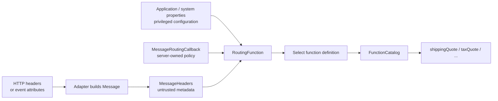

# Restricting SpEL and Distinguishing Trusted Expression Sources

## 1. Context: Is an Expression Configuration or Caller-Controlled Data?

In **SPRING_CLOUD_FUNCTION (Spring Cloud Function)**, business logic is written using `Supplier`, `Function`, and `Consumer`, registered in `FunctionCatalog`, chained via *composition*, and deployable over HTTP, event brokers, or serverless. Several features allow using **Spring Expression Language (SpEL)** to inspect messages, select functions, or enrich headers. SpEL is convenient, yet it introduces a security boundary that cannot be ignored.

Suppose an application has:

- `shippingQuote`: shipping quote function allowed from the public API.
- `taxQuote`: tax quote function allowed from the public API.
- `rebuildLedger`: sensitive maintenance operation, **must never be invoked from the public API**.

When using `functionRouter`, Spring Cloud Function can obtain a **routing expression** from a property or from a `Message` header:

```properties
# Configuration managed by the deployment team:
spring.cloud.function.routing-expression=headers['operation']
```

```java
Message<String> message = MessageBuilder.withPayload("SKU-42")
        .setHeader("spring.cloud.function.routing-expression",
                "headers['operation']")
        .setHeader("operation", "shippingQuote")
        .build();
```

Both `headers['operation']` strings look identical, yet they have **different ownership**. An expression in `application.properties` is managed at the deployment-configuration level; an expression in `MessageHeaders` may arrive from an HTTP client, a Kafka producer, or an event envelope. When a client can supply an **expression string**, it is no longer just a matter of validating a single data field.

> **Core principle:** never let untrusted actors directly supply SpEL or a function definition and then treat language restrictions as an authorization mechanism. The expression source, the objects reachable by the expression, and the target function returned by the expression must all be controlled.

### Learning Objectives

After this lesson, you will be able to:

1. Identify where SpEL appears in Spring Cloud Function and distinguish **expression source** from **expression input data**.
2. Explain `SimpleEvaluationContext` versus `StandardEvaluationContext` and the real limits of each.
3. Know that in **function routing**, header expressions use a restricted context, while expressions from application/system properties use a fuller context.
4. Separate restricting expression syntax from enforcing an **allowed-functions list**.
5. Design adapters that choose functions via allowlists and separate trusted expressions from HTTP/broker/serverless data.
6. Test differences between the two contexts, configuration sources, spoofed routing headers, and caller permissions.
7. Protect deployment configuration, root objects, method/property accessors, conversion, and SpEL caching/compilation.

## 2. Path from HTTP or Events to `functionRouter`



Spring Cloud Function registers `RoutingFunction` in the catalog under the name `functionRouter`. For an **imperative function** processing one `Message` at a time, the official documentation defines the precedence of routing instructions:

1. `MessageRoutingCallback`: an application-registered strategy, highest priority.
2. `Message` headers, if no callback applies.
3. Application/system properties.

Two special headers:

| Header | Role | Risk If Supplied by Client |
|---|---|---|
| `spring.cloud.function.definition` | Specifies a function name or composition string | Selects a privileged function or performs unauthorized chaining |
| `spring.cloud.function.routing-expression` | Supplies SpEL computing a function/definition name | Externally controlled expression, even if evaluation is restricted |

Example of a sender requesting a target via header:

```http
POST /functions/functionRouter HTTP/1.1
Content-Type: text/plain
spring.cloud.function.definition: rebuildLedger

SKU-42
```

This is a **risk-analysis scenario**, not an endpoint to expose. Even if an application blocks all complex SpEL syntax, the `spring.cloud.function.definition` header **is not SpEL**; the definition name alone can influence which function is selected if the router and catalog accept it.

### Reactive Function Routing

Per-message **header-based routing** applies only under the imperative model described in the docs. For reactive functions accepting `Flux`/`Publisher`, the unit of processing is **the entire stream**, so routing instructions are provided at the application properties/definition level rather than per-element headers. Do not rely on reactive inputs assuming a message-sent `routing-expression` behaves identically to imperative functions.

## 3. Three Concepts That Must Be Separated

| Concept | Example | Security Question |
|---|---|---|
| **Expression source** | Deployment config or a message header containing the string `headers['operation']` | Who **has permission to write or modify the SpEL string**? |
| **Expression input data** | Header `operation=shipping` read by a fixed expression | Does the data match schema, type, bounds, and a verified source? |
| **Expression result** | String `shippingQuote` used as the function definition | Is the caller allowed to invoke that function/composition? |

A better flow:

```text
Server-held expression:       "headers['operation']"
Message data from caller:     operation = "shipping"
Server-side mapping:          "shipping" -> "shippingQuote"
                              "tax"      -> "taxQuote"
Any other value:              REJECT
```

**Do not confuse a fixed expression with an authorized result.** A config setting `headers['operation']`, though not written by the client, still **returns raw client data**. If the value is `rebuildLedger`, the router can receive that exact bean name. A valid admin-managed expression can still create an **authorization vulnerability** when how its result is used is unchecked.

Conversely, if an expression is taken directly from the client even though it usually returns `shippingQuote`, the design remains risky because the sender can change the expression in the next request.

## 4. `EvaluationContext` Determines What an Expression Can Do

SpEL does not enforce permission boundaries by itself. It evaluates expressions based on:

- **Root object**, such as a Spring `Message<?>` with `payload` and `headers`.
- **PropertyAccessors**: how properties, maps, or getters are accessed.
- **MethodResolvers**: how methods are resolved and invoked.
- **TypeLocator**, constructor resolvers, and Java type visibility.
- **BeanResolver**: ability to reference application beans.
- **Variables/functions**, conversions, and other configured extensions.

Two common `EvaluationContext` implementations:

| Feature | `SimpleEvaluationContext` | `StandardEvaluationContext` |
|---|---|---|
| Purpose | Cases needing a restricted SpEL subset | Full SpEL capabilities and customization |
| Java type reference `T(...)` | Unsupported by design | Supported |
| Constructor usage `new ...` | Unsupported by design | Supported |
| Spring bean reference `@bean` | Unsupported by design | Bean resolver can be configured |
| Property/method access | Depends on builder and configured accessors | Flexible resolver/accessor system |
| Read-only data binding | Offers `forReadOnlyDataBinding()` | Does not make arbitrary objects safe by default |
| Safe for untrusted expressions? | **Not guaranteed unconditionally** | **Must not be used** for untrusted expressions |

Spring Framework emphasizes that even `SimpleEvaluationContext` provides **best-effort feature restriction**. If an expression can reach a dangerous object through the root, a property accessor, a method resolver, a variable, or a function, forbidding `T(...)` does not guarantee every read or call is harmless.

A getter that looks like a read operation can still have **side effects**. For instance, Java methods with no parameters that return a value can still mutate object state. When such an object becomes the root or a property in the context, an expression reading a property can cause side effects. A "read-data" getter name is **not proof of safety**.

> Per the [Spring Framework — Evaluation, Security Considerations](https://docs.spring.io/spring-framework/reference/core/expressions/evaluation.html) documentation, untrusted expressions should not be evaluated; specifically, `StandardEvaluationContext` must never be used to evaluate expressions from untrusted sources. `SimpleEvaluationContext` is not a security-guaranteed sandbox for arbitrary root objects.

## 5. In Spring Cloud Function: Which Context Does Each Routing Expression Source Use?

The **Spring Cloud Function – Function Routing and Filtering** documentation specifies:

| Where `spring.cloud.function.routing-expression` Is Set | Context Used | Remarks |
|---|---|---|
| `MessageHeaders` of the inbound message | `SimpleEvaluationContext` | Restricts certain language features since input may come from HTTP clients |
| Application properties / system properties / environment configuration | `StandardEvaluationContext` | Allows fuller SpEL because it is assumed to be deployer-managed config |

This is a **rule specific to routing expressions**. Do not assume every SpEL feature in Spring Cloud Function or other libraries uses this exact pair of contexts. For example, `input-header-mapping-expression` and `output-header-mapping-expression` are **header enrichment** features with their own boundaries and implementations; verify actual behavior for your version rather than assuming they share routing's policy.

### 5.1. Expression Placed in a Header

```java
import org.springframework.messaging.Message;
import org.springframework.messaging.support.MessageBuilder;

Message<String> input = MessageBuilder.withPayload("SKU-42")
        .setHeader("operation", "shipping")
        .setHeader("spring.cloud.function.routing-expression",
                "headers['operation']")
        .build();
```

With `functionRouter` in imperative mode, the expression reads the `Message` data. The result is `"shipping"`. If **the function name in the catalog is not `shipping`** but `shippingQuote`, an extra mapping step is still needed. More importantly, if a caller can set `operation` directly to a sensitive bean name, even a restricted context cannot stop an **unwanted routing result**.

### 5.2. Expression Placed in Application Properties

```properties
spring.cloud.function.routing-expression=headers['operation']
```

The deployment team manages this expression, so per the Spring Cloud Function documentation it is evaluated with `StandardEvaluationContext` when taking the application/system property branch. **"Coming from application properties" does not mean always safe**: properties can be overridden via environment variables, startup flags, deployment manifests, Config Server, or an admin interface if those sources are unprotected.

Because the expression runs with broader capabilities, only trusted developers/operators should be allowed to modify it. Never let data from HTTP requests flow into this property via substitution, dynamic config, or an unguarded configuration endpoint.

### 5.3. Benign Context Comparison Example (Not an Exploit Example)

Compare two **benign** expressions:

```text
Expression:     "payload"
Root object:    Message<String>("SKU-42")
Simple context: can read payload if property accessor supports it
Standard:       can read payload

Expression:     "T(java.lang.Math).abs(-7)"
Simple context: does not support Java type reference T(...)
Standard:       can compute result 7
```

`SimpleEvaluationContext` rejecting `T(...)` is a **syntax/feature limitation**, not a license to accept arbitrary expressions from the Internet. You must still control the target function and caller permissions **even when every expression uses valid syntax**.

## 6. Verifying the Difference with JUnit 5

The example below requires neither the Web adapter nor a broker. It uses Spring Expression Language directly to illustrate fundamental differences between the two contexts.

```java
package com.example.security;

import static org.junit.jupiter.api.Assertions.assertEquals;
import static org.junit.jupiter.api.Assertions.assertThrows;

import org.junit.jupiter.api.Test;
import org.springframework.expression.Expression;
import org.springframework.expression.spel.SpelEvaluationException;
import org.springframework.expression.spel.standard.SpelExpressionParser;
import org.springframework.expression.spel.support.SimpleEvaluationContext;
import org.springframework.expression.spel.support.StandardEvaluationContext;
import org.springframework.messaging.Message;
import org.springframework.messaging.support.MessageBuilder;

class SpelContextDifferenceTest {

    private final SpelExpressionParser parser = new SpelExpressionParser();

    @Test
    void readOnlySimpleContextCanReadMessagePayload() {
        Message<String> input = MessageBuilder
                .withPayload("SKU-42").build();
        Expression expression = parser.parseExpression("payload");

        Object output = expression.getValue(
                SimpleEvaluationContext.forReadOnlyDataBinding().build(),
                input);
        assertEquals("SKU-42", output);
    }

    @Test
    void simpleContextRejectsJavaTypeReference() {
        Expression expression =
                parser.parseExpression("T(java.lang.Math).abs(-7)");

        assertThrows(SpelEvaluationException.class,
                () -> expression.getValue(
                        SimpleEvaluationContext
                                .forReadOnlyDataBinding().build()));
    }

    @Test
    void standardContextAllowsBenignTypeReference() {
        Expression expression =
                parser.parseExpression("T(java.lang.Math).abs(-7)");

        Integer output = expression.getValue(
                new StandardEvaluationContext(), Integer.class);
        assertEquals(7, output);
    }
}
```

**Limitation of this test:** it demonstrates raw Spring SpEL, **not which context a Spring Cloud Function router applies at runtime**. To verify your application's actual policy, write integration tests through `FunctionCatalog.lookup("functionRouter")` or the real adapter while observing which function executes.

Do not use the `T(java.lang.Math).abs(-7)` result to extrapolate arbitrary code execution across all contexts. The test only demonstrates the difference in **Java type references** between the two implementations.

## 7. Trust Boundaries Matter More Than Where a Property Is Stored

An expression is **trusted** when its author is a developer or administrator responsible for building/operating the application. Trustworthiness must be based on **actual control**, not merely where the string is stored.

| Source | Can It Be Trusted? | What Must Be Checked |
|---|---|---|
| `application.yml` inside a reviewed artifact | Yes | Build/deploy pipeline, repo write access, change review |
| Environment variables injected at deployment | Yes, if controlled | Permissions to edit pod/task config, secrets, CI/CD, rollback |
| System properties / CLI arguments | Yes, if launch config is protected | Permissions to modify command line, container image, startup scripts |
| Config Server / remote configuration | Conditionally | ACLs, mTLS/authn, commit/publish permissions, auditing, refresh |
| Actuator or admin endpoint that writes config | Only when properly secured | Never expose update capabilities to unauthorized callers |
| HTTP request headers/body | No | Clients can alter the entire value |
| Broker record headers | Not by default | Producer ACLs do not guarantee every value is valid/trusted |
| Third-party webhook/CloudEvent | Not by default | Signature/source verification, schema, source permissions |
| User-editable database row | No | Persistent data does not become trusted configuration |

A **trusted expression** does not turn **untrusted data** into trusted data. For example, a config-defined expression may only read `headers['operation']`, yet the value of `operation` still needs allowed-value checks, type, length, source validation, and caller authorization.

Conversely, a developer-written expression that can be overridden via remote properties controlled by an unauthorized actor is **an expression no longer protected by a valid trust boundary**. Audit the entire configuration supply chain.

### Permission to Change Configuration Is Privileged Access

Spring Cloud Function **does not by itself expose** an endpoint allowing callers to modify arbitrary application properties. However, other libraries, products, or custom admin code can expose configuration read/write mechanisms. Because `StandardEvaluationContext` has rich capabilities, altering `spring.cloud.function.routing-expression` can have far greater impact than changing a cosmetic setting.

You should:

- Block non-admin principals from editing properties, secrets, or ConfigMaps.
- Secure Actuator and custom endpoints; never enable config-writing endpoints merely for convenience.
- Require approval and auditing for routing definition/expression changes.
- Control how environment values are injected into the app; never let client input overwrite config variables directly.
- Separate configuration for public deployments from privileged admin deployments.

## 8. Safe Root Objects: Keep Dangerous Objects Out of SpEL

`EvaluationContext` controls not only syntax, but also **which objects an expression can touch**. A "read-only" context may disallow property assignment while still invoking **getters with side effects**.

Examples of objects that must never be exposed as root/properties to untrusted expressions:

- A service object with methods that read/write a database or call external APIs.
- An admin bean with methods to update config, delete data, or run maintenance jobs.
- A custom object with lazy getters that mutate state, send messages, or run expensive queries.
- An object exposing access to the filesystem, network, execution context, or secrets.
- A DTO nesting service objects reachable through property accessors.

From a security standpoint, **"read-only property access" does not mean "side-effect-free logic."** Provide a simple, immutable data DTO with filtered fields if expression evaluation is unavoidable. Bound data size and depth so expressions cannot traverse unnecessarily large object graphs.

A clearer alternative for routing:

```java
public record RouteHint(String operation, String correlationId) {}
```

Even with `RouteHint`, never let clients write arbitrary expressions; keep the expression or mapping **fixed in code**, reading `operation` strictly as validated data.

## 9. Distinguish SpEL Routing from Header Enrichment

SpEL also appears in Spring Cloud Function's header enrichment properties, for example:

```properties
spring.cloud.function.configuration.shippingQuote.input-header-mapping-expression.ingress='api'
spring.cloud.function.configuration.shippingQuote.output-header-mapping-expression.resultStage='quoted'
```

These two expressions are **enrichment settings** (before/after function invocation), not routing expressions selecting a function name. Keep them distinct:

| Feature | What SpEL Computes | Risk to Control |
|---|---|---|
| `spring.cloud.function.routing-expression` | Name of the function/definition the router will call | Invoking a privileged function, composition abuse |
| `input-header-mapping-expression` | Value of an **inbound** header | Spoofing/overwriting metadata affecting business logic or authorization |
| `output-header-mapping-expression` | Value of an **outbound** header | Leaking sensitive data/metadata to HTTP/broker |
| `spring.cloud.function.definition` | Selected function/definition name **without SpEL** | Bypassing SpEL checks if only `routing-expression` is guarded |

Spring Cloud Function notes that when an enrichment expression fails, the framework may log a `WARN` and **continue invoking the function**. Therefore, never rely on enrichment as a fail-closed validation guard for `tenantId`, roles, scopes, or target functions. If a header is security-critical, the bean/adapter must validate it before taking action.

**Do not mechanically generalize** "header routing uses Simple" into "every expression from `MessageHeaders` or every header enrichment uses Simple." Check the exact feature and SCF version in use.

## 10. Safest Deployment Choice: Fixed Functions Instead of Client-Sent Expressions

If an endpoint only needs shipping quotes, **you do not need `functionRouter`**. Have a Spring MVC adapter inject the exact bean:

```java
package com.example.shipping;

import java.util.Locale;
import java.util.function.Function;

import org.springframework.context.annotation.Bean;
import org.springframework.context.annotation.Configuration;

@Configuration
public class QuoteFunctions {

    @Bean
    public Function<String, String> shippingQuote() {
        return value -> "SHIPPING:" + value.toUpperCase(Locale.ROOT);
    }

    @Bean
    public Function<String, String> taxQuote() {
        return value -> "TAX:" + value.toUpperCase(Locale.ROOT);
    }
}
```

```java
package com.example.shipping;

import java.util.function.Function;

import org.springframework.beans.factory.annotation.Qualifier;
import org.springframework.http.MediaType;
import org.springframework.web.bind.annotation.PostMapping;
import org.springframework.web.bind.annotation.RequestBody;
import org.springframework.web.bind.annotation.RestController;

@RestController
public class ShippingController {
    private final Function<String, String> shipping;

    public ShippingController(
            @Qualifier("shippingQuote") Function<String, String> shipping) {
        this.shipping = shipping;
    }

    @PostMapping(
            path = "/api/shipping/quote",
            consumes = MediaType.TEXT_PLAIN_VALUE,
            produces = MediaType.TEXT_PLAIN_VALUE)
    public String quote(@RequestBody String sku) {
        if (!sku.matches("[A-Za-z0-9-]{1,32}")) {
            throw new IllegalArgumentException("Invalid SKU");
        }
        return shipping.apply(sku);
    }
}
```

In this example, a caller-sent `spring.cloud.function.routing-expression` HTTP header **cannot affect** which bean the controller injects. Still, the application must protect the endpoint with Spring Security, enforce business authorization, and bound HTTP input. If the same app also includes `spring-cloud-function-web`, verify which endpoints the Web adapter automatically exposes; do not protect only the controller while leaving another path open through the adapter.

## 11. When Routing Is Needed: Map Business Operations to a Function Allowlist

When an entry point must handle multiple event types, let callers send a simple **business operation code**; let the application resolve the target via a **server-managed lookup table**. Under the current API documented by Spring Cloud Function, `MessageRoutingCallback.routingResult(Message<?>)` returns the definition name as a `String`.

```java
package com.example.shipping;

import org.springframework.cloud.function.context.MessageRoutingCallback;
import org.springframework.context.annotation.Bean;
import org.springframework.context.annotation.Configuration;
import org.springframework.messaging.Message;

@Configuration
public class SafeRouteConfiguration {

    @Bean
    MessageRoutingCallback routeByApprovedOperation() {
        return new MessageRoutingCallback() {
            @Override
            public String routingResult(Message<?> message) {
                Object raw = message.getHeaders().get("businessOperation");
                if (!(raw instanceof String operation)) {
                    throw new IllegalArgumentException("Missing operation");
                }
                return switch (operation) {
                    case "shipping" -> "shippingQuote";
                    case "tax" -> "taxQuote";
                    default -> throw new IllegalArgumentException(
                            "Unsupported operation");
                };
            }
        };
    }
}
```

Security properties:

- The callback is registered by the **server** and takes precedence in `RoutingFunction` over message headers for imperative routing.
- The callback **does not read** externally supplied `spring.cloud.function.routing-expression` or `spring.cloud.function.definition`.
- The callback **does not return raw `operation`**; it maps two specific values to two reviewed bean names.
- The callback never constructs compositions from user-entered strings.
- Wrong-type, missing, or out-of-set values are **rejected**, with no default fallback to another function.

If the two target functions require **different permissions**, a routing allowlist alone is not enough: the adapter must authenticate the caller and check authorization per operation before invoking the router. If an administrative task needs special privileges, place it in a separate deployment/service rather than sharing a public router.

**Version note:** current documentation shows `routingResult(Message<?>)` as a **`default` method on the interface**, so the snippet uses an **anonymous class with `@Override`** rather than a functional-interface lambda. Older Spring Cloud Function branches may have a different signature or return type; verify the actual API in your dependency version.

## 12. Unit Test: External Expressions Cannot Bypass the Allowlist

For `SafeRouteConfiguration` above, verify that the callback ignores client-supplied routing headers:

```java
package com.example.shipping;

import static org.junit.jupiter.api.Assertions.assertEquals;
import static org.junit.jupiter.api.Assertions.assertThrows;

import org.junit.jupiter.api.Test;
import org.springframework.cloud.function.context.MessageRoutingCallback;
import org.springframework.messaging.Message;
import org.springframework.messaging.support.MessageBuilder;

class SafeRouteConfigurationTest {

    private final MessageRoutingCallback route =
            new SafeRouteConfiguration().routeByApprovedOperation();

    @Test
    void ignoresUntrustedDefinitionAndExpressionHeaders() {
        Message<String> request = MessageBuilder.withPayload("SKU-42")
                .setHeader("businessOperation", "shipping")
                .setHeader("spring.cloud.function.definition",
                        "rebuildLedger")
                .setHeader("spring.cloud.function.routing-expression",
                        "'rebuildLedger'")
                .build();

        assertEquals("shippingQuote", route.routingResult(request));
    }

    @Test
    void rejectsUnknownTargetEvenIfItLooksLikeBeanName() {
        Message<String> request = MessageBuilder.withPayload("SKU-42")
                .setHeader("businessOperation", "rebuildLedger")
                .build();

        assertThrows(IllegalArgumentException.class,
                () -> route.routingResult(request));
    }

    @Test
    void rejectsCompositionAsAnOperation() {
        Message<String> request = MessageBuilder.withPayload("SKU-42")
                .setHeader("businessOperation",
                        "shippingQuote|rebuildLedger")
                .build();

        assertThrows(IllegalArgumentException.class,
                () -> route.routingResult(request));
    }

    @Test
    void rejectsNonStringOperation() {
        Message<String> request = MessageBuilder.withPayload("SKU-42")
                .setHeader("businessOperation", 123)
                .build();

        assertThrows(IllegalArgumentException.class,
                () -> route.routingResult(request));
    }

    @Test
    void recognizesOnlyApprovedTaxOperation() {
        Message<String> request = MessageBuilder.withPayload("SKU-42")
                .setHeader("businessOperation", "tax")
                .build();

        assertEquals("taxQuote", route.routingResult(request));
    }
}
```

These tests prove **the policy enforced by the callback**; they do not prove the adapter registered the callback properly or that the callback takes precedence in a live flow. You need an integration test with a Spring context, `FunctionCatalog.lookup("functionRouter")`, and observation of **which function ran**. For functions with side effects, use spies or state assertions to guarantee sensitive tasks did not run; checking only response content is insufficient.

If your app runs multiple routers or custom lookup settings, the test must mirror that exact deployment. You cannot run a callback unit test in one module and assume every HTTP, broker, and serverless trigger uses it.

## 13. Avoid Forwarding HTTP Headers Directly into Control Metadata

With the Web adapter, certain HTTP headers can pass into `MessageHeaders`. A common mistake in custom adapters is identical: copying every HTTP header into a message and handing that message to a router.

**What not to do:**

```java
// Anti-pattern: all HTTP header data is placed into Message.
// Never use this in an entry point with dynamic routing.
//
// MessageBuilder.withPayload(requestBody)
//         .copyHeaders(requestHeaders.toSingleValueMap())
//         .build();
```

In a custom API, construct the `Message` from an **explicit field allowlist**:

```java
package com.example.shipping;

import java.util.List;
import java.util.UUID;

import org.springframework.http.HttpHeaders;
import org.springframework.http.HttpStatus;
import org.springframework.messaging.Message;
import org.springframework.messaging.support.MessageBuilder;
import org.springframework.web.server.ResponseStatusException;

public final class InboundQuoteMessages {

    private InboundQuoteMessages() {}

    public static Message<String> fromHttp(
            String sku, String operation, HttpHeaders headers) {

        if (sku == null
                || !sku.matches("[A-Za-z0-9-]{1,32}")) {
            throw new ResponseStatusException(
                    HttpStatus.BAD_REQUEST, "Invalid SKU");
        }

        if (!"shipping".equals(operation)
                && !"tax".equals(operation)) {
            throw new ResponseStatusException(
                    HttpStatus.NOT_FOUND, "Unknown operation");
        }

        String correlationId = correlationId(headers);
        return MessageBuilder.withPayload(sku)
                .setHeader("businessOperation", operation)
                .setHeader("correlationId", correlationId)
                .build();
    }

    private static String correlationId(HttpHeaders headers) {
        List<String> values = headers.get("X-Correlation-ID");
        if (values == null || values.isEmpty()) {
            return UUID.randomUUID().toString();
        }

        if (values.size() != 1
                || !values.get(0).matches("[A-Za-z0-9._-]{1,64}")) {
            throw new ResponseStatusException(
                    HttpStatus.BAD_REQUEST, "Invalid correlation ID");
        }
        return values.get(0);
    }
}
```

Key point: the builder **never copies** `spring.cloud.function.definition`, `spring.cloud.function.routing-expression`, `Authorization`, cookies, or any arbitrary header. It passes only explicitly specified metadata: `businessOperation` and `correlationId`. `correlationId` itself **is not authorization evidence**.

HTTP headers can have multiple values and HTTP header names are case-insensitive, whereas `MessageHeaders` keys are Java strings. The adapter must normalize types, key lists, and multi-value handling; **never rely on case sensitivity as a security measure**.

If you use **Spring Cloud Function Web directly** instead of a custom controller/adapter, `InboundQuoteMessages` does not apply automatically. Verify the actual Web export/routing mechanism, disable unnecessary routers, and apply authorization on the exact URLs.

## 14. Protect `FunctionCatalog` and Restrict Exposed Functions

For a Web app needing only the two quoting functions, use definition-list filtering per the Spring Cloud Function Web docs:

```properties
# Example specifically for a deployment using the Web adapter.
spring.cloud.function.web.path=/functions
spring.cloud.function.definition=shippingQuote;taxQuote
spring.cloud.function.single-function-fallback-enabled=false
```

Rules:

| Setting | Key Meaning to Remember |
|---|---|
| `shippingQuote;taxQuote` | List of two definitions published by the Web adapter |
| `shippingQuote\|taxQuote` | **One** composition string, not two endpoints |
| `single-function-fallback-enabled=false` | Prevents looking up a single function via an unmatched name through fallback |
| `web.path=/functions` | Changes the URL prefix; does **not** add authentication/authorization |

If `rebuildLedger` does not belong in the catalog:

```properties
spring.cloud.function.ineligible-definitions=rebuildLedger
```

This property excludes the bean from catalog candidate registration under Spring Cloud Function; it **does not** stop other Java code already holding a reference from calling the bean directly, does not protect the database, and does not replace Spring Security. In real systems, sensitive administrative tasks should live in a separate service/deployment with dedicated permissions.

**Do not conflate two architectures:**

- **Fixed Web export:** use `definition=shippingQuote;taxQuote` and do not expose `functionRouter` to clients.
- **Entry point genuinely needing dynamic routing:** expose the router only by design, use an allowlist callback and adapter-level authorization; never assume Web filtering automatically constrains every function the router can look up.

A router can look up functions in the catalog through its own logic. Thus, restricting **URLs** alone is not enough if a callback or routing headers still allow selecting an out-of-contract bean.

## 15. Spring Security: Authorization Does Not Live Inside `EvaluationContext`

Suppose both `shippingQuote` and `taxQuote` require the `quotes.read` JWT scope. A Spring MVC deployment can enforce:

```java
package com.example.shipping;

import org.springframework.context.annotation.Bean;
import org.springframework.context.annotation.Configuration;
import org.springframework.http.HttpMethod;
import org.springframework.security.config.Customizer;
import org.springframework.security.config.annotation.web.builders.HttpSecurity;
import org.springframework.security.web.SecurityFilterChain;

@Configuration
public class QuoteSecurity {

    @Bean
    SecurityFilterChain api(HttpSecurity http) throws Exception {
        return http
            // Only for stateless APIs authenticating with bearer tokens,
            // not relying on browser cookie authentication.
            .csrf(csrf -> csrf.disable())
            .authorizeHttpRequests(auth -> auth
                .requestMatchers(
                    HttpMethod.POST, "/api/shipping/quote")
                    .hasAuthority("SCOPE_quotes.read")
                .anyRequest().denyAll()
            )
            .oauth2ResourceServer(oauth ->
                oauth.jwt(Customizer.withDefaults()))
            .build();
    }
}
```

In production, configure the JWT decoder to validate signatures, issuer, audience, expiration, and applicable rules; a scope does not mean the caller has access to **every** customer or tenant. If an operation affects owned resources, business authorization must run before side effects.

If using cookies/sessions instead of a stateless bearer-token API, **do not blindly copy** `csrf.disable()`. CORS is not authentication; it governs browsers, not callers using other HTTP clients.

**Authorization does not depend on whether an expression's syntax is restricted.** A caller lacking the `quotes.read` scope must not invoke `shippingQuote` even if the expression is the completely benign literal `'shippingQuote'`.

## 16. Spring Cloud Stream: Publish Permission Is Not Permission to Select Any Bean

With Spring Cloud Stream, an application can enable **event routing** via `RoutingFunction`:

```properties
spring.cloud.stream.function.routing.enabled=true
spring.cloud.stream.bindings.functionRouter-in-0.destination=quotes.requests
```

This configuration **illustrates a deployment intentionally using a router**, not a recommendation for every app. A producer permitted to write to `quotes.requests` can attach record headers. When the binder maps those headers into `MessageHeaders`, treat them as **untrusted external input**.

Target flow:

```text
Producer with appropriate broker ACL
     |
     v
quotes.requests (payload + application headers)
     |
     v
Stream binder / message conversion
     |
     v
Trusted adapter / callback
  - validate schema, size, businessOperation
  - ignore record routing-expression as policy
  - map operation to shippingQuote/taxQuote
     |
     v
Approved FunctionCatalog target
```

Security points:

- Broker ACLs restrict who can **publish/consume**; they do not guarantee every publisher payload/header is valid.
- Never forward tokens, roles, or `tenantId` from event headers into sensitive functions while skipping source authentication/authorization.
- A stream receiving messages from producers with different privilege levels should not share a router choosing targets with vastly different privileges.
- When function routing fails, define retry/DLQ/auditing; never silently treat a dropped message as successfully processed.
- When using reactive functions, do not expect per-record routing headers to share the same semantics as imperative functions.

In particular, distinguish **routing to a function** from **routing output to a broker destination**. Output topic/queue selection metadata also needs constraints, though it is not `spring.cloud.function.routing-expression` itself. Never let a producer freely pick any destination the runtime has permission to write to.

## 17. Serverless: Configuring Function Definition and Event Envelopes

With AWS Lambda or serverless runtimes, `FunctionInvoker` can select the Spring Cloud Function definition from deployment config. A deployment dedicated solely to quotes should **fix its definition**:

```properties
spring.cloud.function.definition=shippingQuote
```

If a router is genuinely needed to handle multiple event types, distinguish:

| Source | Can It Influence Target? | Control Direction |
|---|---|---|
| Deployment environment/config | Yes, because operators define it | Review and restrict IAM/CI/CD edit permissions |
| API Gateway request headers | Potentially if adapter passes routing metadata | JWT/IAM authorization, header filtering, allowlist callback |
| Lambda Function URL body | Potentially if handler parses routing metadata | Protect invoke permissions; never trust raw definitions |
| SQS/EventBridge event attributes | Potentially when mapped to `MessageHeaders` | Producer ACLs/policies, schema, and server-side mapping |
| CloudEvents `type` | Can serve as a business signal | Map event type to fixed targets; never treat `type` as a bean name |

Never infer that an API Gateway authorizer protects **every** Lambda invocation path: resource-based policies, direct IAM invoke permissions, Function URLs, and event triggers create separate paths. A Lambda execution role governs permissions **for downstream resources**, not permission for callers to pick arbitrary bean names.

For CloudEvents, `type=com.example.quote.shipping` can be mapped **by the server** to `shippingQuote`, but never pass an event field or `type` directly into `FunctionCatalog.lookup(...)` without a whitelist. Events from untrusted sources must still pass schema, source, and authorization checks.

## 18. When an Expression Fails to Evaluate or the Target Does Not Exist

Failures and consequences differ:

| Case | Characteristic | Required Handling |
|---|---|---|
| Syntax/evaluation error in routing expression | May throw when router tries to pick target | Return error per HTTP/broker contract; never fall back to a privileged bean |
| Valid expression returning `rebuildLedger` | **Authorization problem**, not syntax error | Callback/adapter must reject non-allowlisted targets |
| Target missing from catalog | Router may throw "route-to function not available" | Monitor, reject, or handle unroutable messages systematically |
| `DefaultMessageRoutingHandler` registered | Default may log and continue, effectively dropping unroutable messages | Never lose critical business commands without auditing |
| Input/output header enrichment SpEL error | SCF docs note it may log WARN and continue calling the function | Validate mandatory metadata inside the bean/adapter |
| Function bean throws an exception | Business/implementation error | Handler/retry/DLQ per adapter and application policy |

Do not lump everything under "SpEL failed so the function didn't run." **Enrichment errors** may not block the function, **routing errors** may block target selection, and **unauthorized routing results** may throw no exception at all unless you implement authorization.

If a function causes side effects (charging payments, sending emails, updating a ledger), **permission** must be verified **before** invocation—not handled after catching an exception or seeing a WARN log.

## 19. Advanced SpEL Considerations in Spring Framework

### 19.1. Getters with Side Effects

A property accessor can invoke Java methods following getter conventions. "Read-only binding" means **property assignment is disallowed** by the configured accessors; it **does not prove getters cannot mutate state**. Keep external expressions away from objects exposing admin APIs, filesystems, networks, queues, or other services.

Even data-reading expressions can impose **computational cost** on large inputs or complex getters. Bound HTTP header sizes, record attributes, payloads, and object-graph depth; use simple validated DTOs.

### 19.2. Type Conversion

Spring Framework supports type conversion in SpEL. Current docs explain that `SimpleEvaluationContext` defaults to a restricted conversion service, avoiding certain reflective conversions that invoke constructors/methods. However, developers can register custom converters or alter config in ways that **expand capabilities**. Adding custom converters just to make external expressions "work" requires a dedicated security review.

Never let automatic conversion turn an unexpected header type into a target function or principal without schema validation. For example, an `operation` header sent by a broker as a byte array is not automatically equivalent to a callback-accepted `String`.

### 19.3. Caching Expressions Across Contexts with Different Trust Levels

Spring Framework may cache resolved `PropertyAccessor`/`MethodExecutor` state inside a parsed `Expression`'s AST. Per official documentation, **never reuse the same parsed `Expression` object across contexts with different privileges/capabilities**—for example, evaluating it first under `StandardEvaluationContext` and later reusing it under `SimpleEvaluationContext` expecting simple's limits to hold.

If an application **builds its own SpEL evaluator** needing two privilege tiers, parse into **two separate `Expression` objects** with separate source and root policies. This is especially critical when developers try to build a custom "SpEL sandbox" instead of using framework-controlled routing.

### 19.4. Compiled SpEL

In current Spring Framework versions, **compiled SpEL** can have different safety properties from interpreted mode; documentation advises **against enabling compilation for expressions from untrusted sources**. Do not configure `spring.expression.compiler.mode` to speed up user-supplied expressions. If an app builds its own SpEL engine, security must be reviewed before any compilation optimization.

**Scope of applicability:** these caching, conversion, and compilation cautions apply to **application code that parses/evaluates SpEL itself** or settings affecting the engine. They do not imply `Spring Cloud Function` compiles expressions or shares caches across contexts in every version.

## 20. Security Testing Matrix by Expression Source

| Test | Source | Expected Outcome |
|---|---|---|
| `payload` expression on `SimpleEvaluationContext` | SpEL unit | Reads data per configured accessor |
| Java type reference `T(...)` in `SimpleEvaluationContext` | SpEL unit | Restricted |
| Benign `T(java.lang.Math)` expression in `StandardEvaluationContext` | SpEL unit | Succeeds, illustrating broader feature set |
| Client sends `spring.cloud.function.definition=rebuildLedger` | HTTP/broker | Does not invoke sensitive function |
| Client sends `routing-expression` resolving outside allowlist | HTTP/broker | Does not invoke sensitive function |
| Client sends out-of-contract composition | HTTP/broker | Rejected; downstream steps never run |
| `businessOperation=shipping` with spoofed routing headers | Callback/catalog | Invokes only `shippingQuote` |
| `businessOperation=unknown` | Callback/catalog | Explicitly rejected |
| Wrong-type or oversized operation header | HTTP/broker adapter | Rejected/normalized prior to routing |
| Caller missing JWT scope | HTTP security | `401`/`403` as appropriate |
| Actor has scope but does not own resource | Business policy | Zero side effects |
| Unauthorized principal edits expression config | CI/CD/admin | Update blocked and audited |
| Event from producer without ACL | Broker/serverless | Never reaches consumer |
| Direct Lambda invoke bypassing API Gateway | IAM/resource policy | Unauthorized principal rejected |
| Router cannot find function | Integration routing | Appropriate error/handler; no privileged fallback |

### Separating Test Types

- **SpEL unit tests:** demonstrate language/context behavior. Not representative of real adapter permissions.
- **Callback unit tests:** prove mapping from business operations to targets matches the whitelist.
- **Catalog integration tests:** prove `functionRouter` follows callback/property/header precedence on your actual SCF version and invokes no other bean.
- **HTTP integration tests:** prove security filters, Web exports, and all invocation paths are protected.
- **Broker/serverless integration tests:** prove message header mapping, ACLs/IAM, retries/DLQs, and event routing.
- **Deployment tests:** prove config/Actuator/CI/CD/secrets cannot be modified from unauthorized sources.

Never test only the `200 OK` path. Negative tests must verify that **sensitive operations did not execute**. For functions mutating a database, compare state and check audit logs/idempotency after rejected requests.

## 21. Common Misconceptions

| Misconception | Risk | Fix |
|---|---|---|
| "`SimpleEvaluationContext` is a complete sandbox" | Root objects/getters/accessors can still be dangerous | Avoid untrusted expressions; constrain data and reachable objects |
| "`StandardEvaluationContext` is safe because the expression is in properties" | Remote config or admin endpoints can be abused | Truly protect configuration edit permissions |
| "Config expression wasn't written by the client, so its result is trusted" | Expression might return raw `headers.operation` | Enforce an independent target allowlist |
| "Blocking SpEL blocks all routing injection" | `spring.cloud.function.definition` needs no SpEL | Control both definitions and compositions |
| "Function name contains only letters so it's valid" | Valid names can still be privileged beans | Match an explicit target list, not just regex |
| "Once declared in properties, HTTP headers can't change the route" | Message headers outrank properties in imperative routing without a callback | Filter headers, use an allowlist callback, and integration-test |
| "Read-only context has no side effects" | Getters or conversions can perform actions | Expose simple DTOs and review accessors |
| "One parsed `Expression` can be shared across any security context" | Cached accessors may not reflect new boundaries | Parse separately per trust tier |
| "Enabling compiled SpEL is always equivalent to interpreted mode" | Differences in safety guards | Never compile untrusted expressions |
| "`ineligible-definitions` is authorization" | Remaining beans can still be called without permission | Spring Security, IAM/ACLs, and business policies |
| "Gateway is protected, so serverless is safe" | Direct invoke / Function URL / queues can bypass | Control resource policies, triggers, and roles |
| "Input-header enrichment failure stops the function" | Enrichment may just log WARN | Validate mandatory metadata inside the bean/adapter |
| "Checking router output alone is enough" | A sensitive function may already have caused side effects | Use spies and verify downstream state |

## 22. Hands-On Exercise: Design a Controlled Routing Entry Point

Build a Spring Cloud Function application with three beans: `shippingQuote`, `taxQuote`, and `rebuildLedger`. Create one entry point accepting quote requests, and a separate internal deployment if maintenance is required.

1. Create `Function<String, String>` beans for the two quote functions. Keep `rebuildLedger` as a plain service or exclude it from the public catalog.
2. Write unit tests evaluating `payload` with `SimpleEvaluationContext` and an expression using `T(java.lang.Math)` with `StandardEvaluationContext`; explain why this test does **not** make it safe to run expressions from the Internet.
3. Write a `MessageRoutingCallback` returning `shippingQuote` when `businessOperation=shipping`, `taxQuote` when `businessOperation=tax`, and rejecting all other values.
4. Send a `Message` with `businessOperation=shipping` plus client-supplied `spring.cloud.function.definition=rebuildLedger` and `spring.cloud.function.routing-expression`. Verify the callback still picks the allowlisted target.
5. Try sending `businessOperation=shippingQuote|rebuildLedger`, wrong-type data, oversized payloads, and duplicate headers. Design rejection policies at the adapter and callback.
6. Compare Web export `shippingQuote;taxQuote` with composition `shippingQuote|taxQuote`. Determine which URLs may be exposed and lock down all paths to `functionRouter` if the deployment needs no router.
7. Use Spring Security to require the right JWT scope before quoting; prove a caller lacking the scope cannot run the bean even when the target is allowlisted.
8. If using Stream, create a dedicated broker input binding, restrict publisher ACLs, and verify record headers cannot choose out-of-whitelist functions.
9. If using serverless, set a fixed function definition via deployment config, restrict direct invoke/trigger IAM, and never treat event headers as verified end-user identity.
10. Audit edit permissions for ConfigMaps, application properties, environment variables, and admin endpoints. Ensure external callers cannot modify `spring.cloud.function.routing-expression`.
11. Write a test verifying `rebuildLedger` produces **no side effects** after any out-of-contract routing attempt.

### Self-Check Questions

1. Which three SpEL features does `SimpleEvaluationContext` restrict compared to `StandardEvaluationContext`? Why is that still insufficient for accepting untrusted expressions?
2. An admin-written `headers['operation']` expression in application properties returns `rebuildLedger` from client data. Is the core issue the expression source or the result?
3. If a client sends `spring.cloud.function.definition` instead of `routing-expression`, does restricting SpEL prevent invoking the wrong bean?
4. Why is a `MessageRoutingCallback` mapping two literals better than a callback returning a header verbatim as the function definition?
5. When must an `Expression` be re-parsed instead of reusing an object already evaluated in another privileged context?
6. If the same JAR runs Web and serverless, what can prevent HTTP protections from applying to other invocation paths?

## 23. Production Checklist

| Check | Required Outcome |
|---|---|
| Are all places accepting expressions and function names identified? | Yes, per adapter and version |
| Is raw SpEL rejected from HTTP/event clients when not truly required? | Yes |
| Is `StandardEvaluationContext` never used on untrusted expressions? | Yes |
| Does `SimpleEvaluationContext` have safe root/accessors? | Reviewed, not assumed safe |
| Does expression-read data have schema/type/size bounds? | Yes |
| Are target functions and compositions in a server-managed allowlist? | Yes |
| Does callback precedence over headers and properties match runtime reality? | Integration-tested |
| Does HTTP Web export expose only necessary functions? | Yes, with negative tests |
| Are Spring Security/ACLs/IAM and business authorization enforced per entry point? | Yes |
| Are callers prevented from editing routing properties, Actuator, or remote config? | Audited and access-controlled |
| Is parsed-expression reuse blocked across different trust tiers? | Separation policy enforced |
| Are untrusted expressions prevented from being compiled? | Yes |
| Are routing/enrichment errors handled appropriately for the business flow? | Fail-closed tested where needed |
| Are tokens and sensitive expressions/data excluded from logs? | Filtering and retention policy |
| Are there tests proving zero side effects when routing is rejected? | Yes |

## 24. Summary and References

**SpEL restrictions and expression-source trustworthiness are two distinct axes.** Spring Cloud Function evaluates routing expressions from `MessageHeaders` using a restricted `SimpleEvaluationContext`, while routing expressions from application/system properties use the broader `StandardEvaluationContext`. Yet **neither context determines whether a caller is allowed to invoke a function**. Even a fixed expression in configuration can return the wrong function name if the data it reads is unvalidated.

For Spring Cloud Function deployed over HTTP, events, or serverless, the preferred approach is **never accepting expressions from callers**: select fixed functions whenever possible; when dynamic routing is necessary, map a validated business operation code to **an explicit function name in an allowlist** via an adapter or `MessageRoutingCallback`. At the same time, control which objects SpEL can reach, protect configuration edits, enforce per-entry-point caller authorization, and test spoofing scenarios along with side effects.

**Official references:**

- [Spring Cloud Function — Programming model, Function Routing and Filtering](https://docs.spring.io/spring-cloud-function/reference/spring-cloud-function/programming-model.html): `functionRouter`, `spring.cloud.function.definition`, `routing-expression`, context per source, and precedence.
- [Spring Framework — EvaluationContext and Security Considerations](https://docs.spring.io/spring-framework/reference/core/expressions/evaluation.html): `SimpleEvaluationContext`, `StandardEvaluationContext`, reachable objects, accessors, conversion, expression caching, and compiled SpEL.
- [Spring Cloud Function — Standalone Web Applications](https://docs.spring.io/spring-cloud-function/reference/spring-cloud-function/standalone-web-applications.html): Web function export and filtering.
- [Spring Cloud Stream — Event Routing](https://docs.spring.io/spring-cloud-stream/reference/spring-cloud-stream/event-routing.html): dynamic routing over message brokers.
