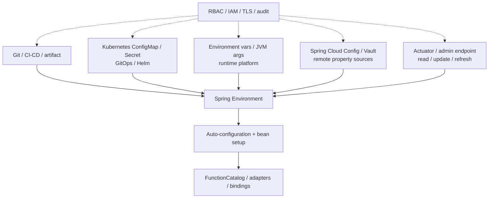
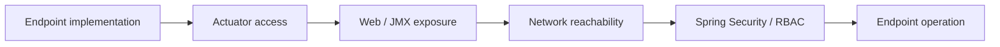
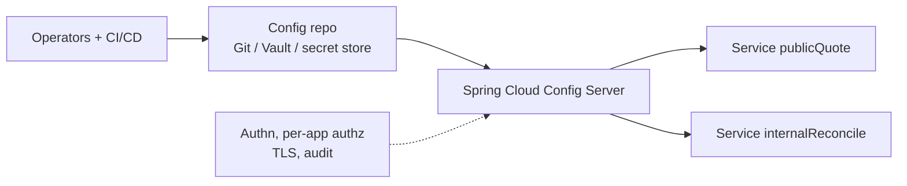

# Securing Configuration Properties and Administrative Endpoints

## 1. Why Is Configuration a Security Boundary?

In **SPRING_CLOUD_FUNCTION (Spring Cloud Function)**, business logic is written as `Supplier`, `Function`, and `Consumer` beans, looked up via `FunctionCatalog`, combined via *composition*, and redeployed across HTTP, events, or serverless. That flexibility means **configuration** can alter which function is called, what metadata is processed, and which entry points are exposed.

Suppose an application has three beans: `publicQuote` for public quoting, `processOrderEvent` solely for an authorized broker, and `internalReconcile` handling sensitive reconciliation data. The operations team explicitly sets:

```properties
spring.cloud.function.definition=publicQuote
spring.cloud.function.web.path=/functions
```

If an untrusted caller modifies `spring.cloud.function.definition` or `spring.cloud.function.routing-expression` through an unprotected admin path, they can influence target function selection. If the application also exposes `/actuator/env`, `/actuator/configprops`, `/actuator/loggers`, or config-refresh endpoints, unintended runtime leakage and modification can occur.

> **Core rule:** protect **who can view configuration**, **who can modify configuration**, **how configuration is loaded**, and **how changes are applied/audited**. Putting a property in `application.yml` or naming a URL "admin" does not create a security boundary on its own.

After this lesson, you will know how to identify sensitive Spring Cloud Function properties, configure Actuator using least privilege, secure HTTP/JMX, restrict Spring Cloud Config/Bus, govern deployment permissions, and test administrative paths against abuse.

## 2. Property Groups That Affect Function Invocation Privileges

| Group | Example Property | Impact to Evaluate |
|---|---|---|
| Bean/composition selection | `spring.cloud.function.definition` | Determines which function or function chain adapters can pick |
| Dynamic routing | `spring.cloud.function.routing-expression` | SpEL expression computing the target function definition |
| Catalog candidates | `spring.cloud.function.ineligible-definitions` | Controls which beans are eligible to appear in the catalog |
| Lookup fallback | `spring.cloud.function.single-function-fallback-enabled` | Affects resolving a single bean by a non-matching name |
| HTTP export | `spring.cloud.function.web.path` | Changes the URL prefix; does **not** authenticate callers |
| Header enrichment | `spring.cloud.function.configuration.<function>.input-header-mapping-expression.<key>` | Computes inbound metadata before the function, potentially affecting business logic |
| Output enrichment | `spring.cloud.function.configuration.<function>.output-header-mapping-expression.<key>` | Computes outbound metadata, potentially leaking through adapters |
| Header propagation | `spring.cloud.function.configuration.<function>.copy-input-headers` | When applied, affects preservation of inbound metadata |
| Stream binding | `spring.cloud.stream.bindings.<binding>.destination` | Connects logic to broker destinations |
| Stream routing | `spring.cloud.stream.function.routing.enabled` | Can open an event-routing path to functions |

**Not every property can be changed live while the application is running.** Some values are read when the context starts or bindings are created; a refresh may affect only supported beans. Therefore, never treat an Environment-updating endpoint as a guaranteed instant switch for changing functions. Configuration changes must be paired with restart/refresh mechanisms, impact assessment, and version-specific testing.

### Routing Expression: Configuration Source Determines SpEL Privilege Level

The official Spring Cloud Function documentation states:

| Routing Expression Source | Context | Security Meaning |
|---|---|---|
| `spring.cloud.function.routing-expression` header in `Message` | `SimpleEvaluationContext` | Restricts SpEL features because headers may originate from HTTP/brokers |
| Application/system property `spring.cloud.function.routing-expression` | `StandardEvaluationContext` | More powerful, assuming the config source is managed by trusted deployers |

Spring Cloud Function **does not automatically create an HTTP endpoint for clients to edit application/system properties**. Risk arises if Actuator, Spring Cloud, third-party products, or a custom endpoint allows reading or modifying them. Because `StandardEvaluationContext` has broader expression capabilities, anyone with write access to routing properties must be considered to have **permission to alter application behavior**.

At the same time, for the imperative router, precedence is `MessageRoutingCallback` → message headers → application properties. Protecting configuration files alone is insufficient if a public router still trusts client-sent `spring.cloud.function.definition`. Both the **config plane and the message plane** must be protected.

## 3. Map of Configuration Sources and Paths



Spring Boot has multiple **property sources** with varying precedence. Values from the command line, environment variables, and external configuration can override `application.yml`, depending on version and launcher precedence. Therefore:

- Do not conclude a deployment is safe simply because the YAML file in the repository was reviewed.
- Verify the **effective configuration** of each environment through a secure process, without printing secrets to logs.
- Restrict edit permissions on pipelines, images, command lines, Helm values, ConfigMaps/Secrets, and config servers.
- Enforce change reviews, deployment approvals, auditing, and rollbacks. Avoid untracked manual edits.
- Never turn HTTP headers, request bodies, or message attributes into privileged property sources.

Example in an artifact:

```yaml
spring:
  cloud:
    function:
      definition: publicQuote
```

If the deployment permits overriding via:

```text
SPRING_CLOUD_FUNCTION_DEFINITION=internalReconcile
```

then the original reviewed intent can be broken. This is a **scenario to prevent**, not a recommended configuration. Spring Boot supports relaxed binding in many cases; final binding and precedence must be verified on your exact version, command line, and runtime environment.

## 4. Actuator Has Four Distinct Control Layers

An administrative endpoint passes through multiple layers:

1. **Implementation presence:** is a dependency providing `env`, `beans`, `health`, `loggers`, or a custom endpoint?
2. **Endpoint access:** in current Spring Boot versions, `management.endpoint.<id>.access` and `management.endpoints.access.*` can restrict access to `none`, `read-only`, or `unrestricted`.
3. **Exposure:** `management.endpoints.web.exposure.include` or JMX settings decide whether the endpoint is exposed over that transport.
4. **Network and authentication/authorization:** can the caller reach the port, pass Spring Security, roles/scopes, CSRF, and other policies?



**Distinguish status codes:**

- An unexposed `/actuator/env` may return `404`; one blocked by a filter may return `401/403`. Never expose an endpoint just to "test security."
- `management.endpoints.web.exposure.include=health` does not create an authorization policy for custom controllers outside Actuator.
- Read-only `GET /actuator/env` differs from `POST /actuator/env` supported by Spring Cloud in certain configurations: POST can affect runtime state.
- Disabling HTTP exposure **does not automatically disable JMX**, a separate management port, or custom endpoints.
- Changing `management.endpoints.web.base-path` only changes the URL; it does not make the endpoint private.

Per Spring Boot 3.5/4.x documentation, **by default only `health` is exposed over HTTP**. However, application dependencies and config can change the effective endpoint set, so always verify the deployed artifact.

## 5. Endpoints Requiring Risk Assessment

| Endpoint | What Can It Expose or Change? | Suggested Policy |
|---|---|---|
| `health` | Application status, component details when details are enabled | Minimal status only for probes; restrict details |
| `info` | Build info, version, and app metadata | Reviewed information only |
| `env` | Property names, sources, and values (with sanitization) | Do not expose publicly |
| `configprops` | Properties bound to `@ConfigurationProperties` | Do not expose publicly |
| `beans` | Bean names and dependency graph | Can reveal internal function names |
| `mappings` | URL mappings, Web endpoints | Can reveal internal API surface |
| `conditions` | Auto-configuration evaluation, dependencies | Restrict |
| `loggers` | View/change logging levels when active | Admin privilege and auditing |
| `heapdump` / `threaddump` | Runtime memory, stacks/heaps, and sensitive contents | Do not expose broadly |
| `httpexchanges` | Recorded request/response details | Separate retention and access controls |
| `shutdown` | Stops the application if enabled | Never expose casually |
| `refresh` | Reloads/refreshes scope when supported by Spring Cloud | Admin channel only |
| `busrefresh` / `busenv` | Broadcasts refresh or config changes across instances | Very tight privileges, with auditing |
| Custom `@Endpoint` or admin controller | Depends on code | Review as a privileged API |

**Not all of the endpoints above are enabled by default.** `refresh`, `busenv`, and some management capabilities depend on Spring Cloud or custom dependencies; Spring Cloud Function does not automatically expose all of them.

## 6. Minimal Actuator Configuration

Example for a Spring Boot 3.5 deployment needing only HTTP health and info, **with no HTTP config updates**:

```yaml
# application-prod.yml (illustrative)
management:
  endpoints:
    web:
      exposure:
        include: "health,info"
    jmx:
      exposure:
        include: "health"
  endpoint:
    health:
      show-details: never
    env:
      show-values: never
    configprops:
      show-values: never
spring:
  cloud:
    function:
      definition: publicQuote
```

Meaning:

- Web exposes only `health` and `info` among configured Actuator endpoints.
- JMX exposure is evaluated **separately**; if JMX is unused, restrict it further.
- `show-details=never` prevents returning detailed health-check internals to callers who do not need them.
- `env`/`configprops` still have sanitization configured in case another profile accidentally exposes them, though the best policy remains **not exposing** them at all.
- `definition=publicQuote` is function selection, not Spring Security authorization.

If HTTP Actuator is not needed at all:

```properties
management.endpoints.web.exposure.exclude=*
```

Spring Boot also supports `management.server.port=-1` to disable the HTTP management server. This Web config does not govern JMX, custom REST controllers, or a standalone Spring Cloud Config Server.

### Configurations to Avoid

```yaml
# Anti-pattern: exposing every endpoint with no security justification.
management:
  endpoints:
    web:
      exposure:
        include: "*"
```

In YAML, `*` must be quoted if used as a string value. **Never expose everything just to debug production**; instead, expose only specific needed endpoints with proper permissions and management networking.

## 7. Masking Config Values Does Not Eliminate All Risk

Spring Boot supports sanitization for `env`, `configprops`, and related endpoints. Sanitized values are typically replaced with `******`. `show-values` has three levels:

| Value | Meaning | Recommendation |
|---|---|---|
| `never` | Always sanitize values per the endpoint mechanism | Use for production |
| `when-authorized` | Show values only to callers the endpoint considers authorized | Only after reviewing admin roles and network controls |
| `always` | Show values to anyone who can access the endpoint, unless a custom sanitizer blocks it | Avoid |

Illustrative configuration **that should not be enabled without genuine need**:

```properties
management.endpoint.env.show-values=when-authorized
management.endpoint.env.roles=CONFIG_ADMIN
```

Over HTTP, Spring Boot evaluates authentication and endpoint roles when `when-authorized` is active. If no roles are configured, per the documentation, **any authenticated user** can qualify to view values. Verify specifically how roles map to Spring Security authorities, such as `ROLE_CONFIG_ADMIN`.

Even when values are masked, key names, property source names, config filenames, or bean classes can still reveal application architecture. `beans`, `mappings`, logs, error responses, heap dumps, and custom endpoints do not necessarily follow the same sanitization mechanism. Never set `show-values=always` to troubleshoot an issue and leave it enabled in production.

## 8. Management Port and Network Isolation

Spring Boot allows separating the application port from the Actuator port:

```properties
server.port=8080
management.server.port=8081
management.server.address=127.0.0.1
management.endpoints.web.exposure.include=health,info
```

Per Boot documentation, `management.server.address` can differ from the main server address only when **the management port differs from the main port**. In the config above, Actuator binds to loopback on the host/container running the app; it does not automatically appear on another operations machine.

Items to verify:

- Inside containers or Kubernetes, `127.0.0.1` is **the network namespace's loopback**, which may be unreachable by readiness probes, monitoring agents, or other pods unless designed properly.
- A separate port can still be public if bound to `0.0.0.0` and exposed by a Service, ingress, firewall, or security group.
- When management runs on a separate port, Spring Security tests must target **the exact port/context**; a MockMvc test against the main context does not prove the management context's security policy.
- If using TLS/mTLS, configure both the user port and the management port, not just a proxy in front of the main port.
- An obscure management URL is not an authorization boundary; you still need IAM, private networking, or Spring Security depending on the model.

Systems may expose `/actuator/health/liveness` and `/actuator/health/readiness` for Kubernetes probes, while restricting details and access. When the management port is separate, a successful probe on the management port **does not necessarily prove the main application port is still accepting requests**; evaluate health groups and probe mechanics per Boot docs.

## 9. Spring Security: A Custom Chain Can Disable Actuator Auto-Security

Per Spring Boot documentation, when Spring Security is on the classpath **and no custom `SecurityFilterChain` is defined**, Boot provides security defaults protecting Actuator (except `health`). However, **the moment an application defines its own `SecurityFilterChain`**, Actuator security auto-configuration backs off and leaves full responsibility to the application.

Here is an incomplete configuration:

```java
// Anti-pattern: defines policy only for the API, ignoring all other HTTP routes.
@Bean
SecurityFilterChain apiOnly(HttpSecurity http) throws Exception {
    http.securityMatcher("/functions/**")
        .authorizeHttpRequests(auth ->
                auth.anyRequest().authenticated());
    return http.build();
}
```

If an Actuator endpoint is exposed at `/actuator/**`, it does not match `/functions/**`. Without a security filter chain covering it, the endpoint can end up outside the fence the developer assumed was there.

### 9.1. Example with Two `SecurityFilterChain` Beans — Spring Boot 3.5 / Spring Security 6

Assume this is a **servlet/MVC application** with Spring Boot Actuator, OAuth2 Resource Server, and a JWT decoder configured to validate signatures, issuer, audience, and expiration. The configuration below allows minimal `health`, restricts `info` to operators, and denies all other endpoints:

```java
package com.example.secureconfig;

import org.springframework.boot.actuate.autoconfigure.security.servlet.EndpointRequest;
import org.springframework.context.annotation.Bean;
import org.springframework.context.annotation.Configuration;
import org.springframework.core.annotation.Order;
import org.springframework.http.HttpMethod;
import org.springframework.security.config.Customizer;
import org.springframework.security.config.annotation.web.builders.HttpSecurity;
import org.springframework.security.config.http.SessionCreationPolicy;
import org.springframework.security.web.SecurityFilterChain;

@Configuration(proxyBeanMethods = false)
public class AppSecurityConfiguration {

    @Bean
    @Order(1)
    SecurityFilterChain actuator(HttpSecurity http) throws Exception {
        return http
            .securityMatcher(EndpointRequest.toAnyEndpoint())
            .authorizeHttpRequests(auth -> auth
                .requestMatchers(EndpointRequest.to("health"))
                    .permitAll()
                .requestMatchers(EndpointRequest.to("info"))
                    .hasAuthority("SCOPE_ops.read")
                .anyRequest().denyAll())
            .oauth2ResourceServer(oauth ->
                oauth.jwt(Customizer.withDefaults()))
            .build();
    }

    @Bean
    @Order(2)
    SecurityFilterChain application(HttpSecurity http) throws Exception {
        return http
            .sessionManagement(session -> session
                .sessionCreationPolicy(SessionCreationPolicy.STATELESS))
            // Only for stateless APIs using bearer tokens, with no cookie auth.
            .csrf(csrf -> csrf.disable())
            .authorizeHttpRequests(auth -> auth
                .requestMatchers(HttpMethod.POST, "/api/quotes")
                    .hasAuthority("SCOPE_quotes.read")
                .anyRequest().denyAll())
            .oauth2ResourceServer(oauth ->
                oauth.jwt(Customizer.withDefaults()))
            .build();
    }
}
```

Rules:

1. `GET /actuator/health` is permitted for infrastructure liveness probes, with `show-details=never`.
2. `GET /actuator/info` requires `SCOPE_ops.read`. A caller holding only `SCOPE_quotes.read` cannot read operational metadata.
3. Any other Actuator endpoints (if accidentally exposed later) are rejected by `denyAll` on the first chain's endpoint matcher.
4. Any route outside the `POST /api/quotes` policy or allowed Actuator endpoints is denied by the second chain.
5. `@Order` sets chain precedence; a chain matching only Actuator **does not replace** the chain protecting the rest of the app.

`EndpointRequest.toAnyEndpoint()` uses Actuator endpoint metadata rather than hard-coding `/actuator/**`; this helps if the base path changes. This example **targets Spring Boot 3.5**: in Spring Boot 4 the `EndpointRequest` package import differs and the API must be checked. For WebFlux, use `SecurityWebFilterChain` instead of copying servlet chains.

### 9.2. Why Changing the Port or Path Alone Is Not Enough

`management.endpoints.web.base-path=/manage` changes the URL to `/manage/{id}` within the corresponding web context; it does not add authentication. A reverse proxy or ingress could still forward that path publicly. Using `EndpointRequest`, testing actual routes, and enforcing network isolation reduce mistakes from hard-coded prefixes.

If management runs on **a different port**, Spring Boot can create a separate management application context. Inspect security configuration inside that context, how `SecurityFilterChain` beans register, and infrastructure traffic routing; do not rely solely on unit tests of security beans in the main context.

### 9.3. CSRF, HTTP Methods, and Machine Clients

The example disables CSRF only for the **stateless bearer-token** API, because it does not rely on browser cookies/sessions for authentication. The Actuator chain keeps default CSRF enabled; endpoints expecting `POST`/`PUT`/`DELETE` will return `403` without a CSRF token.

**CSRF is not authorization.** Never enable `POST /actuator/env` and disable CSRF simply because an operations script needs to call it. If there is a special requirement, design dedicated machine identity/mTLS or JWT scopes, restrict network access, validate property contents, and enforce auditing, rate limiting, and rollbacks.

## 10. Sample Application for HTTP Security Testing

A small Spring Boot application with one function bean and one explicit controller. To avoid unintended invocation paths, the controller example **does not need the Web adapter auto-exposing the same bean**.

```java
package com.example.secureconfig;

import java.util.Locale;
import java.util.function.Function;

import org.springframework.boot.SpringApplication;
import org.springframework.boot.autoconfigure.SpringBootApplication;
import org.springframework.context.annotation.Bean;
import org.springframework.http.MediaType;
import org.springframework.web.bind.annotation.PostMapping;
import org.springframework.web.bind.annotation.RequestBody;
import org.springframework.web.bind.annotation.RestController;

@SpringBootApplication
public class SecureConfigApplication {
    public static void main(String[] args) {
        SpringApplication.run(SecureConfigApplication.class, args);
    }

    @Bean
    public Function<String, String> publicQuote() {
        return input -> "QUOTE:" + input.strip().toUpperCase(Locale.ROOT);
    }
}

@RestController
class QuoteController {

    private final Function<String, String> publicQuote;

    QuoteController(Function<String, String> publicQuote) {
        this.publicQuote = publicQuote;
    }

    @PostMapping(
        path = "/api/quotes",
        consumes = MediaType.TEXT_PLAIN_VALUE,
        produces = MediaType.TEXT_PLAIN_VALUE)
    public String quote(@RequestBody String sku) {
        if (!sku.matches("[A-Za-z0-9-]{1,32}")) {
            throw new IllegalArgumentException("Invalid SKU");
        }
        return publicQuote.apply(sku);
    }
}
```

The controller selects a **fixed bean** and never reads a function name from request headers. To run a real example, the application needs `spring-boot-starter-web`, `spring-boot-starter-actuator`, Spring Security, OAuth2 Resource Server, JWT/JOSE, and Spring Cloud Function context aligned with your dependency BOM. Do not add `spring-cloud-function-web` if you do not need functions published as a second set of URLs.

## 11. Testing Actuator Exposure and Authorization with MockMvc

The test suite below uses Spring Boot Test, Spring Security Test, and MockMvc. It verifies that `health` is allowed, `info` requires its own scope, **the exposure property declares only health/info**, and the quote API requires a different scope. Binding a property properly **does not replace** inspecting the actual route table/HTTP surface of a deployment.

```java
package com.example.secureconfig;

import static org.junit.jupiter.api.Assertions.assertEquals;
import static org.springframework.security.test.web.servlet.request
        .SecurityMockMvcRequestPostProcessors.jwt;
import static org.springframework.test.web.servlet.request
        .MockMvcRequestBuilders.get;
import static org.springframework.test.web.servlet.request
        .MockMvcRequestBuilders.post;
import static org.springframework.test.web.servlet.result
        .MockMvcResultMatchers.*;

import org.junit.jupiter.api.Test;
import org.springframework.beans.factory.annotation.Autowired;
import org.springframework.boot.test.autoconfigure.web.servlet.AutoConfigureMockMvc;
import org.springframework.boot.test.context.SpringBootTest;
import org.springframework.boot.test.mock.mockito.MockBean;
import org.springframework.core.env.Environment;
import org.springframework.http.MediaType;
import org.springframework.security.core.authority.SimpleGrantedAuthority;
import org.springframework.security.oauth2.jwt.JwtDecoder;
import org.springframework.test.web.servlet.MockMvc;

@SpringBootTest(
    classes = SecureConfigApplication.class,
    properties = {
        "management.endpoints.web.exposure.include=health,info",
        "management.endpoint.health.show-details=never",
        "management.endpoint.env.show-values=never"
    }
)
@AutoConfigureMockMvc
class ConfigurationEndpointSecurityTest {

    @Autowired
    MockMvc mvc;

    @Autowired
    Environment environment;

    // Creates a security context only for tests; does not verify real signatures.
    @MockBean
    JwtDecoder jwtDecoder;

    @Test
    void healthIsPublicButDoesNotExposeDetails() throws Exception {
        mvc.perform(get("/actuator/health"))
            .andExpect(status().isOk())
            .andExpect(jsonPath("$.status").exists())
            .andExpect(jsonPath("$.components").doesNotExist());
    }

    @Test
    void infoRequiresOperatorScope() throws Exception {
        mvc.perform(get("/actuator/info"))
            .andExpect(status().isUnauthorized());

        mvc.perform(get("/actuator/info")
                .with(jwt().authorities(
                    new SimpleGrantedAuthority("SCOPE_quotes.read"))))
            .andExpect(status().isForbidden());

        mvc.perform(get("/actuator/info")
                .with(jwt().authorities(
                    new SimpleGrantedAuthority("SCOPE_ops.read"))))
            .andExpect(status().isOk());
    }

    @Test
    void webExposurePropertyContainsOnlyHealthAndInfo() {
        assertEquals("health,info",
                environment.getProperty(
                    "management.endpoints.web.exposure.include"));
    }

    @Test
    void ordinaryCallerCannotUseAdminPath() throws Exception {
        mvc.perform(post("/actuator/env")
                .with(jwt().authorities(
                    new SimpleGrantedAuthority("SCOPE_quotes.read")))
                .contentType(MediaType.APPLICATION_JSON)
                .content("{\"name\":\"spring.cloud.function.definition\","
                        + "\"value\":\"internalReconcile\"}"))
            .andExpect(status().is4xxClientError());
    }

    @Test
    void apiAndAdminScopesAreSeparate() throws Exception {
        mvc.perform(post("/api/quotes")
                .with(jwt().authorities(
                    new SimpleGrantedAuthority("SCOPE_quotes.read")))
                .contentType(MediaType.TEXT_PLAIN)
                .content("SKU-42"))
            .andExpect(status().isOk())
            .andExpect(content().string("QUOTE:SKU-42"));

        mvc.perform(post("/api/quotes")
                .with(jwt().authorities(
                    new SimpleGrantedAuthority("SCOPE_ops.read")))
                .contentType(MediaType.TEXT_PLAIN)
                .content("SKU-42"))
            .andExpect(status().isForbidden());
    }
}
```

**Limitations of these tests:**

- Spring Security Test's `jwt()` creates a mock authentication and `@MockBean JwtDecoder` lets the context boot; this does not test token signatures, issuer, audience, or JWKS. Add integration tests with a real JWT decoder configuration.
- The property assertion checks that **the allowlist config was bound** in the test context; it **does not prove `/actuator/env` has no mapping** if a custom controller or third-party endpoint creates another route. Check the route table/HTTP surface on the real deployment, including any separate management port/context.
- `status().is4xxClientError()` confirms the caller did not succeed on `POST /actuator/env`, **but is not enough to prove all config-update paths are disabled**. That is why the test also checks exposure, and deployment tests must verify other config sources.
- Newer Spring Boot versions may use `@MockitoBean` instead of `@MockBean` and different packages; Boot 3.5 is chosen here for easy reference.
- For functions with side effects, verify downstream state remained unchanged after rejected requests, not just the `403` status code.

## 12. POST `/actuator/env`, `refresh`, and `busenv`: Distinguish Each Mechanism

These endpoints come from Spring Cloud components when added to an application; **they do not appear solely from the Spring Cloud Function dependency**.

| Mechanism | Purpose | Risk If Opened Unintentionally |
|---|---|---|
| Spring Cloud Commons `POST /actuator/env` | In supported setups, updates `Environment` and rebinds certain properties | Callers write config values at runtime |
| `POST /actuator/refresh` | Refreshes bootstrap context/`RefreshScope` when supported | Alters behavior or causes instability if remote config was modified |
| Spring Cloud Bus `POST /actuator/busrefresh` | Broadcasts refresh across multiple instances | One caller can affect the entire cluster |
| Spring Cloud Bus `POST /actuator/busenv` | Broadcasts environment changes over the bus | One request can modify config on many instances |
| `/actuator/loggers` | Reads or updates log levels when active | DEBUG/TRACE logging can leak data or increase cost |

Spring Cloud Commons documentation notes that enabling POST to `/actuator/env` requires configuring:

```properties
# Illustrates a risky switch — NEVER enable in production just to test.
management.endpoint.env.post.enabled=true
```

In newer Spring Cloud Commons branches, writable keys should be restricted using `management.endpoint.env.post.valid-keys-regex`. **Exact syntax, enabling conditions, and runtime behavior must be checked for your version**; even a key regex allowlist does not replace authentication, authorization, or auditing. Standard policy is **do not enable** this operation.

### Why Does `refresh` Not Guarantee Every Function Switches Immediately?

`RefreshScope` recreates scoped beans when its cache is invalidated; certain `@ConfigurationProperties` beans rebind. However, singletons, catalog wrappers, converters, and Stream bindings already initialized may not automatically update as expected.

Therefore:

- Do not rely on `POST /actuator/refresh` as a hot switch to change `spring.cloud.function.definition` without thorough testing.
- Do not build business logic requiring atomic function switching by mutating a property and calling refresh.
- Perform critical configuration changes via controlled deployment/restart, or a dedicated state-management mechanism designed and tested for it.
- For Spring AOT/native images, Spring Cloud Commons has specific refresh limitations; check documentation for your exact version.

**A refresh endpoint can alter runtime behavior even without accepting a new expression directly.** If the backing Config Server source was altered, whoever triggers refresh can cause the app to pick up the new configuration. Both **config publish permissions** and **refresh trigger permissions** must be secured.

## 13. Spring Cloud Config Server and Centralized Governance

Spring Cloud Config Server serves remote configuration and can be accessed by many services. A system that only checks whether a caller "can log into Config Server" without enforcing **which service can read which service's config** can leak secrets or routing configuration across applications.



Policies:

1. **TLS/mTLS or identity-based authentication** between Config Client and Config Server; never pass Basic credentials or config over plaintext HTTP.
2. **Per-application authorization:** a client may read properties only for its permitted application/profile/label; never rely solely on the application name in the URL path.
3. Restrict write access to config repositories to approved people/deploy automation; enforce branch protection, commit signing, or change approvals per organizational policy.
4. Encrypt secrets at rest; manage decryption keys in a trusted store with rotation, auditing, and backups.
5. If Config Server exposes `/encrypt`, `/decrypt`, or custom management endpoints, protect them as privileged cryptographic services; avoid public exposure.
6. Govern Spring Cloud Bus and message publish permissions: never let an arbitrary producer broadcast config events to every service.
7. When modifying sensitive properties (routing, function definitions, broker destinations, IAM credentials), require deployment approval and verify effective config afterward.

### Encryption at Rest Does Not Replace Config Read Permissions

Spring Cloud Config supports `{cipher}...` values to encrypt configuration at rest. When the server decrypts a value to send to a client, **any client permitted to read that config still receives the plaintext secret**. Thus, encryption at rest is only one layer; you must still secure config-read routes, TLS, and application permissions.

Never store Config Server passwords directly in Git, JVM arguments, or logs. Supply credentials via a runtime secret store, managed environment injection, or workload identity; evaluate read permissions and secret lifetimes for every approach.

## 14. Kubernetes, Containers, GitOps, and Secret Lifecycle

When Spring Cloud Function runs in containers, properties can be supplied via `ConfigMap`, `Secret`, environment variables, command-line flags, or volume mounts.

| Source | Benefit | Primary Risk | Control |
|---|---|---|---|
| Git/Helm values | Versioned, reviewed, rollbackable | Accidentally committing secrets or allowing unreviewed routing edits | Branch protection, reviews, secret scanning |
| Kubernetes `ConfigMap` | Separates config by environment | Overly broad RBAC allowing edits to `definition` or binder destinations | Namespace scoping, RBAC, GitOps |
| Kubernetes `Secret` | Dedicated channel for sensitive values | Base64 is encoding, not encryption; overly broad read access | RBAC, platform at-rest encryption, external secrets |
| Environment variables | Easy workload injection | Can leak via diagnostics, process env, logs, or admin tools | Restrict pod/task inspection; never dump env |
| Mounted secret files | Avoids some env-var leak paths | File permissions, copied files, host/container privileges | POSIX permissions, read-only mounts, rotation |
| Container image | Immutable artifact | Baking secrets or debug config into the image | Never embed secrets; image signing, SBOM |
| GitOps/CI deploy identity | Automated, auditable | Deploy account granted edit rights across all namespaces | Least privilege, approvals, policy-as-code |

**Permission to edit a `ConfigMap` containing `spring.cloud.function.routing-expression` can heavily impact application behavior**, especially when routing properties evaluate via `StandardEvaluationContext`. Never equate config write access with editing a UI label.

### Sample Config Separating Non-Secrets and Secrets

```yaml
# Illustrative ConfigMap snippet — contains no passwords.
apiVersion: v1
kind: ConfigMap
metadata:
  name: quote-function-config
data:
  SPRING_CLOUD_FUNCTION_DEFINITION: "publicQuote"
  MANAGEMENT_ENDPOINTS_WEB_EXPOSURE_INCLUDE: "health,info"
```

```yaml
# Illustrative Pod envFrom snippet; not a complete Deployment manifest.
containers:
  - name: quote-service
    image: example.invalid/quotes:1.0.0
    envFrom:
      - configMapRef:
          name: quote-function-config
      - secretRef:
          name: quote-function-runtime-secrets
```

In production, apply policies to namespaces, service accounts, network policies, and CI accounts; never let public pods read all Kubernetes Secrets. Verify environment variable names and relaxed binding behavior, especially for property names containing dots, hyphens, or complex segments.

**Rotation:** updating a Secret in storage does not guarantee every running process or bean immediately adopts the new value. Define whether each credential type updates via restart, rebind, dynamic credential provider, or another mechanism, and test without causing outages or cross-tenant config leaks.

## 15. Serverless: Environment, IAM, and Admin Paths Outside the HTTP App

In AWS Lambda or similar serverless environments, Spring Cloud Function properties can be injected via **function configuration/environment variables**:

```text
spring.cloud.function.definition = processOrderEvent
          |
          v
AWS Lambda deployment configuration
          |
          v
FunctionInvoker / Spring Cloud Function context
```

Do not protect only API Gateway: a principal with **UpdateFunctionConfiguration** or permission to edit versions/aliases/triggers can change environment variables or event sources. Those permissions belong to the **cloud control plane** and do not pass through Spring Boot's `SecurityFilterChain`.

Distinguish clearly:

- **Invoke permissions**: which principals may call the Lambda via API Gateway integration, AWS SDK, Function URL, or event triggers?
- **Configuration update permissions**: which principals may modify function environment variables, roles, layers, runtime, aliases, or triggers?
- **Execution role**: which DynamoDB, SQS, KMS, Secrets Manager, and other resources may code inside the Lambda access?
- **Config/secret read permissions**: can operators, CI, runtime, or diagnostics read sensitive values?

A Lambda handling only `processOrderEvent` should not have permission to update itself or configure administrative Lambdas. Likewise, never let an API client pass `functionName=internalReconcile` in an event body for the runtime to use as a `FunctionCatalog.lookup(...)` target.

**KMS encryption** helps protect environment variables/secrets at rest; you still need IAM to restrict who can read/decrypt, deploy/update, and emit logs/dumps. Never print the full environment on startup errors.

The same thinking applies to Cloud Run, Azure Functions, or other platforms: permissions to alter service settings, configuration revisions, identities, triggers, and secret references must stay separate from business API invocation permissions.

## 16. Auditing Configuration Changes and Incident Response

For an application with a `FunctionCatalog`, changes to sensitive properties should have a **change record**:

| Tracked Field | Example Content |
|---|---|
| Changed configuration | `spring.cloud.function.definition`, routing policy, broker destination |
| Actor/system | Commit signer, CI identity, cloud principal |
| Environment and instances | Prod/staging, service and deployment revision |
| Change ID or pull request | Link to reviewed change |
| Verification results | Allowlist tests, Actuator exposure, IAM/ACL checks, integration tests |
| Timing and rollout | Release timestamp, canary/blue-green, rollback |
| Impact | Whether the set of exposed functions/endpoints/bindings changed |

Never put **secret values**, raw JWTs, passwords, or encryption keys into audit records just for "completeness." For secret rotation, log only non-sensitive secret references/version identifiers if allowed by contract.

### If `/actuator/env` or `/actuator/loggers` Is Found Exposed Unintentionally

1. **Block access immediately** via ingress/firewall/security groups or an approved exposure policy update; do not rely solely on changing the URL.
2. Determine whether the endpoint was read-only or allowed mutations, who could reach it, which requests occurred, and the exposure window.
3. Assess which secrets, tokens, or internal endpoints may have leaked; rotate/revoke credentials if unauthorized access is indicated.
4. Compare effective configuration against the reviewed baseline, checking function definitions, routing expressions, bindings, and logging levels.
5. Restore from a trusted deployment/config revision; do not assume refresh resets every bean to its prior state.
6. Monitor after remediation and add tests to prevent regression.

With Spring Cloud Bus, a single config-change request can affect many instances; the investigation scope must include every application receiving those events, not just the first instance.

## 17. Common Design Mistakes

| Mistake | Why It Is Dangerous | Right Approach |
|---|---|---|
| "SCF doesn't open a config-edit endpoint, so there's no issue" | Actuator, Spring Cloud, custom admin, or cloud APIs can open other paths | Inventory dependencies, ports, resource policies, and custom endpoints |
| "Setting `spring.cloud.function.definition=publicQuote` is enough" | An env/property override can change runtime behavior | Protect all config sources and verify the effective definition |
| Using `management.endpoints.web.exposure.include=*` | Expands runtime read/write attack surface | Expose only the minimal allowlist |
| Merely changing `/actuator` to `/manage` | Security by obscurity | Network + authorization + endpoint policy |
| Assuming Actuator stays auto-secured when a custom API `SecurityFilterChain` exists | Boot Actuator auto-security backs off once any custom chain is defined | Add a dedicated Actuator chain + `denyAll` fallback |
| Using `show-values=always` | Leaks property values | Keep `never` or tightly scoped admin exceptions |
| Enabling `POST /actuator/env` and disabling CSRF for convenience | Opens runtime config modification | Keep disabled; if needed, enforce narrow privileges, audit, and key allowlist |
| Enabling `busenv` on a network shared by many clients | Can alter environment across many instances | Isolate bus and endpoints, authenticate, authorize |
| Only encrypting secrets at rest | Authorized readers/decryptors can still obtain plaintext | Per-app authz, TLS, KMS policies, secrets lifecycle |
| Letting all operators read all Config Server paths | Leaks properties/secrets across services | Authorize by application/profile/label |
| Believing refresh swaps functions instantaneously | Singletons/bindings may not be rebuilt | Controlled deployment/restart, integration tests |
| Sharing one IAM role across dev and prod | Overly broad production read/write permissions | Separate identities, environments, and approvals |
| Storing raw secrets in logs or config diffs | Creates extra sensitive copies | Redaction, key/version references, access controls |
| Testing only HTTP 200 on business functions | Leaves configuration and admin paths untested | Negative tests for `env`, `configprops`, `loggers`, and `refresh` |

## 18. Hands-On Exercise

Design a Spring Cloud Function service with three beans: `publicQuote`, `processOrderEvent`, and `internalReconcile`. Deploy Web and Stream **as two separate deployments** even though they share business code.

1. In the Web deployment, select only `publicQuote` and inventory existing HTTP routes, including endpoints exposed by the Web adapter or custom controllers.
2. Expose only `health` and `info` over Actuator HTTP; return minimal status on `health`; evaluate JMX exposure separately.
3. Write Spring Security filter chains so `health` is minimally public, `info` requires `ops.read`, the quote API requires `quotes.read`, and all other routes deny by default.
4. Write MockMvc tests for missing JWT, wrong scope, and accessing `/actuator/env`, `/actuator/configprops`, `/actuator/loggers`, `/actuator/refresh`, and `/actuator/busenv`. Distinguish exposure tests from authorization tests.
5. Create a ConfigMap for definitions and a Secret for credentials. Define the Kubernetes RBAC required for CI, runtime, and operators; verify read-only operators cannot edit the ConfigMap.
6. Use Spring Cloud Config Server in a test environment and design policies so the Web service can read only its own config, never the reconciliation service's config/secrets.
7. Simulate a routing-property change in a pull request and require tests proving no path can invoke `internalReconcile` from an HTTP client.
8. In the Stream deployment, select `processOrderEvent` and the right broker destination; design ACLs restricting producers/consumers.
9. In the serverless deployment, restrict principals permitted to call `UpdateFunctionConfiguration` and execution roles; never let the public function modify an administrative function's environment.
10. Write a rollback and incident-response plan for the case where `management.endpoints.web.exposure.include=*` is accidentally shipped to production.

### Self-Check Questions

1. Why does `spring.cloud.function.routing-expression` in application properties require stricter edit controls than a typical UI label string?
2. How do `management.endpoints.web.exposure.include=health`, `SecurityFilterChain`, and `management.server.address` solve three distinct problems?
3. If you define a custom `SecurityFilterChain` matching only `/api/**`, does Spring Boot still auto-secure all Actuator endpoints?
4. Does `env.show-values=never` guarantee outsiders cannot learn property names or bean names?
5. Why can `POST /actuator/refresh` be dangerous even when the caller cannot submit a new expression directly?
6. Why does Spring Cloud Config Server need **per-application** authorization rather than generic authentication alone?
7. How do permissions to edit a Lambda's environment differ from permissions to invoke the Lambda?

## 19. Pre-Deployment Checklist

| Question | Expected Result |
|---|---|
| Have all SCF properties affecting definitions, routing, and enrichment been inventoried? | Yes |
| Have all property override sources and edit permissions been identified? | Yes |
| Is there code review, approval, and auditing for sensitive config? | Yes |
| Does Actuator Web/JMX expose only necessary endpoints? | Yes |
| Are `env`, `configprops`, `beans`, and `mappings` non-public? | Yes |
| Are `show-values`, health details, and logs restricted? | Yes |
| Does the custom `SecurityFilterChain` still protect Actuator? | Yes, tested |
| Are the management port and network restricted? | Yes |
| Are `env POST`, `refresh`, and `busenv` disabled outside controlled needs? | Yes |
| Does Config Server enforce TLS, per-app access control, and secret management? | Yes |
| Do Kubernetes, CI/CD, and cloud IAM follow least privilege? | Yes |
| Are callers blocked from writing routing headers or runtime config? | Yes |
| Are public runtimes prevented from editing admin services? | Yes |
| Do negative tests cover endpoint exposure, authorization, and side effects? | Yes |
| Are config-drift monitoring, rollback, and incident response in place? | Yes |

## 20. Summary and References

**Configuration and administrative endpoints form the control plane of Spring Cloud Function.** `spring.cloud.function.definition`, `routing-expression`, catalog filtering, enrichment, and Stream bindings determine which logic runs in which environment. Permission to alter these properties must be protected on par with privileged application-logic changes.

Spring Cloud Function **does not itself open environment-editing endpoints**, but Spring Boot Actuator, Spring Cloud Commons/Bus, Config Server, cloud control planes, and custom admin code can expose read or write paths. Separate **access, exposure, network reachability, and authorization**, and test against the actual ports, profiles, and property sources of each deployment.

Apply **least privilege** across CI/CD, Git, Kubernetes RBAC, Config Server, Cloud Bus, IAM, and Spring Security; keep Actuator allowlists minimal, avoid `show-values=always`, and never use refresh or hot configuration as an uncontrolled permission-changing mechanism. Most importantly, test both **denied paths** and **actual effects on functions/bindings**, not just a single HTTP status code.

**Official references:**

- [Spring Cloud Function — Programming model](https://docs.spring.io/spring-cloud-function/reference/spring-cloud-function/programming-model.html) — routing, source-specific SpEL contexts, definitions, and header enrichment.
- [Spring Boot 3.5 — Actuator Endpoints](https://docs.spring.io/spring-boot/3.5/reference/actuator/endpoints.html) — exposure, security, `EndpointRequest`, and sanitization.
- [Spring Boot — Monitoring and Management Over HTTP](https://docs.spring.io/spring-boot/reference/actuator/monitoring.html) — management port, address, base path, and networking.
- [Spring Cloud Commons — Application Context Services](https://docs.spring.io/spring-cloud-commons/reference/spring-cloud-commons/application-context-services.html) — `env POST`, `refresh`, and constraints.
- [Spring Cloud Bus — Bus Endpoints](https://docs.spring.io/spring-cloud-bus/reference/spring-cloud-bus/bus-endpoints.html) — `busrefresh`, `busenv`, and `busshutdown`.
- [Spring Cloud Config — Security](https://docs.spring.io/spring-cloud-config/reference/server/security.html) — securing Config Server and per-application authorization.
- [Spring Cloud Config — Encryption and Decryption](https://docs.spring.io/spring-cloud-config/reference/server/encryption-and-decryption.html) — protecting properties at rest and cryptographic endpoints.
