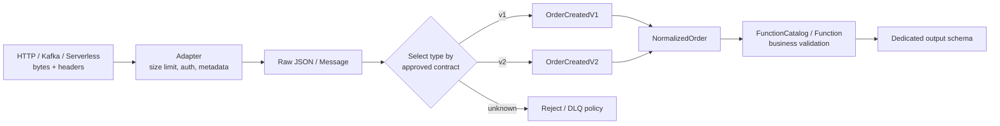

# Restricting Allowed Deserialization Types by Version

## 1. Why Is Deserialization a Security Boundary?

In **SPRING_CLOUD_FUNCTION (Spring Cloud Function)**, `Supplier`, `Function`, and `Consumer` beans make business logic reusable across protocols. `FunctionCatalog` can wrap invocations to convert messages and support *composition*; the same function can receive JSON over HTTP, messages over Kafka/RabbitMQ, or events in a serverless environment. Because of that, turning **external bytes/JSON strings** into **Java objects** is a boundary that must be tightly controlled.

Suppose a system processes two versions of an order-creation event:

```json
{
  "eventType": "order.created",
  "schemaVersion": 1,
  "data": {
    "orderId": "ORD-42",
    "customerId": "C-8",
    "totalMinor": 150000
  }
}
```

```json
{
  "eventType": "order.created",
  "schemaVersion": 2,
  "data": {
    "orderId": "ORD-42",
    "accountId": "C-8",
    "amountMinor": 150000,
    "currency": "VND"
  }
}
```

If the receiver allows senders to specify a **Java class name** via an HTTP header, a Kafka type header, or a JSON field such as `@class`, untrusted data can control object instantiation. That is fundamentally different from the receiver **explicitly choosing an approved DTO** based on `(eventType, schemaVersion)`.

**Core rule:** never let external data freely choose classes for deserialization. Constrain the **set of Java types**, verify **event type + contract version**, and validate **business fields** before invoking beans with side effects.

### Learning Objectives

After this lesson, you will:

1. Distinguish *serialization*, *deserialization*, conversion, schema migration, and Java polymorphic type resolution.
2. Understand `JsonMessageConverter` alongside `MessageConverter`/`ConversionService` in `FunctionCatalog`.
3. Properly use Spring Cloud Function's **`META-INF/deserializable.types`** when a `Content-Type` header contains a `type` parameter.
4. Build an allowlist **by data version** instead of trusting raw class names or opening whole packages.
5. Distinguish Spring Cloud Function's mechanism from Spring Kafka's `__TypeId__` and `trusted.packages`.
6. Implement a Java decoder that reads the raw envelope, selects v1/v2 DTOs via a fixed `switch`, and rejects unknown versions.
7. Write security tests covering HTTP, brokers, serverless, and library upgrades.

## 2. An Event Has Multiple Kinds of "Version"

The term *version* is easily conflated:

| What Is Versioned | Example | Role |
|---|---|---|
| **Payload schema** | `order.created` v1 / v2 | Determines data fields and semantics |
| **Java class / DTO** | `OrderCreatedV1`, `OrderCreatedV2` | Concrete types explicitly instantiated by the app after parsing |
| **Event envelope** | CloudEvents `specversion=1.0` | Envelope standard version, **not the payload schema** |
| **Spring Cloud Function** | SCF 4.x or 5.x line | Determines converter implementation and API |
| **Spring Boot / Jackson** | Boot 3 + Jackson 2; Boot 4 defaults to Jackson 3 | Determines packages, APIs, and JSON config |
| **Spring Kafka** | 3.x, 4.x | Serializer/deserializer names and type-header handling |

In this lesson, "**by version**" means **each payload version maps solely to approved DTOs**; at the same time, deserialization mechanisms must be pinned/tested per **deployed library version**. A Java class allowlist **does not automatically act as a per-schema-version allowlist**, because it usually applies across the application/classpath.

Example policy:

| Event Type | Inbound Schema Version | Allowed Java Target | Action |
|---|---:|---|---|
| `order.created` | `1` | `OrderCreatedV1` | Normalize into current internal model |
| `order.created` | `2` | `OrderCreatedV2` | Normalize into current internal model |
| `order.created` | `3` | **None yet** | Reject cleanly; do not speculatively parse as v2 |
| `payment.refunded` | `1` | **Not for this consumer** | Reject or route to authorized consumer |
| Event carrying `javaClass=com.example.AdminCommand` | Any | **Never accept class directives** | Ignore/reject out-of-contract metadata |

**Never use** `schemaVersion=2` as an authorization signal. A producer can spoof a valid version; permission to invoke functions and access resources must be enforced independently.

## 3. Path from Raw Bytes to `Function`



Distinguish two conversion paths:

1. **Framework-driven automatic conversion**: the adapter builds a `Message<?>`, and `FunctionCatalog` uses the function signature and `contentType` to locate an appropriate converter.
2. **Controlled decoding in the app's adapter/decoder**: receives raw JSON (`String` or `byte[]`), reads the envelope, validates `eventType/schemaVersion`, and **chooses a concrete class in code**.

Path 1 can be simpler when each entry point accepts exactly one schema with a clear signature such as `Function<OrderCreatedV1, OrderAck>`. Path 2 makes sense when **one entry point must support both v1 and v2**, or when you want to avoid any type decisions driven by external headers.

The enforcement point must sit **before object instantiation that could trigger custom logic or side effects**. Passing raw JSON into a `Function<Object,Object>` and hoping to inspect the class afterward may be too late if a converter already instantiated an object from untrusted metadata.

## 4. How Does Spring Cloud Function Conversion Work?

Spring Cloud Function supports two common conversion mechanisms:

- `MessageConverter`: converts a Spring `Message` with a `byte[]`/`String` payload into the target bean type.
- `ConversionService`: converts objects in scenarios without a `Message`.

Example:

```java
@Bean
public Function<OrderCreatedV1, OrderAck> handleV1() {
    return event -> new OrderAck(event.orderId(), "ACCEPTED");
}
```

For an HTTP JSON input or raw broker message, the wrapper in `FunctionCatalog` can use the **`OrderCreatedV1` signature** together with `contentType=application/json` to convert the payload. Converter selection relies on **both the required input type and content type**; `Content-Type` alone does not guarantee the framework will instantiate any client-specified class.

According to the official documentation, `JsonMessageConverter` also supports a `type` parameter in the media type when the target is unspecified (for example `Function<?,?>` or `Function<Object,Object>`):

```http
Content-Type: application/json;type=com.example.orders.contract.OrderCreatedV1
```

**This is a sensitive point:** if a caller can supply a class name such as `type=java.lang.SomeClass`, that class must not arbitrarily become a Java target. Spring Cloud Function provides a **class allowlist mechanism for the `type` parameter**, covered in the next section.

### Content Type Is Different from Schema Version

| Metadata | Example | Question It Answers |
|---|---|---|
| `Content-Type` | `application/json` | What encoding format is the data in? |
| MIME `type` parameter | `type=com.example.orders.contract.OrderCreatedV1` | Which Java class is proposed as target in the SCF-supported mechanism? |
| `eventType` | `order.created` | Which business event kind is this? |
| `schemaVersion` | `2` | Which schema revision does the data follow? |
| Kafka type header | `__TypeId__` | Java type attached by serializer/binder, **not the schema version** |

Never treat `Content-Type: application/json` as proof that the data conforms to a schema. Nor treat a `type` header matching the allowlist as proof that the caller is authorized to invoke the function or that the data is valid.

## 5. Key SCF Mechanism: `META-INF/deserializable.types`

The **Spring Cloud Function – Programming model / Provided MessageConverters** documentation specifies: to use the MIME `type` parameter as a **target class** for `JsonMessageConverter`, the application **must declare permitted classes** in the resource:

```text
src/main/resources/META-INF/deserializable.types
```

Example **resource file content** (a lesson snippet, not an auto-generated file):

```text
com.example.orders.contract.OrderCreatedV1
com.example.orders.contract.OrderCreatedV2
```

Key characteristics:

- The file must be named exactly `META-INF/deserializable.types` and sit on the **runtime classpath** (typically packaged in the JAR).
- Each line can be a **fully qualified Java class name**; the documentation also permits multiple comma-separated names on a line. One class per line is easier to audit.
- If a class is a nested Java class, its JVM name may contain `$`; prefer top-level DTOs so the file stays clear.
- List **only DTOs truly required for dynamic type selection**. Do not copy the documentation's example list containing Java utility classes, and do not add broad internal packages just to "make everything work."
- This allowlist is **control at SCF `JsonMessageConverter` type resolution**, not across every serializer/deserializer in the JVM, and it **does not** verify `schemaVersion`.
- If you only use strongly typed function signatures and never accept an external `type` parameter, you may **not need** this dynamic-type mechanism at all; shrinking the surface is better than widening a whitelist for every DTO.

In a Spring Cloud Function application using a valid `type` parameter:

```http
POST /functions/handleDynamic HTTP/1.1
Content-Type: application/json;type=com.example.orders.contract.OrderCreatedV1

{"orderId":"ORD-42","customerId":"C-8","totalMinor":150000}
```

This **illustrates the class-selection mechanism**, not an endpoint pre-built in the upcoming sample app. To run it, `handleDynamic` would need to be defined and exposed by the Web adapter at a matching URL.

For a class **missing from the resource**, the converter must not load arbitrary caller-specified classes. However, **exact HTTP error codes, exception names, and conversion timing** depend on the adapter, converter, and framework version; tests should verify that the request is blocked and produces **no side effects**, rather than depending verbatim on a stack trace.

### 5.1. Why Not List All Classes?

If `deserializable.types` includes administrative classes or classes with risky polymorphic behavior, widening the allowlist defeats the restriction goal. You must **inventory the effects of instantiating/deserializing each class**, its properties/getters/setters/converters, and dependency versions.

Never trust a package prefix like `com.example.*` in a custom policy. One package can hold both public DTOs and internal classes. Best practice is allowing **only exact concrete DTO types** defined by the contract.

### 5.2. Exact Boundaries of the Allowlist File

This file **does not automatically apply** to:

- Jackson polymorphic `@JsonTypeInfo` or global default typing enabled by the application.
- Spring Kafka `JsonDeserializer`/`JacksonJsonDeserializer` reading Kafka type headers.
- Native Java `ObjectInputStream`.
- Third-party custom `MessageConverter`/deserializer implementations.
- Reflection or `Class.forName` invoked by business code after receiving data.

Each mechanism has its own policy; you cannot secure an entire system with a single `META-INF/deserializable.types` file.

## 6. The SCF Allowlist Is Not a "One Class Per Version" Policy

The `deserializable.types` allowlist normally applies at the **deployment classpath level**. Listing both `OrderCreatedV1` and `OrderCreatedV2` in the file only permits dynamic deserialization into **those two Java classes** under that mechanism. It **does not enforce** that `schemaVersion=1` must pair with `OrderCreatedV1`.

Design **two independent layers of control**:

| Layer | Question | Policy |
|---|---|---|
| **Converter class allowlist** | Which classes may the framework instantiate from a type hint? | Only reviewed concrete DTOs |
| **Application version-to-type mapping** | For this `(eventType, schemaVersion)`, which class is uniquely valid? | Fixed mapping table in code or a controlled schema registry |
| **Payload validation** | Do the DTO's fields satisfy schema and business rules? | Type checks, required fields, ranges, ownership |
| **Authorization** | Is the caller allowed to send this event type and act on this order? | JWT/IAM/broker ACLs + resource policy |

Example of **what not to do**:

```java
// Anti-pattern: eventType/schemaVersion are not a Java FQCN.
// String className = request.headers().get("javaType");
// Class<?> dynamicType = Class.forName(className);
// Object payload = mapper.readValue(json, dynamicType);
```

Instead, use:

```java
// Principle illustration:
return switch (schemaVersion) {
    case 1 -> mapper.treeToValue(data, OrderCreatedV1.class);
    case 2 -> mapper.treeToValue(data, OrderCreatedV2.class);
    default -> throw new IllegalArgumentException(
            "Unsupported order.created schema version");
};
```

Later, the complete example also checks `eventType`, required fields, and the output contract rather than relying solely on `switch`.

## 7. Data Policy for Two Versions of the Order Event

Suppose the organization accepts **only**:

| Property | v1 | v2 |
|---|---|---|
| `eventType` | `order.created` | `order.created` |
| `schemaVersion` | `1` | `2` |
| `orderId` | Required | Required |
| Owner ID | `customerId` | `accountId` |
| Amount | `totalMinor` | `amountMinor` |
| `currency` | Per v1 contract: fixed `VND` | Required, accepts only `VND` in this example |

The difference between v1 and v2 is a **schema contract**, not user privilege. Converting v1 into the internal model:

```text
OrderCreatedV1
  (orderId, customerId, totalMinor)
       |
       v
NormalizedOrder
  (orderId, ownerId, amountMinor, currency="VND", sourceVersion=1)
```

For v2:

```text
OrderCreatedV2
  (orderId, accountId, amountMinor, currency)
       |
       v
NormalizedOrder
  (orderId, ownerId, amountMinor, currency, sourceVersion=2)
```

**Never use a v2 class name in JSON or headers as self-proof that data is v2.** The version number and event name are parsed from the envelope per contract; they must be verified before selecting a class. Payloads carrying unexpected extra fields must also follow a clear policy (rejected in this example).

An important detail: if a producer supplies `schemaVersion=1` while sending v2 fields (such as `accountId` instead of `customerId`), the consumer must **not** guess v2 from field names. Reject contradictory payloads or handle controlled migrations explicitly.

## 8. Defining v1/v2 DTOs and the Internal Model

The example below uses **Java 17, Spring Boot 3.x, and Jackson 2** with `com.fasterxml.jackson.*` packages. This is a deliberate choice to keep sample code concrete; **Spring Boot 4 defaults to Jackson 3** with different packages/APIs, noted in the version upgrade section.

Create **top-level** Java records in `com.example.orders.contract`. Each snippet represents one Java file:

```java
// OrderCreatedV1.java
package com.example.orders.contract;

public record OrderCreatedV1(
        String orderId,
        String customerId,
        long totalMinor
) {}
```

```java
// OrderCreatedV2.java
package com.example.orders.contract;

public record OrderCreatedV2(
        String orderId,
        String accountId,
        long amountMinor,
        String currency
) {}
```

```java
// NormalizedOrder.java
package com.example.orders.contract;

public record NormalizedOrder(
        String orderId,
        String ownerId,
        long amountMinor,
        String currency,
        int sourceVersion
) {}
```

```java
// OrderAccepted.java
package com.example.orders.contract;

public record OrderAccepted(
        String orderId,
        String status
) {}
```

None of these DTOs include `className`, `javaType`, or `@class` fields. A Java record by itself neither authenticates callers nor blocks all JSON attacks; class selection must come from code and Jackson configuration, while values must be validated.

### Difference Between an "Allowed DTO" and a "Valid Payload"

Allowing `OrderCreatedV1` instantiation does not mean `totalMinor=-100` or `orderId=""` is valid. Likewise, `customerId` is untrusted business data: never infer the sender owns that account simply because JSON deserialized cleanly into a record.

In real applications, validation in the adapter and application service must combine caller authentication, tenant ownership, idempotency checks, and data access limits. The example below focuses on **type selection and schema**, without claiming to replace those security layers.

## 9. Java Decoder: Select a DTO Only After Version Validation

A **dedicated decoder** takes raw JSON, reads the three envelope fields `eventType`, `schemaVersion`, and `data`, and **only** calls `treeToValue` with the two classes hardcoded in source. Invalid inputs are rejected before business beans run.

```java
package com.example.orders;

import com.example.orders.contract.NormalizedOrder;
import com.example.orders.contract.OrderCreatedV1;
import com.example.orders.contract.OrderCreatedV2;
import com.fasterxml.jackson.core.JsonParser;
import com.fasterxml.jackson.core.JsonProcessingException;
import com.fasterxml.jackson.databind.DeserializationFeature;
import com.fasterxml.jackson.databind.JsonNode;
import com.fasterxml.jackson.databind.ObjectMapper;

public final class VersionedOrderDecoder {

    // Jackson 2 (Spring Boot 3.x) — isolated mapper for untrusted boundary.
    // Do not enable global default typing or class-name deserialization.
    private final ObjectMapper mapper = new ObjectMapper()
            .enable(DeserializationFeature.FAIL_ON_UNKNOWN_PROPERTIES)
            .enable(DeserializationFeature.FAIL_ON_NULL_FOR_PRIMITIVES)
            .enable(DeserializationFeature.FAIL_ON_TRAILING_TOKENS)
            .enable(JsonParser.Feature.STRICT_DUPLICATE_DETECTION);

    public NormalizedOrder decode(String rawJson) {
        if (rawJson == null || rawJson.isBlank()) {
            throw new IllegalArgumentException("Missing event JSON");
        }

        try {
            JsonNode root = mapper.readTree(rawJson);
            if (root == null || !root.isObject()
                    || root.size() != 3
                    || !root.has("eventType")
                    || !root.has("schemaVersion")
                    || !root.has("data")) {
                throw new IllegalArgumentException(
                        "Unexpected event envelope");
            }

            JsonNode eventType = root.get("eventType");
            JsonNode version = root.get("schemaVersion");
            JsonNode data = root.get("data");

            if (!eventType.isTextual()
                    || !"order.created".equals(eventType.textValue())) {
                throw new IllegalArgumentException(
                        "Event type is not accepted");
            }
            if (!version.isIntegralNumber()
                    || !version.canConvertToInt()
                    || !data.isObject()) {
                throw new IllegalArgumentException(
                        "Invalid schema version or data shape");
            }

            return switch (version.intValue()) {
                case 1 -> decodeV1(data);
                case 2 -> decodeV2(data);
                default -> throw new IllegalArgumentException(
                        "Unsupported order.created schema version");
            };

        } catch (JsonProcessingException ex) {
            // Never leak raw JSON, class names, or stack traces in responses.
            throw new IllegalArgumentException(
                    "Malformed or incompatible event JSON", ex);
        }
    }

    private NormalizedOrder decodeV1(JsonNode data)
            throws JsonProcessingException {
        OrderCreatedV1 v1 =
                mapper.treeToValue(data, OrderCreatedV1.class);

        requireIdentifier(v1.orderId(), "orderId");
        requireIdentifier(v1.customerId(), "customerId");
        requirePositive(v1.totalMinor());

        return new NormalizedOrder(
                v1.orderId(), v1.customerId(),
                v1.totalMinor(), "VND", 1);
    }

    private NormalizedOrder decodeV2(JsonNode data)
            throws JsonProcessingException {
        OrderCreatedV2 v2 =
                mapper.treeToValue(data, OrderCreatedV2.class);

        requireIdentifier(v2.orderId(), "orderId");
        requireIdentifier(v2.accountId(), "accountId");
        requirePositive(v2.amountMinor());
        if (!"VND".equals(v2.currency())) {
            throw new IllegalArgumentException(
                    "Unsupported currency");
        }

        return new NormalizedOrder(
                v2.orderId(), v2.accountId(),
                v2.amountMinor(), v2.currency(), 2);
    }

    private static void requireIdentifier(String value, String field) {
        if (value == null
                || !value.matches("[A-Za-z0-9._-]{1,64}")) {
            throw new IllegalArgumentException(
                    "Missing or invalid " + field);
        }
    }

    private static void requirePositive(long value) {
        if (value <= 0 || value > 1_000_000_000L) {
            throw new IllegalArgumentException(
                    "Amount outside accepted range");
        }
    }
}
```

Intentional security properties:

1. No `Class.forName(...)`, `ObjectMapper.readValue(..., Object.class)` with open typing, or reading Java class names from message headers.
2. `eventType` must match the literal `order.created`; other event types are rejected **before choosing a DTO**.
3. `schemaVersion` must be an **integer fitting in `int`**; strings like `"1"`, `1.5`, or oversized numbers are rejected instead of coerced.
4. The envelope has strictly the three keys `eventType`, `schemaVersion`, and `data`; unexpected out-of-contract keys such as `javaClass` are rejected.
5. `FAIL_ON_UNKNOWN_PROPERTIES` rejects unexpected fields inside the DTO; thus `data.@class` or `data.admin` is not silently ignored.
6. `FAIL_ON_NULL_FOR_PRIMITIVES` prevents `null` from silently becoming `0L`; validation also checks amount bounds.
7. `STRICT_DUPLICATE_DETECTION` prevents duplicate JSON keys from causing parser-level inconsistencies.
8. `FAIL_ON_TRAILING_TOKENS` rejects unexpected trailing content after valid root JSON instead of silently ignoring it.
9. Error responses should hide implementation details; logs can store error category and correlation ID, **never raw payloads**.

**Snippet limitation:** these settings alone do not make the parser immune to every DoS vector. The adapter must enforce **request byte limits**, and the Jackson parser needs **nesting/string/number length limits** per your library version. Jackson 2.15+ provides `StreamReadConstraints`, while Jackson 3/Boot 4 provides equivalent APIs in a different package. Never replace gateway input-size limits with a `String` length check performed after the entire body is already buffered.

### Why Use a Dedicated `ObjectMapper`?

An application-wide mapper might be customized with modules, custom deserializers, or **polymorphic default typing**. The example constructs an isolated mapper with explicit settings and simple record DTOs, avoiding accidentally inheriting an unsuitable policy from a broadened global bean. In production, still use a managed mapper with a **reviewed type policy** and only required modules, rather than allocating a new mapper per request; in the example, the mapper is a reusable field.

Again, `Jackson ObjectMapper` here is **Jackson 2**. Do not copy `com.fasterxml.jackson.*` imports into a Spring Boot 4 application using Jackson 3 by default without migrating APIs.

## 10. Spring Cloud Function Bean Using the Decoder and Emitting Its Own Output Schema

Once the decoder returns `NormalizedOrder`, the bean works strictly on the normalized model. For example, `Function<Message<String>, Message<OrderAccepted>>` accepts raw JSON as `String` and retains adapter-validated metadata:

```java
package com.example.orders;

import java.util.function.Function;

import org.springframework.context.annotation.Bean;
import org.springframework.context.annotation.Configuration;
import org.springframework.messaging.Message;
import org.springframework.messaging.MessageHeaders;
import org.springframework.messaging.support.MessageBuilder;
import org.springframework.util.MimeTypeUtils;

import com.example.orders.contract.NormalizedOrder;
import com.example.orders.contract.OrderAccepted;

@Configuration
public class OrderEventFunctions {

    @Bean
    public VersionedOrderDecoder versionedOrderDecoder() {
        return new VersionedOrderDecoder();
    }

    @Bean
    public Function<Message<String>, Message<OrderAccepted>>
            acceptOrderEvent(VersionedOrderDecoder decoder) {
        return input -> {
            String correlationId = input.getHeaders()
                    .get("correlationId", String.class);
            if (correlationId == null
                    || !correlationId.matches("[A-Za-z0-9._-]{1,64}")) {
                throw new IllegalArgumentException(
                        "Invalid correlationId");
            }

            NormalizedOrder order =
                    decoder.decode(input.getPayload());

            // Illustrative logic only, with no side effects.
            // Real orders must check the actor's permissions for ownerId.
            OrderAccepted accepted =
                    new OrderAccepted(order.orderId(), "ACCEPTED");

            return MessageBuilder.withPayload(accepted)
                    .setHeader("correlationId", correlationId)
                    .setHeader("schemaName", "order.accepted")
                    .setHeader("schemaVersion", "1")
                    .setHeader(
                            MessageHeaders.CONTENT_TYPE,
                            MimeTypeUtils.APPLICATION_JSON)
                    .build();
        };
    }
}
```

Two notable decisions:

- **Input** can be schema `order.created` v1 or v2; **output** is `order.accepted` v1. The function **does not copy** the input `schemaVersion` to the output.
- The function **does not copy** caller-supplied headers such as `javaType`, `__TypeId__`, `spring.cloud.function.definition`, `Authorization`, or `tenantId` onto the output message.

In a real system, `ownerId` must be checked against the sender's authenticated/authorized identity. **A valid payload and a valid `correlationId` do not prove the caller is allowed to create an order for that owner.**

### Direct Invocation to Test the Contract

```java
import java.util.function.Function;

import org.springframework.messaging.Message;
import org.springframework.messaging.support.MessageBuilder;

import com.example.orders.OrderEventFunctions;
import com.example.orders.VersionedOrderDecoder;
import com.example.orders.contract.OrderAccepted;

String rawV1 = """
    {"eventType":"order.created","schemaVersion":1,
     "data":{"orderId":"ORD-42","customerId":"C-8","totalMinor":150000}}
    """;

Function<Message<String>, Message<OrderAccepted>> fn =
        new OrderEventFunctions().acceptOrderEvent(
                new VersionedOrderDecoder());

Message<OrderAccepted> out = fn.apply(
        MessageBuilder.withPayload(rawV1)
                .setHeader("correlationId", "req-42")
                .build());

System.out.println(out.getPayload().orderId()); // ORD-42
System.out.println(out.getHeaders().get("schemaName")); // order.accepted
System.out.println(out.getHeaders().get("schemaVersion")); // 1
```

Calling the bean directly **does not exercise `FunctionCatalog`'s conversion path**. Add catalog and adapter tests to verify wrappers, serializers, and type-header handling in the real deployment.

## 11. HTTP Adapter: Constrain the Body Before Parsing

A Spring MVC adapter can accept only the raw JSON body and delegate DTO selection to the reviewed decoder instead of reading a class parameter from the client:

```java
package com.example.orders;

import java.nio.charset.StandardCharsets;
import java.util.function.Function;

import org.springframework.beans.factory.annotation.Qualifier;
import org.springframework.http.HttpStatus;
import org.springframework.http.MediaType;
import org.springframework.http.ResponseEntity;
import org.springframework.messaging.Message;
import org.springframework.messaging.support.MessageBuilder;
import org.springframework.web.bind.annotation.PostMapping;
import org.springframework.web.bind.annotation.RequestBody;
import org.springframework.web.bind.annotation.RequestHeader;
import org.springframework.web.bind.annotation.RestController;
import org.springframework.web.server.ResponseStatusException;

import com.example.orders.contract.OrderAccepted;

@RestController
public class OrderHttpController {

    private final Function<Message<String>, Message<OrderAccepted>>
            acceptOrderEvent;

    public OrderHttpController(
            @Qualifier("acceptOrderEvent")
            Function<Message<String>, Message<OrderAccepted>> fn) {
        this.acceptOrderEvent = fn;
    }

    @PostMapping(
            path = "/api/order-events",
            consumes = MediaType.APPLICATION_JSON_VALUE,
            produces = MediaType.APPLICATION_JSON_VALUE)
    public ResponseEntity<OrderAccepted> receive(
            @RequestBody String rawJson,
            @RequestHeader("X-Correlation-ID") String correlationId) {

        // Secondary check: enforce body limits at the HTTP server/gateway first.
        if (rawJson.getBytes(StandardCharsets.UTF_8).length > 64 * 1024) {
            throw new ResponseStatusException(
                    HttpStatus.PAYLOAD_TOO_LARGE, "Event too large");
        }
        if (!correlationId.matches("[A-Za-z0-9._-]{1,64}")) {
            throw new ResponseStatusException(
                    HttpStatus.BAD_REQUEST, "Invalid correlation ID");
        }

        // Build only validated metadata. Do not copy all HTTP headers.
        Message<String> inbound = MessageBuilder
                .withPayload(rawJson)
                .setHeader("correlationId", correlationId)
                .build();

        try {
            Message<OrderAccepted> output =
                    acceptOrderEvent.apply(inbound);
            return ResponseEntity.ok()
                    .header("X-Correlation-ID",
                            output.getHeaders()
                                    .get("correlationId", String.class))
                    .body(output.getPayload());
        } catch (IllegalArgumentException ex) {
            // Never expose exception details, class names, or raw JSON over the network.
            throw new ResponseStatusException(
                    HttpStatus.BAD_REQUEST, "Unsupported order event");
        }
    }
}
```

This example uses a **custom controller**, not a guarantee of status codes from the Spring Cloud Function Web adapter. If `spring-cloud-function-web` is enabled in the same app, check which URLs the adapter exposes to prevent a bypass path to a generic function accepting type hints.

### HTTP Constraints

1. The controller handles bodies strictly under the `application/json` contract. If a client adds `type=com.example.AdminCommand` to `Content-Type`, **this controller does not use that parameter to instantiate Java classes**; the decoder still selects v1/v2 from the envelope.
2. The controller **does not copy all request headers** into Spring `MessageHeaders`; it adds only `correlationId` after validation.
3. A missing `X-Correlation-ID` header may automatically yield `400` from Spring MVC; schema errors also map to `400` with a non-leaking message.
4. Spring Security/JWT/mTLS and **the caller's permission over the order owner** must be verified before side effects. The sample code illustrates only the type/schema boundary.
5. Enforce byte limits at the **gateway/servlet container** before buffering the entire body in memory. The `getBytes(...)` check is a secondary guard, not the primary DoS defense.
6. Define policies for valid Unicode/UTF-8, JSON depth, array length, request rate, and object size. Add schema checks after DTO construction.

Example invocation:

```bash
curl -i -X POST http://localhost:8080/api/order-events \
  -H "Content-Type: application/json" \
  -H "X-Correlation-ID: req-42" \
  -d '{"eventType":"order.created","schemaVersion":1,"data":{"orderId":"ORD-42","customerId":"C-8","totalMinor":150000}}'
```

With Spring Security and business policies in place, a valid request receives `OrderAccepted` JSON. For `schemaVersion=99`, an unknown `eventType`, out-of-contract fields, or wrong types, the decoder rejects instead of guessing another Java class.

## 12. Spring Kafka: `__TypeId__` and Trusted Packages Are Separate Mechanisms

Spring Kafka has its **own** JSON serializers/deserializers. When a serializer is configured to write Java type information into record headers, consumers may receive headers such as `__TypeId__`. That mechanism **does not automatically use** Spring Cloud Function's `META-INF/deserializable.types`.

| Mechanism | Spring Cloud Function | Spring Kafka |
|---|---|---|
| Dynamic class hint | `Content-Type` `type` parameter | Type headers like `__TypeId__` or type mappings |
| Class restriction | `META-INF/deserializable.types` for SCF `JsonMessageConverter` dynamic target | `trusted.packages`, explicit target type, type mappings |
| What app must still check | Event type/schema version, caller permissions | Event type/schema version, producer/caller permissions |
| Where activated? | Conversion through `FunctionCatalog` / SCF adapter | Kafka deserializer prior to Spring `MessageConverter`, depending on config |

In **Spring Kafka 3.x**, the usual classes are:

```text
org.springframework.kafka.support.serializer.JsonDeserializer
org.springframework.kafka.support.serializer.JsonSerializer
```

In **Spring Kafka 4.x** documentation, the API uses:

```text
org.springframework.kafka.support.serializer.JacksonJsonDeserializer
org.springframework.kafka.support.serializer.JacksonJsonSerializer
```

This is a concrete example of why you must verify **library versions** before copying deserialization configuration.

### 12.1. Why Is `trusted.packages=*` Risky?

In Spring Kafka's JSON deserializer, `TRUSTED_PACKAGES` defines which packages are allowed when resolving type information. Per the documentation, the default includes only `java.util` and `java.lang`; `*` means trusting every package.

```properties
# Never use with message headers from untrusted sources:
spring.kafka.consumer.properties.spring.json.trusted.packages=*
```

Never set `*` merely to silence a "class not in trusted packages" exception during testing. That shifts from "only specific trusted classes" to "every package," potentially allowing out-of-contract object types to be instantiated.

A more restrictive option in environments **using a single fixed DTO** is specifying the target class explicitly and **ignoring type headers**. In Spring Kafka 3.x:

```java
import org.springframework.kafka.support.serializer.JsonDeserializer;
import com.example.orders.contract.OrderCreatedV1;

JsonDeserializer<OrderCreatedV1> deserializer =
        new JsonDeserializer<>(OrderCreatedV1.class, false);
// false: ignore incoming type headers, use the explicit target class.
```

In Spring Kafka 4.x, use the corresponding `JacksonJsonDeserializer<OrderCreatedV1>` API and check constructors/fluent configuration for that version. **This is a single-class strategy** and does not address a channel needing to consume both v1 and v2.

### 12.2. Consumer Handling Both v1 and v2: Consume Raw JSON, Then Parse by Version

For topics carrying multiple payload versions, a clean design has the Kafka consumer read **`String` or `byte[]`**, then pass raw JSON to `VersionedOrderDecoder`. With plain **Spring Kafka**:

```properties
# Plain Spring Kafka consumer example; not binder configuration.
spring.kafka.consumer.value-deserializer=org.apache.kafka.common.serialization.StringDeserializer
```

When reading raw strings, any producer-sent `__TypeId__` **is never used to pick a class** by the application decoder; the target is determined solely by `eventType + schemaVersion` and fixed code branches. Ensure no other code path invokes a JSON deserializer with header typing.

If using the **Spring Cloud Stream Kafka binder**, receiving bytes and converting messages also depend on `use-native-decoding`, binding content type, and configured serializers/deserializers. **Do not copy `spring.kafka.consumer.value-deserializer` and assume it works identically in every Stream binder.** Consult the binder docs and test the actual path from record bytes to the bean.

### 12.3. Kafka Type Mappings Can Be Used, Still Requiring a Version Contract

Spring Kafka supports mapping short tokens to classes in JSON type mappings. Illustrative **conceptual** example:

```text
orderV1 : com.example.orders.contract.OrderCreatedV1
orderV2 : com.example.orders.contract.OrderCreatedV2
```

Mappings avoid sending raw FQCNs in record headers. However, replacing class names with tokens **does not stop a producer from choosing any mapped token**. The application must still bind tokens to `eventType/schemaVersion` and publisher permissions. When strict fail-closed version checks are needed, a decoder with fixed mappings over raw envelopes is usually easier to audit.

## 13. Jackson Polymorphic Typing: An Entirely Different Boundary

A JSON payload may contain a type discriminator understood by Jackson polymorphic deserialization, such as:

```json
{
  "@class": "com.example.internal.SomeClass",
  "orderId": "ORD-42"
}
```

This **does not mean** Spring Cloud Function or default Jackson always reads `@class`; it acts as a type directive only if the app enables a matching mechanism such as global default typing or class-based `@JsonTypeInfo`. Risk occurs when **untrusted data is allowed to choose classes from the classpath**, potentially reaching "gadget classes" with dangerous behaviors.

### Design to Avoid

```java
// Anti-pattern; never enable open default typing for untrusted JSON.
// ObjectMapper mapper = new ObjectMapper();
// mapper.enableDefaultTyping(); // Legacy API, risky and should not be used.
// Object x = mapper.readValue(untrustedJson, Object.class);
```

Or configuring polymorphism based on `JsonTypeInfo.Id.CLASS` on an overly broad base class, letting input carry Java class names. That is a different issue from SCF's `META-INF/deserializable.types` allowlist.

Preferred practices:

- Never enable **global default typing** on JSON from untrusted HTTP/broker/serverless sources.
- Avoid `@JsonTypeInfo(use = JsonTypeInfo.Id.CLASS)` on broad base types; if polymorphism is genuinely required, use a **fixed, explicit set of subtypes** with reviewed type names plus validators.
- Prefer concrete record DTOs or an envelope parser + version `switch` as shown above.
- Never rely on a gadget-class blocklist as your sole defense; keep Jackson, Spring, and all dependencies updated per security policy.
- Allowing a Java class to be instantiated **does not mean** all values inside that class are valid or that the actor is authorized.

**Distinguish metadata sources:** `Content-Type: application/json;type=...` in SCF, Kafka `__TypeId__`, and JSON `@class` can trigger **three distinct type-resolution paths**. Each must be evaluated and tested independently.

## 14. Spring Cloud Stream: Content Type Is Not a Class Allowlist

Spring Cloud Stream can convert inbound `byte[]`/`String` messages into the bean's type via `MessageConverter`. Content type can be set via message headers or binding configuration, with precedence governed by the binder and version.

Example binding configuration for a JSON-only deployment:

```yaml
spring:
  cloud:
    function:
      definition: acceptOrderEvent
    stream:
      bindings:
        acceptOrderEvent-in-0:
          destination: orders.created
          content-type: text/plain
```

In this example, `acceptOrderEvent` accepts `Message<String>` (JSON text), so the binding sets `text/plain` to steer conversion toward `String`; **the JSON body inside the string** is parsed by `VersionedOrderDecoder`. This depends on the concrete serializer and binder input; verify with integration tests on a real broker.

If a record still carries `contentType=application/json;type=...` from a producer, inbound metadata can override binding content type in some conversion paths. Therefore, **never rely solely on binding `content-type` to block producer type hints**: enforce header/type-resolution filtering rules, choose safe deserializer policies, and run real tests.

### Custom `MessageConverter` Implementations Must Also Follow Policy

Spring Cloud Function allows registering custom `MessageConverter` beans; per documentation, custom converters can be prepended ahead of built-in converters. If a custom converter uses reflection to instantiate classes from headers, **the default `JsonMessageConverter` allowlist does not protect it**.

When reviewing a custom converter:

1. Does `supports(...)` restrict itself strictly to permitted types?
2. Does `fromMessage(...)` accept class names or scripts from external metadata?
3. Does it validate `eventType/schemaVersion` before instantiating objects?
4. Could it accidentally ignore `MessageHeaders.CONTENT_TYPE` or assume headers are always trustworthy?
5. Does it enforce size, depth, collection-length, and parsing-time limits?
6. Are there tests for bad type hints, unknown versions, type mismatches, and output serialization?

### Event Routing Does Not Replace Deserialization Policy

`spring.cloud.function.definition` or `functionRouter` can select a bean from message headers, but that is **function selection**, not schema validation. A caller does not earn permission to invoke an admin bean just by sending valid JSON. Conversely, routing to the right function does not guarantee payload Java types were safely resolved.

## 15. Serverless and CloudEvents: Envelope Type Is Not a Java Class

In AWS Lambda, API Gateway, SQS, EventBridge, or CloudEvents, events typically arrive as a JSON envelope. Adapters can turn payloads into `Message<?>` or handler DTOs. Keep **Java type resolution server-controlled**, never passing a client-supplied event field straight into `Class.forName`.

Example CloudEvent in structured content mode:

```json
{
  "specversion": "1.0",
  "id": "evt-101",
  "source": "/checkout",
  "type": "com.example.order.created",
  "dataschema": "https://schemas.example.test/order-created/v2",
  "data": {
    "orderId": "ORD-42",
    "accountId": "C-8",
    "amountMinor": 150000,
    "currency": "VND"
  }
}
```

Here:

- `specversion=1.0` is the **CloudEvents envelope** version.
- `type=com.example.order.created` is the event type, **not a bean name or Java class name**.
- `dataschema` is a URI describing the schema, which may encode v2 by convention.
- `data` is the payload to decode into a policy-approved DTO.

If using CloudEvents instead of the Java example's `eventType/schemaVersion/data` envelope, build a **dedicated adapter** mapping `type + dataschema/schema registry ID` to an approved internal version, then pass `data` to the right decoder. **Never feed an event URI or type name straight into Java reflection/class loading.** Permission for an event source to invoke Lambda still does not replace schema validation or authorization over the order owner.

Never leave a public Lambda with administrative classes on its classpath and broad IAM roles simply because the same deployment handles v1/v2. Separate runtimes/triggers and execution roles when privilege levels differ.

## 16. Unit-Testing the Decoder: Unknown Versions, Fake Subtypes, and Contradictory Data

Before testing HTTP/brokers, verify the **contract → DTO mapping table** with JUnit 5:

```java
package com.example.orders;

import static org.junit.jupiter.api.Assertions.assertEquals;
import static org.junit.jupiter.api.Assertions.assertThrows;

import org.junit.jupiter.api.Test;

class VersionedOrderDecoderTest {

    private final VersionedOrderDecoder decoder =
            new VersionedOrderDecoder();

    @Test
    void acceptsV1AndNormalizesLegacyFields() {
        String json = """
            {"eventType":"order.created","schemaVersion":1,
             "data":{"orderId":"ORD-42","customerId":"C-8",
                     "totalMinor":150000}}
            """;

        var order = decoder.decode(json);
        assertEquals("ORD-42", order.orderId());
        assertEquals("C-8", order.ownerId());
        assertEquals(150000L, order.amountMinor());
        assertEquals("VND", order.currency());
        assertEquals(1, order.sourceVersion());
    }

    @Test
    void acceptsV2AndNormalizesCurrentFields() {
        String json = """
            {"eventType":"order.created","schemaVersion":2,
             "data":{"orderId":"ORD-43","accountId":"C-9",
                     "amountMinor":230000,"currency":"VND"}}
            """;

        var order = decoder.decode(json);
        assertEquals("ORD-43", order.orderId());
        assertEquals("C-9", order.ownerId());
        assertEquals(2, order.sourceVersion());
    }

    @Test
    void rejectsUnknownVersionInsteadOfGuessing() {
        String json = """
            {"eventType":"order.created","schemaVersion":99,
             "data":{"orderId":"ORD-44"}}
            """;

        assertThrows(IllegalArgumentException.class,
                () -> decoder.decode(json));
    }

    @Test
    void rejectsV2BodyClaimingToBeV1() {
        String json = """
            {"eventType":"order.created","schemaVersion":1,
             "data":{"orderId":"ORD-45","accountId":"C-9",
                     "amountMinor":100,"currency":"VND"}}
            """;

        assertThrows(IllegalArgumentException.class,
                () -> decoder.decode(json));
    }

    @Test
    void rejectsClassHintInsideData() {
        String json = """
            {"eventType":"order.created","schemaVersion":1,
             "data":{"orderId":"ORD-46","customerId":"C-8",
                     "totalMinor":100,
                     "@class":"com.example.internal.AdminCommand"}}
            """;

        assertThrows(IllegalArgumentException.class,
                () -> decoder.decode(json));
    }

    @Test
    void rejectsStringVersionAndUnknownEventType() {
        String stringVersion = """
            {"eventType":"order.created","schemaVersion":"1",
             "data":{"orderId":"ORD-47",
                     "customerId":"C-8","totalMinor":100}}
            """;
        String wrongEventType = """
            {"eventType":"payment.refunded","schemaVersion":1,
             "data":{"orderId":"ORD-47",
                     "customerId":"C-8","totalMinor":100}}
            """;

        assertThrows(IllegalArgumentException.class,
                () -> decoder.decode(stringVersion));
        assertThrows(IllegalArgumentException.class,
                () -> decoder.decode(wrongEventType));
    }

    @Test
    void rejectsDuplicateJsonFields() {
        String json = """
            {"eventType":"order.created","schemaVersion":1,
             "schemaVersion":2,
             "data":{"orderId":"ORD-48",
                     "customerId":"C-8","totalMinor":100}}
            """;

        assertThrows(IllegalArgumentException.class,
                () -> decoder.decode(json));
    }

    @Test
    void rejectsMissingOrInvalidBusinessFields() {
        String json = """
            {"eventType":"order.created","schemaVersion":1,
             "data":{"orderId":"ORD-49","customerId":"",
                     "totalMinor":-1}}
            """;

        assertThrows(IllegalArgumentException.class,
                () -> decoder.decode(json));
    }
}
```

The tests intentionally **avoid** asserting an exact Jackson exception subclass: the decoder's public contract boundary is **rejecting via `IllegalArgumentException`** on invalid input. The parser may change internal exception types across Jackson releases, yet the application policy must hold.

An additional test to add to CI is **resource-bounded fuzz testing** using deeply nested JSON, oversized strings, huge numbers, and large arrays. Ensuring the parser triggers no side effects is only half the story; the app must also resist CPU/memory exhaustion.

## 17. Verifying the Allowlist File in Builds and Deployments

If the application uses SCF's dynamic MIME `type` parameter, `META-INF/deserializable.types` must contain **exact approved classes** and never be omitted when packaging JARs or fat JARs.

A JUnit 5 test can inspect the resource on the classpath:

```java
package com.example.orders;

import static org.junit.jupiter.api.Assertions.assertEquals;
import static org.junit.jupiter.api.Assertions.assertNotNull;

import java.io.BufferedReader;
import java.io.InputStreamReader;
import java.nio.charset.StandardCharsets;
import java.util.Set;
import java.util.stream.Collectors;

import org.junit.jupiter.api.Test;

class ScfTypeWhitelistResourceTest {

    @Test
    void onlyApprovedDtoClassesAreListed() throws Exception {
        var resource = getClass().getClassLoader()
                .getResourceAsStream("META-INF/deserializable.types");

        assertNotNull(resource, "SCF whitelist must be packaged");

        Set<String> classes;
        try (var reader = new BufferedReader(
                new InputStreamReader(resource, StandardCharsets.UTF_8))) {
            classes = reader.lines()
                    .map(String::trim)
                    .filter(line -> !line.isEmpty())
                    .collect(Collectors.toSet());
        }

        assertEquals(Set.of(
                "com.example.orders.contract.OrderCreatedV1",
                "com.example.orders.contract.OrderCreatedV2"
        ), classes);
    }
}
```

This test assumes the resource file **already exists at `src/main/resources/META-INF/deserializable.types`** per Section 5. Within this lesson, the code block is instructional documentation and does not create files in a sample project automatically.

**What this resource test does not verify:** whether the real converter uses that allowlist, whether another library ships another resource at the same path, whether a custom converter overrides it, or whether clients can force classes through another mechanism. To verify those, run integration tests against the packaged artifact and full message flow.

### Dynamic Testing Through SCF `JsonMessageConverter`

On a deployment actually using MIME `type`, build tests covering:

| Input | Expected Behavior |
|---|---|
| `application/json;type=com.example.orders.contract.OrderCreatedV1` | Instantiates V1 only if payload and target function are compatible |
| `application/json;type=com.example.orders.contract.OrderCreatedV2` | Instantiates V2 only when matching contract and supported by entry point |
| `application/json;type=com.example.internal.AdminCommand` | Blocked: class not in allowlist |
| `application/json;type=java.lang.Runtime` | Blocked: not in allowlist |
| `application/json;type=com.example.orders.contract.OrderCreatedV1` with v2 body | Rejected by schema/validation when policy applies |
| Missing `type` header | Converts per function signature or defined policy, **never picks an arbitrary class** |

Do not check only the response body; when the target has side effects, verify no database writes or outbound events occurred when the type or version was disallowed. Exception names and HTTP status codes depend on the adapter; **the invariant "no out-of-allowlist logic executes" is the real security property**.

## 18. Integration Testing Through `FunctionCatalog`

An integration test should exercise the wrapped invocation path rather than only `new OrderEventFunctions().acceptOrderEvent(...).apply(...)`. The Spring Boot Test sample below wires the example beans and verifies spoofed headers do not leak into output metadata:

```java
package com.example.orders;

import static org.junit.jupiter.api.Assertions.assertEquals;
import static org.junit.jupiter.api.Assertions.assertNull;
import static org.junit.jupiter.api.Assertions.assertThrows;

import java.util.function.Function;

import org.junit.jupiter.api.Test;
import org.springframework.beans.factory.annotation.Autowired;
import org.springframework.boot.SpringBootConfiguration;
import org.springframework.boot.autoconfigure.EnableAutoConfiguration;
import org.springframework.boot.test.context.SpringBootTest;
import org.springframework.cloud.function.context.FunctionCatalog;
import org.springframework.context.annotation.Import;
import org.springframework.messaging.Message;
import org.springframework.messaging.support.MessageBuilder;
import org.springframework.util.MimeTypeUtils;

@SpringBootTest(
        classes = OrderCatalogContractTest.TestApp.class,
        properties = {
                "spring.cloud.function.definition=acceptOrderEvent"
        }
)
class OrderCatalogContractTest {

    @SpringBootConfiguration
    @EnableAutoConfiguration
    @Import(OrderEventFunctions.class)
    static class TestApp {}

    @Autowired
    FunctionCatalog catalog;

    @Test
    void processV1WithExplicitDefinitionAndSafeMetadata() {
        Function<Message<String>, Message<?>> fn =
                catalog.lookup("acceptOrderEvent");

        String json = """
            {"eventType":"order.created","schemaVersion":1,
             "data":{"orderId":"ORD-42","customerId":"C-8",
                     "totalMinor":150000}}
            """;

        Message<String> input = MessageBuilder.withPayload(json)
                .setHeader("correlationId", "req-42")
                .setHeader("contentType", MimeTypeUtils.TEXT_PLAIN)
                .setHeader("javaType",
                        "com.example.internal.AdminCommand")
                .build();

        Message<?> output = fn.apply(input);
        assertEquals("req-42",
                output.getHeaders().get("correlationId"));
        assertEquals("order.accepted",
                output.getHeaders().get("schemaName"));
        assertEquals("1",
                output.getHeaders().get("schemaVersion"));
        assertNull(output.getHeaders().get("javaType"));
    }

    @Test
    void invalidEventVersionDoesNotPassTheDecoder() {
        Function<Message<String>, Message<?>> fn =
                catalog.lookup("acceptOrderEvent");

        Message<String> input = MessageBuilder.withPayload(
                "{\"eventType\":\"order.created\","
              + "\"schemaVersion\":99,\"data\":{}}")
                .setHeader("correlationId", "req-43")
                .setHeader("contentType", MimeTypeUtils.TEXT_PLAIN)
                .build();

        assertThrows(IllegalArgumentException.class,
                () -> fn.apply(input));
    }
}
```

This test template assumes the classpath includes Spring Cloud Function context and Spring Boot Test. **No build was run**, so treat the test as reference code: if a particular wrapper version converts output payloads differently or wraps exceptions, adjust assertions to **observed behavior** without relaxing security checks. With `text/plain` content-type, the input stays a raw `String` so the decoder receives the exact text; the sample HTTP adapter still accepts external HTTP `application/json`.

The test above **does not** exercise `META-INF/deserializable.types` because the bean accepts `Message<String>` and requires no dynamic MIME type resolution. Those are **two distinct design strategies** and require separate tests if an application supports both.

## 19. Testing HTTP, Brokers, and Serverless at Each Boundary

| Entry Path | Required Tests | What Unit Tests Alone Do Not Prove |
|---|---|---|
| HTTP controller | Wrong `Content-Type`, spoofed MIME `type`, v1/v2 JSON, version 99, oversized payload, invalid JWT/scope | Other Web adapter routes, proxy policies, servlet container parsers |
| SCF Web adapter | `META-INF/deserializable.types`, out-of-list dynamic `type`, unexported beans/compositions | HTTP methods/paths and conversion errors on untested versions |
| Spring Kafka | Out-of-list `__TypeId__`, `trusted.packages` without `*`, version mismatch, producer ACLs | Whether consumers use native decoding or type headers |
| Spring Cloud Stream | `contentType` header override, binder conversion, native decoding, retry/DLQ | Exact conversion path in production Kafka/Rabbit binders |
| AWS Lambda / serverless | Unknown event envelope type, unsupported schema version, direct invoke and IAM | API Gateway authorizer, Function URL, event source policies |
| Composition | v1/v2 mapped to internal DTO, new output headers/schema | Whether a downstream step accidentally re-parses caller-sent metadata |

When a decoder rejects a record from a queue, design **retry, dead-letter, and acknowledgment** per your binder/runtime:

- **Non-retryable errors** (unsupported schema version, unknown type, disallowed class) should route to an inspection/quarantine queue or controlled DLQ rather than retrying infinitely.
- **Transient errors** (downstream unavailable) can retry with backoff and idempotency.
- Deserializer failures occurring **before the bean runs** follow different error handling from `Function.apply(...)` exceptions; configure error handlers per Kafka/Stream version.
- Never log raw event payloads, tokens, `Authorization`, or type headers carrying sensitive data. Log error category, event ID, schema version, and validated correlation ID.
- Operations workflows may need to replay events after supporting a new schema, but replay must use **trusted stored data and verify source permissions**.

## 20. Spring Cloud Function / Boot / Kafka Upgrades Can Change the Type Resolution Surface

Because adapters and converters evolve across library releases, **pin BOM/dependency versions** and test on the real artifact.

| Component | Example Choices | What to Check on Upgrade |
|---|---|---|
| Spring Cloud Function | 4.2/4.3 line vs. 5.0/5.1 | `JsonMessageConverter`, `deserializable.types` resource, `type` parameter, wrapper behavior |
| Spring Boot | 3.x vs. 4.x | Jackson 2 vs. default Jackson 3, packages/APIs, auto-configuration |
| Spring Kafka | 3.x vs. 4.x | `JsonDeserializer` vs. `JacksonJsonDeserializer`, header typing, trusted packages |
| Spring Cloud Stream | Per matching BOM | Native decoding, converter precedence, content-type header/binding |
| JSON serializer | Jackson, Gson, custom converter | Polymorphic typing, custom type resolvers, unknown fields |
| Serverless adapter | `FunctionInvoker`/binder/runtime version | Envelope mapping, class type hints, error handling |

**Never assume "upgrading Spring Cloud Function from 4.x to 5.x leaves every old rule safe."** Conversely, do not assume a version bump introduces a CVE by default. Verify:

1. Is the resource file still packaged and read by the active converter?
2. Are caller-controlled type parameters/headers still blocked by policy?
3. Did custom converter precedence or classpath discovery change?
4. Did Jackson default typing, polymorphic annotations, or custom modules change?
5. Are v1/v2 DTOs still accepted while unsupported versions are rejected?
6. Is broker/native decoding using different classes or headers than prior tests?
7. Do function signatures via `FunctionCatalog` preserve expected type conversion and output schemas?

**Code version note:** `com.fasterxml.jackson.*` and `JsonDeserializer` snippets in this lesson reflect Boot 3 / Jackson 2 / Kafka 3. On Boot 4, Jackson 3 is the default; on Kafka 4, JSON serializer/deserializer class names changed. The Spring Cloud Function documentation referenced at the end also covers `META-INF/deserializable.types` for dynamic MIME types. Always align with your project's exact version instead of mixing snippets across dependency lines.

## 21. Common Mistakes

| Mistake | Risk | Remedy |
|---|---|---|
| Trusting raw `Content-Type;type=FQCN` | Clients can propose out-of-contract classes | SCF `deserializable.types` or disable dynamic typing |
| Putting every DTO into `deserializable.types` | Renders the allowlist meaningless | Only required concrete DTOs, code-reviewed |
| Thinking a class allowlist equals a version allowlist | `schemaVersion=1` can still arrive with a v2 body | Fixed mapping `(eventType, version) → DTO` |
| Using `Function<Object,Object>` with open typing | Hard to control target types | Use concrete signatures or raw JSON + decoder |
| Using `Class.forName(headerValue)` | Caller controls class loading | Server-managed contract `switch` |
| Enabling Jackson global default typing on public input | Broad polymorphic deserialization | Avoid; use concrete DTOs and narrow subtype policies |
| Treating `@class` as an ordinary field in every serializer | Can act as a type discriminator when polymorphism is active | Audit mapper/annotations and strict unknown-fields |
| Setting Kafka `trusted.packages=*` for convenience | Allows every package in type resolution | Restrict packages/classes or ignore type headers |
| Treating Kafka `__TypeId__` as `schemaVersion` | Wrong abstraction layer | Read version from the defined event contract |
| Setting only Stream binding `content-type` | Inbound headers or native decoding may take another path | Test the real binder and block type hints |
| Using CloudEvents `specversion=1.0` as payload version | Parses the wrong schema | Use `dataschema`/schema registry per contract |
| Upcasting v1→v2 by guessing fields | Contradictory data or semantic loss | Explicit migrations and compatibility tests |
| Reading unbounded body before checking size | CPU/memory DoS occurs before the check | Enforce limits at gateway/container/parser |
| Logging full JSON on parse failure | Leaks sensitive data | Log event ID and sanitized error details |
| Testing only the decoder directly | Does not prove converters/adapters are safe | Test `FunctionCatalog`, HTTP, binder, and serverless |
| Copying input version to output regardless of output type | Sends wrong contract downstream | Emit the **output** payload's schema version |

## 22. Hands-On Exercise

Design a handler for `payment.received` events that have three revisions, while the consumer currently **supports only v1 and v2**:

1. Define `PaymentReceivedV1` with `paymentId` and `totalMinor`; `PaymentReceivedV2` adds `currency` and renames `totalMinor` to `amountMinor`. Allow only `VND` currency.
2. Create `META-INF/deserializable.types` containing **exactly those two classes** if the demo uses SCF's MIME `type` parameter. Write a test verifying the resource contents inside the JAR.
3. Write a decoder accepting a raw JSON envelope, checking `eventType=payment.received` and `schemaVersion`, and picking the class via a literal `switch`; never use `Class.forName`.
4. Reject `schemaVersion=3`, missing amounts, negative amounts, non-numeric versions, unknown event types, `@class` fields, and out-of-contract properties.
5. Register `Function<Message<String>, Message<PaymentReceipt>>` and invoke it directly in JUnit; then invoke it via `FunctionCatalog` to verify the wrapper.
6. Build an HTTP adapter enforcing byte limits, stripping dynamic headers, and protecting the endpoint with JWT scope `payments.write`; verify owner/tenant before writing to the database.
7. Test `Content-Type: application/json;type=com.example.internal.AdminCommand` on a deployment with SCF Web and confirm no internal bean executes.
8. For Kafka, compare consuming raw JSON via `StringDeserializer` versus consuming a fixed DTO via Kafka's JSON deserializer. Explain why `trusted.packages=*` must remain off.
9. For CloudEvents, distinguish `specversion`, `type`, and `dataschema`; map only approved schemas to Java DTOs.
10. Upgrade a sandbox from an older Spring Boot/Spring Kafka line to a newer one and re-run MIME type allowlist, type header, JSON parser, schema mismatch, and negative side-effect tests.

### Self-Check Questions

1. Which mechanism in Spring Cloud Function does `META-INF/deserializable.types` restrict? Does it automatically protect Kafka's `JsonDeserializer` or Jackson default typing?
2. Why must a class already in the allowlist still undergo `schemaVersion` and resource-ownership checks?
3. What is the difference between `Content-Type: application/json;type=...` and Kafka `__TypeId__`?
4. An `order.created` v1 record contains v2's `accountId` field. Should you parse it as v2 or reject it? Why?
5. Why do `FunctionCatalog.lookup("acceptOrderEvent")` and calling the bean directly require two different kinds of tests?
6. When upgrading Spring Kafka 3 to 4 and Boot 3 to 4, which APIs/serializers must be inspected?

## 23. Pre-Production Checklist

| Item | Passing Criteria |
|---|---|
| Have all deserializers across HTTP, brokers, and serverless been inventoried? | Yes, including custom converters |
| Is SCF dynamic MIME `type` used? | If yes, `deserializable.types` lists only permitted concrete DTOs |
| Can `Function` signatures use concrete types instead of `Object`? | Prefer concrete types |
| Is there an `eventType + schemaVersion → DTO` mapping table? | Yes, reviewed per release |
| Are unsupported versions explicitly rejected? | Yes, no speculative fallback parsing |
| Is Jackson global default typing disabled for untrusted inputs? | Yes |
| Are JSON unknown fields, duplicate keys, nulls, and ranges checked? | Yes |
| Are byte, depth, length, and rate limits enforced? | Yes, at the boundary before the parser |
| Have Kafka type headers and `trusted.packages` been audited? | Yes, no habitual wildcards |
| Has binder native decoding/conversion been tested on a broker? | Yes |
| Do HTTP/Web adapters lack any endpoint bypassing the type policy? | Yes |
| Do CloudEvents/`FunctionInvoker` avoid taking classes from self-asserted event fields? | Yes |
| Is authorization enforced before side effects? | Yes, per principal/tenant |
| Are unit/catalog/HTTP/broker/serverless negative tests in place? | Yes |
| Does output set the new payload's schema rather than copying the input version? | Yes |
| Are dependency upgrades tracked with serializer/converter re-testing? | Yes |
| Are logs, DLQs, and tracing free of leaked sensitive raw data? | Yes |

## 24. Summary and References

**Restricting allowed deserialization types must operate at both layers:**

- At the **framework layer**, Spring Cloud Function provides the `META-INF/deserializable.types` allowlist when `JsonMessageConverter` uses the MIME `type` parameter; Kafka, Jackson polymorphic typing, and custom converters each have separate policies. Never allow class loading from raw FQCNs supplied over HTTP/brokers.
- At the **business contract layer**, every `(eventType, schemaVersion)` pair must map to an **explicit** DTO, pass field validation, and normalize into the internal model. Unknown versions/types are rejected; **a valid class does not replace authorization**.

In Spring Cloud Function, the same `Function` can serve HTTP, Stream, and serverless, yet every adapter must guard **Java object instantiation before the bean executes**. Avoid dynamic typing when unneeded, pin and test Spring Cloud Function–Spring Boot–Jackson–Kafka versions, test both `FunctionCatalog` and actual deserializers, and enforce contract-aligned error and side-effect handling.

**Official documentation and references:**

- [Spring Cloud Function — Programming model / Provided MessageConverters](https://docs.spring.io/spring-cloud-function/reference/spring-cloud-function/programming-model.html) — `META-INF/deserializable.types` allowlist, MIME `type`, conversion.
- [Spring Cloud Function 4.3 — Programming model](https://docs.spring.io/spring-cloud-function/reference/4.3/spring-cloud-function/programming-model.html) — 4.x reference.
- [Spring Cloud Stream — Content Type Negotiation](https://docs.spring.io/spring-cloud-stream/reference/spring-cloud-stream/content-type.html) — converters and content types in bindings.
- [Spring Kafka — Serialization, Deserialization, and Message Conversion](https://docs.spring.io/spring-kafka/reference/kafka/serdes.html) — JSON type headers, `trusted.packages`, type mappings, Kafka 4.x.
- [Spring Kafka 3.x — Serialization, Deserialization, and Message Conversion](https://docs.spring.io/spring-kafka/reference/3.3-SNAPSHOT/kafka/serdes.html) — `JsonDeserializer` API reference.
- [Spring Boot 4 — JSON](https://docs.spring.io/spring-boot/4.0/reference/features/json.html) — Jackson 3 default and migration from Jackson 2.
- [FasterXML Jackson — Polymorphic Deserialization](https://github.com/FasterXML/jackson-docs/wiki/JacksonPolymorphicDeserialization) — risks of global default typing and untrusted data.
