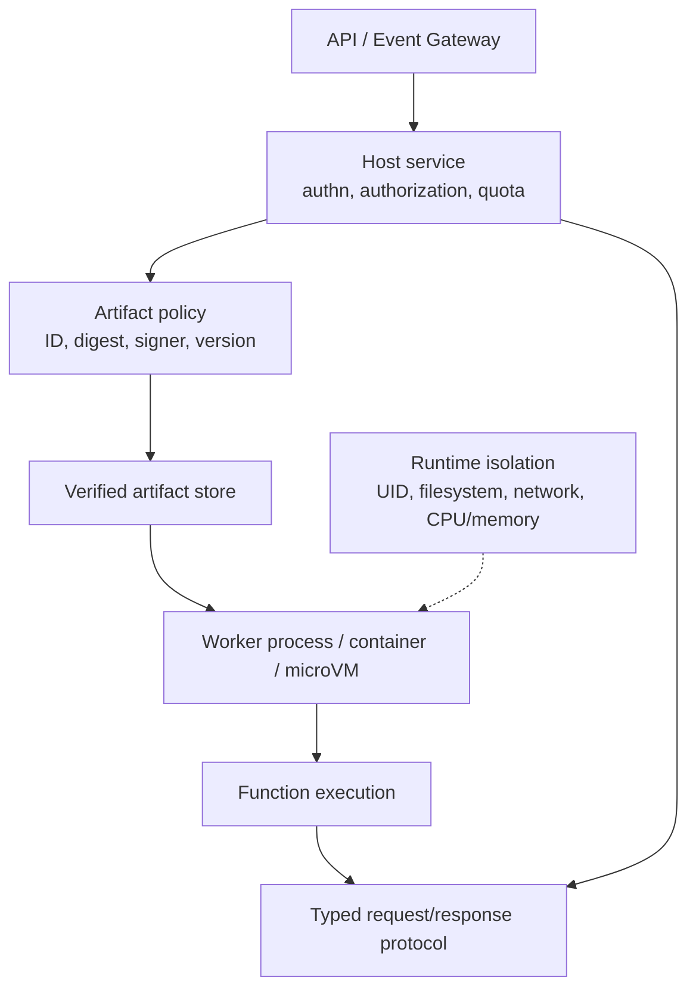
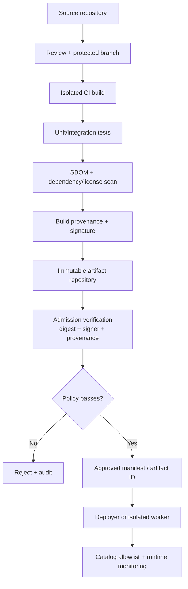

# Never Load Untrusted JARs or Artifacts via the Deployer

## 1. Why Is the Deployer a Security Boundary?

**SPRING_CLOUD_FUNCTION (Spring Cloud Function)** lets you build reusable logic using `Supplier`, `Function`, and `Consumer`, look them up via `FunctionCatalog`, chain them via *composition*, and deploy the same logic across HTTP, events, or serverless. Beyond statically packaged applications, Spring Cloud Function provides a **deployer** library to load a JAR (or unpacked archive, or set of JARs) in a separate class loader and register its functions into the host application's catalog.

This capability is useful when a platform wants to load packaged functions dynamically. However, it also creates a highly sensitive boundary:

```text
Host application (deployer)
       |
       | spring.cloud.function.location
       v
Artifact JAR / archive
       |
       v
Separate class loader
       |
       v
Spring context / function beans
       |
       v
Host application's FunctionCatalog
```

If an artifact is loaded from a user-controlled URL, an unapproved Maven coordinate, or a compromised repository, Java code inside that artifact executes in **the exact same JVM process** as the host application. A malicious function can read data the process can access, make network calls, use runtime credentials, spawn threads, consume CPU/memory, or terminate the process.

The exact point to understand: **a separate class loader isolates class namespaces and avoids dependency version conflicts; it is not a security sandbox for untrusted Java code**. Spring Cloud Function Deployer does not turn an arbitrary JAR into a safe plugin merely by loading it in an isolated class loader.

### Learning Objectives

After this lesson, you will be able to:

1. Describe how `spring-cloud-function-deployer` uses `spring.cloud.function.location` to load JARs and register functions into `FunctionCatalog`.
2. Distinguish **class-loader isolation**, **process isolation**, and **security sandboxing**.
3. Identify risks when locations, Maven coordinates, class names, or function definitions come from HTTP requests or untrusted tenants.
4. Design artifact allowlists, immutable versions, digests, signatures, and build provenance checks before allowing the deployer to load a JAR.
5. Manage Maven repository credentials and prevent SSRF/path abuse during artifact resolution.
6. Understand the limits of the Java Security Manager and why it cannot be relied upon to sandbox plugins on modern JDKs.
7. Choose when to use the in-JVM deployer versus running functions in separate processes/containers/VMs.
8. Write tests rejecting disallowed artifacts, function classes, signers, digests, or download sources.

## 2. How Does Spring Cloud Function Deployer Work?

The official documentation **Deploying a Packaged Function** describes the `spring-cloud-function-deployer` library. When added to the host application's classpath, the deployer reads configuration to locate the function artifact.

Core properties:

| Property | Meaning |
|---|---|
| `spring.cloud.function.location` | URL or resource location of the archive containing the function; may use the `maven:` prefix to resolve by Maven coordinates |
| `spring.cloud.function.function-class` | Function class name for plain JAR packaging that is not a Spring Boot application |
| `spring.cloud.function.definition` | Selected function definition when the artifact is a Spring Boot application with Spring-managed function beans |

Documented example for a simple JAR artifact:

```text
--spring.cloud.function.location=/opt/functions/uppercase.jar
--spring.cloud.function.function-class=com.example.functions.UppercaseFunction
```

Example of an artifact resolved from a Maven repository:

```text
--spring.cloud.function.location=maven://com.example.functions:uppercase:1.4.2
--spring.cloud.function.function-class=com.example.functions.UppercaseFunction
```

For a **Spring Boot application JAR** containing function beans:

```text
--spring.cloud.function.location=/opt/functions/order-functions-2.3.1.jar
--spring.cloud.function.definition=processOrder
```

Once the target JAR starts up successfully, its functions can be registered in the main app's `FunctionCatalog` and invoked from host code. The documentation also notes that the artifact runs in an **isolated class loader by default**. For Spring Boot JARs, the deployer bootstraps the Spring application inside the archive and uses `MANIFEST.MF` to locate the start class.

### 2.1. Which Packaging Formats Can the Deployer Load?

| Artifact Type | How Function Is Selected | Note |
|---|---|---|
| Simple JAR | `location` + `function-class` | Java class implementing `Function`/`Supplier`/`Consumer` |
| Spring Boot JAR | `location` + `function-class` | JAR with Spring Boot dependencies and explicit function class |
| Spring Boot application JAR | `location` + `definition` | Function is a Spring-managed bean inside the artifact's application context |
| Unpacked archive / multiple JARs | `location` as supported by deployer | Requires controlling the entire file set and dependencies |
| Maven artifact | `maven://groupId:artifactId:version` | Resolved via Maven repository configuration |

Some versions also support component scanning in the `functions` package. While convenient for discovery, it also means **adding a class to an artifact can add functions discovered by the catalog**. Never let users supply an artifact and assume every discovered function is safe to expose.

### 2.2. Example Loading an Approved Function

The snippet illustrates loading a **pre-approved Spring Boot application JAR**. The artifact defines an `uppercase` bean; the deployer is configured with `location` and `definition`:

```java
package com.example.platform;

import java.util.function.Function;

import org.springframework.boot.SpringApplication;
import org.springframework.boot.autoconfigure.SpringBootApplication;
import org.springframework.cloud.function.context.FunctionCatalog;
import org.springframework.context.ConfigurableApplicationContext;

@SpringBootApplication
public class FunctionHostApplication {

    public static void main(String[] args) {
        // In production, location and definition must come from
        // reviewed deployment config, never from requests.
        ConfigurableApplicationContext context =
                SpringApplication.run(
                        FunctionHostApplication.class,
                        "--spring.cloud.function.location="
                                + "/opt/approved-functions/uppercase-1.4.2-exec.jar",
                        "--spring.cloud.function.definition=uppercase");

        FunctionCatalog catalog =
                context.getBean(FunctionCatalog.class);

        Function<String, String> uppercase =
                catalog.lookup("uppercase");

        if (uppercase == null) {
            throw new IllegalStateException(
                    "Approved function was not registered");
        }

        System.out.println(uppercase.apply("hello"));
    }
}
```

This example illustrates **using only a pre-approved artifact**. It uses `definition=uppercase` because the artifact is a Spring Boot application JAR with a bean named `uppercase`. For a simple JAR, use `function-class` matching the implementing class. Verify lookup names in integration tests.

The deployer docs describe **resolving, bootstrapping, and registering functions**; the `location`/`function-class`/`definition` properties do not implement signer, digest, or provenance verification. Perform admission/verification in your platform layer **before** passing the artifact to the deployer.

**Never build an API like `POST /deploy?location=...` and feed that value straight into `spring.cloud.function.location`.** Letting users pick a JAR effectively grants them permission to tell the host to load and run Java code.

## 3. A Separate Class Loader Is Not a Sandbox

Spring Cloud Function documentation notes that artifacts run in an **isolated class loader** to prevent Spring Boot or dependency version conflicts between the host application and the function application. That is a **classpath compatibility** benefit, not a secure execution boundary.

| Mechanism | What Does It Isolate? | Does It Stop a Malicious JAR from Accessing Host Resources? |
|---|---|---|
| Separate class loader | Class namespaces and part of dependency/resource resolution | **No** |
| Separate Spring `ApplicationContext` | Bean registry, lifecycle, and Spring configuration of that context | **No** |
| Java module / package boundary | Configured module/package access rules | Does not create an OS sandbox |
| Separate JVM process | Heap, threads, and process crashes are separated | Better, but still needs OS identity/permissions |
| Separate container / VM | Process, filesystem/network/resource boundaries per platform config | Can provide stronger isolation when properly hardened |

A separate class loader does not strip permissions held by the JVM process. Code inside the JAR can still call Java APIs available to the process:

- `System.getenv()` and `System.getProperty(...)` to read environment variables and system properties.
- File I/O on paths accessible to the process user.
- Network sockets/HTTP clients to hosts permitted by network policy.
- JDBC or client libraries using credentials in environment variables, secret mounts, or shared Spring beans.
- Spawning threads, executors, and schedulers; opening files/connections; consuming CPU/memory.
- Causing exceptions, deadlocks, thread exhaustion, memory pressure, or exiting the JVM via standard APIs.

Even if the artifact's Spring context is separate, code still runs in the same JVM and can use the process's Java APIs. If the host exposes functions over HTTP or a broker, the loaded function can also become callable as part of **the host's API surface**.

### 3.1. Example Risk from Process Permissions

Suppose the host is granted:

```text
DATABASE_URL=jdbc:postgresql://orders-db.internal/orders
DATABASE_PASSWORD=<runtime secret>
PAYMENT_API_TOKEN=<runtime secret>
AWS_ROLE=orders-runtime-role
```

A legitimate function might need some of these permissions. However, an untrusted JAR runs under the exact same process identity and can attempt to read or use them. **Just because the JAR cannot see a `DataSource` bean in its Spring context does not mean it cannot open a JDBC connection or read environment variables.**

Principle:

> **Never load untrusted code into a JVM that holds secrets or critical infrastructure privileges.** If you must run third-party or user-uploaded code, isolate it in a separate process/runtime with minimal identity, filesystem, network, and resource limits.

### 3.2. Do Not Rely on the Java Security Manager to Isolate Plugins

The Security Manager once offered permission checks in Java, but it is no longer a viable modern sandbox. JDK 17 deprecated the Security Manager for removal; **as of JDK 24, the Security Manager is permanently disabled**: it cannot be enabled at startup or installed dynamically at runtime.

Therefore, never recommend:

```bash
java -Djava.security.manager -jar function-host.jar
```

as a JAR isolation measure. On JDK 24+, this causes the JVM to fail and exit. Nor should you write a custom `ClassLoader` or `SecureClassLoader` and assume having "Secure" in the class name makes it a security sandbox.

## 4. Risks When `spring.cloud.function.location` Is Controlled

`spring.cloud.function.location` is the input deciding **which artifact gets loaded**. Deployer docs allow URL/resource locations and the `maven:` prefix. If an API, tenant setting, or admin tool accepts `location` from users unchecked, risks include:

| Risk | Scenario | Impact |
|---|---|---|
| Arbitrary code execution | Caller points to a JAR they created | Java code runs with host process privileges |
| SSRF | Caller passes a URL to an internal service reachable by the host | Host may send requests to metadata services or internal systems depending on resolver/URL handler |
| Local resource access | Caller points resource location to a local path readable by the process | Loads unintended artifacts/config or triggers local resource reads |
| Dependency confusion | Same coordinates resolve from an untrusted repository or wrong repo order | Loads a spoofed package |
| Version substitution | Using `LATEST`, `SNAPSHOT`, or mutable versions | Same config resolves different bytes on later runs |
| Repository credential abuse | Resolver holds broad credentials and fetches from untrusted requests | Leaks or abuses repository read access |
| Resource exhaustion | Oversized JAR, huge dependency tree, startup loops, or thread bombs | Exhausts CPU, memory, disk, or connections |
| Function exposure | Artifact contains extra functions discovered via component scanning | Expands catalog/API surface outside the contract |
| Artifact replacement / TOCTOU | One file is verified, then the deployer re-fetches a mutable URL | Executed bytes differ from verified bytes |

### 4.1. Never Accept Location from Requests or Messages

**Unsafe** patterns:

```java
// Anti-pattern: client decides which JAR gets loaded.
String location = request.getParameter("location");
environment.getPropertySources().addFirst(
        new MapPropertySource(
                "user-deployment",
                Map.of("spring.cloud.function.location", location)));
```

```java
// Anti-pattern: event header selects a Maven artifact.
String artifact = message.getHeaders()
        .get("function-artifact", String.class);
```

```java
// Anti-pattern: client decides class/definition inside the JAR.
String functionClass = request.getParameter("functionClass");
String definition = request.getParameter("definition");
```

Never use request headers, bodies, query parameters, CloudEvents `type`, Kafka `__TypeId__`, or tenant metadata fields directly as sources for:

- `spring.cloud.function.location`
- `spring.cloud.function.function-class`
- `spring.cloud.function.definition`
- Maven repository URLs, usernames/passwords, or resolver settings
- Parent class loaders, resource roots, or plugin paths

If a product supports per-tenant function selection, tenants may choose only **a system-approved deployment ID**. The server maps that ID to a fixed artifact digest, signer, version, and function name; never let tenants submit URLs, Maven coordinates, or Java class names.

## 5. Design an Artifact Allowlist Before Invoking the Deployer

Treat the deployer as the **final execution step** of a verification pipeline. Before passing an artifact to `spring.cloud.function.location`, the platform must establish:

1. Which repository/registry did the artifact come from?
2. Are the `groupId:artifactId:version` coordinates on the allowlist?
3. Is the version immutable? Are `SNAPSHOT`, `LATEST`, and version ranges forbidden?
4. Does the SHA-256 of the exact bytes about to be loaded match the approved digest?
5. Is the signature valid and does the signer identity belong to a trusted org/workflow?
6. Does build provenance prove the artifact came from the expected repository, commit, and workflow?
7. Does the SBOM list dependencies and comply with license/CVE/source policies?
8. Which function names is the artifact allowed to publish?
9. Does the runtime provide sufficient isolation and least privilege for that code?

### 5.1. Example Approved Artifact Catalog

A platform can manage a manifest **outside the request path**:

```yaml
# Administrative manifest example; not a deployer property file.
approvedFunctions:
  - id: shipping-quote-v1
    location: maven://com.acme.functions:shipping-quote:1.4.2
    sha256: "aaaaaaaaaaaaaaaaaaaaaaaaaaaaaaaaaaaaaaaaaaaaaaaaaaaaaaaaaaaaaaaa"
    signer: "release-bot@acme.example"
    functionDefinition: "shippingQuote"
    runtimeProfile: "quote-sandbox"
    enabled: true

  - id: order-normalizer-v2
    location: maven://com.acme.functions:order-normalizer:2.3.1
    sha256: "bbbbbbbbbbbbbbbbbbbbbbbbbbbbbbbbbbbbbbbbbbbbbbbbbbbbbbbbbbbbbbbb"
    signer: "release-bot@acme.example"
    functionDefinition: "normalizeOrder"
    runtimeProfile: "orders-sandbox"
    enabled: true
```

Digests and signers in this example are **illustrative placeholders**, not real hashes. Manage the manifest via GitOps/CI with reviews, signatures, or an audited admin system. Never let public APIs write directly to the manifest.

From callers, accept only:

```json
{
  "functionId": "shipping-quote-v1"
}
```

The server looks up `functionId` in the approved manifest, verifies `enabled` status and tenant permissions, and uses the managed artifact metadata. If the ID is missing or disabled, reject; never fall back to a client-supplied URL.

### 5.2. A Function-Name Allowlist Is Also Required

An artifact can contain multiple functions:

```properties
spring.cloud.function.function-class=com.acme.functions.ShippingQuote;com.acme.functions.InternalAdmin
```

Even when an artifact is properly signed and hashed, not every function inside it should necessarily be exposed. For Spring Boot JARs, `spring.cloud.function.definition` picks the definition; for simple JARs, `function-class` identifies the class. Check:

- Is the function name on the approved list?
- Does a composition pull in other functions?
- Does component scanning discover unintended beans?
- Is `functionRouter` or a generic endpoint letting callers look up arbitrary functions?
- Does a function name collide with an existing function in the host catalog?

Expose only approved functions at adapters; never let a valid artifact automatically widen your API surface.

## 6. Artifact Verification: Digest, Signature, Provenance, and SBOM

Before the deployer loads a JAR, you must know **which exact bytes** are being accepted and **who is accountable for producing them**. These controls complement rather than replace one another:

| Mechanism | Question Answered | What It Does Not Prove |
|---|---|---|
| SHA-256 digest | Do the bytes match the recorded artifact? | Does not prove who built it if the digest came from the same untrusted source |
| Digital signature | Was the artifact signed by a trusted private key/identity? | Does not prove the code is bug-free or that the signer was not compromised |
| Build provenance / attestation | Which source, workflow, and build platform produced the artifact? | Does not automatically prove all dependencies are safe |
| SBOM | Which packages/dependencies are inside the artifact? | Not a safety certificate; merely an inventory for policy checks |
| Vulnerability / license policy | Do dependencies fall within acceptable thresholds? | Scanners cannot detect every flaw or malicious behavior |
| Reproducible build | Can the bytes be rebuilt from the declared source/toolchain? | Does not guarantee the original source is trustworthy |

### 6.1. Compute the Digest of the Exact File About to Be Loaded

In a Linux pipeline:

```bash
sha256sum shipping-quote-1.4.2.jar
```

In PowerShell:

```powershell
Get-FileHash .\shipping-quote-1.4.2.jar -Algorithm SHA256
```

Compare the digest against a value from a **trusted manifest/release record**. If whoever supplies the artifact can also alter the digest file, comparing them proves nothing about origin.

### 6.2. Verify Artifact Signatures

Example using Sigstore Cosign and a signature bundle for a JAR file:

```bash
cosign verify-blob shipping-quote-1.4.2.jar \
  --bundle shipping-quote-1.4.2.jar.sigstore.json \
  --certificate-identity=release-bot@acme.example \
  --certificate-oidc-issuer=https://accounts.example.com
```

Identity/issuer values above are illustrative examples. Production must match the **exact** organization-trusted CI/CD identity, OIDC issuer, repository/workflow, and org policy. Avoid overly broad regexes like "any identity from this issuer" without strong justification.

For Java-ecosystem JAR signing, `jarsigner -verify` checks signatures and certificates; you must still verify **the certificate chain, signer identity, timestamps, trust anchors, and signing policy**. A valid signature from an arbitrary signer does not mean that signer is authorized to publish functions into your system.

### 6.3. Provenance and SBOM

A release pipeline should emit:

- **SBOM** in an organization-approved format (e.g., CycloneDX or SPDX) listing direct and transitive dependencies.
- **Build provenance** linking the artifact digest to source repository, commit, build workflow, builder identity, and build parameters.
- Signed **attestations** verifiable by pipeline/runtime policies.
- Dependency/license scan reports and approved policy exceptions.

SLSA provenance describes how an artifact was produced and helps consumers verify it was built as expected. Sigstore/Cosign can verify signatures and attestations. **SBOMs/provenance are evidence and audit inputs, not guarantees that code is safe.**

### 6.4. Prevent TOCTOU Between Verification and Loading

A common mistake:

```text
1. Download https://repo.example/functions/current.jar
2. Verify SHA-256 and signature of file A
3. Invoke deployer with the same URL "current.jar"
4. Repository swaps the file with file B
5. Deployer loads file B even though the pipeline verified file A
```

Solution:

1. Download the artifact once into a **staging directory** writable only by the pipeline.
2. Verify digest/signature/provenance on that exact staged file.
3. Place the verified file into an **immutable, content-addressed artifact store** or digest-named read-only directory.
4. Configure the deployer to load **that exact verified local copy** (such as a resource location under a fixed root), never re-fetching a mutable URL.
5. Never allow the runtime process to modify or replace the file after verification.

If loading via a remote Maven repository is unavoidable, the repository must enforce immutable release versions, separate write permissions, and digest/signature checks on the exact bytes returned by the resolver. Never verify one standalone download and assume the next resolve fetches identical bytes.

## 7. Managing Maven Repositories and Credentials

Spring Cloud Function Deployer supports `maven:` locations. Documentation notes that Maven settings such as local/remote repositories, usernames/passwords, and related properties resolve via default `MavenProperties`, or an application can provide a custom `MavenProperties` bean.

That means the deployer may run with **resolver credentials**. You must enforce:

- Allow only approved internal repositories or managed mirrors; never let requests pick repository URLs.
- Give the runtime account **read-only** access strictly to needed repositories/paths; never use deploy/publish credentials.
- Separate credentials by environment and application; never share a token able to read the entire artifact registry.
- Store passwords/tokens in a secret store, never hard-coded in source, visible command lines, or logs.
- Forbid dynamic versions (`LATEST`, `SNAPSHOT`, version ranges) for production artifacts; pin release versions and digests.
- Disable or control fallback to public repositories when policy requires mirrored-only artifacts.
- Bound download sizes, timeouts, redirects, dependency counts, and disk cache; clean caches per retention policy.
- Never let tenants/users configure `MavenProperties` or resolver settings.

Example of an immutable location configuration:

```properties
spring.cloud.function.location=maven://com.acme.functions:shipping-quote:1.4.2
spring.cloud.function.function-class=com.acme.functions.ShippingQuoteFunction
```

This is **part of deployment configuration**, not a user-editable endpoint. For Spring Boot application JARs, the function selection property is typically `spring.cloud.function.definition` instead of `function-class`.

### 7.1. If URLs or Resource Locations Are Accepted

When policy permits URLs/resources, validate before any resolver or class loader touches them:

1. **Scheme allowlist:** allow only required schemes, such as an internal HTTPS artifact store or a local immutable path. Reject all other schemes.
2. **Host allowlist:** hostname must appear on the approved repository/artifact-store list.
3. **Redirect policy:** disallow redirects to different hosts or schemes without re-validation.
4. **Network egress:** block access to metadata endpoints, loopback, link-local, and unneeded internal networks at the network layer; guard against DNS rebinding and resolved IP addresses.
5. **Path confinement:** local paths must stay under the designated artifact root; canonicalize paths, handle symlinks, and prevent `..` traversal.
6. **TLS:** verify certificate chains and hostnames; never disable hostname verification to work around repository errors.
7. **Size/time limits:** bound byte size, redirect count, connect/read timeouts, and total resolution time.

These protect the **artifact source**, not replace signatures/digests. HTTPS secures transport but does not prove a repository or artifact is approved.

## 8. Never Substitute a Class Loader for Process Isolation

If a JAR is built by an internal team with code review, a signing pipeline, and a controlled artifact store, the deployer may be appropriate for in-process function loading **under your organization's trust model**. If JARs come from customers, tenants, a marketplace, or third parties the host does not fully trust, isolate processes.



In this architecture, the host application owns the **control plane**: authenticating callers, deciding permitted artifact IDs, verifying signatures, and dispatching requests. Workers execute function code in an isolated **data plane**, communicating over DTOs/JSON/protobuf or a defined protocol; never share raw Java object graphs or privileged beans directly.

### 8.1. Minimal Container/Worker Checklist

| Layer | Policy |
|---|---|
| Identity | Run non-root with a dedicated service account per function group |
| Filesystem | Read-only root filesystem; mount only needed scratch space; never mount unneeded host paths/secrets |
| Network | Egress allowlist strictly to required dependencies; block metadata services, control plane, and unrelated databases |
| Linux capabilities | Drop unnecessary capabilities; never run privileged |
| Kernel controls | Apply platform-appropriate seccomp/AppArmor/SELinux profiles |
| Resources | Quotas on CPU, memory, processes/threads, file descriptors, and execution time |
| Secrets | Provision minimal worker-specific secrets; never share host credentials |
| Runtime | Patched, signed, verified JVM/container image; disable/restrict debug/JMX/management endpoints |
| Lifecycle | Timeouts, health checks, worker termination/recycling, deployment auditing, and rollbacks |
| Control plane | Workers have no permission to alter the artifact registry, deployer host, or policies |

Partial Kubernetes Pod `securityContext` example:

```yaml
spec:
  securityContext:
    runAsNonRoot: true
    runAsUser: 10001
    seccompProfile:
      type: RuntimeDefault
  containers:
    - name: function-worker
      image: registry.acme.example/functions/worker@sha256:cccccccccccccccccccccccccccccccccccccccccccccccccccccccccccccccc
      securityContext:
        allowPrivilegeEscalation: false
        readOnlyRootFilesystem: true
        capabilities:
          drop:
            - ALL
      resources:
        limits:
          cpu: "1"
          memory: "512Mi"
```

This is an illustrative snippet, not a complete manifest. Add NetworkPolicy, volume mounts, service accounts, image pull policies, probes, and appropriate ingress/egress controls. Containers share a host kernel; for highly untrusted code or strict multi-tenant isolation, consider **microVMs or dedicated sandboxed runtimes**.

### 8.2. Communicating Over a Data Contract

Never pass Java objects holding references to beans, connections, or class loaders between host and worker. Define an explicit protocol:

```json
{
  "requestId": "req-204",
  "functionId": "shipping-quote-v1",
  "schemaVersion": 1,
  "payload": {
    "sku": "SKU-42",
    "quantity": 2
  }
}
```

The host resolves the permitted `functionId` and schema before sending; the worker receives only needed data. Responses use their own version, size limits, timeouts, and normalized error codes. **Never allow workers to return a class name or URL that causes the host to load another artifact automatically.**

## 9. Secure Artifact Release and Loading Pipeline

A pipeline can be broken into stages:



Principles:

1. **Source review:** build only from protected repositories, branches, and commits.
2. **Isolated build:** never run CI builds on runners holding broad production credentials; restrict network and publish permissions.
3. **Dependency control:** use BOMs/lockfiles or version policies, mirrored repositories, and transitive dependency scanning.
4. **Tests:** unit, integration, contract, and security tests; inspect registered function names.
5. **SBOM:** store alongside the artifact bound to its digest.
6. **Provenance/signature:** sign artifacts and attestations using the release workflow's identity.
7. **Promotion:** promote the exact verified bytes from staging to production; never rebuild from source "at the same version" during promotion.
8. **Admission:** verify allowlist, digest, signer, provenance, and revocation status before loading.
9. **Deployment:** allow deployers or workers to consume only promoted artifacts.
10. **Monitoring/rollback:** record active artifact IDs, digests, and function definitions; support rolling back to a previously approved artifact.

### 9.1. Distinguishing Checksum, Signature, and Provenance

Illustration:

```text
Checksum:
  "Do the bytes match the approved digest?"

Signature:
  "Which identity signed this digest, and is that identity trusted?"

Provenance:
  "Which source, builder, workflow, and parameters produced this digest?"

SBOM:
  "Which dependencies/packages are inside this artifact?"
```

An artifact with a valid checksum can still be malicious if a bad digest was approved. A valid signature can still come from a compromised workflow. Provenance and SBOMs improve auditability, provided policies validate signers, builders, sources, and dependencies.

## 10. Protecting the Catalog and Adapters After Loading

Loading a valid artifact is only the first step. Afterward, functions register in the host's `FunctionCatalog`; if the host runs HTTP, Stream, or serverless adapters, those functions can become new invocation paths.

| Post-Load Risk | Mitigation |
|---|---|
| Artifact registers unexpected function names | Audit the catalog after startup against the approved function list |
| Name collision with internal functions | Namespace functions by artifact/tenant; reject collisions |
| Callers look up arbitrary functions | Never expose a generic endpoint invoking arbitrary catalog names |
| Composition pulls in privileged functions | Allowlist specific definitions/compositions; never accept arbitrary chains |
| `functionRouter` picks functions from headers | Enable router only when needed; use allowlist callbacks and tests |
| Function accesses host beans/secrets | Never load untrusted artifacts in-process; isolate in workers |
| Artifact updates while catalog holds stale functions | Use immutable deployments/restarts; never assume safe class-loader unloading |

**Never turn `FunctionCatalog` into a public administrative API.** Callers may invoke only functions published for their principal/tenant. A signed artifact does not grant everyone permission to invoke every function inside it.

### 10.1. Do Not Rely on Class Loader Unloading to Revoke Privileges

A class loader can be garbage-collected only when zero references remain to its classes, objects, or resources; threads, static fields, executors, `ThreadLocal` values, or singleton beans can retain references far longer than expected. Closing a resource or removing a catalog entry **does not guarantee all code and threads from that artifact have stopped**.

For artifacts loaded in the same JVM, never treat hot unloading as security revocation. To cleanly terminate running code, stop and replace a **separate process/worker** under a controlled lifecycle.

## 11. Java Classpath and Spring Boot Launchers Are Also Code-Loading Paths

The deployer is not the only way JARs enter the classpath. A Spring Boot executable JAR uses nested libraries:

```text
application.jar
  META-INF/MANIFEST.MF
  BOOT-INF/classes/
  BOOT-INF/lib/dependency-1.jar
  BOOT-INF/lib/dependency-2.jar
```

Spring Boot's `JarLauncher` loads JARs from `BOOT-INF/lib/`; `WarLauncher` uses `WEB-INF/lib/` and `WEB-INF/lib-provided/`. `PropertiesLauncher` can add external locations via `LOADER_PATH` or `loader.path` in `loader.properties`.

Therefore:

- Never let users write to directories holding the application JAR or `BOOT-INF/lib`.
- Never let `LOADER_PATH` be controlled by HTTP requests or tenant configuration.
- Never mount a plugin directory writable by untrusted actors onto the host's classpath.
- Review `MANIFEST.MF`, launcher type, nested dependencies, and JAR contents in the pipeline.
- Use immutable container images and never mutate classpath files after signing/approval.

This is **a separate mechanism from Spring Cloud Function Deployer**. Securing `spring.cloud.function.location` alone does not secure the Spring Boot launcher's classpath.

## 12. Build an Admission Policy Layer Before the Deployer

Never let request-handling code invoke the deployer directly. Add a control-plane policy layer to:

1. Authenticate callers and verify deploy/function-use permissions.
2. Accept a `functionId` or deployment ID, never an arbitrary URL.
3. Look up the approved manifest.
4. Verify the artifact is still `enabled`, the version is unrevoked, and the caller is permitted to use it.
5. Verify digest/signature/provenance on the artifact bytes to be loaded.
6. Verify the function name is on the allowlist.
7. Choose the right runtime profile (in-process only for trusted artifacts; separate workers for lower-trust code).
8. Emit audit events before and after loading.

### 12.1. Pure Java Policy Example

The snippet below illustrates only the **allowlist decision**, not the Spring Cloud Function Deployer API:

```java
package com.example.platform.security;

import java.util.Map;
import java.util.Set;

public final class ArtifactAdmissionPolicy {

    public record ApprovedArtifact(
            String id,
            String location,
            String sha256,
            String signerIdentity,
            Set<String> functions) {}

    private final Map<String, ApprovedArtifact> approved;

    public ArtifactAdmissionPolicy(
            Map<String, ApprovedArtifact> approved) {
        this.approved = Map.copyOf(approved);
    }

    public ApprovedArtifact requireApproved(
            String artifactId,
            String requestedFunction,
            boolean callerMayUseFunction) {

        if (!callerMayUseFunction) {
            throw new SecurityException("Not allowed to use function");
        }

        ApprovedArtifact artifact = approved.get(artifactId);
        if (artifact == null) {
            throw new SecurityException("Artifact is not approved");
        }

        if (!artifact.functions().contains(requestedFunction)) {
            throw new SecurityException("Function is not approved");
        }

        if (artifact.sha256() == null
                || !artifact.sha256().matches("[a-fA-F0-9]{64}")) {
            throw new SecurityException("Invalid artifact digest policy");
        }

        if (artifact.signerIdentity() == null
                || artifact.signerIdentity().isBlank()) {
            throw new SecurityException("Missing trusted signer identity");
        }

        return artifact;
    }
}
```

**What this policy does not do:** it does not download files, compute hashes, verify signatures, or invoke the deployer. Those steps must be handled by components with explicit contracts, such as a tested artifact resolver/verification service. `callerMayUseFunction` in the example represents a verified authorization check; never read this boolean from a request body.

### 12.2. Orchestration Pseudocode

```java
// Pseudocode: not a concrete FunctionDeployer API.
ApprovedArtifact approved = admissionPolicy.requireApproved(
        request.functionId(),
        request.operation(),
        authorization.mayInvoke(principal, request.functionId()));

VerifiedArtifact verified = artifactVerifier.fetchAndVerify(
        approved.location(),
        approved.sha256(),
        approved.signerIdentity());

// Use in-process deployer only if the artifact belongs to a trusted tier.
// Otherwise, send verified artifact to an isolated worker process/container.
functionRuntime.loadVerified(
        verified.immutableLocalLocation(),
        request.operation());
```

`VerifiedArtifact`, `artifactVerifier`, and `functionRuntime` are application-level abstractions, not built-in Spring Cloud Function classes. They illustrate the **mandatory order**: authorize → resolve → verify → stage immutable → load. Never invoke the deployer before verification finishes.

## 13. Security Testing

Split testing into multiple layers:

| Test Layer | Content | Required Result |
|---|---|---|
| Policy unit tests | Unknown artifact ID, out-of-allowlist function name, unauthorized caller | Rejected before invoking resolver/deployer |
| Resolver tests | Disallowed scheme/host/path, redirects, oversized files, timeouts | Never accesses out-of-policy sources |
| Integrity tests | Bad digest, invalid signature, unknown signer, invalid provenance | Artifact is not promoted |
| TOCTOU tests | Artifact at URL changes between verify and load | Runtime loads exact verified immutable copy or rejects |
| Deployer integration | Loads a signed/approved test JAR, looks up expected function | Only approved functions register/publish |
| Catalog tests | Colliding names, extra functions, composition/router | No out-of-contract functions exposed |
| Isolation tests | Worker attempts to read host files/secrets or call disallowed network hosts | Blocked by OS/network policies |
| Resource tests | Slow function, thread flood, memory exhaustion | Timeouts/quotas/worker recycling trigger |
| Audit tests | Load, reject, disable, revoke, rollback | Audit events emitted without secrets |

### 13.1. Unit Test Example for the Admission Policy

```java
package com.example.platform.security;

import static org.junit.jupiter.api.Assertions.assertEquals;
import static org.junit.jupiter.api.Assertions.assertThrows;

import java.util.Map;
import java.util.Set;

import org.junit.jupiter.api.Test;

class ArtifactAdmissionPolicyTest {

    private static final String DIGEST = "a".repeat(64);

    private final ArtifactAdmissionPolicy policy =
            new ArtifactAdmissionPolicy(Map.of(
                "shipping-v1",
                new ArtifactAdmissionPolicy.ApprovedArtifact(
                    "shipping-v1",
                    "file:/opt/verified/sha256/" + DIGEST + "/function.jar",
                    DIGEST,
                    "release-bot@acme.example",
                    Set.of("shippingQuote")
                )
            ));

    @Test
    void allowsOnlyKnownArtifactAndFunction() {
        var approved = policy.requireApproved(
                "shipping-v1", "shippingQuote", true);
        assertEquals("shipping-v1", approved.id());
    }

    @Test
    void rejectsUnknownArtifact() {
        assertThrows(SecurityException.class,
                () -> policy.requireApproved(
                        "user-upload.jar", "shippingQuote", true));
    }

    @Test
    void rejectsFunctionOutsideArtifactAllowlist() {
        assertThrows(SecurityException.class,
                () -> policy.requireApproved(
                        "shipping-v1", "internalReconcile", true));
    }

    @Test
    void rejectsCallerWithoutPermission() {
        assertThrows(SecurityException.class,
                () -> policy.requireApproved(
                        "shipping-v1", "shippingQuote", false));
    }
}
```

These tests verify only pure Java policy logic. **They do not test signatures, real digests, networking, class loaders, or runtime isolation.** Each component needs its own tests plus integration tests for the full artifact-loading pipeline.

### 13.2. Testing Malicious Artifact Behavior Safely

Never run an arbitrary JAR inside a shared JVM test runner. To test isolation, use a **disposable least-privilege worker test environment**, for example:

- A test artifact trying to read a sentinel file not mounted into the worker.
- A test artifact trying to connect to a host outside the egress allowlist.
- A test artifact trying to spawn many threads or hold a request past timeout.
- A test artifact trying to write to the read-only root filesystem.

The expected outcome is that **the worker is blocked by OS/network/resource boundaries**, leaving the host and other workers unaffected. Run these tests in isolated, cleaned-up VMs/containers, never with production credentials or data.

## 14. Observability, Revocation, and Rollback

Each artifact load should record enough metadata for investigation:

- Artifact ID, group/artifact/version, or immutable location.
- Verified SHA-256 digest and signer identity.
- Provenance reference, SBOM reference, policy version, and admission decision.
- Registered function definitions, runtime profile, and worker/process ID.
- Who requested deployment, who approved it, and which tenants/services may use it.
- Load timestamp, startup status, health, errors, and rollback results.

Never log Maven passwords, repository tokens, raw environments, secrets, sensitive request payloads, or JAR file contents. Logging **digest, artifact ID, and version** is safe and useful for traceability.

### Artifact Revocation

When an artifact or signer is discovered to be compromised:

1. Mark the artifact ID/version/digest as **revoked** in the admission policy.
2. Block new requests from loading or invoking that artifact.
3. Identify deployments/workers currently running the revoked digest.
4. For isolated workers: stop/recycle processes or containers, revoke identities/credentials, and inspect side effects.
5. For in-process deployers: never assume removing a catalog entry stops running code; evaluate restarting/redeploying the host process.
6. Roll back to a previously approved artifact digest, never re-fetching a mutable version tag.
7. Audit logs, network egress, file/database changes, and secrets that may have been accessed.
8. Update policies, dependency rules, and negative tests to prevent recurrence.

**Rollbacks must point to a previously verified digest**, not just a version string. A mutable repository could replace a version behind the scenes if immutability is not enforced.

## 15. Common Pitfalls

| Pitfall | Why It Is Dangerous | Remedy |
|---|---|---|
| "The deployer uses an isolated class loader, so JARs can't touch the host" | A class loader is not an OS sandbox | Load only trusted code in-JVM; run lower-trust code in separate processes |
| Letting clients supply `spring.cloud.function.location` | Arbitrary code loading, SSRF, or local resource abuse | Accept only allowlisted artifact IDs from clients |
| Checking only Maven coordinates | Versions/repositories can be substituted | Pin version + digest + signature/provenance |
| Using `SNAPSHOT` or `LATEST` in production | Same config can resolve different bytes | Immutable release versions and digests |
| Verifying a URL, then letting the deployer fetch the URL again | TOCTOU: loaded bytes may differ from verified bytes | Verify staged file, then load the same immutable local file |
| Using broad repository credentials | Loader can read unrelated projects/repos | Read-only, narrowly scoped credentials in a secret store |
| Checking only JAR signatures | Signer might be unauthorized or build workflow compromised | Verify identity, provenance, and policy |
| Treating SBOMs as safety certifications | SBOMs only list components | Pair with vulnerability/license/source reviews |
| Allowing all functions in a JAR to be exposed | Artifact may contain internal/privileged functions | Function allowlists and adapter policies |
| Removing a function from the catalog to revoke it | Threads/objects/classloaders may stay alive | Stop/restart the process or recycle workers |
| Relying on Java Security Manager on modern JDKs | JDK 24 permanently disabled Security Manager | Use OS/container/VM isolation |
| Running workers as root or mounting Docker sockets | Code can break out of container boundaries | Non-root, drop capabilities, never mount sockets |
| Giving workers all host secrets | Artifacts can use those credentials | Dedicated identity, minimal secrets |
| Sharing one JVM for untrusted tenant plugins | All plugins share process privileges | Separate workers per trust tier/tenant |
| Testing only function output | Misses loader, artifact integrity, and side-effect bugs | Test admission, resolver, catalog, isolation, and rollback |

## 16. Hands-On Exercise

Design a platform allowing internal teams to publish `shippingQuote` and `normalizeOrder` functions. Tenants may select functions to process requests, but may never upload or load arbitrary JARs.

1. Add `spring-cloud-function-deployer` to a test host application; configure a pre-built Spring Boot JAR and specify `spring.cloud.function.location` and `spring.cloud.function.definition`.
2. Create an artifact catalog containing IDs, immutable Maven coordinates, SHA-256 digests, signer identities, provenance references, and function allowlists.
3. Implement an admission policy accepting only artifact IDs; reject URLs, Maven coordinates, or Java class names supplied by clients.
4. Add CI steps producing an SBOM, signature, and build provenance. Verify digest/signature before promoting artifacts.
5. Store verified artifacts in a read-only content-addressed directory; ensure the deployer loads the exact verified bytes.
6. Write tests rejecting bad digests, unknown signers, `SNAPSHOT` versions, disallowed function names, and revoked artifacts.
7. Inspect `FunctionCatalog` after startup; confirm no internal functions or out-of-allowlist compositions are exposed over HTTP.
8. Simulate a slow or thread-spawning function; observe its impact in the same JVM, then move execution to a worker container with CPU/memory/time quotas.
9. Configure the worker with a dedicated non-root service account, read-only root filesystem, and egress restricted solely to required services.
10. Practice revoking an active artifact. Compare stopping an isolated worker versus only removing the function from the host JVM's catalog.
11. Document a rollback runbook pointing to a previously approved digest and confirm the audit trail contains no secrets.

### Self-Check Questions

1. What problem does the deployer's isolated class loader solve? Why does it not stop a plugin from reading environment variables or opening network connections?
2. What location formats can `spring.cloud.function.location` accept per the docs? Why must clients never supply it?
3. Why must the digest be computed on the exact bytes loaded by the deployer?
4. How do an artifact signature and build provenance differ?
5. If an artifact is signed by a release bot yet bundles a malicious dependency, is the signature alone enough to accept it?
6. Why is `maven://group:artifact:SNAPSHOT` unsuitable for reproducible deployments?
7. Why is the Java Security Manager no longer a viable sandbox on JDK 24+?
8. When should you use the in-process deployer versus a separate worker process/container/microVM?
9. Does removing a function from `FunctionCatalog` guarantee its class loader's threads and code have stopped?
10. If a worker is compromised, which boundaries limit the blast radius to the host and other tenants?

## 17. Pre-Production Checklist

| Item | Passing Criteria |
|---|---|
| Does the deployer read artifact locations solely from trusted config? | Yes; never from requests/events |
| Are both artifact ID allowlists and function name allowlists enforced? | Yes |
| Are Maven coordinates pinned to immutable release versions? | Yes; `SNAPSHOT`/`LATEST`/ranges forbidden |
| Are repositories, hosts, and schemes allowlisted? | Yes |
| Are resolver credentials read-only and narrowly scoped? | Yes |
| Is SHA-256 verified on the exact bytes loaded? | Yes |
| Do signatures verify exact signer identity/issuer? | Yes |
| Are provenance, SBOM, dependency, and license policies enforced? | Yes |
| Are artifacts staged into an immutable/read-only store? | Yes; prevents TOCTOU |
| Do JARs run in-JVM belong to an approved trust tier? | Yes; otherwise isolate in workers |
| Do workers have non-root, filesystem, network, and resource isolation? | Yes |
| Are workers denied host secrets and control-plane credentials? | Yes |
| Do `FunctionCatalog`/router/HTTP adapters expose only required definitions? | Yes |
| Do negative tests cover spoofed artifacts, unknown signers, bad digests, and extra functions? | Yes |
| Are isolation, timeouts, CPU/memory, and egress tested? | Yes |
| Are auditing, revocation, and digest-based rollbacks ready? | Yes |
| Are neither Security Manager nor class loaders relied upon as sandboxes? | Yes |

## 18. Summary and References

**Spring Cloud Function Deployer is a mechanism for loading and integrating packaged functions, not a vetting system or sandbox for untrusted JARs.** `spring.cloud.function.location` can point to URLs/resources or Maven artifacts; the deployer can run archives in an isolated class loader and register functions into the host's `FunctionCatalog`. Class-loader isolation avoids classpath conflicts, yet code still runs inside the same JVM with all process privileges.

Use the in-process deployer only for artifacts with **vetted sources, pinned versions, verified digests/signatures/provenance, scanned dependencies, and allowlisted function names**. Verify the exact bytes before loading, stage immutably to prevent TOCTOU, tightly restrict Maven credentials, and never accept arbitrary locations from callers. When code comes from tenants or less-trusted sources, run it in a **separate process/container/VM** with minimal identity, filesystem, network, and resource bounds.

**Official references:**

- [Spring Cloud Function — Deploying a Packaged Function](https://docs.spring.io/spring-cloud-function/reference/spring-cloud-function/deploying-a-packaged.html) — `spring-cloud-function-deployer`, `spring.cloud.function.location`, Maven URIs, function-class/definition, and isolated class loaders.
- [Spring Boot — Launching Executable JARs](https://docs.spring.io/spring-boot/specification/executable-jar/launching.html) — launchers and class loaders.
- [Spring Boot — Nested JARs](https://docs.spring.io/spring-boot/specification/executable-jar/nested-jars.html) — `BOOT-INF/lib`, `PropertiesLauncher`, and classpath.
- [Oracle JDK 24 — The Security Manager Is Permanently Disabled](https://docs.oracle.com/en/java/javase/24/security/security-manager-is-permanently-disabled.html) — Security Manager deprecation/removal on JDK 24+.
- [Sigstore Cosign — Verifying Signatures](https://docs.sigstore.dev/cosign/verifying/verify/) — verifying signatures and signer identities.
- [SLSA — Build Provenance](https://slsa.dev/spec/v1.1/build-provenance) — artifact origin and build provenance.
