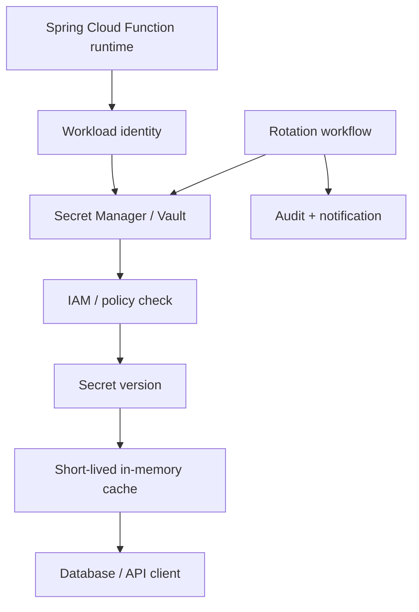
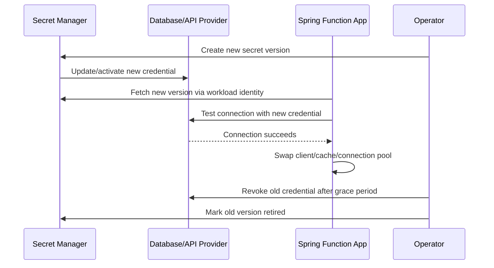

# Protecting Secrets in Environment Variables and Configuration Stores

## 1. Why Are Secrets Part of the Security Boundary?

**SPRING_CLOUD_FUNCTION (Spring Cloud Function)** enables reusing business logic with `Supplier`, `Function`, and `Consumer`, looking them up via `FunctionCatalog`, chaining via *composition*, and deploying the same function across HTTP, event brokers, or serverless. While processing, functions often require credentials to access databases, payment providers, object storage, message brokers, or internal APIs.

Example of an order-processing function:

```text
HTTP / Kafka / Serverless
        |
        v
FunctionCatalog
        |
        v
processOrder
        |
        +--> PostgreSQL (username + password)
        |
        +--> Payment API (API key / OAuth client secret)
        |
        +--> Message broker (client credentials)
```

Items such as passwords, API keys, private keys, refresh tokens, signing keys, database credentials, and certificate private keys are **secrets**. If placed in source code, committed config files, command lines, logs, or message headers, an actor who lacks permission to invoke the function could still obtain access to backing resources.

**Environment variables are not a secret store by themselves.** They are a mechanism for passing configuration into a process. Secrets passed via environment variables can still leak through process-inspection privileges, diagnostics, crash dumps, shell history, container metadata, or management endpoints. Similarly, an encrypted value in Git is no longer plaintext at rest, yet it can be decrypted to plaintext when Config Server sends it to the application.

### Learning Objectives

After this lesson, you will be able to:

1. Distinguish ordinary configuration from secrets; map a secret's lifecycle across creation, storage, authorization, usage, rotation, and revocation.
2. Explain why passwords/API keys must not be committed to `application.yml` or passed via command-line arguments.
3. Choose how to supply secrets to Spring Boot / Spring Cloud Function via environment variables, mounted files, `configtree:`, or a secret manager.
4. Use `@ConfigurationProperties` and constructor injection to pass credentials to functions/services without logging secrets.
5. Distinguish encryption at rest, encryption in transit, and runtime access controls.
6. Secure Kubernetes Secrets, Spring Cloud Config, Actuator, CI/CD, and cloud identities.
7. Design rotation without breaking connection pools, client caches, or running functions.
8. Write tests detecting secrets leaked into source, logs, message headers, or API responses.

## 2. How Does Configuration Differ from Secrets?

| Data | Example | Is It a Secret? | Notes |
|---|---|---|---|
| Function name | `spring.cloud.function.definition=processOrder` | Usually no | Can still be sensitive configuration if altering it exposes an internal function |
| HTTP port | `server.port=8080` | No | May be public by design |
| Feature flag | `orders.validation.enabled=true` | Not by default | Can influence business logic |
| Database hostname | `db.internal.example` | Potentially sensitive | Not usually a credential, yet reveals topology |
| Database username | `orders_app` | Depends on policy | Not always secret, but worth restricting |
| Database password | `...` | **Yes** | Never commit or log |
| API key / OAuth client secret | `...` | **Yes** | Grants access to external services |
| Private signing key | `...` | **Yes, high sensitivity** | Signing permissions and rotation must be strictly controlled |
| Public TLS certificate | `certificate.pem` | Not necessarily | Public certificate differs from private key |
| TLS private key | `private-key.pem` | **Yes** | Must never be exposed |
| JWT access token | `Authorization: Bearer ...` | **Yes** | Time-limited, yet can still be replayed |
| Correlation ID | `req-42` | Usually no | Must never substitute for authentication |

Secrets carry **capability**: whoever holds the database password can access data; whoever holds a private key can sign; whoever holds cloud credentials can call APIs under that IAM policy. Protecting secrets is therefore not merely "encrypting a string," but **restricting which principals can read, use, rotate, and revoke them**.

### Do Not Confuse Types of Protection

| Layer | Objective | Example |
|---|---|---|
| Encryption at rest | Protects stored data if storage/backups are accessed improperly | KMS, etcd encryption, repository encryption |
| Encryption in transit | Protects data moving across networks | TLS/mTLS to Config Server or Secret Manager |
| Access control | Ensures only authorized principals can read secrets | IAM, Kubernetes RBAC, Vault policies |
| Runtime isolation | Reduces where secrets can appear | Separate processes, containers, dedicated file mounts |
| Secret hygiene | Avoids creating unnecessary copies | No logging, no commits, no stuffing into headers |
| Rotation/revocation | Limits the window during which a leaked secret remains usable | Credential replacement, token revocation, client updates |

Encryption at rest does **not** prevent an authorized application from reading the plaintext secret. TLS does **not** prevent application logs from recording tokens. RBAC does **not** prevent a process permitted to read a secret from misusing it. These layers complement each other.

## 3. Places Where Secrets Should Never Be Stored

### 3.1. Never Hard-Code in Source or Committed Config Files

Do not do this:

```yaml
# Never put real secrets into application.yml.
spring:
  datasource:
    url: jdbc:postgresql://db.internal/orders
    username: orders_app
    password: "real-database-password"
payment:
  api-key: "real-provider-api-key"
```

Files travel through Git history, forks, pull requests, build caches, source archives, and backups. **Deleting a secret in a newer commit does not remove it from history.** If a secret was committed, assume it is compromised: revoke/rotate first, then handle repository history per organizational procedure.

Avoid "cosmetic obfuscation" tricks:

- Base64 is not encryption.
- Renaming a property from `password` to `credentialValue` does not make it secret.
- Splitting a secret string into pieces in source still leaves everything needed to reconstruct it.
- Encrypting with a key committed right next to the ciphertext creates no real boundary.
- Putting secrets in an un-ignored `.env` file or baking them into an image build is still hard-coding.

### 3.2. Never Pass Secrets via the Command Line

Avoid:

```bash
java -jar orders-service.jar \
  --spring.datasource.password=real-password \
  --payment.api-key=real-api-key
```

Command-line arguments can appear in process inspection, process supervisors, shell history, audit logs, scripts, and monitoring tools. Exposure depends on the OS, container runtime, and viewer privileges; never use the command line as a secret manager.

### 3.3. Never Write Secrets into Logs, Exceptions, or Tracing

Dangerous examples:

```java
// Never log entire configuration or objects holding credentials.
log.info("Database config: {}", databaseProperties);

// Never log authorization headers.
log.debug("Incoming headers: {}", message.getHeaders());

// Never include tokens in error messages.
throw new IllegalStateException(
        "Payment failed for API key " + apiKey);
```

Common places where secrets leak accidentally:

- Startup logs printing full `Environment`, `@ConfigurationProperties`, or request headers.
- HTTP client wire logging, JDBC driver debug logging, and SDK debug logs.
- Stack traces or exception messages containing URLs with embedded usernames/passwords.
- Distributed tracing baggage/tags, span attributes, and telemetry exporters.
- Metric labels carrying tokens, account identifiers, or secret-derived values.
- Audit events, dead-letter queues, retry payloads, and support bundles.
- Heap dumps, thread dumps, crash dumps, or diagnostic archives.

**Never log raw requests/responses** when bodies or headers hold credentials or personal data. Log validated correlation IDs, secret reference names, error categories, and status codes instead of secret values.

## 4. Environment Variables: Convenient for Config, Not an Ideal Secret Store

Spring Boot supports externalized configuration from properties, YAML, environment variables, system properties, and command-line arguments. Property sources have a precedence order; one source can override another. That lets you deploy one artifact across environments, yet also means an environment variable can alter credentials or function behavior without touching the JAR.

Example environment variables:

```text
SPRING_DATASOURCE_URL=jdbc:postgresql://orders-db.internal/orders
SPRING_DATASOURCE_USERNAME=orders_app
SPRING_DATASOURCE_PASSWORD=<injected-at-runtime>
PAYMENT_APIKEY=<injected-at-runtime>
```

### Advantages

- No need to store credentials in source code or the application JAR.
- Can be injected by a container orchestrator or runtime platform.
- Separates configuration from artifacts; the same image runs in dev, staging, and production.
- Integrates easily with cloud/container secret injection.

### Limitations

- Processes and child processes can inherit the environment.
- Actors with sufficient privileges on the host/container/runtime can inspect environment variables or diagnostics.
- Some process managers record commands/environments in metadata, support bundles, or crash dumps.
- The environment is typically a snapshot at process startup; changing a secret upstream **does not guarantee** the running JVM sees the update.
- In Java, values are usually bound as immutable `String`s; setting a variable to `null` does not guarantee all copies are wiped from the heap.
- If multiple containers in the same Pod share secrets via environment variables, all of those containers can read the values.

**When to use?** Environment variables work for runtime configuration and certain credentials in controlled environments. For high-sensitivity secrets, prefer a secret manager/workload identity or mounted secret files with tight file permissions, depending on your platform.

### 4.1. Spring Boot Relaxed Binding

Spring Boot maps environment variables to properties. Examples:

| Environment Variable | Property |
|---|---|
| `SPRING_DATASOURCE_URL` | `spring.datasource.url` |
| `SPRING_DATASOURCE_USERNAME` | `spring.datasource.username` |
| `SPRING_DATASOURCE_PASSWORD` | `spring.datasource.password` |
| `PAYMENT_APIKEY` | `payment.api-key` |

Example `application.yml` holding only non-secret configuration:

```yaml
spring:
  datasource:
    url: "${SPRING_DATASOURCE_URL}"
    username: "${SPRING_DATASOURCE_USERNAME}"
    password: "${SPRING_DATASOURCE_PASSWORD}"
```

Here, the runtime must supply the variables before startup. Never supply a sample password as a default value that could accidentally be used in production. For required properties, letting a missing secret make the application **fail startup cleanly** is far safer than silently running with empty or development credentials.

In Spring Boot, placeholder defaults may be used for **non-sensitive settings**; avoid default passwords in config files:

```yaml
orders:
  timeout: "${ORDERS_TIMEOUT:3s}"
```

If secrets are supplied via environment variables, restrict who can inspect Pod/task configurations, process diagnostics, and logs. Never dump `System.getenv()` for debugging.

## 5. Mounted Secret Files and Spring Boot `configtree:`

Many platforms can mount secrets as files inside containers. Spring Boot supports **configuration trees** via the `configtree:` prefix: directory/file names become property names, and file contents become property values. This avoids several drawbacks of environment variables and lets you enforce read restrictions via filesystem permissions.

Example mounted directory:

```text
/run/secrets/
  orders/
    datasource/
      username
      password
    payment/
      api-key
```

Generated properties:

| File | Property |
|---|---|
| `/run/secrets/orders/datasource/username` | `orders.datasource.username` |
| `/run/secrets/orders/datasource/password` | `orders.datasource.password` |
| `/run/secrets/orders/payment/api-key` | `orders.payment.api-key` |

In `application.yml`:

```yaml
spring:
  config:
    import: "configtree:/run/secrets/"
```

If the secret directory is mandatory, omit the `optional:` prefix so the app will not silently start with missing credentials. Use:

```yaml
spring:
  config:
    import: "optional:configtree:/run/secrets/"
```

only when an environment legitimately permits the directory to be absent (e.g., a local profile without those secrets). For production, verify the optional/required choice explicitly.

### 5.1. Binding Secrets into a Structured Object

Java record example:

```java
package com.example.orders.config;

import org.springframework.boot.context.properties.ConfigurationProperties;
import org.springframework.validation.annotation.Validated;
import jakarta.validation.constraints.NotBlank;

@Validated
@ConfigurationProperties(prefix = "orders.datasource")
public record OrdersDatabaseCredentials(
        @NotBlank String username,
        @NotBlank String password
) {}
```

Registering configuration properties:

```java
package com.example.orders.config;

import org.springframework.boot.context.properties.ConfigurationPropertiesScan;
import org.springframework.context.annotation.Configuration;

@Configuration(proxyBeanMethods = false)
@ConfigurationPropertiesScan
public class OrdersConfiguration {}
```

Injecting into the consuming component:

```java
package com.example.orders.persistence;

import com.example.orders.config.OrdersDatabaseCredentials;
import org.springframework.stereotype.Component;

@Component
public class OrdersDataSourceFactory {

    private final OrdersDatabaseCredentials credentials;

    public OrdersDataSourceFactory(
            OrdersDatabaseCredentials credentials) {
        this.credentials = credentials;
    }

    public void initialize() {
        // Pass credentials into the DataSource/client builder.
        // Never log credentials or objects holding credentials.
    }
}
```

For validation to run, add `spring-boot-starter-validation` to the application. This illustrates structured binding; production code must build and manage the `DataSource`/connection pool lifecycle properly, close resources, and handle rotation. **Never log the full record holding secrets**: default record `toString()` includes all fields. If an object might pass through logging frameworks, provide a redacted representation or keep it out of logs entirely.

### 5.2. Limitations of Configuration Trees

- `configtree:` reads files when Spring Boot loads config data. It does not watch files for changes or automatically update running beans.
- When the platform updates a mounted secret file, connection pools, SDK clients, or immutable `@ConfigurationProperties` records are not automatically recreated.
- File/volume mount permissions must be restricted to the exact container and user that need read access.
- If files are mounted via symlinks, volumes, or sidecars, inspect mount sources and file-replacement privileges.
- Never mount an entire namespace's secret directory into every container.
- Secret files can still be read via debug endpoints, heap dumps, process compromise, or logs if the app leaks them.

**A config tree turns files into properties; it is not a secret manager.** It does not grant IAM, rotate credentials, or revoke copies already read into the JVM.

## 6. Kubernetes Secrets: Base64 Is Not Encryption

A Kubernetes `Secret` is designed for sensitive data such as passwords, tokens, and SSH keys. Yet a common misconception is that values in `data` are encrypted—they are **Base64-encoded**, not cryptographically protected. If a manifest containing Base64 values is committed to Git, anyone reading it can decode them immediately.

```yaml
# Structure illustration only; never commit real secrets into files.
apiVersion: v1
kind: Secret
metadata:
  name: orders-runtime
  namespace: orders
type: Opaque
stringData:
  orders.datasource.username: orders_app
  orders.datasource.password: <provision-outside-git>
```

```yaml
apiVersion: v1
kind: Deployment
metadata:
  name: orders-service
  namespace: orders
spec:
  template:
    spec:
      containers:
        - name: orders-service
          image: registry.example/orders-service:1.0.0
          volumeMounts:
            - name: runtime-secrets
              mountPath: /run/secrets
              readOnly: true
      securityContext:
        fsGroup: 10001
      volumes:
        - name: runtime-secrets
          secret:
            secretName: orders-runtime
            defaultMode: 0440
```

These manifests illustrate structure. In production, secret values must be provisioned by an appropriately authorized secret manager/CI pipeline or external-secrets integration; **never commit real values in `stringData`**.

### 6.1. Required Cluster Controls

1. **Encryption at rest for Secrets in etcd:** per Kubernetes docs, Secret objects are stored unencrypted by default unless an encryption provider is configured. Enable encryption at rest and follow proper key/KMS lifecycle management.
2. **Least-privilege RBAC:** restrict `get`, `list`, and `watch`. `list`/`watch` can expose Secret contents just like `get`; never grant them broadly to service accounts.
3. **Namespace separation:** separate workloads/tenants of different trust levels; namespaces are not the sole boundary, yet they help organize permissions.
4. **Restrict Pod creation:** anyone permitted to create Pods/Deployments in a namespace can mount Secrets referenced by workloads; workload creation privileges indirectly grant Secret read access.
5. **Mount to the right container:** in multi-container Pods, mount the volume or inject environment variables only into the container needing the secret.
6. **Avoid privileged workloads:** privileged containers can access broad node resources, including secrets used by other workloads depending on setup.
7. **External secret providers:** consider Secrets Store CSI Driver or external secret-manager integration to avoid storing all secrets long-term inside the Kubernetes API.
8. **Auditing:** monitor Secret `get`/`list`/`watch`, Secret modifications, Pod creation, and service account changes.

### 6.2. Mounted File vs. Environment Variable?

| Injection Method | Characteristics | Rotation |
|---|---|---|
| `secretKeyRef` into environment | Easy to use, but the process gets a snapshot at container start | Typically requires Pod restart/rollout for the process to see new values |
| Secret volume mount | Secret appears as files; Kubernetes updates volumes via eventual consistency | Files update after a propagation delay; the app still has to re-read/reload |
| Secret volume with `subPath` | Mounts a single file at a specific path | Does not receive automatic Secret updates via projected volumes |
| External secret CSI/provider | Fetches from external stores and mounts into the Pod | Depends on provider, sync/poll interval, and application reload |

Kubernetes docs note that Secret volumes update with eventual consistency, and containers using `subPath` do not receive automatic updates. **Never assume that updating a Secret on the API server means every JVM is immediately using the new credential.**

### 6.3. Connecting a Kubernetes Volume to Spring Boot Config Tree

When the Secret volume is mounted at `/run/secrets/` as shown above, Spring Boot can import:

```yaml
spring:
  config:
    import: "configtree:/run/secrets/"
```

If a key/filename in the Secret is `orders.datasource.password`, the config tree exposes the corresponding property. If directory structures contain segments, those form property paths too. Verify key names, mount layout, and property binding in integration tests.

`configtree:` can bind values to `String` or `byte[]` depending on the target type. For binary private keys/certificates, consider reading bytes rather than coercing to text; still restrict file permissions and avoid logging contents.

Do not grant the application permission to call the Kubernetes API solely to read secrets if they are already volume-mounted. That avoids giving `get/list secrets` rights to the service account. If an app calls the Kubernetes API itself, scope permissions to the exact namespace/resource/key and protect the service account token.

## 7. Secret Managers and Workload Identity

In cloud systems, the preferred pattern is **not storing long-lived credentials inside application configuration**. Instead, the runtime receives a short-lived platform identity, uses it to fetch permitted secrets, caches briefly if needed, and updates clients when secrets rotate.



| Platform | Secret Management Service | Common Identity Mechanism |
|---|---|---|
| AWS | AWS Secrets Manager / Systems Manager Parameter Store SecureString | IAM role for workload, ECS task role, EKS IRSA / Pod Identity |
| Azure | Azure Key Vault | Managed Identity / workload identity |
| Google Cloud | Secret Manager | Workload Identity Federation / service account identity |
| Multi-cloud / on-prem | HashiCorp Vault | Kubernetes auth, cloud auth, scoped AppRole, or workload identity |

Never issue a static access key with admin rights to every function. Scope policies by service/tenant, secret path, and environment; each function should access only the secrets required by its business task.

### 7.1. AWS Secrets Manager Example

AWS Secrets Manager stores secrets encrypted with AWS KMS and supports IAM read access control, caching, and rotation. AWS best practices recommend storing credentials in Secrets Manager, restricting access, rotating secrets, monitoring usage, and using private networks where appropriate.

A runtime IAM policy should allow reading only the specific secret ARN:

```json
{
  "Effect": "Allow",
  "Action": ["secretsmanager:GetSecretValue"],
  "Resource": "arn:aws:secretsmanager:ap-southeast-1:111122223333:secret:orders/db-*"
}
```

This is an illustrative policy; ARN, account, region, and KMS permissions must match your deployment. If the secret uses a customer-managed KMS key, the runtime also needs decrypt permission via the key policy/IAM. **Never grant `secretsmanager:ListSecrets` or `GetSecretValue` on `*` for convenience.**

### 7.2. Secret Caching Involves Trade-Offs

Calling a secret manager on every message increases latency, cost, and network dependency. Caching reduces calls, yet introduces a window during which a process still holds the old value after rotation.

Cache design must define TTL, refresh behavior, grace periods when the secret manager is unavailable, when to fail closed, and how caches behave across instances. Never cache a revoked credential indefinitely. Conversely, do not evict immediately if downstream systems need an overlap window to swap users/keys.

## 8. Spring Cloud Config: `{cipher}` Protects Data at Rest, Not a Secret Manager Replacement

Spring Cloud Config supports encrypting/decrypting property values. A value in remote config can carry the `{cipher}` prefix:

```yaml
spring:
  datasource:
    username: orders_app
    password: "{cipher}ENCRYPTED_VALUE_FROM_SECURE_WORKFLOW"
```

Encrypted values keep plaintext secrets out of Git repositories or remote config stores. However, the Spring Cloud Config docs explain that Config Server **decrypts values before sending configuration to clients** over HTTP. Therefore:

- Encryption at rest protects stored config, not plaintext from reaching clients authorized to read config.
- Config Server holds or accesses the decryption key; protect both the key and server access.
- `/encrypt` and `/decrypt` endpoints may be exposed; guard them with authentication, authorization, network restrictions, and auditing.
- Any client permitted to read the property receives plaintext after decryption.
- If ciphertext fails to decrypt, Config Server handles it as an error/invalid property; never let an app silently treat raw ciphertext as a password.

### 8.1. Never Commit the Encryption Key Alongside Ciphertext

Avoid:

```yaml
# Anti-pattern: decryption key committed next to ciphertext.
encrypt:
  key: "same-key-stored-in-git"
```

Provision keys from a protected source (KMS/HSM/secret manager or managed key pair). Separate permissions for developers, CI/CD, Config Server, Config Clients, and operators; each principal receives only what its role requires. With symmetric keys, anyone holding the key can decrypt. Never place private keys in Git or container images.

### 8.2. Spring Cloud Config Is Not the Only Secret Source

Config Server works well for centralized configuration and can store encrypted values. For credentials needing frequent rotation, dynamic database users, short-lived tokens, or workload-identity policies, a dedicated secret manager is usually a better fit. You can store non-secret config in Config Server and reference secret paths/versions in Secret Manager:

```yaml
orders:
  datasource:
    secret-id: "prod/orders/database"
  payment:
    secret-id: "prod/orders/payment-provider"
```

`secret-id` values are identifiers, not credentials. The runtime fetches secrets using its own identity. If secret identifiers themselves are considered sensitive by org policy, restrict access and avoid exposing them casually.

## 9. Using Secrets Safely Inside Spring Cloud Function

Functions should receive **business data** in payloads and obtain credentials from injected dependencies. Never pass API keys/passwords in payloads or headers for a function to use.

### 9.1. Credentials Configuration Example

```java
package com.example.orders.config;

import org.springframework.boot.context.properties.ConfigurationProperties;
import org.springframework.validation.annotation.Validated;
import jakarta.validation.constraints.NotBlank;

@Validated
@ConfigurationProperties(prefix = "payment.provider")
public record PaymentProviderProperties(
        @NotBlank String baseUrl,
        @NotBlank String apiKey
) {}
```

Registration:

```java
package com.example.orders.config;

import org.springframework.boot.context.properties.ConfigurationPropertiesScan;
import org.springframework.context.annotation.Configuration;

@Configuration(proxyBeanMethods = false)
@ConfigurationPropertiesScan
public class PaymentConfiguration {}
```

Injection into the client:

```java
package com.example.orders.payment;

import com.example.orders.config.PaymentProviderProperties;
import org.springframework.stereotype.Component;

@Component
public class PaymentGateway {

    private final PaymentProviderProperties properties;

    public PaymentGateway(PaymentProviderProperties properties) {
        this.properties = properties;
    }

    public PaymentResult charge(PaymentCommand command) {
        // Use properties.apiKey() in the Authorization header of the
        // outbound HTTP request to the exact provider.
        // Never log properties or request headers.
        return callProvider(command, properties.apiKey());
    }

    private PaymentResult callProvider(
            PaymentCommand command, String apiKey) {
        // Replace with a real HTTP client; never store apiKey in messages.
        return new PaymentResult(command.paymentId(), "ACCEPTED");
    }
}
```

Business data types used in the example:

```java
package com.example.orders.payment;

public record PaymentCommand(String paymentId, long amountMinor) {}
public record PaymentResult(String paymentId, String status) {}
```

Function invoking the client:

```java
package com.example.orders.functions;

import java.util.function.Function;
import com.example.orders.payment.PaymentCommand;
import com.example.orders.payment.PaymentGateway;
import com.example.orders.payment.PaymentResult;
import org.springframework.context.annotation.Bean;
import org.springframework.context.annotation.Configuration;

@Configuration
public class PaymentFunctions {

    @Bean
    Function<PaymentCommand, PaymentResult> processPayment(
            PaymentGateway gateway) {
        return gateway::charge;
    }
}
```

`PaymentCommand` contains the payment ID and required business data; it does **not** contain `apiKey`. The function can be called over HTTP or a broker, while credentials come from runtime-controlled config/secret providers.

### 9.2. Never Put Secrets in Spring `Message` Headers

Avoid:

```java
// Never pass credentials inside messages.
Message<PaymentCommand> message = MessageBuilder
        .withPayload(command)
        .setHeader("Authorization", "Bearer " + apiToken)
        .setHeader("payment-api-key", apiKey)
        .build();
```

Message headers can be copied across composition, serialized into Kafka/Rabbit or HTTP headers, logged, captured in tracing, or returned by adapters. Propagate only **validated correlation IDs, event types, content types, and reviewed metadata**. Never treat `tenantId` from a message header as the principal; never trust producer-supplied tokens without verification.

### 9.3. Composition Must Not Leak Secrets

Suppose:

```text
validateOrder | processPayment | publishReceipt
```

Secrets are needed only inside `PaymentGateway`/`processPayment`. Never put credentials into a function's output payload and pass them down a composition. Each step receives minimal business data, and output DTOs contain no tokens/passwords. Avoid passing raw client/config objects or raw HTTP SDK exceptions downstream.

If a function is loaded by the deployer or runs in a separate worker, provision secrets via the worker's **runtime identity**. Never pass host secrets in host-to-worker requests unless a secure protocol explicitly requires a short-lived scoped credential design.

## 10. Protecting Actuator, Logs, and Diagnostics

Spring Boot Actuator can expose `env`, `configprops`, `beans`, `loggers`, `heapdump`, or custom endpoints depending on dependencies and config. These endpoints can reveal property names, property sources, bean metadata, logging state, or runtime memory.

Production policy:

```yaml
management:
  endpoints:
    web:
      exposure:
        include: "health,info"
  endpoint:
    health:
      show-details: never
    env:
      show-values: never
    configprops:
      show-values: never
```

Expose only needed endpoints. `show-values=never` is a leak-reduction layer, **not a substitute for not exposing `env`/`configprops`** when unneeded. Custom `SecurityFilterChain` beans must also protect Actuator; do not assume Spring Boot keeps Actuator auto-secured once your application defines its own chain.

### Logs and Telemetry Checklist

- Never log full `Environment` or `System.getenv()`.
- Never log `@ConfigurationProperties` objects containing passwords/tokens.
- Never enable HTTP client or JDBC wire logging in production without redaction.
- Redact `Authorization`, `Cookie`, `Set-Cookie`, API key headers, and secret query parameters.
- Never place secrets in trace baggage, span tags, or metric labels.
- Restrict access to logs/traces, retention periods, and third-party exports.
- Disable or lock down heap dumps, debug endpoints, JMX, and remote management.
- Error messages returned to callers should state only generic errors and correlation IDs; internal details go to controlled logs.

**Redaction is not the only line of defense.** If the system does not need to log request headers, omit them completely rather than logging and hoping regex redaction catches everything.

## 11. Rotation: Swapping Secrets Without Breaking Running Functions

Secrets can be compromised or require scheduled rotation. Rotation is not just updating the store; the application must also pick up the new value, update clients, and stop using the old credential.

### 11.1. General Rotation Workflow



Steps:

1. Create a new credential with **least privilege** matching what is being replaced.
2. When supported, keep old and new credentials active simultaneously during an overlap window.
3. Update the secret store and notify/reload applications via the designed mechanism.
4. Open a new connection/API call to verify the new credential works.
5. Swap the client or connection pool; close old connections cleanly per lifecycle rules.
6. Monitor authentication errors, latency, retries, and failed requests.
7. Once every instance uses the new credential, revoke the old credential.
8. Remove unnecessary copies and emit an audit record containing no secret values.

Never revoke the old credential the instant the secret store updates if instances have not picked up the new version yet. Conversely, never leave the overlap open indefinitely.

### 11.2. Rotation and Connection Pools

Database passwords are usually read when creating the `DataSource` or opening connections. If the password changes in Secret Manager, open connections may keep working for a while, whereas new connections fail if the pool still holds the old password.

Verify whether the pool supports credential updates or requires creating a new `DataSource`; when to close the old pool; whether long-running transactions or messages hold connections; whether cache TTL and pool refresh align; and whether the new database user has exact required grants.

For payment APIs, clients may cache tokens in interceptors or connection configs. Update the client cleanly while draining in-flight requests. Do not allocate a brand-new HTTP client on every request just to avoid rotation; design controlled client lifecycles.

### 11.3. Kubernetes Rotation Has Propagation Delay

Kubernetes Secret volumes update via eventual consistency. Container environment variables do not change automatically when a Secret object is updated; a Pod rollout/restart is usually required for the process to see new values. Volume mounts using `subPath` do not receive automatic updates. Even once a file changes on disk, Spring Boot config trees and bound beans may still hold prior values.

One simple approach is a **controlled restart/rollout** after updating a Secret; another is having the app actively reload from mounted files/secret manager and swap clients. Pick one strategy, test it, and support rollbacks.

### 11.4. Never Log Secret Values to Verify Rotation

To confirm a new version is active, log secret version IDs, timestamps, key identifiers, or a safely designed metadata fingerprint. Never log plaintext or unnecessary hashes of passwords/tokens: for low-entropy secrets, hashes can aid offline guessing.

## 12. Incident Response When a Secret Leaks

If a password, token, or private key appears in Git, logs, messages, or support bundles:

1. **Revoke/rotate first** according to blast radius; do not merely delete the log line or commit.
2. Identify which secret, principal, and downstream systems could have been accessed.
3. Inspect access logs, IAM audit logs, database audits, provider usage, and network telemetry across the exposure window.
4. Revoke dependent sessions/tokens or credentials; replace certificates/key pairs if a private key leaked.
5. Search for copies in Git history, CI artifacts, build caches, logs, trace stores, DLQs, and backups.
6. Restrict access to copies needed for investigation; honor retention/legal hold rules instead of destroying evidence prematurely.
7. Provision a fresh secret via the secret manager and roll out affected runtimes.
8. Add secret scanning, log redaction, and tests to prevent recurrence.

**If a secret was committed to Git, treat it as compromised even in a private repository.** Clones, forks, CI artifacts, or backups may exist beyond your control.

## 13. Testing: Ensuring Secrets Do Not Leak

Tests must never use production secrets. Use synthetic markers like `TEST_ONLY_SECRET_9f3a` and verify the marker never appears in logs, responses, or message headers.

### 13.1. Testing Required Configuration

A unit test can verify the app has no fallback password:

```java
package com.example.orders;

import static org.junit.jupiter.api.Assertions.assertTrue;

import com.example.orders.config.OrdersDatabaseCredentials;
import org.springframework.boot.autoconfigure.AutoConfigurations;
import org.springframework.boot.autoconfigure.validation.ValidationAutoConfiguration;
import org.springframework.boot.context.properties.EnableConfigurationProperties;
import org.springframework.boot.test.context.runner.ApplicationContextRunner;
import org.springframework.context.annotation.Configuration;
import org.junit.jupiter.api.Test;

class SecretConfigurationTest {

    @Test
    void missingRequiredPasswordMustNotSilentlyUseDefault() {
        new ApplicationContextRunner()
                .withConfiguration(AutoConfigurations.of(
                        ValidationAutoConfiguration.class))
                .withUserConfiguration(TestConfiguration.class)
                .withPropertyValues(
                        "orders.datasource.username=orders_app")
                .run(context ->
                        assertTrue(context.getStartupFailure() != null));
    }

    @Configuration(proxyBeanMethods = false)
    @EnableConfigurationProperties(OrdersDatabaseCredentials.class)
    static class TestConfiguration {}
}
```

This test illustrates the goal, though actual record constructor binding and validation depend on how `@ConfigurationProperties` and Spring Boot dependencies are configured. In a full app, use `@Validated` with constraints like `@NotBlank` and test with `ApplicationContextRunner`/`@SpringBootTest` to verify **the context fails to start when a required secret is missing**.

### 13.2. Testing That Secrets Never Appear in Outputs

Example function test:

```java
package com.example.orders;

import static org.junit.jupiter.api.Assertions.assertFalse;
import static org.junit.jupiter.api.Assertions.assertNotNull;

import com.example.orders.config.PaymentProviderProperties;
import com.example.orders.payment.PaymentCommand;
import com.example.orders.payment.PaymentGateway;
import com.example.orders.payment.PaymentResult;
import com.fasterxml.jackson.databind.ObjectMapper;
import org.junit.jupiter.api.Test;
import org.springframework.messaging.support.MessageBuilder;

class SecretHeaderPolicyTest {

    @Test
    void outboundMessageDoesNotContainCredentials() throws Exception {
        String fakeSecret = "TEST_ONLY_SECRET_9f3a";
        PaymentGateway gateway = new PaymentGateway(
                new PaymentProviderProperties(
                        "https://payments.example.test", fakeSecret));
        PaymentResult result = gateway.charge(
                new PaymentCommand("pay-42", 150000));

        var output = MessageBuilder
                .withPayload(result)
                .setHeader("correlationId", "req-42")
                .build();
        String serializedBody =
                new ObjectMapper().writeValueAsString(output.getPayload());

        assertNotNull(output.getHeaders().get("correlationId"));
        assertFalse(output.getHeaders().containsKey("Authorization"));
        assertFalse(output.getHeaders().containsKey("payment-api-key"));
        assertFalse(serializedBody.contains(fakeSecret));
    }
}
```

This test illustrates only the output contract; in a real system, also test serializers and adapters to inspect headers actually sent to Kafka/HTTP. For log verification, use a test appender (such as Logback `ListAppender`) to confirm the synthetic marker never appears in log records.

### 13.3. Testing Rotation

Verify:

- Old secret versions are rejected after revocation.
- The app fetches the new version via workload identity.
- Connection pools/clients swap or refresh cleanly per lifecycle.
- In-flight requests neither drop data nor cause duplicate side effects on retry.
- Cache TTL never exceeds the agreed grace period.
- When Secret Manager experiences transient failures, cached values are used only within allowed bounds before failing closed.
- Neither old nor new secret values appear in logs.

## 14. Common Mistakes

| Mistake | Why It Is Dangerous | Right Approach |
|---|---|---|
| Committing passwords in `application.yml` | Exposed via Git history, clones, and CI | Inject from a secret store |
| Treating environment variables as a secret manager | Can leak via process/diagnostics and usually don't auto-rotate | Use workload identity or secret files/stores where appropriate |
| Passing passwords on the command line | Exposed via process metadata and shell history | Use runtime injection or file/secret providers |
| Relying on Base64 for Kubernetes Secrets | Base64 is not encryption | Encryption at rest + RBAC + secret providers |
| Letting every Pod read every Secret in a namespace | Cross-workload exposure | Mount per container, isolate namespaces, least privilege |
| Granting service accounts `list secrets` | Allows bulk reading of Secret contents | Grant minimal permissions; avoid `list`/`watch` |
| Storing encryption keys next to ciphertext | Anyone reading the repo has both | Manage keys independently in KMS/secret stores |
| Thinking `{cipher}` keeps plaintext from Config Clients | Config Server decrypts before returning to authorized clients | Protect Config Server/client identities and secret access |
| Exposing `/encrypt`, `/decrypt`, or Actuator broadly | Widens config read/encrypt/decrypt attack surface | Authn/authz, network restrictions, auditing |
| Putting API keys in Spring `Message` headers | Can be copied, serialized, logged, or traced | Inject credentials inside runtime clients |
| Logging full config/headers for debugging | Secrets enter logs and telemetry | Log filtered metadata only |
| Updating secret store without updating clients | JVMs/pools/caches keep stale values | Rotation workflow + tested refresh/restart |
| Revoking old credentials too early | Instances not yet updated break | Overlap/grace period and staged rollout |
| Caching secrets indefinitely | Keeps using revoked credentials | TTL, refresh, and expiry policies |
| Assuming setting a Java variable to `null` wipes secrets | `String` and copies may remain in heap | Minimize copies/lifetime, isolate processes, rotate |

## 15. Hands-On Exercise

A Spring Cloud Function application has `processOrder` calling PostgreSQL and a Payment API, then emitting an `order.paid` event to Kafka.

1. Create `OrdersDatabaseCredentials` and `PaymentProviderProperties` using `@ConfigurationProperties` with no real values in source.
2. Run locally with dummy environment variables and test that the application fails startup when required passwords/API keys are missing.
3. Move credentials to mounted files under `/run/secrets/` and import them via `configtree:`; verify filenames map to the right properties.
4. Create a Kubernetes Secret in a dedicated namespace, mount it read-only solely into the application container, and never commit secret values.
5. Design RBAC so developers cannot `list` production Secrets and CI can update only the necessary secret/deployment.
6. Enable encryption at rest for Kubernetes Secrets and define KMS key rotation/backup policies.
7. Replace static API keys with workload identity + Secret Manager; scope the IAM policy strictly to the right secret.
8. Design database credential rotation with two overlapping users, pool updates, and revocation of the old user after all instances switch.
9. Write a function test using `TEST_ONLY_SECRET_9f3a` and verify the marker never appears in output headers, logs, or exceptions.
10. Temporarily enable debug/wire logging in a test environment to check whether client libraries log `Authorization` headers; configure redaction or disable that logging.
11. Verify `/actuator/env` and `/actuator/configprops` do not expose secrets; if management endpoints are required, restrict network access and roles.
12. Write an incident-response runbook for a leaked secret: revoke, audit, rotate, roll out, verify, and clean up copies in Git/CI/logs.

### Self-Check Questions

1. Why do environment variables not provide the same protections as a secret manager?
2. How does Spring Boot `configtree:` map directory/file names to properties?
3. When a Kubernetes Secret volume updates, why might the JVM keep using the old password?
4. Why does `subPath` prevent automatic Secret volume updates?
5. At which stage does `{cipher}` in Spring Cloud Config protect a secret? What value does the Config Client receive?
6. Why should API keys never be placed in Spring `MessageHeaders` even for internal-only messages?
7. How does database password rotation affect connection pools?
8. If a secret was committed to a private Git repository, why must it still be revoked/rotated?

## 16. Pre-Production Checklist

| Item | Passing Criteria |
|---|---|
| Are secrets absent from source, images, Git history, and public manifests? | Yes |
| Are secrets kept out of command lines, query strings, and message headers? | Yes |
| Are secret sources explicitly chosen per environment? | Yes |
| Are environment/config trees protected by process/file permissions? | Yes |
| Are Kubernetes Secrets encrypted at rest in etcd? | Yes |
| Does RBAC restrict `get`/`list`/`watch` and workload creation rights? | Yes |
| Are secrets mounted only into containers that need them? | Yes |
| Are Config Server, `/encrypt`, and `/decrypt` secured? | Yes |
| Does Actuator avoid exposing `env`, `configprops`, `logs`, and heap dumps? | Yes |
| Are logs, traces, and errors free of tokens, passwords, and private keys? | Tested |
| Are workload identity / least-privilege IAM used whenever possible? | Yes |
| Do secret caches enforce TTLs and expiry policies? | Yes |
| Does rotation cover overlap, rollout, client refresh, and revocation? | Yes |
| Are secret reads, edits, rotations, and revocations audited? | Yes |
| Are leak-response runbooks and tests in place? | Yes |

## 17. Summary and References

**Protecting secrets means protecting the entire access lifecycle.** Environment variables are just one configuration source; mounted files and Spring Boot `configtree:` reduce exposing secrets in process environments, while Secret Managers and workload identities centralize read permissions, versioning, and rotation. Kubernetes Secrets require encryption at rest, least-privilege RBAC, and tight container mount scoping; Base64 is not encryption. Spring Cloud Config `{cipher}` protects data at rest, yet Config Server decrypts before sending to authorized clients, so read access and encrypt/decrypt endpoints must be secured.

In Spring Cloud Function, functions should receive business data via payloads and obtain credentials from clients/services injected via runtime configuration or secret providers. Keep passwords and API keys out of `MessageHeaders`, logs, tracing, and outputs. Rotation must update the secret store, client caches, connection pools, and every running instance; changing a store value alone does not ensure the JVM is using the new credential.

**Official references:**

- [Spring Cloud Function — Programming Model](https://docs.spring.io/spring-cloud-function/reference/spring-cloud-function/programming-model.html) — `FunctionCatalog`, composition, and message handling.
- [Spring Boot — Externalized Configuration](https://docs.spring.io/spring-boot/reference/features/external-config.html) — property sources, environment variables, `configtree:`, and configuration trees.
- [Kubernetes — Good Practices for Secrets](https://kubernetes.io/docs/concepts/security/secrets-good-practices/) — RBAC, base64, mount scope, and protecting secrets after reading.
- [Kubernetes — Encrypting Confidential Data at Rest](https://kubernetes.io/docs/tasks/administer-cluster/encrypt-data/) — encryption providers, etcd, and key rotation.
- [Kubernetes — Secrets](https://kubernetes.io/docs/concepts/configuration/secret/) — environment variables, volume mounts, propagation delay, and `subPath`.
- [Spring Cloud Config — Encryption and Decryption](https://docs.spring.io/spring-cloud-config/reference/server/encryption-and-decryption.html) — `{cipher}`, `/encrypt`, and `/decrypt`.
- [Spring Cloud Config — Security](https://docs.spring.io/spring-cloud-config/reference/server/security.html) — authenticating and securing Config Server.
- [AWS Secrets Manager — Best Practices](https://docs.aws.amazon.com/secretsmanager/latest/userguide/best-practices.html) — encryption, access control, caching, and rotation.
- [AWS Secrets Manager — Rotation Schedules](https://docs.aws.amazon.com/secretsmanager/latest/userguide/rotate-secrets_schedule.html) — rotation schedules and windows.
