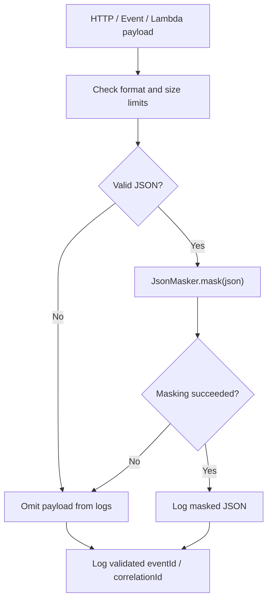

# Masking JSON Data with JsonMasker and META-INF/mask.keys

## 1. Why Mask Data Before Logging?

**SPRING_CLOUD_FUNCTION (Spring Cloud Function)** packages business logic using `Supplier`, `Function`, and `Consumer`, looks it up via `FunctionCatalog`, composes functions with *composition*, and deploys the same function over HTTP, messaging, or serverless environments. Because the same function can run inside multiple adapters, data flowing through the system can surface in many places: application logs, serverless platform logs, traces, dead-letter queues, or monitoring tools.

An order event can contain both business fields and sensitive information:

```json
{
  "eventId": "evt-2026-0042",
  "orderId": "ORD-42",
  "customer": {
    "email": "lan@example.test",
    "phone": "+84901234567"
  },
  "payment": {
    "cardNumber": "4111111111111111",
    "cvv": "123"
  },
  "credentials": {
    "access_token": "eyJhbGciOi...",
    "apiKey": "provider-secret"
  }
}
```

If the entire payload is logged for debugging, emails, phone numbers, card numbers, CVVs, and tokens can end up in a logging system with broader access than the business database. Log records may be exported to third-party services, retained longer than the original data, or viewed by multiple support teams.

**Data masking** replaces the values of selected fields with a masked representation before logging. Spring Cloud Function provides `JsonMasker` starting in version **4.1** to support this use case. `JsonMasker` can be used in any module, not just AWS Lambda; the mechanism is currently documented for structured data such as JSON. Key names to mask are declared in the `META-INF/mask.keys` resource.

### Learning Objectives

After this lesson, you will be able to:

1. Explain the role and limitations of `JsonMasker` in Spring Cloud Function.
2. Create the `src/main/resources/META-INF/mask.keys` resource with multiple keys separated by commas or newlines.
3. Use `JsonMasker.INSTANCE()` to produce a safer JSON string before logging.
4. Apply the same masking approach in functions handling HTTP, events/messages, and AWS Lambda.
5. Distinguish JSON body masking from HTTP headers, Spring `MessageHeaders`, exceptions, and other logs.
6. Design fail-safe behavior when JSON is invalid or masking fails.
7. Test masked output and verify the resource is packaged in the artifact.
8. Maintain a sensitive-data inventory and re-verify masking when schemas evolve.

## 2. What Does `JsonMasker` Do?

The Spring Cloud Function documentation introduces `JsonMasker` to help mask sensitive information in packets/payloads that may appear in logs, initially focusing on AWS Lambda. The documented API looks like:

```java
private static final JsonMasker MASKER = JsonMasker.INSTANCE();

String masked = MASKER.mask(
        new String(payload, StandardCharsets.UTF_8));

logger.info("Received: {}", masked);
```

Meaning of each component:

| Component | Role |
|---|---|
| `META-INF/mask.keys` | List of JSON key names to mask, packaged on the classpath |
| `JsonMasker.INSTANCE()` | Obtains the instance used to perform masking |
| `mask(json)` | Accepts a JSON string and returns a JSON string with configured keys masked |
| `logger.info(...)` | Logs the masked result instead of the raw payload |

The official documentation example uses a resource containing:

```text
eventSourceARN
asdf1, SS
```

Keys may be separated by **commas**, **newlines**, or a mix of both. In the example above there are three keys: `eventSourceARN`, `asdf1`, and `SS`.

### 2.1. `JsonMasker` Does Not Automatically Intercept Every Log

The most important point when using it is that `JsonMasker` is not a global log filter. The documentation illustrates calling `masker.mask(...)` explicitly before the log statement. Therefore:

- Only payloads logged through `JsonMasker` have their declared keys processed.
- Logging objects, raw JSON, or byte arrays directly in another log statement can still leak data.
- Logging HTTP headers, Spring `MessageHeaders`, exceptions, trace attributes, or SQL parameters is not automatically masked by `mask.keys`.
- Other functions, adapters, or logging libraries do not automatically invoke the masker.

Treat `JsonMasker` as a **point-of-use JSON masking utility**, not a system-wide data-protection policy. Locate all places that might log payloads and standardize on a helper and logging policy.

### 2.2. `JsonMasker` Does Not Replace Encryption or Access Control

Masking reduces the readability of raw values in logs. It does not encrypt payloads for storage or transit, authenticate callers, remove sensitive data from original requests/databases/brokers, revoke leaked tokens, or mask undeclared keys.

If a credential has already been logged in plaintext, handle it as a secret-exposure incident: revoke/rotate it and audit log stores. Never treat adding a key to `mask.keys` as remediation for existing logs.

## 3. Creating `META-INF/mask.keys`

Create the file at the exact path:

```text
src/
  main/
    resources/
      META-INF/
        mask.keys
```

Example content:

```text
password
apiKey, authorization
access_token
refresh_token
cardNumber
cvv
email, phone
```

This file instructs the masker to mask the values of the listed JSON keys. Each entry is a JSON field name; never write `password=...` or put secret values inside this file.

### 3.1. Choosing Keys from the Business Schema

| Data Category | Common Keys |
|---|---|
| Authentication | `password`, `token`, `access_token`, `refresh_token`, `authorization` |
| API credentials | `apiKey`, `clientSecret`, `secret` |
| Payment | `cardNumber`, `pan`, `cvv`, `iban` |
| Personal | `email`, `phone`, `mobile`, `ssn`, `nationalId` |
| Address | `address`, `postalCode` |
| Identity data | `dateOfBirth`, `passportNumber` |

This list is only a starting point. Actual key names in real systems vary—such as `accessToken`, `access_token`, `tokenValue`, or `authorizationHeader`. Cross-check event schemas, DTOs, and each provider's payloads to add exact names.

### 3.2. How Keys Are Separated

These two formats are equivalent in intent:

```text
# One key per line
password
access_token
refresh_token
cardNumber
```

```text
# Multiple keys on one line, comma-separated
password, access_token, refresh_token, cardNumber
```

They can be combined:

```text
password, access_token
refresh_token, cardNumber
email
```

Prefer one key per line in larger files for easier review and fewer merge mistakes. Do not put comments, wildcards, or JSONPath expressions in the resource unless your exact version's docs confirm that syntax; current documentation describes comma/newline-separated key names.

### 3.3. Key Matching Must Be Tested

The docs describe declaring keys and masking their values, without guaranteeing every detail such as case sensitivity, matching keys at all nesting depths, wildcard/regex/JSONPath support, duplicate keys/arrays/objects, or an exact placeholder string.

Therefore, **do not infer extra features from the `mask.keys` filename**. Pick consistent key names, then write tests using your application's real payloads and your exact Spring Cloud Function version. If you need path-based or complex pattern masking, add a tested complementary masking layer.

## 4. Using `JsonMasker` in Java

Spring Cloud Function demonstrates retrieving an instance via `JsonMasker.INSTANCE()` and calling `mask(String)`. The following example focuses on a JSON string built from payload bytes:

```java
import java.nio.charset.StandardCharsets;

import org.slf4j.Logger;
import org.slf4j.LoggerFactory;

public final class SafePayloadLogger {

    private static final Logger log =
            LoggerFactory.getLogger(SafePayloadLogger.class);

    private static final int MAX_LOG_PAYLOAD_BYTES = 64 * 1024;

    // JsonMasker is provided by Spring Cloud Function.
    // Use the import matching your application's dependency version.
    private static final JsonMasker MASKER = JsonMasker.INSTANCE();

    private SafePayloadLogger() {}

    public static void logJson(byte[] payload) {
        if (payload == null || payload.length == 0) {
            log.warn("Event payload omitted because it is empty");
            return;
        }
        if (payload.length > MAX_LOG_PAYLOAD_BYTES) {
            log.warn("Event payload omitted because it exceeds the log size limit");
            return;
        }

        String json = new String(payload, StandardCharsets.UTF_8);

        try {
            String maskedJson = MASKER.mask(json);
            log.info("Received event: {}", maskedJson);
        }
        catch (RuntimeException ex) {
            // Never log raw JSON when masking fails.
            // Never attach the exception if message/cause could contain payload.
            log.warn("Received event; JSON payload omitted because masking failed");
        }
    }
}
```

This is an illustrative helper. It assumes the caller already verified that the payload is JSON per content type/contract and bounded its size before passing it to the logger. Resolve the exact `JsonMasker` import in your IDE from the Spring Cloud Function artifact in use; official docs show the class name and `INSTANCE()` call without an import line in the snippet. Do not create another class with the same name in your application package.

### 4.1. Why Use Placeholder Logging?

Write:

```java
log.info("Received event: {}", maskedJson);
```

instead of string concatenation:

```java
log.info("Received event: " + maskedJson);
```

Placeholders let the logging framework format the message only when the log level is enabled. However, this **does not replace masking**: the argument passed to the logger must still be the masked string.

### 4.2. Keep Raw Payloads for Business Logic; Mask Only the Logged Copy

Masking is normally for logs only. Do not overwrite business data under processing when the system needs genuine values for validation, payments, or persistence.

```java
public OrderResult process(byte[] payload) {
    String rawJson = new String(payload, StandardCharsets.UTF_8);

    // Use only the masked version for logging.
    SafePayloadLogger.logJson(payload);

    // Business processing continues using original data per contract.
    OrderEvent event = objectMapper.readValue(
            rawJson, OrderEvent.class);
    return orderService.process(event);
}
```

Do not emit `maskedJson` into downstream messages if consumers require real values. Conversely, if data is shared with analytics/support or environments disallowed from seeing plaintext, build a separate DTO/export that strips sensitive fields rather than relying solely on masked logs.

## 5. Applying in Spring Cloud Function

A function can be invoked through multiple adapters. Placing masking in a shared logging/helper layer prevents each function from implementing inconsistent masking logic.

```java
package com.example.orders;

import java.util.function.Function;

import org.springframework.context.annotation.Bean;
import org.springframework.context.annotation.Configuration;

@Configuration
public class OrderFunctions {

    private final OrderService orderService;

    public OrderFunctions(OrderService orderService) {
        this.orderService = orderService;
    }

    @Bean
    public Function<byte[], OrderResult> processOrder() {
        return payload -> {
            SafePayloadLogger.logJson(payload);
            OrderEvent event = orderService.decode(payload);
            return orderService.process(event);
        };
    }
}
```

This example uses `byte[]` to clearly separate raw JSON from the masked string. In real applications, a function may receive a DTO; in that case, serialize the DTO using the app's mapper, then pass the JSON string through `JsonMasker` before logging.

If a function accepts `Message<?>`, never log the entire message:

```java
// Avoid:
log.info("Incoming message: {}", message);

// Prefer:
SafePayloadLogger.logJson(payloadBytes); // bytes already confirmed as JSON
log.debug("Received event with correlationId={}",
        validatedCorrelationId);
```

`MessageHeaders` can hold authorization headers, tokens, routing metadata, or other sensitive fields. `JsonMasker` processes JSON payloads; it does not filter header maps. Log only allowlisted, validated headers.

### 5.1. With Function Composition

Suppose you have a pipeline:

```text
decodeOrder | validateOrder | processPayment | publishReceipt
```

You can place a dedicated logging/observability step at the start of the pipeline, ensuring that step logs only the masked JSON. Never copy raw payloads into headers to "pass them to a logger," because headers may be retained or serialized across adapters.

If an enrichment function returns a new `Message`, verify explicitly which headers are preserved. Never assume masking the body also masks headers, or vice versa.

### 5.2. Never Leak Raw Payloads in Error Paths

A common mistake:

```java
try {
    log.info("Payload: {}", MASKER.mask(rawJson));
}
catch (Exception ex) {
    // Wrong: falling back to logging unmasked data.
    log.warn("Could not mask payload: {}", rawJson);
}
```

The right behavior is omitting payload content from logs when masking fails:

```java
try {
    log.info("Payload: {}", MASKER.mask(rawJson));
}
catch (RuntimeException ex) {
    log.warn("Payload omitted because masking failed");
}
```

Do not attach the exception object if a parser exception or its cause may embed part of the input JSON. Log a normalized error category, validated correlation ID, and event ID for investigation.

## 6. Applying to AWS Lambda and Other Adapters

Spring Cloud Function initially introduced `JsonMasker` to address AWS Lambda payloads appearing in platform logs. Even so, the documentation describes `JsonMasker` as a generic utility usable in any module.

Example Lambda handler receiving event bytes:

```java
public final class OrderLambdaHandler {

    public OrderResult handle(byte[] payload) {
        String json = new String(payload, StandardCharsets.UTF_8);
        SafePayloadLogger.logJson(payload);
        return processBusinessEvent(json);
    }
}
```

This illustrates manual invocation. **Do not mistakenly think adding `META-INF/mask.keys` makes the Lambda runtime automatically mask every log line or entire events.** Every payload-logging statement must call the masker or route through a tested helper.

| Execution Context | Where to Apply |
|---|---|
| Spring Cloud Function Web / HTTP | Before logging request bodies; filter HTTP headers separately |
| Spring Cloud Stream / Kafka / Rabbit | Before logging payloads; filter message headers separately |
| AWS Lambda | Before logging event bytes/JSON inside the handler or helper |
| Function composition | At a standardized logging point; never copy raw data into headers |
| Other serverless adapters | Use the same helper if payloads are JSON; check platform-emitted logs |

If an adapter or cloud platform logs raw payloads before your function code runs, a helper inside the function cannot retroactively scrub already-emitted logs. Inspect adapter/runtime logging settings and disable or reconfigure unnecessary raw payload logging.

## 7. What Are the Limits of JSON Masking?

`JsonMasker` is documented for **structured data such as JSON**. Do not treat it as a universal masker for every data format.

| Data | Use `JsonMasker` Directly? | How to Handle |
|---|---|---|
| Valid JSON string | Yes | Call `mask(json)` before logging |
| `byte[]` holding UTF-8 JSON | Yes, after decoding with the right charset | Convert to `String`, then mask |
| Java DTO | Not directly via the documented API | Serialize to JSON, then mask |
| HTTP headers | No | Allowlist/redact headers separately |
| Spring `MessageHeaders` | No | Log only permitted headers |
| Plain text | Outside documented scope | Omit content or use dedicated redaction |
| XML, CSV, form-data, binary | No | Use a format-appropriate parser/masking strategy |
| Exceptions / stack traces | No | Normalize error messages; keep payloads out of exceptions |
| Trace baggage / metric labels | No | Dedicated telemetry filtering policies |

### 7.1. Key Names Are Not JSON Paths

`META-INF/mask.keys` holds key names such as `email` or `access_token`. Do not assume syntax such as:

```text
customer.email
payment.*
credentials[0].token
```

is supported as JSONPath or wildcards. Official docs commit only to a comma/newline-separated list of key names. If you need path-based or context-aware masking (for example, masking `email` inside `customer` while leaving a public contact `email` visible elsewhere), test your exact version's behavior or add a complementary masking layer.

### 7.2. Testing Nested Keys and Arrays

Real payloads often contain nested objects and arrays:

```json
{
  "orderId": "ORD-42",
  "customers": [
    {
      "email": "one@example.test"
    },
    {
      "email": "two@example.test"
    }
  ]
}
```

Do not test only flat JSON. Add integration tests for:

- Keys inside nested objects.
- Keys inside array elements.
- The same key name appearing across multiple branches.
- Variations in key spelling such as `accessToken` and `access_token`.
- Values that are strings, numbers, booleans, nulls, objects, or arrays.
- JSON with duplicate keys or malformed structure.

The documentation does not specify every rule for these edge cases. Test results on your exact dependency version determine whether `JsonMasker` suffices or needs a supplemental layer.

### 7.3. Masking Is Not Anonymization

Masked values can still allow indirect identification:

- Retaining email domains, last four card digits, or partial phone numbers.
- Retaining order IDs or customer IDs that can be joined with other datasets.
- Retaining exact timestamps and rare addresses that can reveal identity.
- Other fields in the same payload that link back to a person.

If logs are used for analytics, shared externally, or stored long-term, assess re-identification risks and linkable fields. For unnecessary fields, **omitting the field from logs** is usually safer than partial masking.

## 8. Packaging and Verifying the Resource

`META-INF/mask.keys` must be on the runtime classpath. Place it at `src/main/resources/META-INF/mask.keys` so Maven/Gradle packages it into the artifact in the standard resource layout.

Before deploying:

1. Verify the exact filename and path, including case sensitivity.
2. Verify the resource appears in the built JAR/fat JAR.
3. Verify the resource contents cover all sensitive keys in active schemas.
4. Run masking tests against the exact packaged artifact and dependency version.
5. Whenever adding keys, review changes as security changes and re-run negative tests.

Because the API example uses `JsonMasker.INSTANCE()`, treat the key list as classpath configuration loaded with the app; do not assume editing an external file inside a container updates a running instance. When updating the resource, package and deploy a new artifact, then re-verify.

### 8.1. Checking the Resource on the Classpath with JUnit

```java
import static org.junit.jupiter.api.Assertions.assertNotNull;
import static org.junit.jupiter.api.Assertions.assertTrue;

import java.io.InputStream;
import java.nio.charset.StandardCharsets;

import org.junit.jupiter.api.Test;

class MaskKeysResourceTest {

    @Test
    void maskKeysMustBePackaged() throws Exception {
        try (InputStream input = getClass().getClassLoader()
                .getResourceAsStream("META-INF/mask.keys")) {

            assertNotNull(input,
                    "META-INF/mask.keys must be on the runtime classpath");

            String content = new String(
                    input.readAllBytes(), StandardCharsets.UTF_8);

            assertTrue(content.contains("password"));
            assertTrue(content.contains("access_token"));
        }
    }
}
```

This test confirms the resource is present and contains mandatory keys. In larger projects, compare against the full expected key set or verify every sensitive key in the contract so a merge cannot silently drop an entry.

## 9. Testing Masking Output

Avoid asserting an exact placeholder string if your version's docs do not guarantee the replacement text. Verify two invariants instead:

1. The original sensitive value no longer appears in the logged string.
2. Non-sensitive fields needed for debugging remain intact.

Example:

```java
import static org.junit.jupiter.api.Assertions.assertFalse;
import static org.junit.jupiter.api.Assertions.assertTrue;

import com.fasterxml.jackson.databind.JsonNode;
import com.fasterxml.jackson.databind.ObjectMapper;
import org.junit.jupiter.api.Test;

class JsonMaskerTest {

    private final ObjectMapper objectMapper = new ObjectMapper();
    private final JsonMasker masker = JsonMasker.INSTANCE();

    @Test
    void masksConfiguredTopLevelKeysAndKeepsUsefulFields()
            throws Exception {

        String rawJson = """
            {
              "orderId": "ORD-42",
              "password": "secret-password-value",
              "access_token": "secret-access-token"
            }
            """;

        String maskedJson = masker.mask(rawJson);

        assertFalse(maskedJson.contains("secret-password-value"));
        assertFalse(maskedJson.contains("secret-access-token"));

        JsonNode result = objectMapper.readTree(maskedJson);
        assertTrue(result.path("orderId").asText().equals("ORD-42"));
    }
}
```

The test assumes `password` and `access_token` are declared in `META-INF/mask.keys`. Rather than locking to a specific mask placeholder, verifying the secret value is gone is the primary goal.

The snippet uses the Jackson 2 package `com.fasterxml.jackson.databind` to parse the JSON back. If your app uses Spring Boot 4 / Jackson 3, use the matching Jackson 3 package or your application's configured parser.

### 9.1. Test Actual Log Output, Not Just Returned Strings

A `JsonMasker` unit test alone does not prove the app has no remaining raw-payload log statements. Add tests at the helper or logging boundary:

- Build a payload with a synthetic sensitive marker such as `MASK_TEST_SECRET_42`.
- Invoke the exact function/helper used in production.
- Capture logs with a test appender.
- Assert the marker appears in neither log messages nor throwables/causes.
- Assert allowlisted `eventId`/`correlationId` fields remain available for troubleshooting.
- When masking fails or the resource is missing, verify logs emit only a fixed notice without payload content.

Never use production credentials in tests. Use clearly synthetic markers so test reports never accumulate real secrets.

### 9.2. Test When Schemas Change

When a producer adds a new field such as `bankAccount` or renames `apiKey` to `providerCredential`, existing masking rules may miss the new key. Therefore:

- Review schema/event-contract diffs alongside `mask.keys` diffs.
- Add tests for every newly introduced sensitive field.
- Maintain contract tests covering both old and new event versions.
- Monitor staging logs using synthetic marker payloads.
- Never turn on raw payload logging "just to see which new fields need masking."

When schemas are shared across multiple producers, the contract owner should publish the list of sensitive fields and require consumers to update masking policies prior to release.

## 10. Safe Logging Workflow

A logging flow should follow a clear order:



Principles:

1. Verify the payload is JSON using the expected charset (typically UTF-8 per contract).
2. Enforce size limits before parsing/masking so oversized payloads cannot exhaust memory or CPU.
3. Log only the string returned by `masker.mask`.
4. If parsing or masking fails, never fall back to the raw payload.
5. Attach only allowlisted, validated metadata such as event ID or correlation ID.
6. Never write raw bodies into exceptions, retry logs, or dead-letter diagnostics.
7. Audit logging at gateways, adapters, SDKs, and serverless platforms so another layer does not log the unmasked payload.

Masking does not replace log access control, retention limits, encryption at rest, or auditing. A masked string can still carry residual sensitive information or linkable metadata.

## 11. Integrating Masking into Operations

For masking to remain effective over time, treat `mask.keys` as part of logging policy and schema-change governance rather than a secondary config file that gets forgotten.

### 11.1. Division of Responsibilities

| Role | Responsibility |
|---|---|
| Event/schema owner | Marks sensitive fields in contracts and announces field renames/additions |
| Function development team | Calls the masking helper everywhere payloads are logged; avoids raw message logs |
| Platform/observability team | Audits adapter, Lambda/runtime, gateway, and telemetry logs |
| Reviewers | Verify `mask.keys` updates and tests accompany schema changes |
| Operations | Monitors for log leakage, runs incident response, and rotates exposed credentials |

### 11.2. Updating Keys on Schema Evolution

Example of a producer evolving its schema:

```json
{
  "payment": {
    "apiKey": "old-name-secret"
  },
  "providerCredential": "new-name-secret"
}
```

If `mask.keys` lists only `apiKey`, `providerCredential` may be logged in plaintext. When renaming a field:

1. Add the new key name to the resource before or in the same release as the producer.
2. Keep the old key name while legacy event versions remain supported.
3. Add tests covering both old and new payload versions.
4. Deploy consumers with updated masking policies before producers emit the new event shape.
5. Remove the old key only once no active payload or log path uses it.

Never rely on a field name "looking secret" or containing the word `secret` to get masked automatically; declare keys explicitly and test them.

### 11.3. Managing the Resource Across Multiple Modules

In multi-module or multi-JAR applications, establish which module owns `META-INF/mask.keys`. If multiple dependencies package a resource at that same path, how the class loader resolves/reads it depends on packaging and runtime behavior; `JsonMasker` docs do not specify a merging rule for duplicate filenames.

Recommendations:

- Keep the primary key list in the application/runtime module responsible for logging.
- Avoid letting individual dependency libraries ship unreviewed policies.
- Inspect the final resource inside the built executable/fat JAR or container image.
- If lists must be merged across modules, use an explicit build step generating a single consolidated resource.
- Include tests checking mandatory keys in the final packaged artifact.

### 11.4. Observing Masking Without Leaking Data

Log metadata confirming masking ran:

```text
eventId=evt-2026-0042
payloadFormat=json
maskingStatus=applied
maskingPolicyVersion=2026-11
```

Never log raw JSON, original values, password hashes, or tokens just to "confirm masking worked." If you need to track which policy version ran, log a non-sensitive release-managed policy version identifier.

## 12. Common Pitfalls

| Pitfall | Risk | Remedy |
|---|---|---|
| Thinking adding `META-INF/mask.keys` masks all logs automatically | `JsonMasker` must be called at payload log sites | Use a logging helper and eliminate raw log calls |
| Logging the raw payload in `catch` when masking fails | Error branch leaks the exact data meant to be protected | Fail closed: omit the payload from logs |
| Masking only HTTP bodies | Headers, message metadata, exceptions, and traces can still leak | Separate filtering policies per data channel |
| Assuming every key containing `token` is auto-detected | Masking relies on configured keys | List exact field names in the resource |
| Using wildcards/JSONPath without verification | May not match as expected | Use only syntax verified by docs and tests |
| Testing only flat JSON | Nested keys/arrays may go unmasked | Test real schema payloads |
| Asserting an exact placeholder string | Placeholder may differ across versions | Assert original secret is absent and JSON remains usable |
| Running only masker unit tests | Other code paths may still log raw payloads | Test actual log output through helpers/adapters |
| Forgetting to update keys when fields are renamed | New fields get logged in plaintext | Review schema diffs and `mask.keys` together |
| Assuming Lambda masks payloads automatically | Runtime does not apply the resource to all logs | Invoke the masker before logging and audit platform logs |
| Using `JsonMasker` for XML/plain text | Outside documented JSON scope | Use format-appropriate redaction |
| Treating masking as encryption/anonymization | Values may still be inferred or leaked elsewhere | Combine data minimization, access control, and encryption |
| Sharing conflicting resources across JARs untested | Duplicate resource files may not merge as expected | Maintain one authoritative resource and test final artifacts |
| Logging DTOs before serializing/masking | `toString()` may expose sensitive fields | Serialize and mask before logging |

## 13. Hands-On Exercise

A `processPayment` function receives JSON events over HTTP or Kafka, processes transactions, and returns a result. Payloads include email, phone number, card number, CVV, access token, and order ID.

1. Create `src/main/resources/META-INF/mask.keys` with the sensitive keys matching the event schema.
2. Write a helper using `JsonMasker.INSTANCE()` and `mask(String)` to produce log-safe JSON.
3. Ensure the helper omits raw payloads from logs if JSON is invalid or masking throws.
4. Keep the raw payload for business processing while logging only the masked string.
5. Call the helper from both a Spring Cloud Function bean and a test AWS Lambda handler.
6. Audit HTTP headers, Spring `MessageHeaders`, exceptions, and traces separately; define which fields require dedicated allowlisting/redaction.
7. Write JUnit tests for flat keys like `password` and `access_token`, asserting original values do not appear.
8. Write tests with nested JSON and arrays to verify behavior on your exact library version.
9. Write a test confirming `META-INF/mask.keys` is packaged in the final JAR.
10. Evolve the schema by renaming `apiKey` to `providerCredential`; update the resource and tests before the producer ships.
11. Capture logs in an integration test and confirm synthetic markers never appear in log messages, throwables, or adapter outputs.
12. Write an incident runbook for a logged token: revoke/rotate, identify log stores, audit access, and update policy.

### Self-Check Questions

1. Starting in which version did Spring Cloud Function introduce `JsonMasker`?
2. Where must `META-INF/mask.keys` live so it can be read from the classpath?
3. Which characters can separate keys in `mask.keys`?
4. Why does adding `mask.keys` not automatically protect every log statement?
5. Why should payloads be masked for logging while keeping the raw payload for business logic?
6. Why must raw JSON never be logged in a `catch` block when masking fails?
7. Does `JsonMasker` automatically mask HTTP headers or Spring `MessageHeaders`?
8. Why must you test nested keys, arrays, and key-casing variants?
9. If a producer renames a sensitive field, what must consumers update before accepting the new schema?
10. Why does masking not replace encryption, access control, and data minimization?

## 14. Pre-Production Checklist

| Item | Passing Criteria |
|---|---|
| Does the Spring Cloud Function version support `JsonMasker`? | Yes, 4.1 or higher |
| Is `META-INF/mask.keys` on the right classpath? | Yes |
| Has the key list been cross-checked against event/DTO schemas? | Yes |
| Are keys included for tokens, passwords, API keys, PII, and payment data? | Yes |
| Do functions/helpers invoke `masker.mask` before logging? | Yes |
| Are there zero raw-payload or secret-holding-DTO log statements? | Verified |
| When masking fails, is the payload omitted from logs? | Yes |
| Are HTTP headers and `MessageHeaders` handled separately? | Yes |
| Have nested objects, arrays, and key casing been tested? | Yes |
| Has the resource been verified inside the final packaged artifact? | Yes |
| Do real log output tests confirm no sensitive markers leak? | Yes |
| Do schema changes trigger `mask.keys` updates and tests? | Yes |
| Are log access, retention, encryption, and auditing configured? | Yes |
| Is there an incident runbook for logged secrets/PII? | Yes |

## 15. Summary and References

**`JsonMasker` is a utility for masking JSON key values before an application logs them.** Spring Cloud Function introduced it in version 4.1; keys are declared in `META-INF/mask.keys`, separated by commas or newlines. Application code obtains an instance via `JsonMasker.INSTANCE()` and calls `mask(String)` on JSON strings.

Crucially, masking must be invoked explicitly wherever payloads are logged. `mask.keys` does not automatically filter all logs, headers, exceptions, or traces; when masking fails, never fall back to raw payloads. Test the packaged resource in final artifacts, nested/array payloads, schema evolution, and real log output. Combine masking with data minimization, log access controls, retention limits, encryption, and revoke/rotate procedures when secret exposure occurs.

**Official references:**

- [Spring Cloud Function — Programming Model](https://docs.spring.io/spring-cloud-function/reference/spring-cloud-function/programming-model.html) — Data Masking section, `JsonMasker`, `META-INF/mask.keys`, and `INSTANCE().mask(...)` example.
- [Spring Cloud Function 4.3 — Programming Model](https://docs.spring.io/spring-cloud-function/reference/4.3/spring-cloud-function/programming-model.html) — 4.x line reference documenting `JsonMasker` since 4.1.
- [Spring Cloud Function 5.0 — Programming Model](https://docs.spring.io/spring-cloud-function/reference/5.0/spring-cloud-function/programming-model.html) — 5.x line reference.
