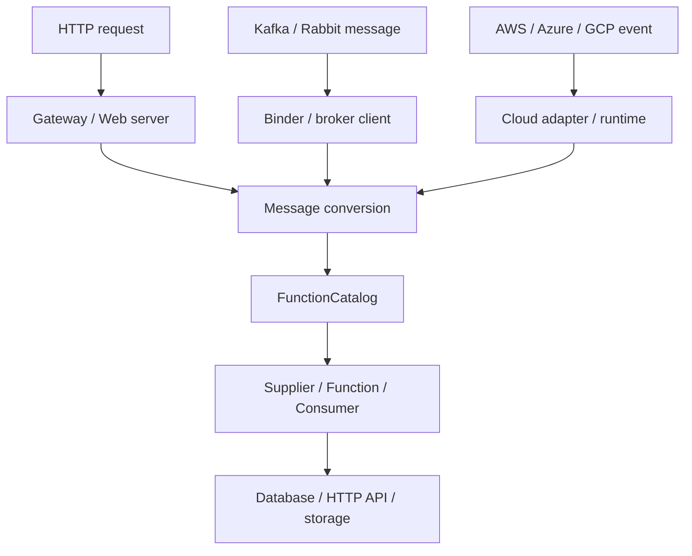
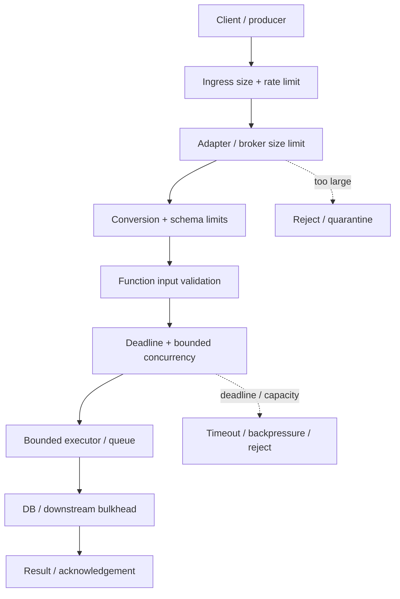

# Limiting Payload Size, Execution Time, and Concurrency

## 1. Why Does a Function Need an Explicit Resource Budget?

A Spring Cloud Function service receives order events, converts JSON into DTOs, calls a database, and publishes results to a broker. Under normal load, everything runs smoothly. Yet a client sending a payload hundreds of times larger than normal, a message containing millions of elements, a very slow downstream API, or a sudden traffic spike can exhaust the heap, hold threads too long, inflate consumer lag, and trigger cascading failures in other services.

Incidents usually stem from one of three causes:

- **Oversized data:** HTTP bodies, messages, batches, files, or decompressed payloads exceed processing capacity.
- **Excessive execution time:** functions block waiting on databases, HTTP clients, locks, CPU-heavy algorithms, or unbounded streams.
- **Excessive concurrency:** too many simultaneous invocations hold memory, threads, connection pools, CPU, or downstream capacity.

These three limits are directly coupled. A large message makes each invocation consume more heap; many concurrent invocations multiply total heap usage; when downstream slows down, invocations stay alive longer and effective concurrency climbs further.

This lesson belongs to the **Security** chapter of the **SPRING_CLOUD_FUNCTION** module. The module builds reusable business logic with `Supplier`, `Function`, and `Consumer`, using `FunctionCatalog`, composition, and message conversion to run the same function over HTTP, events, or serverless. Limits must therefore be designed end-to-end across adapters, converters, brokers, functions, runtimes, and downstream services.

After this lesson, you will be able to place data limits at the right layers, design end-to-end deadlines, calculate concurrency from real capacity, bound queues and connection pools, test overload scenarios, and monitor signs of resource exhaustion.

## 2. Spring Cloud Function Does Not Impose One Global Limit Across All Adapters

Spring Cloud Function standardizes `Supplier`, `Function`, and `Consumer` beans via `FunctionCatalog`. The catalog supports function signatures and mechanisms like conversion/composition, but does not automatically enforce a universal payload size, deadline, or concurrency limit across every environment.

The same function can be called through many paths:



Each layer can have its own limits:

| Layer | Limits to Inspect |
| --- | --- |
| API gateway / load balancer | Request body, headers, connections, timeouts, rate |
| HTTP server | Connections, threads, form/multipart, codec buffering |
| Cloud adapter / runtime | Invocation payload, timeout, memory, concurrency |
| Broker | Message/batch size, queue length, fetch, retention |
| Spring Cloud Stream binder | Consumer concurrency, batching, retries, backoff |
| Message converter | Memory used while aggregating/deserializing |
| Business function | Element count, nesting depth, CPU time, algorithmic complexity |
| Executor / connection pool | Threads, queues, DB/API connections |
| Downstream service | Quotas, rate limits, timeouts, connection limits |

A setting named `max-size` at one layer does not protect every entry path. For instance, multipart limits do not cap raw JSON bodies; `max.poll.records` caps records per poll rather than bytes per record; an HTTP timeout does not automatically halt background work that already started.

**Principle:** enforce limits where data or work enters, then re-verify where expensive resources are consumed. Never rely solely on a guard at the very end of the pipeline.

## 3. Identifying Resource Exhaustion and Abuse Patterns

| Scenario | Primary Impact | Example |
| --- | --- | --- |
| Oversized payload | Heap/direct memory, network, GC | A 50 MB JSON parsed into a massive object graph |
| Decompression bomb | CPU, disk, and memory after decompression | A tiny compressed file expands to many GB |
| Deep/nested JSON | CPU and parser/call stack | JSON nested thousands of levels deep |
| Huge collection | Object count and GC pressure | An array with millions of elements |
| Slow request | Connections/threads held open | A client trickles the request body very slowly |
| Slow downstream | Long-lived invocations, rising concurrency | Database query waiting on a lock |
| Infinite stream | Never-ending subscriptions and retained resources | A `Flux` with no termination condition |
| Unbounded queue | Memory grows with backlog | A thread pool accepts tasks faster than it drains them |
| Retry storm | Amplifies load while the system is already failing | Messages retry nonstop while the DB is unreachable |
| High fan-out | Amplifies outbound requests | One event invokes 30 downstream APIs |
| Oversized batch | Heap and per-poll processing time | A batch containing thousands of large records |
| Tenant monopolization | One customer consumes all capacity | One API key sends most of the traffic |

Not every case is a deliberate attack. Producer bugs, unbounded loops, misconfigured retries, or an anomalous batch can produce the exact same outage.

## 4. Calculate Memory and Concurrency Budgets Before Configuring

A simple formula helps catch unrealistic limits:

```text
M_peak ≈ M_base + C × M_request + M_queue + M_shared
```

Where:

- `M_base`: baseline heap, caches, Spring context, and static data.
- `C`: concurrent invocations inside one instance.
- `M_request`: working set of one invocation, including parsed payloads, DTOs, buffers, and temporary objects.
- `M_queue`: memory retaining queued tasks/messages.
- `M_shared`: connection pools, shared caches/buffers, and other overhead.

`M_request` is usually larger than the wire size of JSON. Parsers allocate many objects; strings, collections, maps, buffers, and defensive copies all consume memory. The amplification factor depends on payload structure, JVM, serializer, and code. Measure via heap profiling or load tests rather than guessing a universal multiplier.

### 4.1. Example: Calculating an Instance Limit

Suppose an instance has:

- Usable application heap: 1,024 MB.
- Baseline and caches: 420 MB.
- Headroom reserved for GC, buffers, and variance: 250 MB.
- Measured working set of a large request: 24 MB.

Remaining memory for concurrent requests:

```text
M_available = 1024 - 420 - 250 = 354 MB
C_memory = floor(354 / 24) = 14
```

This is not the final concurrency limit yet. CPU, database pools, HTTP API quotas, or latency SLOs may force an even lower ceiling. Never set concurrency right at the theoretical limit without headroom.

### 4.2. Using Little's Law to Estimate Active Invocations

Under steady-state load:

```text
L = λ × W
```

- `L`: average number of requests currently in the system.
- `λ`: arrival rate, in requests/second.
- `W`: average residence time in the system, in seconds.

If a service receives 40 requests/second and average processing time is 0.25 seconds:

```text
L = 40 × 0.25 = 10
```

On average, roughly 10 requests are in flight. If downstream slows down and processing time rises to 2 seconds, active requests at the same arrival rate jump to 80. Without concurrency caps, memory, threads, and connection pools can exhaust before autoscaling reacts.

This estimates steady state—not bursts or tail latency. Factor in p95/p99 latency, burst profiles, and headroom.

## 5. Layered Limits Diagram



These layers protect different resources. If a request is rejected by the gateway before entering the JVM, the app never deserializes it. If a message enters from a broker into a consumer, enforce size/batch limits at the broker and binder. If a function calls downstream services, place bulkheads and timeouts on those clients.

## 6. Limiting HTTP Requests: Distinguish Body, Headers, Form, and Multipart

Spring Boot exposes many embedded-server properties, but not all of them cap the full HTTP body.

| Property | Scope | What Not to Misunderstand |
| --- | --- | --- |
| `server.max-http-request-header-size` | Request headers | Does not limit the body |
| `server.tomcat.max-http-form-post-size` | Form content in POST | Not a general cap for JSON bodies |
| `server.tomcat.max-swallow-size` | Body bytes Tomcat swallows after a request is rejected/closed | Not a hard cap on all bodies |
| `spring.servlet.multipart.max-file-size` | Size of one multipart file | Does not limit JSON requests |
| `spring.servlet.multipart.max-request-size` | Total multipart request | Applies only to multipart |
| `spring.http.codecs.max-in-memory-size` | Bytes buffered when WebFlux aggregates an input stream | Not a hard cap for all streaming bodies |

### 6.1. Spring MVC / Servlet: Multipart Limits

Example configuration:

```yaml
spring:
  servlet:
    multipart:
      enabled: true
      max-file-size: 5MB
      max-request-size: 6MB
      file-size-threshold: 0B

server:
  tomcat:
    max-http-form-post-size: 2MB
    max-part-count: 10
    max-part-header-size: 1KB
```

This example targets endpoints receiving multipart uploads. Tomcat form/part properties apply strictly within the scope documented by the server. For endpoints receiving raw JSON or octet streams, enforce limits at the gateway/ingress and the body-reading layer.

### 6.2. WebFlux: Limiting Codec Aggregation and Multipart

```yaml
spring:
  http:
    codecs:
      max-in-memory-size: 1MB
  webflux:
    multipart:
      max-in-memory-size: 256KB
      max-parts: 10
      max-headers-size: 10KB
      max-disk-usage-per-part: 5MB
```

`spring.http.codecs.max-in-memory-size` applies to the auto-configured WebFlux server and `WebClient` when an input stream must be aggregated; if unconfigured, individual codecs have defaults, often 256 KB. For multipart, the per-part memory limit differs from per-part disk usage and total request limits.

**Do not raise `max-in-memory-size` blindly just to silence `DataBufferLimitException`.** Determine why the endpoint needs to aggregate huge payloads. If the payload is naturally a stream, process it streaming and bound total bytes with an explicit streaming limit.

### 6.3. Bodies May Arrive Without `Content-Length`

The `Content-Length` header helps reject oversized requests early, yet clients can send chunked bodies or streams with unknown length. Never rely on that header alone.

At the body-reading layer, count actual bytes read and abort once the threshold is exceeded. When compression is used, cap both wire size and decompressed size. Proxy header/body limits remain necessary so the app does not read invalid data in the first place.

### 6.4. Avoid Parsing Before Checking Size

If an application deserializes an entire JSON document into an object graph before counting elements, most of the cost has already been paid. Check byte length prior to parsing, configure structural parser limits where applicable, and validate element counts/depth during reading or validation.

For large files, consider direct uploads to object storage via pre-signed time-limited URLs; the function receives only the object key, metadata, and minimal access permissions. Avoid pushing hundred-megabyte files through an HTTP body buffered inside the JVM.

## 7. Limit Payload Structure, Not Just Byte Count

Even a small JSON document can consume substantial CPU or memory during parsing. Example:

```json
{
  "orders": [
    {"id": "1", "items": ["..."]},
    {"id": "2", "items": ["..."]}
  ]
}
```

Set domain-specific structural limits:

| Attribute | Example Limit | Reason |
| --- | --- | --- |
| Total bytes | 1 MB | Prevents oversized bodies |
| Array element count | 500 | Bounds loops and object counts |
| Nesting depth | 32 levels | Prevents deep parser/recursive logic |
| String length | 4,096 characters | Limits memory and abnormal processing |
| Field count | Per schema | Rejects payloads with excessive fields |
| Multipart file count | 10 | Limits file handles and disk usage |
| Decompressed size | Per use case | Prevents decompression bombs |
| Operations in a batch | 100 | Bounds fan-out |
| Downstream calls | Per workflow | Prevents amplification |

Numbers in the table are illustrative. Choose limits from your contract and measure against real workloads.

### 7.1. Validate Input Right at the Function Boundary

Example function receiving a DTO:

```java
public record BulkOrderRequest(
        List<OrderCommand> orders) {}

@Bean
Function<BulkOrderRequest, List<OrderResult>> processOrders(
        OrderService service) {

    return request -> {
        if (request == null || request.orders() == null) {
            throw new IllegalArgumentException("orders is required");
        }
        if (request.orders().isEmpty() || request.orders().size() > 100) {
            throw new IllegalArgumentException(
                    "orders must contain between 1 and 100 items");
        }

        return request.orders().stream()
                .map(service::process)
                .toList();
    };
}
```

This is business validation at the function boundary. It does not replace byte limits at ingress: the DTO exists only after the body has been read and converted. If each item contains large strings or nested lists, bound those fields too.

### 7.2. Control Algorithmic Complexity

A moderately sized payload can still cause CPU exhaustion if processing has high algorithmic complexity. For example, nested loops over 20,000 items can trigger hundreds of millions of comparisons.

- Prefer algorithms with predictable complexity.
- Bound item counts, nesting depth, and processing steps.
- Avoid regexes prone to catastrophic backtracking on untrusted inputs.
- Set timeouts on queries and search operations.
- Never let clients control unbounded query sizes or fan-out counts.

## 8. Message Size and Batch Size in Spring Cloud Stream

A function bound via Spring Cloud Stream receives messages through a binder. Limits can live at the producer, broker, topic, consumer fetch, batching, or conversion stages.

For Kafka, distinguish:

| Kafka Setting | Effect |
| --- | --- |
| `max.request.size` | Limits the request batch sent by a producer |
| `message.max.bytes` | Limits the record batch accepted by the broker |
| `max.message.bytes` | Topic-level override of the record batch limit |
| `max.partition.fetch.bytes` | Maximum bytes returned per partition in a fetch |
| `fetch.max.bytes` | Limits the total fetch response |
| `max.poll.records` | Maximum records returned in a single poll |
| `fetch.min.bytes` / `fetch.max.wait.ms` | Controls batching accumulation and fetch wait time |

Kafka's fetch byte limits have exceptions so consumers can still make progress if the first record batch exceeds the limit. Do not treat them as an absolute hard cap in every scenario. The broker and topic decide the largest accepted batch; producers and consumers must align with that size.

### 8.1. Configuring Kafka Consumers and Batches

Example:

```yaml
spring:
  cloud:
    function:
      definition: classifyOrder
    stream:
      bindings:
        classifyOrder-in-0:
          destination: orders.created
          group: order-classifiers
          consumer:
            concurrency: 2
            batch-mode: true
            maxAttempts: 1
    kafka:
      binder:
        consumerProperties:
          max.poll.records: 25
```

`max.poll.records` caps the number of records returned per poll; `batch-mode` instructs the binder to pass received records as a `List<?>` to the function. Record count is not byte count: 25 small records differ vastly from 25 huge records.

In the Kafka binder, standard binder-level retries are not supported the usual way when batch mode is enabled; `maxAttempts` is overridden to 1. Design a batch error handler, manual ack/nack, or per-record handling accordingly. When enabling a DLQ with batching, verify your exact binder version and how polled records route to the DLQ.

### 8.2. Configuring Kafka Producer Limits

Example Kafka producer property passed through the binder:

```yaml
spring:
  cloud:
    stream:
      kafka:
        bindings:
          classifyOrder-out-0:
            producer:
              configuration:
                max.request.size: 1048576
                compression.type: zstd
```

Property names and binding paths must match your active binder/version. Alongside the producer, align broker/topic and consumer fetch settings. Raising only one limit can allow producers to send messages that consumers cannot handle, or cause the broker to reject messages.

### 8.3. Batching Is a Resource Multiplier

If one poll returns `N` records and each record has an average working set `M`, memory for the batch approaches `N × M`, before counting buffers, lists, and outputs. A batch of 100 records each taking 2 MB of working set can require hundreds of megabytes at once.

Reducing batch size lowers peak memory and per-poll processing time, potentially trading off throughput. Measure memory, poll duration, consumer lag, and rebalance frequency together.
## 9. Limiting Time: One Request Involves Many Distinct Timeouts

An HTTP or event-driven flow typically traverses multiple timeouts:

1. Client connect timeout.
2. Gateway/load balancer idle or request timeout.
3. HTTP server request timeout.
4. Adapter/runtime invocation timeout.
5. Queue wait time.
6. Function execution deadline.
7. Database query timeout.
8. Downstream HTTP connect/read/response timeout.
9. Broker poll/ack/visibility timeout.
10. Shutdown/grace period when an instance scales in.

If every layer picks timeouts independently without alignment, a client can time out while the function keeps running; the gateway returns 504 while the database transaction still commits; or the broker redelivers before the old invocation stops.

### 9.1. Designing an End-to-End Deadline

Suppose a request has a 5-second budget:

| Stage | Illustrative Budget |
| --- | ---: |
| Queue wait and dispatch | 300 ms |
| Validation/conversion | 200 ms |
| Business logic | 1,000 ms |
| Database | 1,000 ms |
| Downstream API | 1,500 ms |
| Serialization/response margin | 500 ms |
| Total | 4,500 ms |

The remaining 500 ms is headroom. This is an example; real budgets must come from SLOs and latency distributions.

Each downstream call should receive a timeout shorter than the remaining budget. Never start a new operation once the deadline has expired. Across multi-step workflows, propagate deadlines or remaining budgets via trusted system-generated metadata; never let clients supply arbitrary deadlines to override server ceilings.

### 9.2. Timing Out Does Not Mean Work Stopped

When a client receives 504 or a function raises a timeout, code may still be executing:

- Blocking JDBC/HTTP calls may not respond to interrupts immediately.
- Future timeouts may complete the future with an exception while the background task continues running.
- Reactive cancellation signals upstream to cancel, yet already-committed side effects do not roll back automatically.
- Cloud runtimes closing connections do not necessarily kill the process/container right away.

You therefore need per-dependency timeouts and enforceable cancellation, paired with idempotency/compensation for side effects.

## 10. Timeouts in Imperative and Reactive Functions

### 10.1. Imperative Functions

A synchronous `Function<T,R>` typically runs on an adapter or message-listener thread. Set timeouts on every blocking operation:

- HTTP client connect timeout and response/read timeout.
- JDBC query timeout and transaction timeout.
- Lock acquisition timeout.
- Filesystem/network operation timeout.
- Overall deadline checks before starting the next step.

Never wrap every function in an unbounded executor and only time out at the caller. Tasks can keep running and occupying threads/connections long after the caller gave up.

### 10.2. Reactive Functions

Example:

```java
@Bean
Function<Mono<OrderCommand>, Mono<OrderResult>> processOrder(
        ReactiveOrderService service) {

    return input -> input
            .flatMap(service::process)
            .timeout(Duration.ofSeconds(2));
}
```

`timeout` emits an error if the publisher does not signal within the duration and cancels upstream per Reactive Streams semantics. However:

- Never run blocking JDBC or `Thread.sleep` on the event loop.
- If a blocking library is unavoidable, isolate it on a bounded executor/scheduler.
- Cancellation does not undo already-executed database writes or API calls.
- Retrying after a timeout can repeat side effects; idempotency is mandatory.
- For long-lived streams, an overall stream timeout differs from per-item timeouts or idle gaps between items.

### 10.3. Stream Timeout and Idle Timeout Are Two Different Concepts

A `Flux<T>` can live long as an event stream. Do not put a few-second total timeout on a stream meant to run continuously. Instead, control:

- Idle timeout: max time without an event.
- Per-item timeout: max time to process one event.
- Maximum stream lifetime: max duration a subscription may stay open.
- Cancellation/shutdown: how the stream shuts down when the instance stops.
- Buffering/backpressure: how many events are held when downstream is slow.

## 11. Retries Increase Processing Time and Load

Retries are not free. If each attempt takes `T`, with up to `A` attempts and total backoff `B`, total message hold time approaches:

```text
T_total ≈ A × T + B
```

If each attempt takes 2 seconds, with 3 attempts and 3 seconds total backoff, a message can tie up the consumer for over 9 seconds. When many messages retry concurrently during a database outage, a retry storm piles extra load onto an already weakened downstream.

- Distinguish transient errors from permanent errors.
- Cap both attempt count and total retry duration.
- Use exponential backoff with jitter where appropriate.
- Never retry validation errors or oversized payloads.
- Route poison messages to a DLQ or quarantine.
- Keep downstream timeouts smaller than the remaining deadline.
- Ensure ack/visibility/lease timeouts accommodate processing plus retry time.

In Kafka, batch polls must finish within the poll interval or the consumer can be considered stalled and trigger a rebalance. For other queues/event sources, align with the provider's visibility timeout, ack deadline, or lease.

## 12. Concurrency in Spring Cloud Stream

Spring Cloud Stream provides the consumer `concurrency` property per input binding. The 5.1 documentation notes a default value of 1, configured per binding name.

```yaml
spring:
  cloud:
    function:
      definition: classifyOrder
    stream:
      bindings:
        classifyOrder-in-0:
          destination: orders.created
          group: order-classifiers
          consumer:
            concurrency: 2
            maxAttempts: 2
```

This sets inbound consumer concurrency at the binder/container layer. It does not automatically bound HTTP requests or every function invocation inside the JVM.

### 12.1. Kafka Concurrency Also Depends on Partitions

If a Kafka topic has 4 partitions and a consumer group runs 8 consumer threads, at most 4 consumers can be assigned partitions at once; the remaining threads add no parallel reading capacity for that group.

Useful relation to check:

```text
consumer instances × consumer concurrency per instance
<= useful partition parallelism
```

This is a rule of thumb for one group. Partition count, assignment strategy, processing duration, and downstream capacity still govern actual throughput.

### 12.2. Concurrency Is Not Only Throughput

Increasing concurrency can also:

- Increase the number of message payloads held in heap.
- Increase concurrent database connection demand.
- Increase concurrent HTTP requests to downstream services.
- Increase CPU contention and GC activity.
- Expose race conditions if a function touches mutable shared state.
- Increase concurrent side effects and ordering complexity.

Never crank up concurrency solely to burn down lag if the database or downstream is already the bottleneck.

## 13. Limiting Concurrency with a Bulkhead Inside a Function

A semaphore can cap concurrent heavy operations inside a single JVM:

```java
@Bean
Semaphore orderServiceBulkhead() {
    return new Semaphore(8, true);
}

@Bean
Function<OrderCommand, OrderResult> processOrder(
        OrderService service,
        Semaphore orderServiceBulkhead) {

    return command -> {
        if (!orderServiceBulkhead.tryAcquire()) {
            throw new RejectedExecutionException(
                    "Order processing capacity is full");
        }

        try {
            return service.process(command);
        }
        finally {
            orderServiceBulkhead.release();
        }
    };
}
```

This semaphore caps concurrent entries into the protected section at 8 **within one instance**. If the application scales to 5 instances, cluster-wide concurrency can reach 40. To cap globally, pair with quotas at the provider, broker, API gateway, or a distributed rate/bulkhead mechanism.

How saturation is handled depends on the adapter:

- HTTP: return `429` or `503` per policy, optionally with `Retry-After`.
- Stream: exceptions may trigger retries; distinguish overload from business errors so you do not trigger a retry storm.
- Serverless: tune reserved concurrency / instance concurrency or event source mappings.

Never block indefinitely waiting on a semaphore if doing so simply converts overload into an unbounded queue inside the JVM.

## 14. Queues Must Be Bounded and Have Rejection Policies

A thread pool with a fixed thread count but an unbounded queue can still run out of heap. In Java, `Executors.newFixedThreadPool` uses an unbounded queue; avoid that default for workloads receiving untrusted data.

Example executor with a bounded queue:

```java
@Bean
ThreadPoolTaskExecutor enrichmentExecutor() {
    ThreadPoolTaskExecutor executor = new ThreadPoolTaskExecutor();
    executor.setCorePoolSize(8);
    executor.setMaxPoolSize(16);
    executor.setQueueCapacity(64);
    executor.setThreadNamePrefix("enrichment-");
    executor.setRejectedExecutionHandler(
            new ThreadPoolExecutor.AbortPolicy());
    executor.initialize();
    return executor;
}
```

When all 16 threads are busy and all 64 queue slots are full, the next task is rejected. Map rejections cleanly to an explicit response or retry policy.

- Small queues bound memory and queueing latency.
- Overly large queues make requests wait too long, risking deadline expiration before execution even begins.
- Queue capacity counted in tasks does not reflect task byte size; tasks holding large payloads spike heap rapidly.
- `CallerRunsPolicy` forces the calling thread to run the task, altering latency and backpressure behavior.
- Never spawn a brand-new thread per request.

Emit metrics for queue depth, queue age, rejected task count, and pre-execution wait time.

## 15. Protecting Databases and Downstream Services with Connection Budgets

Suppose each instance has a database pool capped at 12 connections and runs 6 replicas. Maximum connections can reach:

```text
6 × 12 = 72 connections
```

If the database permits only 60 connections for this service, the configuration already exceeds the budget before counting migrations, health checks, batch jobs, or other apps.

Budget formula:

```text
max application connections
= replica count × pool size per instance
```

Leave headroom for operations and other workloads. Also cap how many function invocations can hold connections simultaneously. Never let 100 concurrent requests pile up on an 8-connection pool if each request holds large heap objects and long timeouts.

Recommended limits:

- Maximum DB pool size.
- Connection acquisition timeout.
- Query/statement timeout.
- Transaction timeout.
- HTTP client connection pool maximum.
- Per-host/per-service request concurrency.
- Circuit breakers or bulkheads for critical downstream dependencies.
- Per-tenant/per-client rate limits when one customer could starve others.

If downstream returns `429`/`503`, do not immediately retry all traffic. Honor `Retry-After` where appropriate and apply backoff/jitter.

## 16. Rate Limits, Concurrency Limits, and Queue Limits Differ

| Mechanism | What Does It Cap? | Example |
| --- | --- | --- |
| Rate limit | Requests per unit of time | 100 requests/second |
| Concurrency limit | Tasks executing simultaneously | Max 12 invocations |
| Queue limit | Tasks waiting to run | Max 64 queued tasks |
| Payload limit | Data per request/message | Max 1 MB |
| Deadline | Max lifetime of one unit of work | Max 2 seconds |
| Per-tenant quota | Resources one customer may consume | 20 concurrent requests/tenant |

A rate limit does not replace a concurrency limit. At just 10 requests/second, if each request takes 30 seconds, 300 requests can be active concurrently. Conversely, low concurrency with ultra-fast requests can still drive high request rates.

Combine these controls at ingress and function boundaries, especially for endpoints callable from the Internet or across multiple tenants.

## 17. Reactive Backpressure Does Not Replace Payload Limits

Reactor and Reactive Streams let consumers regulate how many elements they request from publishers. Backpressure keeps downstream from being pushed items faster than it can consume, yet it does not automatically cap:

- Byte size of an individual element.
- Number of elements buffered by operators.
- Data already aggregated in memory.
- Number of active subscriptions.
- A publisher that ignores backpressure.
- Concurrent inbound requests at ingress.

Example:

```java
@Bean
Function<Flux<OrderCreated>, Flux<OrderResult>> classifyOrders(
        OrderService service) {

    return orders ->
            orders
                    .limitRate(32)
                    .map(service::classify);
}
```

`limitRate` shapes upstream demand in batches. It does not cap the bytes of one `OrderCreated`, does not limit total HTTP requests, and does not guarantee downstream services have spare capacity.

### 17.1. Avoid Aggregating an Entire Stream

Operators such as `collectList`, unbounded `buffer`, or `cache` can pull an entire large stream into heap. If batching is required, set an explicit batch size:

```java
orders.buffer(50)
      .concatMap(batch -> service.classifyBatch(batch));
```

Size a 50-element batch according to item size and processing time. If downstream cannot handle parallel load, `concatMap` can be safer than a wide concurrent merge; if parallelism is needed, bound concurrency and prefetch explicitly.

### 17.2. Reactive Suppliers Can Be Long-Lived

A `Supplier<Flux<T>>` may be invoked to produce a long-running stream. Bound subscriber counts, subscription lifetimes, buffers between source and consumer, emission rates, cancellation on app shutdown, and resources captured in closures/operator state.

`@PollableBean` marks finite reactive suppliers requiring polling in frameworks that support it; the annotation does not itself set memory limits, deadlines, or polling behavior inside standalone Spring Cloud Function.

## 18. Time and Concurrency Limits in Cloud Runtimes

Spring Cloud Function does not remove underlying platform quotas. The numbers below are illustrative figures published by providers at the time of writing; actual quotas depend on region, plan, account, and invocation type.

| Platform | Reference Limits | Design Implication |
| --- | --- | --- |
| AWS Lambda | Typical max function timeout 900 seconds; synchronous payload 6 MB per request/response, asynchronous 1 MB; default regional concurrency 1,000 (increasable) | Size payloads, timeouts, and reserved concurrency to match downstream |
| Azure Functions | HTTP responses limited to 230 seconds by Azure Load Balancer; concurrency and timeout depend on hosting plan/trigger | Long HTTP tasks should use async patterns and status polling |
| Google Cloud Run | Max concurrency 1,000 requests/instance; default timeout 5 minutes, configurable up to 60 minutes | Tune concurrency for CPU, memory, and thread safety |

Never copy these numbers into Spring config as if they were framework defaults. Verify the quota/plan docs for your exact production environment.

### 18.1. AWS Lambda: Reserved Concurrency and Memory

AWS Lambda lets you set reserved concurrency to cap and dedicate execution environments for a function, which helps protect downstream databases or APIs. Provisioned concurrency pre-initializes environments to cut cold starts; it does not replace reserved concurrency as a capacity ceiling.

```yaml
Resources:
  ClassifyOrder:
    Type: AWS::Serverless::Function
    Properties:
      Handler: org.springframework.cloud.function.adapter.aws.FunctionInvoker
      Runtime: java21
      MemorySize: 1024
      Timeout: 20
      ReservedConcurrentExecutions: 40
      CodeUri: target/orders-function-aws.jar
```

This is an illustrative AWS SAM snippet. `ReservedConcurrentExecutions` caps concurrent invocations of the function. Once hit, Lambda throttles invocations; event sources may retry or build backlog per trigger semantics. Review retries, DLQs, and event source mappings together.

### 18.2. Azure Functions: Concurrency Depends on Trigger and Hosting Plan

Azure Functions supports fixed per-instance concurrency and dynamic concurrency for certain triggers. On Flex Consumption, HTTP triggers default concurrency based on instance memory: current docs list 4 for 512 MB, 16 for 2,048 MB, and 32 for 4,096 MB. Those defaults apply only to that plan and can be reconfigured.

Never apply one trigger's `host.json` settings blindly to every trigger. For instance, Service Bus uses `maxConcurrentCalls`, whereas Event Hubs, Kafka, and Cosmos DB have distinct scaling/concurrency controls. When limiting concurrency to protect a database, also account for how many instances the platform can scale out to.

### 18.3. Google Cloud Run: Concurrency Per Instance

Cloud Run lets you configure maximum concurrent requests per instance up to 1,000. Defaults may be 80 via console or 80 times vCPU count when creating a new service via CLI/Terraform. The setting is a maximum, not a guarantee that every request runs in parallel at that ceiling.

Raising concurrency makes more requests on the same instance share memory, CPU, connection pools, and state. Code must be thread-safe. For CPU-bound functions or requests near memory limits, lower concurrency is often steadier while the platform scales out more instances within quota.
## 19. Sample Configuration Combining Protective Layers

Example for an app receiving small JSON payloads over WebFlux and Kafka:

```yaml
spring:
  cloud:
    function:
      definition: classifyOrder
    stream:
      bindings:
        classifyOrder-in-0:
          destination: orders.created
          group: order-classifiers
          consumer:
            concurrency: 2
            maxAttempts: 2
    http:
      codecs:
        max-in-memory-size: 1MB
    webflux:
      multipart:
        max-parts: 10
        max-in-memory-size: 256KB
        max-disk-usage-per-part: 5MB

  datasource:
    hikari:
      maximum-pool-size: 12
      connection-timeout: 1000

server:
  tomcat:
    max-connections: 200
    threads:
      max: 100
      max-queue-capacity: 100
```

This is a composite illustration. If your app runs pure WebFlux, Tomcat settings do not apply; if running MVC/Servlet, configure servlet multipart and body limits appropriately. Hikari settings take effect only when Hikari and that datasource are active. Configure Kafka producer/consumer sizes and fetch settings separately per binder/broker.

**Never copy an entire YAML block without checking your runtime.** Each property has a narrow scope; verify metadata/versions and test in reality.

## 20. Resource Observability: Measure Root Causes, Not Just CPU

A system can overload well before CPU reaches 100%—for example when requests wait on a database, the heap holds oversized payloads, queues grow, or connection pools empty.

| Metric | Signal to Watch |
| --- | --- |
| Request/message size histogram | Anomalous payloads, shifting size distributions |
| Rejected / `413` count | Ingress or function limits firing |
| Function duration p50/p95/p99 | Rising execution times |
| Active invocations | Actual live concurrency |
| Queue depth and queue age | Growing work backlog |
| Heap / direct memory | Memory and buffer pressure |
| GC pause / frequency | Excessive object allocations |
| Thread pool active / queued / rejected | Thread pool saturation |
| DB pool active / pending / timeout | Connection starvation |
| Downstream latency / `429` / `503` | Dependent API throttling |
| Kafka consumer lag | Consumers falling behind producers |
| Retry / DLQ count | Recurring failures or poison messages |
| Timeout / cancel count | Deadlines regularly exceeded |
| Instance count / cold starts | Autoscaling and startup overhead |

Never log entire payloads just to inspect sizes. Log byte counts, content types, event types, correlation IDs, and bucketed sizes; keep PII/secrets out of logs.

## 21. Testing Limits and Overload Scenarios

Tests should cover values just below, right at, and above each threshold.

| Test | How to Execute | Expected Outcome |
| --- | --- | --- |
| Body just under limit | Send payload near max | Processed normally |
| Body over limit | Add one extra byte/record | Rejected early without full parse |
| Missing `Content-Length` | Send chunked body | Byte counter still blocks |
| Gzip / decompression bomb | Small compressed payload expanding huge | Aborts once decompressed limit exceeded |
| Deeply nested JSON | Exceed depth threshold | Cleanly rejected |
| Oversized array | Send huge batch | Validation/batch limit rejects |
| Slow client | Trickle body very slowly | Connection/read timeout or ingress policy fires |
| Slow downstream | Delay DB/API responses | Deadlines and bulkheads protect the app |
| Concurrency saturation | Send large traffic burst | Bounded queue, clear reject/throttle |
| Full queue | Submit excess tasks | Rejection policy triggers |
| Retry storm | Induce temporary downstream failures | Backoff, max attempts, and DLQ work |
| Reactive cancellation | Cancel subscriber | Upstream cleans up properly |
| Provider timeout | Invocation exceeds timeout | Retries do not duplicate side effects |
| Multi-instance load | Scale up replicas | Total DB/API connections stay within quota |

### 21.1. Load Testing vs. Stress Testing

- **Load test:** run at expected traffic and verify SLOs.
- **Stress test:** push past design capacity to locate saturation points.
- **Spike test:** inject sudden surges to evaluate queues and autoscaling.
- **Soak test:** sustain load over hours to surface leaks, pool depletion, and queue creep.
- **Abuse test:** send huge payloads, malformed structures, slow trickles, or abnormal request rates.

Do not measure peak throughput alone. Record p99 latency, peak memory, GC behavior, rejection counts, queue age, consumer lag, and downstream saturation.

## 22. Process for Sizing Limits on a New Function

1. Identify invocation sources: HTTP, Stream, Lambda, Azure trigger, or Cloud Run.
2. Record typical, p95/p99, and valid maximum payload sizes.
3. Set byte limits, item-count limits, nesting limits, and schema validation.
4. Measure the memory working set of a single invocation.
5. Determine CPU/I/O time and the business deadline.
6. Measure capacity of databases, APIs, and storage.
7. Calculate maximum concurrency from memory, CPU, and downstream pools.
8. Configure bounded queue capacity and rejection/backpressure policies.
9. Verify provider quotas and binder/partition/batch settings.
10. Write tests just below and above every threshold.
11. Run load, stress, and spike tests.
12. Observe canary deployments and tune to SLOs.

Document limits in contracts, configuration, and runbooks. Never leave critical numbers buried only inside code.

## 23. Common Configuration Mistakes

| Symptom | Likely Cause | Remedy |
| --- | --- | --- |
| Raised `max-in-memory-size` yet still OOM | Total payload × concurrency exceeds heap | Cap bodies, streaming, and concurrency |
| `max-http-form-post-size` fails to block JSON | Property applies only to form content | Cap raw bodies at ingress/reader |
| `max.poll.records` set low yet single message is huge | Limits record count, not bytes | Align broker/topic/producer limits and payload validation |
| Raising Stream `concurrency` causes DB timeouts | Total requests exceed pool/downstream capacity | Lower concurrency or scale downstream carefully |
| Added timeout yet tasks keep running | Caller timeout does not stop blocking work | Set dependency timeouts, cancellation, and idempotency |
| Retries cause load spikes | Unbounded attempts/backoff or retrying permanent errors | Classify exceptions, bound retries, use DLQs |
| Thread pool has max threads yet heap climbs | Unbounded queue | Use bounded queues and rejection policies |
| Cloud Run CPU low while latency is high | Waiting on downstream or connection pools | Monitor pool wait times and lower concurrency |
| Kafka consumer rebalances continuously | Batch takes longer than poll interval | Shrink batch/processing time or adjust poll settings |
| Lambda throttles | Reserved concurrency or account quota reached | Align quotas/concurrency with downstream |
| Azure HTTP returns `502` after long delay | Load balancer 230-second timeout | Switch to async pattern + status endpoint |
| Reactive stream holds growing memory | Unbounded aggregation/cache/buffering | Bound prefetch/batches and avoid collecting entire streams |
| One tenant starves the service | Missing fairness/quotas | Enforce per-tenant rate/concurrency limits |
| Queue grows endlessly | Arrival rate exceeds service rate | Apply backpressure, scale out, or shed load early |

## 24. Pre-Production Resource Protection Checklist

### Data
- [ ] Byte limits enforced at ingress/gateway.
- [ ] Actual body size capped even when `Content-Length` is absent.
- [ ] Decompressed payload size capped.
- [ ] Array counts, nesting depth, string lengths, multipart, and batches bounded.
- [ ] Response sizes bounded if functions return large payloads.
- [ ] Large streams processed incrementally rather than aggregated in memory.

### Time
- [ ] End-to-end deadline defined for requests/workflows.
- [ ] Every HTTP client and DB query has explicit timeouts.
- [ ] Server, provider, and broker timeouts aligned.
- [ ] Retries have max attempts, backoff, and error classification.
- [ ] Cancellation and post-timeout side effects tested.
- [ ] Message visibility/ack/poll intervals accommodate processing time.

### Concurrency
- [ ] Consumer concurrency configured per binding.
- [ ] Kafka partitions and consumer groups accounted for.
- [ ] Thread pools use bounded queues.
- [ ] Bulkheads protect critical downstream services.
- [ ] DB/HTTP connection pools stay within system-wide quotas.
- [ ] Rate limits/fairness enforced for multi-tenant workloads.
- [ ] Autoscaling defines sensible max instance/concurrency caps.

### Operations
- [ ] Metrics track payload sizes, durations, active invocations, and queue age.
- [ ] Metrics track heap/direct memory, GC, threads, and connection pools.
- [ ] Alerts configured for consumer lag, retries, DLQs, and timeouts.
- [ ] Tests cover oversized, slow, burst, stress, and soak scenarios.
- [ ] Runbooks exist for overload handling and backlog recovery.
- [ ] Payloads/secrets/PII are never logged merely to measure size.

## 25. Hands-On Exercises

### Exercise 1: Calculate Concurrency from Memory

An instance has 2 GB memory; baseline and caches use 700 MB, and 300 MB must remain as headroom. A heavy invocation uses a 40 MB working set. Calculate the memory-based concurrency limit and list factors that could force the real limit lower.

### Exercise 2: Calculate Active Invocations

A service receives 60 requests/second on average. Average processing time rises from 200 ms to 1.5 seconds during DB slowdowns. Use Little's Law to estimate active invocations in both cases. Why is a concurrency cap necessary?

### Exercise 3: Distinguish HTTP Properties

An application sets `server.tomcat.max-http-form-post-size=2MB`, yet a 10 MB JSON request still succeeds. Explain the property's scope and propose proper body-limiting layers.

### Exercise 4: Kafka Records and Batches

A consumer enables batch mode with `max.poll.records=100`. Each record averages a 500 KB payload. Estimate the raw payload size of one batch, then explain why actual heap usage can be higher. List additional Kafka limits to verify.

### Exercise 5: Timeouts and Side Effects

A function calls a payment API taking 4 seconds. The client times out at 2 seconds and retries. The first call still captures payment after the client disconnects. Design deadlines, idempotency keys, and a response contract preventing double charges.

### Exercise 6: Bounded Executor

A service uses a 20-thread pool with an unbounded queue. When downstream slows down, heap grows. Design core/max threads, queue capacity, and rejection policies; explain how to surface overload to HTTP and Stream callers.

### Exercise 7: Per-Instance Semaphore

A function uses an 8-slot semaphore and scales out to 10 instances. How many invocations can enter the protected region simultaneously? If the database supports only 40 concurrent operations, what additional limit is needed?

### Exercise 8: Reactive Backpressure

A `Function<Flux<Order>,Flux<Result>>` calls `collectList` before invoking the next function. The topic can emit millions of orders. Replace the design with bounded batching, configure concurrency, and describe memory/backpressure tests.

### Exercise 9: Compare Provider Limits

A function deploys on AWS Lambda, Azure Functions, and Cloud Run. List payload, timeout, and concurrency quotas to verify separately on each platform. Why not rely on a single Spring Cloud Function setting?

### Exercise 10: Overload Testing

Design tests for oversized payloads, slow clients, downstream timeouts, full queues, and retry storms. Which metrics, responses, or error paths must each test verify to pass?

### Self-Check Questions

1. Does Spring Cloud Function have one global property limiting payloads across all adapters?
2. Is wire payload size equal to heap working set?
3. Why is `Content-Length` insufficient for limiting request bodies?
4. How does `max-http-form-post-size` differ from `spring.servlet.multipart.max-request-size`?
5. When does `spring.http.codecs.max-in-memory-size` apply?
6. Does `max.poll.records` limit record count or byte size?
7. Why does batch size affect both memory usage and poll duration?
8. How does an end-to-end deadline differ from a single HTTP client timeout?
9. Does timing out at the caller guarantee background work stops?
10. Does reactive cancellation roll back already-committed side effects?
11. What is the default Stream consumer concurrency in current documentation?
12. Why do Kafka partitions cap parallelism within a single consumer group?
13. What does Little's Law help estimate?
14. Why can a thread pool with an unbounded queue still OOM?
15. Does an in-JVM semaphore cap total cluster-wide concurrency?
16. When are per-tenant rate limits necessary?
17. Does backpressure automatically limit a single message's byte size?
18. How do Lambda's reserved concurrency and provisioned concurrency differ?
19. Why do Azure HTTP triggers need async patterns for long-running work?
20. Which metrics warn that a system is approaching resource exhaustion?

## 26. Summary

Limiting payload size, processing time, and concurrency is part of secure design for every function:

- **Data size:** bound ingress bytes, payload structure, decompressed sizes, messages/batches, and outputs.
- **Processing time:** enforce end-to-end deadlines, per-dependency timeouts, retry/backoff budgets, and cancellation rules.
- **Concurrency:** derive from memory, CPU, partitions, thread pools, queues, DB pools, and downstream quotas.
- **Reactive:** pair backpressure and bounded buffers with per-element byte caps and subscription limits.
- **Cloud runtimes:** verify quotas by provider, plan, region, and trigger type; never treat them as Spring Cloud Function defaults.
- **Observability and testing:** measure payload sizes, durations, active invocations, queue age, heap, GC, connection pools, retries, and DLQs; test both normal and overload conditions.

The right workflow is **measure workload → establish budget → set limits at each boundary → configure concurrency/timeouts → test extreme payloads and load → observe canary → tune to SLOs**.

Spring Cloud Function lets the same business logic run across HTTP, events, and serverless. Each environment still differs in ingestion, timeouts, retries, and scaling. A secure function explicitly knows **how much data it may accept, how long it may run, and how many invocations may run simultaneously**.

### References

- [Spring Cloud Function 5.1.0 — Programming Model and FunctionCatalog](https://docs.spring.io/spring-cloud-function/reference/spring-cloud-function/programming-model.html)
- [Spring Cloud Stream 5.1.0 — Binding Properties, Consumer Concurrency and Retry](https://docs.spring.io/spring-cloud-stream/reference/spring-cloud-stream/binding-properties.html)
- [Spring Cloud Stream — Kafka Binder Configuration Options](https://docs.spring.io/spring-cloud-stream/reference/kafka/kafka-binder/config-options.html)
- [Spring Cloud Stream — Consuming Kafka Batches](https://docs.spring.io/spring-cloud-stream/reference/5.1/kafka/kafka-binder/consume-batches.html)
- [Spring Boot 4.2.0 — Common Application Properties](https://docs.spring.io/spring-boot/appendix/application-properties/)
- [Spring Framework — WebFlux HTTP Message Codecs](https://docs.spring.io/spring-framework/reference/web/webflux/config.html)
- [Apache Kafka 4.1 — Consumer Configuration](https://kafka.apache.org/41/configuration/consumer-configs/)
- [Apache Kafka 4.1 — Broker Configuration](https://kafka.apache.org/41/configuration/broker-configs/)
- [AWS Lambda — Quotas and Limits](https://docs.aws.amazon.com/lambda/latest/dg/gettingstarted-limits.html)
- [AWS Lambda — Reserved Concurrency](https://docs.aws.amazon.com/lambda/latest/dg/configuration-concurrency.html)
- [Azure Functions — Concurrency](https://learn.microsoft.com/en-us/azure/azure-functions/functions-concurrency)
- [Azure Functions — Scale and Hosting](https://learn.microsoft.com/en-us/azure/azure-functions/functions-scale)
- [Azure Functions — HTTP Trigger Limits](https://learn.microsoft.com/en-us/azure/azure-functions/functions-bindings-http-webhook-trigger)
- [Google Cloud Run — Maximum Concurrent Requests](https://docs.cloud.google.com/run/docs/about-concurrency)
- [Google Cloud Run — Request Timeout](https://docs.cloud.google.com/run/docs/configuring/request-timeout)
