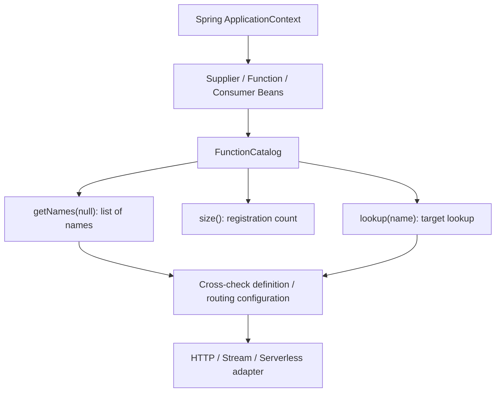
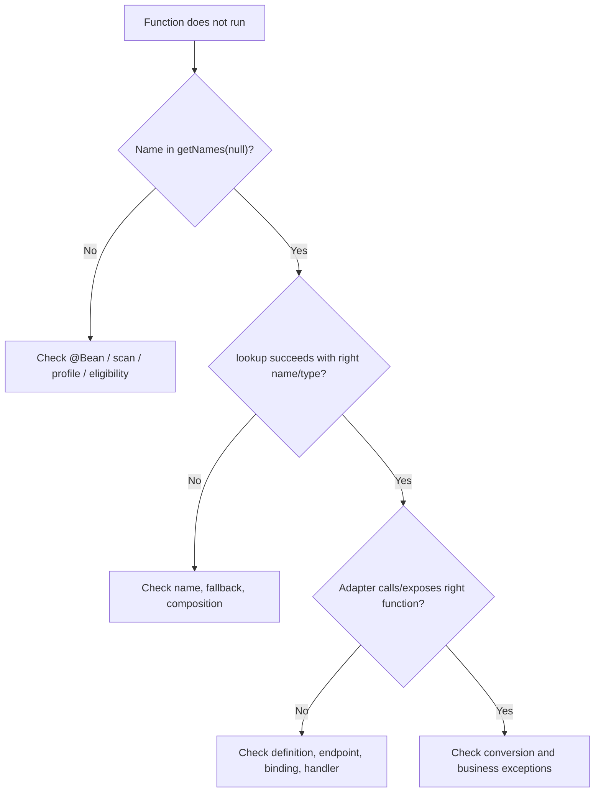

# Listing Functions with `FunctionCatalog` for Configuration Diagnostics

## Learning Objectives

After this lesson, you will be able to:

1. Explain how `FunctionCatalog` manages `Supplier`, `Function`, and `Consumer` functions in a Spring Cloud Function application.
2. Use `FunctionCatalog.getNames(null)` and `FunctionCatalog.size()` to inspect the function catalog inside an `ApplicationContext`.
3. Use `lookup(...)` to verify that a target function can be found and invoked, rather than relying solely on bean names or function counts.
4. Enable and read the Actuator `/actuator/functions` endpoint when you need to observe the catalog from outside the application.
5. Distinguish among three separate concerns: **the bean is created**, **the function is in the catalog**, and **the function is used or exposed by an HTTP/Stream/serverless adapter**.
6. Diagnose issues caused by bean names, component scanning, profiles, `spring.cloud.function.definition`, composition, `ineligible-definitions`, and adapter configuration.
7. Build safe startup checks and tests that avoid exposing internal function names or triggering side effects during diagnostics.

## 1. Why Observe `FunctionCatalog`?

**Spring Cloud Function** lets you build reusable business logic using familiar Java functional interfaces:

- `Supplier<T>`: produces data when invoked.
- `Function<T, R>`: accepts input and returns a result.
- `Consumer<T>`: accepts data and performs side effects without returning a business result.

The framework collects eligible functional beans into `FunctionCatalog`. When looked up through the catalog, they can be adapted to support type conversion, composition, and integration with HTTP, event streams, or serverless runtimes.

A common operational issue looks like this:

> The Spring Boot application started successfully, yet the adapter reports that it cannot find the `normalizeOrder` function, or `functionRouter` fails to route to `uppercase`.

Instead of immediately changing URLs, broker bindings, or business code, you first need to know **which names the catalog actually contains** at runtime.



Listing functions is a **configuration diagnostics tool**: it helps distinguish between a function that does not exist, a function that exists under a different name, and a function that is in the catalog but has not been selected or exposed by the adapter.

## 2. Three Layers to Distinguish Before Diagnosing

| Layer | Question | Example |
| --- | --- | --- |
| **Spring bean** | Has `ApplicationContext` created the business bean? | There is a bean named `uppercase` of type `Function<String, String>` |
| **FunctionCatalog** | Does the catalog know the name/definition for lookup? | `getNames(null)` contains `uppercase`; `lookup("uppercase")` resolves it |
| **Adapter** | Which definition is HTTP, Stream, or serverless calling/exposing? | `spring.cloud.function.definition=uppercase` or `functionRouter` |

These layers are related, but they are **not identical**.

A Spring bean may exist without being registered as a function due to filtering configuration. A function in the catalog might not be exposed over HTTP. And an HTTP endpoint returning 404 is not enough evidence to conclude that `FunctionCatalog` is missing the function.

In particular, the `spring.cloud.function.definition` property typically **selects the function for an adapter to use**, rather than acting as a command to remove all other functions from the catalog. If you change this property value and `getNames(null)` still lists multiple names, that can be completely normal.

## 3. Essential `FunctionCatalog` APIs

Spring Cloud Function supports programmatic inspection in Java:

```java
import java.util.Set;
import org.springframework.cloud.function.context.FunctionCatalog;

FunctionCatalog catalog = applicationContext.getBean(FunctionCatalog.class);

int registered = catalog.size();
Set<String> names = catalog.getNames(null);
```

| API | What is it used for? | What to understand correctly |
| --- | --- | --- |
| `catalog.getNames(null)` | Lists the names of functions, suppliers, and consumers recognized by the catalog | It is a set of names; display order is **not guaranteed** |
| `catalog.size()` | Returns the registration count of the catalog | Does not necessarily equal `getNames(null).size()` across all designs/versions |
| `catalog.lookup("uppercase")` | Looks up a definition by name | The result may be wrapped/adapted by the framework; fallback must be checked |
| `catalog.lookup(Function.class, "uppercase")` | Looks up expecting the `Function` type | Useful when you want to confirm the exact functional interface type |
| `catalog.lookup("uppercase|reverse")` | Requests a composition lookup | Compositions can be created on demand; they do not necessarily appear as standalone bean names in the initial list |

The official documentation directly illustrates `size()` and `getNames(null)` in the *Function visualization and control* section. The `null` argument means retrieving names across `Function`, `Supplier`, and `Consumer` types, rather than requesting one specific type.

### Why Can `size()` Differ from the Number of Names?

A single function registration can have multiple names/aliases, an application may include framework-provided functions (such as `functionRouter`), and some registries implement discovery/lazy registration mechanisms. Therefore:

```text
catalog.size()            = registration count as counted by the registry
catalog.getNames(null)     = set of names listed by the registry
```

You should not write a naive operational alert such as `size() != getNames(null).size()` and conclude that the catalog is broken. Instead, check **the names that are actually expected**, their lookup behavior, and the corresponding adapter configuration.

## 4. Sample Application with Three Functional Bean Types

Build a Spring Boot application with one `Supplier`, one `Function`, and one `Consumer`. At a minimum, use a managed Spring Cloud Function context/starter compatible with your project's Spring Boot version. For the HTTP examples in later sections, you can add `spring-cloud-starter-function-web`.

```xml
<dependency>
    <groupId>org.springframework.cloud</groupId>
    <artifactId>spring-cloud-starter-function-web</artifactId>
</dependency>
```

Java code:

```java
package com.example.catalogobservability;

import java.util.Locale;
import java.util.function.Consumer;
import java.util.function.Function;
import java.util.function.Supplier;

import org.slf4j.Logger;
import org.slf4j.LoggerFactory;
import org.springframework.boot.SpringApplication;
import org.springframework.boot.autoconfigure.SpringBootApplication;
import org.springframework.context.annotation.Bean;

@SpringBootApplication
public class CatalogObservabilityApplication {

    private static final Logger log =
            LoggerFactory.getLogger(CatalogObservabilityApplication.class);

    public static void main(String[] args) {
        SpringApplication.run(CatalogObservabilityApplication.class, args);
    }

    @Bean
    public Supplier<String> greeting() {
        return () -> "hello";
    }

    @Bean
    public Function<String, String> uppercase() {
        return value -> value.toUpperCase(Locale.ROOT);
    }

    @Bean
    public Consumer<String> textSink() {
        return text -> log.info("textSink received text of {} characters",
                text.length());
    }
}
```

The beans are defined using `@Bean` method names:

| Bean name | Java interface | Purpose |
| --- | --- | --- |
| `greeting` | `Supplier<String>` | Data source |
| `uppercase` | `Function<String, String>` | Data transformation |
| `textSink` | `Consumer<String>` | Side effect, returns no result |

Depending on which Spring Cloud Function components are enabled, `getNames(null)` may also include `functionRouter` or other framework-supplied functions. Do not hardcode assertions assuming the catalog **only has three names**.

## 5. Listing the Catalog at Application Startup

A straightforward way to inspect the catalog is to use an `ApplicationRunner` under a diagnostics profile:

```java
package com.example.catalogobservability;

import java.util.ArrayList;
import java.util.Collections;
import java.util.List;

import org.slf4j.Logger;
import org.slf4j.LoggerFactory;
import org.springframework.boot.ApplicationRunner;
import org.springframework.cloud.function.context.FunctionCatalog;
import org.springframework.context.annotation.Bean;
import org.springframework.context.annotation.Configuration;
import org.springframework.context.annotation.Profile;

@Configuration
public class CatalogDiagnosticsConfiguration {

    private static final Logger log =
            LoggerFactory.getLogger(CatalogDiagnosticsConfiguration.class);

    @Bean
    @Profile("catalog-diagnostics")
    public ApplicationRunner logAvailableFunctions(FunctionCatalog catalog) {
        return args -> {
            List<String> names = new ArrayList<>(catalog.getNames(null));
            Collections.sort(names);

            log.info("FunctionCatalog.size() = {}", catalog.size());
            log.info("FunctionCatalog names = {}", names);
        };
    }
}
```

Run with the `catalog-diagnostics` profile to enable the log output:

```bash
# Example of passing a profile when running Spring Boot
java -jar app.jar --spring.profiles.active=catalog-diagnostics
```

Illustrative log output (not a fixed output across all versions):

```text
FunctionCatalog.size() = 4
FunctionCatalog names = [functionRouter, greeting, textSink, uppercase]
```

Actual counts and names may vary by configuration, adapter, and version. `Collections.sort(...)` simply makes the log easier to compare across runs; the `Set` returned by `getNames(null)` does not guarantee order.

**Why enable this only via a profile?** Function names can reveal a service's internal capabilities. In production environments, restrict log levels, log access permissions, and the amount of information emitted. Log only **names approved for diagnostics**, and never log full payloads, bearer tokens, or sensitive data.

### Do Not Invoke Every Function Just to "List" Them

`getNames(null)` and `size()` are meant for inspecting metadata. Never write a `lookup(name).apply(...)` loop to test every function in production:

- A `Consumer` might write to a database, send messages, or call external services.
- A `Supplier` might trigger data-fetching jobs.
- A `Function` might have side effects despite having a transformation signature.
- Different functions require different input shapes and content types.

**Listing names is not the same as executing functions.** Use dedicated tests, controlled inputs, and an appropriate environment when verifying behavior.

## 6. Using `lookup(...)` to Confirm Function Availability

`getNames(null)` answers "which names does the catalog see?" However, a complete diagnostic check also needs to verify that **the expected definition can actually be looked up**.

```java
import java.util.function.Function;
import org.springframework.cloud.function.context.FunctionCatalog;

// catalog has been injected via constructor or field.
Function<String, String> uppercase =
        catalog.lookup(Function.class, "uppercase");

if (uppercase == null) {
    throw new IllegalStateException(
            "Function uppercase is not in FunctionCatalog");
}

String result = uppercase.apply("hello"); // HELLO
```

In the sample application, `uppercase` is a `Function<String, String>` bean, so its name and type are well-defined. In a safe test example, you can invoke it with a known input `"hello"`; in a real system, never probe automatically with production data.

### Catalog Lookup vs. Direct Bean Retrieval

```java
// Path A: Raw Spring bean
Function<?, ?> bean = applicationContext.getBean(
        "uppercase", Function.class);

// Path B: FunctionCatalog
Function<?, ?> catalogFunction =
        catalog.lookup(Function.class, "uppercase");
```

Path A retrieves the raw Java bean. Path B performs a Spring Cloud Function lookup, which may return a **wrapper** providing type conversion, composition, and adaptation for integration environments. The two objects do not necessarily share object identity or identical behavior at the message conversion layer.

If `applicationContext.containsBean("uppercase")` is `true` but `catalog.lookup(...)` returns nothing, check eligibility, registered names, functional bean types, context configuration, and any related filtering mechanisms.

### Diagnosing Wrong Names and Single-Function Fallback

Spring Cloud Function has a **single-function fallback** mechanism: if there is only one eligible function, looking up an incorrect name can still return that sole function. Because of this:

```java
Function<?, ?> wrong = catalog.lookup(Function.class, "upprcase");
```

**You cannot conclude that the name `upprcase` is valid just because the lookup returns a non-`null` result** in every configuration. For strict testing, you can disable the fallback mechanism:

```yaml
spring:
  cloud:
    function:
      single-function-fallback-enabled: false
```

And always cross-check the exact name against `getNames(null)`. The Spring Cloud Function documentation recommends explicitly declaring `spring.cloud.function.definition` when integrating with Spring Cloud Stream and other adapters to avoid ambiguity.

## 7. Testing the Catalog with JUnit

With `spring-boot-starter-test`, you can write Spring context integration tests:

```java
import static org.junit.jupiter.api.Assertions.assertEquals;
import static org.junit.jupiter.api.Assertions.assertNotNull;
import static org.junit.jupiter.api.Assertions.assertTrue;

import java.util.Set;
import java.util.function.Function;

import org.junit.jupiter.api.Test;
import org.springframework.beans.factory.annotation.Autowired;
import org.springframework.boot.test.context.SpringBootTest;
import org.springframework.cloud.function.context.FunctionCatalog;

@SpringBootTest(
        classes = CatalogObservabilityApplication.class,
        properties = "spring.cloud.function.single-function-fallback-enabled=false")
class FunctionCatalogDiagnosticsTest {

    @Autowired
    FunctionCatalog catalog;

    @Test
    void expectedFunctionsAreDiscoverable() {
        Set<String> names = catalog.getNames(null);

        assertTrue(names.contains("greeting"));
        assertTrue(names.contains("uppercase"));
        assertTrue(names.contains("textSink"));
    }

    @Test
    void canLookupAndExecuteKnownPureFunction() {
        Function<String, String> uppercase =
                catalog.lookup(Function.class, "uppercase");

        assertNotNull(uppercase);
        assertEquals("HELLO", uppercase.apply("hello"));
    }
}
```

This is a **configuration test + one pure function test**, without HTTP requests and without triggering `textSink`. If your project uses *functional bean definitions* instead of traditional `@Bean` declarations, context/test initialization may differ; choose test annotations suited to your project's bootstrap model.

A robust test should assert that **the required names are present**, rather than `assertEquals(3, catalog.size())`. The registration count can change when the framework adds `functionRouter`, aliases, or extra functions while business requirements are still satisfied.

### Comparing Two Configuration Profiles

If an error occurs only in production, you can run the same test under different profiles or configurations to answer:

| Configuration | Test question |
| --- | --- |
| `dev` | Which extra beans might be registered in the development environment? |
| `prod` | Are beans annotated with `@Profile("dev")` still present? |
| With `ineligible-definitions` | Which functions are no longer valid lookup targets? |
| With `spring.cloud.function.definition` | Has the adapter selected the right function/binding? |
| With composition `uppercase|textSink` | Can the composed definition be looked up and are its types compatible? |

For compositions, the string `uppercase|textSink` itself **is not necessarily a standalone bean** listed before lookup. Verify each component individually first, then test looking up the composition by its full name in an appropriate test.

## 8. Observing Externally via Actuator `/actuator/functions`

Spring Cloud Function provides an Actuator endpoint to inspect functions in the catalog without writing a custom `ApplicationRunner`.

To access it over HTTP, the application needs:

1. A compatible web stack (`spring-boot-starter-web` or `spring-boot-starter-webflux`; when using Function Web, choose the appropriate integration dependency).
2. The `spring-boot-starter-actuator` dependency.
3. Configuration exposing the `functions` endpoint over the web.

Example Actuator dependency:

```xml
<dependency>
    <groupId>org.springframework.boot</groupId>
    <artifactId>spring-boot-starter-actuator</artifactId>
</dependency>
```

Minimal configuration in a controlled observability environment:

```yaml
management:
  endpoints:
    web:
      exposure:
        include: health,info,functions
```

Once enabled, query it:

```bash
curl -i http://localhost:8080/actuator/functions
```

The response can provide metadata such as name, type `FUNCTION`/`SUPPLIER`/`CONSUMER`, input type, and output type. The example below illustrates **the shape**, not a fixed output of every application:

```json
{
  "uppercase": {
    "type": "FUNCTION",
    "input-type": "string",
    "output-type": "string"
  },
  "greeting": {
    "type": "SUPPLIER",
    "output-type": "string"
  },
  "textSink": {
    "type": "CONSUMER",
    "input-type": "string"
  }
}
```

The actual list also depends on the version, bean types, type inference capabilities, and registered framework functions. The endpoint may show `functionRouter`, and the JSON type strings may differ from the example.

### Security Precautions

The `/actuator/functions` endpoint can expose the names of internal capabilities and the data types processed. **Do not expose it publicly just for debugging.** You should:

- Restrict access to management endpoints using Spring Security or an equivalent mechanism.
- Expose it only on an administrative network, setting a dedicated management port/base path if required by your architecture.
- Avoid blindly enabling `management.endpoints.web.exposure.include=*`.
- Ensure proper logging, auditing, and access controls for operations teams.

If accessing it returns **404**, first check dependencies and exposure configuration. If it returns **401/403**, that likely means an active security policy is in place, **not an empty catalog error**. If the application uses `management.server.port` or `management.endpoints.web.base-path`, the URL changes accordingly.

## 9. Cross-Checking the Catalog with `spring.cloud.function.definition`

A critical property for diagnostics:

```yaml
spring:
  cloud:
    function:
      definition: uppercase
```

In many adapters, this selects **the entry definition** that the adapter should use. When running with the sample application, `catalog.getNames(null)` may still list `greeting` and `textSink` even though the adapter selects only `uppercase`.

Cross-check with three questions:

1. Does the name in `spring.cloud.function.definition` match the exact name in the catalog?
2. If it is a composition, does each component exist and are the input/output types compatible?
3. Where is the adapter **exposing this definition** — an HTTP endpoint, a Stream binding, or a serverless handler?

Stream example:

```yaml
spring:
  cloud:
    function:
      definition: uppercase
    stream:
      bindings:
        uppercase-in-0:
          destination: input-text
        uppercase-out-0:
          destination: output-text
```

In this case:

- `FunctionCatalog` indicates that `uppercase` can be looked up.
- `spring.cloud.function.definition=uppercase` tells the Stream adapter to **select** that function.
- `uppercase-in-0` and `uppercase-out-0` are **binding names** applied by Spring Cloud Stream to the selected function.
- Broker/binder dependencies and connectivity must still be configured separately.

If `uppercase` appears in the catalog but the input binding receives no data, the issue may lie in the destination, binder, consumer group, connection, serializer, or Stream configuration — **not necessarily in the catalog**.

### The `functionRouter` Case

With routing:

```yaml
spring:
  cloud:
    function:
      definition: functionRouter
      routing-expression: "headers['operation'] == 'reverse' ? 'reverse' : 'uppercase'"
```

You need to diagnose **two lookups with different targets**:

- **Entry point:** can the adapter find `functionRouter`?
- **Destination:** when the route evaluates to `reverse` or `uppercase`, does the catalog have the corresponding function?

Seeing `functionRouter` in `getNames(null)` does not prove that the target functions returned by the expression are all valid. Conversely, having the target functions in the catalog does not prove that the adapter is routing requests to the router.

## 10. Reasons the Catalog Differs from Expectations

### 10.1. Bean Is Not Registered

The function is written in Java without `@Bean`, the `@Configuration` class is not scanned, or the class sits outside the component scan scope. If `ApplicationContext` does not create the bean, the catalog cannot see it via standard bean registration either.

```java
// Not a bean if the method is not managed by Spring:
public Function<String, String> lowercase() {
    return String::toLowerCase;
}
```

Fix this by declaring `@Bean` inside a scanned configuration class or registering it via your project's functional definition mechanism.

### 10.2. Bean Name and Definition Name Mismatch

```java
@Bean("normalizeText")
public Function<String, String> uppercase() {
    return String::toUpperCase;
}
```

In this case **the bean name is `normalizeText`**, not `uppercase` from the method name. `catalog.getNames(null)` reveals the registered name; `catalog.lookup("uppercase")` should not be used to assume that the method name is always the definition name.

### 10.3. Profiles or Conditional Configuration

```java
@Bean
@Profile("dev")
public Function<String, String> debugTransform() {
    return value -> "[DEBUG] " + value;
}
```

When the `dev` profile is inactive, this bean is absent. Similarly, `@ConditionalOnProperty` or auto-configuration conditions can prevent a functional bean from being created.

### 10.4. Function Marked as Ineligible

```properties
spring.cloud.function.ineligible-definitions=debugTransform
```

This property is intended for beans that **should not be candidates for function registration in the catalog**. It does not remove the bean from the Spring `ApplicationContext`. During diagnostics, compare eligibility configuration with actual `lookup` capability, **rather than** inferring from a count alone or from seeing a name in a list. Listing/lookup behavior can be affected by registry implementation details and single-function fallback.

### 10.5. Composition and Lazy Registration

A definition such as `uppercase|textSink` is a composition of two functions. The catalog can build a composition wrapper on demand when looked up, rather than necessarily registering a Spring bean with that exact name at application startup.

Therefore, **not seeing a composition string in `getNames(null)` is not automatically an error**. Verify each component individually and test looking up the specific composition in a test, then check type compatibility.

### 10.6. Adapter Issue, Not a Catalog Issue

The catalog has `uppercase`, yet:

- HTTP `POST /uppercase` returns 404 because the adapter does not expose this endpoint.
- Spring Cloud Stream does not create bindings because `spring.cloud.function.definition` selects a different function.
- The serverless handler points to the wrong function name or starts with a different profile.

These errors require checking **adapter configuration** alongside the catalog. Do not blindly rename beans when the catalog already looks up the definition accurately.

## 11. Quick Diagnostic Reference Table

| Symptom | Check first | Common causes |
| --- | --- | --- |
| `getNames(null)` is missing `uppercase` | Does the bean exist in `ApplicationContext`? | Not scanned, missing `@Bean`, wrong profile, or different bean name |
| `getNames(null)` has the name, but `lookup` behaves unexpectedly | Requested type, eligibility, and fallback | Lookup with wrong type, filtered function, or special fallback behavior |
| `size()` differs from `getNames(null).size()` | Set of names and registrations/aliases | Two APIs measure different things; insufficient evidence of an error |
| `lookup("typo")` still returns a function | Number of eligible functions and fallback property | Single-function fallback is enabled |
| `/actuator/functions` returns 404 | Dependencies and web exposure | Missing Actuator, endpoint not exposed, or wrong base path |
| `/actuator/functions` returns 401/403 | Authentication/authorization | Security policy is blocking access |
| Catalog has `uppercase`, but HTTP returns 404 | Function export/mapping | Adapter does not expose the endpoint or URL is wrong |
| Catalog has `uppercase`, but Stream receives no events | Definition, bindings, and binder | Wrong destination, binding, group, or broker connection |
| Router is in the catalog, but routing does not work | Headers, SpEL, and returned target | Wrong target name or adapter does not invoke the router |
| Composition name is missing from the list | `lookup` each component and the composition | Composition is created on demand rather than as a standalone bean |
| A function appears only in `dev` | Profiles/conditionals | Bean is disabled in `prod` |

To avoid fixing the wrong layer, classify issues in order: **bean registration → FunctionCatalog → definition configuration → adapter → message/payload conversion → business execution**.

## 12. A Repeatable Diagnostic Workflow

When encountering a "function not found" error or a missing expected endpoint:

1. **Confirm the runtime environment:** application version, Spring profiles, property sources, and loaded modules. A deployment with a different profile can yield a different set of functions.
2. **Retrieve the list:** use `getNames(null)` in a safe diagnostic snippet or access-controlled Actuator `/actuator/functions`.
3. **Compare against expectations:** check the exact names `uppercase`, `greeting`, `textSink`, and the functions actually required for the failing scenario. Do not hardcode total name counts.
4. **Verify targeted lookups:** look up the required function with the right type and name. In tests, disable single-function fallback to prevent misspelled names from being accepted unintentionally.
5. **Inspect effective `spring.cloud.function.definition`:** identify the single definition or composition the adapter intends to invoke; remember the property can come from YAML, profiles, environment variables, or command-line arguments.
6. **Check the adapter:** HTTP mappings, Stream bindings/destinations, or serverless handlers. Having a function in the catalog does not guarantee the adapter exposes it.
7. **Inspect messages and execution errors:** if the function was looked up successfully, examine conversion, content types, exceptions, routing headers, and the business pipeline.
8. **Lock in with regression tests:** add assertions for critical names/functions and corresponding adapter tests so the issue does not recur.

Decision flowchart:



**Diagram limitation:** `getNames(null)` is an initial observation; depending on how the registry is implemented, listing names does not fully replace actual eligibility and lookup checks. Always gather appropriate supporting evidence before drawing conclusions.

## 13. Observing the Catalog in Production Systems

Distinguish among three tooling levels:

| Tool | When to use | What to watch out for |
| --- | --- | --- |
| Profile-scoped `ApplicationRunner` | Startup diagnostics for a deployment | Do not log too many internal names |
| `FunctionCatalog` in tests | Verifying required functions are present and lookup works | Invoke only safe functions with controlled inputs |
| Actuator `/actuator/functions` | Checking live catalog state from outside | Enforce access control on management endpoints |

For multi-instance systems, do not assume pods/instances run the same version and profile merely because they share a service name. When diagnosing discrepancies, compare deployment version metadata, environment settings, and the **allowed-to-expose** function set of each instance; avoid exposing all function names in metric labels or public APIs.

`FunctionCatalog` helps observe **discoverable functions**, but it does not provide request counts, latency, error rates, or per-invocation traces. Those needs should be addressed with Micrometer, Spring Boot Actuator metrics, tracing, and logging with correlation IDs, depending on your operations platform.

## 14. Practice Exercises

1. Create three beans: `greeting`, `uppercase`, and `textSink`. Use `FunctionCatalog.getNames(null)` to list their names and `size()` to get the registration count. Explain why you should not assume the count equals exactly three.
2. Add `@Bean("normalizeText")` to a Java method named `uppercase`. Predict which name appears in the catalog and write a test to confirm it.
3. Place a `debugTransform` bean under `@Profile("dev")`. Compare the name sets when running with `dev` versus `prod`.
4. Use `spring.cloud.function.ineligible-definitions=debugTransform`. Distinguish between the bean still existing in the Spring context and its ability to be looked up via the catalog.
5. Write a test using `catalog.lookup(Function.class, "uppercase")` and verify `HELLO` from input `"hello"`. Do not execute `textSink` just to count catalog entries.
6. Create a context with only one eligible function and try looking up a misspelled name before and after setting `spring.cloud.function.single-function-fallback-enabled=false`. Explain the result.
7. Enable `/actuator/functions` in a controlled development environment. Compare the list and type metadata with `getNames(null)`; describe safeguards for production deployment.
8. Set `spring.cloud.function.definition=uppercase`, yet the catalog still contains `greeting` and `textSink`. Explain why this property does not exclude the other two beans.
9. Create a composition `uppercase|textSink`. Check the names of each component and the ability to look up the composition; explain why the composition string does not necessarily appear in the initial name list.
10. Simulate an HTTP 404 error on `/uppercase` while the catalog lookup succeeds. Build a checklist covering adapter mapping, function export, and security instead of renaming the bean.
11. With Stream, configure `definition=uppercase` and input/output bindings; explain why having the function in the catalog is still not enough to receive events from the broker.
12. Design a safe startup diagnostic that only verifies required names are present and fails in a controlled way if any are missing, without dumping the entire catalog to public logs.

## Key Takeaways

- `FunctionCatalog` is where Spring Cloud Function organizes `Supplier`, `Function`, and `Consumer` beans for lookup, data conversion, and composition.
- **`getNames(null)` lists names**, **`size()` reports registration scale**, and **`lookup(...)` verifies that a specific definition can be resolved**.
- **Spring beans**, **FunctionCatalog candidates/registrations**, and **adapter-exposed functions** are three distinct layers; do not draw conclusions about one layer solely from another.
- Bean names, component scanning, profiles, ineligible definitions, composition, and single-function fallback all affect diagnostics.
- Actuator **`/actuator/functions`** enables external observation, but it must be explicitly enabled and protected like any management endpoint.
- Once the catalog contains the needed function, inspect **`spring.cloud.function.definition` and adapter configuration** instead of immediately modifying business functions or bean names.

### Official References

- [Spring Cloud Function — Functional Bean Definitions, Function visualization and control](https://docs.spring.io/spring-cloud-function/reference/functional.html)
- [Spring Cloud Function — Programming Model and FunctionCatalog](https://docs.spring.io/spring-cloud-function/reference/spring-cloud-function/programming-model.html)
- [Spring Cloud Function — Standalone Web Applications](https://docs.spring.io/spring-cloud-function/reference/spring-cloud-function/standalone-web-applications.html)
- [Spring Boot — Actuator Endpoints](https://docs.spring.io/spring-boot/reference/actuator/endpoints.html)
- [Spring Cloud Stream — Function Composition and Bindings](https://docs.spring.io/spring-cloud-stream/reference/spring-cloud-stream/overview-user-defined-functions.html)
