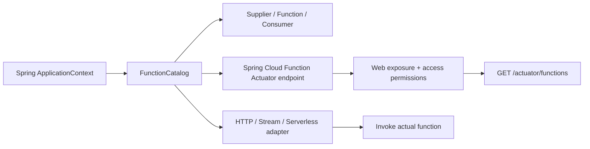
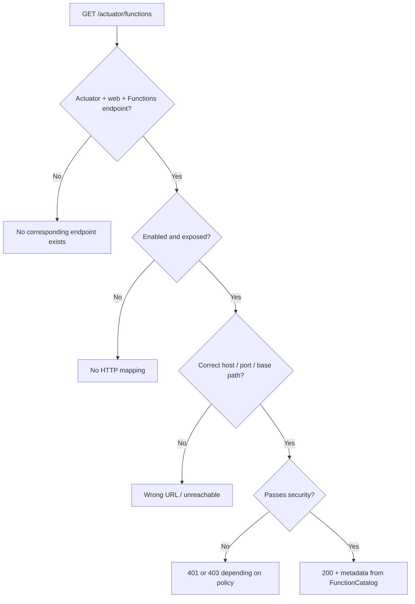

# Actuator `functions` Endpoint and Activation Requirements

## Learning Objectives

After this lesson, you will be able to:

1. Explain what the `/actuator/functions` endpoint observes inside Spring Cloud Function's `FunctionCatalog`.
2. List the exact prerequisites: Spring Cloud Function, Spring Boot Actuator, a web stack, an enabled/accessible endpoint, web exposure configuration, and access permissions.
3. Configure dependencies and `application.yml` to inspect the endpoint in a development environment or on a management network.
4. Understand the `type`, `input-type`, and `output-type` fields in the JSON response and distinguish this metadata from **function execution**.
5. Diagnose cases where the endpoint returns `404`, `401/403`, returns unexpected data, or is served on a different port/base path.
6. Cross-check Actuator output with `FunctionCatalog.getNames(null)`, `size()`, and `lookup(...)` without confusing it with business HTTP endpoints.
7. Propose ways to secure the diagnostic endpoint in production and test its intended access path.

## 1. What Is `/actuator/functions` Used For?

**Spring Cloud Function** lets you implement business logic using Java `Supplier<T>`, `Function<T,R>`, and `Consumer<T>` beans. `FunctionCatalog` registers, looks up, performs type conversion for, and supports composition of functions so the same logic can run over HTTP, event systems, or serverless platforms.

When an application is running but an adapter reports that it cannot find `uppercase`, or a `functionRouter` fails to locate its target function, you need to know **which functions `FunctionCatalog` actually contains**. Spring Cloud Function supports two ways to observe this:

- **Programmatic:** call `FunctionCatalog.getNames(null)`, `size()`, and `lookup(...)` in Java.
- **Actuator:** when enabled and exposed over the web, call **`GET /actuator/functions`** to view metadata for functions in the catalog.

This is a **management endpoint for reading metadata**, not an endpoint for submitting business payloads. It does not replace HTTP routes like `/uppercase`, Spring Cloud Stream input bindings, or serverless handlers.



**Key distinction:** a function appearing in Actuator JSON **does not mean** that the function has a public HTTP URL. Catalog listing and adapter exposure/selection are two separate layers.

## 2. Requirements for HTTP Accessibility

The official Spring Cloud Function documentation, in the *Function visualization and control* section, specifies adding a **web dependency**, the **Actuator dependency**, and enabling **web exposure** for the `functions` endpoint.

In production deployments, check all layers thoroughly:

| Layer | Requirement | If unmet |
| --- | --- | --- |
| **1. Function infrastructure** | The application includes Spring Cloud Function and `FunctionCatalog` is properly registered | There is no function metadata source for the endpoint to publish |
| **2. Actuator** | `spring-boot-starter-actuator` is present and the `functions` endpoint is auto-configured in a compatible version | Typically there is no `/actuator/functions` mapping |
| **3. Web stack** | A web runtime such as Spring MVC or WebFlux is present and the application actually runs an HTTP server | There is no HTTP address to call the endpoint |
| **4. Availability / access** | The endpoint is not disabled by the enablement/access rules of the Spring Boot version in use | The endpoint may be excluded from available endpoints |
| **5. Web exposure** | `management.endpoints.web.exposure.include` contains `functions`, and `exclude` does not remove `functions` | Even though the endpoint exists internally, its URL is not exposed over HTTP |
| **6. Management routing** | Correct management port, context path, and `management.endpoints.web.base-path` | Calling the wrong URL can return 404 or connection refused |
| **7. Security and network** | The caller is authenticated/authorized, and the network permits reaching the management endpoint | May receive 401/403 or connection errors |

Do not lump all seven cases into "Actuator is not working." An application **can still process business traffic normally** when this endpoint is disabled or not exposed over HTTP.



This diagram is a **diagnostic model**; it does not claim every misconfiguration returns the exact same HTTP status code. A reverse proxy can modify status codes, URLs, or responses.

## 3. Adding Dependencies with Clear Roles

An application with a `FunctionCatalog` but without a web runtime or Actuator cannot automatically expose `/actuator/functions`.

### 3.1. Web MVC or WebFlux

Choose a web stack compatible with your project, for example Spring MVC:

```xml
<dependency>
    <groupId>org.springframework.boot</groupId>
    <artifactId>spring-boot-starter-web</artifactId>
</dependency>
```

Or if the application uses WebFlux:

```xml
<dependency>
    <groupId>org.springframework.boot</groupId>
    <artifactId>spring-boot-starter-webflux</artifactId>
</dependency>
```

An application using `spring-cloud-starter-function-web` may already bring in the web components required for Function Web; check your actual dependency management instead of adding a duplicate web stack just for Actuator.

### 3.2. Actuator

```xml
<dependency>
    <groupId>org.springframework.boot</groupId>
    <artifactId>spring-boot-starter-actuator</artifactId>
</dependency>
```

Keep Spring Boot and Spring Cloud Function on **compatible versions**, typically via the project's chosen BOM or dependency management. The `functions` endpoint is an integration provided by **Spring Cloud Function** on top of Spring Boot Actuator, not a built-in Spring Boot endpoint when Spring Cloud Function is absent.

### 3.3. No Function Invocation Needed to Populate Metadata

Entry points like `uppercase` can be exposed as REST APIs by Function Web, whereas the Actuator endpoint only queries the **catalog** and data types. You do not need to send a request to `/uppercase` for `/actuator/functions` to become active.

## 4. Minimal Web Exposure Configuration

By default, Spring Boot exposes only a minimal set of management endpoints (typically `health`) over HTTP. `functions` must be explicitly included in the exposure configuration.

```yaml
# application.yml — illustration for a controlled environment
management:
  endpoints:
    web:
      exposure:
        include: "health,info,functions"
```

Equivalent in `application.properties`:

```properties
management.endpoints.web.exposure.include=health,info,functions
```

Or supplied when launching Spring Boot:

```bash
java -jar app.jar --management.endpoints.web.exposure.include=health,info,functions
```

In this example:

- `health`, `info`, and `functions` are **Actuator endpoint IDs**, separated by commas.
- `functions` is the endpoint serving catalog metadata; it is not the name of a business `Function`.
- `include` only controls **exposure**; it does not grant access permissions or guarantee the endpoint exists if dependencies are missing.

### `exclude` Takes Precedence over `include`

The following configuration does not expose `functions`, even though it is listed in `include`:

```yaml
management:
  endpoints:
    web:
      exposure:
        include: "health,info,functions"
        exclude: "functions"
```

This is a standard Spring Boot Actuator rule: **exclude overrides include**. When troubleshooting a 404, check both properties rather than looking only at `include`.

### Do Not Use `include: "*"` Indiscriminately

```yaml
# Not recommended for public-facing applications:
management:
  endpoints:
    web:
      exposure:
        include: "*"
```

The `*` character must be quoted in YAML. This setting can expose many sensitive endpoints beyond `functions`, such as `env`, `beans`, or additional management endpoints depending on versions and dependencies. List **only the required endpoints** and restrict access.

## 5. Endpoint Availability and Access Differ from Web Exposure

Spring Boot Actuator distinguishes between **an endpoint being enabled/available to operate** and **an endpoint being exposed over HTTP**.

- **Availability/access/enablement:** whether the endpoint is permitted to exist and operate in the management subsystem.
- **Web exposure:** whether that endpoint is mapped to an HTTP URL.
- **Security:** who is permitted to send valid requests to that URL.

Depending on the Spring Boot version, the framework uses legacy enablement properties (such as `management.endpoint.<id>.enabled` alongside global defaults) or the **endpoint access** model (such as `management.endpoint.<id>.access` and `management.endpoints.access.max-permitted`). Always check the documentation for your project's exact Spring Boot version.

Example access property for supported versions:

```properties
# Applies only if your project's Spring Boot version supports this property.
management.endpoint.functions.access=read-only
```

If access is set to `none`, adding `functions` to `exposure.include` will **not** make the endpoint accessible. Conversely, read-only access without exposure still prevents the HTTP URL from appearing.

**Do not blindly configure both legacy and modern property sets.** Inspect `conditions`, effective properties, and the documentation for your exact release whenever an endpoint fails to register.

## 6. Sample Application with `Supplier`, `Function`, and `Consumer`

Create a Spring Boot application:

```java
package com.example.functionsactuator;

import java.util.Locale;
import java.util.function.Consumer;
import java.util.function.Function;
import java.util.function.Supplier;

import org.slf4j.Logger;
import org.slf4j.LoggerFactory;
import org.springframework.boot.SpringApplication;
import org.springframework.boot.autoconfigure.SpringBootApplication;
import org.springframework.context.annotation.Bean;

@SpringBootApplication
public class FunctionsActuatorApplication {

    private static final Logger log =
            LoggerFactory.getLogger(FunctionsActuatorApplication.class);

    public static void main(String[] args) {
        SpringApplication.run(FunctionsActuatorApplication.class, args);
    }

    @Bean
    public Supplier<String> greeting() {
        return () -> "hello";
    }

    @Bean
    public Function<String, String> uppercase() {
        return value -> value.toUpperCase(Locale.ROOT);
    }

    @Bean
    public Consumer<String> textSink() {
        return text -> log.info("Received a string of {} characters", text.length());
    }
}
```

Apply the exposure configuration from Section 4. After running the application with appropriate dependencies and no network/security policy blocking access, run:

```bash
curl -i http://localhost:8080/actuator/functions
```

An **illustrative** response example, simplified from the structure shown in the Spring Cloud Function documentation:

```json
{
  "greeting": {
    "type": "SUPPLIER",
    "output-type": "string"
  },
  "uppercase": {
    "type": "FUNCTION",
    "input-type": "string",
    "output-type": "string"
  },
  "textSink": {
    "type": "CONSUMER",
    "input-type": "string"
  },
  "functionRouter": {
    "type": "FUNCTION",
    "input-type": "object",
    "output-type": "object"
  }
}
```

**Do not write tests that exact-match the entire JSON above.** Exposed keys, declared types, quoting, framework names such as `functionRouter`, and type metadata formatting can vary across versions and configurations. The takeaway is that the endpoint provides **a mapping from names to functional descriptors**, not execution results from running each function.

## 7. Reading the JSON Fields

| Field | Meaning | Example |
| --- | --- | --- |
| Top-level key name | Definition name shown in the catalog | `uppercase`, `greeting` |
| `type` | Functional classification | `FUNCTION`, `SUPPLIER`, `CONSUMER` |
| `input-type` | Inferred input type | `string`, `object` |
| `output-type` | Inferred output type | `string`, `integer` |

A `Supplier` does not accept input under the standard model, so its metadata may contain only output. A `Consumer` returns no business output, so its metadata may display only input.

A `Function<String, Integer>` may report `input-type: string` and `output-type: integer`, yet payloads handled by an HTTP/Stream adapter still depend on conversion, serialization, and content types. **Type metadata does not guarantee that a specific request will succeed.**

### What Does the Endpoint Not Tell You?

`GET /actuator/functions` is not an end-to-end observability system. On its own, it does **not** provide:

- Total invocation counts for a function or per-minute error rates.
- P95/P99 latency, trace IDs, or upstream/downstream calls.
- Actual converted data types during individual requests.
- Broker state, input/output bindings, or retry/DLQ status.
- Per-user authorization to invoke a function.

For metrics, tracing, and logs, add Micrometer/Actuator metrics, a tracing system, and structured logging as appropriate. The `functions` endpoint primarily answers: **"Which functions does the catalog currently know about?"**

## 8. Cross-Checking in Java When the HTTP Endpoint Is Unavailable

Actuator is **optional**. If an application runs in a serverless or event-driven environment without a web server, you can still inspect the catalog in Java:

```java
import java.util.ArrayList;
import java.util.Collections;
import java.util.List;

import org.springframework.boot.ApplicationRunner;
import org.springframework.cloud.function.context.FunctionCatalog;
import org.springframework.context.annotation.Bean;
import org.springframework.context.annotation.Configuration;
import org.springframework.context.annotation.Profile;

@Configuration
class FunctionCatalogDiagnostics {

    @Bean
    @Profile("catalog-debug")
    ApplicationRunner reportCatalog(FunctionCatalog catalog) {
        return args -> {
            List<String> names = new ArrayList<>(catalog.getNames(null));
            Collections.sort(names);

            System.out.println("Catalog size: " + catalog.size());
            System.out.println("Catalog names: " + names);
        };
    }
}
```

When started with the `catalog-debug` profile, this snippet lists names without requiring HTTP. In production, prefer a logger and an access-controlled monitoring system, and avoid printing all internal names where end users can read them.

### Comparing the Two Observation Approaches

| Aspect | `FunctionCatalog` Java API | Actuator `/actuator/functions` |
| --- | --- | --- |
| Requires an HTTP server? | No | Yes, to GET over the network |
| Requires `spring-boot-starter-actuator`? | No | Yes |
| Usable in unit/integration tests? | Yes | Yes, with web test support and proper exposure |
| Data provided | `getNames(null)`, `size()`, `lookup(...)` | Metadata: name, type, input/output |
| Information disclosure risk | Via logs/debug output if leaked externally | Via management endpoint if poorly secured |
| Executes business functions? | Only if your code calls `apply`/`get`/`accept` | No: the endpoint only reads metadata |

Do not use a `404` from `/actuator/functions` to infer that `FunctionCatalog` does not exist. Conversely, having a function in the catalog that the HTTP function adapter has not exposed does not mean the Actuator endpoint is wrong.

## 9. Management Port, Base Path, and Context Path

By default, Actuator Web mounts endpoints under `/actuator` on the application port. However, systems can run the management server on a separate port:

```yaml
server:
  port: 8080
management:
  server:
    port: 9090
  endpoints:
    web:
      base-path: /manage
      exposure:
        include: "health,functions"
```

With this configuration, the illustrative URL is:

```bash
# Not localhost:8080/actuator/functions
curl -i http://localhost:9090/manage/functions
```

In practice, `server.servlet.context-path`, the management base path, reverse proxy path rewrites, and Kubernetes ingress rules can all affect the final URL. When the management server runs on a **different port**, path combination rules can also differ from the single-port setup. Inspect the effective configuration and HTTP mappings exposed by the application.

You should isolate management traffic on a private network so `functions` is never exposed to the public Internet. Changing the port or path only reduces accidental access; **it does not replace authentication and authorization**.

## 10. Securing the `functions` Endpoint

Catalog metadata can reveal internal function names such as `deleteUser`, `reindexData`, or `internalDiagnostics`, along with the types of data a service processes. Even though the endpoint is read-only, that information can still assist unauthorized actors.

Security principles:

1. **Do not over-expose.** Use `management.endpoints.web.exposure.include=health,functions` only when truly needed; never enable `*` on public-facing services.
2. **Authenticate and authorize.** Grant metadata endpoint access only to appropriate operational roles.
3. **Restrict network access.** Run the management port on an internal network or protect it via a gateway, firewall, or VPN.
4. **Enforce auditing.** Log management access with appropriate metadata without logging tokens or credentials.
5. **Prevent untrusted expression edits via management tools.** The `functions` endpoint only displays metadata, but other configuration endpoints/tools may allow modifying `spring.cloud.function.routing-expression`; protect those capabilities separately.

### What About Spring Security?

When Spring Security is on the classpath, Spring Boot typically applies auto-configured protection to Actuator if the application has **not** defined a custom `SecurityFilterChain`. Once you declare a custom security chain, verify that it protects management paths; never assume endpoints remain automatically secured.

Illustrative configuration for Spring Boot 3.x / Spring Security 6:

```java
import org.springframework.boot.actuate.autoconfigure.security.servlet.EndpointRequest;
import org.springframework.context.annotation.Bean;
import org.springframework.context.annotation.Configuration;
import org.springframework.core.annotation.Order;
import org.springframework.security.config.Customizer;
import org.springframework.security.config.annotation.web.builders.HttpSecurity;
import org.springframework.security.web.SecurityFilterChain;

@Configuration
class ManagementSecurityConfiguration {

    @Bean
    @Order(1)
    SecurityFilterChain functionsActuatorSecurity(HttpSecurity http)
            throws Exception {
        return http
                .securityMatcher(EndpointRequest.to("functions"))
                .authorizeHttpRequests(auth -> auth
                        .anyRequest().hasRole("OPS"))
                .httpBasic(Customizer.withDefaults())
                .build();
    }
}
```

This is only an example for the **`functions` endpoint** in a Servlet/MVC application: you must also configure security chains for remaining routes and other Actuator endpoints, backed by a real authentication system. With WebFlux, the security API differs. HTTP Basic should only be used over a trusted TLS connection.

An unauthenticated request typically receives **401**, whereas an authenticated request lacking the required role may receive **403**. Exact responses depend on the authentication entry point, security filters, and proxies; do not relax exposure to "fix" a 403 when authorization rules are doing their job.

## 11. Testing the Endpoint in Spring Boot

For a Spring MVC application with `spring-boot-starter-test` and Actuator, you can use `MockMvc`:

```java
import static org.springframework.test.web.servlet.request.MockMvcRequestBuilders.get;
import static org.springframework.test.web.servlet.result.MockMvcResultMatchers.jsonPath;
import static org.springframework.test.web.servlet.result.MockMvcResultMatchers.status;

import org.junit.jupiter.api.Test;
import org.springframework.beans.factory.annotation.Autowired;
import org.springframework.boot.test.autoconfigure.web.servlet.AutoConfigureMockMvc;
import org.springframework.boot.test.context.SpringBootTest;
import org.springframework.test.web.servlet.MockMvc;

@SpringBootTest(
        classes = FunctionsActuatorApplication.class,
        properties = {
            "management.endpoints.web.exposure.include=health,functions"
        })
@AutoConfigureMockMvc
class FunctionsActuatorEndpointTest {

    @Autowired
    MockMvc mockMvc;

    @Test
    void reportsRegisteredFunction() throws Exception {
        mockMvc.perform(get("/actuator/functions"))
                .andExpect(status().isOk())
                .andExpect(jsonPath("$.uppercase.type").value("FUNCTION"));
    }
}
```

This test assumes Spring Security is not blocking unauthenticated requests and Actuator is registered in the same web application context. If the project enables security, supply an identity with the required role via `spring-security-test` or your configured mechanism; if a separate management port is used, adapt HTTP testing to match that topology.

**Why not assert the entire JSON payload?** Type metadata formatting can vary across framework versions, function signatures, and bean registration styles. Checking key names and `type` is sufficient for a baseline smoke test.

### Testing Before and After Enabling Exposure

Tests can verify:

| Configuration | Expected behavior to verify |
| --- | --- |
| Web + Actuator present, only `health` exposed | `/actuator/functions` is not mapped over HTTP |
| Include `health,functions`, unblocked | GET returns catalog metadata |
| Include `functions` but exclude `functions` | Endpoint is not exposed |
| Security requires role `OPS` | Callers without the role cannot read metadata |
| Change `management.endpoints.web.base-path=/manage` | Old URL no longer works; use `/manage/functions` |
| Change management port | Call the configured management port |

The test goal is to verify **endpoint activation conditions**, not to force Spring Cloud Function Web to expose all business beans as URLs.

## 12. Diagnosing by Status Code and Symptoms

| Symptom | Possible cause | Next step |
| --- | --- | --- |
| `404` when calling `/actuator/functions` | Missing Actuator/web, missing endpoint in compatible version, or not web-exposed | Check dependencies, versions, and `exposure.include` |
| `404` even though `functions` is included | `exposure.exclude`, endpoint access disabled, wrong URL/base path | Check effective configuration, access, and routes |
| `401` | Unauthenticated or invalid credentials | Provide an authorized identity; inspect the security chain |
| `403` | Authenticated without permission, or blocked by proxy policy | Check roles and authorization rules |
| Connection refused / timeout | Wrong port, management server not started, or firewall | Check listeners, `management.server.port`, and network rules |
| `200`, but JSON lacks expected function | Bean missing from catalog or registered under a different name | Use `getNames(null)` and check profiles/component scanning |
| JSON shows `functionRouter` but not target function | Router and target function are separate registrations | Check registration, `definition`, and catalog lookup |
| `getNames(null)` has function, but business HTTP endpoint returns 404 | Function not exposed by Function Web or different web mapping | Check adapter, `spring.cloud.function.definition`, and path |
| Endpoint works in dev but not in prod | Different profiles, management properties, security, or proxy | Compare effective configuration rather than guessing from code |
| `/actuator/functions` works, but no request metrics appear | Endpoint only reports catalog metadata | Use metrics/traces/logs instead of treating this endpoint as APM |

### Quick Diagnostic Checklist

```text
1. Does the application have a valid FunctionCatalog and function beans?
2. Is the Actuator dependency included?
3. Is a web stack present and is the management server listening?
4. Does this Spring Cloud Function version support the functions endpoint?
5. Is the endpoint enabled/accessible (access/enablement)?
6. Does web exposure include functions? Is it excluded?
7. Are the management port, base path, and proxy path correct?
8. Does security allow the current caller to read it?
9. Does the returned JSON include the expected functions?
10. If a function is missing: check bean name, profile, scan,
    ineligible definitions, and the FunctionCatalog Java API.
```

**Never resolve a 404 simply by opening all Actuator endpoints.** Pinpoint the exact missing configuration layer and apply the smallest necessary change.

## 13. Placing the Endpoint in HTTP, Stream, and Serverless Contexts

### HTTP

Spring Cloud Function Web can expose functions as dedicated execution endpoints, such as `POST /uppercase`. By contrast, `GET /actuator/functions` belongs to the **management plane** and only inspects catalog metadata.

These two paths do not have to share the same URL, security policy, or port:

```text
Business request: POST /uppercase        -> runs Function.apply(...)
Management:       GET  /actuator/functions -> reads the function catalog
```

### Spring Cloud Stream

An application consuming events from Kafka/RabbitMQ might not need a web stack at all. In that setup, **there is no requirement to enable Actuator HTTP** for Stream bindings to operate.

If you want remote catalog diagnostics, you can add web + Actuator **intentionally and securely**. Otherwise, use the `FunctionCatalog` Java API in startup diagnostics or tests. The `functions` endpoint does not replace inspecting bindings like `uppercase-in-0`, `uppercase-out-0`, destinations, or broker connectivity.

### Serverless

A serverless function may run as a handler without a long-lived management HTTP listener. In that model, the Actuator endpoint may **not exist or lack an accessible route**, even while the catalog is initialized and the handler runs properly.

Prefer platform logs/metrics or the `FunctionCatalog` Java API instead of adding an HTTP server solely to expose metadata, unless your operational requirements and platform runtime allow it.

## 14. Common Misconceptions About the `functions` Endpoint

**Misconception 1 — "An app with Actuator automatically exposes the endpoint URL."** False. You need a web stack and proper exposure; some versions also require endpoint access/enablement settings.

**Misconception 2 — "Enabling exposure means the public is allowed to view it."** Exposure creates the route, while Spring Security, proxies, and the management network decide who can view it. Conversely, properly configured security will not create a mapping for an unexposed endpoint.

**Misconception 3 — "Being listed in JSON means there is a business REST endpoint."** False. `FunctionCatalog` can register many functions while the HTTP adapter exposes only a configured subset.

**Misconception 4 — "Not seeing a composition in JSON means it cannot be used."** Not necessarily. A composition can be constructed on lookup for definitions like `uppercase|reverse`, and does not always appear as a pre-registered bean.

**Misconception 5 — "The Actuator endpoint leaks processed payloads."** The `functions` endpoint returns function metadata, not invocation payloads by default. Still, function names and type metadata must be protected.

**Misconception 6 — "Actuator `functions` can invoke a function for testing."** No. It is a catalog observation endpoint. Test via `FunctionCatalog.lookup(...)` in code/tests or by calling the appropriate business adapter with controlled input.

## 15. Practice Exercises

1. Create a sample application with `greeting`, `uppercase`, and `textSink`. Add the Actuator + web dependencies, enable `management.endpoints.web.exposure.include=health,functions`, and call `GET /actuator/functions`.
2. Remove `functions` from `exposure.include` without removing the function beans. Explain why the management endpoint disappears while business logic continues working.
3. Add `management.endpoints.web.exposure.exclude=functions` while keeping `include=health,functions`. Predict the outcome and explain precedence.
4. Set `management.server.port=9090` and `management.endpoints.web.base-path=/manage`. Determine the exact URL to reach the endpoint.
5. Enable Spring Security and grant read access only to an operations role. Write a test or verification steps for three cases: unauthenticated, authenticated without sufficient role, and authorized.
6. Use `FunctionCatalog.getNames(null)` and `size()` to cross-check the endpoint metadata. Identify valid differences caused by aliases, registrations, or display types.
7. Rename the `uppercase` bean using `@Bean("normalizeText")`. Observe the JSON output and explain why the Java method name and catalog key do not have to match.
8. Set `spring.cloud.function.definition=uppercase` for Function Web. Verify that `greeting` and `textSink` remain in the catalog and explain the difference between **catalog registration** and **endpoint export**.
9. Add an auxiliary function to `spring.cloud.function.ineligible-definitions`. Check the catalog listing and explain how this differs from merely omitting HTTP endpoint exposure.
10. In a Spring Cloud Stream application without a web server, propose how to diagnose the function list at startup without enabling `/actuator/functions`.
11. Build a production checklist for the endpoint covering dependencies, availability, exposure, port/path, security, auditing, and log access control.

## Key Takeaways

- `GET /actuator/functions` is an endpoint for **observing `FunctionCatalog` metadata** in Spring Cloud Function, typically listing names, `FUNCTION`/`SUPPLIER`/`CONSUMER` types, and input/output type info.
- HTTP access requires **Function infrastructure + Actuator + web runtime + endpoint availability + web exposure + exact URL + access permissions**.
- The core configuration is `management.endpoints.web.exposure.include=functions` (usually alongside `health`); `exclude` overrides `include` and blocks exposure.
- **Availability/access**, **exposure**, and **security** are distinct layers; `404`, `401`, and `403` should be diagnosed at the corresponding layer.
- **Catalog registration** does not mean the HTTP adapter exposes that function as a business endpoint.
- This endpoint does not execute functions or provide per-invocation metrics/traces; use `FunctionCatalog`, Actuator metrics, and tracing according to your needs.
- Protect `functions` as a management endpoint and enable it only when operational visibility genuinely requires it.

### Official References

- [Spring Cloud Function — Functional Bean Definitions: Function visualization and control / Actuator](https://docs.spring.io/spring-cloud-function/reference/functional.html)
- [Spring Cloud Function — Programming Model and FunctionCatalog](https://docs.spring.io/spring-cloud-function/reference/spring-cloud-function/programming-model.html)
- [Spring Boot — Actuator Endpoints: Availability, Exposure, Security](https://docs.spring.io/spring-boot/reference/actuator/endpoints.html)
- [Spring Boot — Monitoring and Management over HTTP](https://docs.spring.io/spring-boot/reference/actuator/monitoring.html)
- [Spring Cloud Function — Standalone Web Applications](https://docs.spring.io/spring-cloud-function/reference/spring-cloud-function/standalone-web-applications.html)
