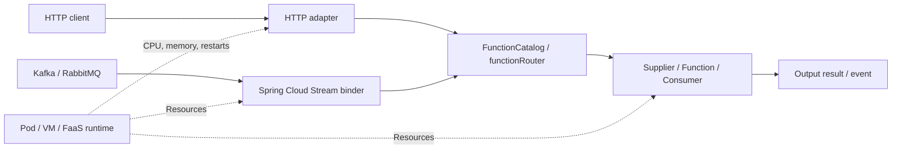
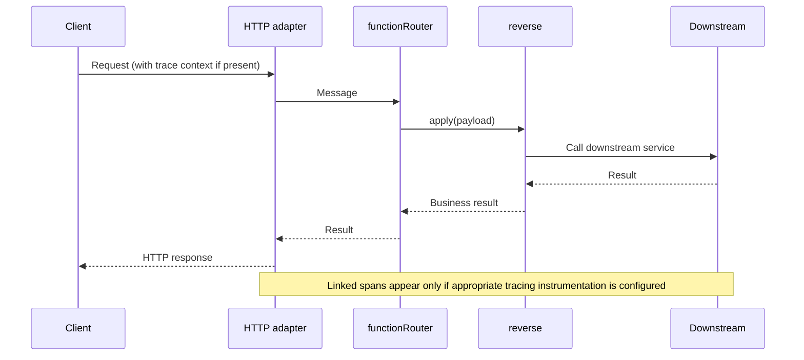
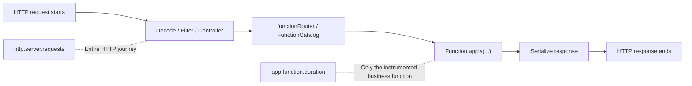

# Distinguishing Function-Level Observability from HTTP, Binder, and Platform Observability

## Learning Objectives

After this lesson, you will be able to:

1. Distinguish **observability of individual `Supplier`, `Function`, and `Consumer` logic** from observability of the **HTTP adapter**, **Spring Cloud Stream binder/broker**, and **deployment runtime/platform**.
2. Explain why seeing HTTP 200, zero consumer lag, or a `Ready` pod is **not sufficient** to conclude that business logic is working properly.
3. Use `FunctionCatalog`, Spring Boot Actuator, Micrometer metrics, logs, and distributed tracing to ask questions at the right layer.
4. Measure invocation counts, outcomes, and processing duration of a `Function<String, String>` using `MeterRegistry`, distinguishing custom application metrics from framework/binder metrics.
5. Read `http.server.requests`, recognize Kafka-binder-specific metrics, consumer lag, and infrastructure indicators, while avoiding assuming a metric exists across every version.
6. Build correlation from an incoming invocation through `functionRouter`, business functions, brokers, and the platform without placing sensitive data into metric tags.
7. Diagnose scenarios where HTTP succeeds while a function fails, the broker backs up while the function is fast, or the function is healthy while the platform is resource-constrained.

## 1. Four Observability Scopes in Spring Cloud Function

**Spring Cloud Function** encourages packaging business logic as `Supplier<T>`, `Function<T,R>`, and `Consumer<T>` beans, looked up via `FunctionCatalog`, with support for composition and message conversion. Functions can be invoked via HTTP, Spring Cloud Stream events, or serverless runtimes without rewriting protocol-specific logic.

Precisely because **logic is decoupled from transport protocols**, observability must be separated into layers:

| Scope | Core question | Example signals |
| --- | --- | --- |
| **Function / business** | Which function ran? How much data was processed? Did it succeed or fail? | `uppercase` invocation count, valid record count, function execution time, validation errors |
| **HTTP adapter** | Did the client reach the server? How did the protocol respond? | Request count, 2xx/4xx/5xx status codes, HTTP latency, route/method |
| **Stream binder and broker** | Are messages arriving at/leaving queues or topics? How big is the backlog? | Binding state, consumer lag, publish/consume errors, retries, DLQ |
| **Runtime / platform** | Does the application have resources and capacity to serve? | CPU/RAM, GC, instance count, restarts, readiness, FaaS invocations/timeouts |



An `uppercase` function may work fine when called directly from `FunctionCatalog`, yet the HTTP adapter returns 404 because the endpoint has not been exposed. Conversely, an HTTP request may return 2xx while the application **intentionally discards the message** via a filtering `Consumer`, producing no business output.

**Principle:** always identify *which layer is being measured* before using a metric as proof of business correctness.

## 2. A Practical Scenario: Same Symptom, Multiple Causes

Suppose a service receives text and routes it to two functions, `uppercase` and `reverse`:

```text
POST /functionRouter
  └─ operation: reverse
       └─ functionRouter
            └─ reverse("hello") = "olleh"
```

In an HTTP environment, users report "slow responses." In a Kafka environment, operations reports "topic backlog." Both may execute the same `reverse` code via **different transport paths**.

| Observation | Cannot conclude yet | What to check next |
| --- | --- | --- |
| HTTP latency increased | `reverse` became slow | Function timer, connection pools, queues, web threads, downstream calls |
| HTTP 200 with empty body | The function returned valid output | `Consumer` branch, adapter mapping, filtering policies |
| Kafka consumer lag increased | The function has a bug | Consumer count, partitions, broker health, producer rate, function duration |
| Container restarts repeatedly | The function threw a business exception | OOM, health probes, deployment config, CPU/memory limits, exit reason |
| `/actuator/functions` lists `reverse` | Requests actually executed `reverse` | Routing decisions, input bindings/HTTP paths, invocation counts |
| Low CPU yet low throughput | The system has spare capacity | Blocking I/O, backpressure, polling/batching, rate limits, dependencies |

Multi-layer observability prevents modifying a pure Java function when the real issue sits in the adapter, broker, or platform.

## 3. Three Signal Types: Logs, Metrics, and Traces

The three pillars of observability do not belong to any single layer:

- **Metrics:** aggregated measurements over time, such as `app.function.calls`, `http.server.requests`, broker consumer lag, or CPU usage.
- **Logs:** contextual event records, such as `function=reverse, outcome=error, reason=invalid_input` paired with an appropriate correlation ID.
- **Traces:** chains of spans for a single request journey, spanning HTTP, functions, message brokers, and other services **when** integration points are instrumented and propagate trace context.



**Micrometer Observation** is an API capable of producing both metrics and traces depending on the configured `ObservationRegistry`, handlers, and exporters. However, simply adding Spring Cloud Function does not mean **every `Function` bean automatically emits custom metrics with the exact names and tags you expect**.

### Distinguishing Metadata from Execution Signals

`FunctionCatalog.getNames(null)` or Actuator `/actuator/functions` tells you **which functions are discoverable**. They do not report invocation counts, latency, or error rates for each function. Conversely, an HTTP metric only proves a request traversed the web stack; it does not specify which internal functions ran.

## 4. Observing **Each Function**: What Belongs to Business Responsibility?

A function can be invoked from multiple environments:

```java
Function<String, String> uppercase =
        catalog.lookup(Function.class, "uppercase");
String output = uppercase.apply("hello");
```

This call **requires neither an HTTP request nor a message broker**. Therefore, you cannot rely solely on `http.server.requests` or Kafka lag to count every invocation of `uppercase`.

### Metrics to Consider by Programming Model

| Interface | Unit to define | Illustrative business metrics |
| --- | --- | --- |
| `Supplier<T>` | Each poll or each produced item | `get()` count, emitted item count, source errors |
| `Function<T,R>` | One call or one processed item | `apply()` count, processing timer, success/error outcome |
| `Consumer<T>` | One consumption and completed side effect | Processed events, discarded events, DB write/publish errors |
| `Function<Flux<T>,Flux<R>>` | **Both Publisher** and/or individual items | Subscription count, item count, pipeline duration, Reactor errors |
| `functionRouter` | Routing decision for a Message or Publisher | Target selection count, unknown-route errors, per-branch message counts |

**The unit of measurement must be explicit in the metric name/description.** "One reactive function invocation" usually marks pipeline assembly, not necessarily "one completed event." When you need item counts, instrument where items are actually processed.

A `Consumer` may return normally while an asynchronous side effect has not finished. When tagging `success`, decide whether you are measuring **call received**, **command dispatched**, or **business transaction committed**; these three carry very different meanings.

## 5. Micrometer Example: Measuring a Function with `MeterRegistry`

The example below defines a `Function<String,String>` with two **application-defined** meters:

- `app.function.calls`: an invocation counter with `function` and `outcome` tags.
- `app.function.duration`: a timer measuring function execution duration, also tagged by outcome.

These names are **not default metrics guaranteed to be emitted by Spring Cloud Function**; they are conventions chosen for this example.

### Dependencies

With Spring Boot, manage versions through a compatible BOM or dependency management:

```xml
<!-- Actuator provides Micrometer core and the metrics endpoint -->
<dependency>
    <groupId>org.springframework.boot</groupId>
    <artifactId>spring-boot-starter-actuator</artifactId>
</dependency>

<!-- Only needed when the application is actually invoked via Spring Cloud Function Web -->
<dependency>
    <groupId>org.springframework.cloud</groupId>
    <artifactId>spring-cloud-starter-function-web</artifactId>
</dependency>
```

### An Instrumented Function

```java
package com.example.observability;

import java.util.Locale;
import java.util.function.Function;

import io.micrometer.core.instrument.MeterRegistry;
import io.micrometer.core.instrument.Timer;

import org.springframework.boot.SpringApplication;
import org.springframework.boot.autoconfigure.SpringBootApplication;
import org.springframework.context.annotation.Bean;

@SpringBootApplication
public class FunctionTelemetryApplication {

    public static void main(String[] args) {
        SpringApplication.run(FunctionTelemetryApplication.class, args);
    }

    @Bean
    public Function<String, String> uppercase(MeterRegistry registry) {
        return text -> {
            Timer.Sample sample = Timer.start(registry);
            String outcome = "success";

            try {
                return text.toUpperCase(Locale.ROOT);
            }
            catch (RuntimeException ex) {
                outcome = "error";
                throw ex;
            }
            finally {
                registry.counter(
                        "app.function.calls",
                        "function", "uppercase",
                        "outcome", outcome)
                        .increment();

                sample.stop(Timer.builder("app.function.duration")
                        .description("Execution duration of a Function.apply call")
                        .tag("function", "uppercase")
                        .tag("outcome", outcome)
                        .register(registry));
            }
        };
    }
}
```

This snippet illustrates how to measure **the body of `Function.apply`**; it **does not** include HTTP wait time, binder message polling, serialization, or broker acknowledgments at other layers.

Explanation:

1. `Timer.Sample` starts when `apply` is entered.
2. `outcome` is set to `success` or `error` depending on whether the function returns normally or throws a `RuntimeException`.
3. The `finally` block increments the counter and records the timer for both successes and errors.
4. The `function=uppercase` tag has finite cardinality and does not vary per payload.
5. `MeterRegistry` provides the metrics abstraction; exporting requires an appropriate registry/transport implementation.

Processing the string `hello` produces one `success` call, whereas passing `null` directly in a Java unit test produces an error. Standard Spring `Message` objects do not permit `null` payloads, so do not treat calling `apply(null)` as a valid HTTP simulation.

### Limitations of This Example

The snippet only catches `RuntimeException`. In real systems, checked/wrapped exceptions, cancellations, timeouts, and business failures that **return error objects without throwing** may require distinct `outcome` values. A `Function` returning an error DTO completes normally in Java terms while still representing a business failure.

If you want to instrument each functional bean without repeating measurement code, consider a wrapper, interceptor, or shared `Observation` convention. However, verify that the wrapper is applied at the **actual invocation boundary** and does not alter generic input/output types or `FunctionCatalog` registration.

## 6. Unit-Testing Function Metrics Without HTTP

Micrometer provides `SimpleMeterRegistry` for unit tests:

```java
import static org.junit.jupiter.api.Assertions.assertEquals;

import java.util.function.Function;
import io.micrometer.core.instrument.simple.SimpleMeterRegistry;
import org.junit.jupiter.api.Test;

class FunctionTelemetryTest {

    @Test
    void recordsOneSuccessInvocation() {
        try (SimpleMeterRegistry registry = new SimpleMeterRegistry()) {
            Function<String, String> fn =
                    new FunctionTelemetryApplication().uppercase(registry);

            assertEquals("HELLO", fn.apply("hello"));

            assertEquals(1.0,
                    registry.get("app.function.calls")
                            .tag("function", "uppercase")
                            .tag("outcome", "success")
                            .counter().count());

            assertEquals(1L,
                    registry.get("app.function.duration")
                            .tag("function", "uppercase")
                            .tag("outcome", "success")
                            .timer().count());
        }
    }
}
```

This test proves **the function code records its own meters** in a standalone `MeterRegistry`. It does **not** prove that `spring-cloud-starter-function-web` mapped the URL, `FunctionCatalog` routed correctly, or the Kafka binder received events. Those require integration tests at their respective layers.

When retrieving the function via `FunctionCatalog` inside a Spring context, verify that the instrumented bean is the one actually invoked by the catalog, rather than an uninstrumented plain Java instance.

## 7. Viewing Metrics via Spring Boot Actuator

With `spring-boot-starter-actuator` and a running web stack, expose the `metrics` endpoint on the management server:

```yaml
management:
  endpoints:
    web:
      exposure:
        include: "health,info,metrics"
  metrics:
    tags:
      application: function-telemetry-demo
```

After actually invoking `uppercase`, query the endpoints:

```bash
# List registered meters
curl -i http://localhost:8080/actuator/metrics

# Read the application-defined counter
curl -i http://localhost:8080/actuator/metrics/app.function.calls

# Filter by function and outcome
curl -i "http://localhost:8080/actuator/metrics/app.function.calls?tag=function:uppercase&tag=outcome:success"

# Read the application-defined timer
curl -i http://localhost:8080/actuator/metrics/app.function.duration
```

Meter names under `/actuator/metrics` must use the **original Java names**, not Prometheus-converted snake_case names. If you have not invoked the function yet or the registry has not registered the meter, the metric name will not appear.

### If Prometheus Is Needed

Add the Prometheus registry matching your Micrometer version:

```xml
<dependency>
    <groupId>io.micrometer</groupId>
    <artifactId>micrometer-registry-prometheus</artifactId>
</dependency>
```

And configure exposure:

```yaml
management:
  endpoints:
    web:
      exposure:
        include: "health,metrics,prometheus"
```

The `/actuator/prometheus` endpoint then exports registry meters in Prometheus format. Converted metric names may differ from the Java names—for instance, dots become underscores and timers follow Prometheus time-unit conventions. Inspect **the actual exported output** before writing queries or alerts; never guess series names solely from Java meter names.

Both `metrics` and `prometheus` belong to the **management plane** and must be authenticated, authorized, and network-restricted. You do not need to expose both if your monitoring stack only scrapes one of them.

## 8. Observing the HTTP Adapter: Requests vs. Function Invocations

Spring Boot Actuator typically auto-instruments **Spring MVC/WebFlux** when Micrometer/Observation infrastructure is configured. Under default Micrometer conventions, the HTTP server metric is usually named:

```text
http.server.requests
```

Example:

```bash
curl -i "http://localhost:8080/actuator/metrics/http.server.requests"
```

Tags such as `method`, `uri`, `status`, `outcome`, and exception depend on framework/observation conventions, versions, route recognition, and project configuration. Projects using OpenTelemetry semantic conventions may use different meter names; in that case, fetch the actual meter list from `/actuator/metrics`.

### What Span Does the HTTP Metric Measure?



HTTP request latency typically covers much more before and after `Function.apply`: server-side networking, body decoding, security filters, conversion, routing, serialization, and response flushing. The custom function metric in Section 5 **only measures the block wrapped by its timer**.

### Why Do the Two Counts Not Necessarily Match?

| Scenario | HTTP metric | Function metric |
| --- | --- | --- |
| Request rejected by security before calling the function | May record HTTP 401/403 | No invocation because the function never ran |
| `POST` hits a nonexistent endpoint | Records HTTP 404 | No function invoked |
| Request via `functionRouter` selects a two-step composition | One HTTP request | May record **two** function invocations if both beans are instrumented |
| Client disconnects mid-processing | Records HTTP error/cancellation depending on adapter | Function may still be running or terminated |
| A `Supplier` is triggered by a scheduler/binder without HTTP | Does not increment `http.server.requests` | Supplier metric may increment |
| One request invokes a function multiple times in code | One HTTP request | Multiple function metric increments |

Thus, there is no rule stating `HTTP request count = function invocation count`. Compare them only after accounting for request routing, retries, batching, and which components are instrumented.

## 9. Observing Spring Cloud Stream Binders and Brokers

With Spring Cloud Stream, a binder connects `Supplier`/`Function`/`Consumer` logic to a message broker. An application can reuse the same `uppercase` bean over Kafka or RabbitMQ without receiving HTTP requests.

Example binding:

```yaml
spring:
  cloud:
    function:
      definition: uppercase
    stream:
      bindings:
        uppercase-in-0:
          destination: text-requests
        uppercase-out-0:
          destination: text-results
```

This configures **binding/destination names** and does not yet include the binder starter, broker connection, or retry policies. In this model:

- **Function metric:** how many times `uppercase` executed, how long it took, and whether it succeeded or failed.
- **Binder metric:** messages received/sent, binding state, publish/consume errors, retries, or binder-supported telemetry.
- **Broker metric:** topic/queue backlog, producer rate, consumer lag, partitions, and broker availability.

### Kafka Binder: Consumer Lag

The Spring Cloud Stream Kafka binder documentation highlights an important observable metric:

```text
spring.cloud.stream.binder.kafka.offset
```

This metric reflects **the lag in unconsumed records** between the consumer group's current offset and the topic's latest offset, as calculated by the binder. It carries context such as consumer group and topic, and is useful for operations and autoscaling.

**Important:** this metric is **specific to the Kafka binder and its version/configuration**, not a universal metric across RabbitMQ, Pulsar, or all Spring Cloud Stream versions. Availability can also depend on Micrometer on the classpath, metrics collection settings, and broker permissions.

Diagnostic example:

```text
Consumer lag is increasing
├── Function duration increased?
│   ├── Yes -> inspect code, I/O, downstream calls, anomalous payloads
│   └── No  -> inspect consumer concurrency, partitions, input rate
└── Binder/broker errors present?
    ├── Yes -> inspect connections, rebalances, retries, DLQ
    └── No  -> inspect traffic distribution and processing capacity
```

**High lag does not prove the function is slow**, because producers may publish faster than the parallel capacity of active consumers. **Zero lag also does not prove every message succeeded in business terms**, since messages can be acknowledged or routed to a discard branch depending on policy.

### RabbitMQ and Other Binders

For RabbitMQ, monitor ready/unacked messages, consumer counts, publish/ack rates, channels/connections, and broker-specific metrics. Do not look for `spring.cloud.stream.binder.kafka.offset` when diagnosing the Rabbit binder.

Each binder exposes its own set of metrics and observations. Check the documentation for your **binder + version** and inspect the actual meter list instead of assuming one uniform metric set across all Spring Cloud Function applications.

### Distinguish Business Failures from Delivery Failures

A `Consumer` might write to a database and then throw an exception; the binder may redeliver the message, causing duplicate processing if logic is not idempotent. When retries occur:

- The function counter may record **multiple attempts**.
- Broker lag/offsets reflect consumption progress.
- "Unique committed transactions" requires its own business metric.

Always name metrics clearly: `attempts`, `processed`, `committed`, `discarded`, or `failed`, instead of calling every metric `messages`.

## 10. Observing the Runtime and Deployment Platform

An application with healthy business metrics can still suffer infrastructure failures:

| Platform | Signals to inspect | What cannot be inferred |
| --- | --- | --- |
| JVM / Spring Boot | `jvm.memory.*`, `jvm.gc.*`, `process.cpu.usage`, threads, uptime | Does not tell which business records were dropped |
| Kubernetes | Pod readiness, restarts/OOMKilled, CPU/memory limits, HPA, network | Pod `Ready` does not mean every function returns correct output |
| VM/container | CPU throttling, memory pressure, disk/network, process exit codes | Low CPU does not prove binder/broker health |
| AWS Lambda / FaaS | Invocations, duration, concurrency, timeouts, cold starts, throttling, provider retries | One invocation does not equal one business item if events are batched |
| Cloud Run / serverless containers | Request/concurrency, instance scaling, latency, memory, errors | A successful request does not confirm async business side effects committed |

Exact metric names and collection sources vary by cloud provider and runtime. Pair your platform's monitoring tools with Actuator/Micrometer where appropriate.

### Example: Latency Spikes Due to CPU Throttling

Suppose the function timer looks fine locally, yet HTTP P95 latency spikes in Kubernetes:

1. Check `http.server.requests` to confirm requests are slow.
2. Compare with `app.function.duration`; if the function itself is not proportionally slower, inspect queues, threads, serialization, or network.
3. Inspect CPU throttling, CPU limits, pod restarts, GC pauses, and JVM pools.
4. Check replica/traffic changes and downstream latency.
5. Correlate a specific request trace if distributed tracing is enabled.

Optimizing `Function.apply` will not help if latency comes primarily from resource constraints or the adapter layer.

## 11. Connecting Layers with Correlation IDs and Distributed Tracing

Diagnosing cross-layer failures requires an appropriate **correlation key**:

- **Trace ID / span ID:** links steps across distributed tracing when instrumentation and context propagation are enabled.
- **Message ID / correlation ID:** identifies a message or unit of work per application contract; can travel across brokers.
- **Business key:** e.g., an internal order ID, used only in access-controlled logs/traces, **never placed into high-cardinality metric tags**.

```text
requestId=req-42
  HTTP POST /process
    trace=abc... span=http
       └─ functionRouter -> uppercase
           trace=abc... span=function
               └─ publish -> text-results
                   trace context in broker headers if instrumented
                       └─ downstream consumer
```

**Trace propagation is not automatic by default.** Carrying `traceparent` or propagation metadata across HTTP/Kafka/RabbitMQ requires an appropriate tracing bridge, instrumentation, and context propagation setup. A pure Java function may have no active trace even when the application emits Micrometer metrics.

### Avoid Turning Metrics into Unbounded-Tag Data

Metric tags should have low, bounded cardinality:

| Suitable tag | Tag to avoid on general meters |
| --- | --- |
| `function=uppercase` | `orderId=1234567` |
| `outcome=success/error` | `userId=...` |
| `route=reverse` from a fixed route set | Entire `payload` or dynamic filenames |
| `environment=prod/staging` | Per-request `traceId` or `requestId` |

Per-item identifiers belong in traces/logs **governed by access control and security policies**, rather than multiplying time series inside the metrics backend. Never record tokens, passwords, or sensitive personal data in logs, tags, or exception messages.

## 12. Reactive Functions: Measure at the Actual Execution Point

A reactive function has the form:

```java
Function<Flux<String>, Flux<String>>
```

Calling `apply(flux)` typically only **assembles the pipeline**. Elements actually execute when the Publisher is subscribed to. Consequently, placing a timer solely around `apply(...)` usually **fails to measure per-element processing time**.

Example measuring per-item mapping duration:

```java
import java.util.Locale;
import java.util.function.Function;

import io.micrometer.core.instrument.MeterRegistry;
import io.micrometer.core.instrument.Timer;
import org.springframework.context.annotation.Bean;
import reactor.core.publisher.Flux;

@Bean
public Function<Flux<String>, Flux<String>> uppercaseStream(
        MeterRegistry registry) {
    Timer elementTimer = Timer.builder("app.function.element.duration")
            .tag("function", "uppercaseStream")
            .register(registry);

    return values -> values.map(value ->
            elementTimer.record(() -> value.toUpperCase(Locale.ROOT)));
}
```

Here `map` executes as Reactor emits each element, so the timer measures **each item's transformation**. However, it excludes queue wait time, downstream I/O, or the full `Flux` lifecycle.

If you want to measure **the duration from subscription to completion/cancellation** of a Publisher, create a timer sample **per subscription**, such as with `Flux.defer` and `doFinally`; keep in mind that infinite streams may never complete, making "whole stream duration" unhelpful. Before attaching meters, decide whether the unit of measurement is **subscription, item, batch, or committed business unit**.

With `flatMap`, concurrency, reordering, and retries, the number of processed items can differ from function invocations; errors and cancellations also affect counts. None of these behaviors can be deduced solely from `http.server.requests` or `spring.cloud.stream.binder.kafka.offset`.

## 13. Designing Dashboards by Layer and Operational Goals

An effective dashboard should organize panels to answer **"At which layer did the incident start?"** rather than mixing all metrics into a single chart.

| Panel | Suggested signals | Question answered |
| --- | --- | --- |
| **Inbound traffic** | HTTP RPS/status; broker input rate | How many requests/events are arriving? |
| **Routing and functions** | `app.function.calls`, `outcome`, processing duration, route counts | Which functions are running? Are there business errors? |
| **HTTP** | `http.server.requests` P95/P99, 4xx/5xx | Is the web protocol layer slow or failing? |
| **Binder/broker** | Consumer lag, publish errors, retries, DLQ count | Are messages backing up or failing delivery? |
| **Platform** | CPU/RAM, restarts, ready instances, scaling | Are there resource or deployment issues? |
| **Correlation/traces** | Trace search, exemplars, log correlation | Which components did a failing journey traverse? |

### Alerting Suggestions

- **HTTP availability:** 5xx rate or request timeouts exceeding your service SLO.
- **Function correctness:** abnormal business error rate or dropped message count, even while HTTP returns 2xx.
- **Kafka consumption:** lag rising continuously under high input rate, or consumers making no progress.
- **Runtime health:** frequent pod restarts, OOMKilled events, sustained CPU throttling, or insufficient ready replicas.
- **Dead-letter/retries:** DLQ volume or retry counts exceeding expected thresholds.

Do not apply one threshold across all functions and workloads. A scheduled `Supplier` behaves differently from a short-lived HTTP function or a high-volume batch consumer. Base thresholds on business impact, traffic patterns, and specific SLAs/SLOs.

## 14. Diagnosing by Symptom

| Symptom | First observation | Follow-up checks |
| --- | --- | --- |
| `POST /uppercase` returns 404 | HTTP mappings and adapter `spring.cloud.function.definition` | `FunctionCatalog.getNames(null)`, Function Web paths, security |
| HTTP 200 but no business outcome | HTTP body and function metrics | Did the router pick `Consumer devNull`? Did side effects commit? |
| High HTTP latency, low function timer | `http.server.requests` | Security/conversion/network/downstream/threads/CPU |
| High function timer and high HTTP latency | `app.function.duration` by outcome | Function I/O, downstream services, GC, input payloads |
| Kafka lag growing while function is fast | Binder/broker metrics | Partitions, consumer concurrency, rebalances, producer rate |
| Low Kafka lag yet missing business results | Business counters and logs | Drops/filters, pre-commit acks, retries/DLQ, serialization |
| Many function errors while pod stays `Ready` | Function outcome counter | Bad data, validation failures, downstream permissions |
| Pod restarts while catalog has all functions | Platform restarts/OOM/exit reason | Memory limits, probes, startup/config |
| `app.function.calls` not appearing | Was the function actually invoked? | Is the instrumented bean called, is `MeterRegistry` exporting? |
| `http.server.requests` not appearing | Web stack/observation registry/metric conventions | App receives no HTTP traffic, auto-instrumentation disabled, different meter name |
| Kafka offset lag metric missing | Correct Kafka binder and Micrometer? | Binder version, consumer group, metrics config, broker permissions |
| No trace linking HTTP to broker | Tracing bridge and propagation | Instrumentation on producer/consumer, sampling, headers |

General workflow:

```text
1. Pick a specific request or event and identify its entry path.
2. Verify whether the HTTP adapter or binding/broker actually received the data.
3. Verify whether routing/FunctionCatalog selected the right function.
4. Inspect invocation counts, outcome, and duration of the function.
5. Check conversion, retries, DLQ, and business side effects.
6. Check platform resources and downstream dependencies.
7. Use trace/correlation IDs to connect the pieces of evidence.
```

The goal is not to measure **as much as possible**, but to measure enough to pinpoint each layer's responsibility when a symptom appears.

## 15. Misconceptions to Avoid

**Misconception 1 — "Being in `FunctionCatalog` means it was invoked."** False. The catalog indicates lookup availability; actual invocations must be verified via counters, logs, or traces along the active call path.

**Misconception 2 — "HTTP 200 means business success."** Not necessarily. A `Consumer` can accept a message and return no output, or a request may complete before asynchronous work finishes.

**Misconception 3 — "HTTP latency equals function duration."** The two measurements span different boundaries; HTTP includes routing, conversion, serialization, network, and queuing.

**Misconception 4 — "Zero Kafka lag means error-free processing."** Lag measures offset consumption progress, not final business correctness.

**Misconception 5 — "Pod Ready means every function is healthy."** Readiness reflects probe conditions, not automatic verification of individual beans or business payloads.

**Misconception 6 — "Having Actuator means having end-to-end tracing."** You also need a tracing bridge, exporter, instrumentation, and context propagation; sampling also affects trace availability.

**Misconception 7 — "Adding `userId` to metric tags improves debugging."** High cardinality causes time-series explosion; use access-controlled traces and logs for per-entity details.

**Misconception 8 — "One `Function<Flux, Flux>.apply` call equals one event."** That call typically only builds a Publisher pipeline; instrument Reactor operators if you want per-element measurements.

## 16. Practice Exercises

1. Write a `Function<String, String> uppercase` and invoke it directly through `FunctionCatalog` without HTTP. Explain why `app.function.calls` can increase while `http.server.requests` does not.
2. Instrument `uppercase` with `MeterRegistry` as shown in Section 5. Write a `SimpleMeterRegistry` unit test asserting call count and timer count after two `apply` calls.
3. Add `spring-boot-starter-actuator`, expose `metrics` in a dev environment, and query `GET /actuator/metrics/app.function.calls` after sending a valid request.
4. Invoke a function over HTTP via Function Web. Compare `http.server.requests` with `app.function.duration`, and list at least four processing stages that can make HTTP latency higher than the function body duration.
5. Create two functions and a `functionRouter`. Have one request select the composition `uppercase|reverse`. Explain why one HTTP request can produce two function invocations.
6. Switch `uppercase` to a Spring Cloud Stream Kafka binding. Identify when the function metric increments, when Kafka lag grows, and why the two metrics should not be treated as identical.
7. Suppose Kafka lag grows while per-function duration remains steady. Propose how to inspect partitions, consumer concurrency, input rates, and broker rebalances.
8. Suppose HTTP returns 200 yet data is not written to the database. Design metrics for three states: message **received**, **processed**, and **committed**.
9. An application running on Kubernetes suffers frequent `OOMKilled` events while its function timer looks normal locally. Identify which platform, JVM, and adapter metrics to investigate.
10. Write a `Function<Flux<String>, Flux<String>>` and measure per-element processing inside `map`. Explain why a timer around `apply(flux)` does not measure the same unit.
11. Sketch a trace spanning HTTP → router → function → broker → consumer. Mark where propagation is required and explain why trace IDs must not be used as metric tags.
12. Design a four-row dashboard covering function, HTTP, binder/broker, and runtime. For each row, pick at least two signals and one workload-appropriate alert.

## Key Takeaways

- **Function-level observability** measures business logic and `Supplier`/`Function`/`Consumer` calls; **HTTP observability** measures the request-response protocol; **binder/broker** measures event transport; **platform** measures resource and deployment health.
- `FunctionCatalog` or `/actuator/functions` **lists capabilities**, and does not report execution counts or processing times.
- Spring Boot provides HTTP metrics like `http.server.requests`; the Kafka binder can emit consumer lag metrics like `spring.cloud.stream.binder.kafka.offset`. These meters **do not replace dedicated business function metrics**.
- Use Micrometer `MeterRegistry` or `ObservationRegistry` to instrument functions at **true processing boundaries**, with low-cardinality tags and clear definitions of `success`/commit.
- With reactive `Flux`, calling `apply` may only construct the Publisher; to measure items, instrument where Reactor actually processes elements.
- For end-to-end diagnostics, combine metrics, logs, traces, correlation context, and adapter/binder/runtime configuration; never infer business correctness from a single isolated signal.

### Official References

- [Spring Cloud Function — Programming Model and FunctionCatalog](https://docs.spring.io/spring-cloud-function/reference/spring-cloud-function/programming-model.html)
- [Spring Cloud Function — Functional Bean Definitions, Function Visualization](https://docs.spring.io/spring-cloud-function/reference/functional.html)
- [Spring Boot — Metrics, HTTP Server Requests, Actuator Metrics Endpoint](https://docs.spring.io/spring-boot/reference/actuator/metrics.html)
- [Spring Boot — Observability: Metrics, Traces, and Logs](https://docs.spring.io/spring-boot/reference/actuator/observability.html)
- [Spring Cloud Stream — Kafka Binder Metrics](https://docs.spring.io/spring-cloud-stream/reference/5.0/kafka/kafka-binder/metrics.html)
- [Spring Cloud Stream — Reference](https://docs.spring.io/spring-cloud-stream/reference/)
- [Spring Framework — Observability Support](https://docs.spring.io/spring-framework/reference/integration/observability.html)
