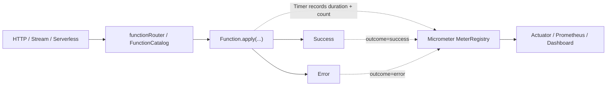

# Measuring Duration, Invocation Count, and Error Rate

## Learning Objectives

After this lesson, you will be able to:

1. Identify the **unit of measurement** for Spring Cloud Function `Supplier`, `Function`, and `Consumer` beans: invocation, item, message, batch, or completed transaction.
2. Use Micrometer `Timer` to record **duration and execution count**, and `Counter` to count other business events while avoiding unnecessary duplicate counting.
3. Define an **error rate** with a clear denominator computed over time windows, without confusing function errors with HTTP 5xx or broker errors.
4. Instrument a `Function<String, String>` bean with `function` and `outcome` tags, and unit-test it with `SimpleMeterRegistry`.
5. Inspect meters using Spring Boot Actuator and Prometheus, distinguishing COUNT, TOTAL_TIME, mean, percentiles, and histograms.
6. Measure at the right boundary for `functionRouter`, composition, HTTP, Spring Cloud Stream, serverless, and reactive `Flux`.
7. Design dashboards, alerts, and troubleshooting checks when metrics are missing, spike unexpectedly, or become skewed by retries and high-cardinality tags.

## 1. Why Measure All Three Signals Together?

Spring Cloud Function helps write protocol-independent business logic using `Supplier<T>`, `Function<T,R>`, and `Consumer<T>` beans. `FunctionCatalog` registers and looks up functions while supporting composition and message conversion; adapters can invoke the same logic over HTTP, events, or serverless runtimes.

A `normalizeText` function may still appear in `FunctionCatalog`, yet that alone **does not tell you**:

- How many times the function was invoked.
- How long each invocation took.
- How many invocations succeeded or failed.

Diagnosing these three quantities together is usually the best starting point for function-level observability.

| Quantity | Question | Illustrative example |
| --- | --- | --- |
| **Invocation count** | Is the function executing? Is traffic rising or falling? | `normalizeText`: 1,200 invocations in 5 minutes |
| **Duration** | How long does one invocation take? | Mean 12 ms; P95 40 ms |
| **Error rate** | Out of measured invocations, how many failed the success criteria? | 42 errors out of 1,200 invocations = **3.5%** |

Measuring only one quantity can mislead you: a low P95 with almost no traffic does not prove the service is healthy; high invocation count paired with high error rate might indicate relentless retries.



**The goal is to measure at the exact execution boundary.** A function-level metric increments only when the function actually runs; it does not automatically include wait time in the web server, binder, or cloud platform.

## 2. Lock In the Unit of Measurement Before Choosing a Metric

Not every functional bean shares the same lifecycle:

| Function type | Natural unit | Easily confused with |
| --- | --- | --- |
| `Supplier<T>` | One `get()` call | Number of items produced, especially when returning a list |
| `Function<T,R>` | One `apply(T)` call | HTTP request count or committed business results |
| `Consumer<T>` | One `accept(T)` call | Persistently committed side effects |
| `Function<Message<T>,R>` | Processing one Spring `Message` | Number of records inside a batch payload |
| `Function<Flux<T>,Flux<R>>` | Pipeline creation, one subscription, or one element depending on design | Counting all three units interchangeably |
| `RoutingFunction` | One routing decision | Execution counts in each branch or composition step |

For example, a single `Message` may contain 100 orders, yet `Function<List<Order>, List<Receipt>>` is called **once**. Using only an invocation counter yields 1 rather than 100.

Conversely, if `functionRouter` invokes a `validate|enrich|persist` composition and all three functions have their own timers, one `Message` can produce **three function timer recordings**, while the HTTP adapter receives **one request**.

Always write clear metric descriptions: `function invocations`, `input items`, `business commits`, `message attempts`, or `consumer acknowledgments`. These names are not interchangeable.

## 3. Micrometer: How `Counter` and `Timer` Differ

Micrometer is the metrics library integrated by Spring Boot Actuator. `MeterRegistry` manages meters and exports them to various backends through the corresponding registry.

### `Counter`: Monotonically Increasing Events

```java
import io.micrometer.core.instrument.Counter;

Counter rejected = Counter.builder("app.function.rejected")
        .description("Number of inputs rejected due to validation")
        .tag("function", "normalizeText")
        .register(registry);

rejected.increment();
```

A `Counter` only increments by a non-negative amount and is typically used for events such as `rejected`, `discarded`, `retried`, or `committed`. Counters accumulate from JVM startup and reset to 0 on restart; to analyze traffic, look at the **rate of increase over a time window** rather than raw absolute totals.

### `Timer`: Duration **and Count**

```java
import io.micrometer.core.instrument.Timer;

Timer execution = Timer.builder("app.function.execution")
        .description("Duration of one Function.apply call")
        .tag("function", "normalizeText")
        .tag("outcome", "success")
        .register(registry);

execution.record(() -> doSomeWork());
```

At minimum, a `Timer` tracks **COUNT** (number of recordings) and **TOTAL_TIME** (total duration), and may also expose MAX, histograms, and percentiles depending on backend and configuration. Therefore, if every invocation is already recorded by a `Timer`, **you do not need a separate `Counter` just to count those same invocations again**.

| Meter | What does it measure? | Reasonable use case |
| --- | --- | --- |
| `Counter` | Event count | Number of orders rejected by validation |
| `Timer` | Count + duration of a code block | Execution time of each `normalizeText.apply` |
| `DistributionSummary` | Distribution of a non-time value | Payload size (bytes), item count per batch |
| `Gauge` | Value at observation time | Number of tasks currently pending |
| `LongTaskTimer` | Duration of in-flight long-running tasks | Long-running or continuous batch/operations |

**Keep in mind:** `Timer` already contains the invocation count. A separate `Counter` only makes sense when it represents **a different event** (such as invalid inputs) or a clearly distinct measurement boundary.

## 4. Formulas for Invocation Count, Duration, and Error Rate

Suppose all invocations of a function are recorded into two `Timer` meters sharing the same name, distinguished by `outcome=success` and `outcome=error`.

Over an observation window `W`:

\[
N_{\mathrm{total}}(W)
= N_{\mathrm{success}}(W) + N_{\mathrm{error}}(W)
\]

\[
\mathrm{ErrorRate}(W)
= \frac{N_{\mathrm{error}}(W)}{N_{\mathrm{total}}(W)} \times 100\%
\]

If in 5 minutes there are 1,158 successes and 42 errors, then:

\[
\mathrm{ErrorRate}(5\,\mathrm{min})
= \frac{42}{1158+42}\times100\% = 3.5\%
\]

**Condition:** the denominator must be non-zero. With zero traffic, the error rate is **undefined**; do not treat missing data as 0% and conclude the service is healthy.

### Common Duration Statistics

| Statistic | Meaning | Note |
| --- | --- | --- |
| `count` | Number of timer recordings | Equals invocation count at the instrumented boundary |
| `totalTime` | Sum of call durations | Used to compute the mean |
| **Mean** | `totalTime / count` | Easily skewed by a few very slow requests |
| **P50** | Half of calls complete at or below P50 | Requires appropriate distribution data |
| **P95/P99** | 95%/99% of calls complete at or below the threshold | Requires configured histograms or percentile publishing |
| **Max** | Maximum value observed in the meter's rolling window | Not necessarily the max since JVM startup |

A `Timer` does not automatically emit Prometheus percentiles or histogram buckets unless you configure them. Multi-instance percentiles **must not be computed by averaging per-instance P95 values**; in Prometheus, aggregate buckets first and then compute percentiles.

### Defining What Counts as an Error

A function can:

- Throw `IllegalArgumentException` on invalid input.
- Throw an exception due to a downstream timeout.
- Return `Result.failure(...)` **without throwing an exception**.
- Accept a `Message` while an asynchronous DB write fails later.

These are four distinct scenarios. The code example below uses a simple rule: **if the function throws, `outcome=error`**; if it returns normally, `success`. In production systems, you may need separate outcomes such as `rejected`, `business_failure`, `technical_error`, and `cancelled`, along with documentation defining the denominator for each SLI.

## 5. Spring Cloud Function Example Measuring All Three Quantities

The application uses `Function<String,String>` and instruments inside the lambda. This ties measurements to **actual `apply` invocations**, whether triggered through `FunctionCatalog`, HTTP, or a message broker.

### 5.1. Dependencies

Manage Spring Boot and Spring Cloud Function with compatible versions via BOM/dependency management:

```xml
<dependency>
    <groupId>org.springframework.boot</groupId>
    <artifactId>spring-boot-starter-actuator</artifactId>
</dependency>

<!-- Used when running the Function Web example over HTTP. -->
<dependency>
    <groupId>org.springframework.cloud</groupId>
    <artifactId>spring-cloud-starter-function-web</artifactId>
</dependency>
```

`spring-boot-starter-actuator` provides Micrometer integration; `MeterRegistry` is auto-configured by Spring Boot when conditions match. If you use only Spring Cloud Function context without Actuator, supply an appropriate registry yourself.

### 5.2. Registering the `normalizeText` Bean

```java
package com.example.functionmetrics;

import java.util.Locale;
import java.util.function.Function;

import io.micrometer.core.instrument.Counter;
import io.micrometer.core.instrument.MeterRegistry;
import io.micrometer.core.instrument.Timer;

import org.springframework.boot.SpringApplication;
import org.springframework.boot.autoconfigure.SpringBootApplication;
import org.springframework.context.annotation.Bean;

@SpringBootApplication
public class FunctionMetricsApplication {

    public static void main(String[] args) {
        SpringApplication.run(FunctionMetricsApplication.class, args);
    }

    @Bean
    public Function<String, String> normalizeText(MeterRegistry registry) {
        Timer successTimer = Timer.builder("app.function.execution")
                .description("One Function.apply execution")
                .tag("function", "normalizeText")
                .tag("outcome", "success")
                .register(registry);

        Timer errorTimer = Timer.builder("app.function.execution")
                .description("One Function.apply execution")
                .tag("function", "normalizeText")
                .tag("outcome", "error")
                .register(registry);

        Counter rejectedInput = Counter.builder("app.function.rejected")
                .description("Input rejected due to validation")
                .tag("function", "normalizeText")
                .register(registry);

        return input -> {
            Timer.Sample sample = Timer.start(registry);
            boolean success = false;

            try {
                if (input == null || input.isBlank()) {
                    rejectedInput.increment();
                    throw new IllegalArgumentException("Blank input");
                }

                String result = input.trim().toUpperCase(Locale.ROOT);
                success = true;
                return result;
            }
            finally {
                sample.stop(success ? successTimer : errorTimer);
            }
        };
    }
}
```

This snippet registers **two series under the same Timer name**:

- `app.function.execution{function=normalizeText,outcome=success}`.
- `app.function.execution{function=normalizeText,outcome=error}`.

And a semantically distinct Counter:

- `app.function.rejected{function=normalizeText}`: count of inputs failing validation.

Notice in particular:

1. Both timers are registered at bean creation time, so success and error series may already appear with `count=0` before traffic arrives.
2. Each `apply` call executes **exactly one `sample.stop`** in either the success or error branch.
3. `rejectedInput` increments only when input is rejected; it represents **a specific error subcategory**, not another total invocation counter.
4. Any failure raised before `success = true` is recorded under `outcome=error`. Normal returns are recorded under `success`.
5. This instrumentation knows nothing about HTTP status codes or broker acknowledgments; it measures only the function body.

**Clear limitation:** if a call returns a business failure object without throwing, such as `Result.failure(...)`, the snippet above still records `success`. Adapt the outcome rule to match your business contract when needed.

### 5.3. Why Not Blindly Annotate `@Bean` with `@Timed`?

The `@Bean normalizeText(...)` method only **creates the `Function` object**. If an annotation instruments only **that factory method**, it measures bean construction, **not** each time an adapter invokes the `Function.apply` lambda.

To use `@Observed`, `@Timed`, or proxies/AOP, you must instrument **the actual execution method/invocation**, ensure annotation support and required AOP dependencies are enabled, and avoid duplicate observations. For lambda-based functional beans, instrumenting inside `apply` or using a tested wrapper is usually clearer.

## 6. Unit-Testing Invocation Count, Outcome, and Timer

Micrometer provides `SimpleMeterRegistry` for testing without an HTTP server, Prometheus, or a broker.

```java
package com.example.functionmetrics;

import static org.junit.jupiter.api.Assertions.assertEquals;
import static org.junit.jupiter.api.Assertions.assertThrows;
import static org.junit.jupiter.api.Assertions.assertTrue;

import java.util.concurrent.TimeUnit;
import java.util.function.Function;

import io.micrometer.core.instrument.Timer;
import io.micrometer.core.instrument.simple.SimpleMeterRegistry;
import org.junit.jupiter.api.Test;

class FunctionMetricsTest {

    @Test
    void countDurationAndErrorsComeFromOneFunction() {
        try (SimpleMeterRegistry registry = new SimpleMeterRegistry()) {
            Function<String, String> fn =
                    new FunctionMetricsApplication().normalizeText(registry);

            assertEquals("HELLO", fn.apply(" hello "));
            assertEquals("SPRING", fn.apply("spring"));
            assertThrows(IllegalArgumentException.class,
                    () -> fn.apply("   "));

            Timer success = registry.get("app.function.execution")
                    .tag("function", "normalizeText")
                    .tag("outcome", "success")
                    .timer();

            Timer error = registry.get("app.function.execution")
                    .tag("function", "normalizeText")
                    .tag("outcome", "error")
                    .timer();

            assertEquals(2L, success.count());
            assertEquals(1L, error.count());

            assertEquals(1.0,
                    registry.get("app.function.rejected")
                            .tag("function", "normalizeText")
                            .counter().count());

            assertTrue(success.totalTime(TimeUnit.NANOSECONDS) >= 0);
            assertEquals(3L, success.count() + error.count());
        }
    }
}
```

The test verifies **two successes, one error, three total invocations**, and one validation rejection. It does not assert an exact nanosecond duration because execution speed depends on the environment.

This is a **unit test of the function and its instrumentation**; it does not prove that `FunctionCatalog` registered the bean, the HTTP endpoint is exposed, the binder receives events, or Prometheus is scraping successfully. Add dedicated integration tests when verifying those layers.

## 7. Observing Metrics via Spring Boot Actuator

With Spring Boot Web and Actuator, enable the `metrics` endpoint in a controlled environment:

```yaml
management:
  endpoints:
    web:
      exposure:
        include: "health,info,metrics"
  metrics:
    tags:
      application: function-metrics-demo
```

Once the application has invoked `normalizeText`, you can query:

```bash
# View the list of meter names.
curl -i http://localhost:8080/actuator/metrics

# View the Timer aggregated across outcomes.
curl -i http://localhost:8080/actuator/metrics/app.function.execution

# View only failed invocations.
curl -i "http://localhost:8080/actuator/metrics/app.function.execution?tag=function:normalizeText&tag=outcome:error"

# View the validation Counter.
curl -i http://localhost:8080/actuator/metrics/app.function.rejected
```

The JSON from `/actuator/metrics/{meterName}` may look like:

```json
{
  "name": "app.function.execution",
  "measurements": [
    {"statistic": "COUNT", "value": 3.0},
    {"statistic": "TOTAL_TIME", "value": 0.005},
    {"statistic": "MAX", "value": 0.003}
  ],
  "availableTags": [
    {"tag": "outcome", "values": ["success", "error"]}
  ]
}
```

This is **illustrative JSON showing structure**, not fixed measurements. `COUNT=3` here is the sum of two successes and one error. Durations, units, MAX, ordering, and `availableTags` can differ depending on the backend, registry, or active filters.

If you query with `tag=outcome:error`, only meters matching that tag are aggregated. Actuator does not compute a **5-minute error rate** for you by dividing current COUNT values; that calculation requires increments over **the same time window**.

### Two Frequently Confused Endpoints

- `GET /actuator/functions`: metadata of functions in `FunctionCatalog`; **not** invocation counts.
- `GET /actuator/metrics/app.function.execution`: duration and count measurements for `app.function.execution`; populated only if the corresponding instrumentation is registered.

When a meter is missing, do not immediately conclude the function does not exist. Check bean instrumentation, the registry, meter names, meter creation conditions, profiles, and whether the adapter invokes the right function.

## 8. Exporting to Prometheus and Calculating Error Rate

If your system uses Prometheus, add the registry compatible with your Micrometer version:

```xml
<dependency>
    <groupId>io.micrometer</groupId>
    <artifactId>micrometer-registry-prometheus</artifactId>
</dependency>
```

Enable web exposure:

```yaml
management:
  endpoints:
    web:
      exposure:
        include: "health,metrics,prometheus"
```

Prometheus can then scrape `/actuator/prometheus` over an authorized management network. Meter names in code are converted according to the registry's naming convention; a `Timer` may export series such as:

```text
app_function_execution_seconds_count{function="normalizeText",outcome="success"}
app_function_execution_seconds_count{function="normalizeText",outcome="error"}
app_function_execution_seconds_sum{function="normalizeText",outcome="success"}
app_function_execution_seconds_sum{function="normalizeText",outcome="error"}
```

These are **typical series name examples** for the Prometheus registry; inspect the actual scraped output before building dashboards, as naming conventions and tag configurations can vary across versions and exporters.

### 8.1. Invocations per Second

Example PromQL calculating invocation rate over 5 minutes:

```promql
sum by (function) (
  rate(app_function_execution_seconds_count[5m])
)
```

Because the `Timer` is split by `outcome`, `sum by (function)` sums both success and error calls for that function. `rate(...[5m])` handles monotonically increasing counters over time and handles process restarts better than subtracting two arbitrary raw points.

### 8.2. Error Rate by Function

```promql
sum by (function) (
  rate(app_function_execution_seconds_count{outcome="error"}[5m])
)
/
sum by (function) (
  rate(app_function_execution_seconds_count{outcome=~"success|error"}[5m])
)
```

The query returns a **ratio from 0 to 1**, e.g., `0.035` corresponding to `3.5%`. In a Grafana panel, use the **Percent (0.0–1.0)** unit to display percentages, or multiply by 100 if the dashboard uses 0–100 percentage units.

Notes:

1. This query assumes `outcome` **only has `success` and `error`** and both series are registered.
2. If a service adds `rejected`, `cancelled`, or `timeout`, redefine the numerator and denominator rather than reusing the formula verbatim.
3. When total traffic is 0, division is undefined. Never treat missing-data results as evidence of a 0% error rate.
4. When combining multiple functions, decide whether you want a **traffic-weighted** aggregate rate. Never take the unweighted arithmetic mean of error rates across functions with vastly different traffic volumes.

### 8.3. Mean Duration

```promql
sum by (function) (
  rate(app_function_execution_seconds_sum[5m])
)
/
sum by (function) (
  rate(app_function_execution_seconds_count[5m])
)
```

The unit is typically **seconds per invocation**. If the denominator is tiny or 0, the result can be noisy or undefined. The mean hides slow tail requests, so dashboards usually pair it with percentiles.

### 8.4. Conditional P95

Using `histogram_quantile` in Prometheus requires **actual exported histogram buckets**. Example configuration in Spring Boot:

```yaml
management:
  metrics:
    distribution:
      percentiles-histogram:
        app.function.execution: true
```

Once the output includes `app_function_execution_seconds_bucket`, you can compute:

```promql
histogram_quantile(
  0.95,
  sum by (function, le) (
    rate(app_function_execution_seconds_bucket[5m])
  )
)
```

Do not write P95 queries before verifying actual bucket names and histogram configuration. Histograms increase time-series cardinality, especially with multiple tags and buckets. Enable them only on meters tied to latency SLOs while keeping your observability budget under control.

## 9. Measuring the Right Duration: Function vs. HTTP vs. Broker

The same `Function<String,String>` can be invoked via `FunctionCatalog.lookup("normalizeText")`, an HTTP adapter, or Spring Cloud Stream. However, different timers measure **different intervals**.

| Scope | What interval is measured? | Example metric |
| --- | --- | --- |
| **Function body** | From entering `Function.apply` until returning/throwing | Custom `app.function.execution` |
| **HTTP server** | Processing one request through the web stack, including layers before/after the function | Spring Boot's `http.server.requests` |
| **Binder/consumer** | Receiving, converting, dispatching, ack/retry depending on instrumentation | Binder/broker-specific meters |
| **Platform** | Invocations, runtime execution, cold starts/timeouts, resources | Cloud provider/JVM/Kubernetes metrics |

HTTP example:

```text
HTTP receive
  -> security/filter
  -> payload decoding/conversion
  -> FunctionCatalog/functionRouter
  -> normalizeText.apply(...)       [app.function.execution]
  -> response serialization
  -> HTTP response sent             [http.server.requests]
```

If `http.server.requests` P95 is 500 ms while `app.function.execution` P95 is 10 ms, the remaining time is spent in queues, security, conversion, serialization, networking, or downstream calls outside the measured block. **Do not immediately blame function code for slowness.**

### When a Router or Composition Is Involved

If an adapter invokes `functionRouter` and the router selects `normalizeText`, the function metric records an invocation when the instrumented bean is actually called. However:

- A **route selection** error occurring before entering `normalizeText` does not increment the function's Timer.
- A composition like `validate|normalizeText` can increment the Timers of both `validate` and `normalizeText`.
- Measuring only the target bean hides the latency of routing and conversion steps themselves.

To observe routing, add dedicated instrumentation at the routing decision point or in adapter hooks where available; do not repurpose function metrics to infer pre-lookup routing failures.

## 10. `Supplier`, `Consumer`, and Retries: Which Count Is Right?

### `Supplier`

A `Supplier<OrderBatch>` may be called once and return 200 orders. In that case:

- Invocation count of `Supplier.get()` = 1.
- Items produced = 200.

If you need both, use a `Timer` for `get()` and a separately **well-defined** `Counter` or `DistributionSummary` for item counts. Avoid reusing `app.function.calls` for two different units.

### `Consumer`

A `Consumer<Order>` may receive an order, write to a DB, and return `void`. If a successful DB commit is the business criterion, increment `orders.committed` **after the write succeeds**, not immediately upon entering `accept`.

With asynchronous work, `accept` returning **does not mean** the side effect finished. Measure in the actual completion callback, or use an appropriate reactive model.

### Retries and Dead-Letter Queues

When a binder retries a `Message` three times before succeeding:

```text
Message M1
  attempt 1 -> function error
  attempt 2 -> function error
  attempt 3 -> function success
```

If the `Timer` sits inside the function, you measure **3 invocations**, with **2 errors and 1 success**. This is a **per-attempt** error rate, not the final per-message failure rate. To count unique completed messages, measure **a single business state** at the appropriate commit/ack boundary alongside idempotency/correlation.

Similarly, routing to a DLQ can be a transport-layer outcome even when the function throws. Do not mix `function execution errors`, `broker delivery failures`, and `business transactions failed` into the same denominator.

## 11. Reactive `Flux`: Do Not Measure Only Pipeline Assembly

For a reactive function:

```java
Function<Flux<String>, Flux<String>>
```

calling `apply(flux)` typically **only constructs the Publisher**; real work happens upon subscription. A `Timer` wrapping `apply` may measure a few microseconds of pipeline assembly without measuring individual elements.

### Measuring Per-Element Processing in Reactor Operators

```java
import java.util.Locale;
import java.util.function.Function;

import io.micrometer.core.instrument.MeterRegistry;
import io.micrometer.core.instrument.Timer;
import org.springframework.context.annotation.Bean;
import reactor.core.publisher.Flux;

@Bean
public Function<Flux<String>, Flux<String>> uppercaseStream(
        MeterRegistry registry) {
    Timer elementTimer = Timer.builder("app.function.element.duration")
            .tag("function", "uppercaseStream")
            .register(registry);

    return flux -> flux.map(value ->
            elementTimer.record(() -> value.toUpperCase(Locale.ROOT)));
}
```

Here each item passing through `map` receives a transformation timing measurement. `elementTimer.count()` therefore tracks **elements passing through the operator**, not subscriptions or broker messages.

**Note on errors:** `Timer.record(...)` still records duration if the lambda throws, but the Timer above has no `outcome` tag. If you need a per-element error rate, classify outcomes right at the element boundary instead of inferring it from a stream-wide counter.

### Measuring an Entire Subscription

If the goal is to measure **the time from subscription until the stream terminates**, start a `Timer.Sample` inside `Flux.defer`, stop it in `doFinally`, and distinguish `ON_COMPLETE`, `ON_ERROR`, and `CANCEL` using Reactor's `SignalType`. Measurements must be initialized **per subscription**, since a Publisher can have multiple subscribers.

For infinite streams, "stream completion time" may be meaningless or occur only upon cancellation. In those cases, measuring **element rate, per-element latency, in-flight items, and errors over time** is usually more useful.

## 12. Tags, Cardinality, and Outcome Definitions

Tags let you slice metrics by function and outcome, but every tag combination creates another time series.

| Recommended tags | Why | Tags to avoid |
| --- | --- | --- |
| `function=normalizeText` | Bounded set of function names | Arbitrary client-supplied function names |
| `outcome=success/error` | Small set of states | Full exception messages |
| `operation=upper/reverse` when allowlisted | Stable list of operations | Payloads or request bodies |
| `environment=prod/staging` | Environment comparison | `userId`, `orderId`, `requestId` |
| `error_type=validation/timeout/internal` | Bounded failure categories | Stack traces or dynamic URLs |

Never put tokens, email addresses, sensitive personal data, or correlation IDs into metric labels. Details needed to investigate individual requests belong in **access-controlled logs/traces with retention limits**, not time-series tags.

### Classify Errors Clearly Enough for Alerting

For public APIs, missing or malformed input is usually treated as `rejected` or a client error, **not necessarily a server outage**. The article's sample code folds validation rejections into `outcome=error` to keep the formula simple; that is a simplifying choice, not a mandatory standard.

When a product needs an availability SLI, you can separate:

```text
success           -> completed according to contract
rejected          -> invalid input / intentionally rejected
technical_error   -> exception caused by server or downstream
cancelled         -> cancelled by client or subscriber
```

Then define the **technical error rate** as `technical_error / eligible_attempts`, without necessarily counting `rejected` in the numerator. Document the classification in a shared spec so dashboards and alerts keep consistent semantics across releases.

## 13. Designing Dashboards and Alerts

A foundational per-function dashboard should contain:

| Panel | Formula or source | Question |
| --- | --- | --- |
| **Throughput** | `rate(timer_count[5m])` | How many times per second is the function running? |
| **Error rate** | `error_count / total_count` over the same window | Is the invocation error rate increasing? |
| **Latency mean** | `rate(timer_sum) / rate(timer_count)` | How long does an invocation take on average? |
| **Latency P95/P99** | Configured histogram buckets or percentiles | Is the tail latency abnormally slow? |
| **Rejected inputs** | `rate(app.function.rejected[5m])` | Are validation rejections spiking? |
| **HTTP/binder/platform** | Adapter and runtime metrics | Which layer is causing the incident? |

### Windowed Alert Example

Suppose a service has steady traffic and an internal SLO; you might alert when **error rate > 1% over 5 minutes**, while also requiring **a minimum invocation volume** to avoid noisy alerts from one error out of a handful of requests.

This is a **design example**, not a universal threshold for every service. Scheduled functions running a few times per day require their own windows and criteria. Multi-region services must aggregate across instances with identical semantics rather than averaging per-pod error rates.

When function duration rises, compare against:

- HTTP latency from `http.server.requests` if a web adapter is present.
- Binder consumer lag/retries if a broker is used.
- Platform CPU, GC, memory, throttling, and instance counts.
- Downstream latency via traces or client metrics.

**A fast function timer does not prove the end-to-end system is fast**, and an HTTP 2xx response does not prove all business side effects have committed.

## 14. Diagnostic Table for Missing or Misleading Metrics

| Symptom | Common cause | How to check |
| --- | --- | --- |
| `app.function.execution` missing in Actuator | Bean uninstrumented, registry unconfigured, or function never called | Check `MeterRegistry`, timer setup, and catalog calls |
| Timer `count=0` despite HTTP requests | Request never reached the function, rejected at web layer, or routed elsewhere | Check HTTP mappings, `functionRouter`, headers, and logs |
| `http.server.requests` rises while function count stays flat | Failure before entering function, or HTTP hit another route | Check security, conversion, endpoints, and handlers |
| Function count exceeds HTTP requests | Non-HTTP triggers, multi-step compositions, or retries | Break down by trigger source and invocation boundary |
| Function error rate rises while HTTP 5xx does not | Errors handled/swallowed by adapter, retries, or broker errors | Inspect actual outcomes and retry/DLQ counts |
| HTTP 5xx rises while function error count stays flat | Failure in middleware, routing, serialization, or network | Check stack traces and failure timestamps |
| Error rate shows 0 during zero traffic | Dashboard coerces missing values to 0 | Preserve `no data` state and inspect the denominator |
| P95 does not appear | Histograms/percentiles disabled or insufficient data | Check buckets, registry, and statistics configuration |
| `rate` drops sharply after deployment | Process restart/reset, scrape gap, or label change | Check `up`, restarts, instance labels, and time range |
| Time-series explosion | Tags contain dynamic IDs/requests/payloads or too many buckets | Bound tag cardinality using finite categories |
| Reactive timer is tiny while users see slowness | Only measured pipeline construction in `apply` | Instrument Reactor signals where items are processed |
| One message retried 3 times reports 3 transactions | Counting attempts instead of unique commits | Define a business metric after idempotent commit |
| Prometheus metric name differs from Actuator | Different naming conventions, units, or backend formats | Read the actual `/actuator/prometheus` output |

### Systematic Analysis Checklist

```text
1. What does the metric measure: invocation, item, message, batch, or commit?
2. At which execution boundary is the instrumentation placed?
3. Is the Counter/Timer registered in MeterRegistry?
4. Is the application actually calling the instrumented bean via FunctionCatalog?
5. Which criterion determines outcome=success vs. error?
6. Which tags does the metric carry, and is cardinality bounded?
7. Does the dashboard use the same time window and right denominator?
8. Does the Timer publish histograms if P95/P99 is needed?
9. Do retries, batching, composition, or reactive subscriptions alter counts?
10. Do HTTP, binder/broker, and platform metrics corroborate the same root cause?
```

## 15. Practice Exercises

1. Write `Function<String,String> normalizeText` and instrument two Timers for `outcome=success/error`. Invoke it 4 times successfully and once throwing an exception, then compute the invocation count and error rate.
2. Explain why `Timer.count()` suffices for counting invocations when every call is timed; add a `Counter` solely for validation rejections and explain the difference.
3. Using `SimpleMeterRegistry`, write a test asserting `success.count()=2`, `error.count()=1`, and `rejected.count()=1` with inputs from Section 6.
4. Enable `/actuator/metrics`; verify meter presence before and after invoking `normalizeText`. Filter using `tag=function:normalizeText&tag=outcome:error`.
5. Add the Prometheus registry. Verify the actual `_count` and `_sum` series names, then write PromQL queries for throughput, error rate, and mean latency over a 5-minute window.
6. Selectively enable histograms and write a P95 query. Explain why service-wide P95 must not be calculated by averaging per-pod P95 values.
7. Configure `functionRouter` to choose between `normalizeText` and another function. Send a request targeting a nonexistent route and explain why `normalizeText`'s Timer does not increment.
8. Using Spring Cloud Stream, simulate a message retried three times before succeeding. Design two metrics—`processing_attempts` and `business_commits`—and explain the denominator for each error rate.
9. Write `Function<Flux<String>,Flux<String>>` and place a timer first around `apply(flux)` and then inside `map`. Compare the measurement unit and when counts increment.
10. Design an availability SLI for a service with both validation errors and downstream failures. Decide which failures belong in the numerator of `technical_error_rate` and justify your choice.
11. A deployment shows rising HTTP P95 while the function Timer stays flat. Outline an investigation sequence covering the adapter, serialization, threads/queues, GC, CPU, and downstream dependencies.
12. Propose a metric tag set for a multi-tenant application that avoids `userId`, `traceId`, `orderId`, and sensitive data as high-cardinality tags.

## Key Takeaways

- **Choose the right unit of measurement** first: function invocations, reactive elements, message attempts, and business commits are distinct units.
- Micrometer `Timer` records both **count** and **duration**; `Counter` is suited for counting separate events such as rejected inputs or completed transactions.
- **Error rate** is the error count divided by **total eligible invocations in the same time window**; define `outcome`, the denominator, and how zero-traffic windows are handled.
- Instrument directly along the **actual `Function.apply`/`Consumer.accept` path**, not only in the `@Bean` factory; for `Flux`, measure at subscription or per-element processing time.
- Use Actuator `/actuator/metrics` to inspect meters, Prometheus `rate` to compute rates/ratios over time, and histograms for P95/P99 when needed.
- Function metrics **do not replace** HTTP, binder/broker, or runtime metrics. Correlate across layers to explain end-to-end latency/errors, retries, and lost business data.

### Official References

- [Micrometer — Timers](https://docs.micrometer.io/micrometer/reference/concepts/timers.html)
- [Micrometer — Counters](https://docs.micrometer.io/micrometer/reference/concepts/counters.html)
- [Micrometer — Meter Filters and Cardinality](https://docs.micrometer.io/micrometer/reference/concepts/meter-filters.html)
- [Spring Boot — Metrics and Actuator Metrics Endpoint](https://docs.spring.io/spring-boot/reference/actuator/metrics.html)
- [Spring Boot — Observability and Observation Annotations](https://docs.spring.io/spring-boot/reference/actuator/observability.html)
- [Spring Cloud Function — Programming Model and FunctionCatalog](https://docs.spring.io/spring-cloud-function/reference/spring-cloud-function/programming-model.html)
- [Project Reactor — Reference Guide](https://projectreactor.io/docs/core/release/reference/)
