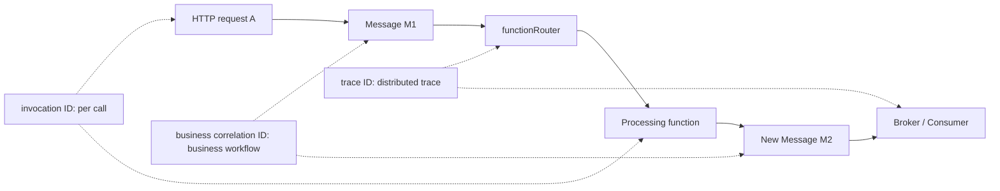

# Correlating Logs by Invocation ID and Message ID

## Learning Objectives

After this lesson, you will be able to:

1. Distinguish **invocation ID**, **message ID**, **business correlation ID**, and **trace ID/span ID**.
2. Explain why `MessageHeaders.ID` is not a durable identifier across message transformations or broker redeliveries.
3. Attach context to logs inside a `Function<Message<T>, R>` using SLF4J **MDC (Mapped Diagnostic Context)** and clean up the scope properly.
4. Carry correlation IDs from HTTP into Spring `Message` objects, and onward through `FunctionCatalog`, `functionRouter`, and event binders when needed.
5. Enable Micrometer Tracing to correlate log lines using `traceId` and `spanId`, while understanding **context propagation** requirements across threads and reactive pipelines.
6. Write tests verifying that correlation IDs are preserved across two messages, invocation IDs differ per call, and MDC never leaks into subsequent invocations.
7. Diagnose retries, duplicate deliveries, missing headers, async logs lacking IDs, and security risks when accepting client-supplied IDs.

## 1. Why a Single Log Line Is Usually Not Enough

**Spring Cloud Function** encourages packaging business logic as `Supplier`, `Function`, and `Consumer` beans, looked up via `FunctionCatalog`, with support for composition and message conversion. The same function can be called directly in Java, over HTTP, via Spring Cloud Stream, or in a serverless environment.

Suppose a service has `functionRouter`, a `Function<String, String> uppercase`, and a `Consumer<Order> saveOrder`. During peak traffic, the system logs:

```text
INFO  Received request
INFO  Function selected: saveOrder
ERROR Database timeout
INFO  Message delivered
```

These log lines can belong to **completely different requests and messages**. Even with timestamps and thread names, it is hard to answer:

- Which request triggered the `Database timeout` line?
- Was one message retried twice, or were there two independent messages?
- Which HTTP request emitted a given event?
- When a function constructs a new message, does the new message share the original message's ID?
- Do logs inside a Reactor thread or thread pool still carry the original request's context?

The solution is to use **multiple identifiers with clearly defined scopes**, and attach them to logs at the right execution boundaries.



The goal is not to stuff every piece of data into every log line, but to select a queryable set of fields sufficient to stitch steps together without leaking sensitive data.

## 2. Four Identifier Types — Four Distinct Meanings

| Identifier type | Scope | Typical source | When does it change? |
| --- | --- | --- | --- |
| **Invocation ID** | One invocation or one processing attempt | Generated by app/adapter when receiving an invocation | Changes on the next execution or retry if measured per attempt |
| **Message ID** | One `Message` object | `MessageHeaders.ID` assigned by Spring Messaging | Can change when constructing a new message or crossing an adapter/broker |
| **Business correlation ID** | A multi-step job or business workflow | Generated by app or validated from inbound request | **Intentionally preserved** when creating downstream messages |
| **Trace ID / Span ID** | One distributed trace / one span | Micrometer Tracing and tracer | Trace ID stays shared within the trace; span ID changes per span |

Example:

```text
businessCorrelationId = workflow-72
traceId               = 4f8e...d91a

Message M1: messageId=uuid-a, invocationId=inv-001, spanId=span-1
Message M2: messageId=uuid-b, invocationId=inv-002, spanId=span-2
Retry M2:   messageId=uuid-c (possible), invocationId=inv-003,
            spanId=span-3, businessCorrelationId still workflow-72
```

This is a **design convention**: a system may use different field names or granularity, provided their semantics are documented and enforced consistently across producers and consumers.

### Invocation ID Is Not the Call Count of a Business Workflow

One business workflow can trigger multiple invocations. Conversely, a single batch invocation can process multiple business items. Particularly in serverless runtimes, one **platform invocation ID** may receive a batch of messages; if you need per-item or per-attempt tracking, assign IDs **at the appropriate processing level** rather than assuming one platform ID represents every message.

### Message ID Is Not a Kafka Record Identifier

The UUID from `MessageHeaders.getId()` identifies a **Spring Message**, not a Kafka `topic-partition-offset` or a broker delivery tag. Brokers maintain their own metadata to identify offsets, redeliveries, or records. A message undergoing deserialization/transformation/republishing can receive a new ID; never use Spring's message ID as a cross-broker idempotency key unless a specific preservation contract exists.

### Trace ID Is Not a Business Key

A trace typically represents **an observation journey**; sampling, async boundaries, batching, or message splitting/merging can cause traces not to map one-to-one with business transactions. A stable business correlation ID remains valuable even when tracing is disabled or spans are not exported.

## 3. Message Lifecycle and the Meaning of `MessageHeaders.ID`

Spring Messaging provides:

```java
import org.springframework.messaging.Message;
import org.springframework.messaging.MessageHeaders;

Message<?> message = ...;
MessageHeaders headers = message.getHeaders();

Object payload = message.getPayload();
java.util.UUID currentMessageId = headers.getId();
Long createdAt = headers.getTimestamp();
```

Normally, `MessageHeaders.ID` is a UUID generated when the message is built. This header is **read-only** under Spring Messaging/Spring Integration APIs: do not design an application that tries to overwrite `id` manually and expect the framework to preserve it.

An illustrative example:

```java
import org.springframework.messaging.Message;
import org.springframework.messaging.support.MessageBuilder;

Message<String> first = MessageBuilder.withPayload("hello")
        .setHeader("businessCorrelationId", "workflow-72")
        .setHeader("invocationId", "inv-001")
        .build();

Message<String> second = MessageBuilder.withPayload("HELLO")
        .setHeader("businessCorrelationId",
                first.getHeaders().get("businessCorrelationId"))
        .setHeader("invocationId", "inv-002")
        .build();

System.out.println(first.getHeaders().getId());
System.out.println(second.getHeaders().getId());
```

Two newly built messages typically get two different UUIDs, yet share the **same business correlation ID** because the application intentionally copied it. The header name `businessCorrelationId` is an example convention, not a mandatory Spring Cloud Function header name.

Do not assume every adapter automatically copies custom headers across HTTP, Kafka, RabbitMQ, or FaaS. Always check serialization, header mapping, trusted headers, and header size limits for your transport.

### Spring Integration `correlationId` vs. Custom Headers

Spring Integration defines `IntegrationMessageHeaderAccessor.CORRELATION_ID` (commonly used in splitter/aggregator/resequencer flows). Its purpose is **grouping related messages** under Spring Integration's contract.

This lesson uses `businessCorrelationId` to avoid conflating:

- A message-grouping ID intended for a Spring Integration aggregator.
- An application-defined tracking ID for a business transaction.
- A distributed trace ID from Micrometer.

If an application chooses to share one field for multiple purposes, define an explicit policy and verify it does not conflict with existing message-processing components.

## 4. Designing a Consistent Set of Log Fields

At a minimum, every important log line at the function layer should carry:

| Field | Example | Purpose |
| --- | --- | --- |
| `service` | `text-processor` | Identifies the service |
| `function` | `uppercase` | Business function currently executing |
| `invocationId` | `inv-001` | Groups logs from a single execution |
| `messageId` | `5aa1...-uuid` | Identifies the Spring `Message` at the current step |
| `businessCorrelationId` | `workflow-72` | Connects separate business steps |
| `traceId`, `spanId` | Hex strings issued by the tracer | Searches logs by distributed trace |
| `outcome` | `success`, `error`, `rejected` | Classifies the result |

In brokered systems, you can add `destination`, `partition`, and `offset` **when those values are genuinely available from the binder**. They are not fixed metadata present on every message.

Illustrative structured log output:

```json
{
  "level": "INFO",
  "service": "text-processor",
  "function": "uppercase",
  "invocationId": "inv-001",
  "messageId": "f6b6b90d-15dd-4bc0-9986-5ff10ba5c58c",
  "businessCorrelationId": "workflow-72",
  "traceId": "b3e7c4a69f31d1922c4d95e6a209c817",
  "spanId": "f84d920917ae0be1",
  "outcome": "success",
  "event": "function_completed"
}
```

This is a **target structure**, not the default JSON output of every Spring Boot logger. Emitting actual JSON requires configuring an appropriate logging formatter/appender; if the system logs plain text, these fields can still be included via MDC or structured log arguments.

## 5. MDC: Attaching IDs to Logs in a Synchronous Invocation

SLF4J **MDC** stores a thread-scoped key-value map; Logback/Log4j2 patterns can render those fields on each log line.

This works well for **imperative `Function` beans** running synchronously on the same thread. However, MDC is not a global workflow store and does not automatically propagate across every thread or Publisher.

### 5.1. Sample Spring Cloud Function Application

The following example registers a bean accepting **Spring `Message<String>`**, allowing it to read the message ID and custom headers. The logger records start, completion, and failure events:

```java
package com.example.functioncorrelation;

import java.util.Locale;
import java.util.Objects;
import java.util.function.Function;

import org.slf4j.Logger;
import org.slf4j.LoggerFactory;
import org.slf4j.MDC;
import org.springframework.boot.SpringApplication;
import org.springframework.boot.autoconfigure.SpringBootApplication;
import org.springframework.context.annotation.Bean;
import org.springframework.messaging.Message;

@SpringBootApplication
public class CorrelatedFunctionApplication {

    private static final Logger log =
            LoggerFactory.getLogger(CorrelatedFunctionApplication.class);

    public static void main(String[] args) {
        SpringApplication.run(CorrelatedFunctionApplication.class, args);
    }

    @Bean
    public Function<Message<String>, String> uppercase() {
        return message -> {
            String invocationId = Objects.toString(
                    message.getHeaders().get("invocationId"), "unknown");
            String messageId = Objects.toString(
                    message.getHeaders().getId(), "unknown");
            String businessCorrelationId = Objects.toString(
                    message.getHeaders().get("businessCorrelationId"),
                    "unknown");

            try (MDC.MDCCloseable inv =
                         MDC.putCloseable("invocationId", invocationId);
                 MDC.MDCCloseable msg =
                         MDC.putCloseable("messageId", messageId);
                 MDC.MDCCloseable corr =
                         MDC.putCloseable("businessCorrelationId",
                                 businessCorrelationId)) {

                log.info("function_started function=uppercase");

                try {
                    String result =
                            message.getPayload().toUpperCase(Locale.ROOT);
                    log.info("function_completed function=uppercase");
                    return result;
                }
                catch (RuntimeException ex) {
                    log.error("function_failed function=uppercase", ex);
                    throw ex;
                }
            }
        };
    }
}
```

Key points to understand:

1. Because the function accepts `Message<String>`, it can access `getHeaders().getId()`.
2. `invocationId` and `businessCorrelationId` are **custom headers** that the caller or adapter must create or attach to the message.
3. `MDC.putCloseable` populates MDC for code inside the `try` block and **removes the entries** when leaving scope.
4. Never manually populate `traceId` or `spanId` with arbitrary values; let the tracer manage them when tracing is enabled.
5. The function only processes text, so it stays reusable across adapters without importing HTTP or Kafka APIs.

This example assumes **a single non-nested MDC layer for the same key names**. If multiple functions or interceptors overwrite `invocationId` in nested scopes, `MDCCloseable.close()` removes the entry rather than restoring the previous value. When nesting is required, build a helper that **saves and restores prior values** in `finally`, or assign one layer to own MDC per invocation.

### 5.2. Configuring a Log Pattern with MDC Fields

On Spring Boot with Logback and support for correlation patterns, you can configure:

```yaml
spring:
  application:
    name: text-processor

logging:
  pattern:
    correlation: "[trace:%X{traceId:-} span:%X{spanId:-} inv:%X{invocationId:-} msg:%X{messageId:-} corr:%X{businessCorrelationId:-}] "
```

This pattern assumes **SLF4J + Logback** and Spring Boot versions supporting `logging.pattern.correlation`. Each `%X{...}` reads an MDC key, and the trailing space separates the correlation prefix from the logger name. If you use a different logging system or structured formatter, configure it according to that backend's capabilities.

When Micrometer Tracing is enabled, Spring Boot usually includes trace/span IDs automatically; customizing the pattern here **adds the three application-managed IDs**. When overriding the correlation pattern, keep `traceId`/`spanId` references matching the active MDC keys so trace correlation in logs is not lost.

**Never assume every field is always populated:** startup logs, health probe logs, or adapter logs emitted before building a Spring `Message` may lack `messageId`; logs outside the function scope may lack `invocationId` from this example.

## 6. Generating and Propagating IDs from HTTP into `FunctionCatalog`

The `X-Correlation-Id` HTTP header is often sent by clients or gateways to tie related requests together. However, **client-supplied headers are not trustworthy by default**: enforce length limits, allowed character sets, authorization rules, and generation rules when missing.

A clear illustration uses a REST controller that **explicitly wraps the HTTP request into a Spring `Message`**, then invokes the function via the catalog. This shows exactly where custom headers are created; it **does not claim Spring Cloud Function Web auto-generates `invocationId` for every request**.

```java
package com.example.functioncorrelation;

import java.util.UUID;
import java.util.function.Function;
import java.util.regex.Pattern;

import org.springframework.cloud.function.context.FunctionCatalog;
import org.springframework.http.ResponseEntity;
import org.springframework.messaging.Message;
import org.springframework.messaging.support.MessageBuilder;
import org.springframework.web.bind.annotation.PostMapping;
import org.springframework.web.bind.annotation.RequestBody;
import org.springframework.web.bind.annotation.RequestHeader;
import org.springframework.web.bind.annotation.RestController;

@RestController
public class CorrelatedHttpController {

    private static final Pattern SAFE_ID =
            Pattern.compile("[A-Za-z0-9._-]{1,64}");

    private final FunctionCatalog catalog;

    public CorrelatedHttpController(FunctionCatalog catalog) {
        this.catalog = catalog;
    }

    @PostMapping("/demo/uppercase")
    public ResponseEntity<String> handle(
            @RequestBody String input,
            @RequestHeader(name = "X-Correlation-Id",
                    required = false) String incomingCorrelation) {

        String invocationId = UUID.randomUUID().toString();
        String businessCorrelationId =
                validOrNew(incomingCorrelation);

        Message<String> message = MessageBuilder.withPayload(input)
                .setHeader("invocationId", invocationId)
                .setHeader("businessCorrelationId", businessCorrelationId)
                .build();

        Function<Message<String>, ?> function =
                catalog.lookup(Function.class, "uppercase");
        if (function == null) {
            throw new IllegalStateException("uppercase is not registered");
        }

        Object result = function.apply(message);
        Object payload = result instanceof Message<?>
                ? ((Message<?>) result).getPayload()
                : result;

        return ResponseEntity.ok()
                .header("X-Invocation-Id", invocationId)
                .body(String.valueOf(payload));
    }

    private static String validOrNew(String value) {
        return value != null && SAFE_ID.matcher(value).matches()
                ? value
                : UUID.randomUUID().toString();
    }
}
```

This snippet requires a web starter alongside Spring Cloud Function. The controller generates a **new invocation ID** for each request it handles and keeps the **correlation ID** when the incoming header is valid. Requests with malformed headers receive a fresh ID; in systems with strict API contracts, you can instead **reject with 400** rather than silently replacing it.

Example invocation:

```bash
curl -i -X POST http://localhost:8080/demo/uppercase \
  -H "Content-Type: text/plain" \
  -H "X-Correlation-Id: workflow-72" \
  --data-raw "hello"
```

The expected business result is `HELLO`; the response carries the server-generated `X-Invocation-Id` header. Logs inside `uppercase` include `invocationId`, `messageId`, and `businessCorrelationId`.

**Endpoint distinction:** `/demo/uppercase` is an application-defined controller. Spring Cloud Function Web also auto-maps functions to HTTP endpoints, but that web adapter does not automatically execute this custom controller code. If you use Function Web directly, implement header generation/normalization at the gateway, servlet/web filter, message enricher, or an appropriate hook, and **test the final headers arriving on `Message`**. Avoid accidentally exposing both a custom controller and a direct function endpoint without consistent authorization policies.

### Why Can One Request Produce Multiple Message IDs?

The controller constructs one `Message`; `RoutingFunction`, message converters, or function composition may construct new message objects at later stages. When that happens, log:

- **The current Message ID** at each step requiring diagnostics.
- **The business correlation ID** preserved across steps.
- **The appropriate Invocation ID** per processing step, matching your contract.

Do not try to copy `MessageHeaders.ID` into a custom header and call it the "true" message ID of every step. If you need a reference to the original message, use a distinct header such as `sourceMessageId` or `originEventId` with clear semantics.

## 7. Passing Through `functionRouter` or Composition

For imperative message routing, Spring Cloud Function can select a target via:

- `MessageRoutingCallback`.
- `Message` headers such as `spring.cloud.function.definition` or `spring.cloud.function.routing-expression`.
- The application property `spring.cloud.function.routing-expression`.

These mechanisms determine **which function is invoked**; they do not automatically ensure every log carries correlation IDs. Example:

```java
Message<String> message = MessageBuilder.withPayload("hello")
        .setHeader("invocationId", "inv-001")
        .setHeader("businessCorrelationId", "workflow-72")
        .setHeader("spring.cloud.function.definition", "uppercase")
        .build();

Function<Message<String>, ?> router =
        catalog.lookup("functionRouter");

Object result = router.apply(message);
```

Under an appropriate imperative configuration, the router forwards the message to `uppercase`. The correlation IDs live in the **inbound message headers** and can be read by the function if the adapter/wrapper preserves them.

To trace a routing decision, you can log:

```text
event=routing_selected
  invocationId=inv-001
  businessCorrelationId=workflow-72
  sourceMessageId=<UUID>
  selectedDefinition=uppercase
```

This is **application-instrumented logging at a point observing the routing decision**, not a guarantee that `functionRouter` emits this exact log line by default.

### One Invocation, Multiple Functions

If the definition is `validate|uppercase|saveResult`, a single request may execute **three functions**. You can keep the same `invocationId` at the orchestration layer (identifying one request execution) and log `function`/`stage` at each step. Alternatively, if you treat each individual `Function.apply` as an invocation, generate a new **`functionInvocationId`** per step and retain `parentInvocationId` or `businessCorrelationId` to link them.

Pick one model and apply it consistently; never reuse the same `invocationId` field for request-level in one service and function-level in another if dashboards or queries compare across services.

## 8. Emitting Events: Keep Correlation ID, Do Not Rely on Message ID

A function can emit an outbound event via Spring Cloud Stream for a downstream consumer in another service. When constructing the new message:

```java
import org.springframework.messaging.Message;
import org.springframework.messaging.support.MessageBuilder;

Message<String> incoming = ...;

String businessCorrelationId = String.valueOf(
        incoming.getHeaders().get("businessCorrelationId"));

Message<String> outgoing = MessageBuilder.withPayload("processed")
        .setHeader("businessCorrelationId", businessCorrelationId)
        .setHeader("originMessageId",
                String.valueOf(incoming.getHeaders().getId()))
        .build();
```

Key distinctions:

1. `outgoing.getHeaders().getId()` is the ID of the **new message**.
2. `originMessageId` is a **custom provenance header**, not an attempt to overwrite `MessageHeaders.ID`.
3. `businessCorrelationId` is propagated per your business contract; this snippet shows setting it **before publishing**.
4. The **downstream consumer's** invocation ID should be freshly generated upon receiving/processing the message; never copy the producer's invocation ID unconditionally, or you lose the ability to distinguish retries.

When a message travels over Kafka, RabbitMQ, or another adapter, verify that the binder preserves your required custom headers. Broker metadata such as topic/partition/offset is **separate from** the Spring Message ID; it helps trace a specific record, but does not replace a business correlation ID.

### Do Not Treat Custom Headers as Proof of Authenticity

An external producer can forge `businessCorrelationId` or `originMessageId`. They exist for **tracing/correlation**, not for authorization checks or proving an event was verified by a broker. When integrity matters, enforce source authentication, signatures, or appropriate trust boundaries.

### Spring Cloud Stream Observability

Spring Cloud Stream integrates with Micrometer Observation and provides mechanisms to instrument functions/binders depending on the binder type, configuration, and version. For the Kafka binder in supported versions, a related setting is:

```yaml
spring:
  cloud:
    stream:
      kafka:
        binder:
          enable-observation: true
```

This property enables observation on the corresponding binder; it **does not automatically generate business correlation IDs** and does not by itself guarantee end-to-end tracing across every producer/consumer. You also need an appropriate tracer bridge, exporter, and context propagation setup.

## 9. Micrometer Tracing: `traceId` and `spanId` in Logs

Micrometer Tracing provides a mechanism distinct from custom correlation headers: **distributed tracing**. When Spring Boot has a compatible tracing implementation and observation support configured, it can populate `traceId` and `spanId` in MDC and logs.

Example (choose a tracer bridge compatible with your project stack):

```xml
<dependency>
    <groupId>org.springframework.boot</groupId>
    <artifactId>spring-boot-starter-actuator</artifactId>
</dependency>

<dependency>
    <groupId>io.micrometer</groupId>
    <artifactId>micrometer-tracing-bridge-otel</artifactId>
</dependency>

<dependency>
    <groupId>io.opentelemetry</groupId>
    <artifactId>opentelemetry-exporter-otlp</artifactId>
</dependency>
```

These are example dependencies in the Spring Boot/Micrometer OpenTelemetry ecosystem. Exporter endpoints, authentication, sampling, and adapter tracing support depend on versions and infrastructure; adding dependencies alone does not automatically turn every `Function.apply` call into a separate span.

### Tracing Logs by Trace ID

When tracing is active:

```text
INFO [trace:b3e7... span:1a22...] HTTP request received
INFO [trace:b3e7... span:2b33...] function=uppercase started
INFO [trace:b3e7... span:2b33...] function=uppercase completed
```

A shared `traceId` lets you find every log in that trace, while `spanId` differentiates child steps. However, if sampling drops a trace, logs carrying IDs **do not mean** the tracing backend retained the spans. Likewise, long-running workflows spanning hours or split batches still need an independent correlation ID.

### Clients/Producers May Send `traceparent`, Never Trust It for Authorization

W3C trace context headers (such as `traceparent`) carry metadata to link traces across services. This is **observability metadata**, not a credential. Enforce independent authentication/authorization and appropriate trust rules at your ingress/gateway.

Never extract `traceparent` directly from an untrusted payload and log it verbatim as an unchecked string. Let the tracing library/adapter handle context propagation where supported.

## 10. MDC Context and Thread Boundaries

MDC is typically **`ThreadLocal`-backed**. Execution can hop threads due to:

- `@Async` or `ThreadPoolTaskExecutor`.
- `CompletableFuture.supplyAsync(...)`.
- Reactor `publishOn` / `subscribeOn`.
- Message listeners or binders invoking callbacks on another thread.

The following snippet **does not guarantee** both log lines share the same MDC:

```java
MDC.put("invocationId", "inv-001");
log.info("before async");

CompletableFuture.runAsync(() ->
        log.info("inside async"));

MDC.remove("invocationId");
```

Not only can context vanish across the thread hop, but MDC can also leak if an exception occurs before `remove`. Always use `try/finally` or `MDC.putCloseable`, and configure propagation intentionally.

### Spring Boot and `ContextPropagatingTaskDecorator`

In Spring Framework/Spring Boot versions supporting Micrometer Context Propagation, an executor can be configured with `ContextPropagatingTaskDecorator`:

```java
import org.springframework.context.annotation.Bean;
import org.springframework.context.annotation.Configuration;
import org.springframework.core.task.support.ContextPropagatingTaskDecorator;
import org.springframework.scheduling.concurrent.ThreadPoolTaskExecutor;

@Configuration
class AsyncLoggingConfiguration {

    @Bean
    ThreadPoolTaskExecutor observedExecutor() {
        ThreadPoolTaskExecutor executor = new ThreadPoolTaskExecutor();
        executor.setCorePoolSize(2);
        executor.setMaxPoolSize(4);
        executor.setQueueCapacity(100);
        executor.setThreadNamePrefix("observed-");
        executor.setTaskDecorator(new ContextPropagatingTaskDecorator());
        executor.initialize();
        return executor;
    }
}
```

This decorator propagates **contexts registered with Micrometer Context Propagation** across tasks. It does not mean every custom MDC key is automatically copied across every runtime; for `invocationId` and `businessCorrelationId`, verify an appropriate `ThreadLocalAccessor` is registered or **pass the IDs explicitly as data/parameters** and repopulate MDC inside the task.

When using `CompletableFuture`, explicitly submit tasks to the **configured executor**; do not assume the no-arg `supplyAsync` uses your custom executor.

### Reactor and Reactive Functions

With `Function<Flux<T>, Flux<R>>`, MDC set around `apply(flux)` typically lives only during **pipeline assembly**. Items execute at subscription time, potentially on different threads.

Spring Boot provides:

```yaml
spring:
  reactor:
    context-propagation: auto
```

In supported versions, this enables **automatic context propagation** for Reactor. Still, propagation depends on registered registries and accessors for the desired contexts. It assists observability/tracing, but does not replace **carrying `businessCorrelationId` in message data or Reactor Context** when a pipeline needs per-item business correlation.

For `Flux<Message<T>>`, you can open a short-lived MDC scope **right where each message is logged**, and close it before processing the next element. If the pipeline performs inner async work, continue propagating context across those boundaries; never set one stream-wide MDC entry and assume it stays accurate per item.

## 11. Retries: One Message Can Have Multiple Invocations

Suppose an `OrderPaid` event is redelivered by a binder after an initial database write fails:

```text
businessCorrelationId = order-flow-77

Attempt 1: invocationId=attempt-001, messageId=uuid-a,
           outcome=error
Attempt 2: invocationId=attempt-002, messageId=uuid-b (possible),
           outcome=success
```

Here:

- **Correlation ID** remains `order-flow-77`: same workflow.
- **Invocation ID** changes: two distinct processing attempts must be distinguished.
- **Message ID** may stay the same or change, depending on whether the adapter constructs a new Spring `Message` and how the binder redelivers.
- **Trace ID** may be the same or different, depending on propagated tracing context, retry topology, and sampling.

When logging `message_processed`, clarify whether it means **attempt received**, **function completed**, or **business transaction committed**. Do not count success log lines as unique committed transactions.

### Idempotency Keys Must Be Designed Separately

A single `businessCorrelationId` can span multiple operations in the same workflow, so **do not assume** it serves as a per-record idempotency key. If `OrderPaid` carries a stable producer event ID, you can use it for deduplication according to your idempotency policy; `MessageHeaders.ID` or a newly generated retry invocation ID is usually unsuitable for that purpose.

### Kafka Offsets and Delivery Metadata

When the binder exposes topic, partition, and offset, they pinpoint a specific Kafka record. However, one workflow can produce multiple records, and the same record can be re-read. Log them as **transport attributes**, not as replacements for `businessCorrelationId` or a business event ID.

## 12. Testing IDs and MDC Leakage

### 12.1. Two Messages with Different IDs Sharing Correlation

JUnit example checking `Message` objects built by the application:

```java
import static org.junit.jupiter.api.Assertions.assertEquals;
import static org.junit.jupiter.api.Assertions.assertNotEquals;
import static org.junit.jupiter.api.Assertions.assertNotNull;

import org.junit.jupiter.api.Test;
import org.springframework.messaging.Message;
import org.springframework.messaging.support.MessageBuilder;

class MessageCorrelationTest {

    @Test
    void twoMessagesCanShareWorkflowButHaveDifferentIds() {
        Message<String> first = MessageBuilder.withPayload("hello")
                .setHeader("businessCorrelationId", "workflow-72")
                .setHeader("invocationId", "inv-001")
                .build();

        Message<String> second = MessageBuilder.withPayload("spring")
                .setHeader("businessCorrelationId", "workflow-72")
                .setHeader("invocationId", "inv-002")
                .build();

        assertNotNull(first.getHeaders().getId());
        assertNotNull(second.getHeaders().getId());
        assertNotEquals(first.getHeaders().getId(),
                second.getHeaders().getId());
        assertEquals(first.getHeaders().get("businessCorrelationId"),
                second.getHeaders().get("businessCorrelationId"));
        assertNotEquals(first.getHeaders().get("invocationId"),
                second.getHeaders().get("invocationId"));
    }
}
```

This test verifies the **application contract**: two messages belong to the same workflow yet carry distinct invocation IDs. Framework-assigned UUIDs are virtually guaranteed to differ, though this alone does not prove headers survive traversal through a real binder.

### 12.2. MDC Cleaned Up After the Function Finishes

```java
import static org.junit.jupiter.api.Assertions.assertEquals;
import static org.junit.jupiter.api.Assertions.assertNull;

import java.util.function.Function;
import org.junit.jupiter.api.Test;
import org.slf4j.MDC;
import org.springframework.messaging.Message;
import org.springframework.messaging.support.MessageBuilder;

class MdcCleanupTest {

    @Test
    void scopedMdcIsRemovedAfterInvocation() {
        MDC.clear();
        try {
            Function<Message<String>, String> function =
                    new CorrelatedFunctionApplication().uppercase();

            Message<String> message = MessageBuilder.withPayload("hello")
                    .setHeader("invocationId", "inv-001")
                    .setHeader("businessCorrelationId", "workflow-72")
                    .build();

            assertEquals("HELLO", function.apply(message));
            assertNull(MDC.get("invocationId"));
            assertNull(MDC.get("messageId"));
            assertNull(MDC.get("businessCorrelationId"));
        }
        finally {
            MDC.clear();
        }
    }
}
```

This test exercises a simple function without starting a Spring context. It does not verify that the log formatter printed all three fields, nor does it prove cross-thread propagation. To inspect rendered log events, use an appropriate Logback/Log4j2 **test appender** to check the MDC map on `ILoggingEvent`; to verify propagation, write integration tests over a real executor or binder.

### 12.3. Recommended End-to-End Test Cases

| Scenario | What to verify |
| --- | --- |
| HTTP request with valid correlation ID | Preserved in `Message` and function logs |
| HTTP request without correlation ID | Server generates a new ID per contract |
| HTTP request with oversized/invalid characters in ID | Rejected or replaced with a fresh ID; never logged verbatim |
| Two distinct requests in the same workflow | Distinct invocation IDs, shared correlation ID |
| Function emits a new event | New message ID, correlation ID propagated per policy |
| Binder retry | Attempts are distinguishable; business event ID preserved |
| `@Async` / Reactor | Tracing/log context propagated or restored where logging occurs |
| Function throws an exception | Error log includes IDs and MDC is cleared in `finally` |

## 13. Log Investigation Workflow for an Incident

Suppose a customer reports that `workflow-72` never completed:

1. **Search by `businessCorrelationId`** to collect logs across all services and attempts in that workflow.
2. **Group by `invocationId`** to separate individual calls, HTTP requests, or retries.
3. **Compare `messageId` and `originMessageId`** at each hop to see where new messages were created.
4. **Search `traceId`** to inspect spans and timing across HTTP, router, functions, and downstream services if tracing is configured.
5. **Cross-check with binder/broker metadata** such as destination/partition/offset and retry/DLQ status if applicable.
6. **Verify business outcome:** a `function_completed` log line does not guarantee a DB commit; confirm via business events, metrics, or persisted state.

```text
workflow-72
  ├─ inv-001 | HTTP -> functionRouter -> uppercase | success
  │    └─ msg: uuid-a
  ├─ inv-002 | Kafka consumer -> saveOrder | timeout
  │    └─ msg: uuid-b
  └─ inv-003 | Kafka retry -> saveOrder | committed
       └─ msg: uuid-c (if the binder recreates the Message)
```

Each branch can have its own **trace/span**. The business journey is linked by correlation ID, while individual attempts are separated by invocation ID.

## 14. Security, Privacy, and Log Budget

| Risk | Example | Mitigation |
| --- | --- | --- |
| **Log injection** | Client injects newlines/control characters into IDs | Validate length/charset; use structured encoders |
| **Sensitive data exposure** | Using email, token, or raw payload as correlation ID | Generate random IDs free of PII; limit logged fields |
| **Unauthorized log queries** | Workflow IDs reveal customer information | Enforce RBAC, retention, auditing, and access controls on log backends |
| **Metric cardinality explosion** | Putting `invocationId` or `messageId` into Prometheus tags | Keep per-entity IDs in logs/traces, never in metric labels |
| **Source spoofing** | Producer sends a `businessCorrelationId` matching someone else's | Authenticate sources; correlation IDs are not credentials |
| **Cross-request MDC leaks** | Thread pool reuses a thread after an exception | Use `try/finally`, `MDCCloseable`, and cleanup tests |
| **Missing propagation** | Async logs lack trace/invocation IDs | Configure propagation, pass IDs explicitly, and integration-test |

IDs should have **bounded length, stable formatting, and adequate entropy** when unpredictability is desired; however, **never** rely on ID unpredictability as an authorization mechanism.

High-throughput systems should log meaningful milestones such as `invocation_started`, `routing_selected`, `function_failed`, `event_published`, and `business_committed` at appropriate levels. Logging every element of a large `Flux` can dramatically inflate cost and sensitive-data exposure.

## 15. Common Troubleshooting Table

| Symptom | Possible cause | Check/fix |
| --- | --- | --- |
| Every log line lacks `messageId` | Code logs before creating Spring `Message` or omits header from MDC scope | Read `getHeaders().getId()` where the `Message` exists |
| Two new messages have different IDs in the same workflow | Normal behavior | Use `businessCorrelationId` to link steps |
| HTTP request has `X-Correlation-Id` but function cannot see it | HTTP header was not mapped to custom `Message` header | Check gateway/filter/controller and actual `Message` headers |
| `traceId` does not appear | Missing tracing implementation/observation or missing context | Check dependencies, sampling, and logging pattern |
| Trace ID appears in HTTP logs but is missing in consumer | Trace context not propagated over binder or tracing disabled | Check observation/binder config and carrier headers |
| Logs inside `@Async` lack IDs | MDC `ThreadLocal` does not transfer automatically | Use `TaskDecorator` + accessor or pass IDs as arguments |
| Logs in `Flux.map` mix IDs from other items | Shared MDC instead of per-item context | Read IDs from the item `Message` and open a tightly scoped MDC |
| Retries appear as multiple business events | Counting invocations instead of unique commits | Distinguish attempt ID, event ID, and idempotency |
| Every request logs the same `invocationId` | ID generated once at startup or stored in mutable singleton state | Generate per invocation/attempt |
| Logs lose fields after a function exception | Scope not cleaned or log emitted outside scope | Log errors inside the scope and clean up in `finally` |
| `/actuator/functions` shows no invocation IDs | Endpoint only lists the catalog | Instrument functions/adapters and logging context |
| Message ID does not match broker record ID | Two distinct identifier systems | Also log broker metadata and `originEventId` per contract |

**Short diagnostic checklist:**

```text
1. Does the log belong to the function, HTTP adapter, binder, or platform?
2. Is an invocation defined as a request, an attempt, or a Function.apply call?
3. Does the current Message carry MessageHeaders.ID?
4. Where is the business correlation ID created and propagated?
5. Is trace context and an appropriate tracing bridge present?
6. Do thread/reactive boundaries drop MDC or context?
7. When building new messages, are custom headers preserved per contract?
8. Do retries or batching alter invocation counts and message IDs?
9. Are IDs safe to log, or arbitrarily controlled by clients?
10. Does the discovered log prove a business commit or only send/receive?
```

## 16. Practice Exercises

1. Build a `Message<String>` with `MessageBuilder` and read `getHeaders().getId()` and `getTimestamp()`. Compare two independently created messages.
2. Set `businessCorrelationId=workflow-72` on two related messages while assigning different `invocationId` values. Write JUnit assertions verifying stability and separation of each ID.
3. Create a `Function<Message<String>,String>` that reads IDs from headers and pushes them into MDC within a scope. Log `function_started`, `function_completed`, and `function_failed`.
4. Use your logging backend's test appender to inspect MDC on the `function_completed` event and verify MDC is cleared after the function throws an exception.
5. Build an HTTP controller that generates an invocation ID per request and validates `X-Correlation-Id`. Send two requests with the same correlation ID and explain why they receive two distinct invocation IDs.
6. Invoke `functionRouter` with a `Message` containing `spring.cloud.function.definition: uppercase`. Identify where `selectedDefinition` can be logged and why catalog registration is not an invocation log.
7. Construct an outbound event from an inbound `Message` via `MessageBuilder`, preserving `businessCorrelationId` and adding `originMessageId`; explain why you should not try to modify `MessageHeaders.ID`.
8. Simulate a Kafka consumer retrying twice. Design logs incorporating `businessCorrelationId`, `invocationId`, transport metadata, and outcome, distinguishing retries from two new transactions.
9. Write an `@Async` example with and without context propagation, and verify whether custom MDC keys actually transfer to the executor.
10. Construct a `Flux<Message<String>>` whose two elements carry different business correlation IDs. Explain how to prevent MDC from the first element leaking into the second.
11. Enable Micrometer Tracing and inspect `traceId`/`spanId` across HTTP and downstream logs; explain why a trace might not be exported due to sampling.
12. Design a minimal JSON log schema for a system spanning HTTP, Stream, and serverless. Specify which fields belong in logs/traces and which **must not** go into metric labels.

## Key Takeaways

- **Invocation ID** distinguishes a processing attempt; **Message ID** identifies a Spring `Message`; **business correlation ID** connects workflow steps; **trace/span ID** links distributed observability spans.
- `MessageHeaders.ID` **is not a durable business identifier** across message transformations, retries, or brokers; use custom correlation/event IDs with an explicit propagation contract.
- For imperative functions, MDC attaches IDs to logs within a synchronous scope; always close the scope so **MDC does not leak across requests**.
- Custom HTTP headers reach a function only when the adapter/controller **explicitly maps them onto the Spring `Message`**. Different adapters do not share identical automatic header preservation rules.
- Micrometer Tracing supplies `traceId`/`spanId` and Spring Boot prints them in logs; configure context propagation across threads, Reactor, and message binders.
- Retries, batching, and composition change the one-to-one relationship among requests, messages, and invocations. Count and query logs using the right unit.
- IDs are for **observability**, not authorization; validate externally supplied IDs, exclude PII from logs, and never place per-entity IDs into metric tags.

### Official References

- [Spring Cloud Function — Programming Model, FunctionCatalog, and Function Routing](https://docs.spring.io/spring-cloud-function/reference/spring-cloud-function/programming-model.html)
- [Spring Framework — Messaging: Message and MessageHeaders](https://docs.spring.io/spring-framework/reference/integration.html)
- [Spring Integration — Message, Header Propagation, and Correlation ID](https://docs.spring.io/spring-integration/reference/message.html)
- [Spring Boot — Tracing: Logging Correlation IDs and Propagating Traces](https://docs.spring.io/spring-boot/reference/actuator/tracing.html)
- [Spring Boot — Logging](https://docs.spring.io/spring-boot/reference/features/logging.html)
- [Spring Boot — Observability and Context Propagation](https://docs.spring.io/spring-boot/reference/actuator/observability.html)
- [Spring Cloud Stream — Observability](https://docs.spring.io/spring-cloud-stream/reference/observability.html)
- [Spring Cloud Stream — Kafka Binder Configuration](https://docs.spring.io/spring-cloud-stream/reference/kafka/kafka-binder/config-options.html)
