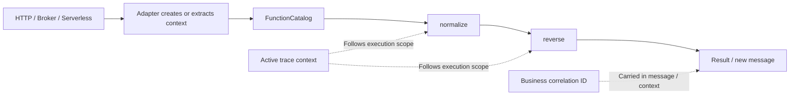
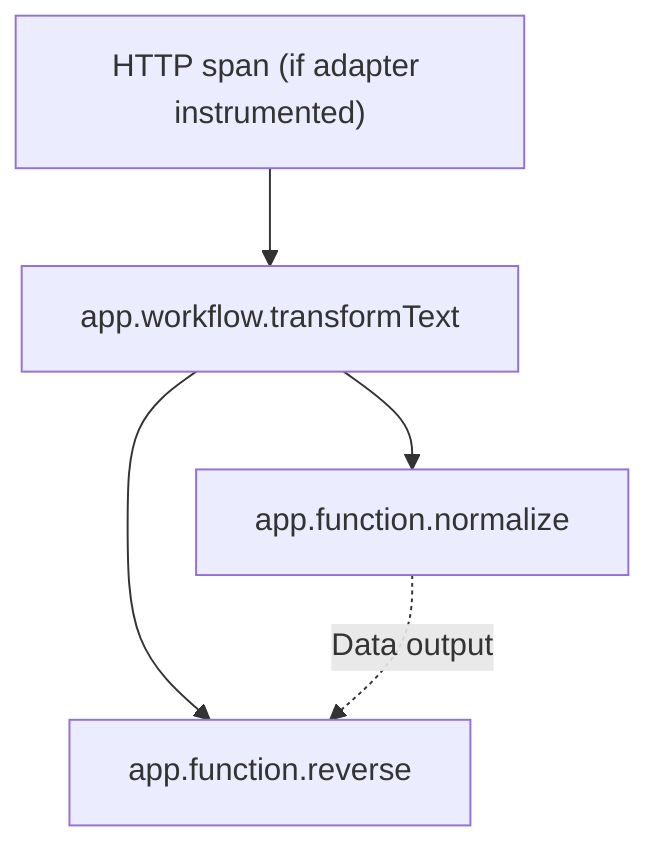
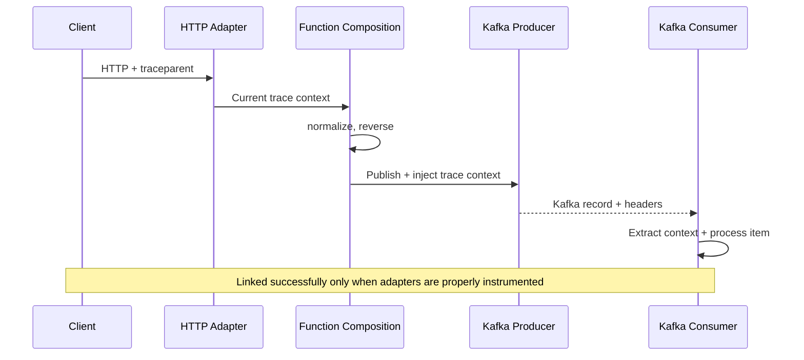

# Propagating Trace Context Through Composed Functions and Reactive Chains

## Learning Objectives

After this lesson, you will be able to:

1. Explain **trace context**, `traceId`, `spanId`, parent-child spans, `Observation`, and the role of `ObservationRegistry` in Spring Boot/Micrometer.
2. Distinguish **synchronous function composition** (`normalize|reverse`) from **reactive function composition** (`Function<Flux<T>, Flux<R>>`) in terms of execution timing and context propagation.
3. Build reusable `Function` beans via `FunctionCatalog`, attach `Observation` to instrument each composition step without coupling business functions to HTTP or brokers.
4. Use Reactor `Context`, `contextWrite`, and `deferContextual` to pass correlation data across `publishOn`, `concatMap`, and compositions.
5. Distinguish Reactor Context from **`ThreadLocal`/MDC**, and understand Micrometer Context Propagation, `spring.reactor.context-propagation=auto`, and its limitations.
6. Observe reactive pipelines with `tap(Micrometer.observation(registry))`, choosing the observation unit: **entire Publisher, subscription, individual element, or a processing segment**.
7. Design trace context extraction and injection across HTTP, Spring Cloud Stream, message brokers, and serverless platforms, avoiding the assumption that function composition automatically provides distributed tracing.
8. Test preservation of `businessCorrelationId` across steps, and identify context loss, duplicate spans, MDC leaks, and sensitive data in tags/logs.

## 1. The Problem: One Function, Multiple Steps, Multiple Environments

Spring Cloud Function packages business logic into `Supplier`, `Function`, and `Consumer` beans. `FunctionCatalog` handles registration, lookup, composition, and type adaptation, letting the same function run over HTTP, event streams, or serverless runtimes without protocol dependencies.

Suppose an application processes text in two steps:

- `normalize`: trims whitespace and converts to uppercase.
- `reverse`: reverses character order.

When defined as `normalize|reverse`, the string `" hello "` becomes `"OLLEH"`. If a request is slow or fails, operations needs to know:

- Which logs and spans belong to **the same request**?
- Did `normalize` or `reverse` take longer?
- Do both steps share **the same trace**, or did they accidentally start two unrelated traces?
- When switching to `Flux` and hopping threads, why can `traceId` become blank in logs?
- When a function emits a new event, did the trace context cross the broker?

**Function composition** describes the data flow path; **context propagation** describes how observational context travels along that path. Those are two separate responsibilities.



Do not rely solely on `/actuator/functions`: that endpoint lists functions registered in the catalog, and does **not** prove a function ran, emitted spans, or propagated trace context across another adapter.

## 2. Concepts That Must Be Kept Separate

| Concept | Question answered | Typical lifecycle |
| --- | --- | --- |
| **Trace** | Which distributed operations belong to one observed journey? | One request, message processing attempt, or designed journey |
| **Trace ID** | Which spans belong to the same trace? | Constant across a trace |
| **Span ID** | Which specific step/operation is being observed? | Distinct per span |
| **Parent span** | Within which operation's context was this span created? | Parent-child relationship; depends on current active context |
| **Observation** | Named measurement unit with tags, errors, and lifetime | A function invocation, a reactive pipeline segment, etc. |
| **MDC** | Which values are inserted into logs on the current thread? | Thread/scope-bound; requires cleanup and propagation across thread hops |
| **Reactor Context** | Data attached to the **subscriber**, independent of a specific thread | Per subscription, governed by `contextWrite` |
| **Business correlation ID** | Which messages belong to the same business workflow? | Preserved by the application across multiple steps or traces |

A Micrometer `Observation` is not necessarily a span on its own. When `ObservationRegistry` has appropriate handlers registered, a single `Observation` can produce metrics and/or spans. **Without a configured tracing bridge/exporter, calling `Observation.observe(...)` alone does not guarantee traces are exported to a tracing backend.**

Example of a journey:

```text
traceId = 6d8c...4af1
  spanId = 1001  HTTP request
    spanId = 1002  normalize
    spanId = 1003  reverse
    spanId = 1004  publish to broker

businessCorrelationId = workflow-72
  Message A: Spring Message ID uuid-a
  Message B: Spring Message ID uuid-b
```

These spans illustrate logical relationships and **do not claim** Spring Cloud Function creates these exact four spans automatically. Which spans appear depends on auto-instrumentation, handlers, configuration, and application-level observations.

### A Trace Is Different from a Business Workflow

A workflow lasting hours or involving retries may span multiple traces. A single HTTP trace may execute multiple business steps. `MessageHeaders.ID` can change whenever a new Spring `Message` is created. Therefore, **never use a trace ID or Spring Message ID as a unique business key**; maintain a separate business correlation/event ID to connect messages and retries.

## 3. Function Composition and Execution Scope

Spring Cloud Function supports declarative composition using `|`:

```properties
spring.cloud.function.definition=normalize|reverse
```

Logically, this resembles:

```java
Function<String, String> composed =
        normalize.andThen(reverse);
```

However, `FunctionCatalog.lookup("normalize|reverse")` also provides composition managed by Spring Cloud Function, including framework type adaptation and conversion.

| Scenario | What can preserve context | Risk |
| --- | --- | --- |
| Two `Function<String,String>` steps run sequentially on **the same thread** | Active `Observation` and scoped MDC | No spans emitted if uninstrumented |
| One step spawns a `CompletableFuture` on another thread | Executor with context propagation | Parent/span lost if using an unconfigured executor |
| One step returns a `Flux` | Reactor Context on the subscriber | `ThreadLocal` present during `apply` may vanish on subscribe |
| One step calls `subscribe()` manually | Context must transfer to the new subscription | Detached from main subscription; hard to track completion and errors |
| One step publishes to a broker | Trace context must be carried by adapter/headers | Consumer in another service may start an unlinked trace |

**Conclusion:** `normalize|reverse` expresses only execution order; it **does not automatically create separate spans per step**. If you need per-step visibility, instrument each step at the right execution boundary.

## 4. Preparing Spring Boot, Actuator, and Tracing

The Java examples in this lesson use Spring Cloud Function, Spring Boot, Micrometer, and Project Reactor. Choose a **Spring Cloud BOM/version compatible with your project's Spring Boot version**; dependency names and tracing auto-configuration can vary across Spring Boot releases.

Maven example for an application with Function Web and Actuator:

```xml
<dependency>
    <groupId>org.springframework.cloud</groupId>
    <artifactId>spring-cloud-starter-function-web</artifactId>
</dependency>

<dependency>
    <groupId>org.springframework.boot</groupId>
    <artifactId>spring-boot-starter-actuator</artifactId>
</dependency>
```

To propagate/export OpenTelemetry traces in supported Spring Boot releases, you can use:

```xml
<dependency>
    <groupId>io.micrometer</groupId>
    <artifactId>micrometer-tracing-bridge-otel</artifactId>
</dependency>

<dependency>
    <groupId>io.opentelemetry</groupId>
    <artifactId>opentelemetry-exporter-otlp</artifactId>
</dependency>
```

Depending on your release, you may use the corresponding tracing starter instead of listing individual artifacts. Avoid configuring two different tracer bridges simultaneously without a clear reason.

YAML example for a testing environment:

```yaml
spring:
  application:
    name: function-observability-demo

management:
  tracing:
    sampling:
      probability: 1.0   # For testing only; production needs a sampling policy

logging:
  pattern:
    correlation: "[trace:%X{traceId:-} span:%X{spanId:-}] "
```

This logging example uses MDC with Logback/Spring Boot supporting `logging.pattern.correlation`. `sampling.probability=1.0` adds significant overhead if used indiscriminately in production; the tracing backend also requires an endpoint, connectivity, and export permissions.

**No tracing bridge/tracer active yet?** Observation names may still be recorded as metrics, while `traceId`/`spanId` will not necessarily appear. **No inbound HTTP span yet?** An observation inside the function may start a new root trace instead of becoming a child of the request.

## 5. Imperative Example: Creating an Observation per Composition Step

This is the core example for function composition. Both functions depend only on `ObservationRegistry` and standard Java APIs; neither reads `HttpServletRequest` nor broker metadata.

```java
package com.example.tracecomposition;

import java.util.Locale;
import java.util.function.Function;

import io.micrometer.observation.Observation;
import io.micrometer.observation.ObservationRegistry;
import org.slf4j.Logger;
import org.slf4j.LoggerFactory;
import org.springframework.boot.SpringApplication;
import org.springframework.boot.autoconfigure.SpringBootApplication;
import org.springframework.context.annotation.Bean;

@SpringBootApplication
public class CompositionTracingApplication {

    private static final Logger log =
            LoggerFactory.getLogger(CompositionTracingApplication.class);

    public static void main(String[] args) {
        SpringApplication.run(CompositionTracingApplication.class, args);
    }

    @Bean
    public Function<String, String> normalize(ObservationRegistry registry) {
        return value -> Observation
                .createNotStarted("app.function.normalize", registry)
                .lowCardinalityKeyValue("function", "normalize")
                .observe(() -> {
                    log.info("stage=normalize started");
                    String output = value.trim().toUpperCase(Locale.ROOT);
                    log.info("stage=normalize completed");
                    return output;
                });
    }

    @Bean
    public Function<String, String> reverse(ObservationRegistry registry) {
        return value -> Observation
                .createNotStarted("app.function.reverse", registry)
                .lowCardinalityKeyValue("function", "reverse")
                .observe(() -> {
                    log.info("stage=reverse started");
                    String output = new StringBuilder(value).reverse()
                            .toString();
                    log.info("stage=reverse completed");
                    return output;
                });
    }
}
```

Calling `normalize` on `" hello "` followed by `reverse` produces `"OLLEH"`. `Observation.observe(Supplier<T>)` manages the observation scope around the lambda; when a tracing handler is configured and an **active parent observation** exists, new observations become child spans.

Important notes:

1. Each `Function.apply` call creates an observation **at the actual execution boundary**, not merely during `@Bean` creation.
2. The `function=normalize`/`reverse` tag has **low cardinality**, suitable as a metric dimension.
3. Logs inside the scope can receive `traceId`/`spanId` from the tracing integration, depending on logger and tracer setup.
4. Never manually generate a new `traceId` at each stage. The tracer manages parent-child relationships using the active context.
5. In synchronous functions, the scope closes before the next step begins; both steps typically appear as **sibling spans** under a shared parent, rather than `reverse` being a child of `normalize`.

### A Workflow Parent Wrapping Both Stages

A caller can open a parent `Observation` around the composition:

```java
import java.util.function.Function;
import io.micrometer.observation.Observation;
import io.micrometer.observation.ObservationRegistry;
import org.springframework.cloud.function.context.FunctionCatalog;

// catalog and registry have been injected by Spring.
Function<String, String> chain =
        catalog.lookup("normalize|reverse");

String result = Observation.createNotStarted(
                "app.workflow.transformText", registry)
        .lowCardinalityKeyValue("workflow", "text-transform")
        .observe(() -> chain.apply(" hello "));

// result: OLLEH
```

On the same thread, while the parent `Observation` scope is active, stage observations inherit it. If the caller already has an HTTP span, `app.workflow.transformText` can become a child of that HTTP span. In a unit test without tracing handlers configured, the code runs identically, though **spans are not necessarily exported**.



This diagram shows one possible observation structure: both stages **are children of the same workflow span**, while data flows sequentially from `normalize` to `reverse`. The *data flow* and the *span tree* do not have to share the exact same shape.

## 6. Selecting Composition at the Adapter Layer

To expose the composition as an entry function, configure:

```yaml
spring:
  cloud:
    function:
      definition: normalize|reverse
```

With Spring Cloud Function Web and appropriate endpoint configuration, one request can flow through both steps:

```bash
# Actual URL depends on web adapter / selected function / configured path.
curl -i -X POST http://localhost:8080/ \
  -H "Content-Type: text/plain" \
  --data-raw " hello "
```

Do not assume a single fixed URL across all Function Web versions, or assume one request produces **exactly two spans**: the web adapter, `FunctionCatalog`, tracing wrappers, or gateways may emit extra observations, and sampling may drop spans.

### Routing to a Composition

If the application uses `functionRouter`, it can route dynamically to `normalize|reverse`:

```yaml
spring:
  cloud:
    function:
      definition: functionRouter
      routing-expression: "'normalize|reverse'"
```

At that point there are two separate concerns:

- **Routing decision:** which definition did the router choose? Is that target name in `FunctionCatalog`?
- **Trace propagation:** when the target function runs, is there an active parent observation/span?

Calling the router does not guarantee individual stages are instrumented. If a routing failure occurs **before entering `normalize`**, stage observations will not appear; observe router/adapter errors separately.

## 7. `ThreadLocal` and MDC Boundaries in Reactive Pipelines

For reactive functions, the typical signature is:

```java
Function<Flux<String>, Flux<String>>
```

When `Function.apply(flux)` is called, the code typically **assembles a new Publisher**. Operators like `map`, `flatMap`, and `concatMap` process elements **at subscription time**, potentially on another thread. Therefore, wrapping `apply` with:

```java
try (Observation.Scope scope = observation.openScope()) {
    return reactiveFunction.apply(flux);
}
```

keeps the scope open only while **constructing the Publisher**, then closes it **before the Publisher is subscribed to**. Do not assume this snippet automatically wraps every stream signal inside the observation.

### Why Is MDC Not Enough?

SLF4J MDC typically relies on `ThreadLocal`. `publishOn` and `subscribeOn` switch threads, and a single thread can interleave multiple subscriptions:

```text
HTTP thread:
  MDC[traceId] = abc  --> build Flux --> return

reactor-parallel thread:
  map("hello")       --> MDC may not contain abc
```

**Reactor Context** is the right place for subscription-scoped data. Unlike MDC, it is not bound to a single thread and travels along the operator chain according to Reactor rules.

## 8. Passing Correlation Data Through Reactor Context

This example **requires no tracing bridge** and uses Reactor Context to show the propagation mechanism clearly:

```java
import reactor.core.publisher.Flux;
import reactor.core.publisher.Mono;
import reactor.core.scheduler.Schedulers;
import reactor.util.context.Context;

Flux<String> output = Flux.just("hello", "spring")
        .publishOn(Schedulers.parallel())
        .concatMap(value -> Mono.deferContextual(context -> {
            String id = context.get("businessCorrelationId");
            return Mono.just(id + ":" + value.toUpperCase());
        }))
        .contextWrite(Context.of("businessCorrelationId", "workflow-72"));

// On subscribe: workflow-72:HELLO, workflow-72:SPRING
```

`contextWrite` is placed downstream near the subscriber, yet its entries are visible to operators **upstream**. `Mono.deferContextual` reads the Context at subscription time, even after `publishOn` switches threads.

**This is a business correlation ID**, not an arbitrary Reactor Context entry pretending to be a tracer-issued `traceId`. Tracing context should be managed by the tracing library and propagated via standard context propagation mechanisms.

### A Common Misunderstanding: Each Subscription Has Its Own Context

```java
Flux<String> source = Flux.just("a", "b")
        .concatMap(value -> Mono.deferContextual(ctx ->
                Mono.just(ctx.<String>get("workflowId") + ":" + value)));

Flux<String> first = source.contextWrite(
        Context.of("workflowId", "flow-A"));
Flux<String> second = source.contextWrite(
        Context.of("workflowId", "flow-B"));
```

Two distinct subscriptions can share `source` while carrying **separate workflow IDs**. By contrast, using a `static ThreadLocal` without proper cleanup can mix IDs across subscriptions sharing a thread.

## 9. Reactive Composition: Context Flowing Through Two Functions

The following example has two `Function<Flux<String>, Flux<String>>` beans. The first normalizes strings; the second reverses them and reads the correlation ID from Reactor Context at processing time.

```java
package com.example.reactivecomposition;

import java.util.Locale;
import java.util.function.Function;

import org.slf4j.Logger;
import org.slf4j.LoggerFactory;
import org.springframework.boot.SpringApplication;
import org.springframework.boot.autoconfigure.SpringBootApplication;
import org.springframework.context.annotation.Bean;
import reactor.core.publisher.Flux;
import reactor.core.publisher.Mono;

@SpringBootApplication
public class ReactiveCompositionApplication {

    private static final Logger log =
            LoggerFactory.getLogger(ReactiveCompositionApplication.class);

    public static void main(String[] args) {
        SpringApplication.run(ReactiveCompositionApplication.class, args);
    }

    @Bean
    public Function<Flux<String>, Flux<String>> normalizeStream() {
        return source -> source
                .map(String::trim)
                .map(value -> value.toUpperCase(Locale.ROOT));
    }

    @Bean
    public Function<Flux<String>, Flux<String>> reverseStream() {
        return source -> source.concatMap(value ->
                Mono.deferContextual(context -> {
                    String workflow = context.getOrDefault(
                            "businessCorrelationId", "unknown");
                    log.info("stage=reverseStream workflow={}", workflow);
                    return Mono.just(new StringBuilder(value)
                            .reverse().toString());
                }));
    }
}
```

They can be composed declaratively:

```properties
spring.cloud.function.definition=normalizeStream|reverseStream
```

Or invoked via the catalog in Java:

```java
import java.util.function.Function;
import reactor.core.publisher.Flux;
import reactor.util.context.Context;

Function<Flux<String>, Flux<String>> chain =
        catalog.lookup("normalizeStream|reverseStream");

Flux<String> output = chain
        .apply(Flux.just(" hello ", " world "))
        .contextWrite(Context.of(
                "businessCorrelationId", "workflow-72"));

// After subscribe: OLLEH, DLROW
```

Here, `contextWrite` is attached to the **outermost** Publisher, allowing `deferContextual` inside `reverseStream` to read the workflow ID upon subscription. `normalizeStream` participates in the same pipeline without needing to know the ID if its logic does not use it.

**Ordering note:** `concatMap` preserves element order as inner Publishers complete sequentially; switching to concurrent `flatMap` can alter completion order. Trace context propagation **does not automatically enforce ordering**.

### A Context Loss Anti-Pattern

```java
// Do not do this inside a reactive function:
return source.map(value -> {
    someMono(value).subscribe();  // Self-managed subscription.
    return value;
});
```

Calling `subscribe()` inside the function spawns **a subscription detached from the main pipeline**, breaking control over parent spans, correlation context, error signals, cancellation, and backpressure. Return the Publisher via `flatMap`/`concatMap` and let the external adapter/subscriber manage subscription.

## 10. Micrometer Context Propagation: From Reactor Context to `ThreadLocal`

Reactor Core integrates with **Micrometer Context Propagation** via `io.micrometer:context-propagation`. In Reactor 3.5+, there are two modes:

| Mode | How it works | Notes |
| --- | --- | --- |
| **Default/limited** | Restores registered `ThreadLocal` values in supported operators such as `handle` and `tap` | Does not guarantee MDC/tracing appears inside every `map` or `doOnNext` |
| **Automatic** | Restores `ThreadLocal` values with registered `ThreadLocalAccessor` instances across many operator boundaries | Adds overhead; applies to new subscriptions and requires proper cleanup |

Spring Boot provides:

```yaml
spring:
  reactor:
    context-propagation: auto
```

In supported Spring Boot versions, this enables automatic context propagation for Reactor. In plain Reactor, you can enable it at application startup:

```java
reactor.core.publisher.Hooks.enableAutomaticContextPropagation();
```

You do not need both approaches for the same purpose. Per Reactor's docs, the hook applies to **subscriptions created after it is enabled**, so configure it early enough.

### `contextWrite` Does Not Automatically Equal MDC

`contextWrite(Context.of("businessCorrelationId", "..."))` puts the value into **Reactor Context**. For a `ThreadLocal`-based library to read that value, Micrometer Context Propagation needs **that key and a matching `ThreadLocalAccessor`**.

An application-invented `businessCorrelationId` key **does not automatically appear in MDC** merely by enabling `spring.reactor.context-propagation=auto`. You have two clean options:

1. Carry the ID as data inside the `Message` or read it directly via `deferContextual`, then include it in structured logs.
2. Register a `ThreadLocalAccessor` or supported propagation mechanism for that key; carefully verify lifecycle and cleanup to prevent leaks across subscriptions.

For trace context managed by Micrometer Tracing, the tracer/Observation integration typically registers the required accessors, provided the proper dependencies and configuration are present.

### When Is `contextCapture()` Used?

`contextCapture()` captures `ThreadLocal` values registered with Context Propagation **at subscription time** and stores them in Reactor Context so upstream operators can read them. It is useful when bridging from imperative code with an active observation to a Publisher.

```java
// Illustrates placement; current Observation must be active at subscribe time.
Flux<String> output = reactivePipeline.contextCapture();
```

Notes:

- If subscription occurs after the imperative scope has closed, capture may **fail to pick up** the desired observation.
- In automatic mode, some blocking operators like `block()` can capture context automatically, but **do not rely on blocking** to fix a reactive architecture.
- `contextCapture` only captures registered `ThreadLocalAccessor` instances; it does not arbitrarily copy all Java state.
- If the adapter already supplied a Reactor Context, avoid overwriting or clearing it when adding custom context.

## 11. Observing Reactive Segments with `Micrometer.observation`

Per the Spring Cloud Stream documentation, there is an important distinction:

- **Imperative functions** can be wrapped by the framework/binder using `ObservationFunctionAroundWrapper`, creating one observation per message invocation in supported configurations.
- **Reactive functions** are typically invoked once **to wire up the stream**, after which Reactor drives Publisher signals. Do not expect the imperative wrapper to measure each individual element.

To instrument a reactive segment, Spring Cloud Stream illustrates the operator:

```java
.tap(Micrometer.observation(registry))
```

This requires the Reactor Micrometer dependency:

```xml
<dependency>
    <groupId>io.projectreactor</groupId>
    <artifactId>reactor-core-micrometer</artifactId>
</dependency>
```

Example observing each item through an inner `Mono`:

```java
import java.util.Locale;
import java.util.function.Function;
import io.micrometer.observation.ObservationRegistry;
import org.springframework.context.annotation.Bean;
import reactor.core.observability.micrometer.Micrometer;
import reactor.core.publisher.Flux;
import reactor.core.publisher.Mono;

@Bean
public Function<Flux<String>, Flux<String>> observedUppercaseStream(
        ObservationRegistry registry) {
    return flux -> flux.concatMap(item ->
            Mono.just(item)
                    .map(value -> value.toUpperCase(Locale.ROOT))
                    .tap(Micrometer.observation(registry)));
}
```

Here the unit of observation is **an inner `Mono` processing one item**. Placing `tap` on the outer `Flux` instead measures **the subscription of the entire stream**; placing it on another segment measures that segment. Operator placement determines whether you observe an item, a batch, or a stream.

**Parent span note:** if the downstream subscriber has an active observation/trace context, `tap`'s observation can attach to that parent. However, for reactive functions, binders **do not automatically attach an observation per element** in all configurations; test with your actual producer, consumer, tracer bridge, and context propagation setup.

### Avoid Wrapping Infinite Streams in a Single Span Unnecessarily

A `Flux` can stay open for days. Creating one observation spanning until `onComplete` produces excessively long spans that hurt operations and tracing backends. For continuous streams, it is usually better to observe **individual items or clearly bounded batches**, attach controlled correlation IDs, and monitor stream-wide throughput/lag via metrics.

## 12. `@Async`, Executors, and Context Loss Outside Reactor

Thread hops do not happen only in Reactor. An imperative `Function` may call `@Async` or `CompletableFuture`:

```java
Observation.createNotStarted("app.work", registry)
        .observe(() -> {
            // Current Observation is active on this thread.
            service.doAsync(); // Runs on another thread.
        });
```

The current Observation is normally kept in thread-local context. If the executor does not propagate context, code inside the async task will not see the parent span.

In supported Spring Framework versions, use `ContextPropagatingTaskDecorator`:

```java
import org.springframework.context.annotation.Bean;
import org.springframework.context.annotation.Configuration;
import org.springframework.core.task.support.ContextPropagatingTaskDecorator;

@Configuration
class TaskContextConfiguration {

    @Bean
    ContextPropagatingTaskDecorator contextPropagatingTaskDecorator() {
        return new ContextPropagatingTaskDecorator();
    }
}
```

When configuring custom executors, **attach this decorator to the executor actually executing the tasks**. Calling `CompletableFuture.supplyAsync(...)` without an executor argument can run on the common pool rather than your decorated executor.

Some Spring Boot versions also offer `spring.task.execution.propagate-context` for the auto-configured executor; verify against **your Spring Boot version and executor type** rather than assuming the property applies to every custom executor.

### A Subtle Bug: Closing the Scope Too Early

Opening a scope right before submitting a task and immediately closing it **does not automatically** let the async task inherit that scope. Propagation must **capture context at submission time** and **restore it while the task runs**, or pass correlation IDs explicitly.

## 13. Propagating Traces Across HTTP, Brokers, and Serverless

Function composition operates within a single process and call. Crossing process boundaries requires a **carrier** to transmit trace context.

| Boundary | Common carrier | What to verify |
| --- | --- | --- |
| HTTP request/response | W3C `traceparent`, `tracestate`, and baggage if configured | Do client/adapter inject/extract? Does security/gateway strip headers? |
| Spring `Message` | Headers managed by framework/adapter | Does the header mapper preserve custom metadata or tracing carriers? |
| Kafka/RabbitMQ | Record/message headers | Are producer and consumer instrumented with compatible propagators? |
| Serverless invocation | Platform event metadata or request headers | Does the adapter support extract/inject, and does the exporter flush before freeze/exit? |
| Direct Java call | Current `Observation`/tracing scope | Does the call stay on the same thread/context or hop to another executor? |

Example flow:



When a client sends no trace context, ingress may **start a new trace**. If the producer fails to inject or the consumer fails to extract, downstream creates a separate trace; never extract `traceId` from a custom text header and force it as the "current trace" while bypassing tracer APIs.

### Business Correlation ID Remains Essential

A single workflow can span multiple traces due to retries, delays, or batching. When constructing an outbound message, the application can explicitly preserve `businessCorrelationId`:

```java
import org.springframework.messaging.Message;
import org.springframework.messaging.support.MessageBuilder;

Message<String> outgoing = MessageBuilder.withPayload("OLLEH")
        .setHeader("businessCorrelationId", "workflow-72")
        .build();
```

This is **business metadata**, distinct from `traceparent` handled by the tracer. Verify that your binder's header mapper carries custom headers across the broker. `MessageHeaders.ID` on the newly built message is not a durable correlation ID.

### Spring Cloud Stream Observation Configuration

In documented versions/binders, a relevant Kafka binder setting is:

```yaml
spring:
  cloud:
    stream:
      kafka:
        binder:
          enable-observation: true
```

This enables observation in the Kafka binder as supported by that version; it **does not automatically instrument all Reactor operators or generate business correlation IDs**. For the reactive Kafka binder, the docs also note that consumer-side observation requires specific configuration/hooks; check your exact binder rather than applying one blanket assumption across all binders.

## 14. Tracing, Metrics, and Logging Serve Different Roles

| Signal | Information provided | What cannot be inferred |
| --- | --- | --- |
| `/actuator/functions` | Functions registered in the catalog | Which function just ran or which trace is active |
| `http.server.requests` | HTTP traffic, status, and latency | Whether a composition stage had the right parent span |
| Custom `Observation` | Duration/tags/errors, plus spans if handlers support them | Does not guarantee traces were exported or messages acked |
| Log MDC | `traceId` and `spanId` within log scope | Does not prove the collector received spans (sampling/export errors) |
| `Flux` Reactor Context | Subscription-scoped data | Does not automatically create traces/spans or populate MDC |
| Broker consumer lag | Ability to keep up with producers | Whether individual messages succeeded in business terms |
| Business correlation ID | Links a workflow across multiple messages | Not an authentication or authorization mechanism |

If two stages log the same `traceId` with different `spanId` values, that usually indicates context stayed in **the same trace**. However, proving parent-child hierarchy requires inspecting **parent span IDs / the trace tree** in the backend; sharing a trace ID alone does not prove which span is the parent of which.

### Sampling and Export

A request may show trace IDs in logs while missing spans in the backend due to sampling, exporter timeouts, or collector unavailability. Conversely, metrics can still appear because Micrometer records observation durations even when the tracer does not export spans. When diagnosing, check:

1. Tracer bridge and `ObservationHandler` registrations.
2. Sampling policy.
3. Exporter endpoint, authentication, and network connectivity.
4. Context propagation at every required boundary.
5. Trace queries using the right service name, time range, and trace ID.

Do not alter business functions to "fix missing traces" when the root cause is the exporter or sampler.

## 15. Testing Composition and Reactor Context

Separate **data tests**, **propagation tests**, and **trace integration tests**.

### 15.1. Testing Imperative Composition

```java
import static org.junit.jupiter.api.Assertions.assertEquals;
import static org.junit.jupiter.api.Assertions.assertNotNull;

import java.util.function.Function;
import org.junit.jupiter.api.Test;
import org.springframework.beans.factory.annotation.Autowired;
import org.springframework.boot.test.context.SpringBootTest;
import org.springframework.cloud.function.context.FunctionCatalog;

@SpringBootTest(classes = CompositionTracingApplication.class)
class ImperativeCompositionTest {

    @Autowired
    FunctionCatalog catalog;

    @Test
    void composeTwoFunctions() {
        Function<String, String> chain =
                catalog.lookup("normalize|reverse");

        assertNotNull(chain);
        assertEquals("OLLEH", chain.apply(" hello "));
    }
}
```

This test verifies function names/types and composition order. It **does not verify parent-child spans**. To test tracing, configure an appropriate tracing handler/test exporter and assert on recorded trace IDs and parent IDs rather than inferring from the `"OLLEH"` result.

### 15.2. Testing Reactor Context Across Thread Hops

```java
import org.junit.jupiter.api.Test;
import reactor.core.publisher.Flux;
import reactor.core.publisher.Mono;
import reactor.core.scheduler.Schedulers;
import reactor.test.StepVerifier;
import reactor.util.context.Context;

class ReactorCorrelationTest {

    @Test
    void keepsSubscriptionContextAcrossPublishOn() {
        Flux<String> output = Flux.just("hello", "spring")
                .publishOn(Schedulers.parallel())
                .concatMap(value -> Mono.deferContextual(ctx ->
                        Mono.just(ctx.<String>get("workflowId")
                                + ":" + value)))
                .contextWrite(Context.of("workflowId", "workflow-72"));

        StepVerifier.create(output)
                .expectNext("workflow-72:hello", "workflow-72:spring")
                .verifyComplete();
    }
}
```

This proves **Reactor Context propagation**, not that a tracer emitted spans. The test does not require `spring.reactor.context-propagation=auto` because it reads Context **explicitly** via `deferContextual`.

### 15.3. Testing Composition of Two Reactive Functions

```java
import static org.junit.jupiter.api.Assertions.assertNotNull;

import java.util.function.Function;
import org.junit.jupiter.api.Test;
import org.springframework.beans.factory.annotation.Autowired;
import org.springframework.boot.test.context.SpringBootTest;
import org.springframework.cloud.function.context.FunctionCatalog;
import reactor.core.publisher.Flux;
import reactor.test.StepVerifier;
import reactor.util.context.Context;

@SpringBootTest(classes = ReactiveCompositionApplication.class)
class ReactiveCompositionTest {

    @Autowired
    FunctionCatalog catalog;

    @Test
    void composesReactivePipeline() {
        Function<Flux<String>, Flux<String>> chain =
                catalog.lookup("normalizeStream|reverseStream");
        assertNotNull(chain);

        Flux<String> output =
                chain.apply(Flux.just(" hello ", " world "))
                     .contextWrite(Context.of(
                             "businessCorrelationId", "workflow-72"));

        StepVerifier.create(output)
                .expectNext("OLLEH", "DLROW")
                .verifyComplete();
    }
}
```

If you need to prove `businessCorrelationId` reached `reverseStream`, replace the logger with a test sink/collector receiving the ID read from `deferContextual`, or inspect a test appender. Asserting only the output above is **not sufficient** to prove logs carried the ID.

### 15.4. Testing Real Parent-Child Spans

A thorough tracing integration test should:

1. Create or extract a **parent trace context** using a test tracer implementation.
2. Invoke `normalize|reverse` inside the parent scope.
3. Collect emitted spans from a test span handler/exporter (without relying on an external collector).
4. Assert that stage spans share the trace ID and have parent span IDs matching your intended hierarchy.
5. Repeat with `publishOn` and binder adapters if those match your production path.
6. Test missing propagation cases: spans split into separate traces or lack the expected parent.

Any test lacking a tracing bridge/handlers **cannot** prove span hierarchy merely by creating an `ObservationRegistry`.

## 16. Common Context Propagation Failures

| Symptom | Possible cause | Check or fix |
| --- | --- | --- |
| Two stages of the same request have different trace IDs | One stage started a root trace or context was lost | Check active scope, tracer, and executor |
| Two stages share a trace ID without expected parent-child nesting | Both observations share the same parent, or scope closed before the next step | Inspect the span tree; distinguish data order from parent-child hierarchy |
| Logs contain trace IDs, yet backend has no spans | Sampling dropped them or exporter/collector failed | Check sampling, exporter, timestamps, and service name |
| Logs inside `Flux.map` lack MDC | Default propagation supports only certain operators | Use Reactor Context; enable auto mode where appropriate |
| `spring.reactor.context-propagation=auto` enabled, yet custom ID missing from MDC | No `ThreadLocalAccessor` registered, or ID only lives in Context | Read `deferContextual` / pass ID explicitly |
| `contextCapture` misses parent | Captured after the imperative scope closed | Capture at subscription time while scope is active |
| Traces lost across `CompletableFuture` | Executor does not capture/restore context | Configure `ContextPropagatingTaskDecorator` |
| Reactive function emits only one span at startup | Framework views function as stream wiring, not per-item | Place `tap(Micrometer.observation)` on the desired segment |
| `functionRouter` picks target, yet no stage span appears | Target functions are uninstrumented | Attach observations along the actual `apply`/Publisher path |
| Kafka consumer starts a new trace unlinked to producer | Missing header propagation or binder observation | Check inject/extract, carrier headers, and binder version |
| One `Flux` processes multiple events with wrong shared business ID | Using one subscription-level Context for multiple workflows | Carry IDs per `Message`/item instead of one stream-wide value |
| Trace volume spikes after enabling per-item observations | One span per event at high throughput | Apply sampling, batching, or pick a coarser observation unit |
| Pod emits metrics but zero traces | Missing tracer bridge/exporter or sampling drops all | Inspect metrics, tracing, and logging pipelines separately |

### Diagnostic Workflow

```text
1. Is the function invoked from HTTP, a binder, serverless, or internal Java?
2. Is the input an imperative Message or a reactive Publisher?
3. Is there an active parent Observation/tracing context at entry?
4. Has the function composition instrumented each stage?
5. Are there thread hops via publishOn, subscribeOn, @Async, or executors?
6. Does Reactor Context contain the right data at subscription time?
7. Is a ThreadLocalAccessor registered for contexts needed in MDC?
8. Is there a nested subscribe() inside the function detaching the pipeline?
9. Do producer/consumer adapters inject and extract trace headers?
10. Are the tracer bridge, sampling, and exporter working?
```

## 17. Security and Economics of Tracing

- **Never trust `traceparent` as a credential.** Trace context links observability signals; authentication and authorization belong to the security layer.
- **Never take arbitrary client data as a trace ID.** Let the tracer/propagator process trace headers using standard formats and trust policies.
- **Limit cardinality:** tags like `function=normalize` or `outcome=success` are fine; `userId`, `orderId`, `messageId`, and `traceId` **should not** be metric labels.
- **Control high-cardinality tags in traces too.** Add per-entity metadata only under clear data policies, retention limits, read permissions, and PII scrubbing.
- **Do not log payloads, tokens, or PII** just to correlate traces when correlation IDs and trace IDs suffice.
- **Watch cost:** per-item spans on high-volume streams can be expensive. Choose sampling, event aggregation, and instrumentation granularity aligned with your SLOs.
- **Clean up MDC/context:** when using `ThreadLocal` or custom accessors, verify scope cleanup so data never leaks across requests or subscriptions.
- **Never block a reactive pipeline** with synchronous exporters or `block()` solely to simplify logging or tracing.

## 18. Practice Exercises

1. Create `normalize` and `reverse` beans and set `spring.cloud.function.definition=normalize|reverse`. Invoke with `" hello "` and explain the `"OLLEH"` result.
2. Inject `ObservationRegistry` into both functions. Wrap each `apply` with `Observation.createNotStarted(...).observe(...)`. Identify where the parent span comes from over HTTP versus in a unit test.
3. Create a parent observation `app.workflow.transformText` around `catalog.lookup("normalize|reverse").apply(...)`. Sketch the expected span tree and distinguish it from the `normalize → reverse` data flow.
4. Enable a tracing bridge and log correlation pattern. Compare `traceId`/`spanId` across both stages and explain why inspecting parent span IDs is necessary to prove hierarchy.
5. Write a `Flux` using `publishOn`, `deferContextual`, and `contextWrite`, then use `StepVerifier` to prove `workflowId` survives the thread hop.
6. Build `normalizeStream|reverseStream` and attach `businessCorrelationId` to the outer Publisher. Add a test sink recording the ID read inside `reverseStream`.
7. Try storing `businessCorrelationId` in MDC before `apply(flux)` and reading it inside `map`. Explain why it can be missing or wrong when subscribed on a different thread.
8. Enable `spring.reactor.context-propagation=auto`. Verify whether your custom key has a registered `ThreadLocalAccessor` and compare that with reading Reactor Context directly.
9. Attach `tap(Micrometer.observation(registry))` to an inner `Mono` inside `concatMap`; compare the number of observations with placing `tap` on the outer `Flux`.
10. Write a function invoking `CompletableFuture` or `@Async`; configure a task decorator and test whether context is captured and restored properly across the executor.
11. Sketch the path HTTP → function composition → Kafka → consumer. Pinpoint where trace context is injected/extracted and where the business correlation ID is propagated.
12. Simulate a broker redelivering the same event twice. Explain why there can be multiple spans and invocation IDs yet the same business event ID.
13. Build a checklist to debug a missing span: whether the function ran, observation was created, parent was active, Reactor Context was used, and sampling/exporter allowed emission.
14. Propose a tracing strategy for an unbounded `Flux` at 100,000 items/sec: choose the observation unit, sampling, complementary metrics, bounded tags, and retention.

## Key Takeaways

- **Function composition** manages data flow between `Function` beans; **trace context propagation** manages observational links. Having composition **does not mean** every stage automatically gets traces/spans.
- For same-thread imperative functions, a **current `Observation`** can act as parent for stage observations; `ObservationRegistry` needs an active tracing handler to create/export spans.
- For reactive functions, `apply(Flux)` usually only constructs the Publisher; context must travel with the **subscription** via Reactor Context and propagation hooks.
- `contextWrite`/`deferContextual` pass subscriber-scoped data across `publishOn`; **`ThreadLocal`/MDC does not transfer automatically** across all Reactor operators.
- `spring.reactor.context-propagation=auto` restores **`ThreadLocal` values with registered accessors**; it does not automatically push arbitrary Reactor Context keys into MDC.
- In Spring Cloud Stream, imperative observation wrappers and manual reactive `tap(Micrometer.observation(...))` measure different units; always pick the right observation boundary.
- Across HTTP, brokers, and serverless, you need compatible tracers/propagators and adapters to inject/extract trace context; business correlation IDs remain separate business metadata.
- Verify propagation via tests with a trace handler/exporter asserting on **trace and parent span IDs**, rather than looking only at function output or `/actuator/functions`.

### Official References

- [Spring Cloud Function — Programming Model: Function Composition and FunctionCatalog](https://docs.spring.io/spring-cloud-function/reference/spring-cloud-function/programming-model.html)
- [Spring Cloud Stream — Observability: Imperative and Reactive Functions](https://docs.spring.io/spring-cloud-stream/reference/observability.html)
- [Spring Cloud Stream — Reactive Kafka Binder Observability](https://docs.spring.io/spring-cloud-stream/reference/kafka/kafka-reactive-binder/reactive_observability.html)
- [Spring Boot — Observability and Context Propagation](https://docs.spring.io/spring-boot/reference/actuator/observability.html)
- [Spring Boot — Distributed Tracing](https://docs.spring.io/spring-boot/reference/actuator/tracing.html)
- [Project Reactor — Context-Propagation Support](https://projectreactor.io/docs/core/release/reference/advanced-contextPropagation.html)
- [Project Reactor — Adding a Context to a Reactive Sequence](https://projectreactor.io/docs/core/release/reference/advancedFeatures/context.html)
- [Micrometer — Observation Concepts](https://docs.micrometer.io/micrometer/reference/observation/introduction.html)
