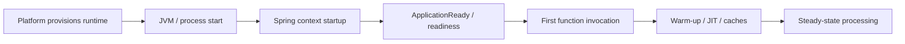

# Distinguishing Startup Time from Steady-State Processing Time

## Learning Objectives

After this lesson, you will be able to:

1. Distinguish **process startup time**, **Spring Application readiness time**, **platform cold start**, **first function invocation**, and **steady-state processing time**.
2. Explain why `ApplicationReadyEvent`, readiness probes, and the first `FunctionCatalog` invocation represent different milestones.
3. Use Spring Boot `ApplicationStartup`, the Actuator startup endpoint, and startup metrics to pinpoint slow startup steps.
4. Instrument `Supplier`, `Function`, and `Consumer` duration and invocation counts with Micrometer while separating first-invocation latency from steady-state latency.
5. Evaluate the impact of class loading, JIT compilation, lazy initialization, connection pools, DNS/TLS, binders, and warm-up on the first invocation.
6. Design safe warm-ups that do not skew business metrics, unintentionally delay readiness, or trigger side effects.
7. Read HTTP, Spring Cloud Stream, JVM, Kubernetes, and serverless signals accurately when investigating cold starts or latency spikes.
8. Construct appropriate tests and benchmarks, avoiding using unit tests or a single first call to draw conclusions about steady-state performance.

## 1. Why Separate Startup Time from Processing Time?

Spring Cloud Function lets you build business logic with `Supplier`, `Function`, and `Consumer` beans, `FunctionCatalog` lookup, composition, and message conversion. The same function can be invoked from HTTP, event streams, or serverless runtimes.

This raises at least two distinct sets of performance questions:

- **How long does the application take to become ready to accept work?**
- **Once ready, how long does each function invocation take to process?**

One service might start in 2 seconds yet spend 1 second on its first call initializing connections or loading classes. Another service might take 15 seconds to start, then process every subsequent request in 5 ms. Looking at only a single latency number can lead you to optimize the wrong layer.

| Metric / phase | What does it measure? | Example |
| --- | --- | --- |
| **Process/JVM startup** | From runtime start until the Java process executes | JVM creating process, loading core classes |
| **Spring Application startup** | From `SpringApplication` start until context initialization completes | Bean creation, auto-configuration, `FunctionCatalog` |
| **Application ready time** | Until startup and runners finish | Binding registration, required warm-up, readiness checks |
| **Platform cold start** | Platform cost to provision a new runtime/instance and initialize the app | Provisioning container, pulling image, JVM, Spring context |
| **First function invocation** | Duration of the very first call into a specific function | Lazy initialization, class loading, caches, JIT |
| **Steady-state processing** | Latency/throughput after startup and warm-up stabilize | P50/P95/P99, errors, requests/s |



These intervals can **overlap or be measured from different clocks**. For example, a serverless platform may measure cold start from receiving the invocation until the handler runs, while Spring Boot measures only from `SpringApplication` startup. Never add or directly compare numbers without confirming exact start/end boundaries.

## 2. Cold Start Does Not Equal Spring Startup

In serverless or scale-to-zero environments, a request may have to initialize a brand-new instance. A cold start typically includes:

1. Platform provisioning of compute/runtime or a container.
2. Pulling the image, package, or application code if needed.
3. Launching the JVM/process.
4. Initializing the Spring `ApplicationContext` and auto-configuration.
5. Initializing `FunctionCatalog`, adapters, clients, and required bindings.
6. Executing lazy initialization triggered on the first call.
7. Running the business function and returning the result.

**Spring Boot startup time does not measure all cloud platform steps.** Nor does it necessarily include container image pulls or scheduler wait times.

| Context | Potentially large cost component | Where to inspect |
| --- | --- | --- |
| JVM in a long-lived container | Spring context, bean creation, classpath scanning | Spring Boot startup steps, logs |
| Kubernetes creating a new pod | Scheduling, image pull, JVM/Spring startup, readiness | Pod events, startup/readiness probes, container metrics |
| Scale-to-zero serverless | Runtime provisioning, code/package init, Spring context, first invocation | Platform cold-start/init duration and application metrics |
| Event consumer restart | Context, binder connection, partition assignment, consumer readiness | Spring startup, binder logs, broker consumer state |
| Function using a downstream client | DNS, TLS handshake, connection pool, cache population | Client metrics, traces, connection metrics |

A new instance can have its Spring Application ready while **the function has never been invoked yet**. Conversely, a function can be invoked for the first time before warm-up completes or before all consumer partitions have been assigned.

## 3. Startup, Readiness, and Liveness Are Three Different Concepts

Spring Boot emits application lifecycle events. Two key milestones are:

- `ApplicationStartedEvent`: the context has been refreshed; emitted before `ApplicationRunner` and `CommandLineRunner` finish.
- `ApplicationReadyEvent`: runners have finished; the application has reached Spring Boot's ready-to-serve stage.

Spring Boot also tracks availability states:

- **Liveness:** is the process still healthy and able to continue running?
- **Readiness:** should the application accept new traffic/work?

| Milestone | What it proves | What it does not prove |
| --- | --- | --- |
| JVM process alive | The process exists | Spring context is initialized |
| `ApplicationStartedEvent` | Context refreshed | Runners, bindings, and warm-up completed |
| `ApplicationReadyEvent` | Startup and runners finished | Every downstream service is healthy at all times |
| Readiness `ACCEPTING_TRAFFIC` | Availability state permits accepting traffic | Business functions will never fail |
| Liveness `CORRECT` | Process does not need a restart | External dependencies are operational |
| First function invocation succeeded | One specific call path executed | All other functions, routes, and bindings are ready |

Do not use **liveness** to check a temporarily degraded downstream service if doing so causes Kubernetes to restart the entire pod repeatedly. Do not use **readiness** as a substitute for per-function latency measurements.

### Startup Probes in Kubernetes

A Spring Boot application that takes substantial time to boot can use a `startupProbe` so Kubernetes waits for startup to finish before applying liveness and readiness probes. Probe settings must match the real endpoint and boot duration; increasing timeouts does not make startup code faster.

## 4. Inspecting Startup with Spring Boot `ApplicationStartup`

Spring Framework provides the `ApplicationStartup` abstraction to record steps during bootstrap. Spring Boot offers `BufferingApplicationStartup`, which retains a timeline of `StartupStep` events for inspection.

### 4.1. Enabling Buffered Startup

```java
package com.example.startupmetrics;

import org.springframework.boot.SpringApplication;
import org.springframework.boot.autoconfigure.SpringBootApplication;
import org.springframework.boot.context.metrics.buffering.BufferingApplicationStartup;

@SpringBootApplication
public class FunctionStartupApplication {

    public static void main(String[] args) {
        SpringApplication application =
                new SpringApplication(FunctionStartupApplication.class);

        application.setApplicationStartup(
                new BufferingApplicationStartup(2048));

        application.run(args);
    }
}
```

In this example, `FunctionStartupApplication` is the Spring Boot class containing `Supplier`, `Function`, and `Consumer` beans. Buffer size `2048` caps how many startup steps are retained; pick a capacity balancing bean count against memory overhead.

### 4.2. Exposing the Startup Endpoint

Add Actuator and expose the endpoint:

```xml
<dependency>
    <groupId>org.springframework.boot</groupId>
    <artifactId>spring-boot-starter-actuator</artifactId>
</dependency>
```

```yaml
management:
  endpoints:
    web:
      exposure:
        include: "health,info,startup"
```

Once the application is running, read it:

```bash
curl -i http://localhost:8080/actuator/startup
```

This endpoint returns the buffered startup steps, helping identify which beans or configuration steps consume time. It is **not an endpoint for measuring individual function invocations**, nor does it report request latency after the application is ready.

### 4.3. Reading the Timeline

Example abbreviated timeline:

```text
spring.boot.application.starting
  -> spring.context.refresh
      -> spring.beans.instantiate
      -> spring.context.config-classes.parse
      -> spring.beans.instantiate (FunctionCatalog-related beans)
  -> spring.boot.application.started
  -> ApplicationRunner
  -> spring.boot.application.ready
```

Actual step names depend on versions, frameworks, and instrumentation. Do not hardcode expectations for a specific bean name if your project's output omits that step. Use the timeline to locate **time-consuming step groups**, then investigate those beans or configurations.

## 5. Spring Boot Startup Metrics

When compatible Micrometer integration is enabled, Spring Boot exposes startup metrics such as:

| Metric | Meaning |
| --- | --- |
| `application.started.time` | Time until application started after context refresh |
| `application.ready.time` | Time until application ready, after runners complete |

These two metrics separate **context startup** from **time to ready**. They are not timers for `Function.apply`.

You can check the meter names via Actuator:

```yaml
management:
  endpoints:
    web:
      exposure:
        include: "health,metrics,startup"
```

```bash
curl -i http://localhost:8080/actuator/metrics/application.started.time
curl -i http://localhost:8080/actuator/metrics/application.ready.time
```

Depending on versions and registries, representation, units, and tags may differ. Check `/actuator/metrics` to confirm the meters exist. These metrics describe **startup per process instance**, not continuous per-request latency.

### Logging the Ready Milestone Explicitly

If you need an extra operational log marker, listen for `ApplicationReadyEvent`:

```java
import org.slf4j.Logger;
import org.slf4j.LoggerFactory;
import org.springframework.boot.context.event.ApplicationReadyEvent;
import org.springframework.context.event.EventListener;
import org.springframework.stereotype.Component;

@Component
class ReadyLogListener {

    private static final Logger log =
            LoggerFactory.getLogger(ReadyLogListener.class);

    @EventListener
    void onReady(ApplicationReadyEvent event) {
        log.info("application_ready application={}",
                event.getApplicationContext().getId());
    }
}
```

This log confirms the ready event fired. It **does not measure duration** without a matching start timestamp, nor does it replace platform readiness states or probes.

## 6. Measuring the First Function Invocation vs. Subsequent Calls

Startup metrics do not answer: "How long did the very first call to `normalizeText` take?" To answer that, instrument **inside the function**, right where `apply` is invoked.

Example creating Timers across two phases:

- `phase=first`: the bean's first invocation in this process.
- `phase=subsequent`: all later invocations.

This is **a classification by call sequence**, not a claim that the second invocation is already steady state. JIT, caches, pools, and downstream connections may take multiple calls to stabilize.

```java
package com.example.startupmetrics;

import java.util.Locale;
import java.util.concurrent.atomic.AtomicBoolean;
import java.util.function.Function;

import io.micrometer.core.instrument.MeterRegistry;
import io.micrometer.core.instrument.Timer;
import org.springframework.context.annotation.Bean;
import org.springframework.context.annotation.Configuration;

@Configuration
class FunctionTimingConfiguration {

    @Bean
    Function<String, String> normalizeText(MeterRegistry registry) {
        AtomicBoolean firstInvocation = new AtomicBoolean(true);

        Timer firstSuccess = timer(registry, "first", "success");
        Timer firstError = timer(registry, "first", "error");
        Timer laterSuccess = timer(registry, "subsequent", "success");
        Timer laterError = timer(registry, "subsequent", "error");

        return input -> {
            boolean first = firstInvocation.compareAndSet(true, false);
            Timer.Sample sample = Timer.start(registry);

            try {
                String result = input.trim().toUpperCase(Locale.ROOT);
                sample.stop(first ? firstSuccess : laterSuccess);
                return result;
            }
            catch (RuntimeException ex) {
                sample.stop(first ? firstError : laterError);
                throw ex;
            }
        };
    }

    private Timer timer(
            MeterRegistry registry, String phase, String outcome) {
        return Timer.builder("app.function.execution")
                .description("Duration of one Function.apply call")
                .tag("function", "normalizeText")
                .tag("phase", phase)
                .tag("outcome", outcome)
                .register(registry);
    }
}
```

**How to interpret this properly:**

1. `AtomicBoolean` ensures only one invocation wins the race and is tagged `first` per instance.
2. The first timer records both duration and count for the initial call, even if it throws an error.
3. Subsequent calls are tagged `phase=subsequent`; avoid labeling all later calls `steady` unless you have identified a warm-up window.
4. This metric starts only when the function is invoked; it **excludes** platform provisioning and Spring Application startup.
5. With multiple replicas, each replica records its own `first` call. When aggregating cluster-wide, preserve an `instance`/deployment dimension or account for combined first invocations.

In applications receiving concurrent requests immediately after startup, only **one initial request** receives `phase=first`; concurrent peers are tagged `subsequent` even though they may still experience cold-start contention. To measure the entire cold-start window, use **readiness/platform milestones** or an explicitly designed warm-up state instead of relying solely on this boolean.

### Why Does the Timer Live Inside the Lambda?

The `@Bean normalizeText(...)` method executes once to create the bean when the Spring context initializes. Timing that factory method measures only **constructing the `Function` object**, not each `Function.apply` call. The Timer must sit inside the lambda or inside a wrapper actually invoked by the catalog/adapter.

## 7. Separating First Invocation from JIT Warm-Up

The JVM compiles bytecode to native machine code at runtime. The first few invocations may pay costs for:

- Class loading and method resolution.
- Static state or lazy bean initialization.
- Creating serializers, converters, or clients.
- Establishing DNS lookups, TLS handshakes, and connection pools.
- JIT compilation and profile-guided optimization.
- Populating caches or reading initial metadata.

As a result:

```text
Invocation 1:  250 ms
Invocation 2:   45 ms
Invocation 3:   18 ms
Invocation 4:    8 ms
Invocation 5:    7 ms
...
```

These illustrative numbers show latency tapering off, yet **do not prove** JIT is the sole cause. Profile or inspect initialization, caching, and networking before concluding.

**First invocation ≠ full cold start.** If a container has been running for 10 minutes without traffic, its first invocation may trigger lazy initialization, but it is no longer a platform cold start.

**Subsequent invocation ≠ instant steady state.** JIT, caches, pools, system load, and input distributions can continue shifting. Steady state is an observation window where latency, throughput, and error rate remain stable for a given workload and SLO—not simply the second invocation.

## 8. Warm-Up: When Should You Do It and When Should You Not?

Warm-up performs controlled work before or during early serving to reduce first-call latency:

- Pre-loading classes/serializers.
- Initializing clients and connection pools.
- Pre-populating metadata caches.
- Running pure computations to trigger JIT compilation.
- Verifying dependency connectivity when required for readiness.

However, warm-up carries costs: longer startup, CPU consumption, synthetic traffic, and potential **business side effects**.

| Function type | Is warm-up usually suitable? | Conditions |
| --- | --- | --- |
| Pure `Function<String,String>`, no side effects | Often yes | Synthetic input that does not leak real data |
| `Function<Order,Receipt>` writing to DB | Do not call arbitrarily | Must use test fixtures/rolled-back transactions or a safe warm-up path |
| `Consumer<Event>` publishing messages | High risk | Avoid emitting fake events into production topics |
| `Supplier<Report>` reading large datasets | Use caution | Can overload DB or populate unwanted caches |
| Function calling payment/email | Never warm up with real business actions | Use health/check endpoints or mocks/sandboxes |
| Reactive function | Possible | Subscribe to the warm-up pipeline cleanly and cancel/complete safely |

### Do Not Pollute Business Metrics with Warm-Up Calls

Calling a function with `"warmup"` still increments invocation timers. You can:

- Use a dedicated `app.function.warmup` metric.
- Add a `source=warmup` tag from a finite source set.
- Or warm up at a lower layer (serializers/clients) rather than calling the business function.

Do not hide warm-up samples if they consume real production capacity; instead, **separate them** so dashboards can filter them out when evaluating user-facing SLOs.

### Avoid Simultaneous Warm-Up Across Many Instances

When an autoscaler launches 50 pods simultaneously and every pod immediately hits downstream services to warm up, you risk a **thundering herd**. Bound concurrency, stagger warm-ups, size connection pools sensibly, and monitor warm-up load as an operational concern.

## 9. Integrating Warm-Up into Spring Boot Lifecycle and Readiness

If warm-up is mandatory before serving traffic, ensure **readiness stays out of `ACCEPTING_TRAFFIC` until warm-up finishes**. Listening to `ApplicationReadyEvent` and starting an async task does not keep readiness refusing traffic.

The simplest approach runs mandatory warm-up inside an `ApplicationRunner`. Spring Boot executes runners **after `ApplicationStartedEvent` and before `ApplicationReadyEvent`**, so startup is not marked complete until the runner finishes:

```java
import org.springframework.boot.ApplicationArguments;
import org.springframework.boot.ApplicationRunner;
import org.springframework.stereotype.Component;

@Component
class RequiredWarmupRunner implements ApplicationRunner {

    @Override
    public void run(ApplicationArguments args) {
        warmUpSafeDependencies();
    }

    private void warmUpSafeDependencies() {
        // Only initialize caches/clients or invoke safe pure functions.
        // Do not emit business events or write production data.
    }
}
```

This fits when warm-up is **mandatory and time-bounded**. If the runner throws, startup fails; define explicit timeouts and recovery policies for instances that fail to boot.

If warm-up must run asynchronously after context startup, implement an explicit readiness gate (such as a health indicator or `AvailabilityChangeEvent`) and test the state transition order on your Spring Boot and Kubernetes versions. Listening to `ApplicationReadyEvent` and launching a background task **does not keep readiness in a refusing-traffic state**.

**Do not leave readiness in `REFUSING_TRAFFIC` indefinitely** when warm-up fails without alerts, timeouts, or recovery. Kubernetes may keep the pod alive while routing no traffic, starving capacity. Nor should liveness fail merely because a downstream dependency is temporarily unreachable.

## 10. Measuring Steady State After Warm-Up

Once the application is ready and warmed up, evaluate steady state over **a representative time window**:

| Signal | Question |
| --- | --- |
| Invocation throughput | How many invocations or items per second? |
| Mean latency | Is average duration stable? |
| P50/P95/P99 | Is tail latency spiking abnormally? |
| Error rate | How many invocations fail per outcome definition? |
| Concurrency/in-flight | Is concurrent work exceeding capacity? |
| Queue/broker lag | Is inbound rate outpacing processing speed? |
| CPU/GC/memory | Is the JVM experiencing contention or memory pressure? |
| Downstream latency | Do DB/HTTP clients/brokers dominate duration? |

Illustrative measurement summary:

| Phase | Calls | Mean | P95 | Error rate |
| --- | ---: | ---: | ---: | ---: |
| First invocation | 1 | 250 ms | — | 0% |
| Warm-up window | 50 | 18 ms | 40 ms | 0% |
| Steady-state window | 10,000 | 7 ms | 12 ms | 0.02% |

These are illustrative figures. **Never compute P95 from a single sample** of the first invocation; percentiles are meaningless on tiny samples.

### Timers and Histograms

Timers should carry bounded tags such as:

```text
function=normalizeText
phase=first|subsequent
outcome=success|error
source=http|stream|internal|warmup
```

Never put `invocationId`, payloads, user IDs, or trace IDs into metric tags. When latency distributions are needed, enable histograms selectively on functions backed by latency SLOs; enabling histograms across every function and tag combination inflates time-series cardinality.

## 11. Comparing HTTP, Binders, and Platforms

One function can be triggered by multiple adapters, each measuring a different slice:

| Scope | Example metric/signal | What is measured |
| --- | --- | --- |
| **Function body** | `app.function.execution` | Time inside instrumented function code |
| **HTTP adapter** | `http.server.requests` | Request across web stack, including routing/conversion/serialization per instrumentation |
| **Spring Cloud Stream** | Binder observations, consumer lag, retries | Message receive/send and transport health per binder |
| **JVM** | Class loading, GC, CPU, memory, threads | Java runtime overhead |
| **Kubernetes** | Scheduling, image pull, startup/readiness probes, restarts | Pod creation and lifecycle management |
| **Serverless** | Init duration, invocation duration, cold starts, concurrency | Platform runtime and execution costs |

### HTTP: First Request vs. Subsequent Requests

HTTP server metrics can typically be inspected via:

```bash
curl -i http://localhost:8080/actuator/metrics/http.server.requests
```

However, `http.server.requests` does not automatically separate every first vs. subsequent invocation of a function. Instrument the function separately and compare with HTTP metrics:

```text
HTTP request:
  security -> decode -> route -> function.apply -> encode -> response

Function timer:
                         [function.apply]
```

If HTTP P95 is high while the function timer is low, investigate layers outside the function: thread pools, request decoding, serialization, network, or proxies.

### Spring Cloud Stream: Consumer Startup

A consumer begins processing events only after the binder connects to the broker, starts the consumer, and receives partition/queue assignments. Therefore:

- `ApplicationReadyEvent` does not guarantee all consumer bindings are already receiving data.
- Consumer lag may climb right after deployment while consumers are not yet active.
- Initial processing may include schema/converter/cache initialization.
- Retries can cause one event to trigger multiple function invocations.

Inspect binder state/logs, consumer group/partition assignments, and broker metrics alongside the function Timer. Do not fold **broker wait time** into function body duration if the Timer starts only when `apply` executes.

### Serverless: Platform Cold Start

Serverless platforms typically provide dedicated metrics/logs for **init duration** and **invocation duration**. For example, a Java runtime might take several seconds to initialize a Spring context while the function body finishes in under 10 ms.

Do not treat `application.ready.time` as the complete cold-start duration when the platform also measures provisioning, package/image download, or pre-Spring runtime initialization. Use **platform cold-start signals** correlated by trace/invocation ID where supported.

## 12. Benchmarking Steady State Properly

A single JUnit run or `System.nanoTime()` around one call cannot establish steady-state performance. Benchmarks must control:

1. **Warm-up iterations:** give the JVM and code time for class loading and JIT before recording samples.
2. **Measurement iterations:** collect enough calls and duration for meaningful distributions.
3. **Representative inputs:** payload sizes, schemas, routing branches, cache hit/miss ratios.
4. **Concurrency:** sequential vs. concurrent load matching production.
5. **Environment:** JVM flags, CPU, container limits, network, and downstreams.
6. **Isolation:** avoid running benchmarks alongside uncontrolled background workloads.

### Microbenchmarking with JMH

For pure functions, JMH is far better suited than JUnit loops:

Add the JMH dependency and configure the annotation processor per JMH guidelines:

```xml
<dependency>
    <groupId>org.openjdk.jmh</groupId>
    <artifactId>jmh-core</artifactId>
    <version>1.37</version>
</dependency>
```

In Maven projects, also configure `jmh-generator-annprocess` on the annotation processor path and package/run benchmarks per JMH documentation. Do not ship JMH inside the production runtime artifact solely to measure functions.

```java
import java.util.Locale;
import java.util.concurrent.TimeUnit;
import java.util.function.Function;

import org.openjdk.jmh.annotations.Benchmark;
import org.openjdk.jmh.annotations.Scope;
import org.openjdk.jmh.annotations.State;
import org.openjdk.jmh.annotations.Setup;
import org.openjdk.jmh.annotations.Warmup;
import org.openjdk.jmh.annotations.Measurement;
import org.openjdk.jmh.annotations.Fork;
import org.openjdk.jmh.annotations.OutputTimeUnit;

@State(Scope.Thread)
@Warmup(iterations = 5)
@Measurement(iterations = 10)
@Fork(2)
@OutputTimeUnit(TimeUnit.NANOSECONDS)
public class NormalizeBenchmark {

    private Function<String, String> function;

    @Setup
    public void setup() {
        function = input -> input.trim().toUpperCase(Locale.ROOT);
    }

    @Benchmark
    public String normalize() {
        return function.apply(" hello spring ");
    }
}
```

JMH manages warm-up, measurement, and forked JVMs per benchmark annotations. The snippet above measures only **in-JVM string transformation**, not Spring Boot startup, `FunctionCatalog`, HTTP adapters, or the Kafka binder. End-to-end measurement requires load testing at the protocol/broker layer.

### Load Testing After the Application Is Ready

For HTTP, use load-testing tools such as k6, Gatling, or JMeter; for Stream, generate a representative producer rate and monitor consumer lag and throughput. Record timestamps for:

- instance creation start,
- readiness flipping to accepting traffic,
- first request/message,
- end of warm-up window,
- start of steady-state measurement.

Exclude cold-start samples from steady-state P95 when evaluating warmed instance capacity. However, **never exclude cold starts from user-facing SLOs** if users genuinely experience cold starts in production.

## 13. Different Optimization Strategies

| Measured bottleneck | Appropriate optimization direction | What not to do before gathering evidence |
| --- | --- | --- |
| Slow Spring context startup | Inspect startup steps, trim unnecessary auto-config/scanning, review bean init | Micro-optimizing lines inside business functions |
| Late readiness due to runners | Shorten runners, move optional work to controlled background tasks | Increasing probe timeouts without finding root cause |
| Slow first invocation | Profile class loading/lazy init, pre-initialize clients/caches, add safe warm-up | Sending fake business transactions to production |
| Long JIT warm-up | Benchmark JVM, inspect tiered compilation/profiles and workload | Drawing conclusions from the first two requests |
| High HTTP latency with fast function | Check filters, conversion, serialization, network, and thread pools | Rewriting business functions |
| Slow consumer processing | Separate function duration from broker wait; check batching/concurrency/downstreams | Blindly increasing consumer count without checking partitions |
| High serverless cold start | Optimize package/runtime/context, reduce init work; evaluate provisioned capacity | Looking only at Spring ready time |
| High steady-state P95 | Profile code, I/O, GC, contention, connection pools | Optimizing only average latency |
| Warm-up causes load spikes | Stagger timing, cap concurrency, remove warm-up side effects | Letting all instances warm up simultaneously |

## 14. Diagnosing Common Issues

| Symptom | Possible cause | How to verify |
| --- | --- | --- |
| Low `application.started.time` yet pod is not Ready | Readiness, runners, probes, or dependency gates | Compare `application.ready.time`, events, and probes |
| `application.ready.time` much higher than `started.time` | Slow runners or pre-ready initialization steps | Check startup logs, runners, and binding initialization |
| Startup endpoint shows no data | `BufferingApplicationStartup` not configured or endpoint not exposed | Check `SpringApplication.setApplicationStartup` and `startup` exposure |
| `FunctionCatalog` lists the name, yet no invocation metric appears | Never invoked or function uninstrumented | Check adapter, routing, and Timer inside lambda |
| First invocation slow, subsequent calls fast | Lazy init, JIT, class loading, caches, or connection setup | Profile first-call path, client initialization, and JVM |
| All subsequent requests stay slow | Not merely a cold start | Inspect P95/P99, downstreams, thread pools, and GC |
| One pod records `phase=first` multiple times | Tag/cardinality issue, registry reset, or non-singleton bean scope | Verify bean singleton scope, process restarts, and meters |
| Warm-up inflates business success counts | Warm-up payloads routed through real business path | Separate `source=warmup` metric or use safe init path |
| Readiness accepts traffic before warm-up completes | Warm-up runs asynchronously after ready | Fix readiness gate / lifecycle ordering |
| Kubernetes restarts pod during startup | Liveness probe fires too early or process crashes/OOMs | Add `startupProbe`, check exit codes and memory |
| Kafka lag spikes after deployment | Consumer awaiting partition assignment or under-provisioned | Check group state, binder logs, and function timer |
| High serverless init duration despite fast function timer | Platform/JVM/Spring startup dominates | Inspect platform cold-start logs and startup metrics |
| Fast in JMH, slow over HTTP | Microbenchmark skips adapter and network layers | Run load tests against HTTP or broker |
| Good steady-state P95 yet users still complain | Cold-start samples excluded from dashboards/SLOs | Measure from first invocation and track cold-start ratio |

### Analysis Checklist

```text
1. Are we measuring process startup, Spring ready, cold start, first invocation, or steady state?
2. Where do clocks start and stop? Same instance and same unit?
3. How far apart are ApplicationStartedEvent and ApplicationReadyEvent?
4. Does the startup timeline reveal slow beans, runners, or bindings?
5. Does the function timer start properly inside apply/accept/get?
6. Does the first invocation incur lazy init, JIT, DNS/TLS, or pool creation?
7. Does warm-up cause side effects or distort business metrics?
8. Does readiness transition only after warm-up completes?
9. Do HTTP, binder, and platform metrics corroborate the same bottleneck?
10. Did the benchmark separate warm-up iterations from measurement iterations?
```

## 15. Practice Exercises

1. Build a Spring Boot app with `Function<String,String> normalizeText`. Record `application.started.time` and `application.ready.time`, and explain what milestone separates them.
2. Configure `BufferingApplicationStartup`, expose `/actuator/startup`, identify expensive startup steps, and explain why they are not function invocations.
3. Instrument `normalizeText` with Timers carrying `phase=first/subsequent` and `outcome=success/error`. Invoke it three times and verify counts per phase.
4. Send multiple concurrent requests immediately after startup. Explain why only one invocation gets `first`, yet several concurrent requests can suffer cold-start contention.
5. Create a function with lazy client initialization. Compare first-call latency before and after moving client initialization to startup, and analyze the impact on readiness.
6. Write a safe warm-up for a pure function. Ensure warm-up never writes to a database, sends emails, or publishes business events.
7. Examine a `Consumer<Order>` with side effects. Propose a warm-up strategy that avoids creating fake orders and explain why calling `accept` directly with arbitrary data is unsafe.
8. Design a readiness gate for a service needing a cache before serving traffic. Distinguish readiness from liveness, and add timeout/recovery handling if warm-up fails.
9. Move the application to Spring Cloud Stream Kafka. Measure timestamps for app ready, binding active, partition assigned, and first message processed.
10. Simulate a serverless cold start. List platform init, JVM/Spring startup, and first function invocation costs, noting the telemetry source for each milestone.
11. Write a JMH benchmark for a pure function with warm-up and measurement iterations. Compare its results against an HTTP load test and explain the gap.
12. Build a two-section dashboard: **startup/cold start** and **steady-state**. Select metrics, windows, percentiles, and alerts for each section.
13. A service has fast `application.ready.time` yet high function P95. Outline an investigation plan covering code, JIT, downstreams, GC, and concurrency.
14. A service has low steady-state P95, yet serverless users still experience slow initial requests. Propose an SLO accounting for cold starts and ways to lower cold-start frequency.

## Key Takeaways

- **Process/JVM startup**, **Spring Application started/ready**, **platform cold start**, **first function invocation**, and **steady-state latency** measure distinct intervals.
- `ApplicationStartedEvent` fires after context refresh; `ApplicationReadyEvent` fires after runners. Platform readiness and liveness are separate signals.
- `BufferingApplicationStartup` and Actuator `/actuator/startup` pinpoint startup steps; `application.started.time` and `application.ready.time` compare startup milestones.
- To measure functions, place Timers **inside** the actual `Supplier.get`, `Function.apply`, or `Consumer.accept` execution; timing `@Bean` factory methods measures only bean creation.
- `phase=first` marks only an instance's initial invocation—**not** full cold-start duration, and it does not prove the second call is already steady state.
- Warm-up can cut first-call latency, but also lengthens startup, consumes capacity, or triggers side effects; keep it bounded, separated in metrics, and synchronized with readiness.
- Use JMH for microbenchmarks and load tests for HTTP/broker/platform performance; separate warm-up iterations from measurements while still including cold starts in SLOs if users experience them.

### Official References

- [Spring Boot — Application Startup Tracking](https://docs.spring.io/spring-boot/reference/features/spring-application.html#features.spring-application.startup-tracking)
- [Spring Boot — Actuator Startup Endpoint](https://docs.spring.io/spring-boot/reference/actuator/endpoints.html)
- [Spring Boot — Application Availability and Readiness/Liveness](https://docs.spring.io/spring-boot/reference/features/spring-application.html)
- [Spring Boot — Metrics and Application Startup Metrics](https://docs.spring.io/spring-boot/reference/actuator/metrics.html)
- [Spring Cloud Function — FunctionCatalog and Programming Model](https://docs.spring.io/spring-cloud-function/reference/spring-cloud-function/programming-model.html)
- [Spring Cloud Stream — Observability](https://docs.spring.io/spring-cloud-stream/reference/observability.html)
- [OpenJDK JMH — Java Microbenchmark Harness](https://github.com/openjdk/jmh)
