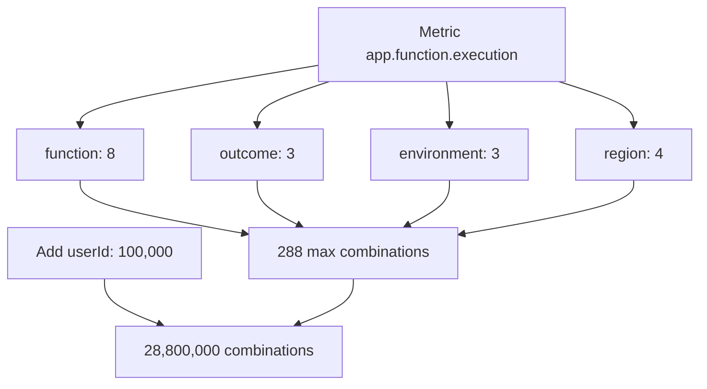

# Bounding Metric Tags and Avoiding Sensitive Data in Telemetry

## Learning Objectives

After this lesson, you will be able to:

1. Explain metric **cardinality** and why time-series count grows as the product of tag/label values.
2. Select tags with bounded value sets for Spring Cloud Function `Supplier`, `Function`, `Consumer`, HTTP adapters, and Spring Cloud Stream binders.
3. Identify data that must never become metric labels: user IDs, order IDs, emails, tokens, payloads, request IDs, and trace IDs.
4. Use Micrometer `MeterFilter` to set defensive guardrails on tag values and metrics, while understanding that filters do not replace proper tag design.
5. Distinguish where data belongs: **metrics** for aggregation, **logs** for contextual events, and **traces** for execution journeys.
6. Design structured logs, sanitize inputs, reduce log injection risks, and avoid recording credentials or PII.
7. Use correlation IDs, trace IDs, baggage, and exemplars properly without inflating metric cardinality.
8. Establish access controls, retention policies, and tests to keep sensitive data out of observability pipelines.

## 1. Why Must Metric Tags Be Bounded?

Spring Cloud Function lets you write reusable business logic as `Supplier`, `Function`, and `Consumer` beans, looked up via `FunctionCatalog`, with support for composition and message conversion. A function can be invoked over HTTP, Spring Cloud Stream, or serverless runtimes.

When instrumenting a function, we typically attach tags to slice measurements:

```java
Counter.builder("app.function.calls")
        .tag("function", "normalizeText")
        .tag("outcome", "success")
        .register(registry)
        .increment();
```

Both `function` and `outcome` have small, controlled value sets. However, adding `userId`, `orderId`, or `requestId` causes nearly every request to create a brand-new tag combination. The metrics backend must store and process ever-growing numbers of **time series**.

**Cardinality** is the number of distinct label-value combinations for a metric. Unbounded cardinality growth can:

- Increase memory usage across the application, Prometheus/remote storage, and dashboards.
- Drive up scraping, ingestion, indexing, querying, and retention costs.
- Slow down dashboards, cause query timeouts, or make the metrics backend reject new series.
- Make critical dimensions harder to observe amid millions of noisy series.
- Accidentally leak personal data, internal identifiers, or secrets into observability backends.

**Tag design is part of both operations engineering and data protection.** Not everything useful for debugging belongs in metrics.

## 2. How Is Cardinality Created?

Suppose `app.function.execution` has these tags:

| Tag | Possible values |
| --- | ---: |
| `function` | 8 |
| `outcome` | 3 |
| `environment` | 3 |
| `region` | 4 |

If every combination occurs, the maximum number of time series is roughly:

\[
8 \times 3 \times 3 \times 4 = 288
\]

That scale is predictable and manageable. Adding a `userId` tag with 100,000 values yields:

\[
8 \times 3 \times 3 \times 4 \times 100{,}000
= 28{,}800{,}000
\]

A tag that looks like "just one extra field" can multiply combinations from hundreds to tens of millions.



The multiplication above estimates free combination of values; actual series count depends on which combinations occur, how the registry creates meters, and the storage backend. With histograms, each logical meter also generates many bucket/count/sum series, so real cost is even higher than for a simple counter.

### Cardinality Comes from More Than Just Tag Count

A metric can explode in cardinality because of:

- Tags holding per-request varying values.
- URL paths containing dynamic IDs such as `/orders/10001`, `/orders/10002`.
- Exception messages containing IDs, SQL fragments, or URLs.
- Arbitrary client-supplied function or operation names.
- A `tenant` tag holding tens of thousands of tenants.
- Combining many small dimensions whose Cartesian product is still huge.
- Histograms with many buckets across many tag combinations.

**Counting tags is not enough.** Estimate the cardinality of each tag and their product for every key metric.

## 3. Choosing Tags with Bounded Value Sets

A well-designed tag generally has these traits:

1. A predefined or tightly bounded set of values.
2. Clear utility for filtering/grouping in dashboards and alerts.
3. No arbitrary user-supplied content.
4. No exposure of personal data, credentials, or sensitive business contents.
5. Clear documentation in your metric catalog.

Examples for Spring Cloud Function:

| Tag | Suitable values | Avoid |
| --- | --- | --- |
| `function` | `normalizeText`, `reverseText`, `saveOrder` from approved code/config | Function names taken directly from unbounded headers |
| `outcome` | `success`, `error`, `rejected` | Exception messages or stack traces |
| `source` | `http`, `stream`, `internal`, `warmup` | Arbitrary URLs or client names |
| `operation` | `normalize`, `reverse`, `validate` from an allowlist | Unchecked client-supplied routing values |
| `status` | `2xx`, `4xx`, `5xx` or status classes | Raw response bodies |
| `error_type` | `validation`, `timeout`, `dependency`, `internal` | `exception.getMessage()` |
| `region` | `ap-southeast-1`, `eu-west-1` if the region set is small | Per-request hostnames or IP addresses |
| `tenant_tier` | `free`, `standard`, `enterprise` | Tenant IDs, emails, or customer names |

### URLs Must Be Route Templates

For HTTP metrics, use route templates such as:

```text
/orders/{orderId}
/customers/{customerId}/profile
/functions/{functionName}
```

Do not use raw URLs containing real IDs:

```text
/orders/ORD-2026-00001234
/customers/mai.nguyen@example.com/profile
```

Spring MVC/WebFlux observation support usually provides normalized URI patterns. If you create custom metrics in filters or controllers, extract the **route template** or a bounded route group—never put raw request URIs directly into a tag.

### `error_type` Should Be an Application-Controlled Enum

Example:

```java
enum ErrorType {
    VALIDATION,
    TIMEOUT,
    DEPENDENCY,
    INTERNAL
}
```

When catching exceptions, map them to a bounded category:

```java
static ErrorType classify(RuntimeException exception) {
    if (exception instanceof IllegalArgumentException) {
        return ErrorType.VALIDATION;
    }
    if (exception instanceof java.util.concurrent.TimeoutException) {
        return ErrorType.TIMEOUT;
    }
    return ErrorType.INTERNAL;
}
```

This snippet illustrates the principle; in real applications, map exceptions according to your business contracts and dependency failure modes. **Never use an exception's message as a tag**, because messages often embed input data.

## 4. Which Data Belongs in Metrics, Logs, and Traces?

Not all useful observability data should live in the same telemetry channel.

| Data type | Metrics | Logs | Traces |
| --- | --- | --- | --- |
| Allowlisted function name | Suitable | Suitable | Suitable |
| Bounded outcome | Suitable | Suitable | Suitable |
| Latency/count | Suitable via Timer/Counter | Selective event logs | Duration/span attributes |
| Random request ID | Must not be a label | Suitable for lookup if controlled | Linked via trace/span context |
| Order ID / user ID | Must not be a label | Only when genuinely needed, access-controlled, and minimized | Only with clear purpose, data policy, and permissions |
| Raw payload | No | Avoid; prefer selected safe fields | Avoid placing payloads in span attributes/events |
| Password / API key / access token | Absolutely never | Absolutely never | Absolutely never |
| Trace ID | Never a metric tag | Appears via tracing correlation | Core identifier of the trace |
| Broker topic/partition | Only if bounded and appropriate | Acceptable | Acceptable as span attributes if helpful |

### Metrics Answer Aggregate Questions

- How many times did `normalizeText` fail in the last 5 minutes?
- What is the function's P95 latency per environment?
- Are rejected messages increasing per binding?

These questions can be answered using bounded dimensions.

### Logs Answer Event-Specific Questions

- Which stages did `invocationId=...` pass through?
- Why was one specific event rejected?
- Which retry attempt succeeded in writing to the database?

Logs can carry random correlation IDs for lookup, subject to access control, retention limits, and careful field selection.

### Traces Answer Journey Questions

Traces connect HTTP → function → client → broker/consumer steps when instrumentation and propagation are configured. Trace and span IDs are high-cardinality identifiers by design, and tracing backends are built for them. **Never turn a trace ID into a Prometheus metric label.**

## 5. Example of Safe Function Metrics

The following example uses bounded tag value sets:

```java
package com.example.safemetrics;

import java.util.Locale;
import java.util.function.Function;

import io.micrometer.core.instrument.MeterRegistry;
import io.micrometer.core.instrument.Timer;
import org.springframework.context.annotation.Bean;
import org.springframework.context.annotation.Configuration;

@Configuration
class SafeFunctionMetricsConfiguration {

    @Bean
    Function<String, String> normalizeText(MeterRegistry registry) {
        Timer success = Timer.builder("app.function.execution")
                .description("Execution duration of one function invocation")
                .tag("function", "normalizeText")
                .tag("outcome", "success")
                .register(registry);

        Timer error = Timer.builder("app.function.execution")
                .description("Execution duration of one function invocation")
                .tag("function", "normalizeText")
                .tag("outcome", "error")
                .register(registry);

        return input -> {
            Timer.Sample sample = Timer.start(registry);
            try {
                if (input == null || input.isBlank()) {
                    throw new IllegalArgumentException("Input is blank");
                }
                String output = input.trim().toUpperCase(Locale.ROOT);
                sample.stop(success);
                return output;
            }
            catch (RuntimeException exception) {
                sample.stop(error);
                throw exception;
            }
        };
    }
}
```

Both `function` and `outcome` have small value sets defined in code. The Timer records count and duration for **one invocation of the function body**.

Do not add tags like these:

```java
// DO NOT use:
.tag("userId", request.getUserId())
.tag("email", request.getEmail())
.tag("orderId", order.getId())
.tag("payload", input)
.tag("traceId", currentTraceId)
```

These values change per request, may carry PII or sensitive business data, and cause high cardinality. To look up an individual invocation, use access-controlled logs/traces and correlation context.

### Function Name Read from a Routing Header

An application using `functionRouter` may read a target function name from a header. Never turn that header directly into a tag:

```java
// Unsafe if operation comes from an unbounded source:
registry.counter("app.function.routes",
        "operation", message.getHeaders()
                .get("spring.cloud.function.definition").toString())
        .increment();
```

Map it through an allowlist instead:

```java
import java.util.Map;

private static final Map<String, String> ALLOWED_OPERATIONS = Map.of(
        "normalize", "normalize",
        "reverse", "reverse",
        "validate", "validate");

static String metricOperation(String requested) {
    return ALLOWED_OPERATIONS.getOrDefault(requested, "other");
}
```

Then pass only the result of `metricOperation(...)` as the tag. Unexpected values can still be recorded in sanitized logs (if needed and permitted), without **creating a new time series** for every arbitrary string.

## 6. Adding Guardrails with Micrometer `MeterFilter`

Good metric design must be the first line of defense. `MeterFilter` adds **a secondary guardrail** at the registry layer to cap the number of meters or tag values.

### 6.1. Limiting the Values of a Tag

```java
package com.example.safemetrics;

import io.micrometer.core.instrument.config.MeterFilter;
import org.springframework.context.annotation.Bean;
import org.springframework.context.annotation.Configuration;

@Configuration
class MetricsGuardrailsConfiguration {

    @Bean
    MeterFilter functionNameCardinalityLimit() {
        return MeterFilter.maximumAllowableTags(
                "app.function.execution",
                "function",
                20,
                MeterFilter.deny());
    }
}
```

This filter caps the `function` tag at 20 distinct values for meters whose names start with `app.function.execution`. Once exceeded, `MeterFilter.deny()` rejects new meters breaching the limit.

**This cap does not sanitize data or strip PII.** If the `function` tag contains an email or token, the filter can still accept a sensitive value before hitting the cap. Therefore, always allowlist and normalize before registering meters.

### 6.2. Limiting Total Meters

You can also enforce a registry-wide cap:

```java
@Bean
MeterFilter totalMetricLimit() {
    return MeterFilter.maximumAllowableMetrics(
            5000,
            MeterFilter.deny());
}
```

`5000` is only an example. Pick a limit based on registry capacity, function count, dimensions, histogram buckets, and system budget. Rejecting new meters can leave dashboards with missing data, so monitor and log when filters trigger.

### 6.3. Normalizing Dynamic Values into Bounded Groups

Some Micrometer versions provide `MeterFilter.replaceTagValues(...)` to map tag values into a predefined set. Illustrative example:

```java
import io.micrometer.core.instrument.config.MeterFilter;

@Bean
MeterFilter routeTagNormalizer() {
    return MeterFilter.replaceTagValues(
            "route",
            value -> switch (value) {
                case "normalize", "reverse", "validate" -> value;
                default -> "other";
            });
}
```

This applies to the `route` tag key across the registry; to scope it to specific meters, filter on `Meter.Id` or use filter options supported by your Micrometer version. **Do not assume** this normalizer replaces validation at tag creation time: any other metric using a `route` tag will also be affected.

### 6.4. Filter Ordering and Scope

| Guardrail | What does it protect? | What does it not solve? |
| --- | --- | --- |
| `maximumAllowableTags` | Number of tag values under a meter prefix | Whether PII appears inside accepted values |
| `maximumAllowableMetrics` | Total registered meters | Remote storage cardinality or log volume |
| `replaceTagValues` | Tag value normalization | Privacy of logs/spans or other registries |
| `denyNameStartsWith` | Blocks disallowed metric groups | Does not remove metrics already exported earlier |

If an application uses multiple `MeterRegistry` instances, verify filters are registered on **every registry requiring protection**. Local filters do not govern data pushed directly by a separate SDK or exporter.

## 7. Anti-Pattern: Tags Taken from Request Data

The following pattern easily sneaks in when teams want per-user visibility:

```java
@Bean
Function<OrderRequest, OrderResult> processOrder(MeterRegistry registry) {
    return request -> {
        return Timer.builder("app.order.processing")
                .tag("customer", request.email())
                .tag("orderId", request.orderId())
                .register(registry)
                .record(() -> doProcess(request));
    };
}
```

Problems:

- Emails are personal data; order IDs can be sensitive business identifiers.
- Every customer and order can spawn a new time series.
- Per-customer metric dashboards break down at scale.
- Metric backends often retain data longer than application logs.
- Hashing emails or order IDs **does not fix cardinality**; hashes remain unique per input and can still be correlated.

Redesigned approach:

```java
Timer.builder("app.order.processing")
        .tag("function", "processOrder")
        .tag("outcome", "success")
        .tag("customer_tier", allowedTier(request.customerTier()))
        .register(registry)
        .record(() -> doProcess(request));
```

If you need to trace a specific order, use an **opaque correlation ID** inside access-controlled logs/traces or a dedicated business audit store. Never turn metrics into a per-customer lookup table.

## 8. Logs: Do Not Record Payloads, Tokens, or Personal Data

High-cardinality metric labels are one hazard; logs introduce another: **recording too much data**.

Anti-patterns:

```java
log.info("Processing request: {}", request);
log.debug("Authorization header={}", authorizationHeader);
log.error("Failed payload={}, exception={}", message.getPayload(), ex);
```

These lines can record:

- Emails, phone numbers, addresses, or customer-submitted text.
- Access tokens, refresh tokens, API keys, or session cookies.
- Payment details or database credentials.
- SQL/query parameters, URLs containing credentials, or exception messages leaking secrets.

Instead, log events with **minimal safe fields**:

```java
log.info(
        "event=function_completed function={} outcome={} correlationId={}",
        "processOrder",
        "success",
        safeCorrelationId);
```

Good logs answer operational questions without dumping entire payloads. When inspecting business content is necessary, rely on audit records or authorized tools governed by explicit procedures.

### How Should Exceptions Be Logged?

`log.error("processing failed", ex)` can emit stack traces and exception messages. Some exception messages embed URLs, SQL statements, headers, or input payloads. You can:

- Log an error code or exception class from a bounded set.
- Log the correlation ID to locate access-controlled traces.
- Emit stack traces only at appropriate levels and destinations, scrubbing secrets if third-party libraries may embed sensitive data.
- Avoid copying `ex.getMessage()` into metric tags or unchecked structured fields.

Do not suppress all stack traces blindly; balance debuggability against data exposure with proper access control and retention.

## 9. Preventing Log Injection and Validating Correlation IDs

A client might send a header:

```text
X-Correlation-Id: request-42
```

If an application writes values containing newline characters directly into plain-text logs, an attacker can forge extra log lines or corrupt log structure.

Validate values before using them:

```java
import java.util.UUID;
import java.util.regex.Pattern;

final class CorrelationIds {

    private static final Pattern SAFE =
            Pattern.compile("[A-Za-z0-9._-]{1,64}");

    private CorrelationIds() {
    }

    static String acceptOrGenerate(String incoming) {
        if (incoming != null && SAFE.matcher(incoming).matches()) {
            return incoming;
        }
        return UUID.randomUUID().toString();
    }
}
```

This helper:

- Caps length at 64 characters.
- Permits only letters, digits, dots, underscores, and hyphens.
- Generates a fresh ID if the incoming value is invalid.

Depending on your API contract, you may return `400 Bad Request` instead of generating a new ID. Either way, **never log the rejected raw value verbatim**.

### What Structured Logging Helps With—and What It Does Not

A compliant JSON encoder typically escapes control characters, reducing newline-based log injection risks. However, JSON **does not automatically redact**:

- `password` or `accessToken`.
- Emails, account numbers, or raw payloads.
- A `correlationId` field containing personal data.

You still must validate, select allowed fields, and redact before emitting logs.

## 10. Trace Attributes and Baggage Must Also Be Bounded

Distributed tracing uses trace and span IDs to link steps. Spans may carry attributes such as:

```text
service.name = order-service
function.name = processOrder
messaging.destination.name = order-events
outcome = error
```

This metadata is helpful when values are controlled. However, **never attach raw payloads, credentials, emails, access tokens, or arbitrary content to span attributes or events**.

### Baggage vs. Span Attributes

Baggage is metadata propagated across multiple services by the propagator. For example, `tenantTier=enterprise` can be useful if values come from a small approved set. By contrast, placing `email`, `userToken`, or raw customer data in baggage spreads sensitive data across every downstream service and telemetry system.

| Field | Metric tag | Log | Trace attribute/baggage |
| --- | --- | --- | --- |
| `function=processOrder` | Yes | Yes | Optional |
| `outcome=success/error` | Yes | Yes | Optional |
| `traceId` | No | Yes via tracing correlation | Built into trace |
| Random `requestId` | No | Yes if needed and controlled | Only with clear purpose |
| `userId` | No | Restricted; avoid if unnecessary | Avoid in baggage; attributes require approval |
| `email` | No | Do not log by default | No |
| Access token | No | No | No |
| Raw payload | No | Do not log by default | No |

### Using Exemplars to Link Metrics to Traces

Prometheus and Micrometer can support **exemplars**: a representative sample attached to a histogram or counter linked to an active trace context (depending on registry and backend). This lets you jump from a metric latency spike to an example trace **without turning trace IDs into labels on every time series**.

Exemplar support depends on the registry, scrape protocol, backend, and active tracing context. Verify your actual exporter configuration rather than adding `traceId` as a metric tag.

## 11. Data Boundaries for Each Spring Cloud Function Layer

### Functions and Composition

Tags should come from controlled function names in code or configuration:

```text
function=normalizeText
function=validateOrder
function=saveOrder
```

For a `validateOrder|saveOrder` composition, measure each stage with dedicated metrics. Never construct a `definition` tag from an arbitrary client-supplied composition string; restrict to an allowlisted set.

### `functionRouter`

The router can pick targets from headers or a routing expression. Before using a route as a tag:

1. Normalize it to one of the allowed routes.
2. Bucket unknown routes into `other` or reject per policy.
3. Never use raw headers or entire expressions as metric labels.
4. Never log raw payloads or headers containing credentials.

Logs can record `requestedOperation=unknown` or a bounded error code; if raw values are ever needed for investigation, scrub/truncate them and store them only in protected locations.

### HTTP Adapter

- Use HTTP method and route templates, never raw URLs.
- Use status classes or bounded status codes.
- Never log `Authorization` or `Cookie` headers.
- Never log request/response bodies by default; log only approved fields when justified.

### Spring Cloud Stream Binder

- Destination and binding names should come from managed configuration with bounded counts.
- Partitions or consumer groups may serve as dimensions when small and operationally useful.
- Never put arbitrary message keys, payloads, or customer IDs into tags.
- Log retries/DLQ events using event name, binding, and outcome rather than dumping full events.

### Serverless

- Platform invocation IDs can appear in logs/traces per platform guidance, never as metric labels.
- Never dump entire event JSON payloads into logs for debugging.
- Distinguish provider request/event IDs from application business event IDs.
- Verify log/trace exports do not accidentally capture event payloads or environment variables.

## 12. Testing Cardinality Guardrails

You can verify `MeterFilter.maximumAllowableTags` using `SimpleMeterRegistry`:

```java
import static org.junit.jupiter.api.Assertions.assertEquals;

import io.micrometer.core.instrument.Counter;
import io.micrometer.core.instrument.config.MeterFilter;
import io.micrometer.core.instrument.simple.SimpleMeterRegistry;
import org.junit.jupiter.api.Test;

class MetricCardinalityGuardrailTest {

    @Test
    void limitsRouteTagValues() {
        try (SimpleMeterRegistry registry = new SimpleMeterRegistry()) {
            registry.config().meterFilter(
                    MeterFilter.maximumAllowableTags(
                            "app.function.calls",
                            "route",
                            2,
                            MeterFilter.deny()));

            Counter.builder("app.function.calls")
                    .tag("route", "normalize")
                    .register(registry)
                    .increment();

            Counter.builder("app.function.calls")
                    .tag("route", "reverse")
                    .register(registry)
                    .increment();

            Counter.builder("app.function.calls")
                    .tag("route", "user-input-123")
                    .register(registry)
                    .increment();

            assertEquals(2, registry.getMeters().size());
        }
    }
}
```

This test shows the registry keeping only the first two `route` values while rejecting the third under the filter. Exact no-op meter behavior and counting details can vary by Micrometer version, so run tests against your project's actual dependencies.

**This is only a technical guardrail.** The test does not prove your application avoids logging PII, avoids propagating sensitive baggage, or protects every registry/exporter. Test log and trace pipelines separately.

## 13. Testing That Logs Exclude Sensitive Data

You can test with a Logback test appender to confirm log events include required fields while excluding tokens and payloads. Pseudocode:

```java
// Pseudocode: using Logback's ListAppender<ILoggingEvent>.
ListAppender<ILoggingEvent> appender = new ListAppender<>();
appender.start();
((ch.qos.logback.classic.Logger) LoggerFactory
        .getLogger(OrderProcessor.class))
        .addAppender(appender);

processor.process(requestWithSecret);

String rendered = appender.list.stream()
        .map(ILoggingEvent::getFormattedMessage)
        .collect(java.util.stream.Collectors.joining("\n"));

assertFalse(rendered.contains("secret-token-value"));
assertFalse(rendered.contains("customer@example.com"));
```

This is pseudocode because appender and logger setup depends on your logging backend. In real projects:

- Inspect formatted messages, MDC maps, and structured arguments.
- If the appender serializes exception proxies or stack traces, inspect exception content as well.
- Keep fake test secrets out of real CI logs.
- Test final serialized output, not just message templates.

### Recommended Test Cases

| Input | Expectation |
| --- | --- |
| Valid correlation ID | Log contains the accepted opaque ID |
| ID containing CR/LF | Raw value is not logged; replaced with a fresh ID or rejected |
| Request with `Authorization` header | Token never appears in logs |
| Payload containing email | Email never appears without explicit purpose/approval |
| Exception message containing SQL parameters | Logged via error code or scrubbed fields |
| Arbitrary route from client | Metric uses allowlist/`other`, creating no new tag |
| Trace context | Trace ID appears in correlation logs or exemplars, never as a metric label |

## 14. Access Control, Retention, and Data Pipelines

Limiting data in application code is not enough. Metrics, logs, and traces flow to centralized backends accessed by multiple teams.

### Control Principles

1. **Purpose limitation:** collect only fields serving clear operational, security, or audit needs.
2. **Data minimization:** never collect payloads/PII merely because "it might help debug later."
3. **Access control:** enforce RBAC; logs carrying customer identifiers require tighter access than aggregate metrics.
4. **Retention:** set retention periods aligned with operational, audit, and data policies; never retain indefinitely by default.
5. **Encryption:** protect telemetry in transit and at rest using your telemetry stack's capabilities.
6. **Redaction at source:** mask/strip sensitive fields before writing logs or exporting spans rather than relying solely on post-ingestion scrubbing.
7. **Audit access:** audit reads of sensitive observability data.
8. **Incident response:** maintain a runbook for accidental secret/PII ingestion, including revoking credentials and purging/restricting copies in backends when required.

### Actuator Is Also an Access Surface

Endpoints like `/actuator/metrics`, `/actuator/prometheus`, and `/actuator/env` expose different levels of detail. Expose only what is necessary:

```yaml
management:
  endpoints:
    web:
      exposure:
        include: "health,metrics,prometheus"
```

This illustrates exposure only; pair it with security policies, a private management network, and authentication/authorization. Never expose `env`, `configprops`, or `*` solely to debug metric cardinality.

### Do Not Treat Hashing as Complete Anonymization

Hashing an email or customer ID can still permit correlation or dictionary attacks when the input space is small or unsalted. Hashing also fails to reduce cardinality because each unique input yields a unique hash. **Never use hashing to justify putting PII into metric labels.**

## 15. Review Checklist for Adding a New Metric

Before adding a meter to a function or adapter, answer:

```text
1. Which operational question does this metric answer?
2. Are the meter name and unit unambiguous?
3. What is the maximum value set size for each tag?
4. How many series can the Cartesian product of tag values create?
5. Does any tag come from user input, payloads, URLs, or exception messages?
6. Does it contain PII, credentials, secrets, or sensitive internal IDs?
7. Can we use a route template, enum, or "other" bucket instead?
8. Does this tag actually belong in metrics, or are logs/traces sufficient?
9. Are histograms/percentiles truly needed, and have bucket costs been estimated?
10. Are MeterFilter guardrails and cardinality tests in place?
11. Is the metric registered on every relevant MeterRegistry/exporter?
12. Do dashboards and alerts use bounded dimensions and the right denominator?
```

## 16. Diagnosing Common Issues

| Symptom | Possible cause | Resolution |
| --- | --- | --- |
| Prometheus has millions of series | Tag holds dynamic IDs or huge dimension combinations | Remove IDs from tags, normalize enums, inspect top series |
| Slow scrapes or remote writes | Rapid cardinality or histogram growth | Trim tags/buckets and cap new metrics |
| Dashboard stalls when filtering by tenant | `tenantId` tag has too many values | Use bounded tiers/regions; query per-tenant details via controlled logs |
| Metric disappears after adding `MeterFilter` | Filter denied new meters | Check prefix, tag key, cap, and filter order |
| Route metric always reports `other` | Allowlist mismatch or overly broad filter scope | Check route mapping, test filter, and registry scope |
| Logs contain tokens even though metrics are clean | Logger dumps headers, payloads, or exceptions | Redact at source; audit appenders and structured fields |
| JSON logs still leak emails | JSON escapes characters but does not redact | Allowlist log fields and scrub sensitive data |
| Traces contain customer data attributes | Arbitrary span events or baggage added | Remove attributes, enforce allowlists, update instrumentation |
| Cardinality filter fails to stop PII | Sensitive values accepted before hitting the cap | Validate and normalize at source; filters are only guardrails |
| Metric carries a trace ID label | Trace ID used as a metric dimension | Remove the tag; use exemplars or tracing backends |
| Logs cannot locate an invocation | Missing correlation context or lost propagation | Generate IDs at ingress and propagate across `Message` and async boundaries |
| Tag cap configured yet remote storage still overloaded | Other tags, histograms, or unprotected registries remain | Audit all dimensions, exporters, and total series |
| Hashed tenant tag still grows per tenant | Hashing preserves uniqueness | Use tenant tiers/aggregates; never hash to fix cardinality |

### Incident Response Steps for Sudden Cardinality Spikes

1. Identify the rapidly growing metric name/prefix and when growth started.
2. Inspect tag keys, top values, and the dimension combinations driving growth.
3. Locate the code registering the meter: function, router, HTTP filter, binder, or custom instrumentation.
4. Identify dynamic-data tags and replace them with enums, route templates, or bounded buckets.
5. Check whether sensitive data was ingested; if so, trigger your data incident response process.
6. Add allowlist/cardinality tests and registry guardrails.
7. Monitor series counts, scrape duration, ingestion, and dashboards after the fix.

Do not delete metrics wholesale blindly: verify which dashboards and alerts depend on those metric names and labels so critical operational signals are not lost.

## 17. Practice Exercises

1. Create `app.function.execution` with tags `function`, `outcome`, `environment`, and `region`. Compute the maximum combinations if the tags take 8, 3, 3, and 4 values respectively.
2. Add `userId` with 10,000 values to the calculation. Explain the impact on time-series count and why metrics must not act as a per-user query store.
3. Instrument `normalizeText` with a `Timer` using only two bounded tags, `function` and `outcome`. Check the number of meters created across many invocations.
4. Use `functionRouter` reading operations from a header. Build an allowlist for `normalize`, `reverse`, and `validate`; map anything else to `other` or reject it.
5. Add `MeterFilter.maximumAllowableTags` for the `function` tag and write a JUnit test verifying meters beyond the limit are not registered.
6. Compare `maximumAllowableTags` and `maximumAllowableMetrics`. Explain why neither replaces checking for PII at meter creation sites.
7. Write a `function_completed` log event containing only function name, outcome, and an opaque correlation ID. Verify tokens and payloads never appear in logs.
8. Submit a correlation ID containing CR/LF characters. Design validation that rejects it or generates a fresh ID without logging the raw input.
9. Given request URL `/orders/12345`, propose the route template `/orders/{orderId}` for HTTP metrics and explain why raw URLs cause high cardinality.
10. Propose approved span attribute fields for `saveOrder`, excluding emails, tokens, and raw payloads.
11. Explain why hashing `customerId` neither solves cardinality nor automatically anonymizes data.
12. Design a dashboard grouped by `function`, `outcome`, `region`, and `tenantTier`, explaining why `tenantId` and `traceId` are omitted.
13. Enable Actuator `metrics` and `prometheus` in a test environment. Propose exposure, authentication, and network access policies.
14. Create a log/metric/trace review checklist for a function processing messages containing customer information.

## Key Takeaways

- **Cardinality is the count of label combinations**; adding a high-cardinality tag multiplies time series combinatorially.
- Metric tags should hold **bounded, operationally meaningful value sets**: fixed function names, outcome enums, route templates, environments, or tiers.
- Never place `userId`, `orderId`, emails, payloads, request IDs, or trace IDs into metric labels. Hashing IDs neither fixes cardinality nor guarantees anonymity.
- Use `MeterFilter.maximumAllowableTags` and `maximumAllowableMetrics` as secondary guardrails; filters never replace allowlists, validation, or source-level data protection.
- Metrics serve aggregation; logs serve contextual events; traces serve distributed journeys. Never write tokens, passwords, credentials, or raw payloads into any telemetry channel.
- Structured JSON escapes special characters but **does not automatically redact** sensitive fields; validate correlation IDs and defend against log injection.
- Trace IDs belong in correlated logs/traces or exemplars, not metric labels. Baggage and span attributes likewise require allowlists, data minimization, and access control.
- Secure Actuator endpoints, telemetry backends, retention, and read access; if sensitive data is ingested, treat it as a data incident.

### Official References

- [Micrometer — Meter Filters](https://docs.micrometer.io/micrometer/reference/concepts/meter-filters.html)
- [Micrometer — Naming Meters and Tags](https://docs.micrometer.io/micrometer/reference/concepts/naming.html)
- [Micrometer — Exemplars](https://docs.micrometer.io/micrometer/reference/prometheus/exemplars.html)
- [Prometheus — Metric and Label Naming](https://prometheus.io/docs/practices/naming/)
- [Prometheus — Instrumentation Practices](https://prometheus.io/docs/practices/instrumentation/)
- [Prometheus — Histograms and Summaries](https://prometheus.io/docs/practices/histograms/)
- [Spring Boot — Metrics and Actuator](https://docs.spring.io/spring-boot/reference/actuator/metrics.html)
- [Spring Boot — Logging](https://docs.spring.io/spring-boot/reference/features/logging.html)
- [Spring Cloud Function — Programming Model and FunctionCatalog](https://docs.spring.io/spring-cloud-function/reference/spring-cloud-function/programming-model.html)
