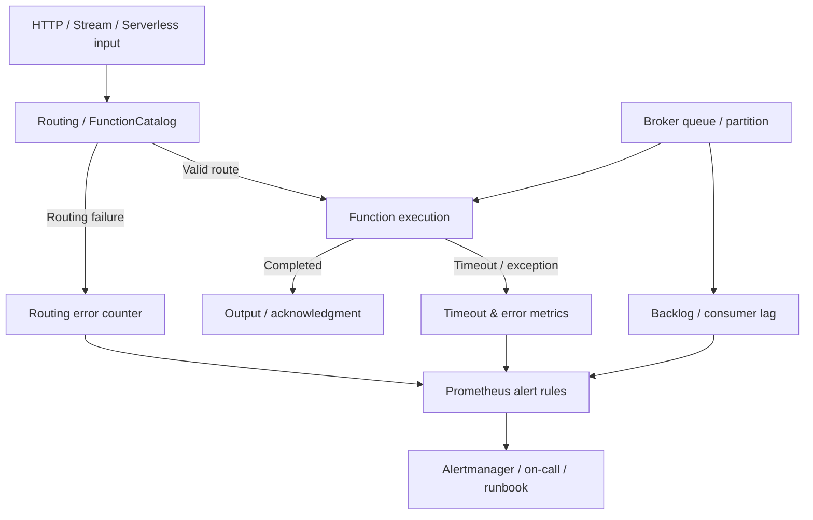

# Setting Up Alerts for Routing Errors, Message Backlog, and Timeouts

## Learning Objectives

After this lesson, you will be able to:

1. Identify three critical incident categories in Spring Cloud Function services: **routing errors**, **message backlog**, and **processing timeouts**.
2. Distinguish function selection errors in `FunctionCatalog`/`functionRouter` from business execution errors occurring after the function starts running.
3. Instrument routing attempts/errors using Micrometer `Counter` with low-cardinality tags.
4. Select the right backlog signal per broker: Kafka consumer lag, RabbitMQ queue depth, or pending message counts on other platforms.
5. Configure timeouts at the right processing boundary while understanding cancellation, retries, and the limits of interrupting synchronous functions.
6. Write Prometheus alert rules for routing error rate, high/growing backlog, dead-letter messages, and timeouts/latency.
7. Choose thresholds, observation windows, `for` durations, and alert severities aligned with SLOs and real traffic.
8. Test metrics, alerts, and runbooks, distinguishing **zero errors** from **missing observability data**.

## 1. Why Alert on These Three Categories?

Spring Cloud Function lets you build business logic with `Supplier`, `Function`, and `Consumer` beans, register/look up via `FunctionCatalog`, compose functions, and convert messages. The same function can be invoked from HTTP, Spring Cloud Stream, or serverless environments.

When a system degrades, three early warning signs commonly surface:

- **Routing error:** a request or message is not dispatched to the intended function—for example, a nonexistent function name, an invalid route, or a failing routing expression.
- **Backlog:** a broker receives messages faster than consumers process them, causing queues or partitions to accumulate pending work.
- **Timeout:** a function or downstream dependency fails to finish within its deadline; requests are cancelled, or messages retry or move to a dead-letter queue.

These three categories are related yet distinct:

| Symptom | Possible cause | What cannot be inferred alone |
| --- | --- | --- |
| Rising routing errors | Bad route/header, unregistered function, misconfigured definition | Business function is running slowly |
| Growing backlog | Slow consumer, insufficient concurrency, broker rebalance, producer surge | Function definitely has a bug |
| Rising timeouts | Slow downstream, blocked threads, overly tight deadline, CPU/GC | Broker definitely has a backlog |
| Rising HTTP 5xx | Routing, function exception, timeout, serialization, or adapter | Every error lives inside the function body |
| Rising DLQ | Messages repeatedly fail, exhaust retries, or get rejected | Messages were processed successfully |

The goal of alerting is to **identify the right layer and point operators to the next piece of evidence**, not merely fire a generic "service is unhealthy" page.



## 2. Define Signals Before Writing Alerts

An actionable alert requires a clear metric, unit, tag set, denominator, and condition.

| Category | Illustrative application metric | Unit |
| --- | --- | --- |
| Routing attempts | `app.function.routing.attempts` | Route selection attempts |
| Routing errors | `app.function.routing.errors` | Failed route selections |
| Function execution | `app.function.execution` (Timer) | Duration and invocation count |
| Function timeouts | `app.function.timeouts` | Deadline violations |
| Messaging backlog | `app.messaging.backlog.messages` (Gauge) | Pending messages |
| Consumer lag | `app.messaging.consumer.lag.records` (Gauge) | Records consumer lags behind |
| Dead-letter messages | `app.messaging.deadletter.messages` | Messages sent to DLQ |

These are **illustrative naming conventions**, not a guarantee that Spring Cloud Function or every binder emits these exact meters automatically. Micrometer's Prometheus registry typically converts names to snake_case and appends `_total` to Counters; check `/actuator/prometheus` or the live meter list before writing PromQL.

If alert rules group by an `application` label, configure a common tag on the registry and ensure broker exporters emit the matching label:

```yaml
management:
  metrics:
    tags:
      application: order-function-service
```

The `application` key and value above are example conventions. If an exporter omits that label, adjust `sum by (...)` and vector matching in PromQL to match the real label set; never assume every binder adds the same tags automatically.

### Three Questions to Answer for Every Metric

1. **Who emits the metric?** The function, router, binder, broker exporter, or cloud platform?
2. **What is the unit?** Invocations, message attempts, record lag, ready messages, or seconds?
3. **Which dimensions are permitted?** For example `application`, `function`, `destination`, `consumer_group`, and `reason` from bounded sets.

Never put payloads, user IDs, order IDs, trace IDs, or arbitrary route strings into metric labels. Those inflate cardinality and leak sensitive data into metrics backends.

## 3. Detecting and Counting Routing Errors

### 3.1. Where Do Routing Errors Occur?

Spring Cloud Function can route using:

- `FunctionCatalog` to look up a function or composition.
- `functionRouter` to select a function from message headers or a routing expression.
- `spring.cloud.function.definition` to specify the active function definition.
- `MessageRoutingCallback` when custom routing logic is required.

Common failures:

| Error | Example | Appropriate reason label |
| --- | --- | --- |
| Disallowed route | Client sends `deleteAll` when only `normalize` and `reverse` are allowed | `unknown_route` |
| Unregistered function | Catalog cannot find `normalizeText` | `function_not_found` |
| Invalid definition | Composition references a bad name or invalid expression | `invalid_definition` |
| Routing callback failure | Callback cannot determine target | `routing_callback_error` |
| Lookup failure | Framework/catalog throws during lookup | `lookup_failed` |

**Separate routing errors from execution errors.** If lookup succeeds, the function starts running, and then throws an exception, that is a function execution error. Combining both into one routing counter misdirects dashboards to the wrong layer.

### 3.2. Instrumenting at the Function Selection Boundary

Example service validating a route name against an allowlist and looking it up in `FunctionCatalog`:

```java
package com.example.alerting;

import java.util.Set;
import java.util.function.Function;

import io.micrometer.core.instrument.MeterRegistry;
import org.springframework.cloud.function.context.FunctionCatalog;
import org.springframework.stereotype.Component;

@Component
class InstrumentedFunctionRouter {

    private static final Set<String> ALLOWED =
            Set.of("normalizeText", "reverseText", "validateOrder");

    private final FunctionCatalog catalog;
    private final MeterRegistry registry;

    InstrumentedFunctionRouter(
            FunctionCatalog catalog, MeterRegistry registry) {
        this.catalog = catalog;
        this.registry = registry;
    }

    Object route(String requestedName, Object payload) {
        registry.counter("app.function.routing.attempts").increment();

        if (requestedName == null || !ALLOWED.contains(requestedName)) {
            routingError("unknown_route");
            throw new IllegalArgumentException("Unsupported function route");
        }

        final Function function;
        try {
            function = catalog.lookup(Function.class, requestedName);
        }
        catch (RuntimeException exception) {
            routingError("lookup_failed");
            throw exception;
        }

        if (function == null) {
            routingError("function_not_found");
            throw new IllegalStateException("Function is not registered");
        }

        // Errors thrown by function.apply belong to execution metrics,
        // and are not counted again as routing errors.
        return function.apply(payload);
    }

    private void routingError(String reason) {
        registry.counter(
                "app.function.routing.errors",
                "reason", reason)
                .increment();
    }
}
```

This snippet illustrates an **application-controlled routing boundary**:

1. Each routing request increments `app.function.routing.attempts`.
2. Route names outside the allowlist increment `reason=unknown_route`.
3. Lookup exceptions are classified as `lookup_failed`.
4. Null lookup results are classified as `function_not_found`.
5. Once `function.apply` is entered, failures belong to the execution layer.

Both function names and `reason` values form bounded sets. Never put raw `requestedName` directly into a tag; if clients submit thousands of arbitrary strings, cardinality scales with untrusted input.

**Integration note:** if your application uses the built-in `functionRouter` instead of a custom wrapper, instrument at the adapter, routing callback, or appropriate exception boundary. Do not introduce an extra router solely for counting if doing so alters routing semantics. Test that the counter increments exactly once per routing decision without double-counting across wrapper and adapter.

### 3.3. Computing Routing Error Rate

Definition:

\[
\text{Routing error rate}
= \frac{\text{routing errors}}{\text{routing attempts}}
\]

For example, 12 errors out of 1,000 routing attempts:

\[
\frac{12}{1000}\times 100\% = 1.2\%
\]

When routing attempts are zero, the error rate is **undefined**, not 0%. Alerts should require a minimum traffic floor so a single failure across a handful of requests does not trigger a high-percentage page.

The routing wrapper above handles only `Function`. If the catalog routes to a `Supplier` or `Consumer`, the adapter must invoke the right interface (`get()` or `accept(...)`) and measure the routing decision at the same boundary rather than forcing every functional bean into `Function`. Payloads passed to `Function.apply` must also match the expected type or have been converted per adapter contract.

## 4. Observing Backlog According to the Broker

Backlog is the amount of work published but not yet completed according to the broker or consumer group's measurement model.

### Kafka: Consumer Lag

Kafka typically measures lag in **record offsets**: the difference between the consumer group's committed/current position and the partition's latest offset, per exporter/binder semantics.

Useful dimensions:

- Topic/destination.
- Consumer group.
- Partition when isolating hotspots.
- Application/service.

Aggregate lag by consumer group and destination for top-level alerts while keeping per-partition drill-down to detect a single stalled partition.

### RabbitMQ: Queue Depth

For RabbitMQ, key signals include:

- `messages_ready`: messages waiting to be delivered to consumers.
- `messages_unacknowledged`: messages delivered but not yet acknowledged.
- Consumer count and publish/ack rates.
- Queue state and connection/channel errors.

Rising `messages_ready` indicates consumers are falling behind. Persistently high `messages_unacknowledged` indicates consumers are processing slowly, stuck, or misconfigured for prefetch/concurrency.

### SQS and Other Brokers

For SQS, inspect visible messages, not-visible/in-flight messages, and age of the oldest message. For other brokers, use the platform's corresponding metrics.

**There is no single universal backlog metric across all binders.** Spring Cloud Stream abstracts bindings, but lag/depth metrics and semantics depend on the specific binder, broker, version, and exporter.

| Platform | Backlog signal to normalize |
| --- | --- |
| Kafka | Consumer lag by record/partition/group |
| RabbitMQ | Ready and unacknowledged messages |
| Amazon SQS | Visible, not-visible, and age of oldest message |
| Other brokers | Queue depth, pending count, or lag per broker documentation |

### Do Not Compute Backlog by Subtracting Two Counters with Different Semantics

`published - consumed` breaks down when:

- Producer and consumer count batches differently.
- Retries deliver the same message multiple times.
- Consumers acknowledge before or after side effects under different policies.
- Filtering, discarding, compaction, or DLQ routing occurs.
- Counters reset on process restart or gaps occur during scrapes.

Prefer **broker-native backlog/lag metrics**. If normalization is unavoidable, explicitly define what constitutes a pending message and a completed state.

### Normalized Backlog Metrics for Dashboards

An organization can standardize on:

```text
app.messaging.backlog.messages
  application=order-processor
  destination=orders
  consumer_group=order-workers

app.messaging.deadletter.messages
  application=order-processor
  destination=orders-dlq
```

This is an internal convention; exporters must map real broker metrics into these meters. When using a `Gauge`, keep values updated from a reliable source and monitor freshness/timestamps. A stale `Gauge` retaining an old reading after a poller stops can look like a flat backlog even though telemetry is broken.

## 5. Configuring Backlog Alerts

### 5.1. Backlog Exceeds Threshold

Example PromQL using the normalized metric:

```promql
sum by (application, destination, consumer_group) (
  app_messaging_backlog_messages
) > 10000
```

**10,000 messages** is purely illustrative. Real thresholds must reflect:

- Producer rate.
- Consumer throughput.
- Message processing SLA.
- Per-message size/cost.
- Scaling headroom and broker limits.

Do not apply 10,000 across every queue. A low-volume queue may need an alert at 100; batch analytics may tolerate far larger backlogs.

### 5.2. Backlog Keeps Growing

A brief backlog spike for a few seconds may be a normal traffic burst. A more serious signal is a backlog **growing continuously**:

```promql
sum by (application, destination, consumer_group) (
  deriv(app_messaging_backlog_messages[10m])
) > 10
```

Here a slope above 10 messages/second over 10 minutes is an example. Because `deriv` operates on Gauge series, apply it only when the metric genuinely represents **current backlog**, not a cumulative counter.

### 5.3. Messages Sitting Pending Too Long

Backlog count alone does not reveal message age. When the broker/exporter exposes the age of the oldest pending message, normalize a metric:

```text
app.messaging.oldest_message_age_seconds
```

PromQL:

```promql
max by (application, destination, consumer_group) (
  app_messaging_oldest_message_age_seconds
) > 300
```

This example alerts when the oldest message has waited longer than 5 minutes. For a workflow with a 30-second deadline, 5 minutes is already far too late; for hourly batch jobs, thresholds differ.

### 5.4. Dead-Letter Queue Growing

If you track messages routed to a DLQ with a counter:

```promql
sum by (application, destination) (
  increase(app_messaging_deadletter_messages_total[5m])
) > 0
```

This alerts when any new message enters the DLQ within 5 minutes. Choose warning or critical severity based on event criticality and replayability. Keep DLQ counts distinct from function exception counts: one message may fail several retries before entering the DLQ once.

## 6. Timeouts: Where Should Deadlines Be Enforced?

Timeout is not a single metric; it can occur at multiple layers:

| Layer | Example | Signal |
| --- | --- | --- |
| HTTP client/gateway | Client stops waiting after 2 seconds | Client timeout, gateway 504 |
| HTTP server | Request processing exceeds deadline | Server request duration/error |
| Function body | Business logic fails to finish within allowed time | Function timeout counter/timer |
| Downstream client | Database/HTTP dependency stops responding | Client timeout, dependency span |
| Reactive pipeline | Publisher emits no signal within configured duration | Reactor `timeout` signal |
| Message processing | Consumer runs past processing/visibility timeout | Retries, redelivery, lag, DLQ |
| Serverless platform | Handler exceeds execution timeout | Platform timeout / invocation failure |

**Measuring duration does not enforce a timeout.** A Micrometer `Timer` records elapsed time; it does not stop a runaway function. To enforce timeouts, configure deadlines/cancellation in clients, reactive operators, async tasks, or the runtime.

### Synchronous Functions Cannot Be Safely Interrupted by a Timer Alone

Given:

```java
Function<Order, Receipt> processOrder = order -> doBlockingWork(order);
```

wrapping `apply` in a `Timer` only records elapsed time after the method returns or throws. It cannot stop `doBlockingWork` at the 2-second mark.

To bound execution time:

- Configure timeouts on downstream clients (HTTP clients, JDBC/statement timeouts).
- Use async APIs supporting explicit cancellation and deadlines.
- Use reactive pipelines with `timeout(Duration)` when underlying work supports cancellation.
- Use a `TimeLimiter` or runtime deadline while accounting for actual task cancellation semantics.

`CompletableFuture.orTimeout` completes the future with `TimeoutException`, yet does not guarantee the underlying thread stops executing; manage cancellation and resources explicitly.

## 7. Example Reactive Function with Timeout and Metrics

The following example uses `Function<Flux<Message<String>>, Flux<String>>`, applying a 2-second deadline per message. This demonstrates timeout instrumentation when work executes via reactive subscription.

```java
package com.example.alerting;

import java.time.Duration;
import java.util.Locale;
import java.util.concurrent.TimeoutException;
import java.util.concurrent.atomic.AtomicReference;
import java.util.function.Function;

import io.micrometer.core.instrument.Counter;
import io.micrometer.core.instrument.MeterRegistry;
import io.micrometer.core.instrument.Timer;
import org.springframework.context.annotation.Bean;
import org.springframework.context.annotation.Configuration;
import org.springframework.messaging.Message;
import reactor.core.publisher.Flux;
import reactor.core.publisher.Mono;
import reactor.core.publisher.SignalType;

@Configuration
class FunctionTimeoutConfiguration {

    @Bean
    Function<Flux<Message<String>>, Flux<String>> normalizeWithTimeout(
            MeterRegistry registry) {

        Timer success = timer(registry, "success");
        Timer error = timer(registry, "error");
        Timer timeout = timer(registry, "timeout");
        Timer cancelled = timer(registry, "cancelled");

        Counter timeoutCounter = registry.counter(
                "app.function.timeouts", "function", "normalizeWithTimeout");

        return messages -> messages.concatMap(message ->
                Mono.defer(() -> {
                    Timer.Sample sample = Timer.start(registry);
                    AtomicReference<String> outcome =
                            new AtomicReference<>("success");

                    return Mono.fromCallable(() ->
                                    message.getPayload().trim()
                                            .toUpperCase(Locale.ROOT))
                            .timeout(Duration.ofSeconds(2))
                            .doOnError(exception -> {
                                if (exception instanceof TimeoutException) {
                                    outcome.set("timeout");
                                    timeoutCounter.increment();
                                }
                                else {
                                    outcome.set("error");
                                }
                            })
                            .doFinally(signal -> {
                                if (signal == SignalType.CANCEL) {
                                    outcome.set("cancelled");
                                }
                                sample.stop(timerFor(
                                        outcome.get(), success, error,
                                        timeout, cancelled));
                            });
                }));
    }

    private static Timer timer(MeterRegistry registry, String outcome) {
        return Timer.builder("app.function.execution")
                .tag("function", "normalizeWithTimeout")
                .tag("outcome", outcome)
                .register(registry);
    }

    private static Timer timerFor(
            String outcome, Timer success, Timer error,
            Timer timeout, Timer cancelled) {
        return switch (outcome) {
            case "timeout" -> timeout;
            case "error" -> error;
            case "cancelled" -> cancelled;
            default -> success;
        };
    }
}
```

This records:

- Timer `outcome=success` when processing completes normally.
- Timer `outcome=error` when the function fails for a non-timeout reason.
- Timer `outcome=timeout` and Counter `app.function.timeouts` when the deadline expires.
- Timer `outcome=cancelled` if the subscription is cancelled.

**Technical note:** `Mono.fromCallable` here suits fast, synchronous transformations. For blocking work, never run it on Reactor's event loop; offload via `subscribeOn(Schedulers.boundedElastic())` or switch to a reactive client. If downstream already exposes a reactive API, call it directly and apply `timeout` to the Publisher.

`timeout(Duration)` cancels the upstream subscription upon expiration, yet a blocking call that ignores interruption/cancellation may keep running on a background thread. A function-layer timeout does not guarantee side effects stopped or rolled back.

With `concatMap`, an error on one item terminates the outer stream unless handled per item. Retry, error-recovery, or DLQ policies belong to the adapter/binder and application; never swallow errors merely to suppress alerts.

## 8. Prometheus Alert Rules for All Three Categories

The examples below use metric names normalized by the Prometheus registry:

- `app_function_routing_attempts_total`
- `app_function_routing_errors_total`
- `app_function_timeouts_total`
- `app_messaging_backlog_messages`
- `app_messaging_oldest_message_age_seconds`
- `app_messaging_deadletter_messages_total`

This is an **application/exporter-defined metric contract**. If your actual output differs, adjust PromQL to match `/actuator/prometheus` and real label names.

### 8.1. High Routing Error Rate

```yaml
groups:
  - name: spring-cloud-function-routing
    rules:
      - alert: FunctionRoutingErrorRateHigh
        expr: |
          (
            sum by (application) (
              rate(app_function_routing_errors_total[5m])
            )
            /
            clamp_min(
              sum by (application) (
                rate(app_function_routing_attempts_total[5m])
              ),
              1e-9
            )
          ) > 0.01
          and on (application)
          sum by (application) (
            increase(app_function_routing_attempts_total[5m])
          ) >= 100
        for: 5m
        labels:
          severity: warning
        annotations:
          summary: "Function routing error rate is high"
          description: "More than 1% of routing attempts failed over 5m."
```

This alert fires only when:

- Routing error rate exceeds 1%.
- At least 100 routing attempts occurred in 5 minutes.
- The condition persists for 5 minutes.

The 1% threshold, 100 attempts, and `for: 5m` are examples—tune them to your SLOs and real traffic. If error and attempt counters carry different label sets, align the `sum by (...)` grouping accordingly.

### 8.2. Sustained High Backlog

```yaml
groups:
  - name: spring-cloud-function-messaging
    rules:
      - alert: FunctionMessageBacklogHigh
        expr: |
          sum by (application, destination, consumer_group) (
            app_messaging_backlog_messages
          ) > 10000
        for: 10m
        labels:
          severity: warning
        annotations:
          summary: "Message backlog is high"
          description: "Backlog exceeded 10000 messages for 10m."
```

For critical queues, you can alert on **oldest message age**:

```yaml
groups:
  - name: spring-cloud-function-message-age
    rules:
      - alert: FunctionMessageTooOld
        expr: |
          max by (application, destination, consumer_group) (
            app_messaging_oldest_message_age_seconds
          ) > 300
        for: 5m
        labels:
          severity: critical
        annotations:
          summary: "Oldest message exceeded processing objective"
          description: "The oldest pending message is older than 5 minutes."
```

Message age usually ties more directly to processing SLAs than raw backlog counts. If a broker does not expose an age metric, do not divide backlog by throughput and pretend it is exact age; document it clearly as an estimate if used at all.

### 8.3. Continuously Growing Backlog

```yaml
groups:
  - name: spring-cloud-function-backlog-growth
    rules:
      - alert: FunctionMessageBacklogGrowing
        expr: |
          sum by (application, destination, consumer_group) (
            deriv(app_messaging_backlog_messages[10m])
          ) > 10
        for: 10m
        labels:
          severity: warning
        annotations:
          summary: "Message backlog keeps growing"
          description: "Backlog is increasing by more than 10 messages per second."
```

`deriv` applies to Gauges. If an exporter emits a cumulative counter of pending events rather than a current-backlog Gauge, use a different formula. Never apply `rate` to a backlog Gauge as a substitute for slope.

### 8.4. Timeouts Detected

```yaml
groups:
  - name: spring-cloud-function-timeouts
    rules:
      - alert: FunctionTimeoutsDetected
        expr: |
          sum by (application, function) (
            increase(app_function_timeouts_total[5m])
          ) > 0
        for: 2m
        labels:
          severity: warning
        annotations:
          summary: "Function timeouts detected"
          description: "One or more function invocations timed out in the last 5m."
```

For high-throughput functions, a single timeout may not warrant a page. You can alert on timeout rate instead:

```promql
sum by (application, function) (
  rate(app_function_timeouts_total[5m])
)
/
clamp_min(
  sum by (application, function) (
    rate(app_function_execution_seconds_count[5m])
  ),
  1e-9
)
> 0.01
```

This alerts when timeouts exceed 1% of total invocations. It assumes the Timer and timeout Counter share **the exact same invocation boundary** and each timeout increments once.

### 8.5. High P99 Execution Latency

If histograms are enabled on `app.function.execution`, you can alert on P99:

```promql
histogram_quantile(
  0.99,
  sum by (le, application, function) (
    rate(app_function_execution_seconds_bucket[5m])
  )
) > 2
```

Units are seconds in this Prometheus Timer example. This alert is valid only when histogram buckets are exported; if only `_count` and `_sum` exist, P99 cannot be computed with this formula.

## 9. Alerting on Missing Observability Data

A missing metric **does not mean zero**. Common causes include:

- Consumers have not been created or bindings are inactive.
- An exporter stopped scraping.
- Label sets changed after deployment.
- A meter was never registered because zero invocations occurred.
- A backlog poller failed while the Gauge stayed frozen at an old value.

When an application must emit a backlog metric, add a dedicated alert for missing telemetry or down targets:

The target-down expression below detects a target known to Prometheus whose scrape failed. If a target disappears completely from service discovery, the `up` series itself may vanish; use `absent(up{job="order-function-service"})` or cross-check against expected target inventory.

```promql
up{job="order-function-service"} == 0
```

Or alert when a required metric is missing while the target remains up, matching your label contract. Never sprinkle `or vector(0)` everywhere to coerce missing series into zeros; that masks broken exporters and binders.

### Distinguishing Three States

| State | Interpretation |
| --- | --- |
| Metric present and equal to 0 | Observed; currently zero errors or backlog |
| Metric present and positive | Observed; errors or pending work exist |
| Metric absent | No data yet; exporter/target inactive or series not created |

Your alerting setup needs a distinct `No Data` handling policy for critical metrics.

## 10. Combining Routing, Backlog, and Timeout Signals to Find Root Cause

Read all three alert categories together:

| Routing errors | Backlog | Timeouts | Initial investigation direction |
| --- | --- | --- | --- |
| Rising | Low | Low | Routes/headers/function definitions, deployment/config |
| Low | Rising | Low | Producer rate, consumer count, partitions, broker health |
| Low | Rising | Rising | Slow function/downstream, retries, concurrency, timeout policy |
| Rising | Rising | Rising | Bad route causing retries/no-ack or concurrent incidents; check traces and DLQ |
| Low | Low | Rising | HTTP/downstream timeouts or low-volume slow workload |
| Low | No data | Low / no data | Binder, exporter, or telemetry pipeline not running |

Example:

1. Kafka consumer lag rises steadily.
2. Function timer P95 jumps from 80 ms to 2.5 seconds.
3. Timeout counter increases on an HTTP dependency.
4. Retries reprocess the same messages repeatedly.
5. DLQ grows as retries expire.

In that scenario, adding more consumer instances can overload the downstream service even further. Investigate **dependency timeouts, retry policies, and parallel capacity** before scaling concurrency.

## 11. Designing Thresholds, Wait Windows, and Severities

An alert should reflect real impact rather than an arbitrary constant.

| Severity | Meaning | Example |
| --- | --- | --- |
| **Info** | Change worth watching, no immediate action | Mild backlog uptick during a brief burst |
| **Warning** | Threshold breached, needs investigation | Routing error rate > 1% for 5 minutes |
| **Critical** | SLO or critical processing path impacted | Message age exceeds business deadline, sustained timeouts |
| **Page** | Requires immediate on-call intervention | Payments stalled or critical queue making zero progress |

### Choosing `for` to Reduce Noise

- Use short evaluation windows for fast detection, knowing they are more sensitive to spikes.
- Use `for` to require the condition to persist before firing.
- Never set `for` longer than the user-tolerable SLA window.
- For DLQs or critical message loss, you may alert immediately on new entries.
- For backlogs, combine count, message age, and growth slope to avoid paging on short bursts.

### SLO-Aligned Alerting

If a service has a processing SLO—say 99% of events processed within 30 seconds—alerts should reflect **deadline violation rates** or SLO burn rates. A 5,000-message backlog may be normal for a batch service, whereas a 2-minute-old pending message can be critical for a payment workflow.

Never share one threshold across all functions. Attach an owner, runbook, and business objective to every alert rule.

## 12. Alertmanager: Grouping and Actionable Notifications

Prometheus alert rules compute alert states; Alertmanager handles grouping, routing, silencing, and inhibition.

Example grouping configuration:

```yaml
route:
  group_by: ["alertname", "application", "destination"]
  group_wait: 30s
  group_interval: 5m
  repeat_interval: 4h
```

This consolidates alerts across multiple partitions or series for the same destination into one grouped notification instead of firing hundreds of separate pages.

A good alert includes:

- **Summary:** concise, clear symptom.
- **Description:** threshold, window, and affected dimensions.
- **Runbook:** immediate verification steps.
- **Owner/severity:** responsible team and priority.
- **Dashboard link:** view aggregating the relevant metrics.

Never include raw payloads, tokens, emails, or customer IDs in alert annotations; notifications travel across external channels and persist for long periods.

## 13. Runbooks for Each Alert Type

### Runbook: FunctionRoutingErrorRateHigh

1. Inspect error rate and total routing attempts; confirm sufficient traffic.
2. Break errors down by bounded `reason`: `unknown_route`, `function_not_found`, `lookup_failed`.
3. Compare recent deployments/config changes around alert onset.
4. Verify function names in catalog, definitions, routing callbacks, and header mappings.
5. Check whether clients/gateways are sending valid route names.
6. If function lookup succeeded, inspect execution errors separately.
7. Roll back or fix route configuration per deployment procedure if misconfiguration is confirmed.

### Runbook: FunctionMessageBacklogHigh

1. Identify the affected destination, consumer group, and partitions/queues.
2. Check current backlog, oldest message age, and backlog growth rate.
3. Compare producer rate against consumer throughput.
4. Inspect consumer count, rebalances, partition assignments, connections, and broker health.
5. Check function duration, downstream latency, timeouts, retries, and DLQ.
6. Scale concurrency only if downstream services, brokers, and partition semantics permit.
7. If backlog stems from poison messages failing repeatedly, isolate and replay per DLQ and idempotency procedures.

### Runbook: FunctionTimeoutsDetected

1. Slice by function and outcome; identify whether timeouts occur in the function, HTTP client, broker, or platform.
2. Compare Timer P95/P99 against configured deadlines.
3. Use trace/log correlation to pinpoint slow downstream spans.
4. Inspect thread pools, blocking calls, CPU, GC, connection pools, and rate limits.
5. Verify whether timeouts actually cancel upstream work or merely return errors to callers while tasks continue running.
6. Check whether retries are amplifying load and backlog.
7. Adjust deadlines, retries, or concurrency only after understanding root cause and downstream impact.

## 14. Testing Metrics and Alerts

### 14.1. Unit-Testing Routing Counters

For a routing wrapper, verify metrics with `SimpleMeterRegistry`. Example testing an invalid route:

```java
import static org.junit.jupiter.api.Assertions.assertThrows;
import static org.junit.jupiter.api.Assertions.assertEquals;

import io.micrometer.core.instrument.simple.SimpleMeterRegistry;
import org.junit.jupiter.api.Test;
import org.mockito.Mockito;
import org.springframework.cloud.function.context.FunctionCatalog;

class InstrumentedFunctionRouterTest {

    @Test
    void countsUnknownRoute() {
        try (SimpleMeterRegistry registry = new SimpleMeterRegistry()) {
            FunctionCatalog catalog = Mockito.mock(FunctionCatalog.class);
            InstrumentedFunctionRouter router =
                    new InstrumentedFunctionRouter(catalog, registry);

            assertThrows(IllegalArgumentException.class,
                    () -> router.route("unknown", "hello"));

            assertEquals(1.0,
                    registry.get("app.function.routing.attempts")
                            .counter().count());
            assertEquals(1.0,
                    registry.get("app.function.routing.errors")
                            .tag("reason", "unknown_route")
                            .counter().count());
        }
    }
}
```

This test uses Mockito to mock the catalog. Since `unknown` is blocked by the allowlist before calling `lookup`, no catalog stubbing is needed.

### 14.2. Testing Reactive Timeouts

```java
import java.time.Duration;
import java.util.concurrent.TimeoutException;

import org.junit.jupiter.api.Test;
import reactor.core.publisher.Mono;
import reactor.test.StepVerifier;

class FunctionTimeoutTest {

    @Test
    void emitsTimeoutWhenWorkExceedsDeadline() {
        Mono<String> work = Mono.delay(Duration.ofSeconds(2))
                .thenReturn("done")
                .timeout(Duration.ofMillis(50));

        StepVerifier.create(work)
                .expectError(TimeoutException.class)
                .verify();
    }
}
```

This test verifies Reactor emits a timeout when the source fails to finish within the deadline. It does not prove every blocking task stops executing; test real cancellation and side-effect boundaries against actual clients and resources.

### 14.3. Testing Prometheus Alert Rules

Do not test Java code alone. Verify alert rules using Prometheus rule unit testing (such as `promtool test rules`) with fixtures for:

- High routing attempts with error rate below threshold → alert does not fire.
- Error rate above threshold sustained for `for` duration → alert fires.
- Brief backlog spike lasting a few seconds → does not fire before `for` elapses.
- Continuously rising timeout counter → timeout alert fires.
- Missing metric → triggers no-data/target alert rather than evaluating as zero.

Rule tests catch label-matching bugs, denominator mistakes, metric-naming mismatches, and `for` issues before production rollout.

## 15. Common Alert Configuration Mistakes

| Symptom | Cause | Fix |
| --- | --- | --- |
| Routing error rate always 0 | Router uninstrumented or wrong metric name | Check meters and Prometheus exposition |
| Error rate spikes wildly on one failure | Tiny denominator | Add minimum-traffic guard or use count alerts |
| Routing error alert never fires | Error and attempt counters carry different labels | Align label contract and inspect PromQL |
| Backlog alert never triggers | Using a counter instead of a Gauge or wrong metric name | Check metric semantics and exporter output |
| Backlog stays 0 after exporter dies | Stale Gauge or no-data coerced to zero | Alert on target/exporter freshness |
| Kafka lag grows while queue depth stays flat | Reading wrong metric or unaggregated per-partition lag | Check consumer group, topic, and partition labels |
| RabbitMQ unacked rises | Consumer receives messages but processes/acks slowly | Check function duration, prefetch, and downstreams |
| Timeout alert stays quiet despite 504s | Gateway times out before function records metric | Instrument gateway/client timeouts separately |
| Timeout counter increments twice per call | Multiple layers record timeouts | Assign one metric boundary owner and correlate |
| Timeout returns yet task keeps running | Cancellation fails to stop blocking call | Enforce client/resource deadlines and manage lifecycle |
| DLQ grows while function errors stay low | Binder retry/DLQ sits outside function instrumentation | Monitor binder/broker DLQ metrics |
| Alert spams once per partition | Missing grouping by destination/group | Configure Alertmanager `group_by` and runbooks |
| Latency alert fails due to missing histogram | Bucket export disabled | Enable histograms or use appropriate count/sum rules |
| Missing data treated as healthy | Dashboard/rule coerces absent to 0 | Add dedicated missing-telemetry alerts |

## 16. Practice Exercises

1. Create three functions: `normalizeText`, `reverseText`, and `validateOrder`. Write a routing wrapper with an allowlist and counters for attempts and errors using bounded `reason` tags.
2. Send an invalid route, an unregistered function, and a looked-up function that throws an exception. Explain why only the first two are routing errors.
3. Write PromQL computing the 5-minute routing error rate with a minimum-traffic guard of 100 attempts to avoid small-denominator noise.
4. For Kafka, identify your binder/exporter's consumer lag metric by group/topic/partition. Normalize it into a backlog Gauge and document the unit.
5. For RabbitMQ, distinguish `messages_ready` from `messages_unacknowledged`. Propose two separate alerts for queued backlog vs. unacked consumer stalls.
6. Simulate a backlog Gauge and write one alert for total backlog exceeding 10,000 for 10 minutes and another for backlog growing faster than 10 messages/sec.
7. Design an oldest-message-age alert for a 30-second business deadline; explain why backlog count cannot replace age.
8. Write a reactive function applying `timeout(Duration.ofSeconds(2))` per message. Test the timeout with `StepVerifier`.
9. Simulate a blocking operation that ignores cancellation. Explain why Reactor `timeout` does not guarantee the operation stopped.
10. Write Prometheus rules for timeout count and P99 execution latency. Identify the histogram requirement before using `histogram_quantile`.
11. Simulate a message timing out and retrying three times before entering the DLQ. Design metrics distinguishing invocation attempts, timeout events, and DLQ messages.
12. Write `promtool` test rules covering routing errors, backlog, timeouts, and missing data.
13. Design Alertmanager grouping to consolidate alerts from multiple partitions sharing the same destination and consumer group.
14. Write a runbook for rising backlog and rising timeouts with flat routing errors. Specify the investigation order across downstreams, concurrency, broker, and retries.

## Key Takeaways

- **Routing errors** occur when selecting/looking up a function; **execution errors** occur after the function is invoked. Count them separately to pinpoint the right layer.
- Derive backlog from **broker-native queue depth/consumer lag** or normalized metrics with clear semantics. Kafka lag, RabbitMQ ready/unacked, and SQS visible/in-flight are not identical metrics.
- A `Timer` only measures duration; it **does not stop** a slow function. Enforcing timeouts requires deadlines/cancellation in reactive operators, async clients, or the runtime.
- Prometheus alerts require a clear metric contract, label set, observation window, denominator, and `for` clause; tune illustrative thresholds to real SLOs.
- Backlog alerting should examine **count, growth rate, and message age**. DLQs are a distinct signal from function exceptions/attempts.
- **No data is not zero**: alert when exporters, targets, or bindings stop emitting metrics.
- Use low-cardinality labels such as application, function, destination, consumer group, and allowlisted reasons; never use payloads, user IDs, or arbitrary routes.
- Every alert needs a severity, owner, dashboard link, and runbook so on-call engineers know the exact next step.

### Official References

- [Spring Cloud Function — FunctionCatalog, Programming Model, and Routing](https://docs.spring.io/spring-cloud-function/reference/spring-cloud-function/programming-model.html)
- [Spring Cloud Function — Functional Bean Definitions](https://docs.spring.io/spring-cloud-function/reference/functional.html)
- [Spring Cloud Stream — Reference and Binder Abstraction](https://docs.spring.io/spring-cloud-stream/reference/)
- [Spring Cloud Stream — Kafka Binder Metrics](https://docs.spring.io/spring-cloud-stream/reference/5.0/kafka/kafka-binder/metrics.html)
- [Spring Boot — Metrics and Actuator](https://docs.spring.io/spring-boot/reference/actuator/metrics.html)
- [Project Reactor — Timeout Operator](https://projectreactor.io/docs/core/release/reference/coreFeatures/error-handling.html)
- [Prometheus — Alerting Rules](https://prometheus.io/docs/prometheus/latest/configuration/alerting_rules/)
- [Prometheus — Alerting Practices](https://prometheus.io/docs/practices/alerting/)
- [Prometheus — promtool Rule Unit Testing](https://prometheus.io/docs/prometheus/latest/configuration/unit_testing_rules/)
- [Alertmanager — Configuration](https://prometheus.io/docs/alerting/latest/configuration/)
