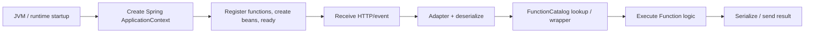
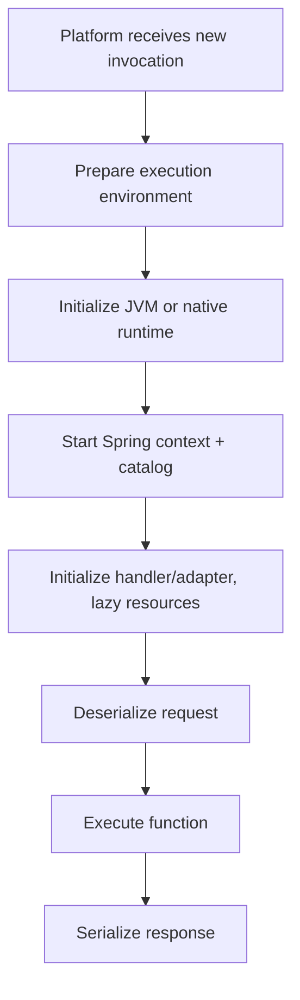

# Measuring Startup Time and Function Execution Time Separately

**Spring Cloud Function** helps you write business logic as `Supplier<T>`, `Function<I, O>`, and `Consumer<T>`, then register them in `FunctionCatalog`, compose them (*composition*), and invoke the same function via HTTP, events, or serverless environments. This architecture is great for reuse, but when evaluating **performance**, asking “Is the function fast?” is usually not precise enough.

There are at least two quantities that need to be **measured separately**:

1. **Startup time**: the time for the process and Spring application to prepare resources, create the context, register functions, and become ready to serve.
2. **Function execution time**: the duration from when an invocation starts processing until the processing we choose to measure completes.

In practice, there is also time for creating the serverless environment, initializing `FunctionCatalog` for the first time, selecting/converting payloads, network I/O, queueing, and serializing results. If you lump all of these into a single number, it is very easy to optimize in the wrong place. One application might take a long time to start up but handle each request extremely fast; another might start up quickly but slow down under load because database queries or JSON processing are resource-intensive.

This lesson belongs to the **Performance** chapter. You will learn how to design measurements with clear boundaries, use `ApplicationReadyEvent` to measure startup, `System.nanoTime()`/Micrometer `Timer` to measure function invocations, inspect the catalog and adapters, recognize *cold start* on serverless, and avoid common benchmarking mistakes.

## 1. Define the right boundaries before recording numbers

A Spring Cloud Function invocation may go through the following stages:



The stages describe a conceptual order; in practice, parts may be executed lazily, in parallel, or cached. For example, the catalog lookup may be performed before the first invocation, or an adapter may already deserialize JSON before handing data to the function. **Do not treat the total time as a simple sum of all these milestones when there is parallel processing, queue waiting, or measurements taken with different clocks.**

| Metric | Start | End | What does it reflect? |
| --- | --- | --- | --- |
| **Process-to-ready** | Process is launched by the OS | Application is confirmed ready | JVM + Boot + resources + readiness |
| **Main-to-ready** | Start of `main(...)` | `ApplicationReadyEvent` | The part of bootstrap observable **from inside the JVM** |
| **Context startup** | A milestone in Spring bootstrap | Context refresh or corresponding event | Cost of building the Spring context; not necessarily equal to process-to-ready |
| **First catalog lookup** | Right before the first `catalog.lookup(name)` | Lookup completes | Resolving/wrapping/possibly caching the function |
| **First invocation** | Right before the first function call | First result completes | May include lazy initialization/JIT/cache |
| **Warm function execution** | Start of invocation in a warm state | Measured logic completes | Java processing cost, not necessarily including protocol overhead |
| **End-to-end latency** | Client sends request or broker delivers event | Client receives full response / event is processed per chosen milestone | Network, queue, adapter, converter, function, and output |

With measurements defined by two timestamps:

\[
T_{\text{main-to-ready}} = t_{\text{ready}} - t_{\text{main}}
\]

\[
T_{\text{function}} = t_{\text{end-function}} - t_{\text{begin-function}}
\]

\[
T_{\text{end-to-end}} = t_{\text{response}} - t_{\text{request}}
\]

These formulas are useful only when **start/end milestones are consistently defined**. The `main-to-ready` metric does not include the time the operating system spends creating the process and starting the JVM before entering `main(...)`.

## 2. Business example: a protocol-independent billing Function

The example uses Java 17 or later, with DTOs as records and business logic calculating the total amount using `long`:

```java
package demo.perf;

import java.util.function.Function;

import org.springframework.context.annotation.Bean;
import org.springframework.context.annotation.Configuration;

@Configuration
public class QuoteFunctions {

    public record QuoteRequest(String sku, int quantity) {}

    public record QuoteResult(
        String sku,
        int quantity,
        long totalVnd
    ) {}

    @Bean("quoteCore")
    public Function<QuoteRequest, QuoteResult> quoteCore() {
        return request -> {
            if (request == null ||
                request.sku() == null ||
                request.sku().isBlank() ||
                request.quantity() <= 0) {
                throw new IllegalArgumentException("Invalid quote request");
            }

            long total = Math.multiplyExact(
                request.quantity(), 50_000L
            );
            return new QuoteResult(
                request.sku(),
                request.quantity(),
                total
            );
        };
    }
}
```

The contract is `Function<QuoteRequest, QuoteResult>`. The function itself does not need to know whether the request came from a Web adapter or a broker. This allows measuring **Java logic** separately, and then measuring protocol overhead additionally.

A direct test:

```java
var functions = new QuoteFunctions();
var quote = functions.quoteCore();

QuoteFunctions.QuoteResult result = quote.apply(
    new QuoteFunctions.QuoteRequest("BOOK-1", 2)
);

System.out.println(result.totalVnd()); // 100000
```

That result verifies the calculation; **it is not a benchmark result**. In particular, `quote.apply(...)` receives a pre-constructed DTO so it does not include the JSON parser, `MessageConverter`, or HTTP overhead.

## 3. Measuring startup time from main to ApplicationReadyEvent

In Spring Boot, `ApplicationStartedEvent` and `ApplicationReadyEvent` do not have the same meaning:

- `ApplicationStartedEvent` is typically published after the context is refreshed and before `ApplicationRunner`/`CommandLineRunner` instances run.
- `ApplicationReadyEvent` is published after the runners have executed, when Boot considers the application ready to serve.

If the goal is **readiness**, the `ApplicationReadyEvent` milestone is usually more appropriate than measuring only `SpringApplication.run(...)` or `ApplicationStartedEvent`. However, Spring Boot's readiness still does not mean every database, broker, or external service can serve business requests yet; appropriate health/readiness probes are needed.

Example measuring from the start of `main(...)` until Boot publishes the events:

```java
package demo.perf;

import java.util.concurrent.TimeUnit;

import org.springframework.boot.SpringApplication;
import org.springframework.boot.autoconfigure.SpringBootApplication;
import org.springframework.boot.context.event.ApplicationReadyEvent;
import org.springframework.boot.context.event.ApplicationStartedEvent;
import org.springframework.context.ApplicationListener;

@SpringBootApplication
public class PerformanceApplication {

    public static void main(String[] args) {
        final long mainStartedNs = System.nanoTime();
        SpringApplication application =
            new SpringApplication(PerformanceApplication.class);

        application.addListeners(
            (ApplicationListener<ApplicationStartedEvent>) event -> {
                long elapsedMs = TimeUnit.NANOSECONDS.toMillis(
                    System.nanoTime() - mainStartedNs
                );
                System.out.println(
                    "startup.main_to_started.ms=" + elapsedMs
                );
            }
        );

        application.addListeners(
            (ApplicationListener<ApplicationReadyEvent>) event -> {
                long elapsedMs = TimeUnit.NANOSECONDS.toMillis(
                    System.nanoTime() - mainStartedNs
                );
                System.out.println(
                    "startup.main_to_ready.ms=" + elapsedMs
                );
            }
        );

        application.run(args);
    }
}
```

The code uses `System.nanoTime()` to measure a **time interval**, not as an absolute wall-clock date/time timestamp. Within the same JVM, the difference between two `nanoTime` calls is suitable for measuring elapsed duration.

### Always name the milestone instead of calling everything startup

Example log:

```text
startup.main_to_started.ms=1180
startup.main_to_ready.ms=1310
```

These are **illustrative numbers**, not a benchmark of Spring Cloud Function. The 130 ms difference could be due to runners or activity in the post-context-refresh phase. Do not assert that the difference always equals runner cost; event handling and other steps also depend on the application.

Measuring from `main(...)` **does not** include the full JVM initialization time before `main` is invoked. Furthermore, if the system truly cares about when an HTTP readiness probe returns a successful result, you should measure **process-to-ready from outside the process** rather than only looking at JVM logs.

### Built-in observability in Spring Boot

Depending on version and dependencies, Spring Boot provides:

- `ApplicationReadyEvent.getTimeTaken()` to access the duration reported by Boot if available.
- Micrometer/Actuator startup metrics such as `application.started.time` and `application.ready.time` when the metrics system is properly configured.
- `ApplicationStartup` (e.g., `BufferingApplicationStartup`) and the Actuator startup endpoint to find time-consuming context creation steps.

These tools serve different purposes: **total time metrics** show how much things changed, while **startup steps** help pinpoint expensive components. Do not turn on detailed tracing and assume zero overhead; measure a baseline and compare when instrumentation is enabled.

## 4. Process-to-ready: measure from the outside instead of only inside the JVM

To evaluate cold process startup, you need to measure using a harness **outside the application**, with milestones as follows:

```text
t0: The harness asks the OS to launch java -jar ...
    |
    | JVM boot / class loading / Spring context / bean initialization
    v
t1: The readiness endpoint or ready signal satisfies the condition
    |
    +-- T_process_to_ready = t1 - t0
```

Recommended procedure:

1. Use a **packaged build artifact**; do not treat `gradle bootRun` or Maven running the full build lifecycle as startup time.
2. Ensure the previous process has completely stopped; **each cold startup measurement must spawn a new process**.
3. Record the timestamp before starting the process using the harness's monotonic clock.
4. Poll a reliable readiness endpoint or signal, with a timeout, and also record startup failures.
5. Record the timestamp when the probe becomes ready, and terminate the process cleanly.
6. Repeat many times (e.g., 20–30 runs depending on cost) and report the distribution, not just a single sample.

If using Spring Boot Actuator with readiness probes enabled, you can observe the appropriate endpoint, typically:

```text
GET /actuator/health/readiness
```

That endpoint path depends on Actuator configuration, management port, and base path; **it does not exist automatically** just because the application has Spring Cloud Function. You should also distinguish “health endpoint returns HTTP 200” from “the business path has been exercised,” because an application can be healthy while a downstream dependency is still failing.

An external measurement also incurs overhead from the **polling interval and network**. If you poll every 500 ms, the detected readiness timestamp can lag significantly behind when the application actually became ready; state the polling interval explicitly in the report.

### Factors that must be held constant when comparing cold startup

| Factor | Why record it? |
| --- | --- |
| JDK, Spring Boot, Spring Cloud Function | Runtime/framework changes affect class loading and context |
| Deployment model: JVM JAR/native image/container | Each option has its own bootstrap path and cost |
| Number of beans, converters, adapters, function definitions | Can change the work done during startup |
| CPU/memory limits, machine architecture | Strongly impacts init time |
| Database, broker, DNS, TLS connections | Can make startup slow or volatile |
| Warm/cold filesystem cache and image layers | Affects class/resource reading time |
| Runners, migrations, cache preloading | Post-context-refresh costs can be large |
| Readiness definition, timeout, polling | Determines the exact end milestone |

When comparing two application versions, keep the measurement environment identical, isolate benchmark runs from concurrent builds/tests, and record the exact configuration variant used.

## 5. Serverless cold start differs from Spring Boot startup

When deploying Spring Cloud Function on serverless, **cold start latency** can include much more than creating the Spring context:



A **cold invocation** is the first invocation in a new execution environment. A **warm invocation** reuses an existing environment and usually skips the heavy bootstrap, though it can still hit cache misses, GC, or slow downstream connections.

| Metric | How to interpret | Notes |
| --- | --- | --- |
| Platform init duration | Initialization duration per platform telemetry | Does not automatically match `main-to-ready` |
| Cold invocation latency | Request latency impacted by creating a new environment | Includes components beyond the core function |
| Warm invocation latency | Request latency on a warm environment | Can still incur queue/network/IO |
| Core function execution | Measured inside the Java delegate or subscribed publisher | Only one part of an invocation |

On AWS Lambda, you can refer to initialization/invocation milestones in platform logs/telemetry; on other platforms, milestones and metric names may differ. Mechanisms like snapshots/provisioned instances, container reuse, or native images also change how cold/warm are categorized.

**Do not directly compare `ApplicationReadyEvent` measurements of a long-lived HTTP application against the total latency of a cold serverless invocation**, because the start/end boundaries are not equivalent.

## 6. Separating FunctionCatalog lookup, first invocation, and warm invocations

When measuring function execution, at a minimum you should separate:

- **Function lookup time**: `FunctionCatalog.lookup(...)`, which may create wrappers or compositions.
- **First invocation time**: may include JIT compilation, lazy class initialization, and caching.
- **Repeated invocation time after warm-up**: partially reflects steady state.

The snippet below reuses `quoteCore` from section 2. It illustrates separating these milestones:

```java
package demo.perf;

import java.util.concurrent.TimeUnit;
import java.util.function.Function;

import org.springframework.cloud.function.context.FunctionCatalog;

public final class CatalogTimingProbe {

    private CatalogTimingProbe() {}

    public static void run(FunctionCatalog catalog) {
        long lookupStart = System.nanoTime();

        Function<QuoteFunctions.QuoteRequest,
                 QuoteFunctions.QuoteResult> function =
            catalog.lookup("quoteCore");

        long lookupElapsed = System.nanoTime() - lookupStart;
        if (function == null) {
            throw new IllegalStateException("quoteCore not registered");
        }

        var request = new QuoteFunctions.QuoteRequest("BOOK-1", 2);

        long firstStart = System.nanoTime();
        var firstResult = function.apply(request);
        long firstElapsed = System.nanoTime() - firstStart;

        System.out.printf(
            "catalog.lookup.ms=%.3f%n",
            lookupElapsed / 1_000_000.0
        );
        System.out.printf(
            "function.first_call.ms=%.3f%n",
            firstElapsed / 1_000_000.0
        );
        System.out.println(firstResult.totalVnd()); // 100000
    }
}
```

Place the `CatalogTimingProbe.run(catalog)` call in a **test or an active measurement command after the app is ready**. Do not place this code inside an `ApplicationRunner` during a startup measurement if you want to keep the startup milestone independent: otherwise the runner will make startup look slower because of the benchmark itself.

### Important: a milestone does not automatically equal the pure cost of a component

`catalog.lookup(...)` time can be affected by whether the context has already cached it or not. The first `function.apply(...)` call can include wrapper, conversion, or lazy initialization overhead. Do not take the difference between those two numbers and claim it is the absolute “framework cost”; to decompose it, instrument each layer along the same execution path.

## 7. Measuring function logic separately with a Micrometer Timer

For applications already using Micrometer, you can attach a timer **inside a business wrapper** to measure only the delegate invocation. For example, register an additional instrumented bean:

```java
package demo.perf;

import java.util.function.Function;

import io.micrometer.core.instrument.MeterRegistry;
import io.micrometer.core.instrument.Timer;

import org.springframework.beans.factory.annotation.Qualifier;
import org.springframework.context.annotation.Bean;
import org.springframework.context.annotation.Configuration;

@Configuration
public class TimedQuoteFunctions {

    @Bean("quoteTimed")
    public Function<
        QuoteFunctions.QuoteRequest,
        QuoteFunctions.QuoteResult
    > quoteTimed(
        @Qualifier("quoteCore")
        Function<QuoteFunctions.QuoteRequest,
                 QuoteFunctions.QuoteResult> delegate,
        MeterRegistry registry
    ) {
        Timer timer = Timer.builder("app.function.core.duration")
            .description("Synchronous quote delegate duration")
            .tag("function", "quoteTimed")
            .publishPercentileHistogram()
            .register(registry);

        return request -> timer.record(
            () -> delegate.apply(request)
        );
    }
}
```

This snippet requires the Micrometer dependency and a `MeterRegistry` in the Spring context (for example, from an appropriate metrics/Actuator configuration). The signature of the `quoteTimed` bean is still `Function<QuoteRequest, QuoteResult>`, so it can be looked up from `FunctionCatalog` like any other function.

If you want to expose **the measured wrapper itself** instead of the core bean:

```yaml
spring:
  cloud:
    function:
      definition: quoteTimed
```

Then:

- The timer starts **right before** `delegate.apply(request)` and stops when the synchronous call finishes or throws an error.
- It measures **core function duration**, excluding pre-wrapper stages like network, HTTP parsing, and catalog lookup.
- For business logic that calls a database, database wait time is inside the timer because it happens inside the delegate.
- The timer adds measurement overhead; consider this when functions are extremely short or have very high throughput.

**Do not put request IDs, customer names, order codes, or payloads into metric tags.** Tags with nearly unbounded values create *high cardinality* and can consume heavy resources in the metrics system.

### What statistics should be reported?

| Statistic | Meaning |
| --- | --- |
| Count | Number of measured invocations |
| Mean | Average; useful but hides tail latency |
| p50 | Median; half of the measurements do not exceed this value |
| p95 / p99 | High percentiles; useful for observing slow requests |
| Error count/rate | Error rate; never report latency for successful requests only |
| Throughput (ops/s, RPS) | Number of invocations processed per unit of time |
| Allocation/GC/CPU | Find causes of slowdowns instead of looking only at duration |

`publishPercentileHistogram()` helps backends that support histograms/percentiles, but how p95/p99 are queried and their accuracy depend on the registry, export interval, and specific observability system. Do not assume that simply enabling the timer makes every backend automatically provide the exact same p99 measurement.

## 8. Warm measurement with System.nanoTime: use for the right purpose

If Micrometer is not yet available, you can write a short test using `System.nanoTime()`. However, this test is only an **exploratory probe**, not a replacement for a microbenchmark tool like JMH.

Example of a sequential measurement after warm-up:

```java
package demo.perf;

import java.util.Arrays;
import java.util.function.Function;

import org.springframework.cloud.function.context.FunctionCatalog;

public final class WarmFunctionProbe {

    private static volatile long resultSink;

    private WarmFunctionProbe() {}

    public static void measure(FunctionCatalog catalog) {
        Function<QuoteFunctions.QuoteRequest,
                 QuoteFunctions.QuoteResult> function =
            catalog.lookup("quoteCore");

        if (function == null) {
            throw new IllegalStateException("Missing quoteCore");
        }

        var inputs = new QuoteFunctions.QuoteRequest[32];
        for (int i = 0; i < inputs.length; i++) {
            inputs[i] = new QuoteFunctions.QuoteRequest(
                "BOOK-" + i, (i % 10) + 1
            );
        }

        for (int i = 0; i < 20_000; i++) {
            function.apply(inputs[i % inputs.length]);
        }

        int samples = 50_000;
        long[] durations = new long[samples];
        long checksum = 0L;

        for (int i = 0; i < samples; i++) {
            var request = inputs[i % inputs.length];
            long start = System.nanoTime();
            var result = function.apply(request);
            durations[i] = System.nanoTime() - start;
            checksum += result.totalVnd();
        }

        resultSink = checksum;
        Arrays.sort(durations);

        System.out.printf(
            "warm.p50.ns=%d%n", percentile(durations, 0.50)
        );
        System.out.printf(
            "warm.p95.ns=%d%n", percentile(durations, 0.95)
        );
        System.out.printf(
            "warm.p99.ns=%d%n", percentile(durations, 0.99)
        );
    }

    private static long percentile(long[] sorted, double p) {
        int index = (int) Math.ceil(sorted.length * p) - 1;
        return sorted[Math.max(0, Math.min(index, sorted.length - 1))];
    }
}
```

**Limitations of the probe above:**

1. Each call is so short that **the cost of two `nanoTime()` calls can take up a large proportion** of the duration.
2. Warming up 20,000 times is an illustrative value and does not guarantee the JIT has stabilized.
3. The JVM can aggressively optimize loops and inputs; a volatile sink only reduces some dead-code elimination risks and does not create a perfect benchmark.
4. Samples run sequentially on a single thread, which does not represent a server handling many concurrent requests.
5. This measures a **catalog-wrapped function with a pre-built DTO input**, not HTTP JSON.
6. Percentiles of a single sample set do not indicate result confidence; runs must be repeated and variance compared.

If you want to microbenchmark logic at the nanosecond/microsecond scale, use **JMH**, letting the benchmark framework handle warm-up, JVM forking, anti-optimization safeguards, and proper statistics.

## 9. Using JMH to benchmark pure Java functions

Example JMH running the **pure business function** `quoteCore`, excluding the Spring context or adapters:

```java
package demo.perf;

import java.util.concurrent.TimeUnit;
import java.util.function.Function;

import org.openjdk.jmh.annotations.*;
import org.openjdk.jmh.infra.Blackhole;

@State(Scope.Thread)
@BenchmarkMode(Mode.AverageTime)
@OutputTimeUnit(TimeUnit.MICROSECONDS)
@Warmup(iterations = 5)
@Measurement(iterations = 5)
@Fork(2)
public class QuoteCoreBenchmark {

    private Function<
        QuoteFunctions.QuoteRequest,
        QuoteFunctions.QuoteResult
    > function;

    private QuoteFunctions.QuoteRequest request;

    @Setup(Level.Trial)
    public void setUp() {
        function = new QuoteFunctions().quoteCore();
        request = new QuoteFunctions.QuoteRequest("BOOK-1", 3);
    }

    @Benchmark
    public void callQuote(Blackhole blackhole) {
        blackhole.consume(function.apply(request));
    }
}
```

The code requires the corresponding **JMH core and annotation processor** dependencies. There is no need to start Spring for this benchmark, because the goal is the **cost of the core Java function**. Keep inputs realistic and check how the JIT optimizes if the operation is too small.

If the goal is to benchmark the **FunctionCatalog wrapper**, you must design a different benchmark that initializes the context before the measured section and ensures context creation resides in `@Setup`, never leaking into the `@Benchmark` body. Even then, that result **still does not measure startup time**; creating the Spring context outside the measurement loop is specifically meant to separate the two quantities.

**Do not use JMH to claim end-to-end HTTP p99 under real load.** JMH is a code-path microbenchmarking tool, whereas API load testing requires concurrent requests, networking, queueing, and errors.

## 10. End-to-end measurement over HTTP: comparing against core duration

Assume the Spring Cloud Function Web adapter is installed and exposes `quoteTimed`. A client can send JSON:

```bash
curl -sS -o /dev/null \
  -w 'connect=%{time_connect}s ttfb=%{time_starttransfer}s total=%{time_total}s\n' \
  -X POST http://localhost:8080/quoteTimed \
  -H 'Content-Type: application/json' \
  -d '{"sku":"BOOK-1","quantity":3}'
```

The three timing fields from `curl`:

| Field | General meaning |
| --- | --- |
| `time_connect` | Time from the start of the transaction until the TCP connection is established |
| `time_starttransfer` | Time to the first byte of the response (*TTFB*) |
| `time_total` | Total transfer time according to curl |

`time_total` includes many parts outside function logic, such as HTTP connection, waiting, JSON deserialization, catalog/adapter, response serialization, and data transmission. Therefore, it generally cannot be used as a substitute for the `app.function.core.duration` metric.

**Note:** a single curl run is not a load test. To evaluate HTTP latency and throughput, use an appropriate load-generation tool, fix concurrency, warm-up duration, connection count, and payload size; report p50/p95/p99 alongside error rate. As load increases, requests may wait in queues, causing tail latency to rise even when core execution time barely changes.

### Comparing the two metric layers

| Observed case | Core Timer | HTTP total | How to reason |
| --- | --- | --- | --- |
| Both increase | Increases | Increases | Check code, I/O inside the function, and JVM resources |
| Core stable, HTTP increases | Nearly unchanged | Increases | Check network, connections, queueing, codecs, thread pool |
| Core increases while HTTP barely changes | Increases | Nearly unchanged | Check sample size, caching, other components; do not jump to conclusions |
| Cold request slow, warm fast | May differ little | Jumps sharply on cold call | Check bootstrap, lazy init, serverless environment |

This table only suggests investigation directions, **not an exact subtraction** like “HTTP total − core = framework overhead”. Measurements may differ in clocks, sample sets, timing, concurrency, and instrumentation overhead.

## 11. Measuring via events: you must choose start and end points

In an event-driven system, there may be the following milestones:

```text
Producer creates event
    ↓
Broker receives and stores
    ↓
Consumer receives message
    ↓
Adapter deserializes
    ↓
Function/Consumer processes
    ↓
Ack / writes result / emits new event
```

You need to distinguish:

- **Delivery lag:** from producer or broker until the consumer receives the event.
- **Conversion duration:** parsing the payload and mapping it to the Java type based on generic/content type.
- **Function processing duration:** business processing after the payload is ready.
- **Acknowledgment/end-to-end duration:** up to ack, commit, or downstream receiving the result per the contract.

A `Consumer<T>` bean does not return a Java output, yet its processing time can still include database operations or emitting events. Conversely, if `Consumer<T>` merely schedules a task and returns immediately, a timer around `accept(...)` measures **scheduling time**, not until the task actually finishes.

With brokers, correlation IDs and timestamps should be designed up front for end-to-end measurement. Do not subtract two `System.nanoTime()` values taken on **two different JVMs**: `nanoTime` is an interval clock within the same process and does not share an absolute epoch. To measure across processes, use timestamps with synchronized clocks or trace context, while accounting for clock skew.

Beyond latency, record throughput, backlog, retry counts, and DLQ counts. If you only report durations of successful messages, you may miss a system that is backed up or continuously retrying.

## 12. With Mono/Flux, the time to call apply is not completion time

Spring Cloud Function can also use reactive signatures, for example:

```java
import java.util.function.Function;
import reactor.core.publisher.Mono;

Function<
    Mono<QuoteFunctions.QuoteRequest>,
    Mono<QuoteFunctions.QuoteResult>
> reactiveQuote = source -> source.map(request -> {
    long total = Math.multiplyExact(
        request.quantity(), 50_000L
    );
    return new QuoteFunctions.QuoteResult(
        request.sku(), request.quantity(), total
    );
});
```

Here, `reactiveQuote.apply(source)` **typically only constructs a publisher**. If you measure from before to after the `apply(...)` call, the measurement may finish before the publisher is subscribed to and data is actually processed.

In a **test** (not running on a production event loop), you can measure until the `Mono` completes:

```java
import java.time.Duration;

var request = new QuoteFunctions.QuoteRequest("BOOK-1", 3);

long start = System.nanoTime();
var result = reactiveQuote
    .apply(Mono.just(request))
    .block(Duration.ofSeconds(5));
long end = System.nanoTime();

System.out.println(result.totalVnd()); // 150000
System.out.println("reactive.completion.ns=" + (end - start));
```

This time includes publisher assembly, subscription, and completion of the test path; it **does not equal the CPU time of the `map(...)` lambda**. In reactive applications, instrument from subscription time to the terminal signal and explicitly record complete, error, and cancel cases. For an unbounded `Flux`, you must define a different measurement boundary (such as per-item latency, time to first item, or a bounded measurement window).

**Do not call `block(...)` on a production reactive processing path**, especially on the event loop. It is used here to illustrate measuring completion in a test.

## 13. Startup and execution need to be optimized with different strategies

| If the slow primary metric is… | Appropriate investigation direction |
| --- | --- |
| Process-to-ready | JVM boot, filesystem/image, startup scripts, CPU/memory, readiness probe |
| Main-to-ready | Spring context creation, bean init, classpath scanning, runners, migrations |
| First invocation | Lazy init, class loading, JIT, cache, first-time connection/handshake |
| Warm function core | Algorithms, allocation, DB/network I/O inside the function, lock contention |
| HTTP end-to-end | Network, queue, connection pooling, JSON codec, thread pool, and core |
| Event end-to-end | Broker backlog, batching, partitioning, retry, downstream processing |
| Reactive completion | Scheduler, subscription, backpressure, IO, and cancellation |

For instance, optimizing startup by lazy-loading a bean may improve `main-to-ready` while making **the first invocation slower**. This can be suitable for a long-running service with warm-up, but not necessarily good for serverless with many cold invocations. Therefore, any change must be evaluated using **both startup and first-invoke/warm metrics**, not just one table of numbers.

### Choosing metrics based on operational goals

- Long-lived APIs: typically need **steady-state p95/p99 latency**, throughput, and error rate; startup still matters for rolling deployments/scale-out.
- Autoscaling/serverless: **cold-start latency and cold invocation ratio** can matter as much as warm execution.
- Batch/event consumers: throughput, backlog/drain time, and end-to-end event latency are usually more important than the latency of a single Java call.
- Tiny CPU-only functions: benchmark code with JMH; HTTP/messaging may dominate the cost of an end-to-end call.

There is no single “good startup” or “fast execution” value that applies to every application: set a **performance budget** based on real SLAs/SLOs and hardware constraints.

## 14. Designing an A/B experiment to compare two versions

Suppose you want to know whether a startup optimization actually makes the system faster. Split the experiment as follows:

| Measurement | Baseline | Candidate | How to collect |
| --- | --- | --- | --- |
| Process-to-ready p50/p95 | Measure N fresh processes | Measure the same N fresh processes | External harness, same readiness |
| Main-to-ready p50/p95 | Event inside JVM | Same event | Do not mix metric with process-to-ready |
| First catalog lookup | Measured after readiness | Same milestone | Identical context and function name |
| First invocation | One first call per process | Similar | Same input, after lookup |
| Warm core p50/p95/p99 | Warm-up + many samples | Same sample size | Timer/JMH, same JVM resources |
| HTTP p95/p99 and error rate | Fixed load test | Equivalent load test | Same client, concurrency, and payload |
| Memory/GC/CPU | Monitored | Monitored | To explain latency changes |

You should run versions in interleaved rounds rather than measuring all baseline runs in the morning and all candidate runs in the afternoon, because system load and environment conditions can drift. Avoid running two heavy load tests concurrently on the same host if you want an independent comparison.

### Hypothetical results example to practice interpretation

| Metric | Before | After | Reasonable interpretation |
| --- | ---: | ---: | --- |
| Main-to-ready p50 | 1,400 ms | 950 ms | Startup portion inside the JVM decreased |
| First invocation p50 | 12 ms | 45 ms | Lazy initialization may have been deferred to the first call |
| Warm core p50 | 0.30 ms | 0.30 ms | No change observed in warm logic |
| HTTP warm p99 | 18 ms | 18 ms | No improvement observed in HTTP tail latency |

The numbers above **are fabricated for illustration**, not measurements of Spring Cloud Function. Looking at them, you should not claim “the system is 32% faster” in general: startup improved while first invocation got worse, and warm latency remained practically unchanged.

## 15. Common performance measurement mistakes

| Mistake | Why is it wrong? | How to fix |
| --- | --- | --- |
| Measuring `SpringApplication.run(...)` and calling it full cold start | Excludes JVM/process initialization before main | Measure process-to-ready from outside |
| Counting build time in startup | Build and bootstrap are two different tasks | Measure from a packaged artifact |
| Measuring once and drawing conclusions | Cache/JIT/GC/OS cause variance | Repeat many times, report distribution |
| Calling Function directly and treating it as HTTP latency | Missing codec/network/queue | Load test through the adapter |
| Merging first lookup with core time | Catalog caching makes cold/hot differ | Measure lookup and invoke separately |
| Skipping warm-up when comparing core | Results suffer from JIT/class loading | Include a clear warm-up phase |
| Measuring tiny functions with a custom loop | Timer overhead and JIT skew results | Use JMH for microbenchmarks |
| Reporting only the average | Hides slow requests and tail latency | Track p50/p95/p99 and errors |
| Counting only successful requests | Timeouts/retries vanish from the report | Include error rate and failure latency |
| Measuring `Mono.apply(...)` and assuming completion | Reactive publisher may not be subscribed yet | Measure until terminal signal as appropriate |
| Subtracting `nanoTime` from two JVMs | No shared reference epoch | Use timestamps/tracing across processes |
| Instrumenting with an `orderId` tag | Very high cardinality | Tag only bounded function/stage names |
| Optimizing startup without measuring first call | Lazy init may shift costs | Report startup + first + warm |
| Comparing across different CPU/memory/traffic | Unfair comparison | Fix and document the environment |

## 16. Minimum measurement result set to keep

For a function exposed over a protocol, keep **two separate groups of results**:

**Startup group**

```text
Version / build:
JDK / Spring Boot / Spring Cloud Function:
Deployment: JVM JAR / container / serverless / native
CPU / memory:
Cold process count:
Process-to-ready: p50 / p95 / max
Main-to-ready: p50 / p95 / max
First lookup: p50 / p95
First invocation: p50 / p95
Readiness definition and polling interval:
```

**Execution group**

```text
Function name / composition:
Input size and contentType:
Invocation model: synchronous / reactive
Warm-up method:
Sample size / concurrency:
Core execution: count / mean / p50 / p95 / p99
Adapter end-to-end: p50 / p95 / p99
Throughput:
Error/timeout/retry rate:
CPU, heap allocation and GC observations:
```

Recording *first invocation* separately helps detect a startup optimization that merely deferred cost to the first call. Recording both *core* and *end-to-end* helps distinguish algorithmic changes from network/adapter changes.

## 17. Practice exercises

**Exercise 1 — Identifying milestones.** You start `System.nanoTime()` on the first line of `main(...)` and stop when receiving `ApplicationReadyEvent`. Is this the entire process startup?

*Answer:* No. This is main-to-ready inside the JVM; it does not include launching the process and JVM before entering main. For process-to-ready, an external harness is required.

**Exercise 2 — First call.** A function runs very fast after 10,000 invocations, but the first call is slow. Should the first sample be included in the warm execution set to calculate p50?

*Answer:* First invocation and warm invocation metrics should be kept separate. Mixing states makes results hard to interpret and can hide the effects of lazy init/JIT.

**Exercise 3 — FunctionCatalog.** Why should `catalog.lookup("quoteCore")` be measured separately from `function.apply(request)`?

*Answer:* Lookup may resolve/wrap/cache the function, while `apply` executes the invocation. The two stages have different costs and caching behavior.

**Exercise 4 — HTTP.** A Micrometer timer around `delegate.apply(...)` reports 0.2 ms, while curl reports 14 ms. Can you claim Spring Cloud Function adds exactly 13.8 ms of overhead?

*Answer:* No. The two measurements have different boundaries, clocks, and sample sets; HTTP also includes network, queue, parse/serialize, connection, and adapter time. Consistent trace-based measurement is needed for a more accurate breakdown.

**Exercise 5 — Reactive.** Why is timing `fn.apply(Mono.just(input))` not enough to measure completion time?

*Answer:* `apply(...)` may only construct the publisher. Actual processing happens after subscription; you must measure until a terminal signal or a properly defined milestone.

**Exercise 6 — Serverless.** What differs between Spring Boot's `ApplicationReadyEvent` time and a cold invocation on a serverless platform?

*Answer:* A cold invocation can also include environment provisioning, runtime/handler initialization, event mapping, and request processing. The two quantities do not share the same boundaries.

**Exercise 7 — A/B experiment.** After an optimization, main-to-ready drops by 400 ms, while first invocation rises by 300 ms and warm core is unchanged. Can you conclude every invocation is faster?

*Answer:* No. Part of initialization may have been deferred to the first call. You must examine the cold/warm mix and actual end-to-end SLAs.

**Exercise 8 — Measuring events.** A `Consumer<T>` writes to a database and then acks. Does a timer placed only around Java processing reflect latency from the producer to the broker and consumer?

*Answer:* No. A timer inside the consumer excludes broker queue/delivery lag. For end-to-end latency, you need timestamps/tracing and a clear ack/commit milestone definition.

**Exercise 9 — Microbenchmarking.** Why is JMH more suitable than a `nanoTime()` loop when each invocation takes only a few hundred nanoseconds?

*Answer:* JMH handles forking, warm-up, JIT control, and proper benchmarking mechanics; in custom measurement code, clock overhead and runtime optimizations can dominate the results.

## 18. Key takeaways

- **Measure startup and execution with two separate metric groups**, each with clearly defined start/end milestones.
- **Main-to-ready differs from process-to-ready**; both also differ from cold invocation latency on serverless.
- **FunctionCatalog lookup, first invocation, and warm execution are three distinct measurements**; do not lump them together and call all of it function execution time.
- **A Micrometer Timer around the delegate** is useful for measuring the core function, while curl/load tests and broker metrics reflect end-to-end behavior through adapters.
- **Do not measure reactive publishers solely by `apply(...)` duration**; consider subscription and complete/error/cancel signals.
- **Never draw performance conclusions from an average or a single sample.** Report p50/p95/p99, throughput, errors, and resource usage.
- **Optimizing startup can make the first call slower** if lazy initialization is used; evaluate both.
- **Fair comparisons require matching JDK/environment/load and measurement methodology**, with proper warm-up and sufficient sample sizes.

**References:**

- [Spring Cloud Function Reference](https://docs.spring.io/spring-cloud-function/reference/)
- [Spring Boot — Application Events and Listeners](https://docs.spring.io/spring-boot/reference/features/spring-application.html)
- [Spring Boot — Actuator Metrics](https://docs.spring.io/spring-boot/reference/actuator/metrics.html)
- [Micrometer — Timer](https://docs.micrometer.io/micrometer/reference/concepts/timers.html)
- [JMH — Java Microbenchmark Harness](https://github.com/openjdk/jmh)
- [Project Reactor — Reference Guide](https://projectreactor.io/docs/core/release/reference/)

These examples are tools for learning and designing measurements. When applying them, verify your **Spring Cloud Function version, Spring Boot version, adapters, and deployment environment**, and measure on your actual system before drawing performance conclusions.
