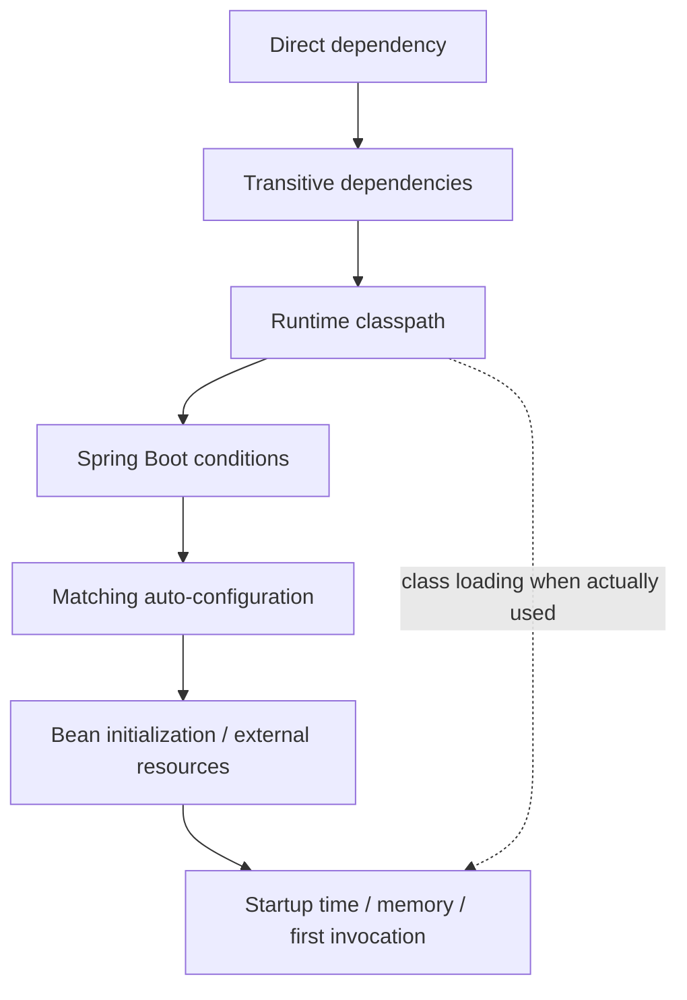
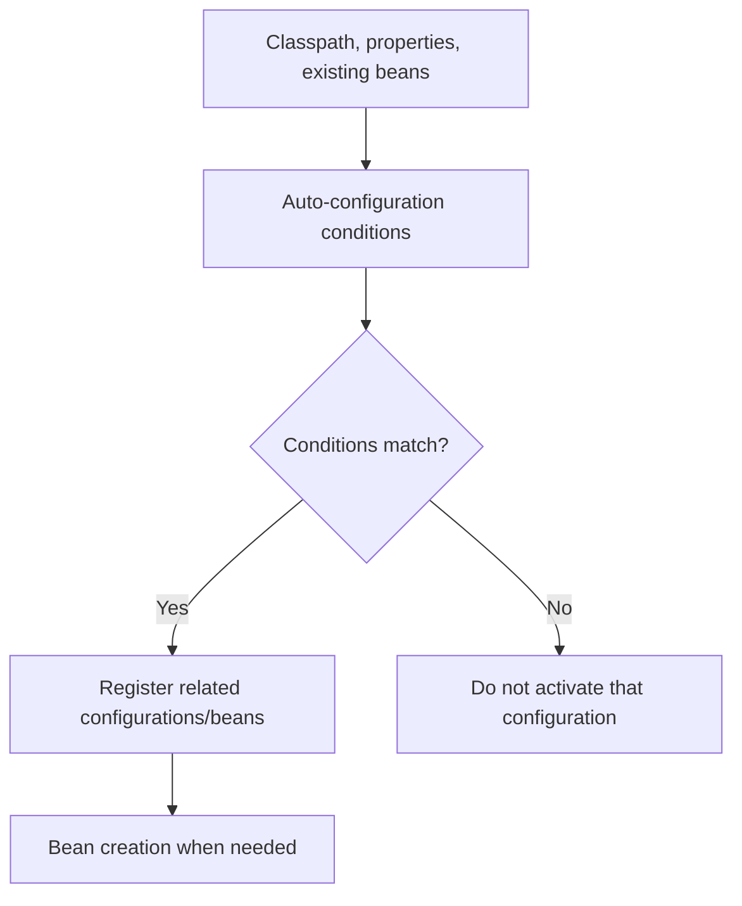

# Reducing Unnecessary Dependencies and Auto-Configuration

**Spring Cloud Function** helps organize business logic into `Supplier<T>`, `Function<I, O>`, and `Consumer<T>` beans, register them through `FunctionCatalog`, support composition, and expose the same function to HTTP, events, or serverless environments. Protocol independence is a major advantage, yet it also raises a question about **startup cost and resources**: does a function that only calculates product prices truly need an embedded web server, database connection libraries, a message broker, Actuator, a template engine, and multiple unused converters?

Within the **Performance** chapter, this lesson guides you on **reducing unnecessary dependencies and auto-configuration** without losing functionality. The two main levers are:

1. **Reducing dependencies/runtime classpath**: include only the libraries and adapters genuinely needed to run the function.
2. **Reducing the work Spring must perform at bootstrap**: inspect auto-configuration, component scanning, bean initialization, and external connections.

You should not equate “fewer dependencies” with “guaranteed faster startup.” Spring Boot uses auto-configuration conditions: some dependencies may be present without creating beans if their conditions are not met. Conversely, a misconfiguration can trigger heavy resource initialization or defer failures until the first invocation. **Measure first, make controlled changes, and measure again** is the guiding principle throughout.

After this lesson, you will be able to:

- Identify which dependencies truly belong on the HTTP, messaging, or serverless execution path.
- Read Gradle/Maven dependency graphs and trace *transitive dependencies*.
- Use Spring Boot's conditions report to see which auto-configurations are activated and why.
- Distinguish between **removing dependencies**, **excluding auto-configuration**, **not initializing beans**, and **lazy initialization**.
- Compare standard `@SpringBootApplication` declarations with Spring Cloud Function's **functional bean definitions**.
- Evaluate trade-offs across readiness time, first invocation, warm execution time, memory, and remaining functionality.

## 1. Why do dependencies affect performance?

A dependency can bring along classes and resources, pull in additional libraries, participate in auto-configuration discovery, register metadata, or introduce beans/integrations the application does not need.



**Not every arrow necessarily fires:** having a JAR on the classpath does not mean Spring has to load every class or instantiate every bean in that JAR. Spring Boot typically guards auto-configuration via classpath, property, existing bean, and web/non-web application type conditions. An extra dependency is merely a **candidate** to check, not proof that it dominates startup time.

| Cost source | Example | Observable symptoms |
| --- | --- | --- |
| Large artifact/classpath | Many starters, heavy SDKs, multiple adapters | Large JAR/container, many runtime libraries |
| Bean creation | HTTP clients, connection pools, converters, schedulers | Long context refresh, many beans |
| External connections | Database, Kafka, schema registry, cloud metadata | Variable startup due to DNS/TLS/network |
| Scanning and reflective metadata | Overly broad component scanning, many configurations | Startup steps spent on beans/configurations |
| Lazy work on first call | Class loading, caching, client handshake | Lower startup time, higher first invocation |
| Function body | JSON parsing, algorithms, I/O, composition | Warm latency, CPU, allocation |

**Key point:** reducing dependencies and auto-configuration primarily targets **bootstrap cost, footprint, and complexity**. It will not automatically make a `Function.apply(...)` computation faster if the real cost lies inside the function's algorithm or I/O.

## 2. Start from deployment requirements, not a default set of starters

A Spring Cloud Function application should clearly define **how it will be invoked**. Do not install every adapter “just in case for later” when deploying only a single path.

| Execution mode | What to consider | Components likely not needed |
| --- | --- | --- |
| In-Java call via `FunctionCatalog` | Spring Cloud Function context and Spring context | Embedded web server, broker binder |
| HTTP endpoint | Web adapter and compatible web runtime | Broker binder, serverless adapter |
| Event consumer/producer | Appropriate binder/integration (e.g., Kafka/Rabbit), converters | Embedded HTTP server if health/web is unused |
| AWS Lambda or other serverless platforms | Platform-specific adapter and suitable packaging | Embedded HTTP server and unused binders |
| Truly multi-protocol application | Multiple adapters when required | Accept the cost and measure each path |

This is a **scoping table**, not an exhaustive dependency list for every version. Spring Cloud Function provides artifacts such as `spring-cloud-function-context`, `spring-cloud-function-web`, and platform-specific serverless adapters. Spring Cloud Stream/binders form a separate integration layer for events.

### Separating business core from adapters

A target architecture to aim for:

```text
                       ┌─────────────────────┐
                       │ Pure Java Logic     │
                       │ Supplier / Function │
                       │ Consumer            │
                       └──────────┬──────────┘
                                  │
                          FunctionCatalog
                                  │
                 ┌────────────────┼────────────────┐
                 │                │                │
             HTTP adapter    Event binder   Serverless adapter
             (if needed)      (if needed)      (if needed)
```

The same `Function<Request, Response>` bean can be used across multiple paths, yet **each deployment artifact does not have to carry every adapter**. You can build separate packaging variants sharing a common business module, if your build architecture supports it.

## 3. Business example as an optimization baseline

A simple Java 17+ example: one function calculating total price and another formatting the result.

```java
package demo.perf;

import java.util.function.Function;

import org.springframework.context.annotation.Bean;
import org.springframework.context.annotation.Configuration;

@Configuration
public class PriceFunctions {

    public record PriceRequest(String sku, int quantity) {}

    public record PriceResult(String sku, long totalVnd) {}

    @Bean
    public Function<PriceRequest, PriceResult> calculatePrice() {
        return request -> {
            if (request == null ||
                request.sku() == null ||
                request.sku().isBlank() ||
                request.quantity() <= 0) {
                throw new IllegalArgumentException(
                    "Invalid price request"
                );
            }

            long total = Math.multiplyExact(
                request.quantity(), 50_000L
            );
            return new PriceResult(request.sku(), total);
        };
    }

    @Bean
    public Function<PriceResult, String> formatPrice() {
        return result -> result.sku() + ": " +
            result.totalVnd() + " VND";
    }
}
```

This chain has matching types:

```yaml
spring:
  cloud:
    function:
      definition: calculatePrice|formatPrice
```

```text
PriceRequest
   ↓ calculatePrice
PriceResult
   ↓ formatPrice
String
```

The Java beans open no sockets, connect to no database, and require no messaging broker. They only process two DTOs/values. When deployed over HTTP, the **adapter** must accept JSON and return the output representation; when deployed via events, the **binder** must connect to the broker and map messages.

All subsequent performance comparisons must keep the logic and inputs identical so that only dependencies/configuration change, not the computation itself.

## 4. Establish a “dependency budget” by deployment path

Before optimizing, write down the **minimal list allowed to exist** at runtime:

| Group | Decision question | Example handling |
| --- | --- | --- |
| Spring Cloud Function | Is `FunctionCatalog` needed? | Keep required context/catalog |
| Web | Is there a real HTTP endpoint? | Bring Web adapter/runtime only if needed |
| Messaging | Which broker is used? | Add only the binder actually in use |
| Data/JPA | Does the function query a database? | If unused, avoid both starter and driver |
| Security | Is HTTP authentication/authorization or another policy required? | Keep required security features |
| Actuator | Are health/metrics/conditions needed at runtime or only in measurement environments? | Weigh configuration variants and access control |
| Observability | Which traces/metrics/log exporters are needed? | Keep only exporters and registries actually operated |
| Cloud SDK | Which cloud APIs are called? | Avoid importing an umbrella SDK when only one service is needed |
| JSON | Which JSON mapper is used? | Avoid multiple mappers dragged in transitively, but do not remove blindly |

**Never remove mandatory features just to shave off a few milliseconds.** Readiness/health in orchestrated environments, security, tracing for SLO compliance, and retry mechanisms can outweigh small startup gains.

### Two easily confused concepts

- **Direct dependency:** declared directly in `build.gradle`/`pom.xml`.
- **Transitive dependency:** pulled in by another library. Deleting a direct line does not guarantee the artifact disappears from runtime, because it may still arrive through another dependency.

To truly eliminate an extra dependency, inspect the **runtime dependency graph after the change**, not just the build file.

## 5. Analyzing the dependency graph with Gradle or Maven

The following commands are **instructions for learner projects**, not commands executed while authoring this lesson.

With Gradle:

```bash
./gradlew dependencies --configuration runtimeClasspath
./gradlew dependencyInsight \
  --dependency spring-boot-starter-web \
  --configuration runtimeClasspath
./gradlew dependencyInsight \
  --dependency spring-cloud-stream \
  --configuration runtimeClasspath
```

With Maven:

```bash
mvn dependency:tree -Dscope=runtime
```

On Windows, use `gradlew.bat` instead of `./gradlew` or the syntax appropriate for your shell. A dependency required for compile/test is not necessarily present at runtime; prioritize inspecting **runtimeClasspath** or the corresponding runtime scope.

### Questions to answer from the output

1. Why is a web library present when the artifact is only an event consumer?
2. What is pulling in multiple JSON libraries simultaneously?
3. Is there a database driver/JPA migration tool inside a function that performs no data queries?
4. Did any test/dev-only libraries leak into the runtime artifact?
5. Are serverless adapters, HTTP, and binders bundled into one runtime without a real need?
6. Do versions in the graph align with Spring Boot/Spring Cloud dependency management?

### Distinguishing removing dependencies from removing beans

| Change | Classpath changes? | Auto-config may change? | Beans may change? |
| --- | --- | --- | --- |
| Remove an unused dependency | Yes | Yes | Yes |
| Exclude a transitive dependency | Yes | Yes | Yes |
| Only use `spring.autoconfigure.exclude` | No | Yes | Yes |
| Only use `spring.main.lazy-initialization` | No | Not necessarily | Bean creation timing changes |
| Only set `spring.cloud.function.definition` | No | Not by default | Typically selects exposed/composed function; does not delete other beans |
| Change `web-application-type` | No | Possibly | Application context type and web features change |

**Removing dependencies at the build level** is generally more thorough than keeping the JAR and disabling auto-configuration via properties. However, verify that nothing else still depends on the removed classes.

## 6. Creating build variants per adapter type

A project can use one core module containing Java DTOs/functions and multiple thin deployment modules. Example module layout:

```text
order-functions-core
  └─ DTOs, business logic, unit tests

order-http-app
  └─ FunctionCatalog + Web adapter + HTTP dependencies

order-event-app
  └─ FunctionCatalog + active binder

order-lambda-app
  └─ FunctionCatalog + specific serverless adapter
```

This is a **design suggestion**, not a strict requirement to split into multiple modules. If an application genuinely serves both HTTP and events, splitting can increase operational overhead; weigh your goals carefully.

### Illustrative Gradle dependencies

When the project already uses dependency management/BOM compatible with Spring Cloud Function:

```kotlin
// build.gradle.kts - illustrative dependencies snippet
dependencies {
    implementation("org.springframework.cloud:spring-cloud-function-context")

    // Add only to artifacts that actually need HTTP:
    // implementation("org.springframework.cloud:spring-cloud-function-web")

    // Add only the exact event binder or serverless adapter
    // supported by the active Spring Cloud Function version.
}
```

The example **omits explicit versions** because versions should be managed by a BOM/release train compatible with the project's Spring Boot version. Adding a single standalone artifact does not prove the application already has full Spring Boot bootstrap, a Web runtime, or the required packaging.

When you need to exclude an unwanted transitive dependency:

```kotlin
// Example when a legacy integration SDK unexpectedly pulls in the web starter.
dependencies {
    implementation("com.example:legacy-integration-sdk") {
        exclude(
            group = "org.springframework.boot",
            module = "spring-boot-starter-web"
        )
    }
}
```

`com.example:legacy-integration-sdk` is a **hypothetical name for syntax illustration**, not a dependency to install. Only exclude if the graph proves that artifact is being pulled in, and tests confirm the SDK still works; excluding a starter can remove classes the SDK actually needs.

### Inspecting the artifact after building

After building the real deployable artifact, check:

- JAR/layer/container image size.
- Dependency list inside `BOOT-INF/lib` (for applicable executable JAR formats).
- Actual runtime classpath, not just directly declared dependencies.
- Differences across HTTP, event, and serverless variants.

A smaller JAR usually helps distribution/image reading, but **does not guarantee** startup improves proportionally to the bytes removed.

## 7. Conditional auto-configuration in Spring Boot

Spring Boot **auto-configuration** attempts to configure components based on JARs on the classpath, properties, existing beans, and the environment. For example, having a JDBC library does not automatically mean a `DataSource` will be created successfully in every configuration; specific conditions govern behavior.



**Why shouldn't you disable things blindly?**

An inactive configuration may only exist in metadata without **creating any beans**. Excluding it might yield no meaningful startup improvement. Conversely, accidentally disabling datasource, JSON converter, transaction management, web handler, or security auto-configuration can break the function or leave endpoints unprotected.

The right workflow is to find **evidence of which configurations actually matched/initialized resources** before disabling them.

## 8. Reading the Conditions Evaluation Report

Spring Boot provides a **conditions report** explaining why auto-configurations were or were not applied. With a standard runnable Boot artifact:

```bash
java -jar app.jar --debug
```

Debug mode prints the conditions report and additional logs to the console. Distinguish between:

- **Positive matches:** a configuration's conditions were satisfied.
- **Negative matches:** the configuration was skipped due to unmet conditions.
- **Unconditional classes:** classes that do not use conditional checks of that kind.

**A positive match does not mean that configuration is the bottleneck.** Cross-reference with startup steps, bean counts, network operations, and startup measurements.

### Actuator conditions endpoint

If the application includes Actuator, the `conditions` endpoint exposes information about auto-configuration conditions. The endpoint must be **properly authorized and exposed**; it is not always public by default:

```yaml
management:
  endpoints:
    web:
      exposure:
        include: health,info,conditions
```

In an authorized environment, the endpoint is typically at:

```text
/actuator/conditions
```

Do not expose this diagnostics endpoint to the public internet: it can reveal internal classpath/configuration structure. On serverless or non-web applications, adding Actuator Web solely to view the report can **increase footprint** and skew the measurements you are trying to optimize. In that case, use `--debug` or appropriate development instrumentation.

### Find root causes instead of just scanning a bean list

An investigation flow should look like:

1. Capture the baseline conditions report and note which configurations were applied.
2. Identify expensive resources: database pools, broker clients, schedulers, embedded servers.
3. Cross-reference the dependency graph to see which library triggered each configuration.
4. Propose removing a dependency or auto-configuration only after proving the feature is unused.
5. Re-capture the report and re-measure time after the change to verify causality.

## 9. Disabling a specific auto-configuration with evidence

Spring Boot supports two main mechanisms:

- Excluding in `@SpringBootApplication` / `@EnableAutoConfiguration`.
- The `spring.autoconfigure.exclude` property.

Example **specifically for Spring Boot 3.x** when DataSource/JDBC is genuinely unnecessary:

```yaml
spring:
  autoconfigure:
    exclude:
      - org.springframework.boot.autoconfigure.jdbc.DataSourceAutoConfiguration
```

Or the same idea in Java for Boot 3:

```java
import org.springframework.boot.autoconfigure.SpringBootApplication;
import org.springframework.boot.autoconfigure.jdbc.DataSourceAutoConfiguration;

@SpringBootApplication(
    exclude = DataSourceAutoConfiguration.class
)
public class Application {
}
```

**Do not copy this example verbatim across major versions.** Spring Boot 4 relocates many auto-configuration packages/modules; for instance, DataSource auto-configuration is documented in Boot 4 under `org.springframework.boot.jdbc.autoconfigure.DataSourceAutoConfiguration`. Only exclude the exact class name **belonging to your active version and classpath**.

With newly added dependencies, a “failed to configure a DataSource” error might indicate the application doesn't actually need JDBC, or it might indicate a connection configuration bug. Do not disable DataSource when business logic or migrations still require a database.

### Excluding auto-configuration is not equivalent to removing a dependency

If a database driver JAR remains at runtime, using `spring.autoconfigure.exclude` **does not shrink the JAR**. If the dependency is truly unused, consider removing it at the build level rather than keeping the code and only disabling beans.

Conversely, when a dependency is still needed by another library but its auto-configuration overreaches, property exclusion can be more reasonable than deleting the artifact.

## 10. Choosing the right web-application-type

Spring Boot can boot into different application types:

- **SERVLET** if the application uses the servlet web stack.
- **REACTIVE** for compatible reactive web applications.
- **NONE** when no web application context is needed.

For an event consumer or handler running **without needing an embedded HTTP server**, consider:

```yaml
spring:
  main:
    web-application-type: none
```

This property affects how Spring Boot selects the application context and initializes the web runtime, yet **it does not remove web libraries from the runtime classpath**. For a smaller footprint, you still must address dependencies.

**Do not set `none` for an application that needs the Web adapter to expose HTTP endpoints or Actuator HTTP readiness** and expect the server to keep working. For serverless, check the specific adapter; one platform may use a handler without an embedded server, while another has its own HTTP runtime path.

### Easily confused settings

| Setting | What does it do? | What does it NOT do? |
| --- | --- | --- |
| `spring.main.web-application-type=none` | Selects a non-web context | Does not remove web JARs |
| `server.port=0` | Lets the server pick a random port when a server exists | Does not disable the web stack |
| `spring.cloud.function.definition=calculatePrice` | Selects the function/chain for the exposed or invoked path | Does not disable all other beans by default |
| `spring.main.lazy-initialization=true` | Defers bean creation until needed | Does not remove dependencies and can slow down the first call |

**Pick the right lever for the right goal**: do not treat function definitions as a classpath-shrinking mechanism or random ports as a way to disable the web server.

## 11. Reducing unnecessary component scanning and bean initialization

`@SpringBootApplication` typically combines auto-configuration and component scanning scoped by package. If the main class sits too high in a large codebase, the scanner may discover configurations/components unrelated to the function deployment.

Example of a more controllable layout:

```text
demo.price
  ├─ PriceApplication
  ├─ PriceFunctions
  └─ adapter-specific-config

demo.other-service
  └─ OtherServiceConfiguration
```

Placing the entrypoint in a well-scoped package prevents the scanner from automatically scanning all other services. Only expand `scanBasePackages` or `@Import` for parts that are actually required.

**Note:** narrowing scanning too aggressively can omit validation beans, custom `MessageConverter`s, or necessary dependency injection. Having fewer beans does not guarantee behavior remains intact; integration tests are required.

### Inspecting beans with startup side effects

Several patterns commonly slow down startup without being caused by Spring Cloud Function itself:

- Constructors or `@PostConstruct` methods calling external APIs.
- `ApplicationRunner`/`CommandLineRunner` preloading large caches.
- Connection pools attempting connections before downstream is ready.
- Migrations running on every startup.
- Schedulers kicking off heavy work as soon as the context is ready.

Distinguish **redundant configuration** from **work that genuinely must finish before readiness**. If you speed up startup by deferring a critical migration, the application may accept requests before the schema is ready — a measurable gain that violates the operational contract.

## 12. Functional bean definitions: an option for small functions

Spring Cloud Function documentation describes **functional** bean registration for small-scope applications seeking shorter startup. This pattern avoids standard full annotation scanning and Boot auto-configuration.

### Comparing the two styles

**Traditional style:**

```java
@SpringBootApplication
public class TraditionalPriceApp {

    @Bean
    public Function<String, String> uppercase() {
        return value -> value.toUpperCase(
            java.util.Locale.ROOT
        );
    }

    public static void main(String[] args) {
        SpringApplication.run(TraditionalPriceApp.class, args);
    }
}
```

This illustrative snippet sits inside a class importing `SpringBootApplication`, `Bean`, `SpringApplication`, and `Function`. It uses Boot auto-configuration as usual.

**Spring Cloud Function functional style:**

```java
package demo.perf;

import java.util.Locale;
import java.util.function.Function;

import org.springframework.boot.SpringBootConfiguration;
import org.springframework.cloud.function.context.FunctionRegistration;
import org.springframework.cloud.function.context.FunctionalSpringApplication;
import org.springframework.cloud.function.context.catalog.FunctionTypeUtils;
import org.springframework.context.ApplicationContextInitializer;
import org.springframework.context.support.GenericApplicationContext;

@SpringBootConfiguration
public class MinimalFunctionApplication implements
        ApplicationContextInitializer<GenericApplicationContext> {

    public static void main(String[] args) {
        FunctionalSpringApplication.run(
            MinimalFunctionApplication.class, args
        );
    }

    @Override
    public void initialize(GenericApplicationContext context) {
        Function<String, String> uppercase =
            input -> input.toUpperCase(Locale.ROOT);

        context.registerBean(
            "uppercase",
            FunctionRegistration.class,
            () -> new FunctionRegistration<>(uppercase)
                .type(FunctionTypeUtils.functionType(
                    String.class, String.class
                ))
        );
    }
}
```

Key points:

1. `@SpringBootConfiguration` **does not automatically enable all Boot auto-configuration** the way `@SpringBootApplication` does.
2. `FunctionalSpringApplication` is the API provided by Spring Cloud Function for this model.
3. `ApplicationContextInitializer<GenericApplicationContext>` registers functions directly without broad component scanning for beans.
4. `FunctionRegistration.type(...)` supplies input/output type metadata for the lambda. Registering raw `Function.class` alone may prevent the framework from inferring `String → String`.
5. This approach fits small functions, yet **does not automatically configure all external Boot integrations/adapters**.

According to SCF documentation, if you need a datasource or rich Boot auto-configuration, you can use `@Bean`-style declarations or **hybrid mode**. Optimization does not always mean pure functional mode.

### Hybrid: when auto-configuration is still needed

Spring Cloud Function documentation describes combining functional bean registration with Boot auto-configuration; when taking that route, use `@EnableAutoConfiguration` appropriately and configure:

```properties
spring.functional.enabled=false
```

This **disables “full functional mode”** so Boot can drive auto-configuration. Therefore, do not expect hybrid mode to retain all startup gains of pure functional mode. Choose based on integration needs and test against your active SCF version.

## 13. Setting function definition does not delete other beans

Spring Cloud Function supports the property:

```yaml
spring:
  cloud:
    function:
      definition: calculatePrice|formatPrice
```

This property selects the function or composition name to expose/invoke in the appropriate context. It is **not an optimization switch that automatically eliminates all beans outside the chain**.

If the application still scans a package containing many components, auto-configures a datasource, or instantiates broker clients, those components can still be initialized even when `spring.cloud.function.definition` only specifies `calculatePrice`.

When reducing startup, inspect **the actual beans created**, dependencies, and the conditions report; do not rely solely on which single function appears on an endpoint.

## 14. Lazy initialization: easy startup gains that shift cost to the first call

Spring Boot supports:

```yaml
spring:
  main:
    lazy-initialization: true
```

When lazy initialization is enabled, many beans are created **when actually needed** instead of at application startup. This can reduce time-to-readiness in some scenarios.

However, there are trade-offs:

- **First invocation** becomes slower because beans must be created, classes loaded, or connections established.
- Configuration errors may surface only on the first request rather than at startup.
- Memory once the application is under full load may match or exceed eager init; do not treat lazy init as a guarantee of sustained RAM savings.
- On serverless, many cold invocations may pay that deferred cost.

### Trade-off example

| Hypothetical metric | Baseline | After lazy init | Conclusion |
| --- | ---: | ---: | --- |
| Main-to-ready p50 | 1,300 ms | 850 ms | Startup was shortened |
| First invocation p50 | 20 ms | 180 ms | Work shifted to the first call |
| Warm p95 | 12 ms | 12 ms | No improvement on warm path |
| Peak heap under load | 220 MiB | 220 MiB | No proven heap savings |

These numbers are **hypothetical for learning interpretation**, not a Spring Cloud Function benchmark. A change is only truly beneficial if it improves the **operational goal**: e.g., lowering overall cold-start latency, not merely shortening the “Started application” log timestamp.

## 15. Measure a baseline before making changes

At a minimum, measure:

| Category | Metrics to keep | Why? |
| --- | --- | --- |
| Artifact | JAR/image size, runtime dependency count | Know actual footprint |
| Startup | Process-to-ready, main-to-ready, beans initialized | Know bootstrap duration |
| First use | First catalog lookup, first function invocation | Detect costs deferred to runtime |
| Warm | p50/p95/p99 for function and adapter | Ensure steady state does not regress |
| Resource | RSS/heap, allocation, GC, CPU | Know memory/resource cost |
| Reliability | Error rate, readiness, health, retries | Avoid trading errors for speed |

### Example measuring main-to-ready

```java
import java.util.concurrent.TimeUnit;

import org.springframework.boot.SpringApplication;
import org.springframework.boot.context.event.ApplicationReadyEvent;
import org.springframework.context.ApplicationListener;

public static void main(String[] args) {
    long start = System.nanoTime();
    SpringApplication app = new SpringApplication(PriceApplication.class);

    app.addListeners(
        (ApplicationListener<ApplicationReadyEvent>) event -> {
            long elapsed = System.nanoTime() - start;
            System.out.println(
                "main_to_ready_ms=" +
                TimeUnit.NANOSECONDS.toMillis(elapsed)
            );
        }
    );

    app.run(args);
}
```

This snippet is a **sample `main` method body** inside a Boot class with a corresponding `PriceApplication`, not a standalone compilable source file. If using `FunctionalSpringApplication` from section 12, adjust startup/listener registration accordingly. This milestone only measures from the first line of `main` to `ApplicationReadyEvent`, **excluding process/JVM creation before `main`**.

You should also measure process-to-ready **from an external harness**, with a fixed readiness probe and polling interval, to evaluate total artifact startup.

### ApplicationStartup and Actuator startup

Spring Boot provides `ApplicationStartup` and the startup endpoint when appropriately configured. Example setting up the application to record startup steps:

```java
import org.springframework.boot.SpringApplication;
import org.springframework.boot.context.metrics.buffering.BufferingApplicationStartup;

SpringApplication app = new SpringApplication(PriceApplication.class);
app.setApplicationStartup(new BufferingApplicationStartup(2048));
app.run(args);
```

This is also a **snippet inside the startup method**, requiring a supporting Spring Boot version. The `/actuator/startup` endpoint only works when Actuator, startup buffering, and exposure policies are configured; do not add instrumentation dependencies to an optimized production build just to collect a one-off report without measuring their overhead.

## 16. A/B experimentation: change one factor at a time

A plan can follow this sequence:

1. **Baseline:** capture runtime graph, JAR size, startup, first call, warm latency, and beans/conditions report.
2. **Remove unused starters:** keep logic and required adapters intact; re-measure.
3. **Exclude proven auto-configurations:** one class/group per round; re-measure.
4. **Reduce scanning/side effects:** adjust scan scope or bean init with justification; re-measure.
5. **Try functional mode or lazy initialization:** on a separate variant and measure first call.
6. **Run regression tests:** HTTP/event/serverless, JSON conversion, security, readiness, metrics.
7. **Keep only beneficial changes:** review p50/p95, variance, errors, and footprint, not just a single run.

### Hypothetical results table

| Experiment | Runtime JAR | Main-to-ready p50 | First invocation p50 | Warm p95 |
| --- | ---: | ---: | ---: | ---: |
| Baseline multi-adapter | 74 MiB | 1,420 ms | 18 ms | 12 ms |
| Remove unused binder | 60 MiB | 1,180 ms | 17 ms | 12 ms |
| Remove web stack in event-only | 49 MiB | 900 ms | 16 ms | 12 ms |
| Enable global lazy init | 49 MiB | 700 ms | 160 ms | 12 ms |

**All figures above are illustrative examples**, not Spring Cloud Function measurements. They demonstrate why **startup and first invocation must be reported separately**. A batch event-processing app may evaluate these trade-offs differently than a serverless API experiencing frequent cold starts.

## 17. Functional testing after trimming dependencies

Over-trimming dependencies can allow an application to boot while edge functionality is broken. Verify:

| Feature | What to verify after changes |
| --- | --- |
| Catalog | `FunctionCatalog.lookup("calculatePrice")` finds the function |
| Composition | `calculatePrice|formatPrice` runs with correct types and order |
| JSON converter | HTTP/event JSON deserializes into the proper DTO, not a raw Map/Object |
| HTTP | Real endpoint is callable with expected response/content type |
| Event | Binder connects and consumer processes, acks/retries properly |
| Serverless | Handler initializes and maps event envelopes accurately |
| Security | Mandatory authentication/authorization/filters still work |
| Health/readiness | Probes behave properly in the deployment environment |
| Observability | Required metrics/tracing are still generated and exported |
| Startup/first use | No deferred exceptions triggered on the first request |

### Testing logic and catalog

```java
import static org.junit.jupiter.api.Assertions.assertEquals;

import java.util.function.Function;

import org.junit.jupiter.api.Test;
import org.springframework.beans.factory.annotation.Autowired;
import org.springframework.cloud.function.context.FunctionCatalog;

// Place inside a Spring Test class with proper application context configuration.
@Autowired
FunctionCatalog catalog;

@Test
void catalogAndCompositionStillWork() {
    Function<PriceFunctions.PriceRequest, String> pipeline =
        catalog.lookup("calculatePrice|formatPrice");

    String result = pipeline.apply(
        new PriceFunctions.PriceRequest("BOOK-1", 2)
    );

    assertEquals("BOOK-1: 100000 VND", result);
}
```

This sample verifies catalog/composition using a pre-constructed Java DTO. **It does not prove the JSON converter or HTTP adapter still exists**. If the artifact requires HTTP, add integration tests sending JSON to the real endpoint; if it requires events, test with the binder and realistic payloads/headers.

### An HTTP example when the Web adapter is retained

```bash
curl -X POST http://localhost:8080/calculatePrice \
  -H 'Content-Type: application/json' \
  -d '{"sku":"BOOK-1","quantity":2}'
```

This command only applies if the application exposes the function over HTTP. For an event-only artifact switched to `web-application-type=none`, **do not expect the endpoint to still work**: that may be the intended behavior under the new design, provided the deployment does not require HTTP.

## 18. Do not sacrifice correctness or observability just to lower startup

Some optimizations look great on charts but carry risks:

**Disabling security auto-configuration** can leave endpoints unprotected. If Spring Security is a requirement, do not remove it merely to reduce bean count. Choose appropriate configuration or optimize elsewhere.

**Removing Actuator completely** can eliminate readiness/liveness probes or metrics needed for autoscaling. If these are operational contracts, keep Actuator and only trim unused endpoints/exporters while restricting access to diagnostics endpoints.

**Disabling database/broker config** when the function depends on external data can cause failures to appear only on the first invocation.

**Enabling lazy init in production** may shorten readiness while delaying configuration errors, impacting first-request SLAs.

**Switching to pure functional mode** can drop auto-configuration needed by an adapter or client. When complex integrations are required, hybrid or traditional style may be more appropriate.

**Removing JSON mappers/converters** can cause `Function<PriceRequest, PriceResult>` to receive the wrong input type or fail during HTTP/event JSON deserialization. Never assume that because Java function beans do not reference Jackson directly, adapters do not need JSON support.

## 19. Troubleshooting table when optimizations yield no gains

| Symptom | Possible cause | How to verify |
| --- | --- | --- |
| Smaller JAR but unchanged startup | Auto-config wasn't matching, or bottleneck is outside classpath | Conditions report, startup steps, external I/O |
| Lower startup, sharply slower first call | Lazy init or cache warm-up shifted timing | Measure first invocation separately |
| Only one function exposed yet many beans remain | `definition` does not delete other beans | Inspect beans and component scan |
| Non-web app still contains servlet libraries | Only changed property, didn't remove dependency | Inspect runtimeClasspath/BOOT-INF/lib |
| HTTP endpoint vanished | Disabled web context or removed Web adapter | Verify required deployment path |
| Events stop processing after trimming dependencies | Missing binder/serializer/header converter | Run end-to-end event tests |
| Bean injection fails after switching to functional mode | Required auto-configuration/scan was not activated | Check functional/hybrid config |
| FunctionCatalog cannot find lambda | Missing `FunctionRegistration` or type metadata | Check registration name, generics, and lookup |
| JSON input arrives as Map instead of DTO | Missing converter/generics or JSON dependency removed | Check mapper and target type |
| High startup variance across runs | Network, migrations, CPU contention, cache | Repeat measurements in identical environment |
| Actuator conditions unreachable | Endpoint unexposed/no web/insufficient permissions | Check config and security policy |
| Metrics backend missing data | Removed registry/exporter that should have been kept | Observability contract tests |

### Verification order to avoid blind configuration tweaks

1. Identify the **features actually needed** in the deployed artifact.
2. Analyze the **runtime dependency graph** and find where dependencies are pulled in.
3. Review the **conditions report** to see which auto-configs match, and startup steps to find expensive work.
4. Remove specific dependencies/configurations, **changing only one primary factor per iteration**.
5. Measure **process-to-ready, main-to-ready, first invocation, warm latency, and footprint**.
6. Run regression tests for functions, adapters, security, and health.
7. Keep changes only when **gains are verified and functionality is intact**.

## 20. Practice exercises

**Exercise 1 — Trimming the wrong layer.** An artifact only uses an event binder and exposes no HTTP endpoints, yet declares `spring-boot-starter-web` and `spring-cloud-function-web`. What should you check first?

*Answer:* Check the runtime dependency graph and whether health/readiness/metrics require HTTP. If it is truly event-only, consider removing the Web adapter/starter, verify the binder still works, and measure startup, footprint, and event processing.

**Exercise 2 — Why conditions matter.** A JAR is on the classpath, yet the conditions report shows its auto-configuration was not activated. Will excluding that class definitely speed up startup?

*Answer:* No. The configuration didn't match and likely created no beans; to conclude anything, measure and find the actual bottleneck.

**Exercise 3 — Picking the right tool.** How do you find out which library pulls in `spring-boot-starter-web` in Gradle?

*Answer:* `./gradlew dependencyInsight --dependency spring-boot-starter-web --configuration runtimeClasspath`, combined with `dependencies --configuration runtimeClasspath`.

**Exercise 4 — Disabling web vs. removing dependencies.** Why does `spring.main.web-application-type=none` not mean web JARs were removed from the artifact?

*Answer:* The property only selects a non-web application context/bootstrap path; the dependency graph and JAR can still contain web libraries.

**Exercise 5 — Selecting function definition.** Does setting `spring.cloud.function.definition=calculatePrice` prevent Spring from instantiating unrelated JPA/broker beans?

*Answer:* Not by default. Definition selects the function/chain to expose/invoke; it is not a mechanism to disable auto-configuration and component scanning.

**Exercise 6 — Functional style.** Why is `FunctionRegistration.type(...)` needed when registering a lambda in `GenericApplicationContext`?

*Answer:* Lambdas/raw factories may not retain sufficient input/output generic types at runtime; type metadata helps the catalog/converters determine the exact target types.

**Exercise 7 — Lazy initialization.** Main-to-ready drops from 1,400 to 900 ms, while first invocation jumps from 15 to 220 ms. Can you call this a success yet?

*Answer:* Not yet. You must examine SLOs, cold-request ratio, end-to-end latency, and whether configuration errors were deferred to the first call.

**Exercise 8 — Version-specific auto-config.** Why shouldn't you copy an auto-configuration class name verbatim to exclude from Boot 3 into Boot 4?

*Answer:* Auto-configuration packages/modules can change between major versions. Check the conditions report and the exact class name for your running version.

**Exercise 9 — Testing after optimization.** A unit test calling `new PriceFunctions().calculatePrice().apply(...)` directly passes. Is that enough to conclude the Web adapter still converts JSON into DTOs properly?

*Answer:* No. Pure Java tests bypass the JSON converter and HTTP runtime; an integration test sending JSON requests through the real endpoint is required.

**Exercise 10 — Optimization goals.** After removing a large cloud SDK, the JAR shrinks by 20 MiB while p95 startup and warm latency stay unchanged, though image deployment becomes faster. Is this result valuable?

*Answer:* Potentially yes: a smaller footprint can improve distribution/deployment even without improving startup or warm latency. Report accurately which metric improved without claiming faster function execution without evidence.

## 21. Key takeaways

- **Removing unused runtime dependencies is the first priority** when shrinking footprint and eliminating triggers for auto-configuration.
- **Spring Boot auto-configuration is conditional**: a JAR's presence does not mean all its beans are created; use the conditions report and startup steps to verify.
- **`spring.autoconfigure.exclude` disables configuration without shrinking the classpath**. Only exclude exact auto-configuration classes for the active version when the feature is unneeded.
- **`spring.main.web-application-type=none` picks a non-web context**, not removing web libraries; do not apply it to apps that actually need HTTP.
- **`spring.cloud.function.definition` selects functions/chains**, not automatically cleaning up all unused beans.
- **Spring Cloud Function's functional bean definitions** fit certain small apps; they require `FunctionRegistration` metadata and have limitations when integrating with Boot auto-configuration.
- **Lazy init can shift cost to the first invocation**, so always measure startup, first call, and warm execution together.
- **Never strip needed security, health, converters, or broker support** just to lower bean count; test real business logic and adapters.
- **Every change must be evaluated via controlled comparison**, reporting footprint, process-to-ready/main-to-ready, p50/p95, errors, and resources.

**Official references:**

- [Spring Cloud Function — Functional Bean Definitions](https://docs.spring.io/spring-cloud-function/reference/5.0/functional.html)
- [Spring Cloud Function Reference](https://docs.spring.io/spring-cloud-function/reference/)
- [Spring Boot — Auto-configuration](https://docs.spring.io/spring-boot/reference/using/auto-configuration.html)
- [Spring Boot — SpringApplication and Lazy Initialization](https://docs.spring.io/spring-boot/reference/features/spring-application.html)
- [Spring Boot Actuator — Endpoints, Conditions, and Startup](https://docs.spring.io/spring-boot/reference/actuator/endpoints.html)
- [Gradle — Viewing Dependencies](https://docs.gradle.org/current/userguide/viewing_debugging_dependencies.html)
- [Apache Maven Dependency Plugin — dependency:tree](https://maven.apache.org/plugins/maven-dependency-plugin/tree-mojo.html)

This lesson presents principles and educational examples; in real deployments, use **compatible Spring Cloud Function, Spring Boot, and Spring Cloud release trains**, verify class/property names for your exact major version, and keep only optimizations proven by measurements.
