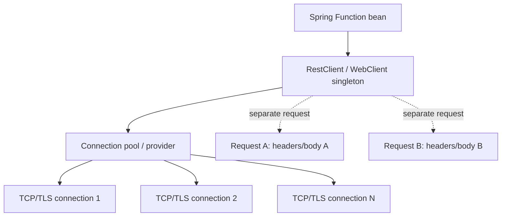
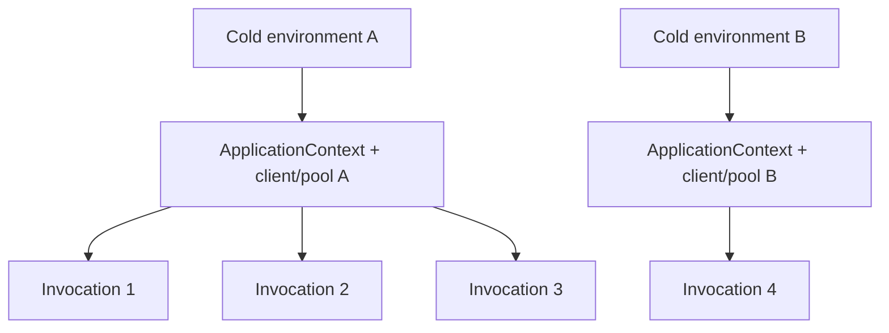
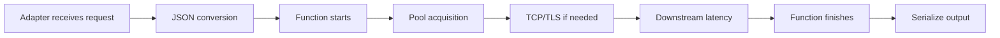

# Reusing Connections and Client Objects Safely

In **Spring Cloud Function**, business logic is written as `Supplier<T>`, `Function<I, O>`, or `Consumer<T>`, looked up via `FunctionCatalog`, optionally chained (*composition*), and deployed over HTTP, events, or serverless environments. However, if **every time a function is invoked** you instantiate an HTTP transport client, open a connection pool, or initialize a cloud SDK from scratch, I/O overhead can easily dwarf the actual computation.

Within the **Performance** chapter, this lesson focuses on two goals that must be achieved **simultaneously**:

1. **Safely reuse expensive resources** — HTTP clients, connection pools, datasources, or SDK clients documented as safe for sharing.
2. **Never wrongly share per-invocation state** — request bodies, user tokens, correlation IDs, JDBC `Connection`s, mutable buffers, or in-flight requests.

Reusing an object does not automatically mean reusing the **exact same TCP connection**; a pool may open multiple connections, close idle ones, or open new ones when the server resets them. The primary objective is lifecycle control, reducing connection churn, preventing resource leaks, and keeping latency stable under load.

After this lesson, you will be able to:

- Distinguish client objects, pools, sockets, requests, transactions, and their respective lifetimes.
- Write a `Function<QuoteRequest, QuoteResult>` with a shared `RestClient` on the synchronous path.
- Write a `Function<Flux<QuoteRequest>, Flux<QuoteResult>>` with non-blocking `WebClient`/Reactor Netty and bounded concurrency.
- Manage JDBC connection pools via `DataSource` instead of sharing JDBC `Connection`s.
- Calculate connection budgets across multiple replicas and tune timeouts, pending queues, retries, and bulkheads.
- Understand reuse boundaries across cold/warm environments on serverless.
- Test concurrency, connection lifecycles, and observe metrics to verify gains.

> **Example scope:** Java 17+, compatible Spring Framework (`RestClient` available since 6.1), Apache HttpClient 5 or Reactor Netty matching your Spring Boot/Spring Cloud Function version. URLs and configuration numbers are illustrative, not live services or executed benchmarks. Before using the code, check dependency versions and corresponding API documentation.

## 1. At which layer does reuse happen?

An invocation calling a pricing service may pass through several layers:



A singleton `Function` may hold a reference to a stable client; each invocation creates a fresh request. The pool is responsible for borrowing, reusing, or closing sockets within limits. Do not pin a fixed socket inside the function, and do not use mutable fields to store data for the current request.

| Component | Share across calls? | Notes |
| --- | --- | --- |
| Configured and built `RestClient` | Yes | Client wrapper is typically safe to reuse when configuration is not mutated |
| Built `WebClient` | Yes | Use request-specific builders and non-blocking operators |
| Apache `CloseableHttpClient` / connection manager | Yes | Close when the application context shuts down |
| Reactor Netty `ConnectionProvider` | Yes | Manage max/idle/lifetime and dispose on shutdown |
| `DataSource`/HikariCP pool | Yes | Borrow a connection per operation/transaction |
| JDBC `Connection`, `ResultSet`, `PreparedStatement` | **Never** share across invocations | Return to pool / close per usage scope |
| Per-request token, body, correlation ID | **Never** store in singleton | Pass via parameters/headers of each individual request |
| Mutable `WebClient.Builder` | Do not mutate concurrently across invocations | Build once or use a builder copy |
| Cloud provider SDK client | Depends on API | Share only if the provider guarantees thread safety and proper lifecycle |
| Reactive `Mono`/`Flux` carrying request content | Per publisher semantics | Do not unintentionally cache/replay per-user responses |

**Singleton is a bean creation scope, not a thread-safety guarantee.** Spring may invoke the same function bean from multiple HTTP threads, multiple event consumer threads, or multiple reactive subscriptions.

## 2. When does creating new clients waste resources?

Example of a hard-to-control pattern:

```java
// ANTI-PATTERN: creating a RestClient wrapper on every invocation.
@Bean
public Function<QuoteRequest, QuoteResult> quoteBad() {
    return request -> RestClient.create(
            "https://pricing.example.internal"
        )
        .post()
        .uri("/v1/quotes")
        .body(request)
        .retrieve()
        .body(QuoteResult.class);
}
```

This snippet assumes Spring `RestClient` and the DTOs are imported. Creating a wrapper every time makes configuration, observability, and transport management unclear. **However, do not claim that merely calling `RestClient.create(...)` or `WebClient.builder().build()` always opens a new TCP connection every time**: some clients/connectors use shared resources. The more serious problem is creating a **brand-new HTTP transport and connection pool per invocation** without reuse, shutdown, or bounded limits.

```text
Bad design:
invocation A → transport A → pool A → DNS/TCP/TLS
invocation B → transport B → pool B → DNS/TCP/TLS
invocation C → transport C → pool C → DNS/TCP/TLS

Good design:
ApplicationContext → shared transport + bounded pool
     ├─ invocation A → request A
     ├─ invocation B → request B
     └─ invocation C → request C
```

Reusing transports/pools can reduce:

- Repeated DNS resolution, TCP connect, and TLS handshake overhead.
- Connection churn and pressure on file descriptors, ephemeral ports, and NAT.
- Repeated creation of threads/event-loop resources.
- Leaked pools left behind without shutdown.
- Latency jitter from cold connections or transport-layer congestion.

The benefit depends on downstream behavior, keep-alive, HTTP version, TLS, and connector settings. If the real bottleneck is JSON serialization or a slow query, pooling alone may help very little.

## 3. DTOs and Spring Cloud Function contracts

Running example: a function sending requests to an internal pricing API. The business data consists of two Java records:

```java
// QuoteRequest.java
package demo.perf;

public record QuoteRequest(String sku, int quantity) {}
```

```java
// QuoteResult.java
package demo.perf;

public record QuoteResult(
    String sku,
    int quantity,
    long totalVnd
) {}
```

The corresponding HTTP body might be:

```json
{"sku":"BOOK-1","quantity":2}
```

Hypothetical pricing service response:

```json
{"sku":"BOOK-1","quantity":2,"totalVnd":100000}
```

The pricing API `https://pricing.example.internal/v1/quotes` is an **illustrative address**, not a public API. In real environments, read the host from trusted configuration and never let arbitrary user input supply the full URL, as that can lead to SSRF.

Two contract choices:

| Processing type | Signature | Nature |
| --- | --- | --- |
| Synchronous | `Function<QuoteRequest, QuoteResult>` | Caller waits until the pricing service call returns a result |
| Reactive | `Function<Flux<QuoteRequest>, Flux<QuoteResult>>` | Publisher stream, processed non-blockingly upon subscription |

The two options are not automatically interchangeable; in particular, **never call `block()` on `WebClient` inside a reactive function running on an event loop**.

## 4. Synchronous RestClient: a bean created once

When using Spring Framework 6.1+ with **Apache HttpClient 5**, you can configure the connection manager/pool inside a Spring bean.

```java
package demo.perf;

import org.apache.hc.client5.http.config.ConnectionConfig;
import org.apache.hc.client5.http.config.RequestConfig;
import org.apache.hc.client5.http.impl.classic.CloseableHttpClient;
import org.apache.hc.client5.http.impl.classic.HttpClients;
import org.apache.hc.client5.http.impl.io.PoolingHttpClientConnectionManagerBuilder;
import org.apache.hc.core5.util.Timeout;

import org.springframework.beans.factory.annotation.Value;
import org.springframework.context.annotation.Bean;
import org.springframework.context.annotation.Configuration;
import org.springframework.http.client.HttpComponentsClientHttpRequestFactory;
import org.springframework.web.client.RestClient;

@Configuration
public class BlockingHttpConfiguration {

    @Bean(destroyMethod = "close")
    public CloseableHttpClient pricingApacheClient() {
        ConnectionConfig connectionConfig =
            ConnectionConfig.custom()
                .setConnectTimeout(Timeout.ofSeconds(2))
                .build();

        var manager =
            PoolingHttpClientConnectionManagerBuilder.create()
                .setMaxConnTotal(32)
                .setMaxConnPerRoute(16)
                .setDefaultConnectionConfig(connectionConfig)
                .build();

        RequestConfig requestConfig =
            RequestConfig.custom()
                .setConnectionRequestTimeout(Timeout.ofSeconds(2))
                .setResponseTimeout(Timeout.ofSeconds(3))
                .build();

        return HttpClients.custom()
            .setConnectionManager(manager)
            .setDefaultRequestConfig(requestConfig)
            .evictExpiredConnections()
            .build();
    }

    @Bean
    public RestClient pricingRestClient(
        CloseableHttpClient pricingApacheClient,
        @Value("${pricing.base-url}") String baseUrl
    ) {
        var requestFactory =
            new HttpComponentsClientHttpRequestFactory(
                pricingApacheClient
            );

        return RestClient.builder()
            .baseUrl(baseUrl)
            .requestFactory(requestFactory)
            .build();
    }
}
```

Spring Boot can provide a `RestClient.Builder` and pick an HTTP request factory based on dependencies/configuration. The example above **explicitly configures the pool** so the lesson can illustrate max connections, timeouts, and shutdown. If a transport client managed by Boot or other infrastructure already exists, consider reusing it instead of spawning extra pools.

### What do these settings constrain?

| Setting | Meaning | Do NOT infer |
| --- | --- | --- |
| `setMaxConnTotal(32)` | Pool-wide connection ceiling | Not a requests/sec limit |
| `setMaxConnPerRoute(16)` | Per-route connection ceiling | Does not scale down automatically across replicas |
| `setConnectTimeout(2s)` | Connection establishment limit | Does not replace an overall deadline |
| `setConnectionRequestTimeout(2s)` | Wait limit for borrowing a connection | Does not make downstream respond faster |
| `setResponseTimeout(3s)` | Transport response timeout | Does not automatically cap all retries at operation level |
| `destroyMethod="close"` | Closes Apache client on context stop | Does not close after every request |

The numbers are purely **examples to explain the mechanics**. Real values must be based on peak concurrency, upstream timeout budgets, per-route traffic, and pricing service limits.

### The Function bean only holds a client reference

```java
package demo.perf;

import java.util.Objects;
import java.util.function.Function;

import org.springframework.beans.factory.annotation.Qualifier;
import org.springframework.context.annotation.Bean;
import org.springframework.context.annotation.Configuration;
import org.springframework.web.client.RestClient;

@Configuration
public class BlockingQuoteFunctions {

    @Bean("quoteBlocking")
    public Function<QuoteRequest, QuoteResult> quoteBlocking(
        @Qualifier("pricingRestClient") RestClient client
    ) {
        return request -> {
            if (request == null ||
                request.sku() == null ||
                !request.sku().matches("[A-Z0-9-]{1,24}") ||
                request.quantity() <= 0) {
                throw new IllegalArgumentException("Invalid quote request");
            }

            QuoteResult response = client.post()
                .uri("/v1/quotes")
                .body(request)
                .retrieve()
                .body(QuoteResult.class);

            return Objects.requireNonNull(
                response, "Empty pricing response"
            );
        };
    }
}
```

Here `@Bean Function<QuoteRequest,QuoteResult>` keeps clear generic types for `FunctionCatalog` and JSON converters. When the app exposes `quoteBlocking` over HTTP, events, or compatible serverless adapters, the Java logic still uses **the same client bean within that application context**.

Each invocation has its own request builder and body. The function never stores `currentRequest`, bearer tokens, or connections in mutable fields. If the downstream POST has side effects, **do not retry blindly** just because a timeout occurred.

## 5. WebClient + Reactor Netty: non-blocking connection reuse

On the reactive path, you can use `WebClient` and configure Reactor Netty's `ConnectionProvider`. A clearly bounded pool prevents unbounded requests from piling onto downstream.

### 5.1. Configuring the pool in the Spring context

```java
package demo.perf;

import java.time.Duration;

import io.netty.channel.ChannelOption;
import reactor.netty.http.client.HttpClient;
import reactor.netty.resources.ConnectionProvider;

import org.springframework.beans.factory.annotation.Value;
import org.springframework.context.annotation.Bean;
import org.springframework.context.annotation.Configuration;
import org.springframework.http.client.reactive.ReactorClientHttpConnector;
import org.springframework.web.reactive.function.client.WebClient;

@Configuration
public class ReactiveHttpConfiguration {

    @Bean(destroyMethod = "dispose")
    public ConnectionProvider pricingConnectionProvider() {
        return ConnectionProvider.builder("pricing-pool")
            .maxConnections(32)
            .pendingAcquireMaxCount(64)
            .pendingAcquireTimeout(Duration.ofSeconds(2))
            .maxIdleTime(Duration.ofSeconds(30))
            .maxLifeTime(Duration.ofMinutes(5))
            .build();
    }

    @Bean("pricingWebClient")
    public WebClient pricingWebClient(
        ConnectionProvider pricingConnectionProvider,
        @Value("${pricing.base-url}") String baseUrl
    ) {
        HttpClient httpClient =
            HttpClient.create(pricingConnectionProvider)
                .option(
                    ChannelOption.CONNECT_TIMEOUT_MILLIS,
                    2_000
                )
                .responseTimeout(Duration.ofSeconds(3));

        return WebClient.builder()
            .baseUrl(baseUrl)
            .clientConnector(
                new ReactorClientHttpConnector(httpClient)
            )
            .build();
    }
}
```

Required libraries include Spring WebFlux, Reactor Netty HTTP, and compatible related dependencies. Reactor Netty uses shared default resources; this example creates a **dedicated pool for pricing** to demonstrate bounds and lifecycle. If the app already uses `ReactorResourceFactory` or Boot's resource management, check resource ownership before creating another provider.

| Setting | Purpose |
| --- | --- |
| `maxConnections(32)` | Connection ceiling in the provider |
| `pendingAcquireMaxCount(64)` | Limit on requests waiting to acquire a connection |
| `pendingAcquireTimeout(2s)` | Avoid waiting indefinitely on the pool |
| `maxIdleTime(30s)` | Evict idle connections per policy |
| `maxLifeTime(5m)` | Maximum connection age in the pool |
| `CONNECT_TIMEOUT_MILLIS` | TCP connect timeout |
| `responseTimeout(3s)` | Reactor Netty response timeout |
| `dispose()` at shutdown | Release pool resources owned by the context |

Never dispose `ConnectionProvider` immediately after `WebClient.post(...)` returns: a `Mono` may not have been subscribed yet or the response may still be in flight.

### 5.2. Reactive function with bounded concurrency

```java
package demo.perf;

import java.util.function.Function;

import org.springframework.beans.factory.annotation.Qualifier;
import org.springframework.context.annotation.Bean;
import org.springframework.context.annotation.Configuration;
import org.springframework.web.reactive.function.client.WebClient;

import reactor.core.publisher.Flux;
import reactor.core.publisher.Mono;

@Configuration
public class ReactiveQuoteFunctions {

    @Bean("quoteReactive")
    public Function<
        Flux<QuoteRequest>,
        Flux<QuoteResult>
    > quoteReactive(
        @Qualifier("pricingWebClient") WebClient client
    ) {
        return requests -> requests.flatMap(request -> {
            if (request == null ||
                request.sku() == null ||
                request.sku().isBlank() ||
                request.quantity() <= 0) {
                return Mono.error(
                    new IllegalArgumentException(
                        "Invalid quote request"
                    )
                );
            }

            return client.post()
                .uri("/v1/quotes")
                .bodyValue(request)
                .retrieve()
                .bodyToMono(QuoteResult.class)
                .switchIfEmpty(Mono.error(
                    new IllegalStateException("Empty pricing response")
                ));
        }, 8);
    }
}
```

`flatMap(..., 8)` bounds **concurrent inner subscriptions within this pipeline**, not system-wide: multiple pipelines, multiple function invocations, and multiple replicas can share the pool simultaneously. Consider adding a bulkhead or rate limiting to protect downstream.

**`flatMap` can emit results out of input order.** When business rules require preserving order, consider `concatMap` (sequential) or an order-preserving operator and measure actual throughput/latency.

Never call `.block()` on a production event loop. If you must use a blocking library, isolate the scheduler/execution model and bound resources accordingly instead of assuming reactive automatically improves performance.

## 6. Thread safety: dangerous singleton mistakes

A function bean is a singleton yet can be invoked concurrently. Storing the current request in a shared field:

```java
// ANTI-PATTERN: data race and risk of leaking data across users.
@Configuration
public class UnsafeQuoteFunctions {

    private QuoteRequest currentRequest;

    @Bean
    public Function<QuoteRequest, String> unsafe() {
        return request -> {
            currentRequest = request;
            return currentRequest.sku();
        };
    }
}
```

Requests A and B can interleave writes to the field, causing A to read B's `sku`. The right approach is keeping per-invocation data in local variables:

```java
@Bean
public Function<QuoteRequest, String> safe() {
    return request -> {
        String sku = request.sku();
        return sku;
    };
}
```

These snippets belong inside classes with appropriate `@Bean`, `@Configuration`, and `Function` imports.

### Safe vs. unsafe sharing reference table

| Object | Correct practice |
| --- | --- |
| Built HTTP client | Inject as a stable bean; never mutate configuration per request |
| Mutable `WebClient.Builder` | Never let multiple threads mutate the same builder; pre-build or copy properly |
| Per-user bearer token | Attach to the individual request, never store in global default headers |
| Global cache | Use a concurrency-safe cache with TTL and max size; never store unbounded data |
| Mutable `SimpleDateFormat` | Replace with immutable `DateTimeFormatter` where applicable |
| Mutable byte buffer | Allocate/borrow per request with clear ownership |
| JDBC Connection/ResultSet | Never store in a singleton field |
| Per-request correlation ID | Pass via input/message headers/reactive context |
| `ThreadLocal` in async/reactive code | Never assume automatic context propagation; clean up properly |

A thread-safe client **does not make all code using that client thread-safe**. Review state fields in `Supplier`, `Function`, and `Consumer` beans.

## 7. Per-invocation authorization and headers

When an access token belongs to a specific user or tenant, attach it on the **individual request builder**, never writing it into the singleton client:

```java
import reactor.core.publisher.Mono;
import org.springframework.web.reactive.function.client.WebClient;

public Mono<QuoteResult> quoteForUser(
    WebClient client,
    QuoteRequest request,
    String accessToken
) {
    return client.post()
        .uri("/v1/quotes")
        .headers(headers -> headers.setBearerAuth(accessToken))
        .bodyValue(request)
        .retrieve()
        .bodyToMono(QuoteResult.class);
}
```

This is an illustrative method inside a class/service, not a top-level Java method. The token must come from valid authentication and never appear in logs or metric tags.

For service credentials, use a credential provider supporting **rotation/refresh**. Never store a token initialized once and assume it stays valid forever. If tenants have distinct proxies, certificates, or policies, design bounded client/pool partitioning rather than accidentally sharing the first tenant's context.

## 8. Database: share DataSource, borrow Connection per transaction

In JDBC applications, the **`DataSource`/HikariCP pool** is typically a shared bean. However, a `Connection` borrowed from the pool is short-lived and carries transaction/session state.

Example HikariCP configuration (durations in milliseconds):

```yaml
spring:
  datasource:
    hikari:
      maximum-pool-size: 10
      minimum-idle: 2
      connection-timeout: 2000
      idle-timeout: 600000
      max-lifetime: 1800000
```

These are **illustrative values**, not universal recommendations. Database URL, username, and password must come from configuration/secret management, never hardcoded in lessons or source code.

### Borrowing and returning a logical connection

```java
package demo.perf;

import java.sql.Connection;
import java.sql.PreparedStatement;
import java.sql.ResultSet;
import java.sql.SQLException;
import javax.sql.DataSource;

public final class PriceRepository {

    private final DataSource dataSource;

    public PriceRepository(DataSource dataSource) {
        this.dataSource = dataSource;
    }

    public long unitPrice(String sku) throws SQLException {
        String sql =
            "SELECT unit_price_vnd FROM product_price WHERE sku = ?";

        try (Connection connection = dataSource.getConnection();
             PreparedStatement statement =
                connection.prepareStatement(sql)) {
            statement.setString(1, sku);

            try (ResultSet rs = statement.executeQuery()) {
                if (!rs.next()) {
                    throw new IllegalArgumentException("Unknown SKU");
                }
                return rs.getLong(1);
            }
        }
    }
}
```

When a `Connection` is borrowed from Hikari, `connection.close()` typically **returns the logical connection to the pool**, rather than necessarily closing the physical socket. `try-with-resources` ensures release even if the query throws an error.

When using Spring transaction management or `JdbcTemplate`, let Spring manage the connection within the proper transaction scope. Never manually borrow/close a connection outside the transaction manager and expect it to participate in an active transaction. With JPA, never share a real session/`EntityManager` across threads; use managed proxies/transactional services properly.

### Calculating the pool budget under autoscaling

If a service has `N` replicas, and each replica can open at most `P` connections:

\[
C_{\mathrm{max,service}} \approx N \times P
\]

For example, 12 instances with pool size 10 create a configured ceiling of roughly **120 connections** from that service alone, before counting rolling deployments, admin tasks, and other systems. That number does not mean 120 sockets are always open simultaneously.

Increasing max pool size does not necessarily improve throughput: the database can slow down when too many queries contend for CPU, locks, or I/O.

## 9. Serverless: share within a warm environment, never across environments

On serverless, the Spring context and beans can persist across multiple invocations **within the same execution environment**:



Environments A and B **do not share memory or pools**. A new cold start creates its own context/client; a warm invocation can reuse the old client, though it may also encounter idle connections already closed by the server or load balancer.

**Design rules:**

- Initialize clients at application scope, never creating transports inside each invocation.
- Never assume the environment will always stay warm or be invoked only once at a time.
- Set connect/response/idle/max-life timeouts and handle stale connections.
- Never store per-user state in static/singleton mutable fields.
- Clean up resources on shutdown when invoked, but do not rely on every serverless platform always running shutdown callbacks.
- Measure **cold invocation**, **first connection**, and **warm invocation** separately.

Reusing a client does not eliminate platform init, JVM startup, Spring bootstrap, or JSON deserialization costs in the serverless adapter.

## 10. Balancing pool size, pending queue, and concurrency

Three distinct limits:

- **Max connections**: concurrent connections permitted by the pool.
- **Pending acquire**: requests waiting to borrow a connection.
- **Application concurrency**: active invocations/inner subscriptions running simultaneously.

```text
40 concurrent calls
        |
        v
Pool capped at 16 connections
        ├─ 16 using connections → downstream
        └─ 24 waiting to acquire → may time out
```

One way to estimate average demand is Little's Law:

\[
L = \lambda W
\]

For example, with average throughput **80 req/s** and average system residence time **0.15 s**, there are roughly:

\[
L = 80 \times 0.15 = 12
\]

average concurrent requests during that interval. This **is not a formula to pick `maxConnections=12`**: traffic bursts, p95/p99, instance count, route count, HTTP/2 multiplexing, and downstream capacity all matter.

### Both small pools and large pools carry risks

| Configuration | Risk |
| --- | --- |
| Pool too small | Long pending queue, timeouts, high latency |
| Pool too large | Downstream overload, extra sockets/file descriptors, contention |
| Unbounded pending queue | Growing RAM and latency when downstream slows down |
| Timeout too long | Requests hold resources for too long |
| Timeout too short | False errors / inability to tolerate legitimate tail latency |
| Too many retries | Amplifies traffic while downstream is already failing |
| One shared pool for all downstreams | One slow downstream can starve other downstreams |

Increase pool size only when metrics confirm capacity shortage **and** downstream can handle higher concurrency; you may need bulkheads, rate limiting, or downstream optimization instead of more connections.

## 11. Timeouts and deadlines are not the same thing

A remote call has multiple stages:

```text
Wait for connection from pool
  ↓
DNS/TCP connect
  ↓
TLS handshake
  ↓
Send request
  ↓
Wait for response
  ↓
Read and deserialize body
```

| Timeout/deadline | Protects stage |
| --- | --- |
| Pending acquire timeout | Waiting too long for the pool |
| Connect timeout | Establishing the TCP connection |
| TLS handshake timeout | Incomplete TLS negotiation |
| Response/read timeout | Slow downstream response per client policy |
| Overall operation deadline | Total duration across multiple steps, including retries |
| Function/platform timeout | Limits of the HTTP adapter, broker, or serverless platform |

Do not assume `responseTimeout(3s)` means an operation with **three retries** always finishes within 3 seconds. You need an overall deadline accounting for queue wait, backoff, conversion, and all downstream hops.

### Retries require idempotency

| Failure | How to evaluate |
| --- | --- |
| Idempotent GET hits transient network error | Bounded retries with backoff and jitter may be reasonable |
| POST creating an invoice/payment | Never retry blindly; requires an idempotency key or confirmation contract |
| HTTP 400 from invalid request | Usually do not retry the same payload |
| HTTP 429/503 | Respect throttling/`Retry-After` policy and cap retries |
| Repeated pool acquire timeouts | Check concurrency, saturation, and downstream health |
| Stale connection after idle | Reconnect or retry when the operation is safe |
| Expired token | Refresh credentials through proper mechanism |

A `connection pool` does not replace a circuit breaker, bulkhead, or idempotency. With message brokers, account for **both binder retries** and HTTP client retries to avoid unintended call multiplication.

## 12. Supplier, Function, and Consumer all benefit from shared clients

| Interface | Example | Notes |
| --- | --- | --- |
| `Supplier<T>` | Reading status or data from an API | Client reused across multiple `get()` calls; trigger driven by adapter |
| `Function<I,O>` | Calling a pricing API per request | Each input/output independent; client shared |
| `Consumer<T>` | Sending audit/events downstream | Ack/retry/idempotency when events are redelivered |

Example `Supplier<String>` using an injected RestClient:

```java
import java.util.Objects;
import java.util.function.Supplier;

import org.springframework.beans.factory.annotation.Qualifier;
import org.springframework.context.annotation.Bean;
import org.springframework.web.client.RestClient;

@Bean
public Supplier<String> pricingHealth(
    @Qualifier("pricingRestClient") RestClient client
) {
    return () -> Objects.requireNonNull(
        client.get()
            .uri("/v1/status")
            .retrieve()
            .body(String.class)
    );
}
```

This is a sample bean inside a `@Configuration` class; `/v1/status` is hypothetical. Do not assume the supplier runs only once or on a fixed schedule: the adapter/binder determines triggers.

With `Consumer<Message<T>>`, keep event headers scoped strictly to that invocation. Never write per-event `correlationId`s or tokens into mutable client defaults. If the consumer spawns async work, determine when that work completes before acking.

### Composition does not force creating multiple clients

```text
validateQuote : Function<QuoteRequest, QuoteRequest>
    |
quoteBlocking : Function<QuoteRequest, QuoteResult>  <-- shared RestClient
    |
renderQuote   : Function<QuoteResult, String>
```

```yaml
spring:
  cloud:
    function:
      definition: validateQuote|quoteBlocking|renderQuote
```

The beans `validateQuote` and `renderQuote` above are **illustrative contracts**, not defined in section 4's code snippets. `FunctionCatalog` can compose beans once created with matching names/generics. The client remains a dependency of `quoteBlocking`, not recreated at each link.

## 13. Lifecycle management: closing the right resource at the right time

| Resource | Where created? | When closed? |
| --- | --- | --- |
| `RestClient` wrapper | Bean/configuration | Usually owns no standalone socket to close directly |
| Apache `CloseableHttpClient` | Transport client bean | Spring context shutdown, `close()` |
| Dedicated Reactor Netty `ConnectionProvider` | Bean | Spring context shutdown, `dispose()` |
| Hikari `DataSource` | Spring Boot/bean | App shutdown/bean destroy |
| JDBC `Connection` | Operation/transaction | When operation completes, returned to pool |
| Per-request request/response stream | Each invocation | On complete/error/cancel, released via proper API |

**Closing too early:** calling `connectionProvider.dispose()` inside `Function.apply(...)` can break active invocations or an unsubscribed publisher.

**Never closing:** creating multiple HTTP clients/pools outside the Spring context without shutdown can leave behind threads, sockets, and file descriptors during reloads or repeated integration test contexts.

On serverless, platforms do not always invoke shutdown hooks. Clients therefore also need timeouts and stale/reset connection handling rather than assuming a connection lives forever.

## 14. Measuring properly to see whether reuse helps

Do not measure only `Function.apply(...)`. An invocation with an HTTP downstream involves these stages:



| Metric | Question answered |
| --- | --- |
| Process-to-ready / main-to-ready | Does client/pool initialization slow startup? |
| First invocation | Does the first request pay DNS/TCP/TLS or lazy setup? |
| Warm p50/p95/p99 | Does the pool lower steady-state latency? |
| New connections per second | Did connection churn actually decrease? |
| Active/idle/pending connections | Is the pool used efficiently or saturated? |
| Pool acquisition timeouts | Are requests waiting too long for the pool? |
| HTTP status 429/503, error rate | Is downstream overloaded? |
| Throughput, CPU, RSS/heap, GC, file descriptors | Actual efficiency and resource cost |
| Retry count | Are retries amplifying traffic? |

Reactor Netty supports pool metrics/observability when integrated with compatible Micrometer; metric names and enablement depend on version. Never use request ID, user ID, SKU, or arbitrary URLs as metric tags due to **high cardinality**.

### Measuring a synchronous function with an injected client using Micrometer

```java
import java.util.function.Function;

import io.micrometer.core.instrument.MeterRegistry;
import io.micrometer.core.instrument.Timer;

import org.springframework.beans.factory.annotation.Qualifier;
import org.springframework.context.annotation.Bean;

@Bean("quoteTimed")
public Function<QuoteRequest, QuoteResult> quoteTimed(
    @Qualifier("quoteBlocking")
    Function<QuoteRequest, QuoteResult> delegate,
    MeterRegistry registry
) {
    Timer timer = Timer.builder("app.quote.duration")
        .description("Synchronous quote function duration")
        .tag("function", "quoteTimed")
        .publishPercentileHistogram()
        .register(registry);

    return request -> timer.record(
        () -> delegate.apply(request)
    );
}
```

This snippet belongs in a `@Configuration` class with Micrometer and a `MeterRegistry` bean. The timer measures the **entire synchronous delegate duration**, including pool wait and remote HTTP, not just lambda CPU time. Separating pool wait, TCP, and remote latency requires transport/tracing instrumentation.

With `Mono/Flux`, `apply(...)` may only create a publisher; observe **subscription through completion/error/cancel** or per-item latency for unbounded streams. Never call `block()` in reactive production code just to record a timer.

## 15. A/B example and how to interpret it

Suppose we compare two builds with identical logic, adapters, concurrency, and downstream:

| Metric (**hypothetical** figures) | Uncontrolled transport/pool creation | Shared bounded pool |
| --- | ---: | ---: |
| New connections/s | 90 | 7 |
| Warm HTTP p50 | 26 ms | 11 ms |
| Warm HTTP p99 | 320 ms | 93 ms |
| System CPU | 62% | 37% |
| Pool pending acquire timeout | No unified metric | 0.2% |
| Main-to-ready p50 | 840 ms | 910 ms |

These **are not Spring Cloud Function benchmark results**. The example highlights a trade-off: initializing the pool early may raise startup slightly while cutting connection churn and warm latency. Still, 0.2% pending timeouts is a signal to investigate, never to be ignored just because p50 looks prettier.

### Fair experiment checklist

1. Keep JDK, Spring Boot/Cloud Function, container resources, and adapters identical.
2. Use identical input/request sizes, concurrency, and downstream load.
3. Measure **startup**, **first connection**, **cold requests**, and **warm requests** separately.
4. Record max connections, per-route limits, pending queue, response timeout, and retry policy.
5. Collect p50/p95/p99, error rate, throughput, and pool metrics.
6. Repeat runs, inspect variance and errors, and never conclude from a single `curl`.
7. Never run load tests exceeding production downstream capacity or violating system policies.

Optimizing reuse must never sacrifice correctness, introduce security risks into a shared client, or spike errors during traffic bursts.

## 16. Safe testing: object reuse vs. socket reuse

### Testing a gateway retained across invocations

To test logic without network dependencies, extract a gateway interface:

```java
// PricingGateway.java
package demo.perf;

public interface PricingGateway {
    QuoteResult quote(QuoteRequest request);
}
```

```java
// GatewayQuoteFunctions.java
package demo.perf;

import java.util.function.Function;
import org.springframework.context.annotation.Bean;
import org.springframework.context.annotation.Configuration;

@Configuration
public class GatewayQuoteFunctions {

    @Bean("quoteViaGateway")
    public Function<QuoteRequest, QuoteResult> quoteViaGateway(
        PricingGateway gateway
    ) {
        return gateway::quote;
    }
}
```

```java
// GatewayQuoteFunctionsTest.java
package demo.perf;

import static org.junit.jupiter.api.Assertions.assertEquals;

import java.util.concurrent.atomic.AtomicInteger;
import java.util.function.Function;

import org.junit.jupiter.api.Test;

class GatewayQuoteFunctionsTest {

    @Test
    void reusesGatewayObject() {
        AtomicInteger calls = new AtomicInteger();

        PricingGateway fake = request -> {
            calls.incrementAndGet();
            return new QuoteResult(
                request.sku(),
                request.quantity(),
                request.quantity() * 50_000L
            );
        };

        Function<QuoteRequest, QuoteResult> function =
            new GatewayQuoteFunctions().quoteViaGateway(fake);

        function.apply(new QuoteRequest("BOOK-1", 2));
        function.apply(new QuoteRequest("PEN-1", 3));

        assertEquals(2, calls.get());
    }
}
```

This test shows both calls used **the same gateway object**; it does not prove TCP sockets were reused. Verifying connection reuse requires integration tests and real transport metrics/tracing.

### Integration testing a real pool

Using a test HTTP server that can observe connection counts (e.g., MockWebServer, WireMock, or a suitable Netty test server):

1. Build the Spring context with the client/pool once.
2. Send multiple requests sequentially, then concurrently.
3. Verify each response matches its request — no swapped tokens/bodies/correlation IDs.
4. Observe active/idle/pending pool counts and created connections.
5. Have the test server close an idle socket; verify safe reconnect/retry behavior.
6. Inject controlled timeouts/503s; verify retry limits and overall deadline.
7. Close the context; verify pool/client resources are released.

Concurrency tests are helpful for checking thread safety, yet **a single passing test does not prove the absence of data races**. Review code carefully, use immutable DTOs, and apply concurrency testing tools when appropriate.

## 17. Spring Cloud Function-specific notes

### FunctionCatalog wrappers do not recreate clients

Spring Cloud Function may wrap a function upon catalog lookup to support composition/type conversion. That wrapper **is no reason** to create a new transport per call. The client should be a dependency of the functional bean inside the Spring context:

```text
Spring context
  ├─ pricingRestClient (singleton)
  ├─ quoteBlocking Function (references client)
  └─ FunctionCatalog
       └─ lookup("quoteBlocking")
            ├─ HTTP invocation
            ├─ event invocation
            └─ serverless invocation
```

The HTTP, event, and serverless paths in the diagram are **alternative deployment environments** or configured adapters; they do not coexist automatically if a build includes only one adapter.

When using functional registration instead of `@Bean`, register the client and `FunctionRegistration` properly in the context, preserving lambda input/output metadata. `FunctionRegistration.type(...)` tells the catalog/converters the DTO types; **it does not control pooling**.

### Inbound server and outbound client are two separate pools

The Web adapter handles **inbound** requests; `RestClient/WebClient` calling the pricing API from inside the function is **outbound**. Tuning server threads does not change the outbound connection pool. An event consumer also has its own broker connections and its own HTTP client; do not lump them into a single metric.

### MessageConverter does not manage sockets

`JsonMessageConverter`, `StringMessageConverter`, and `ByteArrayMessageConverter` handle **payload formatting**, not TCP reuse. If CPU is dominated by JSON parsing, the pool may not be the bottleneck. If requests stall on pool acquisition, swapping JSON mappers may not help either.

## 18. Troubleshooting

| Symptom | Possible cause | Resolution direction |
| --- | --- | --- |
| First call slow, warm fast | DNS/TCP/TLS/lazy client setup | Measure first connection/startup separately |
| High connection count, low requests/connection | Multiple separate transports/pools created, server idle timeout | Reuse shared pool, inspect keep-alive |
| Pool pending spikes | Concurrency exceeds pool/downstream capacity | Bulkhead, bound queue, investigate remote latency |
| p99 increases when raising max connections | Downstream overload, contention | Reduce concurrency, review system-wide budget |
| Request A receives B's token or body | Mutable singleton request state | Per-request headers/body, immutable DTOs |
| JDBC pool exhausted | Connection leak / long transactions | `try-with-resources`, transaction boundaries |
| Stale connection after long idle | Server/proxy closed socket | Idle/max life, safe reconnect and retry |
| Client closed while processing | Disposed/closed inside each function call | Tie resource lifecycle to Spring context |
| Serverless warm fast but cold slow | Context/pool absent in fresh environment | Measure cold/warm and startup separately |
| HTTP 503 rises after enabling retries | Retry storm / too many parallel attempts | Retry budget, backoff, circuit breaker |
| Low reactive throughput | `block()` on event loop, wrong concurrency | Non-blocking pipeline and bounded `flatMap` |
| Reusing client shows no gain | Default connector already pooled or different bottleneck | Traces, pool metrics, and profiling |
| Unbounded memory growth | Unbounded pending queue/cache/buffers | Bound queues/caches/sizes and measure allocation |
| Errors only when container stops | Resource lifecycle and in-flight requests | Graceful shutdown, close/dispose at right time |

### Six diagnostic questions

1. **Which layer is being measured?** Java logic, outbound HTTP, broker, adapter, or entire invocation?
2. **Where is the client/pool created?** Per request or in the Spring context?
3. **Is any mutable state shared?** Tokens, headers, requests, connections, caches?
4. **What are the real bounds?** Max pool, per-route, pending, timeout, retry, concurrency?
5. **What do downstream and replica counts look like?** Is the system-wide pool budget reasonable?
6. **Were cold/first/warm and error rates measured?** A single average is never enough.

## 19. Practice exercises

**Exercise 1 — Client and socket.** Does making `WebClient` a singleton bean guarantee every invocation uses the same TCP socket?

*Answer:* No. The client can use a connection pool, multiple sockets, and reconnect when idle/stale. Object reuse and connection reuse are distinct concepts.

**Exercise 2 — Data scoping.** In `Function<QuoteRequest,QuoteResult>`, where should the client and `currentRequest` live?

*Answer:* The built client is injected as a singleton dependency; the current request stays in parameters and local variables, never in a mutable singleton field.

**Exercise 3 — JDBC.** Why shouldn't you store a `Connection` in a function field for reuse?

*Answer:* A `Connection` carries transaction/session state, may not be thread-safe, and can go stale. Share `DataSource`, borrowing and releasing connections per operation or transaction.

**Exercise 4 — Pool budget.** An app has 15 replicas, each setting `maximum-pool-size=12`. What is the configured connection ceiling from this app?

*Answer:* Roughly `15 × 12 = 180` connections per configuration, excluding rolling deployments and other apps. It does not mean 180 sockets are always open.

**Exercise 5 — Reactive.** Why avoid `webClient.post(...).retrieve().bodyToMono(...).block()` inside `flatMap(...)`?

*Answer:* Blocking can stall event-loop threads; keep the pipeline non-blocking and bound concurrency.

**Exercise 6 — Credentials.** Should user A's token be stored in the singleton client's default header so user B reuses it?

*Answer:* No. Set tokens per individual request and use controlled auth/credential rotation.

**Exercise 7 — Serverless.** One warm invocation reused a pool. Will the next invocation definitely reuse that same pool?

*Answer:* No. The platform may spin up a different execution environment; pooling only lives within the same environment/context, and old sockets may be stale.

**Exercise 8 — Pool saturation.** A pool has 16 connections, 40 concurrent requests, and 24 waiting. Should you immediately raise the pool to 100?

*Answer:* Not yet. Check downstream capacity, pool wait, p95/p99, error rate, replica count, and bulkheads/backpressure.

**Exercise 9 — POST retries.** A POST creating an invoice timed out, yet the server already committed it. Is automatically retrying three times safe?

*Answer:* Not without an idempotency contract. It can create duplicate transactions; use an idempotency key or status confirmation mechanism.

**Exercise 10 — Measuring results.** Warm p50 dropped, yet p99 rose and pending-acquire timeouts appeared. Can this be called an unqualified improvement?

*Answer:* No. You must account for tail latency, throughput, error rate, and pool saturation.

**Exercise 11 — Dispose.** Should you call `ConnectionProvider.dispose()` right after constructing a `Mono` response?

*Answer:* No. The `Mono` may not be subscribed yet or the response may still be incomplete; the provider is disposed with the context lifecycle.

**Exercise 12 — Verifying socket reuse.** A fake-gateway test calling twice passes. Has it proven connection reuse?

*Answer:* Not yet. That test only verifies dependency object reuse. Observe transport connections via integration tests/metrics/tracing.

## 20. Key takeaways

- **Share clients/pools, never share mutable per-invocation state.** Singleton scope does not imply thread safety.
- **Built `RestClient` and `WebClient` instances can be reused**, while actual connection reuse depends on transport/connectors, the remote server, and configuration.
- **Bound max connections, per-route limits, pending queues, acquisition timeouts, idle lifetimes, and concurrency** according to real load.
- **For JDBC, share `DataSource` but never share `Connection`**; release within the proper transaction scope.
- **For reactive code, never block the event loop**; define concurrency limits and ordering behavior.
- **Timeouts, retries, circuit breakers, and bulkheads solve different problems**; retries must respect idempotency and deadlines.
- **Serverless reuses clients only within a warm environment**, with no shared pool across cold environments.
- **Measure first/warm calls, active/idle/pending pool metrics, connection churn, p50/p95/p99, throughput, and error rates** before declaring optimization success.

**References:**

- [Spring Cloud Function Reference](https://docs.spring.io/spring-cloud-function/reference/)
- [Spring Framework — REST Clients](https://docs.spring.io/spring-framework/reference/integration/rest-clients.html)
- [Spring Framework — WebClient](https://docs.spring.io/spring-framework/reference/web/webflux-webclient.html)
- [Reactor Netty — HTTP Client and Connection Pool](https://projectreactor.io/docs/netty/release/reference/http-client.html)
- [Apache HttpClient 5 — Connection Management](https://hc.apache.org/httpcomponents-client-5.5.x/current/tutorial/html/connmgmt.html)
- [HikariCP — Configuration](https://github.com/brettwooldridge/HikariCP)
- [Micrometer — Timers](https://docs.micrometer.io/micrometer/reference/concepts/timers.html)

These examples provide design and testing guidance; when deploying, verify your exact Spring Boot/Spring Cloud Function versions, Reactor Netty/Apache HttpClient versions, adapters, downstream limits, and system security policies.
