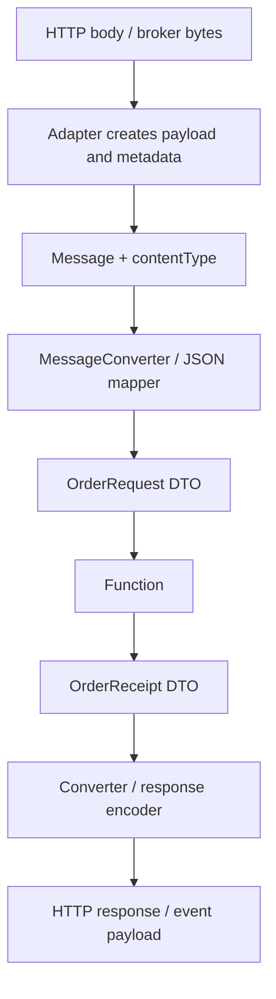
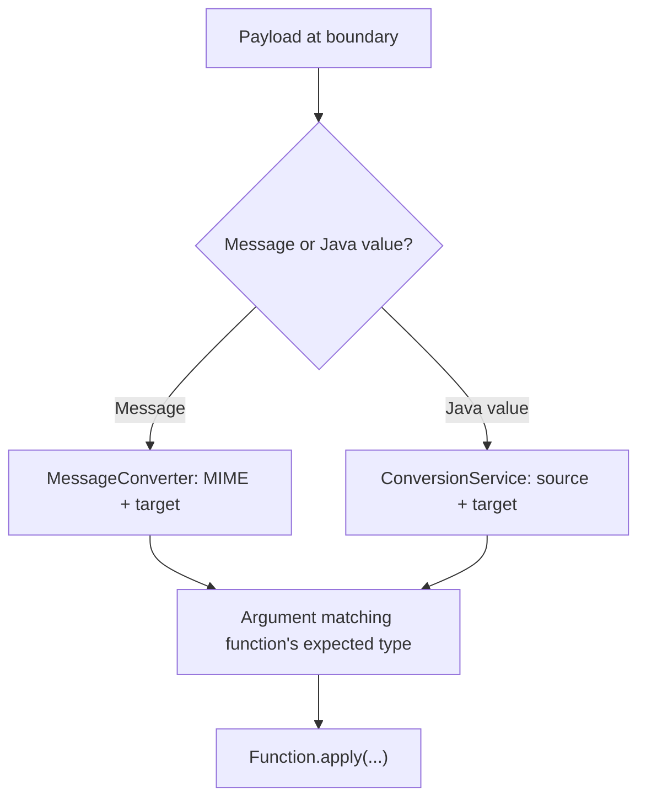

# JSON Conversion Costs and Message Copying

Spring Cloud Function lets you write business logic as `Supplier<T>`, `Function<I, O>`, and `Consumer<T>`, look them up via `FunctionCatalog`, chain them (*composition*), and deploy the same logic over HTTP, events, or serverless environments. To cross protocol boundaries, the framework or adapter may need to **deserialize JSON into Java types**, construct a `Message<?>` carrying headers, and **serialize the result**. These steps incur CPU, memory allocation, and garbage collection costs distinct from business processing time.

Within the **Performance** chapter, this lesson focuses on two frequently confused sources of overhead:

1. **JSON conversion:** byte ↔ object encoding/decoding, charset conversion, type metadata lookup, DTO/collection allocation, and validation.
2. **Message copying:** creating new wrappers, copying header maps, sharing vs. cloning payloads, and propagating metadata across functions in a chain.

The goal is not to eliminate every object creation. **Copying data when needed to protect ownership and immutability is good practice**, while removing unnecessary JSON round-trips or redundant payload copies can improve performance. You must distinguish **what is actually being copied** before optimizing.

After this lesson, you will be able to:

- Explain the cost of `byte[] → DTO → byte[]` and distinguish it from `String`/`Map`/`Message<?>`.
- Understand the relationship among function generics, the `contentType` header, `MessageConverter`, and `ConversionService`.
- Prove that `MessageBuilder.fromMessage(...)` reuses the payload instead of deep-copying it.
- Distinguish **header map copying**, **header value reference copying**, and **byte array cloning**.
- Reduce intermediate conversions when composing functions that already have compatible Java types.
- Design immutable DTOs, selective header propagation, and protect mutable payloads at asynchronous boundaries.
- Use JMH and integration measurements to compare JSON serialization, Message wrapping, and end-to-end latency.

> **Version scope:** Java examples use Java 17+; `ObjectMapper` snippets use Jackson 2 (`com.fasterxml.jackson.*` packages), suitable for projects using Jackson 2. Jackson 3 uses `tools.jackson.*` packages and corresponding APIs. Spring Cloud Function's `JsonMapper` is not identical to Jackson 3's `JsonMapper` class. Your actual configuration, adapter, and Spring Cloud Function version determine which converter runs.

## 1. Mapping the actual path of a payload

A JSON request sent into a function may pass through these stages:



This is a **conceptual diagram**, not a mandatory call stack for every adapter. A Web adapter may decode the body using its own codec before handing it to the catalog; a broker may deliver a payload that is already a `String` or Java object. Therefore, you cannot assume every call always builds an exact `Message<byte[]>` and invokes a single JSON converter.

### What costs can appear?

| Stage | Work performed | Common costs |
| --- | --- | --- |
| Receiving body | Network I/O, buffering, possible decompression | Memory/byte copies, wait time |
| Charset | UTF-8 bytes ↔ Java `String` if passing through text | Char/string allocation, CPU |
| JSON decode | Tokenizing, matching properties, creating DTO/list/map | CPU, allocation, GC |
| Message wrapper | Creating `Message<?>`, headers | Object and header-map allocations |
| Function | Validation, computation, DB/HTTP I/O | CPU or business I/O wait |
| JSON encode | Traversing object graph, UTF-8 encoding | CPU, buffer allocation |
| Adapter output | Copying buffers, network/broker transmission | I/O, queueing, possible copies |

Calling `Function.apply(...)` directly on a pre-built DTO **does not measure** the JSON/adapter steps at either end. Conversely, end-to-end HTTP duration includes many costs outside the core function, so you cannot simply subtract them and call the remainder “Jackson cost.”

## 2. Message is an envelope, not a copy of the content

Spring Messaging defines `Message<T>` with two main parts:

- **Payload:** the Java object `T`.
- **Headers:** `MessageHeaders` carrying metadata such as `contentType`, correlation ID, and routing/tracing information.

```text
Message<OrderRequest>
├── payload ───────────────> OrderRequest (object)
└── headers
    ├── contentType: application/json
    ├── correlationId: order-42
    ├── id: ...
    └── timestamp: ...
```

A new `Message` can **point to the same payload** as the old message. Likewise, copying headers usually copies key/value pairs at the map level, **without automatically deep-copying each value**.

### Wrapper immutability is not payload immutability

`MessageHeaders` exposes a map that **forbids normal modification**; the `Message` interface has no setter to swap the payload. Even so, if the payload is a `byte[]` or a header value is a mutable `Map`, code holding a reference can still mutate the contents inside.

Comparison:

| Component | Mutable through the Message wrapper? | Can internal data be mutable? |
| --- | --- | --- |
| `MessageHeaders` map | No via standard `put(...)` | Header values can still be mutable |
| `String` payload | Reference cannot be changed via setter | `String` is immutable |
| Record payload with immutable fields | Reference cannot be changed via setter | Depends on nested fields |
| `byte[]` payload | Reference cannot be changed via setter | **Yes**, byte elements can be modified |
| `List<T>` payload | Reference cannot be changed via setter | Depends on implementation and elements |

The decision to copy should be based on **ownership and risk of concurrent mutation**, not solely on whether the message is typed as `Message<byte[]>` or `Message<OrderRequest>`.

## 3. Running DTO and Function example

Example order-processing application:

```java
// File: demo/perf/OrderLine.java
package demo.perf;

public record OrderLine(
    String sku,
    int quantity,
    long unitPriceVnd
) {}
```

```java
// File: demo/perf/OrderRequest.java
package demo.perf;

import java.util.List;
import java.util.Objects;

public record OrderRequest(
    String orderId,
    List<OrderLine> lines
) {
    public OrderRequest {
        Objects.requireNonNull(orderId, "orderId");
        lines = List.copyOf(
            Objects.requireNonNull(lines, "lines")
        );
    }
}
```

```java
// File: demo/perf/OrderReceipt.java
package demo.perf;

public record OrderReceipt(
    String orderId,
    int lineCount,
    long totalVnd
) {}
```

The `List.copyOf(...)` constructor creates a **structural snapshot of the list** so the caller cannot add or remove elements after passing it into the record. It **does not deep-copy every element**; in this example, each `OrderLine` is a record containing primitives and `String`, so it can be shared relatively safely. For mutable elements, deeper protection or a data design change is needed.

Business functions:

```java
// File: demo/perf/OrderFunctions.java
package demo.perf;

import java.util.function.Function;

import org.springframework.context.annotation.Bean;
import org.springframework.context.annotation.Configuration;

@Configuration
public class OrderFunctions {

    @Bean("calculateOrder")
    public Function<OrderRequest, OrderReceipt> calculateOrder() {
        return request -> {
            if (request == null ||
                !request.orderId().matches("[A-Z0-9-]{1,32}") ||
                request.lines().isEmpty() ||
                request.lines().size() > 100) {
                throw new IllegalArgumentException("Invalid order");
            }

            long total = 0L;
            for (OrderLine line : request.lines()) {
                if (line == null ||
                    line.sku() == null ||
                    !line.sku().matches("[A-Z0-9-]{1,24}") ||
                    line.quantity() < 1 ||
                    line.quantity() > 10_000 ||
                    line.unitPriceVnd() < 0) {
                    throw new IllegalArgumentException(
                        "Invalid order line"
                    );
                }

                total = Math.addExact(total, Math.multiplyExact(
                    (long) line.quantity(), line.unitPriceVnd()
                ));
            }

            return new OrderReceipt(
                request.orderId(),
                request.lines().size(),
                total
            );
        };
    }

    @Bean("renderReceipt")
    public Function<OrderReceipt, String> renderReceipt() {
        return result -> result.orderId() + ": " +
            result.totalVnd() + " VND";
    }
}
```

Example JSON input:

```json
{
  "orderId": "ORD-101",
  "lines": [
    {"sku": "BOOK-1", "quantity": 2, "unitPriceVnd": 50000},
    {"sku": "PEN-1", "quantity": 1, "unitPriceVnd": 30000}
  ]
}
```

The logical result is `OrderReceipt("ORD-101", 2, 130000)`. Declaring the generic signature `Function<OrderRequest,OrderReceipt>` tells Spring Cloud Function the **conversion target** if the adapter receives JSON; the `application/json` MIME type only identifies the format, without picking the DTO by itself.

## 4. What does JSON decode and encode cost consist of?

Clearly distinguish the operations:

```text
JSON byte[] --(decode/parser)--> OrderRequest object
OrderRequest object --(JSON writer)--> byte[]

JSON byte[] --(UTF-8 decode)--> String
String --(JSON parser)--> OrderRequest
```

The second path includes an intermediate `String` step that can allocate extra memory. With Jackson 2, `ObjectMapper.readValue(byte[], ...)` can read directly from a byte array without manually creating a `String` via `new String(bytes, UTF_8)`. That **does not mean completely zero-copy**: the parser still uses buffers, tokenization, and Java object allocations.

### Even “successful” conversion still has overhead

| Data | Cost characteristics |
| --- | --- |
| A small DTO with a few fields | Parser overhead and object allocations can be significant relative to a simple calculation |
| JSON object with many fields | Increases token/property lookups |
| JSON array with many elements | Increases DTO/list object count, CPU, and GC |
| Long Unicode strings | Increases UTF-8 decode/encode cost and allocations |
| Deeply nested structures | Increases traversal, stack/depth pressure |
| `Map<String,Object>` then converted to DTO | Can allocate unnecessary intermediate objects |
| `byte[] → String → DTO` | Can add an extra decode/string allocation pass |

**Never treat “JSON costs X ms” as a constant.** Cost depends on payload size, schema, mapper, JDK/JIT, configuration, concurrency, and warm-up. Measure on representative data instead of only a tiny static JSON payload.

## 5. Keeping a stably configured JSON mapper

With **Jackson 2**, `ObjectMapper` is relatively expensive compared to a small serialization call. The recommended pattern is **configure once**, then share across calls while ensuring configuration is not mutated during reads/writes.

```java
package demo.perf;

import com.fasterxml.jackson.databind.ObjectMapper;
import com.fasterxml.jackson.databind.ObjectReader;
import com.fasterxml.jackson.databind.ObjectWriter;

import org.springframework.context.annotation.Bean;
import org.springframework.context.annotation.Configuration;

@Configuration
public class JsonCodecConfiguration {

    @Bean
    public ObjectReader orderReader(ObjectMapper objectMapper) {
        return objectMapper.readerFor(OrderRequest.class);
    }

    @Bean
    public ObjectWriter receiptWriter(ObjectMapper objectMapper) {
        return objectMapper.writerFor(OrderReceipt.class);
    }
}
```

The example above assumes the application **already has a Jackson 2 `ObjectMapper` bean**. If using a Spring Boot/Spring Cloud Function version based on Jackson 3/Gson or a separate `JsonMapper` abstraction, use the version-appropriate API instead of forcing the snippet above.

Immutably configured `ObjectReader` and `ObjectWriter` instances express target types clearly and reuse settings. Avoid calling mutating configuration methods on an `ObjectMapper` already in concurrent use across threads; configure it before publishing the bean, then treat the mapper as read-only.

### Direct example to see copy points

```java
import com.fasterxml.jackson.databind.ObjectMapper;
import java.nio.charset.StandardCharsets;

ObjectMapper mapper = new ObjectMapper();

byte[] raw = """
    {"orderId":"ORD-101","lines":[
      {"sku":"BOOK-1","quantity":2,"unitPriceVnd":50000}
    ]}
    """.getBytes(StandardCharsets.UTF_8);

OrderRequest request =
    mapper.readValue(raw, OrderRequest.class);

OrderReceipt receipt = new OrderReceipt(
    request.orderId(), request.lines().size(), 100_000L
);

byte[] encoded = mapper.writeValueAsBytes(receipt);
System.out.println(encoded.length);
```

Here:

- `raw` is the input byte array.
- `readValue(...)` creates a new Java object graph.
- `receipt` is another Java object.
- `writeValueAsBytes(...)` creates the output JSON byte array.

Do not conclude that because `writeValueAsBytes(...)` returns a `byte[]`, the socket/network sends that exact array without copying. Adapters and transports may buffer or copy further.

### Reusing the mapper does not mean skipping validation/limits

An oversized JSON request or an array with huge element counts can still exhaust resources even with a reused mapper. Enforce size limits at the gateway/adapter, parser nesting/string limits, and collection size bounds, and keep framework patches up to date. Optimizing for “fewer allocations” must never compromise deserialization safety.

## 6. Conversion in Spring Cloud Function: when does it actually happen?

Spring Cloud Function involves two related Spring Framework mechanisms:

- **`MessageConverter`**: converts a `Message<?>` payload when needed to match the function's declared type; relies on `contentType` and target type.
- **`ConversionService`**: converts plain Java values not wrapped in `Message<?>` between types that have matching converters.

Diagram:



The framework **does not need to deserialize again** if the incoming object already matches the function's expected type and the invocation path does not force extra conversion. Do not infer from `contentType=application/json` that a `Message<OrderRequest>` already holding a DTO payload will be sent through a JSON serializer and parsed again.

Examples:

| Runtime input | Target type | Likely to trigger JSON mapping? |
| --- | --- | --- |
| `Message<byte[]>`, JSON | `OrderRequest` | Yes, if adapter/catalog selects a JSON converter |
| `Message<OrderRequest>` | `OrderRequest` | Usually no need to re-deserialize payload |
| Plain `OrderRequest` | `OrderRequest` | No JSON conversion needed |
| `String` containing JSON | `OrderRequest` | Depends on converter/call path; does not apply blindly to every plain String |
| `Map<String,Object>` | `OrderRequest` | May need type conversion mapping depending on mechanism |
| `Message<byte[]>`, wrong MIME | `OrderRequest` | May fail to find converter or mishandle payload |

**How many times** JSON is parsed is a measurement and tracing question, not something accurately answered from function class names alone.

## 7. Composition: avoid encoding/decoding JSON between two type-compatible Java functions

With the two functions from section 3:

```yaml
spring:
  cloud:
    function:
      definition: calculateOrder|renderReceipt
```

The junction is:

```text
OrderRequest
    ↓ calculateOrder
OrderReceipt  ← Java object already of the right type
    ↓ renderReceipt
String
```

No intermediate step is needed:

```text
OrderReceipt
  ↓ serialize into JSON byte[]
  ↓ decode JSON byte[] back into OrderReceipt
  ↓ renderReceipt
```

That intermediate hop is an **unnecessary JSON round-trip** when both beans run in the same process and Java signatures match. The catalog can wrap functions, yet you should never intentionally insert JSON steps solely to “normalize” every function.

### Why does JSON conversion sometimes happen between two steps?

- The upstream function returns `Message<byte[]>` carrying JSON, while the downstream expects `OrderReceipt`.
- A function or adapter operates on raw payloads instead of Java objects.
- Output/input types are incompatible and a converter is applied at the junction.
- A step crosses a real **network/broker** boundary rather than in-JVM composition.

When crossing a broker, serialization is part of the transport contract and should not be “optimized away” by sharing Java object references across two independent processes.

## 8. What does MessageBuilder.fromMessage(...) copy?

Spring Framework Javadoc states that `MessageBuilder.fromMessage(message)` creates a builder with **copied headers** and **reuses the original message's payload**.

```java
import org.springframework.messaging.Message;
import org.springframework.messaging.support.MessageBuilder;

byte[] payload = {1, 2, 3, 4};

Message<byte[]> original = MessageBuilder
    .withPayload(payload)
    .setHeader("correlationId", "ORD-101")
    .build();

Message<byte[]> next = MessageBuilder
    .fromMessage(original)
    .setHeader("processingStage", "validated")
    .build();

System.out.println(
    original.getPayload() == next.getPayload()
); // true: shares the same byte[] reference

System.out.println(
    original == next
); // false: new message object
```

**Two things are true simultaneously:** there is a new Message wrapper, yet the payload array is the **same object**. Copying header entries can create map/builder allocations; it **does not clone every payload byte**.

Contrast with:

```java
Message<byte[]> independentBytes = MessageBuilder
    .withPayload(original.getPayload().clone())
    .setHeader("correlationId", "ORD-101")
    .build();

System.out.println(
    original.getPayload() == independentBytes.getPayload()
); // false
```

Here `byte[].clone()` allocates a **new array with identical contents**, costing O(n) in payload size and increasing allocations. Use it when you need **independent ownership** of the bytes or when the source may mutate the data after publishing the message.

## 9. Header copy is a shallow copy, not a deep copy

Example where a header value is a mutable `Map`:

```java
import java.util.HashMap;
import java.util.Map;

import org.springframework.messaging.Message;
import org.springframework.messaging.support.MessageBuilder;

Map<String, String> attributes = new HashMap<>();
attributes.put("region", "north");

Message<String> original = MessageBuilder
    .withPayload("hello")
    .setHeader("attributes", attributes)
    .build();

Message<String> derived = MessageBuilder
    .fromMessage(original)
    .setHeader("stage", "processed")
    .build();

attributes.put("region", "south");

@SuppressWarnings("unchecked")
Map<String, String> seen = (Map<String, String>)
    derived.getHeaders().get("attributes");

System.out.println(seen.get("region")); // south
```

Calling `MessageHeaders.put(...)` directly is normally unsupported, yet the **value object** `attributes` remains a mutable map pointed to by both `original` and `derived`.

To protect the message from mutations by the source:

```java
Map<String, String> safeAttributes =
    Map.copyOf(attributes);

Message<String> safe = MessageBuilder
    .withPayload("hello")
    .setHeader("attributes", safeAttributes)
    .build();
```

`Map.copyOf(...)` creates a structurally unmodifiable map, though it is still a **shallow copy** if map values are mutable objects. For large/nested header values, consider immutable value types, dropping unneeded headers, or cloning according to the actual contract.

### Metadata that should not be copied unconditionally

| Header | Risk when copied blindly to a new message |
| --- | --- |
| `contentType` | Payload changed from text to JSON while header still claims text |
| `replyChannel`/routing information | Message may route to the wrong channel or loop replies |
| `errorChannel` | Errors routed to an inappropriate destination |
| Auth/session headers | Information leakage across boundaries/tenants |
| Correlation ID | May need to be kept, but must enforce trust/length checks |
| Custom header containing mutable Map/List | Unintended mutations during fan-out |
| `id`, `timestamp` | Spring treats these as special metadata with dedicated read-only rules |

In Spring Integration, `id` and `timestamp` are treated as read-only headers when creating a new message; do not rely on copying them to replace standard identity/lifecycle metadata. **Header propagation must follow the adapter's contract**, not always “copy all.”

## 10. When replacing the payload, build a new Message and keep only needed headers

A function receiving `Message<OrderRequest>` might want to return `Message<OrderReceipt>` to preserve the correlation ID.

```java
package demo.perf;

import java.util.function.Function;

import org.springframework.beans.factory.annotation.Qualifier;
import org.springframework.context.annotation.Bean;
import org.springframework.context.annotation.Configuration;
import org.springframework.messaging.Message;
import org.springframework.messaging.MessageHeaders;
import org.springframework.messaging.support.MessageBuilder;
import org.springframework.util.MimeTypeUtils;

@Configuration
public class MessageOrderFunctions {

    @Bean("calculateWithHeaders")
    public Function<
        Message<OrderRequest>,
        Message<OrderReceipt>
    > calculateWithHeaders(
        @Qualifier("calculateOrder")
        Function<OrderRequest, OrderReceipt> calculateOrder
    ) {
        return incoming -> {
            OrderReceipt result =
                calculateOrder.apply(incoming.getPayload());

            MessageBuilder<OrderReceipt> builder =
                MessageBuilder.withPayload(result)
                    .setHeader(
                        MessageHeaders.CONTENT_TYPE,
                        MimeTypeUtils.APPLICATION_JSON
                    );

            Object correlationId = incoming
                .getHeaders().get("correlationId");
            if (correlationId != null) {
                builder.setHeader("correlationId", correlationId);
            }

            return builder.build();
        };
    }
}
```

`@Qualifier("calculateOrder")` specifies the injected bean when multiple functions exist in the context. Do not declare a second bean named `calculateWithHeaders` in the same context.

**Notes:**

- `MessageBuilder.withPayload(result)` creates a new message with an **`OrderReceipt` object payload**; it **does not generate JSON bytes here**.
- `contentType=application/json` describes the desired/handled boundary format; actual serialization depends on the adapter/converter.
- Preserve `correlationId` from input only when the contract allows; review other headers explicitly.
- When the final message crosses a broker or HTTP adapter, one necessary JSON encode may happen for outbound transmission.

## 11. Sometimes reuse the Message, sometimes create a new one

| Requirement | Approach | Cost/risk |
| --- | --- | --- |
| Function only inspects payload/headers and returns original message | May return the same message if contract allows | No new wrapper; no metadata changes |
| Add a `stage` header for the same payload | `MessageBuilder.fromMessage(original).setHeader(...).build()` | New wrapper/header map; payload shared |
| Change payload from `OrderRequest` to `OrderReceipt` | `MessageBuilder.withPayload(result)` + needed headers | New wrapper; no JSON round-trip required |
| Protect `byte[]` against source mutation | `raw.clone()` when taking ownership | Allocation/copy proportional to byte length |
| Transmit over network/broker | Serialize/encode per protocol | Cannot use another process's Java reference |
| Send the same mutable `byte[]` to multiple consumers | Separate copies, or design ownership/immutability | Prevents data races and corruption |

Never force “zero-copy” everywhere. If a producer reuses a buffer after sending an async message, a consumer may read overwritten bytes. **Correctness and data isolation come before allocation micro-optimization.**

## 12. Code patterns that cause redundant JSON round-trips

Anti-pattern:

```java
// ANTI-PATTERN: no need to push a DTO through JSON inside the same JVM.
byte[] intermediate =
    mapper.writeValueAsBytes(orderReceipt);

OrderReceipt copied =
    mapper.readValue(intermediate, OrderReceipt.class);

String display = copied.orderId();
```

This snippet allocates bytes, parses JSON, and creates a new DTO only to read fields already in hand. If you need a **deep copy** of an object graph, serialize/deserialize is one technique, yet it is expensive and depends on schema/mapper behavior; prefer immutable DTOs or copy constructors where appropriate.

Replace with:

```java
String display = orderReceipt.orderId();
```

When reviewing code, ask:

1. Do both functions run in the **same process**?
2. Is the previous step's output type already the next step's input type?
3. Is there an actual protocol/authorization/serialization boundary?
4. Does the object contain mutable state that makes sharing unsafe?
5. Is the JSON round-trip serving a contract or merely an implementation habit?

Only remove conversions when certain it does not break contracts, validation, audit logging, or security boundaries.

## 13. Allocation, throughput, and GC: three evaluation dimensions

In high-request systems, JSON overhead and Message copying can generate significant allocation volume.

Suppose an operation unnecessarily copies a 32 KiB `byte[]`. At **2,000 operations/second**, the newly copied payload bytes alone equal roughly:

\[
32 \times 1024 \times 2000
= 65{,}536{,}000\ \text{bytes/s}
\]

That is roughly **62.5 MiB/s** counting only **the new payload bytes**, before header objects, message wrappers, object alignment, parser buffers, or other allocations.

This is an illustrative calculation, not a measured number. Volume grows with larger payloads, higher throughput, or multi-step copies.

### Potential consequences

- **CPU:** JSON parsing, encoding, header hashing/copying, and memory copies.
- **Allocation rate:** many DTOs, maps/lists, byte arrays, and message wrappers.
- **GC:** higher collection frequency for short-lived objects; p99 may fluctuate.
- **Memory pressure:** batches/queues retaining multiple copies of the same payload on the heap.
- **Cache locality:** freshly allocated object graphs/bytes can increase memory bandwidth pressure.

Do not claim every allocation causes a noticeable GC pause. Modern JVMs and collectors are tuned for short-lived objects; **measure with a profiler/JFR/JMH before redesigning**.

### Comparing copy magnitudes

| Operation | Relative work scale | Notes |
| --- | --- | --- |
| Assigning another DTO reference | Approx. O(1) | No data copied |
| Creating a new `Message`, a few headers | Depends on header count | Does not necessarily copy payload |
| Copying header map | Approx. O(h), h = entries | Values are typically still references |
| `byte[].clone()` | O(n), n = byte count | Allocates new byte array |
| JSON serialize/deserialize | Depends on length and structure | Traverses objects/tokens, typically allocates buffers/objects |
| Network/broker send | Depends on transport | May add copies or buffering |

`MessageBuilder.fromMessage(...)` is not a **deep clone** of the entire payload; therefore, never infer from the phrase “Message copy” that O(n) byte copying occurs in every case.

## 14. JMH: benchmarking conversions and Message copies properly

For microbenchmarks, use **JMH** instead of a short `System.nanoTime()` loop per operation. JMH handles warm-up, JVM forking, `Blackhole`, and safeguards against misleading compiler optimizations.

The **Jackson 2 + Spring Messaging** benchmark example below fixes a small payload to compare operations that are **fundamentally different in nature**:

```java
package demo.perf;

import java.util.concurrent.TimeUnit;

import com.fasterxml.jackson.databind.ObjectMapper;
import org.openjdk.jmh.annotations.*;
import org.openjdk.jmh.infra.Blackhole;

import org.springframework.messaging.Message;
import org.springframework.messaging.support.MessageBuilder;

@State(Scope.Thread)
@BenchmarkMode(Mode.AverageTime)
@OutputTimeUnit(TimeUnit.MICROSECONDS)
@Warmup(iterations = 5)
@Measurement(iterations = 5)
@Fork(2)
public class JsonAndMessageBenchmark {

    private ObjectMapper mapper;
    private OrderRequest request;
    private byte[] json;
    private Message<byte[]> original;

    @Setup(Level.Trial)
    public void setUp() throws Exception {
        mapper = new ObjectMapper();
        request = new OrderRequest("ORD-101",
            java.util.List.of(
                new OrderLine("BOOK-1", 2, 50_000L)
            ));
        json = mapper.writeValueAsBytes(request);
        original = MessageBuilder
            .withPayload(json)
            .setHeader("correlationId", "ORD-101")
            .build();
    }

    @Benchmark
    public void jsonDecode(Blackhole sink) throws Exception {
        sink.consume(
            mapper.readValue(json, OrderRequest.class)
        );
    }

    @Benchmark
    public void jsonEncode(Blackhole sink) throws Exception {
        sink.consume(mapper.writeValueAsBytes(request));
    }

    @Benchmark
    public void messageWithSharedPayload(Blackhole sink) {
        sink.consume(
            MessageBuilder.fromMessage(original)
                .setHeader("stage", "next")
                .build()
        );
    }

    @Benchmark
    public void messageWithClonedBytes(Blackhole sink) {
        sink.consume(
            MessageBuilder
                .withPayload(original.getPayload().clone())
                .setHeader("correlationId", "ORD-101")
                .build()
        );
    }
}
```

The benchmark requires compatible `jmh-core` and JMH annotation processor dependencies, Spring Messaging, and Jackson 2. The code here has not been executed — each project must build with its real JDK/dependency versions.

### Why shouldn't you compare one number and draw conclusions?

The four benchmarks above perform different amounts of work:

- `jsonDecode`: parses bytes and constructs an object graph.
- `jsonEncode`: traverses a DTO and produces new bytes.
- `messageWithSharedPayload`: creates wrapper/headers while reusing the payload.
- `messageWithClonedBytes`: copies bytes and constructs a message.

Even if `messageWithSharedPayload` is faster than `jsonDecode`, that does not suffice to conclude “Spring Cloud Function only costs one message copy”: it is only a **microbenchmark of isolated code not running through `FunctionCatalog` or a real adapter**.

### Adding payload sizes and allocation profiling

When expanding the benchmark, vary parameters deliberately:

| Variable | Suggested values |
| --- | --- |
| JSON payload size | 1 KiB, 32 KiB, 256 KiB |
| Headers | 2, 20, 100 entries |
| DTO graph | Single object, list of 10/100 items |
| Charset | ASCII, accented Unicode UTF-8 |
| Mapper | Jackson 2/3 or Gson matching active version |
| Threads | Single-thread, then multi-threaded |
| Target | Concrete DTO vs. raw `Map` |

To inspect allocations, JMH provides the `-prof gc` profiler reporting metrics such as `gc.alloc.rate.norm` (**bytes/op**) where supported by the runtime. With Java Flight Recorder (JFR), you can observe allocations and hotspots in integrated applications. Never mix single-thread JMH results with concurrent HTTP p99 as if they were the same metric.

## 15. Testing wrapper, payload, and header value copying

JUnit 5 unit tests can verify contracts directly:

```java
package demo.perf;

import static org.junit.jupiter.api.Assertions.*;

import java.util.HashMap;
import java.util.Map;

import org.junit.jupiter.api.Test;
import org.springframework.messaging.Message;
import org.springframework.messaging.support.MessageBuilder;

class MessageCopyTest {

    @Test
    void newMessageSharesSamePayloadReference() {
        byte[] bytes = {1, 2, 3};
        Message<byte[]> original = MessageBuilder
            .withPayload(bytes)
            .setHeader("trace", "A")
            .build();

        Message<byte[]> next = MessageBuilder
            .fromMessage(original)
            .setHeader("trace", "B")
            .build();

        assertNotSame(original, next);
        assertSame(original.getPayload(), next.getPayload());
        assertEquals("A", original.getHeaders().get("trace"));
        assertEquals("B", next.getHeaders().get("trace"));
    }

    @Test
    void cloneCreatesIndependentBytes() {
        byte[] source = {1, 2, 3};
        Message<byte[]> original =
            MessageBuilder.withPayload(source).build();

        Message<byte[]> copied = MessageBuilder
            .withPayload(original.getPayload().clone())
            .build();

        assertNotSame(
            original.getPayload(), copied.getPayload()
        );
        source[0] = 9;
        assertEquals(1, copied.getPayload()[0]);
        assertEquals(9, original.getPayload()[0]);
    }

    @Test
    void headerValueIsNotDeepCopied() {
        Map<String, String> value = new HashMap<>();
        value.put("region", "north");

        Message<String> original = MessageBuilder
            .withPayload("hello")
            .setHeader("meta", value)
            .build();

        Message<String> copied = MessageBuilder
            .fromMessage(original)
            .setHeader("trace", "next")
            .build();

        value.put("region", "south");

        assertSame(
            original.getHeaders().get("meta"),
            copied.getHeaders().get("meta")
        );
    }
}
```

These tests verify Spring Messaging object behavior; they **do not measure network, broker, or Spring Cloud Function conversion costs**. Each test uses `MessageBuilder`; with async publishers or real broker adapters, you still must verify ownership and when the data is read.

## 16. Testing FunctionCatalog and JSON at the boundary

A test calling `calculateOrder().apply(request)` directly with a pre-built DTO verifies only Java logic.

```java
import java.util.List;
import java.util.function.Function;

import org.springframework.cloud.function.context.FunctionCatalog;

// Inside a test/method with FunctionCatalog catalog injected:
Function<OrderRequest, OrderReceipt> fn =
    catalog.lookup("calculateOrder");

OrderReceipt receipt = fn.apply(
    new OrderRequest("ORD-101", List.of(
        new OrderLine("BOOK-1", 2, 50_000L)
    ))
);

System.out.println(receipt.totalVnd()); // 100000
```

This call has no JSON bytes or Message headers, so you cannot deduce `JsonMessageConverter` time from it.

### End-to-end measurement when an HTTP adapter is present

With a Spring Cloud Function Web app exposing `calculateOrder`:

```bash
curl -X POST http://localhost:8080/calculateOrder \
  -H 'Content-Type: application/json' \
  -H 'Accept: application/json' \
  -d '{"orderId":"ORD-101","lines":[{"sku":"BOOK-1","quantity":2,"unitPriceVnd":50000}]}'
```

This call exercises **HTTP body → adapter/conversion → function → response** on the real version. If you only compare JMH snippets without running integration tests, you miss adapter, header, IO buffer, and network overhead.

### Recommended measurement matrix

| Test | Input | Duration may include |
| --- | --- | --- |
| Core function | Java `OrderRequest` | Validation/calculation |
| JSON decode microbenchmark | JSON `byte[]` | Parser/object allocation |
| Message shallow copy microbenchmark | `Message<byte[]>` | Wrapper and headers |
| Message deep byte copy benchmark | `Message<byte[]>` | Byte copy + wrapper |
| Catalog invocation with DTO | Java DTO | Wrapper/catalog + function depending on path |
| HTTP integration | Real JSON body | Codec/Message/conversion + function + network |
| Event binder test | Broker payload + headers | Broker, binder, converter, function, ack |
| Serverless cold/warm | Platform event | Initialization + adapter + conversion + function |

**Never subtract durations from two tests run under different conditions and call it exact framework cost.** To decompose costs, instrument along the same trace/request path and eliminate discrepancies in clocks, sampling, concurrency, GC, and payloads.

## 17. Optimizations worth considering in order

1. **Keep concrete generic signatures**: `Function<OrderRequest, OrderReceipt>` and `Message<OrderRequest>` when needed; avoid raw `Object` which makes mapping unpredictable.
2. **Let DTOs flow directly through composition when types match**; never manually encode/decode JSON between Java functions.
3. **Reuse stably configured mappers/readers/writers** instead of unnecessarily instantiating new codecs per invocation.
4. **Avoid `byte[] → String → DTO` when the decoder supports bytes directly**, if it fits the API/charset.
5. **Do not reflexively clone `byte[]`** at every step. Clone at true trust/ownership boundaries and document why.
6. **Propagate headers selectively when creating a new Message**, avoiding carrying stale routing/security metadata.
7. **Trim unnecessary payload fields** while preserving all required schema fields; never drop fields downstream contracts depend on.
8. **Enforce size/depth/collection limits** to protect parsers and prevent unbounded JSON arrays.
9. **Measure allocation/GC and end-to-end before and after**, avoiding guesswork optimizations.
10. **Account for concurrency and backpressure** when moving to reactive/batching; never assume throughput increases solely from fewer Message objects.

### Optimizations to treat with caution

| Idea | Risk |
| --- | --- |
| Sharing a single mutable `byte[]` across multiple async messages | Producer overwrites before consumer finishes reading |
| Keeping a global mutable header map to reduce allocations | Race conditions, data leakage across invocations |
| Skipping JSON conversion across a broker boundary | Another process cannot dereference Java object pointers |
| Converting every function to `String` | Lost typing, repeated parsing, missing validation |
| Switching all DTOs to `Map<String,Object>` | Lost type safety, casting, map allocations |
| Caching entire JSON payloads by request content | Memory leaks/high cardinality, sensitive data exposure |
| Making batches as large as possible | Memory pressure, tail latency, exceeding message size limits |
| Disabling validation to save CPU | Broken business rules and security risks |

## 18. Headers, fan-out, and when true copying is required

In fan-out, a single `Message<byte[]>` may be delivered to multiple consumers:

```text
                  Message<byte[]>
                         |
               +---------+---------+
               |                   |
          Consumer A           Consumer B
               |                   |
         reads same bytes?    reads same bytes?
```

If both **only read** and the source never mutates the bytes, sharing the reference can be safe within the same process. However, if consumer A modifies `payload[0]`, B can observe the change. With event brokers, a serializer may also read the data after the publisher yields control, so if the source modifies the array before encoding completes, corruption occurs.

Strategies:

- **Immutable DTOs** or `String`: safer to share when the entire object graph is immutable.
- **Defensive copy at the boundary**: clone bytes when a component cannot trust producer or consumer behavior.
- **Ownership transfer**: contractually forbid the producer from mutating the buffer after publishing, and restrict consumers to read-only access.
- **Reference-counted buffers** in certain transports: follow retain/release strictly if used; never treat them like ordinary `byte[]`.
- **Minimize header propagation**: keep only meaningful correlation/tracing headers; never blindly copy internal metadata to public channels.

With `List<OrderLine>`, `List.copyOf` protects only the list structure; if elements are mutable objects, multiple consumers can still mutate the same element. Choose data structures based on the ownership contract, not merely generic types.

## 19. Reactive and batching: reducing overhead is not always straightforward

With a reactive function:

```java
import java.util.function.Function;
import reactor.core.publisher.Flux;

Function<Flux<OrderRequest>, Flux<OrderReceipt>> calculateStream =
    requests -> requests.map(
        new OrderFunctions().calculateOrder()
    );
```

This is a Java pipeline that does not automatically serialize JSON per item merely because the data is a `Flux`. However, if the adapter receives/sends each event as JSON, **conversion still occurs at each event boundary**, unless the adapter itself supports batching/different encoding.

Do not measure `apply(...)` publisher-creation time and call it total completion time: work may happen only upon subscription. Measure per-item latency, time to terminal signal, or an appropriate measurement window.

### Batching has trade-offs

| Potential benefit | Cost/risk |
| --- | --- |
| Lower per-item message overhead | Higher latency waiting to fill a batch |
| Fewer envelope/header creations | Larger individual message sizes |
| Higher broker/transport throughput | Large batches increase RAM pressure and batch-wide retries |
| Single JSON array encode | Still allocates many DTOs; requires element limits |

Apply batching only when the contract permits, sizes are bounded, retries/partial failures are handled, and tail latency SLOs remain intact.

## 20. Troubleshooting checklist

| Symptom | Possible cause | How to verify |
| --- | --- | --- |
| CPU spikes on large JSON | Complex parser/encoder and object graph | JFR, size-parameterized JMH JSON benchmark |
| GC increases despite very fast core function | Short-lived DTOs/byte arrays/message wrappers | Allocation profiler, `gc.alloc.rate.norm` |
| New message yet mutations affect old message | Shared `byte[]` payload or mutable header value | `assertSame` unit test, ownership audit |
| JSON parsed twice in one request | Adapter/logic round-tripping or multi-layer conversion | Trace converters, instrument boundaries |
| `List<Map>` instead of `List<DTO>` | Generic target metadata lost | Bean signatures, `FunctionRegistration.type(...)` |
| `MessageConversionException` | Incompatible `contentType` or target type | Check metadata and runtime payload type |
| Wrong `contentType` header after transform | Copied all headers even though payload changed | Set new content type / allowlist |
| Response missing correlation ID | Needed header not propagated | Explicit header propagation |
| Cross-tenant data leakage | Shared mutable payload/header map | Immutable DTOs, boundary copy, isolation |
| Slow HTTP p99 despite fast JMH JSON | Network, queue, broker, serverless initialization | End-to-end traces/adapter metrics |
| Cloning `byte[]` spikes memory | Copying large payloads at every step | Identify trust boundaries and bytes/op |
| No gain from reducing Message copies | Bottleneck is in I/O or GC is already healthy | Measure before/after under identical load |
| Large arrays exhaust heap | Missing transport/parser/collection limits | Enforce size limits/streaming parse and patch framework |

### Six questions when analyzing

1. **What is the current runtime payload type?** `byte[]`, `String`, `Map`, DTO, or `Message<?>`?
2. **Is there a real protocol boundary or just chained Java functions?**
3. **Between consecutive steps, do target type and `contentType` match?**
4. **Are payloads/header values mutable or fanned out across threads?**
5. **Where are allocations concentrated: JSON parser, byte array clones, or header maps?**
6. **Do benchmark results reflect production schemas, load, JDK, and adapters?**

## 21. Practice exercises

**Exercise 1 — Defining JSON overhead.** A `Function<OrderRequest,OrderReceipt>` receives a DTO directly and returns a DTO directly. Can you deduce JSON deserialization cost from `apply(...)` duration?

*Answer:* No. JSON conversion, if any, happens in the adapter/catalog before or after the call; tests passing pre-constructed DTOs bypass that step.

**Exercise 2 — Shallow or deep?** Does `MessageBuilder.fromMessage(original).setHeader("stage","x").build()` automatically clone a `byte[]` payload?

*Answer:* No. Javadoc specifies the payload object is reused; headers are copied into the new builder/message. Mutable bytes require explicit protection when concurrent mutation is possible.

**Exercise 3 — Header values.** A header value is a mutable `HashMap`. After `fromMessage(...)`, can mutating the original HashMap affect the new message?

*Answer:* Yes. Copying the header map does not mean deep-cloning header values.

**Exercise 4 — Header propagation.** After transforming a `text/plain` body into a JSON DTO, should you copy `contentType=text/plain` unchanged onto the new message?

*Answer:* No. Declare metadata matching the new payload and selectively propagate only headers that remain valid.

**Exercise 5 — Cloning bytes.** A 32 KiB `byte[]` is cloned 2,000 times/second. Roughly how many new bytes come from cloning?

*Answer:* Roughly 65,536,000 bytes/second, or 62.5 MiB/second, excluding other allocations.

**Exercise 6 — Mapper reuse.** Should you call `new ObjectMapper()` on every invocation or mutate a singleton mapper's configuration while multiple threads are using it?

*Answer:* Generally no. Configure the mapper once and reuse it; use `ObjectReader`/`ObjectWriter` when specific configurations are needed without mutating an active shared mapper.

**Exercise 7 — Composition.** `calculateOrder` returns `OrderReceipt` and `renderReceipt` takes `OrderReceipt`. Is JSON serialization needed between the two steps?

*Answer:* No, if this is composition inside the same process and typed Java contracts already match. JSON may still be required at the transport boundary.

**Exercise 8 — JMH vs. HTTP.** JMH reports Message wrapping is very fast, yet HTTP p99 remains high. Are these results contradictory?

*Answer:* No. HTTP includes network/queue/codec/serialization/function; JMH measures only an isolated local operation with fixed payload/load.

**Exercise 9 — Reactive.** Why isn't timing `fn.apply(flux)` enough to measure parsing/processing completion for all items?

*Answer:* The publisher can be lazy; processing occurs after subscription. Measure per-item or until the terminal signal with clear boundaries.

**Exercise 10 — Fan-out.** Two consumers receive the same `Message<byte[]>`; consumer A modifies a byte element. Can consumer B observe the change?

*Answer:* Yes, if the payload array is the same object and there is no safeguard. Use immutability, ownership transfer, or appropriate defensive copies.

**Exercise 11 — Generics.** Does a raw `Function<Object,Object>` with `contentType=application/json` guarantee the converter creates an `OrderRequest`?

*Answer:* No. The MIME header only indicates format; the converter still needs the target type from generics/registration or another safe typing mechanism.

**Exercise 12 — Batching.** Is combining 1,000 events into a single JSON array automatically better than 1,000 separate `Message`s?

*Answer:* Not necessarily. It may lower envelope overhead while increasing memory, tail latency, retry scope, and oversized-array risks. Measure, enforce size limits, and verify broker contracts.

## 22. Key takeaways

- **JSON encode/decode, Message wrapper copying, and byte-array deep copying are three distinct operations.** Never let one metric stand in for all of them.
- **Spring Cloud Function uses generics and `contentType` to select conversions when needed**, without automatically JSON-round-tripping already well-typed objects.
- **`MessageBuilder.fromMessage(...)` copies headers at the entry level and reuses the payload reference**, without deep-copying payloads or header values.
- **With immutable DTOs and typed composition in the same JVM, objects can pass directly**, avoiding redundant intermediate conversions.
- **If payloads or header values are mutable and cross async/fan-out boundaries**, use defensive copies or ownership transfer; correctness beats zero-copy.
- **Reuse JSON mappers/readers/writers after configuration**, keep type metadata explicit, and bound JSON payloads/collections.
- **Measure JMH, allocation/GC, and integration latency separately**, reporting p50/p95/p99, bytes/op, throughput, and error rates.
- **Optimize based on profiling and real contracts**, never dropping validation, security boundaries, or serialization required by brokers/HTTP.

**Official references:**

- [Spring Cloud Function — Programming Model / Message Converters](https://docs.spring.io/spring-cloud-function/reference/spring-cloud-function/programming-model.html)
- [Spring Framework — MessageBuilder Javadoc](https://docs.spring.io/spring-framework/docs/current/javadoc-api/org/springframework/messaging/support/MessageBuilder.html)
- [Spring Framework — MessageHeaders Javadoc](https://docs.spring.io/spring-framework/docs/current/javadoc-api/org/springframework/messaging/MessageHeaders.html)
- [Spring Integration — Message and Header Propagation](https://docs.spring.io/spring-integration/reference/message.html)
- [Jackson 2 — ObjectMapper Javadoc](https://javadoc.io/doc/com.fasterxml.jackson.core/jackson-databind/2.17.3/com/fasterxml/jackson/databind/ObjectMapper.html)
- [JMH — Java Microbenchmark Harness](https://github.com/openjdk/jmh)
- [Micrometer — Timer](https://docs.micrometer.io/micrometer/reference/concepts/timers.html)

These examples demonstrate how to analyze performance and ownership contracts. When applying them, verify your Spring Cloud Function/Spring Framework/Jackson versions, measure on the same JDK and adapters, and test data accuracy before keeping any optimization.
