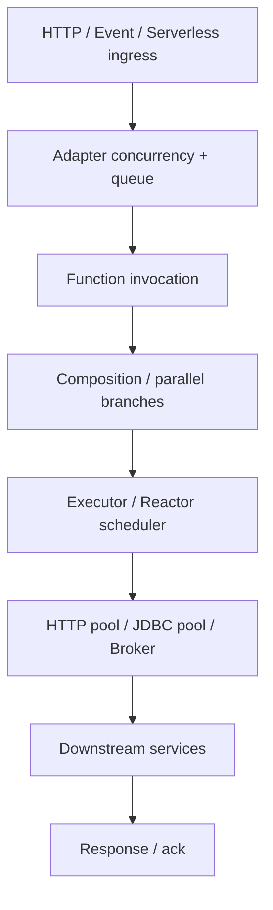
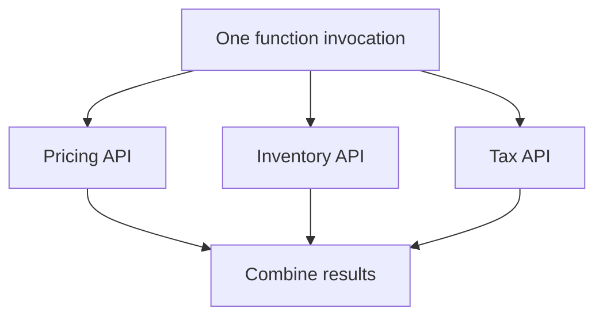

# Tuning Concurrency, Memory, and Connection Counts

Spring Cloud Function allows writing business logic with `Supplier<T>`, `Function<I, O>`, and `Consumer<T>`, looking them up via `FunctionCatalog`, chaining functions into compositions, and deploying the same logic over HTTP, events, or serverless. As traffic grows, the key question is not merely how long one function call takes, but **how many invocations can run simultaneously, how much memory each invocation holds, and how many total connections the entire system creates**.

These three limits are tightly coupled:

- **Concurrency** governs how many units of work are active simultaneously.
- **Memory budget** governs how many in-flight requests, responses, buffers, and pending tasks the system can hold.
- **Connection budget** governs how many sockets/connections to databases, HTTP services, and brokers downstream can tolerate.

Raising concurrency without accounting for memory can trigger GC pressure or `OutOfMemoryError`. Adding threads without sizing connection pools can simply create longer queues. Increasing connection pools on every replica can overload downstream databases or APIs. Therefore, this lesson builds a framework for **setting budgets end-to-end from adapters through functions to external resources**.

After this lesson, you will be able to:

1. Distinguish concurrency at ingress, adapters, function pipelines, executors, and connection pools.
2. Bound invocations and subtasks using thread pools, virtual threads, Reactor operators, and binder settings.
3. Estimate heap usage for in-flight requests, queues, batches, payloads, and responses.
4. Calculate total connection budgets across multiple replicas, autoscaling, and rolling deployments.
5. Use Little's Law to estimate in-flight work and recognize the formula's limitations.
6. Apply bounded queues, backpressure, load shedding, and timeouts instead of queuing work indefinitely.
7. Measure p95/p99, throughput, heap, GC, queue depth, thread usage, connection pools, and downstream errors.

> **Example scope:** Java 17+ and Spring Cloud Function on compatible Spring Boot/Spring Framework versions. Virtual threads require JDK 21+; Reactor and binder APIs depend on version. Numbers are hypothetical to illustrate calculation methods, not default settings or executed benchmarks.

## 1. Three budgets that must be calculated together

A request passes through multiple layers:



At each layer there is a distinct limit:

| Layer | Budget | If unbounded |
| --- | --- | --- |
| Ingress | Concurrent accepted requests/events | Requests pile into server or broker |
| Adapter | Worker threads, prefetch, poller, request queue | Queues grow, latency rises |
| Function | Concurrent running invocations | Singleton state contention, heap grows |
| Composition | Concurrent branches/subtasks | One request multiplies downstream calls |
| Executor/scheduler | Threads and task queues | Thread starvation or task backlog |
| Connection pool | HTTP/JDBC connections | Pool waits, timeouts, or downstream overload |
| Memory | Heap/direct buffers and per-request retained data | GC thrashing, OOM |

**There is no single concurrency number for the whole application.** For example, the HTTP server may accept 200 requests while allowing only 20 into the function; each function may call 3 APIs in parallel; meanwhile the HTTP pool has only 30 connections. Each number controls a different part of the load.

### Distinguishing types of concurrency

- **Request concurrency:** incoming requests currently active or queued.
- **Function concurrency:** simultaneous executions of function logic.
- **Inner concurrency:** subtasks within a single invocation, such as three API calls in `flatMap`.
- **Thread concurrency:** work currently occupying platform/virtual threads or scheduler workers.
- **Connection concurrency:** connections actively in use toward a destination.

A reactive invocation may not hold a thread during I/O wait, yet it still retains **request state, publisher state, buffers, and connection leases**. Non-blocking does not mean zero memory cost.

## 2. A singleton function bean does not bound concurrent calls

Spring typically manages function beans in singleton scope. A bean:

```java
@Bean
public Function<QuoteRequest, QuoteResult> quote() {
    return request -> calculate(request);
}
```

can be invoked from multiple threads or subscriptions depending on the adapter and runtime. Registering a function in `FunctionCatalog` **does not set concurrency to one**, nor does it spawn one thread per invocation.

Actual concurrency comes from the invocation path:

| Deployment path | What to inspect |
| --- | --- |
| HTTP servlet | Server request threads, connection limits, accept queue, and ingress proxy |
| HTTP reactive | Event loops, reactive subscriptions, downstream concurrency |
| Spring Cloud Stream | Binder consumer concurrency, partition/consumer model, prefetch, and poller |
| Serverless | Execution environment count, platform concurrency limits, intra-environment parallelism |
| Direct Java call | Executor/caller and how the function is scheduled |

**Never infer function invocation concurrency from bean count.** A single singleton bean can serve many concurrent invocations; logic must be stateless or protect shared state with concurrency-safe mechanisms.

## 3. Setting a concurrency budget from target load

Before tuning settings, identify:

- Target throughput (requests/second or events/second).
- Latency budget, especially p95/p99.
- Average processing time and downstream wait-time distribution.
- Replica counts in steady state and during autoscaling/rolling deployments.
- Capacity of databases, HTTP APIs, and brokers.
- Heap/container memory limits and the share reserved for JVM/runtime.

### Little's Law: estimating in-flight requests

In steady state:

\[
L = \lambda \times W
\]

Where:

- `L`: average number of work items in the system.
- `λ`: average throughput (requests/second).
- `W`: average residence time in the system (seconds).

For example, if a function handles **120 requests/second** and each request spends an average of **0.25 seconds** in the measured segment:

\[
L = 120 \times 0.25 = 30
\]

The system has roughly **30 in-flight requests on average** in that measured segment.

This is an average value, **not a maximum concurrency configuration**. Traffic bursts, p95/p99, retries, replica counts, and downstream capacity must still be factored in. Substituting p95 for mean `W` can help build conservative scenarios, though it is no longer a direct statistical application of Little's Law.

### Distributing across replicas

With 6 replicas and a system-wide target of 120 requests/second, average throughput per replica is:

\[
\lambda_{\mathrm{instance}} = \frac{120}{6} = 20
\]

If average time inside the function is 250 ms:

\[
L_{\mathrm{instance}} = 20 \times 0.25 = 5
\]

Roughly 5 in-flight requests on average per replica under even load distribution. Do not set max concurrency to exactly 5; allow headroom for bursts and skew, while keeping headroom within memory and connection budgets.

## 4. Start from downstream limits

Suppose a function calls:

- A pricing API with safe capacity for 80 concurrent requests.
- A database with a budget of 60 connections allocated to this app.
- A broker consumer group processing 12 partitions.

Overall concurrency cannot be decided solely from CPU count or HTTP worker threads. If each function invocation calls the pricing API once and the database once, concurrent invocations performing both steps may be constrained by the smaller downstream; the two calls may happen sequentially or in parallel.

If each invocation calls **three pricing APIs in parallel**, 30 invocations can generate up to 90 inner calls in a burst. Thus you must account for the **fan-out factor**:

\[
C_{\mathrm{downstream}} \approx
C_{\mathrm{invocations}} \times F
\]

Where `F` is the maximum concurrent calls to that destination per invocation. This is an upper bound; timing overlap and concurrency controls can keep actual counts lower.

### Never configure each layer in isolation

| Setting | Example | Question you must answer |
| --- | --- | --- |
| HTTP ingress | 200 requests | Can heap safely hold 200 request bodies? |
| Function concurrency | 40 invocations | What is the fan-out per invocation? |
| Reactive `flatMap` | 8 inner calls | Can 40 invocations generate 320 inner calls? |
| HTTP pool | 32 connections | Where do the remaining calls wait, and for how long? |
| Database pool | 10 connections | How many invocations are waiting on the DB? |
| Queue | 500 pending items | How many bytes do 500 items retain? |

Limiting one layer does not automatically protect another. For example, `flatMap(..., 8)` only limits inner subscriptions within one pipeline; if 40 pipelines run concurrently, the theoretical total can still reach 320.

## 5. Thread pools and executors: bound both threads and queues

In imperative code, an executor controls how many tasks run and how many wait. A setup with an unbounded queue can let the system accept load faster than it can process, holding request objects in the heap and driving up latency.

Example creating a bounded executor:

```java
package demo.performance;

import java.util.concurrent.ThreadPoolExecutor;

import org.springframework.context.annotation.Bean;
import org.springframework.context.annotation.Configuration;
import org.springframework.scheduling.concurrent.ThreadPoolTaskExecutor;

@Configuration
public class ExecutionConfiguration {

    @Bean("quoteExecutor")
    public ThreadPoolTaskExecutor quoteExecutor() {
        ThreadPoolTaskExecutor executor =
            new ThreadPoolTaskExecutor();
        executor.setCorePoolSize(8);
        executor.setMaxPoolSize(16);
        executor.setQueueCapacity(64);
        executor.setThreadNamePrefix("quote-");
        executor.setRejectedExecutionHandler(
            new ThreadPoolExecutor.AbortPolicy()
        );
        executor.setWaitForTasksToCompleteOnShutdown(true);
        executor.setAwaitTerminationSeconds(10);
        return executor;
    }
}
```

The values 8/16/64/10 are illustrative. `ThreadPoolTaskExecutor` must actually be wired at the appropriate boundary, e.g., when submitting tasks or in an integration using an executor; **merely declaring this bean does not move every Spring Cloud Function invocation onto that executor**.

### Core, max, and queue have distinct meanings

- `corePoolSize`: baseline workers retained according to executor policy.
- `maxPoolSize`: upper limit on platform threads created once the queue fills, per executor policy.
- `queueCapacity`: number of tasks held waiting.
- `RejectedExecutionHandler`: behavior when both workers and queue capacity are full.

With `ThreadPoolExecutor` and a bounded queue, tasks typically queue once core workers are busy; expansion beyond core up to max occurs only when the queue fills. If queue capacity is huge, max pool may rarely be used.

### Choosing an overload policy

| Policy | Behavior | Trade-off |
| --- | --- | --- |
| Abort/reject | Rejects new tasks | Caller/adapter must map into a controlled error |
| Caller-runs | Caller executes the task itself | Can apply backpressure, yet may block request/event threads |
| Discard | Drops new tasks | Appropriate only for loss-tolerant tasks allowed by contract |
| Discard-oldest | Drops oldest queued task | Can lose critical work or break ordering |

Never use discard policies for orders, payments, or audit events unless durable persistence and explicit acknowledgment exist. Load shedding must be a **deliberate business decision**, not a way to hide errors.

## 6. Virtual threads do not erase connection budgets

JDK 21+ supports virtual threads. In compatible Spring Boot versions, you can enable:

```yaml
spring:
  threads:
    virtual:
      enabled: true
```

Virtual threads reduce the cost of holding platform threads during many blocking operations, yet they:

- Do not increase the number of database connections a database can handle.
- Do not raise downstream HTTP rate limits.
- Do not give a blocking SDK infinite throughput.
- Do not eliminate per-request heap state.
- Do not replace queue limits, deadlines, and load shedding.

If 1,000 virtual threads wait simultaneously on a 20-connection JDBC pool, at most around 20 connections can run database work concurrently; the rest must wait. If request bodies and contexts for all 1,000 invocations remain live, the heap still pays that cost.

**Virtual threads are an execution mechanism, not a downstream resource budget.**

## 7. Reactive concurrency: flatMap, prefetch, and backpressure

In Reactor, `flatMap` accepts a concurrency parameter to limit active inner publishers:

```java
Flux<QuoteResult> results = requests.flatMap(
    request -> pricingClient.quote(request),
    8
);
```

The number 8 limits inner publishers for **one subscription**. With 25 concurrent subscriptions, theoretical inner calls can reach:

\[
25 \times 8 = 200
\]

If the pricing service can only tolerate 80 concurrent calls, lower concurrency per pipeline or cap total active pipelines.

### Concurrency and prefetch are not the same

A Reactor overload can take both `concurrency` and `prefetch`:

```java
Flux<QuoteResult> results = requests.flatMap(
    request -> pricingClient.quote(request),
    8,   // max inner subscriptions
    1    // prefetch per inner publisher
);
```

- **Concurrency** governs how many inner publishers are subscribed concurrently.
- **Prefetch** governs how many elements are requested/buffered ahead from inner publishers per operator semantics.

High prefetch can boost throughput in some pipelines while increasing buffering and memory usage. Do not raise prefetch on intuition; measure queues, allocations, and latency.

### Choosing operators by semantics

| Operator | Concurrency/ordering | When to use |
| --- | --- | --- |
| `map` | Synchronous on signal, no async concurrency | Fast transformations |
| `concatMap` | One inner publisher at a time, preserves order | Sequential execution or order preservation needed |
| `flatMap(mapper, n)` | Up to `n` inner publishers, results may reorder | Independent I/O |
| `flatMapSequential(mapper, n)` | Concurrent execution, emits results in source order | Both concurrency and ordering needed |
| `buffer(n)` | Groups up to `n` elements into a batch | Downstream supports batching |

Reactive Streams backpressure helps publishers and subscribers coordinate demand, yet **it does not automatically ensure every external queue is bounded**. Adapters, brokers, executors, and network clients each have their own policies.

## 8. Broker concurrency and prefetch must align with partitions and capacity

With Spring Cloud Stream, consumer concurrency depends on the binder and broker type. For instance, some binders support the property:

```yaml
spring:
  cloud:
    stream:
      bindings:
        processOrder-in-0:
          consumer:
            concurrency: 4
```

The binding name `processOrder-in-0` must match the real function/binding. Exact property names and effects must be checked against your active Spring Cloud Stream and binder versions.

### Kafka and partitions

In Kafka, useful concurrency for a consumer group is bounded by the number of partitions distributable across consumers. If a topic has 4 partitions and you configure 12 consumer threads, some consumers will sit idle with no assigned partitions. Increasing concurrency does not create partitions or speed up a single partition.

### RabbitMQ and prefetch

With the Rabbit binder, prefetch affects how many unacknowledged messages can be delivered to a consumer. Large prefetch can raise throughput while holding many messages in memory and affecting fairness/rebalancing. Property names and defaults depend on binder version/configuration; check the corresponding documentation.

### Calculating total in-flight events

With 4 consumer instances, each processing 8 messages concurrently, and each message fanning out 3 API calls:

\[
4 \times 8 \times 3 = 96
\]

There can be up to roughly 96 in-flight API calls under full overlap. This is why broker concurrency must be sized alongside downstream HTTP pools and API capacity.

## 9. Memory budgets start per invocation

An invocation holds more than just the raw payload. It may retain:

- HTTP body bytes or broker payloads.
- Deserialized DTOs.
- Intermediate objects during validation/composition.
- Response DTOs / serialized bytes.
- Message headers, tracing context, and request-scoped data.
- Closures/publishers, buffers, and retry state.
- Objects allocated by the function during processing.

Therefore, measure **average retained memory per in-flight invocation**, rather than looking only at JSON size on the wire.

### Simple estimation formula

\[
M_{\mathrm{inflight}} \approx
C \times S_{\mathrm{retained}}
\]

Where `C` is the number of invocations simultaneously holding state, and `S_retained` is the average heap/direct memory retained per invocation within the measurement boundary.

For example, suppose a 64 KiB JSON request produces a DTO graph, buffers, and response with a measured retained footprint of roughly 300 KiB; with 400 invocations:

\[
400 \times 300\ \mathrm{KiB}
= 120{,}000\ \mathrm{KiB}
\approx 117.2\ \mathrm{MiB}
\]

This is an estimate assuming 300 KiB/invocation, **not a universal conversion factor from JSON bytes to heap**. Object headers, collection capacities, strings, alignment, and lifetimes all change actual footprint.

### Never treat max heap as the request budget

The heap must also accommodate the Spring `ApplicationContext`, singleton beans, caches, connection/client state, queues, background jobs, and GC headroom. Outside the heap sit direct buffers, metaspace, thread stacks, native memory, and container runtime overhead. `-Xmx` is not total container memory.

## 10. Calculating memory budgets and limiting in-flight work

A budgeting breakdown:

```text
Container memory limit
  ├─ JVM heap budget (-Xmx)
  │    ├─ baseline live set (Spring/context/caches)
  │    ├─ per-request retained objects
  │    ├─ pending queues / batch buffers
  │    └─ GC headroom
  ├─ metaspace + code cache
  ├─ direct/native buffers
  ├─ thread stacks
  └─ native libraries / runtime overhead
```

Suppose an application has:

| Item | Illustrative budget |
| --- | ---: |
| Container memory limit | 1,536 MiB |
| JVM max heap | 1,024 MiB |
| Baseline live heap after warm-up | 420 MiB |
| Reserve for GC/headroom | 180 MiB |
| Remaining heap for variance | 424 MiB |

If each in-flight request retains 256 KiB on average:

\[
C_{\mathrm{memory}} =
\frac{424 \times 1024\ \mathrm{KiB}}{256\ \mathrm{KiB}}
= 1696
\]

The theoretical limit from this division is roughly 1,696 invocations. **Do not configure concurrency to that exact number**: the calculation omits peak payloads, variance, temporary allocations, native/direct buffers, and downstream constraints. Leave headroom and measure peak retained memory.

### Estimating by measurement

1. Warm the application and record the baseline.
2. Send controlled requests and hold them in-flight (e.g., an intentionally delayed test downstream server).
3. Inspect heap histograms, JFR, GC logs, or heap dumps in a test environment.
4. Compare live sets before and under load.
5. Repeat with small/large payloads, varying line-item counts, and varying responses.
6. Separate retained objects from temporary allocations if your tools allow.

Dividing heap delta by request count is only a **rough estimate** unless requests have uniform lifetimes and object graphs.

## 11. Queue capacity is also memory capacity

Queues hold unprocessed tasks or messages. If each task retains a 128 KiB request body and the queue holds 1,000 tasks:

\[
M_{\mathrm{queue}} \approx
1000 \times 128\ \mathrm{KiB}
= 125\ \mathrm{MiB}
\]

This counts estimated payloads only, excluding object graphs, queue nodes, headers, and metadata.

### Long queues do not make a system process faster

If the sustained arrival rate exceeds the service rate:

\[
\lambda_{\mathrm{in}} > \mu_{\mathrm{out}}
\]

backlog grows indefinitely without load shedding, autoscaling, or upstream throttling. Large queues can absorb short bursts, but cannot fix sustained overload. Queue waits climb, requests expire before processing, memory stays pinned longer, and GC activity rises.

### Bounded queues and load shedding

A queue with an explicit capacity gives the system a clear point to reject or throttle. Depending on business requirements:

- HTTP can return 429/503 with appropriate retry guidance.
- Event consumers can lower prefetch, pause consumption, or let the broker hold durable backlog.
- Batch jobs can defer the next batch.
- Only loss-tolerant tasks (e.g., metric sampling) may be dropped by policy.

Never silently drop orders, payments, or audit events. For durable messages, prefer letting the broker hold the backlog while the consumer paces intake via binder semantics.

## 12. Batch size is a throughput vs. memory trade-off

Batching can reduce database/broker/HTTP round trips when downstream supports bulk APIs. However, large batches raise heap retention and can worsen tail latency.

| Batch size | Potential benefit | Cost/risk |
| --- | --- | --- |
| Small | Low latency, low memory | More calls/round trips |
| Medium | Amortizes network/serialization overhead | Must tune for payload and downstream |
| Very large | Can raise bulk throughput | Heap spikes, timeouts, batch-wide retries, complex partial failures |

With Reactor:

```java
Flux<List<QuoteRequest>> batches = requests.buffer(100);
```

Each batch contains up to 100 elements once the stream emits enough items. If downstream needs a time window for gathering batches, use Reactor's size/time `buffer` API matching your version.

When batching, bound both item count and total byte size if payloads vary; define partial failure/retry semantics; avoid holding multiple concurrent batches beyond your memory budget; and measure time-to-first-result and p99, not just throughput.

## 13. Connection budgets must be calculated cluster-wide

Each replica may have its own HTTP pool and JDBC pool. Total connections equal the sum across all live instances, including surges during rolling deployments and autoscaling.

\[
C_{\mathrm{total}} \approx
N_{\mathrm{instances}} \times P_{\mathrm{per-instance}}
\]

Example:

- 12 steady-state replicas.
- Each replica has an HTTP pool max of 20 connections to pricing.

\[
12 \times 20 = 240
\]

The application can open up to roughly 240 connections to the pricing API when pools are full.

If rolling deployments allow a surge of 4 replicas, peak instance count is 16:

\[
16 \times 20 = 320
\]

Downstream capacity must therefore be validated against **peak deployment topology**, not just steady state.

### Calculate per destination separately

| Destination | Pool per instance | 12 replicas | 4 surge replicas | Peak 16 |
| --- | ---: | ---: | ---: | ---: |
| Pricing HTTP | 20 | 240 | 80 | 320 |
| Inventory HTTP | 8 | 96 | 32 | 128 |
| JDBC database | 6 | 72 | 24 | 96 |

Numbers are illustrative. HTTP pools, database pools, and broker connections are separate budgets; never add them all together assuming every connection has the same cost or destination.

### Do not forget other connection consumers

- Health checks and management clients.
- Background jobs/schedulers.
- Migrations and admin sessions.
- Retries/hedged requests if enabled.
- Old versions still draining during rolling deployments.
- Concurrent serverless execution environments.
- Other services sharing the same downstream.

A database's `max_connections` is a server-wide limit; applications must leave headroom for administration, failover, and other clients. Never size each replica as a large fraction of database capacity and forget to multiply by replica count.

## 14. Pool size, concurrency, and fan-out must align

Suppose:

- Function concurrency: 30 invocations.
- Each invocation calls 2 HTTP APIs in parallel.
- Each destination has a 20-connection pool.

If the two calls go to different hosts, each pool may see 30 concurrent calls against 20 connections, so the remainder wait on the pool. If both calls hit the same route, demand can reach 60 calls on a single pool.

A rough sanity check:

\[
C_{\mathrm{outbound}} \le
C_{\mathrm{function}} \times F
\]

Where `F` is concurrent outbound calls per invocation. Pool size limits concurrent socket-backed calls; the pending queue holds the rest.

**Pool size does not have to equal concurrency**: HTTP/2 multiplexes, call durations vary, destinations differ, and requests may be sequential. Use the formula to find the ceiling to check, then measure pool wait and downstream behavior.

## 15. Configuring HTTP and database pools deliberately

Illustrative configuration example:

```yaml
pricing:
  http:
    max-connections: 20
    acquire-timeout: 2s
    response-timeout: 3s

spring:
  datasource:
    hikari:
      maximum-pool-size: 6
      minimum-idle: 2
      connection-timeout: 2000
```

`pricing.http.*` are **custom application properties**, not standard properties automatically understood by Spring Cloud Function. Bind them to your HTTP client and connection provider configuration. Hikari `connection-timeout` is in milliseconds; check all values against your version and downstream SLAs.

### Guiding principles

- Separate pools per destination when isolation and distinct capacities are needed.
- Never allocate a new pool per invocation.
- Set acquisition timeouts so pool exhaustion does not stall requests indefinitely.
- Cap pending queues and concurrency before increasing max connections.
- Sum connections across peak replica counts.
- For databases, keep pools within the service's allocated database budget.
- Monitor active/idle/pending counts and connection acquisition latency.

If using Spring Boot's auto-configured clients, inspect resource lifecycles so you do not accidentally create two pools for the same destination.

## 16. Backpressure, rate limiting, and load shedding

Three mechanisms with distinct roles:

| Mechanism | Effect |
| --- | --- |
| Backpressure | Coordinates demand between Reactive Streams publishers/subscribers |
| Rate limiting | Caps request/event rate over time |
| Load shedding | Rejects or drops load by policy when overloaded |

Backpressure does not replace HTTP edge rate limits or downstream quotas. Rate limiting does not automatically bound queue heap if the queue accepts items indefinitely. Load shedding must distinguish rejectable work from work that must be durably persisted.

### Example bounded buffer

```java
Flux<QuoteRequest> bounded = requests
    .onBackpressureBuffer(
        500,
        dropped -> recordOverflow(dropped)
    );
```

This Reactor example illustrates a finite-capacity buffer; check exact overload/API signatures for your Reactor version. When the buffer fills, choose an explicit overflow policy (error/drop/latest) and emit a metric. Never drop non-loss-tolerant business data.

### Rate limiting to protect downstream

If the pricing API allows 100 calls/second, a 10-replica app must not configure 100 calls/second per replica and emit 1,000 calls/second total. Partition quotas per instance, use a distributed rate limiter when a cluster-wide quota is required, enforce limits at gateways/downstream, and tune concurrency/retries so budgets are respected.

## 17. Fan-out and composition can multiply load

Linear composition:

```text
validate → enrich → calculate → render
```

typically passes one step's output to the next. However, a function may fan out to multiple destinations:



If each invocation calls three APIs concurrently across 40 invocations, total in-flight downstream calls can reach 120. If each call retries, total attempt counts climb further.

### Keeping fan-out under control

- Call a destination only when business logic actually needs its data.
- Cache reference data with TTL and size bounds where appropriate.
- Bound concurrency per destination, not just globally for the function.
- Apply an overall deadline plus individual timeouts per call.
- Avoid stacked retries across multiple layers.
- Combine results with clear semantics when one branch fails.

## 18. Autoscaling does not replace resource budgeting

Autoscaling adds replicas as load rises. Yet if each replica holds a 20-connection pool, scaling from 5 to 30 replicas raises the HTTP connection ceiling from 100 to 600.

When autoscaling:

1. Calculate peak replicas, not just desired replicas.
2. Account for connection pools and background workers per replica.
3. Verify whether downstreams can scale alongside.
4. Cap max replicas according to database/API capacity.
5. Account for startup surges and rolling-update overlap.
6. Set scale-down grace periods to drain in-flight work and close resources.

With CPU-only autoscalers, I/O-bound workloads may show low CPU while queues and pending connections spike. You may need queue-depth, request-latency, or consumer-lag metrics depending on the platform.

### Serverless also has an instance multiplier

Serverless platforms can spin up many parallel execution environments. Each environment maintains its own Spring context, HTTP clients, and pools. Factor platform concurrency limits into the connection budget:

\[
C_{\mathrm{connections}} \approx
N_{\mathrm{active\ environments}} \times P
\]

Never assume static clients or singleton beans are shared across isolated environments.

## 19. Measuring and monitoring budgets

A performance dashboard should include at least:

| Category | Metrics |
| --- | --- |
| Traffic | Requests/events per second, active requests |
| Latency | p50, p95, p99, queue wait, downstream duration |
| Function | Invocation count, active executions, failures |
| Threads | Active platform threads, virtual thread counts if applicable, executor queue |
| Reactive | Event-loop utilization, pending subscriptions, operator/buffer signals |
| Memory | Heap used/committed, live set, allocation rate, GC pauses |
| Queues | Queue depth, oldest item age, rejected tasks, consumer lag |
| HTTP pool | Active, idle, pending, acquire timeouts, new connections |
| JDBC pool | Active, idle, pending, acquisition timeouts |
| Downstream | 429/5xx responses, response latency, timeouts, retry attempts |

Never put user IDs, order IDs, or arbitrary URLs in metric tags, as high cardinality inflates monitoring backend memory and CPU.

### Separating queue wait from service time

\[
T_{\mathrm{total}} =
T_{\mathrm{queue}} + T_{\mathrm{service}}
\]

If service time stays flat while p99 rises, queue wait may be the culprit. Optimizing function code alone will not help if requests sit waiting in an executor or connection pool before the function continues.

### Observing memory and GC

- Use JFR, GC logs, or profilers in controlled test/production environments.
- Track allocation rate and live set, not just point-in-time heap used.
- Watch container RSS and direct memory alongside heap.
- Identify which queues hold request objects too long.
- Take heap dumps when investigating retained paths, handling sensitive data per policy.

## 20. Practice scenario: designing a budget for Order Function

Suppose an order-processing service has:

- 8 steady-state replicas, with up to 2 surge replicas.
- Target throughput of 160 orders/second.
- Average time inside the function: 200 ms.
- Each order calls pricing once and inventory once.
- Pricing HTTP pool max 12/replica; inventory max 8/replica.
- JDBC pool max 6/replica.
- Max heap per instance: 1 GiB.
- Baseline live heap: 400 MiB; reserve: 200 MiB.
- Estimated retained memory: 200 KiB per in-flight order.

### Step 1: Estimate cluster-wide average in-flight orders

\[
L = 160 \times 0.2 = 32
\]

Roughly 32 in-flight orders on average under steady load and 200 ms residence time.

### Step 2: Divide across steady replicas

\[
L_{\mathrm{instance}} = \frac{32}{8} = 4
\]

Roughly 4 in-flight orders on average per replica under even distribution.

### Step 3: Calculate connection ceilings

Peak instances = 8 + 2 = 10.

| Destination | Pool/instance | Peak connection ceiling |
| --- | ---: | ---: |
| Pricing | 12 | 120 |
| Inventory | 8 | 80 |
| JDBC | 6 | 60 |

Downstreams must provision capacity for these ceilings; otherwise, reduce pool sizes or cap max replicas.

### Step 4: Estimate variable heap usage

At 200 KiB/order and 4 in-flight orders on average per replica:

\[
4 \times 200\ \mathrm{KiB} = 800\ \mathrm{KiB}
\]

This assumed average retained request state is tiny compared to a 1 GiB heap. Yet if a burst puts 300 orders in flight per replica:

\[
300 \times 200\ \mathrm{KiB}
= 60{,}000\ \mathrm{KiB}
\approx 58.6\ \mathrm{MiB}
\]

You still must add queues, temporary allocations, caches, thread stacks, and native/direct memory; never conclude from this arithmetic alone that any burst is safe.

### Step 5: Pick starting points and measure

- Start with moderate function concurrency within downstream capacity.
- Keep pools aligned with database/pricing/inventory budgets.
- Bound queues with explicit reject/slowdown policies.
- Load test steady state, bursts, and downstream degradation.
- Adjust one variable at a time while monitoring p99, queue wait, heap/GC, and pending pool counts.

Numbers in this scenario are educational assumptions. In production, substitute measured load, real downstream limits, peak replicas, and actual memory footprints.

## 21. Common tuning mistakes

| Symptom | Possible cause | Resolution direction |
| --- | --- | --- |
| Low CPU yet high latency | Waiting on connections, queues, or downstream | Measure queue wait / pool acquisition |
| Heap climbs steadily under load | Unbounded queues or retained request state | Bound in-flight work, queues, batches |
| GC pauses rise when raising concurrency | Too many live DTOs/buffers/request objects | Lower concurrency, payload/batch size; profile allocations |
| Database connections exhausted | Per-replica pool multiplied by max replicas | Calculate peak instance budget |
| High HTTP pool pending count | Function fan-out exceeds pool/downstream | Reduce fan-out/concurrency or tune pool with evidence |
| Adding threads does not raise throughput | Downstream or CPU is already saturated | Profile bottlenecks and add bulkheads |
| Reactive app hits OOM | Overly large buffers/prefetch/`flatMap`/queues | Bound operators and measure retained memory |
| Broker lag grows despite high consumer concurrency | Partitions, downstream, or processing time is the limit | Check partition assignment and service time |
| Autoscaling breaks the database | Every replica creates its own pool | Cap max replicas and pool sizes |
| Good p50 yet bad p99 | Queueing, bursts, GC, or retries | Monitor tail latency and queue age |
| Rejected tasks spike | Executor queue/thread capacity full | Load shed, throttle upstream, or scale capacity with proof |
| Retries overload downstream further | Retry storms and multi-layer retries | Retry budgets, backoff, jitter, circuit breakers |
| Raising virtual threads does not speed up DB | Connection pool still caps concurrency | Tune DB concurrency to capacity |

### Six questions before raising any limit

1. Which layer is saturated: ingress, function, executor, pool, or downstream?
2. Will raising the limit increase retained memory or queue depth?
3. What is the total resource budget across peak replicas?
4. Can downstreams genuinely handle the new concurrency?
5. Do p95/p99 and error rates improve, or only raw throughput?
6. Under overload, does the system reject/throttle or queue work indefinitely?

## 22. Practice exercises

**Exercise 1 — Little's Law.** A function completes 100 requests/second on average; each request stays in the system 300 ms. What is the estimated average in-flight count?

*Answer:* `L = 100 × 0.3 = 30` requests. This is a steady-state average, not max concurrency.

**Exercise 2 — Fan-out.** There are 20 concurrent function invocations; each calls 3 APIs in parallel. What is the theoretical maximum inner calls?

*Answer:* `20 × 3 = 60` calls, before pool/adapter limits and timing overlap.

**Exercise 3 — Reactive subscriptions.** A pipeline has `flatMap(..., 8)` and 25 active subscriptions. What can total theoretical inner concurrency reach?

*Answer:* `25 × 8 = 200` inner publishers. The parameter `8` is not a process-wide limit.

**Exercise 4 — Connection budget.** 10 replicas, each with a JDBC pool max of 12. What is the configured connection ceiling from the app?

*Answer:* `10 × 12 = 120` connections, excluding rolling surges, migrations, and other clients.

**Exercise 5 — Memory queue.** A queue holds 800 tasks, each retaining an average 96 KiB payload. Roughly how much payload-only memory is that?

*Answer:* `800 × 96 KiB = 76,800 KiB = 75 MiB`, excluding object graphs, headers, and queue nodes.

**Exercise 6 — Virtual threads.** 500 virtual threads call the database simultaneously, yet the Hikari pool has only 20 connections. At most how many queries can use connections concurrently from that pool?

*Answer:* At most around 20 connection-backed operations simultaneously; remaining tasks wait on the pool or time out. Virtual threads do not expand database capacity.

**Exercise 7 — Queue overload.** Arrival rate is 150 events/s while the consumer sustains 100 events/s over a long period. How does backlog change without bounds or load shedding?

*Answer:* Backlog grows by roughly 50 events/s in a simple model, and memory/latency can grow until bounded or upstream slows down.

**Exercise 8 — Prefetch.** Should you set broker prefetch very high just to reduce round trips?

*Answer:* Not by default. High prefetch holds many unacknowledged messages in memory and can hurt fairness/latency. Measure throughput, heap, queues, and ack behavior.

**Exercise 9 — Pool per instance.** A service has 12 steady-state replicas and 3 surge replicas; HTTP pool max is 15. What is the peak connection ceiling?

*Answer:* `(12 + 3) × 15 = 225` connections to that destination.

**Exercise 10 — Batching.** Does raising batch size from 100 to 10,000 records always improve performance?

*Answer:* No. It may reduce round trips while raising heap usage, batch fill latency, retry blast radius, and partial failures. Bound byte sizes and measure.

**Exercise 11 — Load shedding.** The executor queue fills while processing payments. Should you use `DiscardOldestPolicy`?

*Answer:* No if payments cannot be lost. Reject in a controlled way, persist durably, or throttle upstream per the business contract.

**Exercise 12 — Diagnosis.** CPU is low, heap is high, p99 is rising, and HTTP pool pending count is high. Should you add CPU first?

*Answer:* Not yet. Symptoms point to queue/pool/downstream waiting and retained request state. Measure acquisition time, pending counts, queue age, downstream latency, and retained memory first.

## 23. Key takeaways

- **Concurrency, memory, and connections are three linked budgets**, calculated from ingress through functions, compositions, executors, and downstreams.
- **Singleton function beans do not limit concurrency themselves**; adapters/runtime drive invocation counts and code must be thread-safe.
- **Little's Law `L = λW` estimates average in-flight work**, not max concurrency or pool size.
- **Both thread pools and queues need bounds**; long queues only hold work longer without raising service rate.
- **Reactive `flatMap` concurrency limits only one subscription/pipeline**, and must be multiplied by invocations/replicas and fan-out.
- **Virtual threads do not increase JDBC/HTTP downstream capacity** and do not eliminate per-request memory.
- **Memory budgets must include request/response object graphs, queues, batches, buffers, and GC headroom**, not just JSON bytes on the wire.
- **Connection budgets equal per-instance pools multiplied by peak replicas**, including autoscaling and rolling-deployment surges.
- **Backpressure, rate limiting, and load shedding serve distinct roles**; never drop critical business work.
- **Measure p95/p99, queue wait, heap/GC, active/pending connections, and error rates** before raising any limit.

**References:**

- [Spring Cloud Function — Reference](https://docs.spring.io/spring-cloud-function/reference/)
- [Spring Cloud Stream — Consumer Properties](https://docs.spring.io/spring-cloud-stream/reference/spring-cloud-stream/binding-properties.html)
- [Project Reactor — Reference Guide](https://projectreactor.io/docs/core/release/reference/)
- [Reactive Streams — Specification](https://www.reactive-streams.org/)
- [Spring Framework — Task Execution and Scheduling](https://docs.spring.io/spring-framework/reference/integration/scheduling.html)
- [Spring Boot — Virtual Threads](https://docs.spring.io/spring-boot/reference/features/spring-application.html)
- [HikariCP — Pool Sizing](https://github.com/brettwooldridge/HikariCP/wiki/About-Pool-Sizing)
- [Micrometer — JVM Metrics](https://docs.micrometer.io/micrometer/reference/reference/jvm.html)

Numbers in examples are hypothetical to teach calculation methods, not standard settings. When deploying, replace them with measured load, downstream limits, peak replicas, and real memory footprints; verify APIs against your active Spring Cloud Function, binder, Spring Boot, and Reactor versions.
