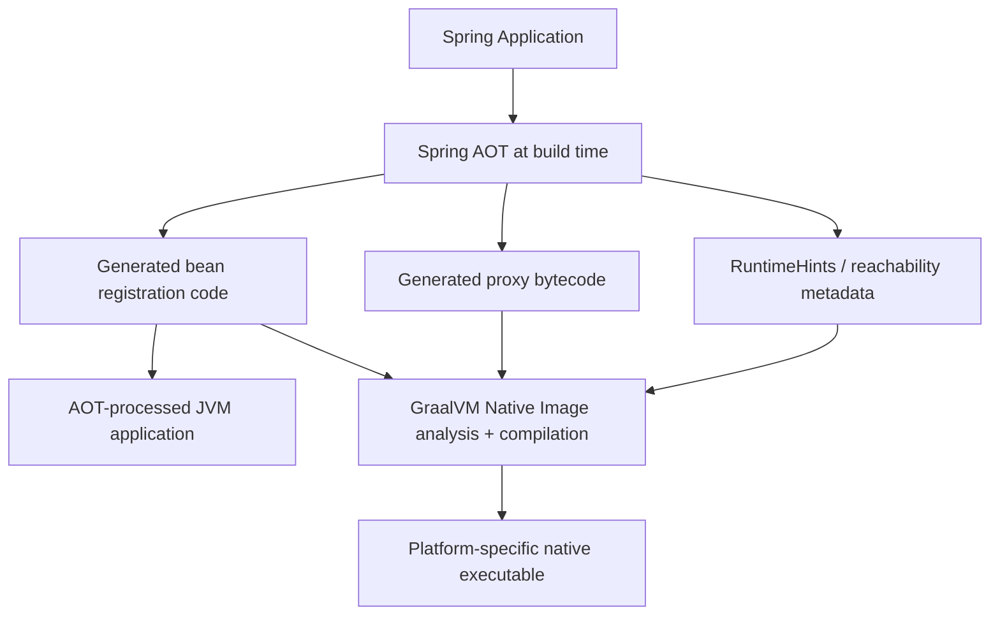

# Evaluating Spring AOT, RuntimeHints, and GraalVM Native Image

Spring Cloud Function allows packaging business logic as `Supplier<T>`, `Function<I, O>`, and `Consumer<T>`, looking them up via `FunctionCatalog`, composing functions, and deploying across HTTP, events, or serverless environments. When deploying these functions, startup time, idle memory, and first-invocation latency can be just as important as steady-state throughput.

**Spring Ahead-of-Time (AOT)** and **GraalVM Native Image** are related technologies, not synonyms:

- **Spring AOT** analyzes Spring configuration at build time, generating bean initialization code and metadata so the application runs with the analyzed configuration.
- **RuntimeHints** describe dynamic operations that static analysis cannot automatically discover, such as reflection, resource loading, serialization, or JDK proxies.
- **GraalVM Native Image** uses static analysis and metadata to compile the application into a platform-specific native executable.

Native Image is often worth evaluating for services needing fast cold starts, scale-to-zero, or a small memory footprint. However, it incurs heavy build costs, restricts dynamic features, and does not guarantee higher steady-state throughput than a warmed-up JVM. Consequently, this lesson focuses on **evaluating with real measurements and compatibility checks**, rather than assuming native is always the optimal choice.

After this lesson, you will be able to:

1. Distinguish Spring AOT, RuntimeHints, and GraalVM Native Image.
2. Understand the closed-world assumption and which Spring configurations must be decided at build time.
3. Identify reflection, resources, serialization, proxies, and class initialization that need metadata.
4. Register custom hints using `RuntimeHintsRegistrar`, `@ImportRuntimeHints`, and `@RegisterReflectionForBinding`.
5. Keep function beans and generic metadata explicit so AOT can process them.
6. Build, run, and test a Spring Cloud Function app on AOT-enabled JVM and native executables.
7. Compare startup, first request, p50/p95/p99, throughput, RSS, binary size, and build duration.

> **Version scope:** Example APIs use Spring Framework/Spring Boot with AOT and Native Image support alongside Java 17+; GraalVM Native Image and Native Build Tools versions must match the project's JDK/Spring Boot versions. Task names, plugins, and package APIs can change across major versions. Follow the compatibility matrix supported by Spring Boot and GraalVM rather than copying fixed version numbers from examples.

## 1. Distinguishing the three concepts



### Spring AOT

A standard Spring application discovers configuration and builds bean definitions at startup. Spring AOT shifts part of that analysis to build time. The AOT engine prepares an `ApplicationContext` up to bean definitions, then generates the code and metadata needed to assemble the context from that analyzed configuration.

Typical outputs include:

- Java source code recreating bean definitions and required callbacks.
- Bytecode for certain proxies generated at build time.
- Runtime hints for reflection, resources, serialization, and JDK proxies.

The goal is reducing dynamic discovery work at startup and supplying metadata to the native compiler. AOT-generated code can also be tested on the JVM with appropriate settings without compiling natively on the first step.

### RuntimeHints

Native Image analyzes reachable code from the entrypoint, yet cannot always infer operations driven by runtime data. For example:

- Invoking methods via reflection from names read out of configuration.
- Loading dictionary files via dynamically constructed resource names.
- Serializing a DTO discovered only through generics or reflection.
- Creating a JDK dynamic proxy for a list of interfaces.

Runtime hints supply metadata so those capabilities keep working in the executable.

### GraalVM Native Image

Native Image analyzes code and metadata at build time and produces a native executable. The binary bundles application code and the necessary runtime substrate; no separate HotSpot JVM needs to be shipped to run that application.

| Concept | Primary timing | Result |
| --- | --- | --- |
| Spring AOT | Build time | Bean registration code, proxy bytecode, hints |
| RuntimeHints | Contributed during AOT/build process | Metadata for dynamic access |
| GraalVM Native Image | Build time | Native executable per OS/architecture/ABI |
| JVM runtime | Application startup/runtime | Class loading, JIT compilation, and dynamic behavior |

**Spring AOT is not a native compiler. RuntimeHints is not a speed optimizer.** They support the build pipeline and correctness inside a native environment.

## 2. Native Image changes how Java applications are analyzed

Native Image relies on the **closed-world assumption**: classes and code that may run must be known at build time. Static analysis determines what is reachable from the entrypoint; unreachable code can be eliminated from the binary.

This differs from a standard JVM:

| Aspect | Standard JVM | Native Image |
| --- | --- | --- |
| Classpath | Can load classes at runtime via JVM mechanisms | Class set is fixed at build time |
| Class loading | Can lazy-load classes | No JVM-style lazy class loading |
| Reflection | Often works via built-in class metadata | Needs reachability metadata when static analysis cannot infer it |
| Resources | Readable from classpath/JAR | Resources must be explicitly included in the image |
| Proxies | Can generate dynamic proxies at runtime | Must provide metadata or pre-generated proxy code |
| Bytecode generation | Some libraries generate classes at runtime | Dynamic class definition is restricted |
| Spring configuration | Can adapt to environment at startup | AOT decisions recorded at build time are fixed |
| JIT | JIT optimizes hot code via runtime profiling | Code is compiled ahead of time; no HotSpot JIT warm-up |

### Implications for Spring configuration

Spring AOT must know how bean configuration will be constructed. Conditions affecting bean presence, such as `@Profile` or `@ConditionalOnProperty`, need to be evaluated during the AOT build environment. You cannot assume switching profiles or toggling arbitrary beans via properties after the binary is built will yield the same bean graph as dynamic JVM startup.

Example:

```java
@Configuration(proxyBeanMethods = false)
@Profile("production")
class ProductionPricingConfiguration {

    @Bean
    PricingClient pricingClient() {
        return new ProductionPricingClient();
    }
}
```

If the `production` profile governs which beans are created during AOT build, build with the matching environment. Running the binary later with a different profile does not re-run full condition evaluation like a standard JVM.

**Never place secrets into the build environment to “help AOT.”** The build environment should determine application structure, never baking passwords, tokens, or environment keys into generated code or the native image heap.

### Patterns to watch out for

- Bean definitions created dynamically after the context has started.
- Registering singletons via `registerSingleton(...)` instead of bean definitions.
- Custom `BeanDefinition`s using instance-supplier lambdas/method references that AOT cannot transform.
- Runtime classpath scanning or plugin loading from class names stored in a database.
- Circular dependencies resolved via setter/field injection.
- Bean factory methods declaring overly generic return types.
- Instantiating beans with custom constructor arguments known only at runtime.

Not every lambda in an application is incompatible with AOT. The warning here specifically targets **bean definitions registered programmatically with instance suppliers** that AOT cannot analyze/transform. A static `@Bean` function declaration is a standard Spring pattern; still verify with your version's AOT processing.

## 3. Spring Cloud Function: keeping function registration explicit

With Spring Cloud Function, declare function beans using static configuration, full generic types, and explicit names:

```java
package demo.nativeapp;

public record QuoteRequest(String sku, int quantity) {}
```

```java
package demo.nativeapp;

public record QuoteResult(
    String sku,
    int quantity,
    long totalVnd
) {}
```

```java
package demo.nativeapp;

import java.util.function.Function;

import org.springframework.context.annotation.Bean;
import org.springframework.context.annotation.Configuration;

@Configuration(proxyBeanMethods = false)
public class QuoteFunctions {

    @Bean("quote")
    public Function<QuoteRequest, QuoteResult> quote() {
        return request -> {
            if (request == null ||
                request.sku() == null ||
                request.sku().isBlank() ||
                request.quantity() <= 0) {
                throw new IllegalArgumentException("Invalid quote");
            }

            return new QuoteResult(
                request.sku(),
                request.quantity(),
                request.quantity() * 50_000L
            );
        };
    }
}
```

The records in this example are illustrative DTOs. In a real application, the function may inject repositories/clients and return DTOs or `Message<?>` per contract.

### Why do generics and bean types matter?

`FunctionCatalog` and message conversion must know input/output types. Raw functions:

```java
Function quote() { ... }
```

or:

```java
Function<Object, Object> quote() { ... }
```

can lose type information needed for conversion and AOT inference. Use concrete signatures:

```java
Function<QuoteRequest, QuoteResult>
```

If using functional registration APIs like `FunctionRegistration` with a lambda, provide type metadata via the `FunctionType` mechanism of your Spring Cloud Function version. Never expect the native compiler to infer erased generics at runtime.

### Avoid dynamic runtime singleton function registration

Some apps construct functions from external config and call `GenericApplicationContext.registerSingleton(...)` or mutate the catalog while running. Registrations arriving after the AOT build are absent from the bean definitions AOT analyzed.

When the function set is fixed, prefer bean definitions registered at build time. If dynamic plugins/functions are truly required, re-evaluate that requirement against the closed-world model; native image is not an environment for loading arbitrary new classes from the filesystem after the executable is built.

### FunctionCatalog still needs verification

A smoke test can look up the function by name:

```java
import java.util.function.Function;

import org.springframework.cloud.function.context.FunctionCatalog;
import org.springframework.stereotype.Component;

@Component
public class QuoteCatalogSmokeCheck {

    public QuoteCatalogSmokeCheck(FunctionCatalog catalog) {
        Function<QuoteRequest, QuoteResult> quote =
            catalog.lookup("quote");

        if (quote == null) {
            throw new IllegalStateException(
                "Function 'quote' was not registered"
            );
        }
    }
}
```

This is an example checking registration during context initialization. In real tests, prefer test assertions over throwing exceptions from a component solely for verification. Beyond lookup, test actual invocation and conversion through real adapters.

## 4. Types of RuntimeHints to know

Spring Framework provides the `RuntimeHints` API for several categories of dynamic access:

| Hint category | When needed? | Example |
| --- | --- | --- |
| Reflection | Calling constructors/methods/fields reflectively unseen by static analysis | JSON binding or frameworks calling methods by name |
| Resources | Reading classpath files by name/pattern | Templates, dictionaries, schemas, properties |
| Serialization | Java serialization needing type metadata | Reading/writing Java objects over streams |
| JDK proxies | Creating proxies implementing one or more interfaces | Dynamic gateway/client interfaces |

GraalVM reachability metadata includes additional categories such as JNI, resource bundles, and predefined classes. Not every metadata category has a direct Spring `RuntimeHints` API; specialized cases may need native-image metadata per GraalVM guides.

### Reflection does not always require hints

If code calls directly:

```java
QuoteResult result = new QuoteResult("BOOK-1", 2, 100_000L);
```

the compiler sees the constructor call. However, if a framework discovers constructors, fields, or setters via reflection and the type appears only through runtime data, static analysis may lack sufficient information.

### Resources must be packaged into the image

On the JVM, classpath resources can be read from JARs. In a native image, resources are not automatically bundled into the executable merely because files exist in the project. Declare matching patterns or metadata.

### Two scenarios for proxies

- Spring can generate certain proxy classes at build time during AOT processing.
- JDK dynamic proxies created from interface lists at runtime need metadata so Native Image knows which proxy interfaces may appear.

Do not add proxy hints to every interface indiscriminately; register only interfaces for which code actually creates dynamic proxies.

## 5. Registering RuntimeHints near the component using them

Suppose the app has a pricing adapter reading dictionaries and using a JDK proxy for a gateway interface:

```java
package demo.nativeapp;

public interface PricingGateway {
    QuoteResult quote(QuoteRequest request);
}
```

```java
package demo.nativeapp;

import org.springframework.aot.hint.MemberCategory;
import org.springframework.aot.hint.RuntimeHints;
import org.springframework.aot.hint.RuntimeHintsRegistrar;

public class PricingRuntimeHints implements RuntimeHintsRegistrar {

    @Override
    public void registerHints(
        RuntimeHints hints,
        ClassLoader classLoader
    ) {
        hints.resources().registerPattern("pricing/*.json");

        hints.reflection().registerType(
            QuoteRequest.class,
            MemberCategory.INVOKE_PUBLIC_CONSTRUCTORS,
            MemberCategory.INVOKE_PUBLIC_METHODS,
            MemberCategory.DECLARED_FIELDS
        );

        hints.proxies().registerJdkProxy(PricingGateway.class);
    }
}
```

Registering the registrar:

```java
package demo.nativeapp;

import org.springframework.context.annotation.Configuration;
import org.springframework.context.annotation.ImportRuntimeHints;

@Configuration(proxyBeanMethods = false)
@ImportRuntimeHints(PricingRuntimeHints.class)
public class NativeHintsConfiguration {}
```

This example illustrates Spring AOT APIs; keep reflection/proxy hints only if your code actually needs them. `registerPattern("pricing/*.json")` must match classpath resource paths. Never register `**/*` casually, as that can bloat the binary with unnecessary assets.

### DTOs used for JSON binding

For DTOs serialized/deserialized through client APIs where AOT cannot infer them from controller signatures, you can use the annotation:

```java
import org.springframework.aot.hint.annotation.RegisterReflectionForBinding;
import org.springframework.context.annotation.Configuration;

@Configuration(proxyBeanMethods = false)
@RegisterReflectionForBinding({
    QuoteRequest.class,
    QuoteResult.class
})
public class QuoteBindingConfiguration {}
```

This is a concise declaration for binding types. If your current Spring Boot/Spring Framework version already infers hints for a specific serialization path, avoid redundant duplicate registrations. Inspect generated hints and native tests before adding custom metadata.

### When are serialization hints needed?

If the application uses Java serialization (`ObjectInputStream`/`ObjectOutputStream`), registering Java serialization metadata may be required. Standard JSON binding is not Java native serialization; use reflection/binding hints matching the active converter.

## 6. Testing RuntimeHints

Do not just build native and wait for runtime failures. You can test each registrar with `RuntimeHintsPredicates`.

```java
package demo.nativeapp;

import static org.assertj.core.api.Assertions.assertThat;

import org.junit.jupiter.api.Test;
import org.springframework.aot.hint.RuntimeHints;
import org.springframework.aot.hint.predicate.RuntimeHintsPredicates;

class PricingRuntimeHintsTests {

    @Test
    void registersDictionaryResources() {
        RuntimeHints hints = new RuntimeHints();

        new PricingRuntimeHints().registerHints(
            hints,
            getClass().getClassLoader()
        );

        assertThat(
            RuntimeHintsPredicates.resource()
                .forResource("pricing/en.json")
        ).accepts(hints);
    }
}
```

This test verifies that the resource pattern was registered. You can write corresponding predicate tests for reflection, serialization, or proxies using your Spring Framework version's APIs. Hint tests **do not replace integration tests running the native executable**.

### RuntimeHints Agent

Spring Core includes a `RuntimeHints` recording agent in a dedicated test module to record dynamic operations requiring metadata within instrumented scope. Approach:

1. Run representative code/tests through the recording agent.
2. Record reflection/resource/proxy operations.
3. Compare recorded invocations against `RuntimeHints` contributed by components.
4. Add missing hints.
5. Re-run tests covering additional business branches.

The agent has instrumentation scope and cannot observe unexecuted code paths. Hence, a single happy-path run does not prove the entire application has complete metadata.

## 7. How RuntimeHints and GraalVM reachability metadata differ

Spring AOT produces hints from the framework and application. GraalVM Native Image consumes reachability metadata in several forms, including JSON configuration under `META-INF/native-image` or metadata contributed by libraries.

For example, a dependency may ship its own metadata inside its JAR; the application does not need to copy files manually if Native Image recognizes that metadata through a compatible mechanism. Where support is missing, custom `RuntimeHints` or native metadata may be needed.

| Metadata source | Role |
| --- | --- |
| Spring AOT contributions | Hints from Spring Framework, auto-configuration, and components |
| Custom `RuntimeHintsRegistrar` | Application/library-specific hints |
| `@RegisterReflectionForBinding` | Declaring binding types |
| Dependency reachability metadata | Supports dynamic features of third-party libraries |
| JSON in `META-INF/native-image` | Native metadata packaged in application/dependency |
| Native Image Agent output | Suggested metadata from executed code paths |

Never edit generated build files directly as a permanent fix; generated files get overwritten. Place custom hints in source code or dedicated metadata directories following build-tool conventions.

## 8. AOT restrictions affecting function configuration

Spring AOT requires a determinable bean model. With Spring Cloud Function:

- Declare function beans using `@Bean` with concrete generic return types.
- Keep the function list fixed at build time.
- Avoid `registerSingleton(...)` after the context is built.
- Use lifecycle-appropriate bean definitions/registrars if programmatic registration is unavoidable.
- Minimize runtime classpath scanning and dynamic class loading.
- Avoid relying on environment properties that alter bean presence after native build.
- Avoid circular dependencies; use `ObjectProvider` or `@Lazy` where appropriate.

### Example of explicitly configured composition

Suppose there are two functions:

```java
@Bean
Function<QuoteRequest, QuoteResult> calculateQuote() {
    return request -> calculate(request);
}

@Bean
Function<QuoteResult, String> renderQuote() {
    return result -> result.sku() + ":" + result.totalVnd();
}
```

Composition can be configured via function definition:

```yaml
spring:
  cloud:
    function:
      definition: calculateQuote|renderQuote
```

Composition remains a function pipeline inside Spring Cloud Function. When function beans are declared statically, AOT can analyze the bean model far better than dynamically creating and registering functions from runtime class names.

Still, check your exact Spring Cloud Function version and adapter against native builds; never assume every binder/composition combination works just because one simple function bean runs.

## 9. Building a native image with Gradle

Example plugin block (replace placeholders with compatible versions):

```groovy
plugins {
    id 'java'
    id 'org.springframework.boot' version '<spring-boot-version>'
    id 'org.graalvm.buildtools.native' version '<native-build-tools-version>'
}
```

When the Native Build Tools plugin is applied alongside a compatible Spring Boot Gradle plugin, Spring Boot configures AOT tasks and native build integration.

Common commands:

```bash
./gradlew processAot
./gradlew bootJar
```

`processAot` produces AOT application contributions. You can then run the JAR containing generated AOT code on the JVM:

```bash
java -Dspring.aot.enabled=true -jar build/libs/application.jar
```

The JAR must be built with AOT-generated output. Running a JAR without AOT assets while setting the property will not generate them at runtime.

Native compilation:

```bash
./gradlew nativeCompile
```

With standard plugin configuration, the executable is placed under:

```text
build/native/nativeCompile/
```

The binary name depends on the project/application name. Check build task output instead of hardcoding the name.

### Running native containers

Spring Boot also integrates buildpacks to build native container images when the build environment has a Docker daemon and compatible native build support. A native image is a platform-specific binary; images built on an OS/architecture different from runtime must be checked carefully, as one native executable cannot run across all OSes.

## 10. Building a native image with Maven

If the project uses the Spring Boot starter parent, the `native` profile can provide convenient build configuration. For example:

```bash
./mvnw -Pnative spring-boot:build-image
```

This profile typically coordinates `process-aot`, Native Build Tools, and `build-image`. Without the starter parent, declare the `process-aot` execution and configure Native Build Tools per your Maven plugin version's docs.

Do not mix plugin versions arbitrarily. JDK, Spring Boot, GraalVM distribution, and Native Build Tools must match the compatibility matrix. Native compilation also requires toolchain/platform dependencies matching the target OS.

## 11. Verifying AOT on the JVM before native compilation

A fast verification step is running the app on the JVM with generated AOT code:

```bash
java -Dspring.aot.enabled=true -jar target/application.jar
```

This catches several issues with generated bean definitions, profiles/conditions, and AOT initialization before waiting on a lengthy native compilation.

Notes:

- The JAR must include AOT-generated classes/resources.
- The build must use the same profiles/environment affecting bean conditions as the native target.
- AOT-on-JVM is still a JVM process; it does not test every Native Image difference.
- Reflection/resource/proxy compatibility still requires native executable tests.

## 12. Focused testing for native images

You do not need to run the entire test suite as a native image from the start. Spring Boot recommends keeping most unit/integration tests on the JVM for fast feedback and focusing native testing on paths where differences exist.

### Test matrix

| Test layer | Goal |
| --- | --- |
| Unit tests on JVM | Business logic, validation, and error cases |
| Spring integration tests | Bean wiring, `FunctionCatalog`, adapter configuration |
| `RuntimeHints` predicate tests | Required metadata is contributed |
| AOT-on-JVM smoke test | Generated AOT context starts cleanly |
| Native executable smoke test | Native binary starts and becomes ready |
| Native HTTP test | JSON binding, request/response conversion |
| Native event test | Binder serialization, headers, ack/retry if used |
| Native reflection/resource test | Dynamic code paths actually work |
| Native load test | Startup, RSS, latency, and throughput |

### Critical flows for Spring Cloud Function

1. Look up functions via `FunctionCatalog`.
2. Invoke functions directly with DTOs.
3. Call through HTTP adapters with JSON input and output.
4. Check `Message<?>` headers and payload conversion.
5. Test multi-function compositions.
6. Test `Supplier`/`Consumer` if used.
7. Test event binders and retry/ack when event-driven.
8. Test resources/config files read by functions.
9. Test the exact profile/environment used to build.
10. Test DTOs constructed/serialized by reflection-based mappers.

### Native executable smoke test

```bash
./build/native/nativeCompile/application
```

Once the process is ready, call the function endpoint like a real client and verify the response. Never check only exit code zero; a binary can boot and still fail on the first reflection call, DTO serialization, or resource read.

## 13. Native Image Agent: collecting metadata from real runs

GraalVM provides a Native Image tracing agent to record dynamic accesses while running on the JVM. Conceptual command example:

```bash
java -agentlib:native-image-agent=config-output-dir=build/native-agent-config \
  -jar build/libs/application.jar
```

After startup, exercise all scenarios to verify:

- HTTP requests for every DTO and response shape.
- Composition branches.
- Resources loaded per locale/config.
- Code paths using reflection/proxies.
- Event consumers and error handling.

The agent generates metadata from **observed** operations. It does not guarantee unexecuted paths have hints. Never run the agent for a brief startup and treat its output as complete production configuration.

Workflow:

1. Run unit/integration scenarios on the JVM with the agent.
2. Collect metadata into a dedicated directory.
3. Review generated files, remove unneeded entries, and check paths.
4. Place durable metadata in your project/dependency per GraalVM conventions.
5. Rebuild native and run native tests.
6. Add regression tests for easily overlooked dynamic paths.

Prefer explicit hints from libraries and Spring AOT where available; the agent is a helper to uncover missing metadata.

## 14. Class initialization: do not move everything to build time

Native Image can run some class initializers during the build and persist static state into the image heap. That can trim startup work, yet changes when static initializers execute.

Risky example:

```java
public final class PricingConfiguration {

    static final String API_TOKEN =
        System.getenv("PRICING_API_TOKEN");

    static final long STARTED_AT =
        System.currentTimeMillis();
}
```

If this class is initialized at build time, the token and timestamp reflect the build environment, not runtime. Baking secrets into the image heap also creates security risks.

### State that must not be accidentally frozen

- Environment variables, system properties, and secrets.
- File descriptors, sockets, or threads.
- Current working directory and deployment-dependent file paths.
- Random seeds/state and initialization timestamps.
- Runtime-rotated credentials, certificates, or keys.
- Client connections or objects holding native handles.

Native Image offers `--initialize-at-build-time` and `--initialize-at-run-time` to control class initialization, yet **never apply flags by trial-and-error across huge packages**. Change initialization only after inspecting static initializers and testing semantics. Prefer default runtime initialization unless optimization evidence demands otherwise.

## 15. Dynamic feature limitations to verify

| Feature | Risk in native | How to address |
| --- | --- | --- |
| Reflection | Constructors/methods/fields stripped from image | `RuntimeHints` or reachability metadata |
| Resource loading | File missing from executable | Resource hints |
| JSON binding | DTO needing reflection lacks metadata | `@RegisterReflectionForBinding` or proper hints |
| JDK dynamic proxies | Interface combination unregistered | Proxy hints |
| Runtime bytecode/class loading | New classes unavailable at build time | Switch to build-time generation or redesign |
| JNI/native libraries | Incompatible native symbols/metadata | Check GraalVM compatibility and JNI config |
| Runtime classpath scanning | No dynamic JVM classpath | Scan/register at build time |
| Script engines/plugin systems | Loading arbitrary runtime code | Re-evaluate architecture or stay on JVM |
| Runtime bean registration | Bean absent from AOT model | Declare bean definitions at build time |
| Locales/resource bundles | Bundles missing from image | Resource bundle metadata |

Native Image supports many Java features, yet differs from the HotSpot JVM in several respects. For third-party libraries, consult GraalVM/Spring Boot reachability metadata and compatibility guides instead of adding broad reflection hints blindly.

## 16. Evaluating performance: measure both build and runtime

Native Image introduces trade-offs across two phases:

| Metric | JVM | Spring AOT on JVM | GraalVM Native Image |
| --- | --- | --- | --- |
| Build duration | Usually lower | Increases due to AOT processing | Can increase substantially due to native compilation |
| Startup | Includes JVM/bootstrap and class loading | Can reduce part of Spring setup | Often faster, depending on app/environment |
| First request | May incur class loading/JIT warm-up | Depends on JVM and code path | No HotSpot JIT warm-up, yet still has lazy app work |
| Steady-state throughput | JIT can aggressively optimize hot code | Close to JVM with AOT context differences | Can be lower, similar, or higher depending on workload |
| Memory footprint | JVM heap + native overhead | Still a JVM | Potentially lower; measure RSS/native memory |
| Binary/artifact size | JAR + runtime image | JAR/AOT output | Native executable/container |
| Portability | Relatively high with compatible JVM | Similar to JVM | Tied to target OS/architecture/ABI |
| Debugging/development | Mature JVM tooling | Similar to JVM | Some diagnostic/agent workflows differ |

### Startup is not a single number

Measure separately:

1. Process start → Spring context ready.
2. Container start → readiness probe passes.
3. First request after readiness.
4. First request after scale-from-zero.
5. Warm requests after sustained load.

A native binary can start fast while its first request stays slow due to initial connections, resource reads, DNS, TLS, or client initialization.

### Steady-state throughput

HotSpot JIT observes runtime profiles and optimizes hot paths. Native Image compiles ahead of time without that JIT warm-up loop. Thus, native image can shine for short-lived/cold-start workloads while not necessarily winning for long-running services with CPU-bound hot loops.

Never use fast startup numbers to claim higher throughput.

### Memory

Native Image is often chosen for potential footprint savings, yet measure:

- Container RSS.
- Native-runtime heap/managed memory.
- Direct buffers and native libraries.
- Memory at steady state and peak load.
- Memory per concurrent invocation count.

Comparing JVM `-Xmx` against native RSS is unfair. Use **identical container/process boundaries** and identical load.

## 17. Designing a fair benchmark

Build two artifacts from the same source revision:

- Executable JVM JAR (plus optionally an AOT-enabled JVM variant).
- Native executable/container.

Hold constant:

- Business logic, function definitions, and input/output DTOs.
- Adapters (HTTP/event) and protocols.
- Compatible JDK/Spring dependency versions.
- CPU, memory limits, networking, and downstream services.
- Connection pools, timeouts, retries, and concurrency.
- Payload sizes, arrival rates, warm-up, and test duration.

### Metrics matrix to record

| Category | Metrics |
| --- | --- |
| Build | Build duration, CPU hours, cache hits, artifact size |
| Startup | Process-to-ready, container-to-ready |
| First request | First request latency, connection setup |
| Runtime | p50/p95/p99, throughput, error/timeout rate |
| CPU | Average/peak CPU, throttling |
| Memory | RSS, peak memory, per-invocation retained memory |
| Scaling | Cold starts, scale-up duration, concurrent instances |
| Operations | Image size, deploy/pull time, crash/restart behavior |

### Test scenarios

1. Cold start: launch a fresh process/container and measure until readiness.
2. First invocation: call the function once after readiness.
3. Warm-up: run enough traffic to stabilize.
4. Steady-state: hold target arrival rate and record percentiles.
5. Burst: ramp load quickly to observe queues, rejections, and memory.
6. Soak: run long enough to expose leaks, resource exhaustion, and drift.
7. Scale-from-zero: measure platform environment provisioning if applicable.

Repeat runs, alternate JVM/native order where appropriate, and document the environment. Never benchmark native on different CPU/OS hardware from the JVM and blame every difference on the compiler.

## 18. Hypothetical results table and decision example

The table below contains **hypothetical numbers to practice reading**, not Spring Cloud Function benchmark results:

| Metric | JVM | JVM + AOT | Native |
| --- | ---: | ---: | ---: |
| Container-to-ready | 1,250 ms | 980 ms | 180 ms |
| First request p95 | 90 ms | 78 ms | 55 ms |
| Warm p95 | 22 ms | 21 ms | 24 ms |
| Throughput | 4,800 req/s | 4,900 req/s | 4,300 req/s |
| Steady RSS | 390 MiB | 370 MiB | 170 MiB |
| Build duration | 35 s | 55 s | 8 min |
| Artifact size | 85 MiB | 88 MiB | 105 MiB |

Interpretation:

- Native shows strong startup and RSS advantages in this hypothetical scenario.
- Native warm p95 and throughput trail JVM; for continuous CPU-bound services, weigh that cost carefully.
- Native build duration is much longer, consuming more CI and release-cycle resources.
- For scale-to-zero or serverless workloads, cold start and RSS can outweigh peak throughput.
- For long-running services, JVM may win if JIT throughput and operational simplicity matter most.

Never decide from a single metric. Base decisions on SLOs, infrastructure cost, build time, and deployment traits.

## 19. Spring Cloud Function over HTTP, events, and serverless

A function bean can be exposed through multiple adapters, yet **native compatibility of the entire application depends on every adapter and dependency**:

| Deployment | Components to verify |
| --- | --- |
| HTTP | Web MVC/WebFlux, JSON codecs, reflection DTO binding, embedded server |
| Spring Cloud Stream | Binders, serializers/deserializers, broker clients, ack/retry |
| Serverless | Function adapters, cloud SDKs, event DTOs, platform runtime/bootstrap |
| Function composition | Bean discovery, generic function metadata, conversion |
| Messaging | Message headers, converters, proxy/reflective invocation |

Never assume that because a native HTTP function passes, Kafka/Rabbit binders or every serverless adapter will pass too. Each integration brings its own dependencies and dynamic features.

### HTTP JSON binding

A function:

```java
@Bean
Function<QuoteRequest, QuoteResult> quote() {
    return request -> new QuoteResult(
        request.sku(),
        request.quantity(),
        request.quantity() * 50_000L
    );
}
```

may work when invoked directly with DTOs, yet still fail on the native HTTP path if JSON binding needs unregistered reflection metadata. Test both catalog lookup and real HTTP requests.

### Event binders

For event-driven functions, test serialization, deserialization, message headers, content type, retries, and acks in the native executable. If a binder dependency lacks compatible reachability metadata, native builds or runtime execution can fail.

### Serverless

Native image can be appealing for function-as-a-service due to cold start and memory, yet verify:

- The provider's runtime/bootstrap contract.
- OS/architecture and ABI of the native executable.
- How the platform injects environment variables/configuration/secrets.
- Request concurrency within a single execution environment.
- Native image startup and first-invocation latency.
- SDK/cloud client compatibility.

Do not assume every provider executes a native binary identically; deployment adapters must support the exact artifact/runtime.

## 20. Troubleshooting native builds and runtime

| Symptom | Possible cause | How to investigate |
| --- | --- | --- |
| Native build or runtime reports missing reflection metadata | Reflection path lacks description | Locate call site, add `RuntimeHints`/metadata, and test |
| Native starts but JSON DTO fails | Binding DTO missing hints | `@RegisterReflectionForBinding`, test endpoint |
| Cannot read config/dictionary file | Resource not packaged | `resources().registerPattern(...)` |
| JDK proxy fails to create | Proxy interface list missing metadata | `proxies().registerJdkProxy(...)` |
| `FunctionCatalog` cannot find function | Wrong bean registration/type metadata or dynamic registration | Inspect bean definitions, generics, AOT mode |
| Profile differs from JVM behavior | Profile/condition evaluated at build time | Build with the matching environment |
| Runtime plugin fails to load | Closed-world; class not in image | Redesign or stay on JVM deployment |
| Build fails during class init | Static initializer has unsafe side effects/state | Review build-time vs. runtime initialization |
| Native binary runs on build host but fails in production | Different OS/architecture/libc | Build for the target platform |
| Native build is excessively slow | Huge static analysis/linking, many dependencies | Caching, trim dependencies/reachability, CI capacity |
| RSS higher than expected | Buffers/native libraries/retained heap | Profile process/container memory |
| Fast startup yet slow first request | Lazy resource/connection/DNS setup | Measure readiness and first request separately |
| Lower throughput than JVM | No JIT profile optimization or other bottleneck | Compare identical workloads, CPU profile, and p99 |
| Wrong secret after deploy | Static state frozen at build time | Never bake environment secrets into the image |

### Workflow for fixing a missing hint

1. Record the exact error and call path in the native executable.
2. Identify whether the dynamic access is reflection, resource, serialization, proxy, or JNI.
3. Check whether the dependency already ships reachability metadata.
4. If application code, add the minimal hint near the component needing it.
5. Write a predicate test for the hint if the API supports it.
6. Rebuild native and run the exact scenario.
7. Add regression tests so future refactors do not lose the hint.

Never add broad reflection config across an entire package just to make a build pass without understanding which component actually needs it.

## 21. When to choose JVM, JVM AOT, or Native Image?

| Situation | What to evaluate |
| --- | --- |
| Long-running service, CPU-bound throughput critical | JVM first; benchmark native only with clear cause |
| Scale-to-zero, cold start is the primary SLO | Native Image worth trying |
| Tight memory budget / container density | Compare native vs. JVM RSS under identical load |
| Uses runtime plugins / dynamic class loading | JVM is usually much better suited |
| Uses libraries lacking native metadata | JVM or swap dependencies first |
| Build pipeline has tight time/resource limits | JVM / AOT-on-JVM may be simpler |
| Spring startup dominates cold start | Try Spring AOT on JVM first |
| Short serverless function, few requests per instance | Native may shrink cold starts |
| Steady-state throughput and JIT warm-up matter | Measure JVM vs. native on real workload |

### A low-risk evaluation sequence

1. Optimize the bean graph and startup dependencies on the JVM.
2. Measure baseline startup/RSS/first/warm latency.
3. Enable Spring AOT and run AOT-on-JVM.
4. Fix AOT constraints and maintain regression tests.
5. Build a native prototype for one real deployment adapter.
6. Add minimal hints and test natively.
7. Benchmark native vs. JVM under identical load and environment.
8. Decide based on SLOs, build cost, compatibility, and operations.

You do not have to move an entire system to native if only a few function workloads have strict cold-start requirements. Separate deployment units by workload when architecture and operational cost permit.

## 22. Practice exercises

**Exercise 1 — Distinguishing concepts.** Are Spring AOT and GraalVM Native Image the same step?

*Answer:* No. Spring AOT analyzes the context and generates code/hints; Native Image uses static analysis and metadata to compile a native executable.

**Exercise 2 — Closed world.** Why can't a plugin class sitting on the production filesystem—but absent during native build—be loaded dynamically like on a normal JVM?

*Answer:* Native Image fixes the reachable class set at build time. New classes not inside the image cannot be loaded arbitrarily from runtime classpaths.

**Exercise 3 — RuntimeHints.** A function reads `pricing/en.json` from the classpath by runtime name. Which hint category should you consider?

*Answer:* Resource hints, e.g., `hints.resources().registerPattern("pricing/*.json")`, if the resource is not automatically inferred.

**Exercise 4 — DTO binding.** A `WebClient` deserializes `QuoteResult` via JSON inside a method body; AOT does not infer the DTO. Which declaration may help?

*Answer:* `@RegisterReflectionForBinding(QuoteResult.class)` or a corresponding registrar, after confirming the converter and version need reflection metadata.

**Exercise 5 — Function registration.** Why can raw `Function` or dynamic singleton registration cause issues for AOT?

*Answer:* Raw types lose generic metadata; singletons registered after AOT processing are absent from the analyzed bean model.

**Exercise 6 — Build-time conditions.** A bean exists only under `@Profile("production")`. What must you watch out for?

*Answer:* Profiles affecting bean presence must be selected in the AOT build environment; do not assume switching profiles at runtime recreates beans like dynamic JVM configuration.

**Exercise 7 — Hint testing.** Does passing a `RuntimeHints` predicate test prove the native executable runs every flow cleanly?

*Answer:* No. It verifies declared metadata; native smoke/integration tests on real code paths are still required.

**Exercise 8 — Native Image Agent.** Is running the tracing agent once on the happy path enough metadata?

*Answer:* Not yet. The agent only records executed dynamic accesses; exercise multiple branches, event types, locales, and error paths.

**Exercise 9 — Class initialization.** Should you add `--initialize-at-build-time` to an entire package for faster startup?

*Answer:* No. Static initializers may capture environment variables, secrets, timestamps, file descriptors, or threads; change only per class after verifying semantics.

**Exercise 10 — Performance.** Native starts faster while warm throughput trails JVM. Which should you pick?

*Answer:* Depends on SLOs and workload. Serverless/scale-to-zero may prioritize startup; long-running services may prioritize JVM throughput. Compare total cost, build time, and operations too.

**Exercise 11 — Platform.** Can a native binary built on Windows be assumed to run on Linux production?

*Answer:* No. Native executables are tied to OS/architecture/ABI; build or supply artifacts matching the target platform.

**Exercise 12 — Function adapters.** If a native HTTP function passes, will the Kafka binder definitely pass too?

*Answer:* No. Binders and broker clients have their own dependencies, serializers, proxies, and metadata; run native tests on the real adapter.

## 23. Key takeaways

- **Spring AOT, RuntimeHints, and GraalVM Native Image are three linked parts with distinct responsibilities.**
- **AOT locks in part of the bean model at build time**; profiles/conditions affecting bean presence must match the build environment.
- **Native Image uses closed-world analysis**; runtime class loading and dynamic plugins do not behave like a standard JVM.
- **RuntimeHints describe dynamic access** such as reflection, resources, serialization, and JDK proxies; register minimally based on real need.
- **Keep function beans static with explicit generics**, avoiding raw types and late singleton registrations.
- **Test hints individually, run AOT on the JVM, then test the native executable** through real adapters.
- **Native Image Agent observes only executed code paths**, not proving metadata completeness.
- **Never force class initialization to build time if static state depends on runtime values or secrets.**
- **Evaluate native and JVM on the same workload**: startup, first request, warm p50/p95/p99, throughput, RSS, build time, and artifact size.
- **Native can fit cold-start/memory goals; JVM can fit long-running throughput and dynamic libraries.** Decide from SLOs and operational costs.

**Official references:**

- [Spring Framework — Ahead of Time Optimizations](https://docs.spring.io/spring-framework/reference/core/aot.html)
- [Spring Boot — Introducing GraalVM Native Images](https://docs.spring.io/spring-boot/reference/packaging/native-image/introducing-graalvm-native-images.html)
- [Spring Boot — Advanced Native Image Topics](https://docs.spring.io/spring-boot/reference/packaging/native-image/advanced-topics.html)
- [Spring Boot — Testing GraalVM Native Images](https://docs.spring.io/spring-boot/how-to/native-image/testing-native-applications.html)
- [Spring Boot — Gradle AOT Processing](https://docs.spring.io/spring-boot/gradle-plugin/aot.html)
- [GraalVM — Reachability Metadata](https://www.graalvm.org/latest/reference-manual/native-image/metadata/)
- [GraalVM — Native Image Compatibility Guide](https://www.graalvm.org/dev/reference-manual/native-image/metadata/Compatibility/)
- [Spring Boot with GraalVM — Known Limitations](https://github.com/spring-projects/spring-boot/wiki/Spring-Boot-with-GraalVM)

Benchmark figures are hypothetical to guide analysis methodology, not real measurements. Before deploying, verify version compatibility, test the exact function adapters, and replace all assumptions with measurements from your target environment.
