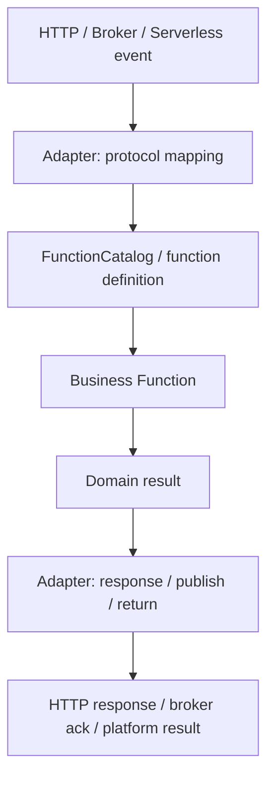
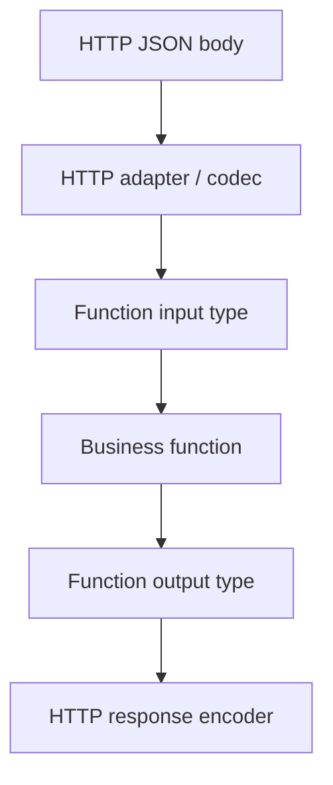
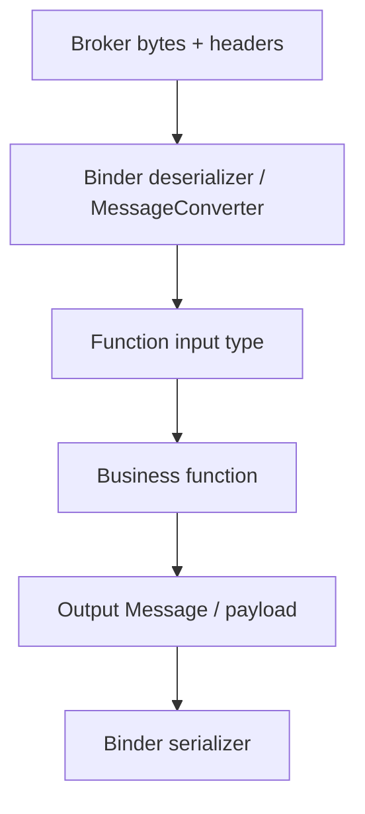

# Verifying Adapter Compatibility Before Choosing an Optimal Deployment Model

Spring Cloud Function allows developing reusable business logic with `Supplier<T>`, `Function<I, O>`, and `Consumer<T>`, looking them up through `FunctionCatalog`, composing multiple functions, and deploying the same logic over HTTP, events, or serverless environments. However, a function that works well when invoked directly inside the JVM does not prove it fits every adapter.

**An adapter is the layer connecting a function to a protocol or execution platform.** An HTTP adapter, a Spring Cloud Stream binder, and a serverless adapter differ in how they receive payloads, map types, propagate headers, handle errors, manage concurrency, and acknowledge results. A function signature valid on one adapter may lack equivalent semantics on another.

Before picking an optimal deployment model, verify **the function contract and the adapter's real capabilities**. Do not pick WebFlux solely because a function returns `Flux<T>`, pick a broker solely for async, or pick serverless solely for low cold start without checking the request model, retries, payload limits, and lifecycle.

After this lesson, you will be able to:

1. Distinguish the function programming model from the adapter/protocol/runtime.
2. Compare HTTP, event binders, and serverless across request models, responses, headers, streaming, and error semantics.
3. Verify payload conversion, generic types, `Message<?>`, and `contentType`.
4. Identify where ack, retries, dead-lettering, timeouts, cancellation, and idempotency are handled.
5. Verify concurrency, backpressure, batching, payload size, cold start, and resource limits.
6. Write contract tests and integration tests against the target adapter.
7. Choose an adapter based on SLOs, operations, and downstream capacity rather than a single isolated benchmark.

> **Scope:** Examples use Java 17+ and Spring Cloud Function under the functional programming model. Spring Cloud Stream binders, Spring Cloud Function Web, and serverless adapters vary in capabilities by version and provider. Property/binding names in examples must be checked against actual dependencies; never assume every adapter supports the same set of signatures.

## 1. Separating function, adapter, and runtime

An application typically has three layers:



- **Function:** business logic, e.g., calculating order pricing.
- **Adapter:** converts a request/event into input the function accepts, then maps the result into an HTTP response, published message, or platform return value.
- **Runtime/platform:** manages processes, threads, event delivery, scaling, timeouts, environment, and resources.

Spring Cloud Function provides the function abstraction and catalog. Adapters come from Spring Cloud Function Web, Spring Cloud Stream binders, or serverless platform integrations. The runtime can be an embedded server, a broker consumer, or a cloud provider's execution environment.

**A plain function passing tests does not mean the entire adapter path works.** Adapters also add serialization, message conversion, routing, security, acknowledgement, and retries.

## 2. Start with a stable business contract

Example order-processing function:

```java
package demo.adapter;

public record OrderCreated(
    String eventId,
    String orderId,
    String customerId,
    long totalVnd
) {}
```

```java
package demo.adapter;

public record OrderAccepted(
    String orderId,
    String status,
    long acceptedAtEpochMillis
) {}
```

Function focused on the contract:

```java
package demo.adapter;

import java.util.function.Function;

import org.springframework.context.annotation.Bean;
import org.springframework.context.annotation.Configuration;

@Configuration(proxyBeanMethods = false)
public class OrderFunctions {

    @Bean("acceptOrder")
    public Function<OrderCreated, OrderAccepted> acceptOrder(
        OrderService service
    ) {
        return event -> service.accept(event);
    }
}
```

`OrderService` is an injected business service; the function does not need to know whether inputs arrive from HTTP, a broker, or a serverless event. Still, each adapter must prove it can construct `OrderCreated` and handle `OrderAccepted` per the contract.

### Define the contract before choosing an adapter

| Property | Question |
| --- | --- |
| Input | Single request, single event, batch, or stream? |
| Output | Single response, multiple messages, no output, or stream? |
| Cardinality | Does one input yield exactly one output or possibly many? |
| Ordering | Must ordering between events be preserved? |
| Delivery | Can the same event be redelivered? |
| Durability | Must the event be durably stored before acknowledgement? |
| Latency | Immediate response required, or eventual processing acceptable? |
| Failure | Return error to caller, retry, dead-letter, or record separately? |
| Security | Where do identity, tenant, and authorization come from? |
| Payload | Maximum size, schema version, and content type? |

When the contract is unclear, adapter benchmarks are hard to compare because each adapter may be performing a different kind of work.

## 3. Function types and adapters must be compatible

Spring Cloud Function supports these functional interfaces:

| Type | Business meaning | What to verify on the adapter |
| --- | --- | --- |
| `Supplier<T>` | Produces data | Trigger/poller, frequency, and lifecycle |
| `Function<I, O>` | Takes input, returns output | Request-response or event transformation |
| `Consumer<T>` | Receives and processes, returns no output | Ack, retries, and errors |
| `Supplier<Flux<T>>` | Produces a stream | Does the adapter consume the stream and manage subscription? |
| `Function<Flux<I>, Flux<O>>` | Transforms a stream | Backpressure, cancellation, streaming transport |
| `Consumer<Flux<T>>` | Consumes a stream | Completion, error, and acknowledgement semantics |

Never assume every adapter supports every combination. One adapter may invoke the function per message, while another supplies a finite event object. An HTTP response may be a single body, stream, or publisher depending on server stack and version.

### Distinguishing Message<T> from payload T

A function can accept a plain payload:

```java
Function<OrderCreated, OrderAccepted>
```

or a message with metadata:

```java
Function<Message<OrderCreated>, Message<OrderAccepted>>
```

`Message<T>` contains payload and headers. Adapters can map certain transport metadata into headers, yet not every protocol header automatically becomes a Spring `Message` header. Verify mappings and which headers are permitted to pass through.

## 4. HTTP adapter: request-response and HTTP contract limits

HTTP fits when the caller sends a request and expects a response within the same interaction, such as:

- Calculating a quote.
- Validating data.
- Looking up status.
- Executing a command needing an immediate result.

With Spring Cloud Function Web, a function is exposed by name through the adapter's HTTP mapping. For instance, a function named `acceptOrder` can be called via HTTP POST at the corresponding endpoint per web adapter configuration/version.

```bash
curl -X POST http://localhost:8080/acceptOrder \
  -H 'Content-Type: application/json' \
  -H 'Accept: application/json' \
  -d '{
    "eventId": "evt-1",
    "orderId": "ORD-101",
    "customerId": "CUS-7",
    "totalVnd": 130000
  }'
```

The endpoint example illustrates Spring Cloud Function Web; verify exact path, HTTP method, and response behavior for your active version. In real apps, enable authentication/authorization and TLS at the appropriate layer.

### HTTP fits well when

- The caller needs a synchronous result or a clear HTTP response.
- Status codes, request schemas, and response schemas can be well defined.
- Payloads and processing times stay within gateway/client limits.
- Timeouts, cancellation, and rate limits are in place.
- Idempotency is designed for commands that may be retried.

### HTTP does not solve these needs by itself

- Durable event delivery and consumer acknowledgement.
- Retries after a client disconnects without a separate workflow.
- Fan-out/broadcast to multiple independent consumers.
- Unbounded stream processing over simple request-response.
- Workloads lasting longer than gateway/platform timeouts.

If an HTTP function calls a downstream service and times out before returning a response, the caller may not know whether the command executed. For order creation or payments, an idempotency key and status-lookup mechanism are required.

## 5. Event adapters and Spring Cloud Stream binders

Event-driven functions fit when producer and consumer do not need to coexist inside a single request-response interaction. A broker can persist messages, retain backlogs, and deliver messages to consumers per system semantics.

Example:

```java
@Bean
public Function<OrderCreated, OrderAccepted> acceptOrder(
    OrderService service
) {
    return service::accept;
}
```

Illustrative configuration:

```yaml
spring:
  cloud:
    function:
      definition: acceptOrder
    stream:
      bindings:
        acceptOrder-in-0:
          destination: orders.created
        acceptOrder-out-0:
          destination: orders.accepted
```

Under functional binding conventions, input/output binding names typically follow `functionName-in-0` and `functionName-out-0`. Verify exact function signatures, binders, and versions. If the function is only a `Consumer<T>`, there is no corresponding output binding unless the app declares a separate output flow.

### Event semantics differ from HTTP responses

| Property | HTTP | Event/broker |
| --- | --- | --- |
| Caller waits for result | Usually yes | Producer usually does not wait for consumer completion |
| Delivery | Request sent by client | Broker delivers per subscription/consumer model |
| Acknowledgement | HTTP response status | Broker/binder ack/nack or commit |
| Retry | Client/gateway/application policy | Binder/broker retry/redelivery policy |
| Ordering | Per request/connection semantics | Per partition/queue and consumer settings |
| Durability | Depends on app/database | Broker can store durably per configuration |
| Consumer scaling | HTTP server scaling | Consumer group/partition/queue concurrency |
| Duplicates | Client retries may resend | Redelivery is a normal scenario to handle |

**Event delivery must generally be designed to handle duplicates.** Do not assume brokers and binders provide end-to-end exactly-once semantics for every side effect of a function. For database writes or external API calls, use idempotency keys, unique constraints, inbox/outbox patterns, or suitable deduplication.

### A Consumer with no output does not mean no processing outcome

`Consumer<OrderCreated>` returns no domain result through an output binding. Yet the consumer can still write data, call downstreams, log audits, emit metrics, or throw errors to trigger binder retry/error handling.

Define clearly when a message is acknowledged. If a function catches an exception and ignores it, the binder may treat the invocation as successful and commit the message; that is a business decision, not just coding style.

## 6. Serverless adapters: event contracts and platform lifecycles

A serverless adapter translates provider events/requests into function inputs and maps outputs/errors per platform contract. Differences to verify:

- Event envelopes (HTTP, queue, object storage, scheduler, CloudEvents).
- Handler signatures and function selection.
- How the provider injects request context, identity, and trace metadata.
- Cold starts, warm reuse, and execution environment lifecycles.
- Timeouts, memory/CPU allocation, and per-environment concurrency.
- Retry/redelivery, dead-lettering, and acknowledgement semantics.
- Artifact types, architectures, and runtime support.

Some Spring Cloud Function integrations offer provider-specific adapters. Even so, verify the adapter, function invocation model, and version compatibility for your chosen provider; never treat the generic term “serverless” as a single uniform contract.

### Cold start is not the whole latency

\[
T_{\mathrm{total}} =
T_{\mathrm{provision}} +
T_{\mathrm{bootstrap}} +
T_{\mathrm{function}} +
T_{\mathrm{downstream}}
\]

Native Image or AOT can trim part of bootstrap, yet cannot eliminate provider provisioning, networking, DNS, TLS, database connections, or downstream work.

### Warm reuse and state

An execution environment can be reused across multiple invocations. Therefore:

- Never store user/tenant/request state in mutable singleton fields.
- Never assume the next invocation runs in the same environment.
- Never assume every invocation receives a fresh instance.
- Create clients/pools within supported lifecycles and cap total connections by active environments.
- Never retain credentials or sensitive data longer than needed.

## 7. Message conversion: same JSON, yet adapter paths can differ

A JSON payload only describes data format; converters still need the target type. In Spring Cloud Function, generic function signatures and `contentType` both participate in conversion decisions.





Both paths may use JSON, yet converters, default content types, header mappings, and error behavior depend on the adapter. Do not assume HTTP codecs and broker binders always share the exact same converter configuration.

### Concrete input types make conversion clearer

```java
Function<OrderCreated, OrderAccepted>
```

typically provides clearer target type information than:

```java
Function<Object, Object>
```

or a raw `Function`. If a function accepts `Message<OrderCreated>`, check both payload generics and the headers supplied by the adapter.

### contentType must match the payload

Example JSON message:

```java
import org.springframework.messaging.Message;
import org.springframework.messaging.MessageHeaders;
import org.springframework.messaging.support.MessageBuilder;
import org.springframework.util.MimeTypeUtils;

Message<OrderCreated> message = MessageBuilder
    .withPayload(event)
    .setHeader(
        MessageHeaders.CONTENT_TYPE,
        MimeTypeUtils.APPLICATION_JSON
    )
    .build();
```

If the payload is already an `OrderCreated`, the function does not need another JSON deserialization pass. `contentType` describes the payload format at the boundary; the adapter/converter must decide whether conversion is needed.

When transforming a payload, update metadata accordingly. Never copy `contentType=text/plain` unchanged onto a message holding a JSON DTO if the new contract expects `application/json`.

## 8. Header mapping and metadata differ across transports

An HTTP request carries headers like `Authorization`, `Content-Type`, `Accept`, and `X-Correlation-Id`. A broker message may carry keys, partitions, offsets, delivery tags, timestamps, routing keys, and custom headers. Serverless events carry their own envelopes and context.

Do not pass all transport metadata straight into business functions as if they shared one uniform schema.

| Metadata | HTTP | Broker | Serverless | How to handle |
| --- | --- | --- | --- | --- |
| Correlation/trace ID | Request header | Message header | Event/context metadata | Normalize into application tracing context |
| Content type | HTTP header | Message header | Event contract | Used to pick converters |
| Auth principal | Security context/header | Possibly from trusted producer | Provider identity/context | Verify trust boundaries |
| Tenant ID | Verified claim/header | Trusted event metadata | Provider/request context | Check authorization |
| Delivery attempt | Usually no universal standard | Binder/broker metadata | Provider retry metadata | Use for retry observability |
| Partition/offset | Not applicable | Broker-specific | Non-uniform | Keep in adapter/observability |
| HTTP status | Response | Not directly applicable | Trigger-dependent | Adapter mapping |

### Avoid trusting caller-supplied headers

Never trust `X-Tenant-Id` or `X-User-Id` sent by a client for authorization without verification. Broker headers can also arrive from untrusted producers. Adapters should authenticate the source and place only verified information into the application context.

### Allowlist header propagation

When constructing a new message:

```java
Message<OrderAccepted> output = MessageBuilder
    .withPayload(accepted)
    .setHeader("correlationId", trustedCorrelationId)
    .setHeader(
        MessageHeaders.CONTENT_TYPE,
        MimeTypeUtils.APPLICATION_JSON
    )
    .build();
```

This example keeps a verified correlation ID and declares the appropriate content type. Never copy routing keys, authorization tokens, reply channels, or delivery metadata indiscriminately to another destination.

## 9. Error mapping: exceptions mean different things per adapter

An error inside a function can become:

- An HTTP 4xx/5xx response.
- A broker retry/redelivery.
- A dead-letter message.
- A serverless invocation failure triggering provider retries.
- An error signal in a reactive pipeline.

Never assume one exception is handled identically across all adapters.

| Error type | HTTP | Event binder | Serverless |
| --- | --- | --- | --- |
| Invalid input | Usually 4xx if mapped appropriately | Reject/DLQ or skip per policy | Invocation failure or error response per trigger |
| Downstream timeout | 5xx/504 per mapping | Retry/redelivery per policy | Provider/app retry per trigger |
| Transient failure | Client may retry | Binder retry/backoff | Platform retry if event source supports it |
| Non-recoverable error | 4xx/5xx per contract | DLQ/error channel | DLQ or failure destination if configured |
| Programming bug | 5xx | Retries may loop fruitlessly | Retries may inflate invocation counts |

### Do not retry every exception

Classify:

- Validation/schema errors: normally do not retry the same payload.
- Authentication/authorization: handle per security policy; never retry indefinitely.
- Timeouts/connection resets: bounded retries if the operation is idempotent.
- Rate limits: respect `Retry-After`/quotas.
- Bugs/serialization errors: alert and route to observable error handling.

### Multi-layer retries multiply attempts

If an HTTP client retries 3 times, the function retries 2 times, and the broker redelivers 5 times, total downstream attempts can far exceed expectations. Design an end-to-end retry budget with backoff/jitter and an overall deadline.

## 10. Ack, retries, dead-lettering, and idempotency

Event adapters must define when messages are acknowledged. For a consumer:

1. Adapter receives message.
2. Binder converts message into function input.
3. Function executes and completes or fails.
4. Binder applies ack/nack/commit according to configuration and broker semantics.

This is a conceptual model; exact order and details depend on the binder and acknowledgement mode.

### Idempotency is a business responsibility

Example event with an ID:

```java
public record OrderCreated(
    String eventId,
    String orderId,
    String customerId,
    long totalVnd
) {}
```

The service can record the event ID with a unique constraint inside the same transaction as the business update:

```java
@Transactional
public OrderAccepted accept(OrderCreated event) {
    if (processedEventRepository.existsById(event.eventId())) {
        return loadExistingResult(event.orderId());
    }

    processedEventRepository.insert(event.eventId());
    Order order = orderRepository.accept(event.orderId());
    return toAccepted(order);
}
```

This is pseudo-implementation for illustration; ensure the unique constraint and business update sit inside the appropriate transaction, handle races when two deliveries arrive concurrently, and return a stable result for duplicates.

For HTTP commands, an idempotency key is equally valuable when clients time out and resend. For serverless events, understand provider retry policies to avoid duplicate side effects.

## 11. Streaming and backpressure depend on the adapter

A reactive function:

```java
Function<Flux<OrderCreated>, Flux<OrderAccepted>>
```

can process streams via Reactive Streams. However, an adapter might:

- Dispatch each item as a separate invocation.
- Feed one stream into the function.
- Read the body in streaming mode.
- Buffer the entire payload before invoking.
- Not support streaming responses in your active version.

Looking only at a `Flux` signature is never enough to conclude the transport streams end-to-end.

### Verify streaming at every boundary

| Boundary | Question |
| --- | --- |
| Client → adapter | Does the client send chunks/streams or a buffered body? |
| Adapter → function | Does the function receive one object or a multi-item publisher? |
| Function → downstream | Are `flatMap` concurrency/prefetch bounded? |
| Function → adapter | Does the adapter subscribe and stream outputs? |
| Adapter → client/broker | Does the transport support incremental delivery/backpressure? |
| Cancellation | Does client disconnect cancel upstream work? |

### Reactive does not mean non-blocking end-to-end

If a function returns `Flux` yet makes blocking JDBC calls on the event loop, the system can still stall. If a broker binder only delivers finite single-message events, `Flux` does not automatically turn a broker into a streaming HTTP response.

Verify all blocking calls, the adapter's subscription model, queues/prefetch, and downstream capacity.

## 12. Batching and payload limits

HTTP gateways, brokers, and serverless providers enforce different payload limits. A 20 MiB JSON request may pass unit tests yet be rejected by a gateway or fail delivery from a serverless event source.

| Limit | HTTP | Broker | Serverless |
| --- | --- | --- | --- |
| Payload size | Gateway/server/client body limits | Broker/message limits | Provider/event source limits |
| Batch size | Possibly a JSON array | Binder batch mode | Event source batch settings |
| Timeout | Client, proxy, server | Processing/ack/rebalance window | Platform invocation timeout |
| Headers/metadata | HTTP header limits | Broker header constraints | Event envelope/context limits |
| Ordering | Per request | Partition/queue semantics | Provider/event source dependent |

Real limits must come from your active platform, never a single generic constant across all adapters.

### Batching can change semantics

A function taking:

```java
Function<List<OrderCreated>, List<OrderAccepted>>
```

differs from:

```java
Function<OrderCreated, OrderAccepted>
```

A batch function must define:

- Does one failed item fail the entire batch or return per-item results?
- Does ack apply to the entire batch?
- Does a retry resend the whole batch or only failed items?
- Does output ordering correspond to input ordering?
- What is the maximum payload/batch size?

Never switch from item-level to batch-level purely to boost throughput without addressing partial failures and duplicate handling.

## 13. End-to-end timeouts and deadlines

Each adapter has its own timeouts:

- HTTP client timeout, reverse proxy timeout, and server request timeout.
- Broker processing/ack timeout, session timeout, or visibility timeout per broker.
- Serverless platform invocation timeout.
- Downstream HTTP/database timeouts.

A function may finish internally after the caller has already timed out, leaving the outcome ambiguous for the caller.

### Designing an overall deadline

Example HTTP request with a 3-second deadline:

| Step | Illustrative budget |
| --- | ---: |
| Adapter/request overhead | 200 ms |
| Pricing API | 900 ms |
| Inventory API | 900 ms |
| Business processing/serialization | 300 ms |
| Safety margin | 700 ms |
| Total | 3,000 ms |

Parallel calls do not necessarily add linearly; the table represents a design budget so the total deadline is not exceeded. In practice, propagate remaining deadlines/cancellation contexts downstream and avoid giving individual calls timeouts larger than the remaining budget.

### Event processing

With brokers, timeouts must cover processing, commit/ack, and related retry policies. If processing exceeds delivery/visibility/session limits, the broker may redeliver the message or rebalance the consumer. Check broker-specific behavior.

### Serverless

Function execution timeouts must cover cold start, application bootstrap, and function processing per provider semantics. If the platform times out after side effects complete, retries can produce duplicates; idempotency remains mandatory.

## 14. Security and adapter trust boundaries

The adapter is where protocol-specific identities are authenticated and mapped into the application security context. Never let business functions blindly trust raw incoming metadata.

### HTTP

- Authenticate tokens/sessions at the gateway or security filter.
- Check authorization per resource/tenant.
- Never log full `Authorization` headers or sensitive bodies.
- Cap body size, request rate, and header size.
- Guard against SSRF if functions call dynamic URLs.

### Event brokers

- Authenticate producers/consumers using broker mechanisms.
- Restrict publish/subscribe permissions per topic/queue.
- Never trust tenant/user headers from unverified producers.
- Protect message payloads and metadata at rest.
- Handle poison messages and dead-lettering per policy.

### Serverless

- Use IAM/service identities with least privilege.
- Distinguish provider-supplied context from data sent by event producers.
- Manage secrets in runtime secret stores/environments properly.
- Restrict network, database, and cloud resource permissions.

**Same DTO does not mean same trust level.** HTTP clients, broker producers, and cloud event sources can carry different identities and privileges.

## 15. Concurrency and scaling semantics

The adapter determines or shapes how invocations execute:

| Adapter | Where it scales | Risks to check |
| --- | --- | --- |
| HTTP servlet | Server instances/threads | Thread pool saturation, blocking calls |
| HTTP reactive | Event loops/subscriptions | Blocking on event loop, pending work |
| Stream binder | Consumer instances/partitions/concurrency | Partition limits, prefetch, rebalancing |
| Serverless | Platform execution environments | Cold starts, concurrency quotas, per-environment pools |

### Connection pools multiply by instance

If each instance has a 20-connection HTTP pool and the platform scales to 15 instances, total ceiling reaches 300 connections to that destination. On serverless, warm environments may stay alive and concurrent instances fluctuate with quotas.

Include rolling deployments, autoscaling surges, and background clients. Never raise per-instance pools without multiplying by max instance count.

### Singleton functions must be concurrency-safe

Function beans are usually managed as singletons. Never store request-specific mutable fields:

```java
// Unsafe: multiple invocations write concurrently to this field.
private String currentTenantId;
```

Pass context per invocation, use immutable data, and inject resource/thread-safe clients. In reactive pipelines, never rely on `ThreadLocal` across scheduler boundaries; use proper context propagation.

## 16. Observability and correlation across adapters

Each adapter supplies its own metadata, yet tracing/metrics should let you follow a single business operation across boundaries.

What to measure:

| Metric | HTTP | Event | Serverless |
| --- | --- | --- | --- |
| Invocation count | Request count | Messages consumed | Platform invocations |
| Latency | Request/response | Processing duration + queue age | Cold/warm + duration |
| Errors | HTTP status | Retry/DLQ/ack failures | Invocation errors/retries |
| Queues | Server/ingress pending | Consumer lag/backlog | Event source backlog if applicable |
| Concurrency | Active requests | Active consumers/messages | Concurrent environments |
| Conversion | Codec duration | Deserializer/converter duration | Event mapping duration |

Never put order IDs, customer IDs, raw URLs, or event IDs into high-cardinality metric tags. Use controlled trace/log fields and keep sensitive data out of logs.

### Correlation IDs do not replace trace context

A correlation ID can be a business key to look up an order. Trace context is standardized propagation metadata. One request may span many traces and downstream calls; never create a separate metric time series per correlation ID.

## 17. Compatibility matrix before picking an adapter

Fill out the matrix below for your exact versions and dependencies:

| Capability | HTTP Web adapter | Spring Cloud Stream binder | Serverless adapter |
| --- | --- | --- | --- |
| Supported function signatures | Verify `Supplier`/`Function`/`Consumer` | Verify per binder/functional binding | Verify handler mapping |
| `Message<T>` and headers | Check HTTP-to-message mapping | Check binder headers | Check event context mapping |
| JSON/content type | Check codecs and generics | Check deserializers/converters | Check event serializers |
| Reactive `Mono`/`Flux` | Check server stack/version | Check binder support | Check adapter/provider support |
| End-to-end streaming | Check request/response streaming | Check batch/stream semantics | Check event model |
| Retry/ack | HTTP/client policy | Binder/broker policy | Provider/event source policy |
| Dead-lettering | Needs dedicated app/workflow | Binder/broker feature | Provider-specific destination |
| Timeouts | Gateway/server/client | Processing/ack/session | Platform invocation |
| Concurrency | Server/executor | Consumer/partition/prefetch | Platform quota |
| Payload size | Gateway/server | Broker limit | Provider limit |
| Security identity | HTTP security context | Broker identity/producer trust | IAM/provider context |
| Native/AOT compatibility | Test web stack/codecs | Test binder/client | Test provider adapter/SDK |

This matrix is not a guarantee that every cell is supported. It is a checklist for your team to populate from version docs, builds, and integration tests.

## 18. Contract tests and integration tests must run through real adapters

Testing lookup and function invocation via `FunctionCatalog` inside a Spring context:

```java
import static org.junit.jupiter.api.Assertions.assertEquals;
import static org.junit.jupiter.api.Assertions.assertNotNull;

import java.util.function.Function;

import org.springframework.beans.factory.annotation.Autowired;
import org.springframework.boot.test.context.SpringBootTest;
import org.junit.jupiter.api.Test;
import org.springframework.cloud.function.context.FunctionCatalog;

@SpringBootTest
class OrderFunctionTests {

    @Autowired
    FunctionCatalog catalog;

    @Test
    void acceptsValidOrder() {
        Function<OrderCreated, OrderAccepted> function =
            catalog.lookup("acceptOrder");
        assertNotNull(function);

        OrderCreated input =
            new OrderCreated("evt-1", "ORD-101", "CUS-7", 130_000);

        OrderAccepted result = function.apply(input);

        assertEquals("ORD-101", result.orderId());
        assertEquals("ACCEPTED", result.status());
    }
}
```

This test verifies catalog lookup and invocation inside the Spring context. It still does not verify HTTP codecs, broker binders, or serverless event mapping; write separate integration tests for the adapter.

### HTTP integration test

```bash
curl -i -X POST http://localhost:8080/acceptOrder \
  -H 'Content-Type: application/json' \
  -H 'Accept: application/json' \
  -H 'X-Correlation-Id: test-001' \
  -d '{"eventId":"evt-1","orderId":"ORD-101","customerId":"CUS-7","totalVnd":130000}'
```

Verify:

- Endpoint and HTTP method are right.
- JSON converts into the expected DTO.
- Content types and headers follow the contract.
- Output body and status codes are right.
- Validation errors and downstream failures map cleanly.
- Authentication and authorization work.
- Request timeouts and cancellation cause no uncontrolled side effects.

### Event integration test

With a test broker environment, publish a schema-valid message to the destination and verify:

- Consumer receives the right payload/headers.
- Function is invoked under the expected name/definition.
- Output binding publishes to the right destination if applicable.
- Ack/commit occurs strictly per policy.
- Transient failures retry within bounds.
- Poison messages route per error/DLQ policy.
- Duplicate events produce no duplicate side effects.

### Serverless adapter test

Use the provider's official test harness or local emulator if available. Send realistic event envelopes including runtime-injected metadata/context. Verify responses/acks, timeouts, retries, and cold/warm behavior on the matching deployment artifact.

### Contract tests do not replace integration tests

Contract tests verify producer/consumer schemas. Integration tests verify wiring, conversion, and HTTP/broker/serverless semantics. Both are needed whenever an adapter forms part of production behavior.

## 19. Workflow to select an adapter by requirements

1. Determine whether callers need immediate responses, durable event delivery, or platform-triggered execution.
2. Define durability, ordering, duplicate, and acknowledgement requirements.
3. Finalize payload schemas, versioning, content types, headers, and max sizes.
4. Pick a function signature with concrete generics and matching cardinality.
5. Verify the adapter supports the signature, conversion, streaming, and error semantics.
6. Set timeouts, concurrency, retries, queues/prefetch, and connection budgets.
7. Define security identities and trust boundaries.
8. Run contract/integration tests against the real adapter.
9. Benchmark the same business workload and measure p95/p99, throughput, errors, RSS, and cold start as needed.
10. Pick the simplest adapter meeting SLOs and operations; document any capability gaps.

### Short decision matrix

| Primary need | Adapter to evaluate first | Reason |
| --- | --- | --- |
| Fast request-response where caller waits | HTTP | Direct contract, clear status/response |
| Durable asynchronous processing | Event broker | Backlog, delivery, and consumer scaling |
| Fan-out to many independent consumers | Event broker/pub-sub | Decouples producers from consumers |
| Triggered by cloud or scheduled events | Serverless adapter | Fits platform event model |
| Continuous data streams | Reactive HTTP/broker streaming if supported | Streaming/backpressure may align well |
| Long-running work exceeding request timeout | Event workflow or async job | Avoids holding callers waiting |
| Dynamic plugin loading | JVM deployment usually easier than native | Flexible runtime class loading |

This is a starting point for evaluation, not an automatic selection. A broker rarely fits when callers need an immediate reply; serverless does not guarantee durable workflows by itself; HTTP is ill-suited to emulate an event bus.

## 20. Common compatibility pitfalls

| Symptom | Possible cause | How to investigate |
| --- | --- | --- |
| Function passes unit tests yet returns HTTP 400 | JSON schema/content type/generic mismatch | Check codecs, body, and function signature |
| HTTP returns 200 yet business errors are swallowed | Function catches exceptions and returns defaults | Review error mapping and contract |
| Event produces no output | Function is a `Consumer` or output binding is misnamed | Check function type and binding names |
| Event processed repeatedly | Redelivery/retry after side effects | Add idempotency keys and transactions |
| Broker never acks | Function error or incomplete async work | Check binder ack semantics |
| Broker lags despite fast function | Partitions, prefetch, or downstream limits | Check consumer metrics and partition assignment |
| `Flux` emits only after buffering completely | Adapter/buffer mode or operator | Inspect streaming boundaries |
| Client disconnects yet work keeps running | Cancellation not propagated downstream | Check adapter and client cancellation |
| Serverless retries create duplicates | Invocation timeout after side effects | Enforce idempotency and check provider retry policy |
| Headers disappear | Adapter mapping/allowlist | Test header propagation |
| Wrong tenant context | Trusted unverified header or shared mutable state | Check security context and isolation tests |
| Native HTTP passes while event fails | Missing binder/client metadata | Run dedicated native integration tests |
| Payloads rejected in deployment | Gateway/broker/provider limits | Compare max payload across all boundaries |
| High p99 despite low function CPU | Queue/pool waits/downstream timeouts | Measure each boundary |

## 21. Pre-production checklist for functions

### Contract

- [ ] Input/output schemas are versioned with clear generic types.
- [ ] Cardinality, ordering, and batching semantics are defined.
- [ ] Content types and header mappings are tested.
- [ ] Payload sizes and maximum header sizes are bounded.

### Adapter/runtime

- [ ] Exact adapter dependencies and versions are verified.
- [ ] Function definition and catalog lookup work properly.
- [ ] Reactive/streaming behavior is tested end-to-end if used.
- [ ] Timeout, cancellation, and acknowledgement semantics are clear.
- [ ] Concurrency, prefetch, and queues are bounded.

### Failure and security

- [ ] Error mapping and retry budgets do not conflict.
- [ ] Duplicate deliveries/HTTP retries are idempotent.
- [ ] Poison messages have an error/DLQ policy.
- [ ] Identity and tenant metadata are authenticated.
- [ ] Secrets and sensitive payloads are kept out of logs.

### Performance and operations

- [ ] Throughput and p50/p95/p99 measured through the real adapter.
- [ ] Queue depth/age, pool pending counts, and downstream errors monitored.
- [ ] Connection budgets sized for peak replicas/environments.
- [ ] Memory budgets cover payloads, buffers, queues, and batches.
- [ ] Native/AOT compatibility tested separately if used.
- [ ] Rollback plan and dashboards ready post-deploy.

## 22. Practice exercises

**Exercise 1 — Choosing HTTP vs. events.** A checkout endpoint must return an immediate order confirmation to the user. Which adapter should be evaluated first?

*Answer:* HTTP for request-response. If downstream business processing is long, accept the command over HTTP, persist state, and process asynchronously via events; the API returns an accepted status or job ID per contract.

**Exercise 2 — Consumer semantics.** A `Consumer<OrderCreated>` finishes without error. Can you infer the broker saved an output event?

*Answer:* No. A `Consumer` has no output return; ack/commit is governed by binder/broker policy. To publish outputs, use a function returning an output or a dedicated producer mechanism.

**Exercise 3 — Duplicates.** The broker redelivers the same `eventId` after a timeout. How do you avoid accepting the order twice?

*Answer:* Idempotency/deduplication keyed on event ID, a unique constraint, and a transaction wrapping the business side effect appropriately.

**Exercise 4 — Content type.** JSON bytes arrive at `Function<OrderCreated, OrderAccepted>`. What details must be checked?

*Answer:* Runtime payload type, content type, converter/deserializer chosen by the adapter, and target generic type.

**Exercise 5 — Header trust.** A client sends `X-Tenant-Id: tenant-admin`. Can you use this header directly to query tenant data?

*Answer:* No. Authenticate identity/claims and verify authorization first; caller-supplied headers are not a trust source.

**Exercise 6 — Reactive adapters.** A function returns `Flux<OrderAccepted>`. Can you assert the broker will stream outputs item by item with producer backpressure?

*Answer:* No. Verify binder/version, output binding, batch/stream semantics, and backpressure across every boundary.

**Exercise 7 — Retry storms.** An HTTP client retries 3 times, the function retries 2 times, and the broker redelivers 4 times. Why must you review the combined retry budget?

*Answer:* Multi-layer retries multiply attempts and can overload downstream; enforce a unified deadline, backoff/jitter, and coherent retry policy.

**Exercise 8 — Serverless timeouts.** The platform times out after a database transaction commits but before the function returns its response. What can happen?

*Answer:* The platform may retry the invocation even though the side effect already occurred; idempotency keys/deduplication and queryable state are required.

**Exercise 9 — Payload limits.** A unit test processes a 10 MiB JSON payload cleanly, yet production returns HTTP 413. Where should you look?

*Answer:* Gateway, reverse proxy, web server, and adapter body-size limits; unit tests bypass transport limits.

**Exercise 10 — AOT compatibility.** The native HTTP endpoint works, yet the event binder fails during deserialization. Can you ignore it because function logic passed?

*Answer:* No. Binders/serializers are part of the production path; add the required metadata/hints and test the native event adapter.

**Exercise 11 — Streaming.** A client disconnects while downstream computation keeps running. What should you inspect?

*Answer:* Cancellation propagation across the HTTP adapter, reactive pipeline, clients, and downstream APIs; never assume `Flux` automatically cancels every side effect.

**Exercise 12 — Choosing an adapter.** A function is consumed by multiple independent consumers and requires a durable backlog plus retries after transient errors. What should you evaluate?

*Answer:* An event broker / Spring Cloud Stream binder with appropriate durability, consumer groups, ack/retry/DLQ, ordering, idempotency, and capacity limits.

## 23. Key takeaways

- **The function is business logic; the adapter dictates how the protocol/runtime invokes it and maps results.**
- **Function unit tests do not prove HTTP, binder, or serverless adapter compatibility.**
- **HTTP fits request-response; event adapters fit delivery/ack/retry; serverless depends on event contracts and platform lifecycles.**
- **Generic types, runtime payload types, content types, and header mappings must align.**
- **Never assume `Flux` guarantees end-to-end streaming/backpressure across every adapter.**
- **Ack, retries, dead-lettering, and duplicate delivery must be designed alongside idempotency.**
- **Caller timeouts/cancellation do not guarantee downstream side effects stopped.**
- **Security identities and tenant metadata must be authenticated at trust boundaries.**
- **Size concurrency, connection pools, and payload limits per adapter and peak instance counts.**
- **Run contract/integration tests and benchmarks on the real adapter before choosing a deployment model.**

**Official references:**

- [Spring Cloud Function — Reference](https://docs.spring.io/spring-cloud-function/reference/)
- [Spring Cloud Function — Programming Model](https://docs.spring.io/spring-cloud-function/reference/spring-cloud-function/programming-model.html)
- [Spring Cloud Function — Web](https://docs.spring.io/spring-cloud-function/reference/spring-cloud-function/web.html)
- [Spring Cloud Stream — Functional Binding Names](https://docs.spring.io/spring-cloud-stream/reference/spring-cloud-stream/functional-binding-names.html)
- [Spring Cloud Stream — Consumer Groups](https://docs.spring.io/spring-cloud-stream/reference/spring-cloud-stream/consumer-groups.html)
- [Spring Cloud Stream — Error Handling](https://docs.spring.io/spring-cloud-stream/reference/spring-cloud-stream/overview-error-handling.html)
- [Spring Framework — Integration](https://docs.spring.io/spring-framework/reference/integration.html)
- [Project Reactor — Reference Guide](https://projectreactor.io/docs/core/release/reference/)

Adapters and binders vary in behavior across versions and deployments. Before releasing, verify documentation for your exact dependencies, test real protocol paths, and document capability gaps rather than inferring them from function signatures.
