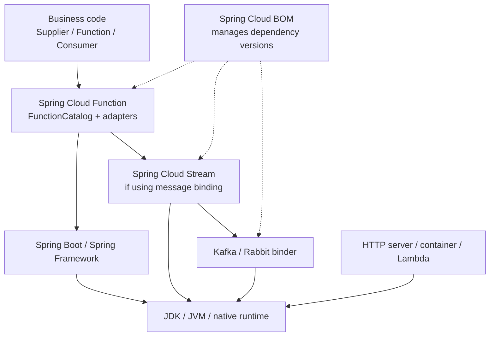
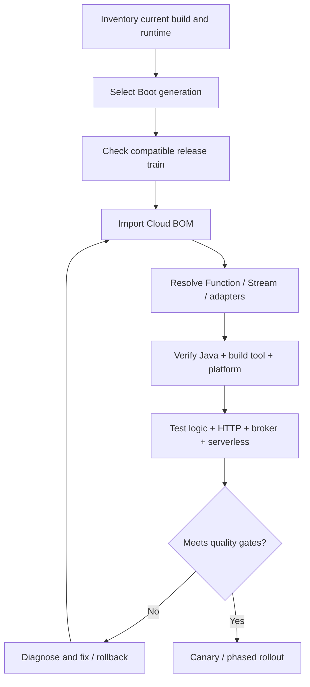

# Distinguishing Spring Cloud Function, Boot, BOM, and Runtime Versions

## 1. The Upgrade Problem: Why Does One Application Have Multiple "Versions"?

A development team is operating an order-processing application built with Spring Cloud Function. The business logic is very simple:

```java
@Bean
Function<OrderCreated, OrderClassified> classifyOrder() {
    return order -> new OrderClassified(
            order.orderId(),
            order.totalInCents() >= 100_000L
                    ? "PRIORITY" : "STANDARD");
}
```

The application can expose this function over HTTP, process events using Spring Cloud Stream, or run via an adapter on a serverless platform. When upgrading, teams often encounter information that appears contradictory:

- Spring Boot has version `4.2.0`.
- Spring Cloud has **release train** version `2026.0.0`.
- Spring Cloud Function has module version `5.1.0`.
- Maven or Gradle imports a **BOM** `spring-cloud-dependencies:2026.0.0`.
- The build machine uses JDK 21, while the container or serverless platform also has a **Java runtime** selection.
- The HTTP adapter, Kafka/RabbitMQ, AWS Lambda, and third-party libraries each have their own compatibility lifecycles.

There is no contradiction: these are **different version axes**. Forcing them to share the same number or upgrading each individually to its latest version can create an incompatible classpath.

This lesson helps you accurately identify the role of each version, read Maven/Gradle configurations, select a compatible version set, recognize Java runtime requirements, and execute verifiable, rollback-safe upgrades.

**Context:** This document belongs to the **Upgrades** chapter of the **SPRING_CLOUD_FUNCTION** module. The goal remains keeping `Supplier`, `Function`, `Consumer`, and `FunctionCatalog` logic reusable and protocol-independent while properly upgrading the HTTP, event, or serverless adapters.

## 2. Seven Things to Distinguish in a Deployment

| Component | Example version/value | Responsibility | Who decides? |
| --- | --- | --- | --- |
| **Java language / bytecode target** | Java 17 or 21 | Java syntax, APIs, and class file format at compile time | Toolchain, compiler settings |
| **Execution JDK/JRE** | Java 21 in container | Running bytecode and the application at deployment time | Image/runtime platform |
| **Spring Boot** | `4.2.0` | Application platform, auto-configuration, lifecycle, starters, build plugin | Parent/plugin and dependency management |
| **Spring Cloud release train** | `2026.0.0` | Coordinated set of Spring Cloud branches tested for compatibility | `spring-cloud-dependencies` BOM |
| **Spring Cloud Function** | `5.1.0` | `FunctionCatalog`, functional programming model, composition, adapters | Artifact version managed by BOM |
| **Spring Cloud Stream / binder** | `5.1.0` and managed binder version | Message binding, Kafka/RabbitMQ integration | Spring Cloud BOM and dependencies |
| **Runtime adapter/platform** | HTTP server, Kafka, AWS Lambda Java runtime | How functions are triggered and the deployment environment | Adapter dependency, platform configuration |

An application also includes **Spring Framework**, Spring Security, Jackson, Reactor, Gradle/Maven, the container OS, and custom libraries. They also have versions, but they should not be treated as aliases for the Spring Cloud Function version.

**Short takeaway:** Spring Cloud Function `5.1.0` does **not** require Boot to also be `5.1.0`; Cloud release train `2026.0.0` does **not** mean Java `2026`. These numbers belong to different versioning schemes.

### Layer Diagram



A BOM only provides **dependency version management** metadata; it is not an executable runtime. The JDK is the execution environment; it does not select the Spring Cloud Function version on its own.

## 3. What Is the Spring Boot Version?

Spring Boot helps build Java applications with auto-configuration, lifecycle management, Actuator, logging, starter dependencies, and standalone executable packaging. Spring Boot is not synonymous with Spring Cloud Function: a Boot application might not declare any `Function` bean, and functional logic can be tested as plain Java.

In Maven, the Boot version is typically declared via the parent:

```xml
<parent>
    <groupId>org.springframework.boot</groupId>
    <artifactId>spring-boot-starter-parent</artifactId>
    <version>4.2.0</version>
    <relativePath/>
</parent>
```

In Gradle, the Boot version is typically set in the plugins block:

```kotlin
plugins {
    id("org.springframework.boot") version "4.2.0"
}
```

The Spring Boot version affects:

- The Spring Framework version and the Spring Boot starters it coordinates.
- Supported Java and Gradle/Maven versions.
- Auto-configuration, module/starter structure, and property migration.
- Test integration, packaging, AOT/native image, servlet/web stack, and Boot dependency management.

**Do not upgrade Boot merely by changing the Java base image.** Changing the JDK can affect bytecode execution, but the Boot artifacts in the dependency graph remain on the old version.

### Spring Framework Also Has Its Own Version

Spring Framework is the foundation for DI, Web, Messaging, Reactor integration, and many other APIs. Boot manages the compatible Framework version. In a typical Boot project, you should not manually force a `spring-context` or `spring-core` version outside the BOM without proving compatibility.

For example, the Spring Boot 4 generation pairs with Spring Framework 7. This is a generational change that may require code and integration library updates; it is not just a version number change.

## 4. Spring Cloud Release Train vs. Spring Cloud Function Version

**Spring Cloud** is an ecosystem containing many subprojects: Config, Gateway, Function, Stream, Commons, and more. Projects have their own release lifecycles. A **release train** is a coordinated set of versions published under a shared name.

For example:

```text
Spring Cloud release train: 2026.0.0
    Spring Cloud Function: 5.1.0
    Spring Cloud Stream:   5.1.0
    Spring Cloud Commons:  5.1.0
    ... other modules in the train
```

Here, `2026.0.0` is the **train** version, while `5.1.0` is the **module** version. These numbers are different and do **not** need to match.

Previous release trains also have codenames, such as **Oakwood** for the `2025.1.x` line and **Paddington** for `2026.0.x`. Codenames help you locate release notes; they must not be used as the version of the `spring-cloud-function-context` Maven artifact.

### Example Compatibility Table as of November 24, 2026

| Spring Boot generation | Spring Cloud release train | Spring Cloud Function branch in train | Notes |
| --- | --- | --- | --- |
| **Boot 4.2.x** | **2026.0.x (Paddington)** | **Function 5.1.x** | `2026.0.0` GA on November 20, 2026, based on Boot `4.2.0` |
| **Boot 4.0.x / 4.1.x** | **2025.1.x (Oakwood)** | **Function 5.0.x** | Release `2025.1.5` on November 20, 2026 confirms both Boot branches |
| **Boot 3.5.x** | **2025.0.x (Northfields)** | **Function 4.3.x** | Generation pair for reference when planning migration from Boot 3 |

**Timeliness warning:** This table is a real-world example as of **November 24, 2026**, **not** a promise that every Boot/Cloud Function patch release will be supported forever. The writing date and your deployment date may differ; always consult the official table at the [Spring Cloud project](https://spring.io/projects/spring-cloud/) and [release notes](https://spring.io/blog/category/releases), and check support/EOL information. "Available on Maven Central" does not mean "still receiving security support."

Verification sources: [Spring Cloud 2026.0.0 announcement](https://spring.io/blog/2026/11/20/spring-cloud-2026-0-0-has-been-released/), [Spring Cloud 2025.1.5 announcement](https://spring.io/blog/2026/11/20/spring-cloud-2025-1-5-has-been-released/), and the [Spring Cloud–Boot compatibility matrix](https://spring.io/projects/spring-cloud/).

### Why Not Combine "Latest Function" with "Any Boot"?

Even if Maven resolves the artifacts, modules may rely on:

- APIs/ABIs from a different Spring Framework generation.
- Different auto-configuration, property binders, or starter layouts.
- Different versions of Reactor, Spring Integration, Spring Kafka, Spring AMQP, or Jackson.
- Different minimum Java versions, AOT/runtime hints, and plugin configurations.

Failures may only surface at startup or during integration tests. The safe rule is to select **Boot generation → compatible Cloud release train → BOM-managed Spring Cloud modules**, rather than picking each module independently by its highest number.

## 5. What Does a BOM Actually Do, and What Does It Not Do?

A **BOM (Bill of Materials)** in the Maven ecosystem is a POM with `dependencyManagement`: it publishes managed versions of related artifacts. Spring Cloud provides the BOM:

```text
org.springframework.cloud:spring-cloud-dependencies:<release-train-version>
```

For example:

```text
org.springframework.cloud:spring-cloud-dependencies:2026.0.0
```

Maven or Gradle imports the BOM so it knows the right version when you declare a dependency without specifying a version:

```xml
<dependency>
    <groupId>org.springframework.cloud</groupId>
    <artifactId>spring-cloud-function-context</artifactId>
</dependency>
```

The actual version of `spring-cloud-function-context` is resolved by dependency management from the BOM set and project configuration. This is a **build-time resolution**, not a version-lookup service when the application starts.

### Four Things a BOM Does Not Do

1. **Does not pull every module into the application.** Importing `spring-cloud-dependencies` only manages versions; you still must declare specific dependencies if you want Function Web, Stream, Kafka binder, or the AWS adapter.
2. **Does not automatically upgrade the Spring Boot parent/plugin.** The Boot version must still be chosen independently and remain compatible with the release train.
3. **Does not select the deployment JDK/JVM.** Java toolchain, compiler target, and runtime image are configured separately.
4. **Does not guarantee that all external dependencies and deployments are compatible.** Third-party libraries, brokers, cloud platforms, and business code must be tested.

### Boot BOM and Cloud BOM Have Different Responsibilities

| BOM / mechanism | Primary scope | Example dependencies |
| --- | --- | --- |
| `spring-boot-dependencies`, usually via `spring-boot-starter-parent` or Boot plugin + dependency management | Dependencies managed by Spring Boot | Spring Framework, logging, starters, many common libraries |
| `spring-cloud-dependencies` | Spring Cloud projects in the release train | Function, Stream, Commons, Config, Gateway, related binders |
| Other ecosystem BOMs | A dedicated stack such as testing, cloud SDKs, schemas/codecs | Conflicts and precedence rules must be evaluated if imported alongside |

If multiple BOMs are imported, precedence order and resolution behavior can differ between Maven `dependencyManagement`, the Gradle `dependency-management` plugin, and Gradle native platforms. Do not rely on intuition; **inspect the actual dependency graph**.

## 6. Maven: A Complete Configuration for Proper Version Management

The minimal example below illustrates **Spring Boot 4.2.0 + Spring Cloud 2026.0.0**, targeting Java 21 with Spring Cloud Function context. This pair was published as compatible at the time of writing; adjust patch and plugin versions when applying later.

```xml
<project xmlns="http://maven.apache.org/POM/4.0.0"
         xmlns:xsi="http://www.w3.org/2001/XMLSchema-instance"
         xsi:schemaLocation="http://maven.apache.org/POM/4.0.0
             https://maven.apache.org/xsd/maven-4.0.0.xsd">
    <modelVersion>4.0.0</modelVersion>

    <groupId>com.example</groupId>
    <artifactId>order-functions</artifactId>
    <version>1.0.0</version>

    <parent>
        <groupId>org.springframework.boot</groupId>
        <artifactId>spring-boot-starter-parent</artifactId>
        <version>4.2.0</version>
        <relativePath/>
    </parent>

    <properties>
        <java.version>21</java.version>
        <spring-cloud.version>2026.0.0</spring-cloud.version>
    </properties>

    <dependencyManagement>
        <dependencies>
            <dependency>
                <groupId>org.springframework.cloud</groupId>
                <artifactId>spring-cloud-dependencies</artifactId>
                <version>${spring-cloud.version}</version>
                <type>pom</type>
                <scope>import</scope>
            </dependency>
        </dependencies>
    </dependencyManagement>

    <dependencies>
        <dependency>
            <groupId>org.springframework.boot</groupId>
            <artifactId>spring-boot-starter</artifactId>
        </dependency>
        <dependency>
            <groupId>org.springframework.cloud</groupId>
            <artifactId>spring-cloud-function-context</artifactId>
        </dependency>
        <dependency>
            <groupId>org.springframework.boot</groupId>
            <artifactId>spring-boot-starter-test</artifactId>
            <scope>test</scope>
        </dependency>
    </dependencies>

    <build>
        <plugins>
            <plugin>
                <groupId>org.springframework.boot</groupId>
                <artifactId>spring-boot-maven-plugin</artifactId>
            </plugin>
        </plugins>
    </build>
</project>
```

**Why is this a good configuration for learning?**

- The Boot parent selects the Boot generation, plugins, and related dependency versions.
- The Spring Cloud BOM selects module versions in the train without attaching `<version>` to every Spring Cloud dependency.
- The Java version is the application's compiler target, **not** the Cloud train.
- `spring-cloud-function-context` provides the core; it does not automatically expose an HTTP endpoint or create a Kafka consumer.
- Only when HTTP, Stream, or Lambda is needed do you add the **corresponding adapter** and package for the target environment.

### Why Avoid Pinning Versions on Individual Dependencies?

A configuration prone to drift:

```xml
<!-- CONFIGURATION YOU SHOULD NOT COPY BLINDLY -->
<dependency>
    <groupId>org.springframework.cloud</groupId>
    <artifactId>spring-cloud-function-context</artifactId>
    <version>5.0.0</version>
</dependency>
```

If the project uses Cloud `2026.0.0` and Function 5.1.x, a hardcoded `5.0.0` override can create a branch-skewed module. Maven may still build, but runtime fails due to incompatible dependencies. Only apply a controlled override when compatibility is verified, thoroughly tested, and the reason is documented.

### When the Application Does Not Use the Boot Parent

Some projects use an internal corporate parent. In that case, you can import `spring-boot-dependencies` and `spring-cloud-dependencies` inside `dependencyManagement`. However, **importing a BOM does not inherit plugin configuration** normally provided by `spring-boot-starter-parent`. Maven compiler, surefire, the Spring Boot plugin, resource processing, and packaging must be configured explicitly.

## 7. Gradle: Boot Plugin, dependency-management, and BOM

Equivalent to Maven, a `build.gradle.kts` configuration can use the Kotlin DSL:

```kotlin
plugins {
    java
    id("org.springframework.boot") version "4.2.0"
    id("io.spring.dependency-management") version "1.1.7"
}

group = "com.example"
version = "1.0.0"

repositories {
    mavenCentral()
}

java {
    toolchain {
        languageVersion.set(JavaLanguageVersion.of(21))
    }
}

dependencyManagement {
    imports {
        mavenBom("org.springframework.cloud:spring-cloud-dependencies:2026.0.0")
    }
}

dependencies {
    implementation("org.springframework.boot:spring-boot-starter")
    implementation("org.springframework.cloud:spring-cloud-function-context")
    testImplementation("org.springframework.boot:spring-boot-starter-test")
}

tasks.withType<Test> {
    useJUnitPlatform()
}
```

Meaning:

- `org.springframework.boot` is the **build plugin**, selecting build tasks and configurations for the Boot generation.
- `io.spring.dependency-management` supports plugin-style BOM imports; when paired with the Boot plugin, it integrates with the Boot BOM.
- `spring-cloud-dependencies:2026.0.0` manages Spring Cloud artifacts.
- The Java toolchain selects the JDK for compiling/testing per Gradle rules; it **does not automatically change the JVM that the production container runs**.

Besides the dependency-management plugin, Gradle also has a **native platform** mechanism:

```kotlin
dependencies {
    implementation(platform(
        "org.springframework.boot:spring-boot-dependencies:4.2.0"))
    implementation(platform(
        "org.springframework.cloud:spring-cloud-dependencies:2026.0.0"))

    implementation("org.springframework.cloud:spring-cloud-function-context")
}
```

This is **an alternative dependency management approach**; you should not paste this block directly into an example using `io.spring.dependency-management` without clearly establishing conflict resolution and version precedence. With Gradle native platforms, version constraints and conflict resolution differ from Maven `dependencyManagement`.

### The Gradle Wrapper Is Also a Version to Consider

Projects with `gradlew`/`gradlew.bat` usually pin a Gradle version. When upgrading Boot, check the **Gradle versions supported by Boot**, not just the Boot plugin version. According to the Spring Boot 4.2.0 documentation, Gradle requires a version in a supported branch (such as Gradle 8.14+ in the 8.x line or the listed 9.x line). This is a build tool constraint unrelated directly to `FunctionCatalog`.

## 8. How Do You Know Which Version Is Actually Used?

Reading `pom.xml` or `build.gradle.kts` is not enough. Dependency management, transitive dependencies, BOM overrides, and dependency resolution can produce a different result than intended.

### 8.1. Checking with Maven

```bash
# View the Java/Maven versions currently used by this shell:
java -version
mvn -version

# View the effective dependency management:
mvn help:effective-pom

# View the actual dependency graph:
mvn dependency:tree

# Filter artifacts related to Spring Cloud Function:
mvn dependency:tree -Dincludes=org.springframework.cloud:spring-cloud-function-context
```

`effective-pom` reveals inherited/managed versions; `dependency:tree` shows the resolved version and the dependency path pulling it in. These commands are **practical instructions** and were not executed while authoring this lesson.

### 8.2. Checking with Gradle

```bash
# Check the Gradle wrapper and the JDK actually used:
./gradlew --version

# View all runtime dependencies:
./gradlew dependencies --configuration runtimeClasspath

# Trace an artifact and why its version was selected:
./gradlew dependencyInsight \
    --configuration runtimeClasspath \
    --dependency spring-cloud-function-context
```

On Windows, use `gradlew.bat` instead of `./gradlew`. When verifying runtime state, inspect the dependency graph of the **packaged/deployed** artifact, not just the IDE classpath.

### 8.3. Questions to Answer from the Output

1. What is the actual Boot version?
2. Which Cloud BOM release train is imported?
3. What versions are Function context, web/adapter, and Stream/binder resolved to?
4. Are there multiple modules from the same Spring Cloud family with **different major/minor versions**?
5. Is an explicit `version` forced on any dependency, overriding the BOM?
6. Are the Java compiler target and test JDK what you expect?
7. Is the artifact inside the image/container actually the build you just verified?

**Classic mistake:** the build file updates the BOM, yet the deployment still uses an old image tag; the dependency graph in CI is right, while the production pod is still running the old JAR. This is a release artifact/runtime issue, not a BOM bug.

## 9. Java Target and JDK Runtime: Two Things Not to Conflate

Three concepts:

- **Java source/toolchain:** the JDK used to compile the code.
- **Target bytecode:** the class file format produced by the compiler (`--release`/`java.version`).
- **Runtime JVM:** the JDK/JRE that actually launches the application on a local machine, container, VM, or serverless platform.

For example:

```text
Build: JDK 21
Compiler target: Java 21
Artifact: Java 21-compatible class files
Production: JRE 17
Result: cannot execute class files requiring Java 21
```

A newer JDK can **usually** run older bytecode if libraries and APIs remain compatible, but to be certain you must verify the JDK range supported by Boot, Framework, Function, adapters, and the platform. Conversely, an older JRE cannot run bytecode with a higher major version than it understands.

### 9.1. Container Example

```dockerfile
# Illustrative example: the base image must be pinned to a patch version/digest and checked for support.
FROM eclipse-temurin:21-jre
WORKDIR /app
COPY target/order-functions-1.0.0.jar app.jar
ENTRYPOINT ["java", "-jar", "/app/app.jar"]
```

The Dockerfile above chooses **Java runtime 21**. It **does not select** the Spring Boot or Spring Cloud Function version; those dependencies reside inside the JAR copied into the image.

In production, pin a specific image tag or digest, scan for vulnerabilities, and verify CPU/OS architecture. A moving tag like `21-jre` can shift to a newer patch image, reducing deployment reproducibility; acceptable for demos, but not a complete release strategy.

### 9.2. Java Requirements of Boot 4.2

According to [Spring Boot 4.2.0 System Requirements](https://docs.spring.io/spring-boot/system-requirements.html), Boot 4.2.0 requires **at least Java 17**, and the documentation publishes the tested/supported JVM range for that version. A minimum of Java 17 does **not** mean every serverless adapter provides that exact runtime or every third-party dependency is compatible with all JDKs in that range.

For an application built with Java 21, deploying on a Java 21 runtime is the easiest choice to verify. If you build with Java 17 but run on Java 21, verify compatibility with your deployment target and dependencies rather than inferring it solely from `17 < 21`.

## 10. "Runtime" Has Multiple Meanings in Spring Cloud Function

Depending on context, the term **runtime** can refer to at least three layers:

1. **Java runtime**: the JVM/JRE executing bytecode or a GraalVM native executable.
2. **Application runtime**: the Spring Boot application, HTTP server, message listeners, and beans managed by `ApplicationContext`.
3. **Hosting platform runtime**: AWS Lambda managed runtime, container image, Kubernetes, Cloud Foundry, or a serverless custom runtime.

Every layer must be verified during an upgrade, yet they do not share a single version.

| Deployment model | Component triggering the function | Which versions need checking? |
| --- | --- | --- |
| **Standalone Boot** | Main class, `ApplicationContext` | Boot, Function context, JDK, packaging |
| **HTTP adapter** | Web adapter receiving HTTP requests | Boot web stack, Function Web, servlet/reactive support, HTTP contract |
| **Event-driven** | Spring Cloud Stream + Kafka/RabbitMQ binder | Function, Stream, binder, broker protocol, headers/serializer, JDK |
| **AWS Lambda** | Spring Cloud Function AWS adapter / handler | Adapter, packaged artifact, Java managed runtime, handler config, cold start |
| **Native image** | Native executable + OS/architecture | GraalVM/native build tool, AOT hints, reflection/resources, target OS |
| **Container/Kubernetes** | JVM or native binary inside the image | Base image, CPU arch, JDK, container memory limits, and probes |

**There is no rule** that "upgrading Spring Cloud Function to 5.1 automatically switches AWS Lambda to Java 21." Function 5.1 is a Java dependency; Java 21 Lambda is a platform/runtime choice. Platforms have their own supported runtime sets and deprecation dates that must be tracked independently of the Maven BOM.

## 11. Same Business Logic, Three Adapters with Different Upgrade Requirements

Let's define a DTO and a function using Spring Cloud Function:

```java
import java.util.function.Function;

import org.springframework.boot.SpringApplication;
import org.springframework.boot.autoconfigure.SpringBootApplication;
import org.springframework.context.annotation.Bean;

@SpringBootApplication
public class OrderFunctionsApplication {

    public static void main(String[] args) {
        SpringApplication.run(OrderFunctionsApplication.class, args);
    }

    public record OrderCreated(String orderId, long totalInCents) {}
    public record OrderClassified(String orderId, String priority) {}

    @Bean
    Function<OrderCreated, OrderClassified> classifyOrder() {
        return order -> new OrderClassified(
                order.orderId(),
                order.totalInCents() >= 100_000L
                        ? "PRIORITY" : "STANDARD");
    }
}
```

This logic does not import HTTP, Kafka, or AWS classes. Yet each adapter may have different version and runtime changes.

### 11.1. Exposing Over HTTP

To expose a Function over HTTP, you need the Spring Cloud Function Web dependency, such as the `spring-cloud-function-web` artifact, and a web stack matching the Boot generation. Re-check the starter, web module, servlet/reactive stack, and how URLs/methods are mapped in the target version.

Regression tests should verify:

- Request JSON is converted to `OrderCreated`.
- Headers/content type and response status are accurate.
- Function paths, routing, and error responses have not changed unexpectedly.
- Security access, timeouts, and observability still work.

Upgrading the `FunctionCatalog` version does not automatically prove the HTTP adapter remains compatible.

### 11.2. Event Processing via Spring Cloud Stream

Add the appropriate binder, such as `spring-cloud-stream-binder-kafka` or `spring-cloud-stream-binder-rabbit`, along with definition/bindings:

```yaml
spring:
  cloud:
    function:
      definition: classifyOrder
    stream:
      bindings:
        classifyOrder-in-0:
          destination: orders.created
          group: order-classifiers
          content-type: application/json
        classifyOrder-out-0:
          destination: orders.classified
          content-type: application/json
```

When upgrading the train, verify **both** Function and Stream/binder. Do not manually add a Kafka binder from a version lower than the Cloud BOM branch without verification. Especially important tests:

- Binding names `<function>-in-0` and `<function>-out-0`.
- `Message<T>`/POJO conversion, `content-type`, and native serialization.
- Group, partition, offset/ack, retry, DLQ/DLT, and redelivery semantics.
- Multiple function definitions, composition, Supplier polling, and reactive pipelines if your project uses them.

### 11.3. Deploying to AWS Lambda

Spring Cloud Function provides the `spring-cloud-function-adapter-aws` adapter, which can use the generic handler `org.springframework.cloud.function.adapter.aws.FunctionInvoker`. When upgrading, in addition to dependencies, check:

- The Java runtime provided by AWS, such as `java21` if supported by your target and account.
- The handler entry point and `spring_cloud_function_definition` configuration or equivalent function selection mechanism.
- Lambda-compatible artifact packaging; a standard Spring Boot executable JAR does **not by default** match the layout expected by every serverless adapter.
- Memory, timeout, cold start, environment variables, resource/secret injection, and event source mapping.
- Actual event payloads (SQS, Kinesis, HTTP proxy, etc.) and error/batch/partial-failure handling.

Example runtime section in an AWS SAM template (illustrative; permissions, event sources, and artifact must be added):

```yaml
Resources:
  ClassifyOrderFunction:
    Type: AWS::Serverless::Function
    Properties:
      Runtime: java21
      Handler: org.springframework.cloud.function.adapter.aws.FunctionInvoker
      CodeUri: build/distributions/classify-order-lambda.zip
      Environment:
        Variables:
          spring_cloud_function_definition: classifyOrder
```

The `CodeUri` path is **hypothetical** for this example: the actual file must be built using a suitable Lambda packaging process; it does not appear merely from importing the Cloud BOM. Refer to the [Spring Cloud Function AWS adapter](https://docs.spring.io/spring-cloud-function/reference/adapters/aws-intro.html) to pick the right build layout and entry point.

**Key point:** Spring Cloud Function keeps business code reusable; it does **not** eliminate platform/runtime compatibility obligations for each adapter.

## 12. Selecting a Compatible Version Set Before Touching Source Code

A repeatable selection process:

1. **Inventory the current state:** record Boot, Spring Cloud BOM, Function, Stream, adapters, Java target, JDK runtime, and broker/platform versions.
2. **Determine the target Boot generation:** weigh APIs, support policies, and required application libraries.
3. **Check the Spring Cloud release train matrix:** select the Cloud BOM published as supporting that Boot generation.
4. **Keep module versions BOM-managed:** avoid hardcoding Function/Stream versions without a verified reason.
5. **Check Java/build tool requirements:** minimum JDK, Gradle wrapper/Maven, GraalVM, and adapter requirements.
6. **Read release notes for every module in use:** Function, Stream, binder, AWS adapter, Boot migration guide, and release train notes.
7. **Inspect the dependency graph and run integration tests:** before declaring the version pair ready for the project.



Do not pick `2026.0.0` just because its year number is newer than `2025.1.5` if the application still has to run on Boot 4.0/4.1 and there is no plan to upgrade Boot. Conversely, if you have chosen Boot 4.2.0, pick the compatible release train rather than keeping an old BOM from another Boot generation out of habit.

## 13. Upgrading from Boot 3.5 to Boot 4: More Than Editing the POM

An example generational transition:

```text
Before:
  Spring Boot 3.5.x
  Spring Cloud 2025.0.x
  Spring Cloud Function 4.3.x
  Spring Cloud Stream and binders from the same train

After (example target as of November 24, 2026):
  Spring Boot 4.2.0
  Spring Cloud 2026.0.0
  Spring Cloud Function 5.1.0
  Spring Cloud Stream and binders from the same train
```

This is a **major generation upgrade**, and should not be done via a "replace all version strings" operation. Areas that may need review:

| Area | Why check it? |
| --- | --- |
| Spring Framework/API | Boot 4 uses a new Framework generation; APIs, module structure, or deprecated methods may change |
| Auto-configuration and starters | Some modules have been split or changed how they integrate |
| Jackson, serialization | JSON mapping and dependency stacks may differ; test schemas/headers, especially for events and Lambda |
| Spring Cloud Function | `FunctionCatalog`, routing, message conversion, composition, wrapper invocation |
| Spring Cloud Stream | Binder connectivity, retry, DLQ, producer/consumer configs |
| Security | Security filters, authentication, authorization, OAuth config, transitive CVEs |
| Servlet/reactive stack | Controllers, WebFlux, HTTP handlers, actuator, and test integration |
| Test tooling | JUnit, Testcontainers, mocking, CI Java version, Gradle/Maven plugins |
| AOT/native image | Reflection hints, resources, proxies, container image builds |
| Deployment | JDK runtime, base image, Kubernetes probes, Lambda packaging/timeout |

**You do not need to migrate `javax.*` to `jakarta.*` simply because you moved from Boot 3.5 to 4.2 if the project already completed that when upgrading to Boot 3.** Conversely, newly changed Java/Spring APIs must be identified through compiler errors, release notes, and specific tests; do not guess everything from the major version number.

### A Sensible Upgrade Sequence

For a large system, you can:

- Upgrade patch releases on the current branch first, fix tests, and pay down technical debt.
- Move business code into plain Java `Supplier`/`Function`/`Consumer` beans to minimize framework coupling.
- Migrate Boot/Cloud generations as an **official pair**, without temporarily mixing modules from mismatched branches.
- Upgrade build/runtime requirements; rerun integration tests for each adapter.
- Perform a canary release with monitoring and a fallback plan to the previous image/version.

A multi-stage roadmap is often safer than upgrading every adapter, broker, Java runtime, and business schema in a single release.

## 14. Proving FunctionCatalog and Composition Still Work

Compiling cleanly is not enough to prove Spring Cloud Function still behaves correctly. Test the core behavior using `FunctionCatalog`:

```java
import static org.junit.jupiter.api.Assertions.assertEquals;

import java.util.function.Function;

import org.junit.jupiter.api.Test;
import org.springframework.beans.factory.annotation.Autowired;
import org.springframework.boot.test.context.SpringBootTest;
import org.springframework.cloud.function.context.FunctionCatalog;

@SpringBootTest
class FunctionCatalogUpgradeTest {

    @Autowired
    FunctionCatalog catalog;

    @Test
    void findsAndInvokesFunction() {
        @SuppressWarnings("unchecked")
        Function<OrderFunctionsApplication.OrderCreated,
                 OrderFunctionsApplication.OrderClassified> function =
                catalog.lookup(Function.class, "classifyOrder");

        var result = function.apply(
                new OrderFunctionsApplication.OrderCreated(
                        "ORD-101", 150_000L));

        assertEquals("PRIORITY", result.priority());
    }
}
```

This is an example of testing **function lookup** using the POJO types declared by the application. When running against a specific version, `FunctionCatalog` may return a wrapper with conversion semantics based on generic types; use method signatures and payloads matching the real app. If type conversion tests behave unexpectedly, evaluate the wrapper/cast and invocation API in the target version rather than forcing dangerous runtime casts.

### Composition Is Also a Compatibility Contract

If the application defines:

```java
@Bean
Function<String, String> normalize() {
    return String::trim;
}

@Bean
Function<String, String> uppercase() {
    return String::toUpperCase;
}
```

then you should test:

```java
@SuppressWarnings("unchecked")
Function<String, String> pipeline =
        catalog.lookup(Function.class, "normalize|uppercase");

assertEquals("HELLO", pipeline.apply(" hello "));
```

The lesson from these two tests is that **an upgraded Function module can affect lookup/composition behavior**, even when the business Java beans themselves are unchanged. When multiple function beans exist, configure `spring.cloud.function.definition` explicitly in each adapter.

## 15. Testing Contracts and Message Conversion During Upgrades

For a function:

```java
Function<OrderCreated, OrderClassified>
```

verify at least:

1. Passing a valid Java `OrderCreated` into the function returns the expected result.
2. Sending real JSON through the HTTP adapter confirms conversion into `OrderCreated`.
3. Sending real JSON through the Kafka/RabbitMQ input binding checks content type and headers.
4. Confirming the output DTO serializes to the expected schema and downstream consumers understand it.
5. Sending a malformed message to observe whether failure occurs in the deserializer, converter, or handler.
6. Resending the same event ID to verify idempotency and broker redelivery behavior.
7. For reactive functions, verifying `Flux` lifecycle, error termination, backpressure, and retry policies per the binder.

**Do not reduce testing to merely counting function invocations.** Upgrading a serialization library can alter how fields or headers are represented while business rules still appear valid.

### Example of Message Headers to Test

```text
Input event:
  Content-Type: application/json
  correlationId: req-789

Function:
  Function<Message<OrderCreated>, Message<OrderClassified>>

Output contract:
  payload = OrderClassified
  correlationId is still forwarded per policy
  content type matches output expectations
```

Across Kafka, RabbitMQ, and HTTP, header mapping differs. Even when sharing `Message<T>`, integration tests per actual transport are required.

## 16. Serverless Runtimes Have Their Own Versions and Lifecycles

In serverless environments, an upgrade can impact several independent dimensions:

| Dimension | Example | Risk if ignored |
| --- | --- | --- |
| Function library | `spring-cloud-function-adapter-aws` | Incompatible handler API, packaging, or conversion |
| Java runtime | AWS managed `java21` | Runtime incompatible with bytecode or deprecated by platform |
| Artifact | ZIP/JAR layout, entry handler | Deployment succeeds, but handler fails to load |
| Event source | SQS, Kinesis, API Gateway | Different event schemas and batch/error semantics |
| Cold start/performance | Boot context init, memory, snapshot/AOT | Increased latency, timeouts, or OOM |
| Cloud permissions | IAM, networking, secrets | Function cannot reach dependencies even though code is valid |

An HTTP API working on your local machine does **not** prove the Lambda handler works: Lambda does not necessarily run an embedded web server listening on a port like a traditional Boot application.

### 16.1. When Must the Artifact Be Rebuilt?

If any of the following changes, build a new artifact and verify packaging:

- Boot/Function/adapter major version.
- Java bytecode target or JVM runtime image.
- Spring AOT/native-image configuration.
- Switching an HTTP adapter to a Lambda handler or vice versa.
- Changing serialization dependencies that affect event conversion.

Changing only an environment variable that selects a function usually does not require a rebuild if the artifact already contains all beans and the adapter supports that selection mechanism. However, changing permissions, handlers, or runtime settings still requires a rollout and smoke tests.

## 17. An Auditable Upgrade and Rollback Plan

A reliable plan includes a **baseline first**, **quality gates**, and a **non-destructive rollback**.

### Phase A — Baseline

Record:

```text
APP_VERSION=1.8.0
BOOT_VERSION=<resolved>
CLOUD_TRAIN=<imported BOM>
FUNCTION_VERSION=<resolved>
STREAM_VERSION=<resolved>
JAVA_TARGET=<compiler release>
BUILD_JDK=<CI JDK>
RUNTIME_JDK=<container / serverless runtime>
ADAPTERS=<web / kafka / rabbit / aws>
ARTIFACT_DIGEST=<sha256>
```

Values inside `<...>` are placeholders for actual environment readings, not fixed versions of this lesson.

### Phase B — Target Selection and Dependency Verification

- Select a compatible Boot generation and release train from official sources.
- Review release notes and support policies for Function/Stream/adapters.
- Import the new BOM; remove unnecessary version overrides.
- Inspect the effective POM or Gradle resolution.
- Run compile, unit, adapter integration, security, and startup tests.

### Phase C — Testing in a Production-Like Environment

- Use the corresponding broker/serializer/schema.
- Measure startup time, heap, throughput, error rate, consumer lag, or queue depth.
- Test old events, new events, malformed payloads, retries, and DLQ.
- Test broker loss, restarts, scaling, and rollback while messages remain in flight.
- For Lambda, measure cold start, memory, timeout, and verify exact event source mapping.

### Phase D — Rollout and Rollback

1. Preserve the old image digest/artifact digest and configuration.
2. Roll out per instance group or canary.
3. Monitor metrics/logs/traces and downstream contracts.
4. For rollback, keep data/event schemas **backward compatible** or have a recovery plan.
5. Do not blindly roll back code if a backward-incompatible DB migration has already been applied.
6. Document who approves, which metrics permit proceeding, and which thresholds trigger rollback.

**Key point:** rolling back a JAR does not automatically revert DB data or already-published events. In event-driven systems, old and new versions may run concurrently for a period; schemas and routing must be designed to tolerate that overlap.

## 18. Signs of Version Mismatch and How to Diagnose Them

| Symptom | Common cause | How to check |
| --- | --- | --- |
| Startup reports Boot–Cloud incompatibility | Wrong release train chosen or Cloud library overridden | Check Spring Cloud matrix, effective dependency graph |
| `NoSuchMethodError` or `NoClassDefFoundError` | Generation-skewed artifact/ABI, transitive conflict | `dependency:tree` / `dependencyInsight`, runtime classpath |
| Build succeeds, deploy throws `UnsupportedClassVersionError` | Bytecode target higher than runtime JVM | Compiler target, `java -version` in image |
| `FunctionCatalog` or function bean not found | Missing dependency/auto-configuration or component scan | Check Function context and application startup logs |
| HTTP function returns 404 after upgrade | Web adapter, endpoint mapping, or function definition changed | Test live endpoint, web dependencies |
| Incorrect JSON type conversion | Different Jackson/schema/content type/native codec | Test payload/headers, converters, and serializers |
| Kafka/Rabbit input drops messages | Mismatched binding/destination/group/binder properties | Broker integration test, offset/ack, and DLQ |
| Lambda deploys but handler fails | Artifact layout, handler name, runtime, or env | Check `FunctionInvoker`, platform logs, and packaging |
| AOT/native build fails on reflection | Missing runtime hints or unsupported library | Native build report, AOT hints, integration tests |
| Gradle plugin fails to run | Gradle wrapper too old for Boot plugin | `./gradlew --version`, Boot system requirements |
| Maven still uses old Function version | Direct version override or BOM precedence conflict | Effective POM, dependency graph |
| Works locally, fails in container | Stale artifact/image cache, different JDK, different config | Digest, image JDK, environment, and startup classpath |
| New patch still has CVEs | Unsupported branch chosen or fix not yet released | Security advisories, support policy, dependency inventory |
| After rollback, consumer fails on new schema | Event or DB migration not backward compatible | Contract compatibility tests and replay plan |

### When the Application Reports Boot/Cloud Incompatibility

Spring Cloud Commons provides a **compatibility verifier** mechanism in certain configurations/versions. Documentation describes properties such as:

```properties
spring.cloud.compatibility-verifier.enabled=true
spring.cloud.compatibility-verifier.compatible-boot-versions=4.2.x
```

This is a **syntax example**, not a recommendation to use override properties to force an incompatible pair to be accepted. The verifier mechanism and defaults can change across generations; some versions do not enable it by default. When you see this error, **fix the dependency matrix first**; do not disable the verifier just to bypass startup checks.

## 19. Hands-On Exercises

### Exercise 1: Identify Each Number

An application lists:

```text
Spring Boot 4.2.0
Spring Cloud BOM 2026.0.0
Spring Cloud Function 5.1.0
Java target 21
Runtime JVM 21
```

Explain why all five values can validly coexist. Which value manages the `spring-cloud-function-context` version? Which value is the runtime? Which value is the release train?

**Hint:** Boot is the application platform; the Cloud BOM manages Spring Cloud modules; Function is a module dependency; Java target is the bytecode; the runtime JVM is the execution environment.

### Exercise 2: Spot a Wrong BOM

A project uses Spring Boot `4.2.0` but still imports Spring Cloud `2025.0.x`. State the risks and the fix procedure. Why shouldn't you simply pin version `5.1.0` directly on Function while leaving older Stream/binder modules unchanged?

### Exercise 3: Maven vs. Gradle

Using the examples in Sections 6 and 7, pinpoint:
- Where is the Boot version defined?
- Where is the Cloud BOM imported?
- Does Function context declare an explicit version or not?
- How is the Java target configured?
- Which commands prove the **resolved** versions?

### Exercise 4: Java Target and Deployment

CI uses JDK 21 and produces Java 21 bytecode; the production container still runs JRE 17. Predict the error that will occur. Propose two ways to fix it and the verification steps. Why can't you solve this by simply changing the Cloud BOM?

### Exercise 5: One Function, Three Adapters

You have `Function<OrderCreated,OrderClassified>` and want to run it over HTTP, Kafka, and then AWS Lambda. Identify for each adapter:
- Additional dependencies to investigate.
- Runtime/platform and trigger configuration.
- Critical integration tests.
- Conversion, retry, and packaging risks.

### Exercise 6: Plan a Major Upgrade

A Boot 3.5/Cloud 2025.0 application wants to move to Boot 4.2/Cloud 2026.0. Propose a pre-upgrade checklist, staging tests, canary rollout, rollback criteria, and how to handle schemas of events currently stored in Kafka.

### Exercise 7: Distinguish BOM from Artifact

Suppose you import the `spring-cloud-dependencies` BOM but forget to declare `spring-cloud-function-context`. Will `FunctionCatalog` appear automatically just because the BOM is imported? Why or why not? If a transitive dependency happens to bring Function context onto the classpath, does that replace an explicit dependency declaration?

### Self-Assessment Questions

1. Must the Spring Cloud release train and Spring Cloud Function module share the same version number?
2. What does the Spring Boot parent/plugin do differently from the Spring Cloud BOM?
3. Why doesn't importing a BOM automatically pull in every Spring Cloud project?
4. How do Java target and JVM runtime differ?
5. Is a Lambda runtime determined by the `spring-cloud-function-adapter-aws` version?
6. Why can a direct dependency version skew a module away from the release train?
7. When do you need to test the Kafka/Rabbit binder rather than just unit-testing the Function?
8. Which official sources should be consulted when choosing a Boot–Cloud pair?
9. Why is rolling back the artifact insufficient if an event schema changed incompatibly?
10. For `UnsupportedClassVersionError`, should you check the BOM first or the JDK target/runtime first?
11. How do you inspect the resolved versions rather than just the intended versions in the build file?
12. Why does keeping logic as plain `Function<T,R>` make adapter upgrades easier?

## 20. Summary

To upgrade Spring Cloud Function safely, keep four axes separate:

- **Spring Boot version:** the application platform, auto-configuration, build plugin, and foundational dependency set.
- **Spring Cloud release train + BOM:** selects the Spring Cloud module set compatible with Boot; `2026.0.0` is a train version, **not** the version of every module.
- **Spring Cloud Function module version:** the actual version of `FunctionCatalog`, composition, and adapters resolved by dependency management, such as `5.1.0` in train `2026.0.0`.
- **Runtime:** Java bytecode target, JDK/JRE, container/native/serverless platform, and actual handler/integration — none of which can be substituted by a single BOM line.

The recommended workflow is: **pick a compatible Boot–Cloud pair → import the BOM → let the BOM manage Function/Stream/adapters → verify the dependency graph → choose the right JDK/runtime → test each adapter → roll out with a rollback plan**.

By keeping `Supplier`, `Function`, and `Consumer` transport-independent, teams can reuse logic across HTTP, events, or serverless. Yet each adapter and platform still needs separate verification for packaging, conversion, security, retries, performance, and support lifecycle.

### References

- [Spring Cloud — Project, compatibility matrix, and BOM guide](https://spring.io/projects/spring-cloud/)
- [Spring Cloud 2026.0.0 (Paddington) release notes — November 20, 2026](https://spring.io/blog/2026/11/20/spring-cloud-2026-0-0-has-been-released/)
- [Spring Cloud 2025.1.5 (Oakwood) release notes — November 20, 2026](https://spring.io/blog/2026/11/20/spring-cloud-2025-1-5-has-been-released/)
- [Spring Cloud Release Train Reference](https://docs.spring.io/spring-cloud-release/reference/)
- [Spring Cloud Function Reference](https://docs.spring.io/spring-cloud-function/reference/)
- [Spring Cloud Function — Functional Bean Definitions](https://docs.spring.io/spring-cloud-function/reference/functional.html)
- [Spring Cloud Function — AWS Lambda Adapter](https://docs.spring.io/spring-cloud-function/reference/adapters/aws-intro.html)
- [Spring Cloud Stream Reference](https://docs.spring.io/spring-cloud-stream/reference/)
- [Spring Boot — System Requirements](https://docs.spring.io/spring-boot/system-requirements.html)
- [Spring Boot — Reference Documentation](https://docs.spring.io/spring-boot/reference/)
- [Spring Cloud — Supported Versions and support policy](https://github.com/spring-cloud/spring-cloud-release/wiki/Supported-Versions)
- [Apache Maven — Introduction to the Dependency Mechanism](https://maven.apache.org/guides/introduction/introduction-to-dependency-mechanism.html)
- [Gradle — Platforms and Dependency Constraints](https://docs.gradle.org/current/userguide/platforms.html)
