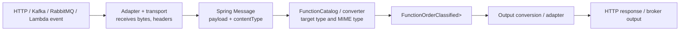
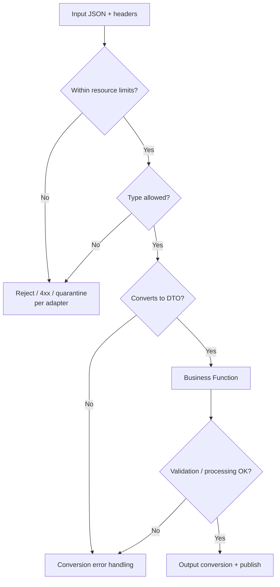

# Verifying JSON Conversion and Allowed Data Type Policies

## 1. The Problem: Library Upgrade Changes How the Same JSON Is Interpreted

An order-processing service uses **Spring Cloud Function** with a `Function<OrderCreated, OrderClassified>` bean. That same Java logic is used across HTTP, Spring Cloud Stream (Kafka/RabbitMQ), or a serverless adapter. Changing the release train, Spring Boot, Spring Cloud Function, or the JSON library can alter the **data conversion path**, even when the business function itself does not change.

Suppose a producer sends:

```json
{
  "eventId": "evt-101",
  "orderId": "ORD-101",
  "totalInCents": 150000
}
```

After upgrading, the application must be able to answer:

- By what mechanism is the JSON string or `byte[]` converted into `OrderCreated`?
- How do `contentType=application/json` and the `Function<T,R>` signature interact?
- When a client specifies `application/json;type=...`, does the framework allow arbitrary class loading?
- Are there limits on body size, JSON array element counts, and memory usage?
- If using a Kafka native deserializer, do Spring Cloud Function's restrictions still apply along that path?
- Which mapper—Jackson 2, Jackson 3, or Gson—is actually processing JSON?
- Is a payload rejected due to a security change a producer regression to fix, or an error requiring a relaxed policy?

This lesson belongs to the **Upgrades** chapter of the **SPRING_CLOUD_FUNCTION** module. The overarching goal of Spring Cloud Function is developing reusable `Supplier`, `Function`, and `Consumer` logic using `FunctionCatalog`, composition, and message conversion, independent of the calling protocol. Nevertheless, **every adapter still has data and security boundaries that must be tested individually**.

After this lesson, you will know how to establish an **allowed types** policy, distinguish allowlist mechanisms across layers, build regression tests for JSON and class loading, and upgrade or roll back without silently widening deserialization capabilities.

## 2. Separate Five Layers Before Hunting Conversion Errors



This diagram is a **conceptual model**, not a guarantee that every adapter executes the exact same internal steps. When using Kafka native deserialization, Java object creation may occur before Function's usual conversion step. When calling a Java bean directly in a unit test, no transport or JSON converter runs at all.

| Layer | What does it know? | Responsibility | Typical errors |
| --- | --- | --- | --- |
| HTTP/Stream/serverless adapter | Protocol, body, metadata | Converts external data into input to invoke the function | Oversized payload, bad headers, invalid body |
| Transport binder/codec | Kafka serializer/deserializer, AMQP properties | Produces/reads broker representation | Codec errors, type headers, trusted packages |
| `FunctionCatalog`/invocation | Function name, Java signature, composition | Lookup, wrappers, and coordinating type conversion | Missing converter, incompatible parameter types |
| JSON converter/mapper | MIME type, DTO, JSON structure | Parses/generates JSON per library and policy | Wrong number type, oversized array, disallowed dynamic type |
| Business function | `OrderCreated`, business rules | Validation and order classification | Blank ID, negative amount, changed rules |

**Principle:** JSON errors usually occur **before** `Function.apply(...)` runs. A `try/catch` inside the function cannot handle pre-invocation deserialization errors. Conversely, a blank `orderId` error after the DTO has been constructed is a **business validation** error, not a class-trust issue.

## 3. Typed Java Signatures Are the Preferred Conversion Path

One way to keep boundaries clear is to declare concrete DTOs:

```java
import java.util.function.Function;

import org.springframework.boot.SpringApplication;
import org.springframework.boot.autoconfigure.SpringBootApplication;
import org.springframework.context.annotation.Bean;

@SpringBootApplication
public class OrdersApplication {

    public static void main(String[] args) {
        SpringApplication.run(OrdersApplication.class, args);
    }

    public record OrderCreated(
            String eventId,
            String orderId,
            long totalInCents) {}

    public record OrderClassified(
            String eventId,
            String orderId,
            String priority) {}

    @Bean
    Function<OrderCreated, OrderClassified> classifyOrder() {
        return order -> {
            if (order.eventId() == null ||
                    order.eventId().isBlank() ||
                    order.orderId() == null ||
                    order.orderId().isBlank() ||
                    order.totalInCents() < 0) {
                throw new IllegalArgumentException(
                        "Invalid OrderCreated");
            }

            return new OrderClassified(
                    order.eventId(),
                    order.orderId(),
                    order.totalInCents() >= 100_000L
                            ? "PRIORITY" : "STANDARD");
        };
    }
}
```

This is a Java 17+ example using `record`. `Function<OrderCreated,OrderClassified>` supplies the `OrderCreated` target type to the framework's conversion mechanism. When the input is a `Message<byte[]>` with a JSON content type, Spring Cloud Function can use a compatible converter to construct the DTO before invoking the function.

**There is no need for the caller to supply a Java class name in a header** for this use case. The function signature already describes the input type. A typed contract design is usually safer and easier to maintain than `Function<Object,Object>` paired with arbitrary client-supplied `type` parameters.

### Do Not Confuse Conversion with Validation

Even after JSON is converted into `OrderCreated`, the program still needs to verify:

- `eventId` and `orderId` are present and valid.
- `totalInCents` is non-negative and within business-supported bounds.
- Event type, schema version, and access permissions match.
- Whether a duplicate event with an already-processed `eventId` is arriving.

The converter decides whether a Java object can be constructed; it does not prove the event is trustworthy or business-valid.

## 4. How Do Content Type, Target Type, and Converter Work Together?

Spring Cloud Function uses two Spring mechanisms depending on the input kind:

1. **`MessageConverter`** when input data is a `Message<?>`; requires a Java target type and may require `contentType`.
2. **`ConversionService`** for non-`Message` data when type conversion is needed.

For HTTP/Stream adapters, input is normally represented as a `Message`, so you should trace the message conversion path.

Per Spring Cloud Function documentation, common converters include:

| Converter | Use case | Does not guarantee by itself |
| --- | --- | --- |
| JSON message converter | `application/json` with matching target type | Valid schema, business validation, external security limits |
| String message converter | `text/plain` for text data | Turning arbitrary JSON into a valid business DTO |
| Byte-array message converter | `application/octet-stream` and `byte[]` | Understanding an arbitrary binary format |
| Custom converter | Custom MIME type, custom types | Safety by default without an allowlist/limits |

Example:

```text
payload: byte[] containing JSON
contentType: application/json
target type: OrdersApplication.OrderCreated
          |
          v
    OrderCreated(...)

payload: byte[] containing JSON
contentType: text/plain
target type: OrderCreated
          |
          v
    conversion may fail or yield a different result
```

`contentType` is a **format hint**, whereas the target type comes from the signature, permitted metadata, or an adapter contract. Never assume that merely setting `content-type: application/json` automatically allows every payload and every class.

### Illustrative Spring Cloud Stream Configuration

```yaml
spring:
  cloud:
    function:
      definition: classifyOrder
    stream:
      bindings:
        classifyOrder-in-0:
          destination: orders.created
          group: order-classifiers
          content-type: application/json
        classifyOrder-out-0:
          destination: orders.classified
          content-type: application/json
```

Here `classifyOrder-in-0` is the input binding, `orders.created` is the destination, and `order-classifiers` is the consumer group. The Java signature decides the target type; the content type helps pick the converter. If an incoming message carries a `contentType` header different from the binding config, check actual precedence on your exact adapter/version.

## 5. MIME `type` Parameter: Flexible Feature Requiring Control

Spring Cloud Function supports a **`type` parameter in the MIME content type**, for example:

```http
Content-Type: application/json;type=com.example.orders.api.OrderCreated
```

This feature is useful when **the target type is unknown when authoring the function**, such as `Function<?,?>` or `Function<Object,Object>`. The converter can use the `type` parameter to choose a target Java class instead of relying solely on the generic signature.

However, a class name coming from a request or header is **potentially untrusted input**. Never assume that because a client sent a syntactically valid class name, the application should load that class.

Per Spring Cloud Function documentation on the current branch, to use the **dynamic `type` parameter**, allowed classes must be explicitly declared in a classpath file:

```text
META-INF/deserializable.types
```

This is a **specific class allowlist** serving Spring Cloud Function's dynamic type mechanism; it is neither a list of callable function names nor the `trusted.packages` setting of Kafka's deserializer.

## 6. Declaring the Allowed Types List: `META-INF/deserializable.types`

Suppose the source code has two DTOs in a package:

```java
package com.example.orders.api;

public record OrderCreated(
        String eventId, String orderId, long totalInCents) {}

public record OrderClassified(
        String eventId, String orderId, String priority) {}
```

If the application **genuinely** needs clients to specify one of these two types via the MIME header, create a file in the project:

```text
src/main/resources/META-INF/deserializable.types
```

with contents:

```text
com.example.orders.api.OrderCreated
com.example.orders.api.OrderClassified
```

These steps **illustrate the resource contents in this lesson** and do not require creating files outside your assigned Markdown deliverables. Spring Cloud Function documentation allows one fully qualified class name per line, and also describes comma-separated names on a single line. For readability and auditing, **one class per line** is usually clearer.

When the application builds, the file must reside on the **classpath** of the runnable artifact, typically packaged inside the JAR at `META-INF/deserializable.types`.

### 6.1. How It Works by Contract

```text
Input:
  Content-Type: application/json;type=com.example.orders.api.OrderCreated
  Body: {"eventId":"evt-101","orderId":"ORD-101","totalInCents":150000}

If the type is allowlisted and a converter matches:
  The framework may select OrderCreated to deserialize.

If the type is not allowlisted:
  It is not accepted merely because the class is on the classpath.
```

**Important note:** for the typed bean `Function<OrderCreated, OrderClassified>` in Section 3, avoid adding `type` to headers unnecessarily. The allowlist primarily serves **dynamic type resolution**, not a requirement that every DTO named in a Java signature be listed in this file.

### 6.2. Policies to Enforce

- Add only DTOs meant for the public protocol with clear ownership and versioning.
- Never add JDK/framework/system classes just to make a failing payload "stop erroring."
- Do not use wildcard packages if the mechanism is not officially documented as supporting them.
- Never allow clients to pick arbitrary classes by names they construct.
- Review changes to the allowlist file as changes to the **API contract and security surface**.
- Verify the file inside the built artifact; a missing resource can cause dynamic-type flows to be rejected.
- Never use `Class.forName(...)` arbitrarily on header-supplied names to "work around" framework restrictions.

### 6.3. A Valid Allowlist Entry Does Not Mean a Valid Payload

A request with an allowed `OrderCreated` type can still contain:

```json
{"eventId":"evt-101","orderId":"","totalInCents":-1}
```

The converter can build the DTO, yet business logic must still reject the invalid event. The class allowlist only restricts **Java type selection**; it does not replace validation, authentication, authorization, tenant isolation, payload size limits, or idempotency.

## 7. Distinguishing Four "Allowed Types" Mechanisms Often Lumped Together

| Mechanism | Where applied | Purpose | Does not substitute for |
| --- | --- | --- | --- |
| `META-INF/deserializable.types` | Spring Cloud Function, MIME `type` parameter | Allows selecting **specific classes** during dynamic JSON conversion | Schema validation, Kafka JSON trusted packages |
| Jackson polymorphic type restrictions | Jackson mapper and `@JsonTypeInfo` if used | Defines valid subtypes when JSON carries a discriminator | Spring Cloud Function MIME class allowlist |
| Kafka JSON deserializer `trusted.packages` | Spring Kafka native deserialization | Limits classes/packages accepted from codec type headers | HTTP `type` header, business rules |
| Application event type/schema allowlist | Domain layer/API contract | Accepts only valid event types, schema versions, and producers | Classloader/codec trust boundaries |

**These policies are independent.** An application using only `Function<OrderCreated,OrderClassified>` with standard typed JSON might not need the dynamic `type` parameter at all. Conversely, if Kafka native `JsonDeserializer` is enabled, verify **Spring Kafka's** trusted-packages mechanism even if `META-INF/deserializable.types` is already present.

### 7.1. A Business Discriminator Is Not a Java Class Name

Event contract design should prefer:

```json
{
  "eventType": "ORDER_CREATED",
  "schemaVersion": 1,
  "eventId": "evt-101",
  "data": {
    "orderId": "ORD-101",
    "totalInCents": 150000
  }
}
```

Inside the application, verify `eventType` belongs to an approved set of names and deserialize `data` into a concrete DTO chosen by **the server**. This decouples the public contract from Java class names, making interoperability across Python/Go/Java producers and HTTP/serverless adapters much easier.

Never feed `eventType` arbitrarily into `Class.forName(eventType)`. A business string such as `ORDER_CREATED` should map to a handler/DTO via an explicit server-controlled lookup table.

### 7.2. When Polymorphism Is Unavoidable

If a schema requires multiple subtypes, use a **closed** set of subtypes with a tested decoder/configuration. Never enable broad default typing for untrusted JSON just to "avoid writing mappings." Test the exact DTO subtypes needed, schema versions, and error behavior when a client sends an unknown discriminator.

## 8. 2026 Security Fixes Impacting Conversion

As of **November 24, 2026**, two Spring security advisories published on **November 19, 2026** relate directly to this topic:

| Advisory | Issue | What to check when upgrading |
| --- | --- | --- |
| **CVE-2026-59439** | JSON arrays entering Spring Cloud Function lack adequate bounds, potentially causing out-of-memory errors | Patch version, input size limits, controlled large JSON array tests |
| **CVE-2026-59440** | Dynamic MIME `type` could cause the framework to attempt loading insufficiently restricted system/platform classes | Patch version, class allowlist, negative tests rejecting out-of-contract classes |

Per the **revised advisories dated November 20, 2026**, affected Spring Cloud Function versions and fixes include:

| Branch | Affected versions published in advisory | Published fix |
| --- | --- | --- |
| 5.0 | `5.0.0–5.0.5` | **`5.0.6`** OSS; `5.0.5.1` Enterprise |
| 4.3 | `4.3.0–4.3.5` | **`4.3.6`** Enterprise |
| 4.2 | `4.0.0–4.2.8` | **`4.2.9`** Enterprise |
| 3.2 (for CVE-2026-59439) | `3.2.17` and earlier | **`3.2.18`** Enterprise |

**Important:** use version numbers from the **corrected** security notices, not an older summary that listed pre-correction affected ranges. Verify the resolved version of `spring-cloud-function-context` and related libraries inside the deployed artifact. The Spring Cloud **2026.0.0** announcement confirms that fixes for both CVEs are included in Spring Cloud Function **5.1.0**.

Sources:
- [Spring CVE-2026-59439 — Unbounded JSON Collection](https://spring.io/security/cve-2026-59439/)
- [Spring CVE-2026-59440 — Arbitrary Class Loading](https://spring.io/security/cve-2026-59440/)
- [Spring Cloud 2026.0.0 release notes](https://spring.io/blog/2026/11/20/spring-cloud-2026-0-0-has-been-released/)

### 8.1. Never Trade Away a Security Patch for an Old Test

If an input accepted before the upgrade is rejected afterward because `type` is missing from the allowlist or a JSON array is too large, do not immediately turn off controls. Instead:

1. Determine whether the request belongs to an **approved contract** or out-of-contract usage.
2. If the type is valid and dynamic typing is genuinely required, add **only that DTO class** to the allowlist.
3. If the payload exceeds limits, revise the producer contract: paginate, split batches, or emit individual events.
4. For invalid types, preserve rejection behavior and record appropriate metrics.
5. Never log full sensitive payloads or internal system details upon rejection.

## 9. JSON Array Limits: Resource Failures Differ from Schema Errors

A JSON array is a valid JSON payload:

```json
[
  {"eventId":"evt-1","orderId":"ORD-1","totalInCents":1000},
  {"eventId":"evt-2","orderId":"ORD-2","totalInCents":2000}
]
```

Yet that does not mean a caller may send **millions of elements** in one request. When a converter builds a collection and passes each element through the function, it can consume far more memory and time than a single POJO. Left unbounded, it risks exhausting heap or overloading downstream systems.

### 9.1. Three Separate Limits to Consider

| Limit | Example control | Why separate? |
| --- | --- | --- |
| **Total bytes** | HTTP request body limit, gateway limit, message broker max size | Even a single element can be huge |
| **Element count** | Maximum events allowed in a batch | Many tiny elements still consume resources |
| **Complexity/nesting** | JSON depth, field count, string length | A single object can be overly deep or complex |

These limits should reflect business needs and real capacity. **Do not invent a property `spring.cloud.function.max-json-array-size`** unless your application version's documentation confirms it exists. A security advisory announces a patch; it does not mean every version exposes the exact same property name for limits.

### 9.2. Contract-Level Solution: Explicit Batch Caps

Suppose a service decides to accept at most 100 orders per batch. You can define a DTO:

```java
import java.util.List;

public record OrderBatch(
        String batchId,
        List<OrderCreated> orders) {}
```

Then validate:

```java
static final int MAX_BATCH_ORDERS = 100;

static void validateBatch(OrderBatch batch) {
    if (batch == null ||
            batch.orders() == null ||
            batch.orders().isEmpty() ||
            batch.orders().size() > MAX_BATCH_ORDERS) {
        throw new IllegalArgumentException("Invalid batch size");
    }
}
```

**Post-parse business validation is only one layer of defense.** If an input is large enough to trigger OOM **before `OrderBatch` is constructed**, this Java check never executes. Therefore, enforce byte and allocation limits at the HTTP gateway, event source, parser, or adapter prior to or alongside conversion.

### 9.3. Do Not Confuse JSON Arrays with `Flux`

```java
Function<Flux<OrderCreated>, Flux<OrderClassified>>
```

is a reactive pipeline over multiple elements across time. It does not mean every Kafka input is a JSON array. Conversely, a JSON array received over HTTP does not automatically split into multiple Kafka messages without explicit splitting/producer design.

When upgrading, test both cases separately:

- **A single message containing a JSON array**: how the framework handles collections, limits, and errors.
- **Multiple independent messages**: through a Stream input binding, per-event handling, and binder error paths.

## 10. Jackson 2, Jackson 3, and Gson: Do Not Infer Mapper Behavior from Spring Boot Names Alone

Moving from Boot 3 to Boot 4 can change the JSON pipeline. Spring Boot 4 documentation favors **Jackson 3**; Jackson 2 is supported as a transition path and marked deprecated in Boot 4. Auto-configuration properties and bean types differ between Jackson 2 and Jackson 3.

Spring Cloud Function also has its **own JSON abstraction**:

```text
org.springframework.cloud.function.json.JsonMapper
```

Spring Cloud Function documentation describes Jackson and Gson support, along with the property:

```yaml
spring:
  cloud:
    function:
      preferred-json-mapper: jackson
```

Documented values are `jackson` or `gson`; verify against your **resolved Function version**. This is a Spring Cloud Function property, **distinct** from Spring Boot Web's mapper-selection properties.

For example, a Boot 4 property for HTTP converters:

```yaml
spring:
  http:
    converters:
      preferred-json-mapper: jackson
```

Do not assume changing Boot's HTTP property guarantees you changed the mapper Spring Cloud Function uses for message conversion. Two adapters or layers may use **different mapper mechanisms**, especially if the app registers customizers or custom converters for Gson or Jackson.

### 10.1. Changes That Require Testing

| Topic | Test to run |
| --- | --- |
| Jackson 2 → Jackson 3 | Do custom modules, annotations, and custom serializers still work? |
| Gson ↔ Jackson | `null` handling, unknown fields, numeric coercion, date/time |
| Preferred mapper selection | Verify the intended converter runs, not just YAML presence |
| Enums and casing | `"priority"` vs. `"PRIORITY"` |
| Large integers | Check overflow/truncation/numbers beyond `long` |
| Nested/collection payloads | Parser behavior, memory/time, and input bounds |
| Error reporting | How exceptions surface in HTTP responses/DLQ; check for data leaks |
| Output formatting | JSON field names, date formats, Unicode, null omission |

Never assume all Jackson 2 serializer settings automatically carry over to Jackson 3 after an upgrade. Reading migration notes and testing actual JSON output is far more reliable.

## 11. Golden JSON Contracts: Cases That Commonly Regress During Upgrades

A golden fixture is a fixed request paired with an approved expected response/behavior. You do not need a binary dump of the entire app—just the critical contracts.

### 11.1. A Valid Event

Input:

```json
{"eventId":"evt-101","orderId":"ORD-101","totalInCents":150000}
```

Expected output:

```json
{"eventId":"evt-101","orderId":"ORD-101","priority":"PRIORITY"}
```

### 11.2. Missing and Null Fields

```json
{"eventId":"evt-102","orderId":null,"totalInCents":1000}
```

```json
{"eventId":"evt-103","totalInCents":1000}
```

In a Java record, both `null` and an omitted field can populate a `null` field depending on the mapper and config. So "JSON parsed successfully" is not enough. The application needs `orderId` validation or appropriate Bean Validation, and tests must verify the response/error route.

### 11.3. Invalid Numeric Types

```json
{"eventId":"evt-104","orderId":"ORD-104","totalInCents":"invalid"}
```

```json
{"eventId":"evt-105","orderId":"ORD-105","totalInCents":9223372036854775808}
```

A `long` field cannot represent numbers exceeding `Long.MAX_VALUE`. Depending on the mapper and settings, errors or coercion differ. Tests must prove there is **no silent overflow or truncation**, rather than inferring behavior only from valid inputs.

### 11.4. Unknown Fields and Versioning

```json
{
  "eventId": "evt-106",
  "orderId": "ORD-106",
  "totalInCents": 5000,
  "promotionCode": "NEW"
}
```

The application must explicitly decide whether **unknown fields are ignored or rejected**, aligned with its schema evolution policy. After upgrading Jackson or Gson, test this contract instead of assuming every mapper shares the same default.

### 11.5. Unicode, Escapes, and Formatting

```json
{"eventId":"evt-107","orderId":"ĐƠN-107","totalInCents":12345}
```

Verify UTF-8, escaped Unicode, long strings, and round-trip serialization. If IDs disallow Unicode, validation must reject it explicitly; do not let codec differences quietly alter business rules.

## 12. `Message<T>` and Headers: Check Output Conversion, Do Not Copy Blindly

If a function needs `correlationId` from metadata, you can write:

```java
import java.util.function.Function;

import org.springframework.context.annotation.Bean;
import org.springframework.messaging.Message;
import org.springframework.messaging.support.MessageBuilder;

@Bean
Function<Message<OrderCreated>, Message<OrderClassified>>
classifyWithHeaders() {

    return message -> {
        OrderCreated order = message.getPayload();
        OrderClassified result = classify(order);

        var builder = MessageBuilder.withPayload(result)
                .setHeader("processedBy", "order-classifier");

        Object correlationId =
                message.getHeaders().get("correlationId");

        if (correlationId != null) {
            builder.setHeader("correlationId", correlationId);
        }

        return builder.build();
    };
}
```

In this snippet, `OrderCreated`, `OrderClassified`, and `classify(...)` belong to the domain logic defined in the configuration class. It is not a standalone runnable file; the runnable sample is `OrdersApplication` in Section 3.

Notes:

- `Message<T>` carries **payload and headers**; it does not create extra bindings.
- Headers may include `contentType`, correlation IDs, and transport-specific metadata.
- If output changes from `String` to a DTO, copying an incoming `contentType: text/plain` verbatim can make the output converter pick the wrong strategy.
- Kafka headers, RabbitMQ properties, HTTP headers, and AWS Lambda event metadata do not map 1:1.
- Forward only required business headers and let the output binding/adapter generate appropriate transport metadata.

**Required tests:** accurate JSON payload, expected Java type for `correlationId`, unknown headers not leaked, and the MIME `type` parameter not forwarded unintentionally.

## 13. Kafka Native JSON Deserializer: A Completely Different Trust Policy

Spring Cloud Stream lets you choose between **framework conversion** and binder-level **native decoding**. For example:

```yaml
spring:
  cloud:
    stream:
      bindings:
        classifyOrder-in-0:
          destination: orders.created
          group: classify-workers
          content-type: application/json
          consumer:
            useNativeDecoding: false
```

With `useNativeDecoding: false`, the framework interprets the message using `contentType` and target type. In native mode:

```yaml
spring:
  cloud:
    stream:
      bindings:
        classifyOrder-in-0:
          destination: orders.created
          group: classify-workers
          consumer:
            useNativeDecoding: true
```

The Kafka client/binder requires a properly configured deserializer to produce the expected Java value. When the deserializer returns `String`/`byte[]` or a different DTO than the function's type, conversion paths and failure modes differ. Never treat `content-type: application/json` as a "fix" for an incompatible native deserializer.

### 13.1. Trusted Packages of Kafka `JsonDeserializer`

Spring Kafka provides a `trusted.packages` mechanism for JSON type headers when using `JsonDeserializer`. **Never set it to `*` for untrusted data** just to silence an exception. Instead:

- Configure a fixed DTO target type in the deserializer whenever possible.
- Restrict trusted packages/classes tightly.
- Review `use.type.headers` and type mappings if producers emit type headers.
- Avoid coupling to Java class names of external-organization producers.
- Test Kafka native decoding with real broker records or Testcontainers.

**Separate the policies:**

```text
MIME type parameter on Message/HTTP:
  -> Spring Cloud Function META-INF/deserializable.types

Kafka JsonDeserializer type headers:
  -> Spring Kafka trusted.packages, type mapping,
     target type, and native serde configuration

Domain eventType:
  -> application business allowlist
```

Although all three mention "type," they **do not substitute for one another**. If data flows through a native Kafka decoder, tests for Function's MIME `type` parameter may never exercise Kafka's type-header path.

## 14. Boot 4 and Custom Converters: Avoid Hooking the Wrong Extension Layer

A project may register a custom `MessageConverter` to support a custom MIME type. Spring Cloud Function allows registering converters as beans; current documentation states that custom converters take precedence in the framework's conversion stack.

Example of a custom binary wire contract:

```java
import org.springframework.context.annotation.Bean;
import org.springframework.messaging.converter.MessageConverter;

@Bean
MessageConverter orderWireConverter() {
    return new OrderWireMessageConverter();
}
```

`OrderWireMessageConverter` is an application-implemented class using the Spring Messaging converter API; this illustrates only the registration point and does not assume the class already exists. A custom converter can alter message behavior **before the business function runs**.

When upgrading, verify:

1. Is the converter actually registered in the `ApplicationContext`?
2. Which MIME types and target classes does it support?
3. Does it take precedence over default JSON converters in the active composite converter?
4. Does it enforce size/type limits and handle untrusted input safely?
5. Are there tests ensuring invalid data and disallowed types are rejected?

If a custom converter bypasses `META-INF/deserializable.types` or uses unrestricted reflection on header-supplied class names, Spring Cloud Function's allowlist **does not automatically protect** that custom path. The implementer must enforce equivalent guardrails.

## 15. JSON Across HTTP, Spring Cloud Stream, and Lambda: Three Distinct Test Paths

The same `Function<OrderCreated,OrderClassified>` can run behind multiple adapters, yet each needs separate tests:

| Adapter | Test input | What to verify |
| --- | --- | --- |
| HTTP | `Content-Type: application/json` request and JSON body | Status, body, headers, payload size, MIME `type` rejection |
| Stream Kafka | Record/bytes and Kafka headers | Destination, group, framework vs. native decoding, error route |
| Stream RabbitMQ | Message body and AMQP properties | Conversion, DLQ, queue/routing, header mapping |
| AWS Lambda | Trigger-accurate JSON event | Handler, wrapper event, payload mapping, timeout/memory |
| Direct `FunctionCatalog` | Java value or `Message<?>` | Lookup, type conversion, and wrapper contract |

### 15.1. Sample HTTP Test

Suppose the Spring Cloud Function Web adapter exposes `/classifyOrder` in your chosen configuration:

```bash
curl -i -X POST "http://localhost:8080/classifyOrder" \
  -H "Content-Type: application/json" \
  --data '{"eventId":"evt-101","orderId":"ORD-101","totalInCents":150000}'
```

Expected behavior: output includes `priority: PRIORITY`, with status and headers matching your published contract. URL paths and HTTP methods must be verified on the actual adapter version; this example does not imply adding `spring-cloud-function-context` alone exposes an endpoint.

### 15.2. Dynamic Type Rejection Test

In an application **that uses the dynamic `type` parameter**, test:

```text
Request 1:
  Content-Type: application/json;type=com.example.orders.api.OrderCreated
  Body: valid DTO
  Expect: accepted per contract, since the class is allowlisted

Request 2:
  Content-Type: application/json;type=java.lang.Thread
  Body: {}
  Expect: rejected; does not load system class from request

Request 3:
  Content-Type: application/json;type=com.example.orders.api.Unknown
  Body: {}
  Expect: rejected; does not accept unapproved types
```

`java.lang.Thread` is used here solely as a **class name for rejection testing**, not requesting creation or execution of any risky system object. Exact HTTP status and error shape depend on the adapter; what matters is that the request is rejected and the disallowed type is never loaded or instantiated.

### 15.3. Spring Cloud Stream Test Binder

You can send test messages to input binding `classifyOrder-in-0` and assert output from `classifyOrder-out-0` to verify wiring and JSON conversion. However, the test binder **does not replace** testing Kafka `JsonDeserializer`, RabbitMQ properties, or producer schemas in a real environment.

### 15.4. Lambda Event Sources May Wrap Payloads

An event from API Gateway/SQS/Kinesis does not necessarily have a raw `OrderCreated` JSON body. It may contain wrappers, metadata, or a **batch of records**. The Lambda adapter must map the event source appropriately and define retry/partial-failure semantics per the platform. Do not take a passing HTTP test as proof that Lambda deserializes the same way.

## 16. Designing a Positive/Negative Test Matrix

| Test ID | Input | What must be proven |
| --- | --- | --- |
| JSON-01 | Schema-valid `OrderCreated` | Converts to DTO and returns expected output |
| JSON-02 | Malformed JSON syntax | Controlled rejection, no side effects |
| JSON-03 | Missing/`null` required field | Contract validation works |
| JSON-04 | Wrong numeric type, overflow | No dangerous silent coercion |
| JSON-05 | Unknown field | Follows schema evolution policy |
| JSON-06 | Valid Unicode/escapes | Data preserved accurately |
| JSON-07 | `text/plain` content type with JSON body | Does not silently route through wrong converter |
| JSON-08 | Header `application/json;type=allowed DTO` | Works only when dynamic typing path is designed |
| JSON-09 | Header `type=non-allowlisted class` | Rejected; unapproved class is never loaded |
| JSON-10 | Header `type` naming a system class | Rejected |
| JSON-11 | Array within limit | Batch processed per contract |
| JSON-12 | Array exceeding limit | Rejected/quarantined without OOM |
| JSON-13 | Deeply nested object/array | Resource limits and error route enforced |
| JSON-14 | Duplicate event ID | No duplicate side effects executed |
| JSON-15 | Kafka native `JsonDeserializer` | Type headers/trusted packages controlled |
| JSON-16 | Output `Message` headers | No unintended metadata leaked from input |
| JSON-17 | Same fixture across HTTP/Stream/Lambda | Business contract preserved across adapters |

### 16.1. Dual-Version Comparison Runs

When upgrading from Function 5.0.x to 5.1.x:

1. Record baseline artifact digest, BOM, and Java runtime.
2. Run the full suite against the baseline.
3. Run the same suite against the target version.
4. Categorize differences: **expected security hardening**, **intended business change**, or **unexpected regression**.
5. Never alter expected outcomes for security-rejected inputs merely to achieve "100% pass rate."
6. Record responses, metrics, conversion errors, and memory/CPU usage during limit tests.

**The test suite must share identical data fixtures while allowing distinct expected policies** if an approved policy changed—for example, "an unapproved type must now be rejected."

## 17. Broker-Free Business and DTO Unit Tests

Using `OrdersApplication` from Section 3, test the rules:

```java
import static org.junit.jupiter.api.Assertions.assertEquals;
import static org.junit.jupiter.api.Assertions.assertThrows;

import org.junit.jupiter.api.Test;

class OrderBusinessTest {

    @Test
    void classifiesPriority() {
        var app = new OrdersApplication();
        var function = app.classifyOrder();

        var result = function.apply(
                new OrdersApplication.OrderCreated(
                        "evt-101", "ORD-101", 150_000L));

        assertEquals("PRIORITY", result.priority());
        assertEquals("evt-101", result.eventId());
    }

    @Test
    void rejectsInvalidOrder() {
        var app = new OrdersApplication();
        var function = app.classifyOrder();

        assertThrows(IllegalArgumentException.class,
                () -> function.apply(
                        new OrdersApplication.OrderCreated(
                                "evt-102", "", 100L)));
    }
}
```

These two tests prove **business logic is unchanged**. They do not parse JSON, enforce allowlists, or exercise framework converters. Therefore, a system needs **at least three testing layers**:

1. Unit tests for Java business functions.
2. `FunctionCatalog`/Message conversion integration tests using payload bytes, headers, and target types.
3. Real adapter integration tests: HTTP, Kafka/RabbitMQ, or AWS Lambda.

### Test `FunctionCatalog` Separately

During upgrades, confirm `catalog.lookup("classifyOrder")` finds the right bean and wrapper invocation handles payloads per the type contract. Do not assume the returned wrapper has the same object identity or class as the raw bean. When testing conversion, supply `Message<byte[]>` with an appropriate `contentType` rather than only invoking the function with a Java record.

## 18. Testing Resource Limits Without Breaking the Environment

Safe testing requires **small thresholds, isolated environments, and memory/time caps**. Never generate multi-gigabyte payloads or try to force OOM on shared environments.

Example test for business limit `MAX_BATCH_ORDERS=100`:

```java
import static org.junit.jupiter.api.Assertions.assertThrows;

import java.util.List;
import java.util.stream.IntStream;
import org.junit.jupiter.api.Test;

class OrderBatchValidationTest {

    @Test
    void rejectsBatchOf101Orders() {
        var orders = IntStream.range(0, 101)
                .mapToObj(i -> new OrderCreated(
                        "evt-" + i, "ORD-" + i, 100L))
                .toList();

        var batch = new OrderBatch("batch-1", orders);

        assertThrows(IllegalArgumentException.class,
                () -> validateBatch(batch));
    }
}
```

This is an **illustrative test** assuming `OrderCreated`, `OrderBatch`, and `validateBatch` are placed in the proper package with static imports. It verifies only a business cap. To prove protection against unbounded JSON collections, test on the **actual conversion path** with a bounded body and confirm the request is rejected before exceeding resource budgets.

### Essential Guardrails

- Cap HTTP request bytes at the reverse proxy, gateway, or server.
- Cap broker message size/max batch size suited to your infrastructure.
- Apply rate limits and concurrency limits on untrusted endpoints.
- Set heap/container memory limits, timeouts, and circuit breakers where appropriate.
- Enforce field/count/depth limits on DTOs and schemas per policy.
- Apply security patches for Function/Boot/mappers/adapters.
- Emit metrics for rejected inputs, unusually large frequencies, and conversion latency.

No single guardrail replaces upgrading the affected framework to a patched version.

## 19. Bad Data Must Land on the Right Error Path



This flowchart shows the **desired control sequence**. A parser may still read part of a body before counting elements, and error routes differ across adapters. Do not conclude every failure maps to the same HTTP status or the same DLQ.

| Failure | Preferred handling layer | Notes |
| --- | --- | --- |
| Body too large | Gateway/HTTP server/event adapter | Prevent resource exhaustion before function runs |
| MIME type not in allowlist | JSON conversion boundary | Reject before loading classes |
| Native Kafka deserializer error | Kafka client/binder error handler | Function may never be invoked |
| JSON violates schema | Converter/validation | Do not infinitely retry poison messages |
| Business validation failure | Function/application | Explicit rejection response or deliberate quarantine |
| Output JSON encoding failure | Producer/adapter | Function already ran; side effects may have occurred |
| DLQ/DLT publish failure | Binder/recovery pipeline | Must alert and have a recovery procedure |

### Do Not Swallow Errors at the Wrong Layer

If a `try/catch` inside a function returns a fake success object when JSON broke the contract, downstream systems may treat corrupted messages as valid. If the binder automatically retries a permanent schema error, a partition or queue can stall or trigger a retry storm. Clearly classify **transient** vs. **permanent** failures.

## 20. Upgrade Pitfall: Jackson/Function Settings May Differ Per Adapter

Build an empirical inventory table:

| Axis | Baseline | Target | Evidence required |
| --- | --- | --- | --- |
| Boot + Cloud train | Current versions | Compatible pair | Effective dependency graph |
| Function module | Resolved `spring-cloud-function-context` | Patched version with security fixes | Advisory + dependency tree |
| Function JSON engine | Actual Jackson/Gson in use | Selected engine | Startup/config + conversion test |
| HTTP JSON engine | MVC/WebFlux mapper | New mapper | HTTP golden test |
| Kafka native mode | Enabled/disabled | Keep or change deliberately | Kafka deserializer test |
| MIME `type` usage | Which clients send it and why | Minimal allowlist | Negative type tests |
| JSON array semantics | Batch vs. per-element | Explicit bounds | Batch fixtures |
| Headers | Content type, correlation, type | Header policy | Adapter tests |
| Error route | HTTP error, DLT/DLQ | Recovery path | Integration tests |
| Runtime | JDK/container/Lambda | Supported runtime | Production-like smoke test |

**Important:** the dependency graph reveals library versions; it does not prove which mapper wins when custom converters or multiple JSON libraries coexist. Always verify **runtime behavior**.

### Verification Commands for Learners

```bash
# Maven
mvn help:effective-pom
mvn dependency:tree

# Gradle
./gradlew dependencies --configuration runtimeClasspath
./gradlew dependencyInsight \
  --configuration runtimeClasspath \
  --dependency spring-cloud-function-context

# Java runtime
java -version
```

Do not treat a version written in `pom.xml` as absolute truth if BOMs, direct overrides, or transitive dependencies resolve something else. For Docker/Lambda, verify the deployed artifact digest and runtime image/configuration.

## 21. Safe Upgrade and Rollback Plan

### Phase A — Discovery

- Document function signatures, dynamic MIME `type` clients, and custom converters.
- Identify all exposed DTOs; eliminate dynamic class selection if unnecessary.
- Gather JSON fixtures: valid, invalid, arrays, Unicode, nulls, overflows, and headers.
- Record baseline error statuses, DLQ/DLT counts, retries, and message throughput.
- Determine whether Kafka native `JsonDeserializer` and `trusted.packages` are used.
- Verify Spring Cloud Function/Boot/Stream versions via the dependency graph.

### Phase B — Update

- Select **compatible** Spring Boot and Spring Cloud release trains.
- Ensure the Function module is on a version containing the relevant **security fixes** from advisories.
- Include in `META-INF/deserializable.types` only DTOs genuinely requiring dynamic MIME typing.
- Remove overly broad trust settings in custom/native deserializers.
- Document batch/request size budgets and schema versioning policy.
- Never disable guardrails simply because a baseline test previously accepted risky payloads.

### Phase C — Verification

1. Unit tests for business functions.
2. `FunctionCatalog` lookup and composition tests.
3. Message conversion tests on typed POJOs and dynamic `type`.
4. Negative tests rejecting classes outside the allowlist.
5. Controlled size-limit tests (without inducing OOM).
6. HTTP, Kafka/RabbitMQ, and Lambda tests matching production adapters.
7. Retry/quarantine and idempotent replay tests.
8. Before–after comparisons of throughput, memory, error rates, and processed counts.

### Phase D — Canary and Rollback

- Deploy canary via reproducible image digests.
- Monitor conversion failures, error statuses, rejected type counts, and DLT/DLQ.
- Triage legitimate clients rejected by new schemas or allowlists.
- Before rolling back, confirm producers have not emitted data that older consumers cannot parse.
- Never roll back to a version still vulnerable to CVEs without formal risk review, mitigations, and security sign-off.
- Remember already-published events do not vanish when rolling back a JAR; keep schemas backward compatible while two versions coexist.

**A rollback cannot "undo" already-processed messages or events sitting on a broker.** If new code writes a new event schema, rolling back producers/consumers can break older consumer groups. Design schema evolution and replay plans prior to rollout.

## 22. Troubleshooting Matrix for Common Issues

| Symptom | Possible cause | Where to check |
| --- | --- | --- |
| After patching, `application/json;type=...` stops working | Type missing from allowlist | Inspect `META-INF/deserializable.types` in artifact and client contract |
| Function receives `Map` instead of POJO | Overly broad generic type, converter, or native mode | Signature, content type, target type, codec |
| `ClassNotFoundException` from a header | Invalid type name, missing class, or rejected | Eliminate dynamic class loading; do not widen trust blindly |
| Large JSON array payload rejected after upgrade | New security limit or gateway/binder cap | Adjust batch contract/split events; do not disable patch |
| Function unit test passes, HTTP fails | Test bypassed body conversion/headers | HTTP golden test with real content type |
| Kafka native returns `String` instead of `OrderCreated` | Deserializer configured as `String` | Native serde config and target type |
| JSON header trust error | Kafka `trusted.packages`/type mapping | Test native deserializer; never use `*` |
| Jackson customizer has no effect | Boot 4 Jackson 3 vs. 2 or different mapper | Resolved libraries, bean types, settings |
| Output changes when Gson and Jackson coexist | Different JSON mapper selected | `preferred-json-mapper` property and runtime test |
| `contentType` is `text/plain` when returning DTO | Copied incoming header verbatim | Filter headers selectively; set proper output content type |
| Exception thrown before Function runs | Converter/deserializer failed | Inspect error handler at that layer |
| DLQ fails to write error payload | Serializer, ACL, topology | Binder-specific integration test |
| Missing JSON field yields risky default value | Mapper and primitive DTO field behavior differ | Business validation, nullable fields, tests |
| Schema version change breaks old consumer | Not backward compatible | Contract evolution and canary rollback plan |
| Parser takes excessive CPU/time | Deeply nested or huge batch, or parser config | Limit bytes/count/depth, profile, and patch |
| Allowlist too broad | Arbitrary classes added or unsafe default typing | Audit class list and negative tests |

Helpful debugging sequence:

**Artifact/dependency version → adapter → bytes/headers → contentType → target type → allowlist/native trusted classes → JSON mapper → business validation → output codec → error route.**

## 23. Hands-On Exercises

### Exercise 1: Does a Typed Function Need Dynamic MIME `type`?

Given `Function<OrderCreated,OrderClassified>` and a `Content-Type: application/json` request, identify where the Java target type comes from, why clients do not need to send a class name, and which tests prove JSON converts properly into the DTO.

### Exercise 2: Build a Minimal Allowlist

An application genuinely uses `application/json;type=...` and supports only two DTOs: `com.example.orders.api.OrderCreated` and `com.example.orders.api.OrderCancelled`. Write the contents of `META-INF/deserializable.types`. Name at least three classes you must never add just to clear an error, and explain how to verify the file is inside the built JAR.

### Exercise 3: Reject Out-of-Contract Dynamic Types

Design two negative tests:

1. A `type` header naming a class outside approved packages/domains.
2. A `type` header naming a system/platform class.

Define expected rejections and metrics, **without** writing code that dynamically executes classes from headers.

### Exercise 4: JSON Arrays and Resource Limits

A producer plans to send a JSON array of 50,000 orders. Design an approach for splitting messages, batch caps, byte limits, and retry/idempotency. Explain why post-parse Java validation alone cannot prevent OOM before conversion.

### Exercise 5: Distinguish Three Trust Policies

Given three components:

- Spring Cloud Function MIME `type`.
- Kafka native `JsonDeserializer`.
- Domain event `eventType`.

Identify the allowlist/configuration and matching tests for each. Why does `META-INF/deserializable.types` not replace `trusted.packages`?

### Exercise 6: Upgrading Spring Boot 3 → Boot 4

An application has a custom Jackson 2 `ObjectMapper`, a Spring Cloud Function JSON converter, and an HTTP WebFlux endpoint. Identify at least three potential mapper/configuration differences when moving to Boot 4, and propose a golden test suite rather than merely comparing dependency versions.

### Exercise 7: Investigating Errors Before Function Execution

Incoming JSON has `totalInCents: "not-a-number"` and the bean expects `OrderCreated`. Why won't a `try/catch` inside the lambda catch this? Under what contract should this error be classified as a transient retry vs. routed to quarantine?

### Exercise 8: Post-Patch Security Verification

Create a test plan for CVE-2026-59439 and CVE-2026-59440 using bounded payloads, an isolated test environment, and a minimal class allowlist. List practices to avoid (such as sending gigabyte-sized payloads in production).

### Exercise 9: One Function, Multiple Adapters

Expose `Function<OrderCreated,OrderClassified>` over HTTP, Kafka, and AWS Lambda. Build a table comparing input wire formats, headers, converters, request/event limits, and error paths. Which tests prove the business logic is shared while each adapter remains safe?

### Self-Assessment Questions

1. How do `contentType` and Java target type differ?
2. When does Spring Cloud Function use `MessageConverter`, and when can it use `ConversionService`?
3. Why is `Function<Object,Object>` + dynamic `type` riskier than typed `Function<OrderCreated,OrderClassified>`?
4. What is the exact filename and classpath location of the MIME `type` allowlist?
5. Does an allowed dynamic `type` guarantee the payload is business-valid?
6. Does `META-INF/deserializable.types` replace Kafka `trusted.packages`?
7. Why is Jackson `@JsonTypeInfo` a separate mechanism from the MIME `type` parameter?
8. How can a syntactically valid JSON array pose a resource exhaustion risk?
9. Which errors can happen before the business function is ever invoked?
10. Why must you check both Boot Web's mapper and Spring Cloud Function's mapper?
11. If upgrading with a security fix rejects an old request, is that necessarily a regression to undo?
12. Why are business-function unit tests insufficient to prove JSON conversion?
13. What must a Kafka native-decoding consumer verify beyond `content-type`?
14. Why shouldn't you use reflection on a client-supplied class name to "fill in" for an allowlist?
15. When rolling back to an older version, do already-published event schemas disappear automatically?

## 24. Summary

**Verifying JSON conversion and allowed data type policies** is a non-negotiable part of upgrading Spring Cloud Function:

- **Typed functional signatures** (`Function<OrderCreated,OrderClassified>`) provide a reliable contract for conversion at adapter boundaries; business validation must still run separately.
- **`contentType` and target type** work together to pick a converter; `application/json` does not implicitly allow arbitrary classes or schemas.
- **Dynamic MIME `type`** is a specialized feature that must be governed by the **`META-INF/deserializable.types`** allowlist per current Spring Cloud Function documentation.
- **Kafka native `JsonDeserializer`, Jackson polymorphism, and domain event types** have separate trust models; never use one allowlist in place of all of them.
- **JSON collection sizes** and class loading had 2026 security advisories; apply advisory-recommended patches, keep resource bounds active, and test rejected inputs.
- **Boot 4/Jackson 3, Gson, and custom converters** can alter how payloads are parsed; verify the actual mapper running in each adapter.
- **HTTP, Kafka/RabbitMQ, and Lambda** need separate integration tests even when invoking the same `Function` through `FunctionCatalog`.

The upgrade workflow should be: **inventory contracts and codecs → pick patched compatible versions → lock down dynamic types with a minimal allowlist → enforce resource limits → run golden/negative tests per adapter → roll out in phases while monitoring conversion errors**. Never relax deserialization permissions merely to keep an older build running; the goal is preserving **reusable business logic** while **minimizing the unintended accepted-data surface**.

### References

- [Spring Cloud Function — Programming model: Type conversion, MessageConverters, dynamic MIME type, and deserializable.types](https://docs.spring.io/spring-cloud-function/reference/spring-cloud-function/programming-model.html)
- [Spring Cloud Function — Reference documentation](https://docs.spring.io/spring-cloud-function/reference/)
- [Spring Cloud — 2026.0.0 release announcement, November 20, 2026](https://spring.io/blog/2026/11/20/spring-cloud-2026-0-0-has-been-released/)
- [Spring Security Advisory CVE-2026-59439: JSON Collection](https://spring.io/security/cve-2026-59439/)
- [Spring Security Advisory CVE-2026-59440: Arbitrary Class Loading](https://spring.io/security/cve-2026-59440/)
- [Spring Cloud Stream — Binding Properties](https://docs.spring.io/spring-cloud-stream/reference/spring-cloud-stream/binding-properties.html)
- [Spring Cloud Stream — Kafka Binder Configuration](https://docs.spring.io/spring-cloud-stream/reference/kafka/kafka-binder/config-options.html)
- [Spring for Apache Kafka — Serialization and Deserialization](https://docs.spring.io/spring-kafka/reference/kafka/serdes.html)
- [Spring Boot — JSON Mapping](https://docs.spring.io/spring-boot/reference/features/json.html)
- [Spring Boot — Externalized Configuration](https://docs.spring.io/spring-boot/reference/features/external-config.html)
