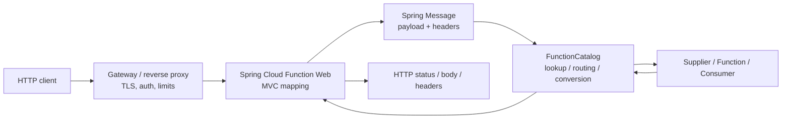
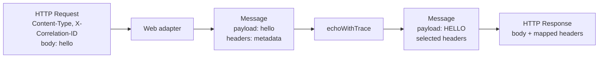
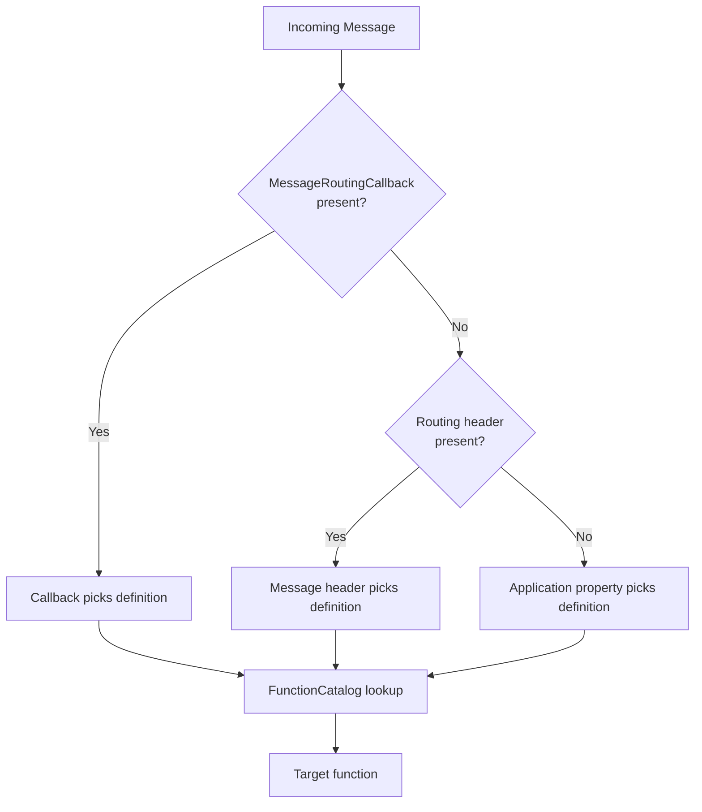

# Verifying the Web Adapter, Routing, and Headers After an Upgrade

## 1. Context: Application Starts Cleanly, Yet the HTTP Contract Changed

An application uses Spring Cloud Function to expose order-processing logic over HTTP. Before upgrading, clients call `POST /classifyOrder` with JSON and receive the classification result plus a correlation header for request tracing. After upgrading Spring Boot, Spring Cloud Function, or the adapter, any of the following can happen:

- `POST /classifyOrder` no longer reaches the expected function.
- `POST /` starts invoking a different function or stops working because the application registered an additional functional bean.
- Requests carrying a header specifying a function or routing expression alter the target handler.
- Business headers are dropped, while sensitive headers accidentally appear in responses.
- `Content-Type` and `Accept` yield JSON, plain text, or streaming responses that differ from the baseline.
- A `Consumer` previously used only internally becomes an HTTP endpoint because the application exports too many functional beans.
- Java unit tests still pass, yet behavior behind a reverse proxy or the real HTTP adapter differs.

These are issues to **check** when upgrading, not assertions that all of them occurred in a specific Spring Cloud Function release.

The goal of the **Upgrades** chapter in the **SPRING_CLOUD_FUNCTION** module is to preserve the reusability of `Supplier`, `Function`, `Consumer`, and `FunctionCatalog` across HTTP, events, or serverless environments. This lesson focuses on the **Spring Cloud Function Web adapter**, endpoint mapping rules, routing, and handling HTTP/`Message` headers.

After this lesson, you will be able to design a version-independent upgrade checklist, trace the source of every header, lock down the list of exported functions, test routing under controlled conditions, write regression tests for status/body/headers, and deploy a canary without losing rollback capability.

## 2. Responsibility Diagram: Business Logic Is Not the HTTP Adapter



A `Function<OrderCreated,OrderClassified>` defines only a Java transformation. When exposed over HTTP, the Spring Cloud Function Web adapter bridges HTTP requests to functions in the catalog. The adapter needs to know the **path**, **HTTP method**, **content type**, **routing instructions**, and how headers are translated.

| Component | Responsibility | Should not take on |
| --- | --- | --- |
| `Function<T,R>` | Business rules, typed DTOs | Servlet handling code, filtering hop-by-hop HTTP headers |
| `FunctionCatalog` | Function lookup, composition, wrappers, and compatible type conversion | Managing TLS, authentication, and reverse proxies |
| Web adapter | Exposes functional beans as endpoints and translates HTTP requests/responses to message/function invocations | Automatically authorizing every exported function |
| Spring Boot Web/MVC | Web server, filter chain, request mapping, converters, and lifecycle | Order classification business rules |
| Gateway/WAF/Ingress | TLS, edge authentication, request limits, proxy headers | Proving an internal function route is permitted |
| Serverless adapter | Receives events and triggers functions per platform | Preserving all HTTP headers or Web adapter retry semantics |

**Key point:** The Web adapter **does not fully replace Spring MVC or WebFlux**. Spring Cloud Function documentation describes web export as a lightweight way to expose functional beans over HTTP, especially useful for stateless/serverless patterns. An API needing resource-level authorization, multipart uploads, complex validation/permissions, or detailed CRUD contracts may call for dedicated controllers, filters, and security rather than cramming everything into routing headers.

## 3. Pin the Version Set Before Comparing Behavior

Every claim that "behavior changed after the upgrade" needs **baseline, target, artifact digest, and environment**.

As of **November 24, 2026**, the Spring Cloud `2026.0.0` release train was published on **November 20, 2026**, based on Spring Boot `4.2.0` and including Spring Cloud Function `5.1.0`. This is an illustrative version set suitable for building tests, not a mandatory requirement for every project.

| Axis to record | Illustrative baseline | Illustrative target |
| --- | --- | --- |
| Spring Boot | 3.5.x or 4.0.x/4.1.x per project | 4.2.0 |
| Spring Cloud BOM | Baseline release train | 2026.0.0 |
| Spring Cloud Function | Version resolved by baseline BOM | 5.1.0 |
| Spring Framework/Web MVC | Managed by baseline Boot | Managed by target Boot |
| Java build/runtime | Current JDK target | Verified JDK and runtime |
| Web adapter | Actual artifact and dependencies | Artifact managed by target BOM |
| Security/proxy config | Filters, policies, header forwarding | Approved configuration |
| Contract fixtures | Saved standard request/response pairs | Same fixtures; expected changes documented |

**Do not conclude an HTTP mapping changed in 2026.0.0 merely because an application test failed.** The cause could be a renamed bean, Spring profile, filter, gateway rewrite, selected `definition`, overridden dependency, or custom handler code.

Version-accurate reference sources: [Spring Cloud Function Web reference](https://docs.spring.io/spring-cloud-function/reference/spring-cloud-function/standalone-web-applications.html), [Programming model](https://docs.spring.io/spring-cloud-function/reference/spring-cloud-function/programming-model.html), and [Spring Cloud 2026.0.0 release announcement](https://spring.io/blog/2026/11/20/spring-cloud-2026-0-0-has-been-released/).

## 4. Which Dependency Enables the Web Adapter?

Per Spring Cloud Function documentation, the `spring-cloud-function-web` module provides auto-configuration for Spring Boot Web applications supporting MVC. The project also provides the `spring-cloud-starter-function-web` starter to bundle the necessary dependencies for a simple setup.

Example **Maven dependency** when a Boot parent and compatible Spring Cloud BOM are already configured:

```xml
<dependency>
    <groupId>org.springframework.cloud</groupId>
    <artifactId>spring-cloud-starter-function-web</artifactId>
</dependency>
```

Or **Gradle** with an appropriate BOM imported:

```kotlin
dependencies {
    implementation("org.springframework.cloud:spring-cloud-starter-function-web")
}
```

Do not pin `5.1.0` individually on dependencies when using the `2026.0.0` BOM. The BOM coordinates a matching set of artifacts; arbitrary explicit versions can skew Function context, the Web adapter, or other modules.

**A BOM does not create endpoints.** Importing `spring-cloud-dependencies` solely for version management **does not** add the web adapter to the classpath. If the app only includes `spring-cloud-function-context`, a `Function` bean enters `FunctionCatalog` without being exposed over HTTP.

### 4.1. Check the Classpath When Seeing 404

Verify:

1. `spring-cloud-function-web` or the corresponding starter is present in the deployed artifact.
2. The web application actually starts an **MVC server** per the target configuration.
3. Spring Cloud Function auto-configuration and application beans are created.
4. Web mappings are registered; inspect startup logs or endpoint mappings in the test environment.
5. Whether the Gateway/Ingress adds or strips a URL prefix.
6. The active profile and application config select the expected `spring.cloud.function.definition`.

Never read `pom.xml` alone and assume the deployment updated: the container could still be running an old image or resolving a different classpath than intended.

## 5. Application Example: Multiple Functions and a Header-Handling Function

Using Java 17+ with `record`, the following code defines three independent functions—uppercase, reverse string, and order classification—along with a function that reads/writes a correlation header.

```java
import java.util.Locale;
import java.util.function.Function;

import org.springframework.boot.SpringApplication;
import org.springframework.boot.autoconfigure.SpringBootApplication;
import org.springframework.context.annotation.Bean;
import org.springframework.messaging.Message;
import org.springframework.messaging.support.MessageBuilder;

@SpringBootApplication
public class WebUpgradeApplication {

    public static void main(String[] args) {
        SpringApplication.run(WebUpgradeApplication.class, args);
    }

    public record OrderCreated(
            String eventId,
            String orderId,
            long totalInCents) {}

    public record OrderClassified(
            String eventId,
            String orderId,
            String priority) {}

    @Bean
    Function<String, String> uppercase() {
        return value -> value.toUpperCase(Locale.ROOT);
    }

    @Bean
    Function<String, String> reverse() {
        return value -> new StringBuilder(value)
                .reverse().toString();
    }

    @Bean
    Function<OrderCreated, OrderClassified> classifyOrder() {
        return order -> {
            if (order.eventId() == null ||
                    order.eventId().isBlank() ||
                    order.orderId() == null ||
                    order.orderId().isBlank() ||
                    order.totalInCents() < 0) {
                throw new IllegalArgumentException(
                        "Invalid OrderCreated");
            }

            return new OrderClassified(
                    order.eventId(),
                    order.orderId(),
                    order.totalInCents() >= 100_000L
                            ? "PRIORITY" : "STANDARD");
        };
    }

    @Bean
    Function<Message<String>, Message<String>> echoWithTrace() {
        return input -> {
            String result = input.getPayload()
                    .toUpperCase(Locale.ROOT);

            var builder = MessageBuilder.withPayload(result)
                    .setHeader("x-processed-by", "web-upgrade-app");

            Object correlation =
                    input.getHeaders().get("x-correlation-id");

            if (correlation instanceof String trace &&
                    trace.length() <= 128 &&
                    trace.matches("[A-Za-z0-9_-]+")) {
                builder.setHeader("x-correlation-id", trace);
            }

            return builder.build();
        };
    }
}
```

`echoWithTrace` demonstrates **intentional header forwarding**; it does not copy every request header onto the response. Header names are written in lowercase for readability. In practice, HTTP headers are case-insensitive, yet how the adapter represents headers in Spring `MessageHeaders` must be verified with integration tests.

Because there are **multiple functional beans**, do not rely on Spring Cloud Function "guessing a single function." When you need to restrict public endpoints or pick a composition, configure `spring.cloud.function.definition` explicitly for the scenario.

## 6. Default HTTP Endpoints: Function Name in the URL

The **Standalone Web Applications** documentation for Spring Cloud Function 5.1.0 describes typical mappings when the Web adapter is active:

| HTTP method | URL | Functional bean type | Documented result |
| --- | --- | --- | --- |
| `GET` | `/{supplier}` | `Supplier<T>` | Elements from supplier; `200 OK` |
| `POST` | `/{function}` | `Function<I,O>` | Result of applying function; `200 OK` |
| `PUT` | `/{function}` | `Function<I,O>` | Result of applying function; `200 OK` |
| `GET` | `/{function}/{item}` | Function taking path parameter | Passes item to function; `200 OK` |
| `POST` | `/{consumer}` | `Consumer<T>` | Passes input to consumer; `202 Accepted` |
| `PUT` | `/{consumer}` | `Consumer<T>` | Passes input to consumer; `202 Accepted` |
| `DELETE` | `/{consumer}` | `Consumer<T>` | No response body; `204 No Content` |

This table reflects **documented behavior**, not a substitute for running tests in the target application: filters/security, exception handlers, custom MVC mappings, function state, and content negotiation can affect actual results.

Example calling a text function:

```bash
curl -i -X POST "http://localhost:8080/uppercase" \
  -H "Content-Type: text/plain" \
  -H "Accept: text/plain" \
  --data "hello"
```

Expected business result: body contains `HELLO`. This scenario uses a String-to-String function; there is no need to send a JSON object or pass a Java class name in an HTTP header.

Example calling a typed POJO function:

```bash
curl -i -X POST "http://localhost:8080/classifyOrder" \
  -H "Content-Type: application/json" \
  -H "Accept: application/json" \
  --data '{"eventId":"evt-101","orderId":"ORD-101","totalInCents":150000}'
```

Expected business output:

```json
{
  "eventId": "evt-101",
  "orderId": "ORD-101",
  "priority": "PRIORITY"
}
```

Never test solely with `new WebUpgradeApplication().classifyOrder().apply(...)` and conclude the Web adapter still works. Unit tests cannot verify status codes, request mapping, header propagation, or JSON conversion.

## 7. Checking URL Prefixes and Context Paths After Upgrading

The Web adapter supports the property:

```properties
spring.cloud.function.web.path=/api/functions
```

This property configures the **root path of the Web Function adapter**. Even with it set, the live URL is still influenced by the servlet context path, reverse proxies, and gateway rewrites. A call path might look like:

```text
Client
  /public/functions/classifyOrder
       |
       | Gateway rewrite
       v
Web application
  /api/functions/classifyOrder
       |
       v
FunctionCatalog: classifyOrder
```

This is an **illustrative deployment diagram**, not a requirement that gateways rewrite paths this way.

### 7.1. Distinguish Three Path Layers

| Path | Managed by | Example |
| --- | --- | --- |
| Public URL | Load balancer / API gateway | `/public/functions/classifyOrder` |
| Servlet context path | Spring Boot web server | `/app` |
| Function adapter path | `spring.cloud.function.web.path` | `/api/functions` |

If both a context path and a function path are enabled, observe the actual combined URL; do not rely on mental string concatenation when proxies rewrite paths or custom routing exists.

### 7.2. Questions to Test

- Directly on the HTTP server, are endpoints mapped under the expected prefix?
- Through the gateway, how are `Host`/`Forwarded`/`X-Forwarded-*` headers handled under your trust policy?
- Are any deprecated endpoints still unintentionally exposed?
- Do two handlers map the same URL/method and conflict?
- After setting `spring.cloud.function.web.path`, are health/Actuator/controller endpoints mistakenly treated as function endpoints?

A `404` status alone does not prove a function does not exist. The handler might not be mapped, a proxy might have rewritten the URL, a security filter might reject it in a custom way, or the function might have been filtered out of exported endpoints.

## 8. Root Path, Single-Function Fallback, and Function Definition

If the catalog contains only **one functional bean**, the documentation allows URLs without the function name. For example, with only `uppercase`, both `POST /uppercase` and `POST /` can reach the function.

However, once `reverse`, `classifyOrder`, or a bean contributed by another dependency is added, the "only one function" assumption breaks. Root mapping behavior may change even though all functions compile cleanly.

### 8.1. Explicit Definition

To map a function or composition to the root path, configure:

```yaml
spring:
  cloud:
    function:
      definition: uppercase
```

In the Web adapter, a single selected function or composition can be mapped to the root path per the documented rules. Test the expected URLs and **never allow root mapping to become an accidental doorway to another bean**.

### 8.2. Prevent Wrong-Name Lookups from Falling Back

Spring Cloud Function supports:

```yaml
spring:
  cloud:
    function:
      single-function-fallback-enabled: false
```

This disables empty or arbitrary-name lookups from returning the sole function in the catalog. It is a **lookup policy adjustment**, not an authorization API; you still need explicit function definitions and filtering of public endpoints.

### 8.3. Risk During an Upgrade

```text
Baseline:
  1 bean uppercase
  POST /           -> uppercase (via single-function rule)

Target:
  2 beans uppercase, reverse
  POST /           -> assumption no longer holds
  POST /uppercase  -> must verify it is exported
```

If an application test only calls `/`, it may detect breakage without knowing why. Record the **list of functional beans** in both baseline and target, and treat `definition` as part of the contract.

## 9. Composition and Multiple Functions Exported via the Web Adapter

Spring Cloud Function supports composition using `|` or `,`. In URLs, commas are usually easier to use than pipe characters.

Example with two String functions:

```text
uppercase: " hi " -> " HI "
reverse:   " HI " -> " IH "
```

Composition configuration:

```yaml
spring:
  cloud:
    function:
      definition: uppercase|reverse
```

In this case, the Web adapter can expose the `uppercase|reverse` pipeline and map the root path per documentation. Test `POST /` with a String input and verify the output reflects the expected transformation order.

### 9.1. Using Semicolons to Export Multiple Independent Endpoints

```yaml
spring:
  cloud:
    function:
      definition: uppercase;reverse
```

In the Web adapter, `;` means **export only the listed functions**—such as `/uppercase` and `/reverse`—rather than every functional bean in the catalog. The documentation notes that **no root path mapping** is created when using a `;` list.

If the app also defines `classifyOrder` and `echoWithTrace` that are not yet approved for public exposure, this setting limits exported functions at the adapter layer. Even so, **do not treat this as a firewall**: security filters and network access controls remain mandatory.

### 9.2. A Composition Alongside an Independent Function

```yaml
spring:
  cloud:
    function:
      definition: uppercase|reverse;classifyOrder
```

Per Web adapter rules, this exports two endpoints/definitions: the composition `uppercase|reverse` and the function `classifyOrder`. To invoke a composition by URL, the documentation permits comma syntax such as `/uppercase,reverse`.

**Distinguish HTTP from Stream:** in Spring Cloud Stream, each selected definition also receives input/output bindings attached to a broker; in the Web adapter, `definition` controls the exported function set and HTTP paths. Never infer that an HTTP pipeline is wired to a Kafka topic just because both adapters read `spring.cloud.function.definition`.

### 9.3. Test That Unintended Functions Are Not Exposed

When `definition` is `uppercase;reverse`, verify:

- `POST /uppercase` succeeds.
- `POST /reverse` succeeds.
- `POST /classifyOrder` **does not run business logic**.
- `POST /echoWithTrace` **does not run business logic**.
- `POST /` does not automatically map to an unauthorized function.
- Unlisted composition URLs do not open up merely because a caller sends `foo,bar`.

Exact status codes for disallowed paths depend on your adapter/filter version; what matters is **no side effects or unauthorized function invocations**.

## 10. Mapping HTTP Methods per Function

Spring Cloud Function Web documentation also supports properties like:

```properties
spring.cloud.function.http.GET=uppercase
spring.cloud.function.http.POST=uppercase;reverse
spring.cloud.function.http.DELETE=deleteById
```

This lets you explicitly control **HTTP method mapping** instead of relying entirely on the default method table.

YAML example allowing text functions on only two methods:

```yaml
spring:
  cloud:
    function:
      definition: uppercase;reverse
      http:
        GET: uppercase
        POST: uppercase;reverse
```

**Deployment note:** verify key casing and Spring Boot property binding on your target version; documentation examples use uppercase method names. This is an **HTTP adapter contract**, distinct from `spring.cloud.stream.bindings.*`.

### 10.1. Do Not Use GET for Side Effects Just Because the Framework Allows It

A `Function<String,String>` bean can be invoked via GET if mapped that way. Yet by web semantics, HTTP GET should be **safe** (no business side effects). Never turn `GET /chargeCreditCard/123` into a payment command just because Function Web can map that method.

When upgrading, check:

- Are any unexpected HTTP methods newly allowed?
- Do `POST`/`PUT`/`DELETE` produce surprising behavior when routed to a `Consumer`?
- Does the API gateway allow a method that differs from backend policy?
- Do CORS preflight and authentication apply properly to every mapped method?
- Do HTTP status codes match the approved contract?

**Spring Cloud Function Web is not intended to replace full REST resource design and complex annotation mappings** in Spring MVC. For workflows requiring strict HTTP methods, fine-grained authorization, validation, and transactional boundaries, dedicated controllers/services are often clearer.

## 11. How Do HTTP Request Headers Flow into `Message`?

A payload-only function:

```java
Function<String, String> uppercase()
```

cannot directly inspect request headers. When headers are needed, declare:

```java
Function<Message<String>, Message<String>> echoWithTrace()
```

When the Web adapter receives an HTTP request and constructs a Spring `Message`, it can copy request headers into `MessageHeaders`. Documentation also notes that headers on an output `Message<?>` are mapped back to HTTP response headers.



### 11.1. Example Sending a Correlation Header

```bash
curl -i -X POST "http://localhost:8080/echoWithTrace" \
  -H "Content-Type: text/plain" \
  -H "Accept: text/plain" \
  -H "X-Correlation-ID: req_789" \
  --data "hello"
```

Expected business behavior when the function is exposed:

- Body: `HELLO`.
- Business header `x-processed-by` has value `web-upgrade-app` if the adapter/HTTP stack allows mapping headers.
- Header `x-correlation-id` is preserved when present in input and passing code validation.

**Do not hardcode exact output status/header expectations into an API contract without running tests on the target adapter version.** HTTP headers are case-insensitive, reverse proxies may strip or alter headers, and Java `MessageHeaders` stores metadata differently from raw HTTP headers.

### 11.2. Request Headers Do Not Automatically Become DTO Fields

`X-Correlation-ID` does not automatically populate a `correlationId` field on `OrderCreated`. Only if the DTO/JSON payload carries that field or application code explicitly reads message metadata will the app have that value.

Likewise, if a client sends an unauthenticated `eventId` header, the function must not blindly trust it as a valid identity. Headers can be spoofed unless validated by a gateway and governed by clear trust boundaries.

## 12. Default HTTP Header Propagation: A Critical Security Check

Web adapter documentation notes that **by default, most HTTP request headers are copied to HTTP response headers**. Therefore, carefully check headers that must never echo in responses, such as:

- `Authorization` and credentials in certain deployments.
- `Cookie` and session/tracking values that must not be reflected.
- `X-Internal-Token` and internal identity/debug headers.
- Request-routing headers such as `spring.cloud.function.definition` or routing expressions.
- Headers containing personal data or trace metadata not meant for callers.

Spring Cloud Function Web provides the property:

```properties
spring.cloud.function.http.ignored-headers=authorization,cookie,x-internal-token
```

It accepts a **comma-separated list of header names** to exclude specified headers from the adapter's propagation behavior.

### 12.1. Illustrative YAML Configuration

```yaml
spring:
  cloud:
    function:
      http:
        ignored-headers: authorization,cookie,x-internal-token
```

This is **one layer of defense**, not a complete solution. A custom function can still attach sensitive headers via `MessageBuilder`, and a gateway can inject headers or apply its own CORS rules. Always test the **final response through the public endpoint**, rather than merely asserting configuration properties.

### 12.2. Which Headers Should Never Be Copied Blindly?

Even when `copyHeaders` is convenient, avoid forwarding these across request/response boundaries:

- Security credentials and authorization tokens.
- Client-supplied routing instructions into downstream calls.
- Transport-specific headers such as Kafka offsets or RabbitMQ delivery tags.
- Stale `contentType` when the output payload changes format.
- Unsanitized values or headers exceeding length limits.

In the Web adapter, the response `Content-Type` should reflect the **actual returned body**, not blindly echo the client's request `Content-Type`. For instance, JSON DTO input returning a plain `String` output requires proper content negotiation; tests must inspect headers alongside actual response bytes.

## 13. HTTP Query Parameters, URIs, and `Message` Headers

In addition to request headers, Spring Cloud Function Web maps query parameters into a message header:

```text
http_request_param
```

Documentation defines the constant `HeaderUtils.HTTP_REQUEST_PARAM` and states its value is a map of request parameters. This helps functions that need query metadata outside the request body.

Example endpoint:

```text
POST /describeText?source=mobile&lang=vi
Content-Type: text/plain

hello
```

The function can read it:

```java
@Bean
Function<Message<String>, String> describeText() {
    return input -> {
        Object queryParams =
                input.getHeaders().get("http_request_param");

        // Illustrates reading metadata only; production must validate
        // keys/values and avoid writing raw request params into sensitive logs.
        return input.getPayload();
    };
}
```

When only a path input string is needed, the documentation also supports `GET /{function}/{item}`, such as `GET /uppercase/hello`. The adapter passes the path item to the function through its conversion pipeline.

### 13.1. Do Not Embed Business Identity Ambiguously in URIs or Headers

When a function is invoked from multiple adapters, keep roles separate:

- **Payload** holds business data to process.
- **HTTP query/path** holds API access parameters.
- **Headers** hold metadata/request context.
- **Security context** holds authenticated identity.

Never promote a client-supplied `X-User-Id` header into a trusted user ID without authentication, and never let a `uri` header authorize calls to a sensitive function.

### 13.2. Testing Query Parameters After an Upgrade

- Is key casing preserved?
- Do repeated parameters yield multiple values?
- Are URL encoding and Unicode parsed accurately?
- Are missing or empty parameters handled properly by validation?
- Are total URL/query lengths bounded?
- Does the proxy preserve query strings when rewriting paths?

Do not use `http_request_param` as a substitute for a typed DTO when a business protocol requires explicit schemas and versioning.

## 14. `RoutingFunction`: Choosing the Target Function at Invocation Time

Spring Cloud Function provides a default routing function named:

```text
functionRouter
```

`RoutingFunction` can pick an actual target function based on:

1. A registered `MessageRoutingCallback`.
2. Routing instructions inside `Message` headers.
3. Application properties such as `spring.cloud.function.routing-expression`.

**Precedence in the imperative model:** **callback → message header → application property**. This is documented by Spring Cloud Function; test actual behavior whenever multiple mechanisms coexist.



**Having `functionRouter` does not make an app safe to expose to the Internet.** Routing headers or expressions can steer which function runs. Restrict allowed targets and enforce authorization instead of letting clients pick arbitrary bean names.

## 15. Static Routing via Configuration

Suppose the app defines:

```java
@Bean
Function<String, String> uppercase() {
    return String::toUpperCase;
}

@Bean
Function<String, String> reverse() {
    return value -> new StringBuilder(value)
            .reverse().toString();
}
```

One way to set a static routing target is:

```yaml
spring:
  cloud:
    function:
      definition: functionRouter
      routing-expression: "'uppercase'"
```

Here `routing-expression` is a SpEL expression returning the function name string. Single quotes inside the string value denote a string literal in expression syntax.

When the router runs, text payloads route to `uppercase`. **Why not just use `definition: uppercase`?** If you only ever need one fixed function, selecting `uppercase` directly is simpler, safer, and easier to test. `functionRouter` makes sense when the app genuinely routes heterogeneous events through a single entrypoint.

### 15.1. Do Not Confuse These Two Properties

| Property | Purpose |
| --- | --- |
| `spring.cloud.function.definition` | Selects which functional definition is used/exported, which may be `functionRouter` |
| `spring.cloud.function.routing-expression` | Rule computing the target function when `RoutingFunction` is active |

Setting `definition: classifyOrder` alongside a routing expression without using the router will not route through `RoutingFunction`. Verify both the **router entrypoint** and the **target definition** with tests.

### 15.2. Header-Based Routing over HTTP

For the Web adapter and imperative functions, documentation describes passing routing instructions from HTTP headers into Spring `MessageHeaders`:

```bash
curl -i -X POST "http://localhost:8080/functionRouter" \
  -H "Content-Type: text/plain" \
  -H "spring.cloud.function.definition: reverse" \
  --data "abc"
```

When permitted, the router selects `reverse` and returns `cba`. **This is a functional test-environment example; allowing untrusted clients to supply raw function names directly is not recommended.**

Some API gateways and proxies have special rules for header names containing dots. Test **through the actual public proxy**, because requests may be stripped or headers may not arrive at the adapter as expected.

## 16. Routing Callback: Restricting Selectable Function Names

Callback-based routing lets the server enforce a **business allowlist** of routes. For example, permitting only two text operations:

```java
import java.util.function.Function;

import org.springframework.cloud.function.context.MessageRoutingCallback;
import org.springframework.context.annotation.Bean;
import org.springframework.messaging.Message;

@Bean
MessageRoutingCallback approvedRouter() {
    return message -> {
        Object operation =
                message.getHeaders().get("x-operation");

        if ("UPPER".equals(operation)) {
            return "uppercase";
        }

        if ("REVERSE".equals(operation)) {
            return "reverse";
        }

        // Do not let arbitrary headers decide the bean name.
        throw new IllegalArgumentException(
                "Unsupported operation");
    };
}
```

This is an illustrative `@Bean` method inside a `@Configuration` or Spring Boot-managed class. In Spring Cloud Function 5.1.0, `MessageRoutingCallback.routingResult(Message<?>)` returns a `String` holding the target function definition.

**Contrast with an unsafe pattern:**

```java
// DO NOT use with untrusted external HTTP input.
return message -> String.valueOf(
        message.getHeaders().get("spring.cloud.function.definition"));
```

That grants clients power to select bean names. If the catalog holds an internal function with side effects, a single header can expose an unintended call path.

### 16.1. Define the Trust Boundary for `x-operation`

Ideally, the operation is chosen by an authenticated layer or validated body. Even if external clients can send `x-operation`, the callback limits choices to two routes—yet **it does not replace authorization**: whether a caller is permitted to invoke both routes must be enforced by security policy.

### 16.2. Testing Callback Precedence

Send a request with:

```text
x-operation: UPPER
spring.cloud.function.definition: reverse

Application routing-expression: 'reverse'
```

With the callback above and an imperative router, the expected target is `uppercase`, because callbacks take precedence over headers and application properties. Verify this **behavior with tests** on every major upgrade or adapter change.

If the callback bean is accidentally omitted from scanning or registration after an upgrade, routing can silently fall back to headers or properties—a dangerous operational shift even without compile errors.

## 17. Routing Expressions and SpEL: Security by Configuration Source

Spring Cloud Function supports routing expressions. Documentation highlights an important distinction:

- Expressions coming from **Message headers** are evaluated inside `SimpleEvaluationContext` with restricted capabilities.
- Expressions coming from **application/system properties** use `StandardEvaluationContext`, which is more permissive.
- This **does not mean** every routing expression from client input is safe, nor that an app can skip authentication/authorization.

### 17.1. Why Do the Two Evaluation Contexts Differ?

Message headers may originate from external HTTP callers or third-party producers. Untrusted expressions must be tightly restricted to prevent unapproved operations or access.

Application properties are normally operator-controlled, yet can still be exposed or overwritten if Actuator, Config Server, environment injection, or admin endpoints are overly permissive. Thus, configuration update permissions themselves are part of the attack surface.

### 17.2. Policies to Enforce When Upgrading

- Do not expose `functionRouter` to all clients unless dynamic routing is genuinely required.
- Use a callback or fixed map instead of letting clients specify arbitrary function beans.
- Restrict the set of definitions exported by the Web adapter.
- Protect Actuator `env`, `configprops`, and config mutation surfaces.
- Avoid logging untrusted expressions verbatim when they may contain sensitive data.
- Test unfamiliar headers, nonexistent routes, malformed expressions, and oversized inputs.
- Monitor Spring Cloud Function security advisories and patch dependencies promptly.

**Never fix post-upgrade routing errors by switching client headers from `SimpleEvaluationContext` to `StandardEvaluationContext`.** That widens the attack surface; fix the route contract and data validation instead.

## 18. Reactive Routing Differs from Imperative Routing

With an imperative function:

```java
Function<OrderCreated, OrderClassified>
```

each message is a unit of processing. `RoutingFunction` can inspect routing headers and pick a target **per message**.

With a reactive function:

```java
Function<Flux<OrderCreated>, Flux<OrderClassified>>
```

the function may be invoked once to construct the pipeline, and multiple elements then flow through the `Flux`. Spring Cloud Function documentation explicitly states **per-message header routing is not supported in the same way** in the reactive model. The router uses **application properties** to route the entire stream.

| Criterion | Imperative | Reactive |
| --- | --- | --- |
| Invocation unit | Single message/payload | Single Publisher/stream |
| Header-based per-message routing | Supported via `RoutingFunction` | Not per-element by default |
| `MessageRoutingCallback` | Can apply per message | Do not rely on per-element callback as in imperative |
| Application routing expression | Supported | Supported, for the whole stream |
| Post-upgrade risk | Callback/header/property precedence | Confusing stream-level config with per-event routing |

### Example of a Wrong Expectation

```text
Flux input:
  event A -> header route=uppercase
  event B -> header route=reverse

Wrong assumption:
  Router switches functions per Flux element solely from the two headers.
```

If business logic must classify individual events inside a reactive stream, use Reactor operators (`groupBy`, `filter`, `flatMap`) with explicit error handling, or perform event routing at the Stream/binder message boundary using supported features. Never carry imperative HTTP header-routing assumptions into a reactive pipeline without testing.

## 19. Unroutable Messages: Never Swallow Errors Unintentionally

When the router finds no target function, the framework may throw an exception. Spring Cloud Function also provides `DefaultMessageRoutingHandler` to handle unroutable cases.

Documentation notes that a default implementation of this strategy may **log and let the message pass without throwing**, effectively **dropping the message**. That may suit certain filters, yet it is dangerous in order/payment workflows lacking quarantine and monitoring.

### Decision Matrix

| Scenario | Desired behavior | Rationale |
| --- | --- | --- |
| Valid route, authorized caller | Forward to target function | Normal processing |
| Valid route, unauthorized caller | Reject prior to function invocation | Authorization |
| Route does not exist | Fail closed or controlled error handling | Avoid silent drops |
| Route broken due to new config | Surface deployment error; do not fall back to another function | Prevent misprocessing data |
| Unsupported event type | Reject/quarantine per contract | Prevent message loss |
| Message filtered out per published policy | May discard after audit/metrics | Must be an explicit business decision |

Over HTTP, exact error status codes depend on your adapter and error handler. Never assume every unknown route returns `404`; tests must confirm **no unintended function runs** and errors conform to the contract.

## 20. `Content-Type`, `Accept`, and JSON Conversion After Upgrading

An HTTP request carries at least two key pieces of metadata:

- `Content-Type`: format of the **request body**.
- `Accept`: formats of the **response body** accepted by the client.

Spring Cloud Function uses message conversion driven by Java types and `contentType`. For example, a typed function:

```java
Function<OrderCreated, OrderClassified>
```

and request:

```http
POST /classifyOrder HTTP/1.1
Content-Type: application/json
Accept: application/json

{"eventId":"evt-101","orderId":"ORD-101","totalInCents":150000}
```

If a JSON converter is available, the payload converts into `OrderCreated` before invoking the function. The `OrderClassified` output converts into the appropriate response representation.

### 20.1. Conversion Errors Easily Mistaken for Routing Errors

| Symptom | Possible cause |
| --- | --- |
| Endpoint exists but fails before the function runs | JSON parse or type conversion error |
| Input is `String`, yet client sends an unexpected JSON string/object | Content type or body contract mismatch |
| Output is `text/plain` instead of JSON | Different `Accept`, output type, message headers, or mapper |
| Response `Content-Type` header is wrong when returning `Message<T>` | Copied request header incompatible with output |
| Multi-item body returned as JSON array instead of streaming | Response content negotiation or different model |
| Java result is right, yet JSON fields differ | Jackson/Gson/custom serializer and version differences |

### 20.2. Testing Invalid Schemas

```json
{
  "eventId": "evt-102",
  "orderId": "ORD-102",
  "totalInCents": "not-a-number"
}
```

Since `totalInCents` is a `long`, failure occurs in the converter before `classifyOrder` runs. Tests must assert the endpoint **causes no side effects**, returns a sanitized error message, and never leaks class names or stack traces to callers.

### 20.3. Client-Supplied `type` Header

Spring Cloud Function supports the `application/json;type=...` MIME parameter for dynamic type resolution. With untrusted HTTP input, you must follow the `META-INF/deserializable.types` class allowlist policy in affected versions. A typed `OrderCreated` function normally **does not need** clients to send Java class names.

Never relax class-loading permissions just because an old pre-patch test stops passing. That belongs to security/serialization boundaries, not a URL-router bug.

## 21. Streaming Responses and `Accept: text/event-stream`

Per Web adapter documentation, when a function returns **multiple items** (such as a collection or `Flux`), clients can request Server-Sent Events (SSE) with:

```http
Accept: text/event-stream
```

Example reactive function:

```java
import java.util.function.Function;
import org.springframework.context.annotation.Bean;
import reactor.core.publisher.Flux;

@Bean
Function<Flux<String>, Flux<String>> uppercaseStream() {
    return values -> values.map(String::toUpperCase);
}
```

When testing HTTP response streaming, observe:

1. Whether the response is a JSON batch or an event stream, per contract and `Accept`.
2. Whether the first event arrives before the entire source completes.
3. Whether cancelling the client connection releases the subscription.
4. Whether a single element error terminates the whole stream.
5. Whether proxy timeouts or buffering defeat streaming benefits.
6. Whether `Content-Type`, cache-control, and other headers follow policy.

**Do not infer from a function accepting `Flux` that every Web adapter handles backpressure and connection cancellation identically to a WebFlux server.** The standalone Web adapter docs highlight its MVC foundation. SSE scenarios must be tested end-to-end against your target server, gateway, and runtime.

## 22. HTTP Routing Differs from Spring Cloud Stream Routing

An application may expose the same `Function<T,R>` over HTTP and Spring Cloud Stream. Yet the two adapters have very different delivery boundaries.

| Criterion | Spring Cloud Function Web | Spring Cloud Stream |
| --- | --- | --- |
| Input | HTTP request body, path, query, and headers | Messages from Kafka/RabbitMQ/binder |
| Function selection | URL mapping, definition, `RoutingFunction` | Definition/bindings, event routing when configured |
| Output | HTTP status/body/headers | Output binding to destination |
| Correlation | HTTP/`Message` headers per contract | Broker headers + application metadata |
| Retry | Client/gateway/server policy | Consumer retries, binder error handling |
| Acknowledgement | HTTP response does not imply downstream processing | Kafka offsets, RabbitMQ acks, etc. |
| Streaming | HTTP/SSE when supported | `Flux`/messages via binder |
| Security | Auth, CORS, CSRF policy, route exposure | Broker credentials/ACLs, trusted headers, deserialization |

**An HTTP `200 OK` only confirms the HTTP call per contract**—it does not prove a downstream Kafka consumer committed an offset. Conversely, a Kafka message carrying a `spring.cloud.function.definition` header does not mean a matching Web path is exposed.

When changing adapters during an upgrade, re-verify **policies for retries, headers, error statuses, and routing**. Business code stays intact, while operational contracts do not automatically translate.

## 23. Securing the HTTP Adapter and Route Headers

A thorough security checklist looks beyond payload/output correctness.

### 23.1. Protecting Route Entrypoints

- Export only approved functional beans.
- Require appropriate authentication/authorization for side effects.
- Prevent clients from picking internal functions via arbitrary headers.
- Separate permissions to invoke `uppercase` from permissions to invoke a write-performing `Consumer`.
- Use a callback allowlist or dedicated controllers when authorization logic is complex.

### 23.2. Protecting Response Headers

- Configure `spring.cloud.function.http.ignored-headers` to filter sensitive request metadata.
- Never copy all `MessageHeaders` onto responses.
- Strip `Authorization`, cookies, and internal headers at the gateway/adapter per policy.
- Validate headers for invalid values, excessive length, or dangerous characters.
- Enforce standard policies for correlation IDs, trace IDs, and request IDs.

### 23.3. Protecting SpEL/Configuration

- Restrict write access to application properties and Config Server.
- Lock down Actuator configuration endpoints.
- Never let a client header turn into an arbitrary Java class name or evaluated expression.
- Track Spring Cloud Function patches covering JSON collections and class loading.
- Enforce request size limits, JSON array caps, and processing timeouts.

### 23.4. Do Not Rely on CORS for Authorization

CORS is a browser mechanism controlling cross-origin response reads, **not** a trustworthy API authorization system. Non-browser clients send HTTP requests directly. Enforce Spring Security or gateway policies appropriate to your domain.

## 24. Regression Testing: Capturing Behavior Before and After an Upgrade

Tests should run the **same request fixtures** against both baseline and target. Captured assertions must cover **status + body + headers + actual target function invoked**, not just "curl didn't return 500."

### 24.1. Golden Contract Matrix

| ID | Request | Expectation to lock down |
| --- | --- | --- |
| WEB-01 | `POST /uppercase`, text/plain `hello` | Body `HELLO`, success status |
| WEB-02 | `POST /reverse`, text/plain `abc` | Body `cba` |
| WEB-03 | `POST /classifyOrder`, valid JSON | Correct schema, correct priority |
| WEB-04 | JSON with bad field/type | Controlled rejection; no side effects |
| WEB-05 | `POST /` with one function | Root mapping matches baseline or new policy |
| WEB-06 | `POST /` with multiple functions | Does not fall back to an unintended bean |
| WEB-07 | Definition `uppercase;reverse` | Exports only the two listed functions |
| WEB-08 | `POST /uppercase,reverse` | Composes in exact order if selected |
| WEB-09 | Function mapped only to GET | POST rejected / runs no business logic |
| WEB-10 | Valid `X-Correlation-ID` | Header preserved per contract |
| WEB-11 | `Authorization`/Cookie in request | Never leaked back in response |
| WEB-12 | Header `spring.cloud.function.definition` | Cannot bypass function exposure policy |
| WEB-13 | Callback vs. conflicting header/property | Callback wins in imperative routing |
| WEB-14 | Unknown route | No unintended function runs |
| WEB-15 | Query params | `http_request_param` populated properly if used |
| WEB-16 | `Accept: text/event-stream` | Streaming response satisfies contract |
| WEB-17 | Public URL via gateway | Path rewrites/auth/header filters behave properly |
| WEB-18 | Large headers/batch | Resource limits and rejections enforced |
| WEB-19 | Multi-profile app | Active profile and definition resolve accurately |
| WEB-20 | Web + Stream in same app | No unintended endpoints auto-exposed |

A difference counts as **expected** only when approved by the product/security owner. For example, newly rejecting a non-allowlisted class name may be a **security fix**, not a regression to disable.

### 24.2. How Should Fixtures Be Stored?

Example fixture:

```json
{
  "request": {
    "method": "POST",
    "path": "/classifyOrder",
    "headers": {
      "Content-Type": "application/json",
      "Accept": "application/json",
      "X-Correlation-ID": "req_789"
    },
    "body": {
      "eventId": "evt-101",
      "orderId": "ORD-101",
      "totalInCents": 150000
    }
  },
  "expected": {
    "status": 200,
    "body": {
      "eventId": "evt-101",
      "orderId": "ORD-101",
      "priority": "PRIORITY"
    }
  }
}
```

This is an **illustrative test fixture**, not the schema of a specific testing tool. Real suites should compare JSON semantically rather than depending on key order, and assert only contracted headers.

## 25. Separating Unit Tests from Web Adapter Tests

Business unit test:

```java
import static org.junit.jupiter.api.Assertions.assertEquals;

import org.junit.jupiter.api.Test;

class WebUpgradeBusinessTest {

    @Test
    void classifiesOrderWithoutHttp() {
        var fn = new WebUpgradeApplication().classifyOrder();

        var result = fn.apply(
                new WebUpgradeApplication.OrderCreated(
                        "evt-101", "ORD-101", 150_000L));

        assertEquals("PRIORITY", result.priority());
        assertEquals("ORD-101", result.orderId());
    }
}
```

Java-level header function test:

```java
import static org.junit.jupiter.api.Assertions.assertEquals;

import org.junit.jupiter.api.Test;
import org.springframework.messaging.support.MessageBuilder;

class WebUpgradeHeaderTest {

    @Test
    void copiesOnlyApprovedBusinessHeader() {
        var fn = new WebUpgradeApplication().echoWithTrace();

        var incoming = MessageBuilder.withPayload("hello")
                .setHeader("x-correlation-id", "req_789")
                .setHeader("authorization", "sensitive")
                .build();

        var outgoing = fn.apply(incoming);

        assertEquals("HELLO", outgoing.getPayload());
        assertEquals("req_789",
                outgoing.getHeaders().get("x-correlation-id"));
        assertEquals("web-upgrade-app",
                outgoing.getHeaders().get("x-processed-by"));
        assertEquals(null,
                outgoing.getHeaders().get("authorization"));
    }
}
```

This header test **only proves the function builds a new message** without copying `authorization`. It **does not prove the Web adapter itself will not echo `Authorization`**—adapter behavior must be verified at the HTTP layer with `ignored-headers` and proxies.

## 26. Testing the HTTP Adapter with Real Requests

Running `curl` commands directly exercises routes, methods, headers, and serialization on the live adapter.

### 26.1. Testing a Text Function

```bash
curl -i "http://localhost:8080/uppercase" \
  -X POST \
  -H "Content-Type: text/plain" \
  -H "Accept: text/plain" \
  --data "hello"
```

Inspect both the status line and headers, not just the body. When fronted by a public proxy URL, run the **same request** against the public URL to catch header/path rewrites that differ from localhost.

### 26.2. Testing a JSON Function

```bash
curl -i "http://localhost:8080/classifyOrder" \
  -X POST \
  -H "Content-Type: application/json" \
  -H "Accept: application/json" \
  --data '{"eventId":"evt-101","orderId":"ORD-101","totalInCents":150000}'
```

Inspect field names, numbers, JSON MIME type, and status. Avoid brittle raw-string comparisons if a JSON serializer changes key order while the contract is order-independent.

### 26.3. Verifying Sensitive Headers Are Not Echoed

```bash
curl -i "http://localhost:8080/echoWithTrace" \
  -X POST \
  -H "Content-Type: text/plain" \
  -H "X-Correlation-ID: req_789" \
  -H "Authorization: Bearer demo-only-token" \
  -H "Cookie: demo_cookie=not-a-real-secret" \
  --data "hello"
```

The tokens above are **mock placeholders** containing no real credentials. Expected outcome: the response never reflects `Authorization` or `Cookie` against policy, and the correlation header behaves per contract.

### 26.4. Testing a New Prefix

```bash
curl -i "http://localhost:8080/api/functions/uppercase" \
  -X POST \
  -H "Content-Type: text/plain" \
  --data "hello"
```

Applies only when `spring.cloud.function.web.path` is set to `/api/functions` and the real URL has no extra context or proxy prefix.

### 26.5. Testing Routing Security

Send a request with a routing header naming an **unapproved** function. Confirm that function **is not invoked** and the response fails cleanly; never publish dangerous beans into a public catalog just for tests. When using a callback allowlist, test both permitted and forbidden function names.

## 27. An End-to-End Test Using Java `HttpClient`

Java's `HttpClient` tests the running adapter without tying directly to `MockMvc` or a specific Boot version's test starter.

Example JUnit test when the test app is running at a configured URL:

```java
import static org.junit.jupiter.api.Assertions.assertEquals;
import static org.junit.jupiter.api.Assertions.assertTrue;

import java.net.URI;
import java.net.http.HttpClient;
import java.net.http.HttpRequest;
import java.net.http.HttpResponse;

import org.junit.jupiter.api.Test;

class FunctionHttpSmokeTest {

    @Test
    void classifiesOrderOverHttp() throws Exception {
        String endpoint = System.getProperty(
                "function.test.base-url",
                "http://localhost:8080");

        var request = HttpRequest.newBuilder()
                .uri(URI.create(endpoint + "/classifyOrder"))
                .header("Content-Type", "application/json")
                .header("Accept", "application/json")
                .POST(HttpRequest.BodyPublishers.ofString(
                        "{\"eventId\":\"evt-101\","
                      + "\"orderId\":\"ORD-101\","
                      + "\"totalInCents\":150000}"))
                .build();

        var response = HttpClient.newHttpClient().send(
                request, HttpResponse.BodyHandlers.ofString());

        assertEquals(200, response.statusCode());
        assertTrue(response.body().contains(
                "\"priority\":\"PRIORITY\""));
    }
}
```

**Limitations of this example:** it targets a running local server and performs simple JSON substring matching. In CI, start and stop the app on a random port, pass the base URL, set timeouts, deserialize JSON to compare semantically, and ensure tests never accidentally hit production.

### 27.1. Testing Non-Functional Header Behavior

A dedicated test should:

- Send mock `Authorization` and `Cookie` headers.
- Verify the response **omits** those sensitive headers.
- Send a valid correlation ID and confirm the response matches contract.
- Send a correlation ID with disallowed characters and confirm it is not echoed.
- Send a client-chosen HTTP `spring.cloud.function.definition` header and verify the routing policy.
- Verify response `Content-Type` matches the actual payload.

**Never print requests or responses containing real tokens** into CI logs or test snapshots.

## 28. Logging, Metrics, and Observability During Canary

When upgrading the Web adapter, you need visibility into **which function ran**, **HTTP statuses**, **latency**, and **header policy**, without logging sensitive data.

| Metric/signal | Meaning |
| --- | --- |
| HTTP request rate by method/path | Are old/new endpoints receiving expected traffic? |
| 4xx/5xx per function | Client contract mismatch or server failure? |
| Routing callback result | Are any out-of-allowlist routes requested? |
| `FunctionCatalog` lookup failures | Misconfigured definition or missing bean |
| JSON conversion failures | Content type, DTO, or mapper shifts |
| Latency p95/p99 | Did the adapter, gateway, or serialization slow down? |
| Response headers audit | Are any headers leaking outside policy? |
| SSE disconnections/timeouts | Are streaming lifecycles healthy? |
| Heap/CPU and body sizes | Resource anomalies after upgrade |
| Security denial count | Requests properly rejected by policy |

Never log `Authorization`, `Cookie`, `spring.cloud.function.routing-expression` values containing sensitive data, or full request bodies. For tracing, rely on validated correlation IDs and approved trace contexts.

When `/actuator/mappings` or `/actuator/configprops` are enabled for runtime inspection, lock down access so endpoint inventories and sensitive configs are not exposed. Never leave a public management endpoint open as a production debugging crutch for the Web adapter.

## 29. Troubleshooting Matrix for Common Issues

| Symptom | Possible cause | How to check |
| --- | --- | --- |
| `POST /classifyOrder` returns 404 | Missing Web starter, wrong path, bean not exported, proxy rewrite | Classpath, startup mappings, `definition`, public vs. direct URL |
| `POST /` routes to another function | Single-function fallback or changed `definition` | Catalog beans, `definition`, root mapping |
| Multiple beans exist, yet only one endpoint remains | `spring.cloud.function.definition` selects one definition | Effective config and mappings |
| Composition has a different URL name | `|` vs. `,` or URL encoding | Test `/uppercase,reverse` per docs |
| Unexpected HTTP method is allowed | `spring.cloud.function.http.GET/POST/...` not locked down | Method matrix tests |
| Internal `Consumer` gets called over HTTP | Auto-exporting multiple functions | Explicit `definition`, authz, and audit |
| Routing header invokes sensitive bean | Unbounded function choices | Server-owned callback/allowlist, auth |
| Callback stops working after upgrade | Bean not scanned or registered | `ApplicationContext` and precedence tests |
| Header routing fails on reactive stream | Per-message routing differs from imperative | Use application properties for stream routing |
| `x-correlation-id` header lost | Proxy stripped it, case mapping, output `Message` didn't copy | Compare direct vs. public HTTP calls |
| Response contains `Authorization` or cookies | Unfiltered header propagation | `ignored-headers`, proxy filters, output `Message` |
| JSON response has wrong `Content-Type` | Copied stale header or different converter | `Accept`, output type, mapper |
| Query parameter unreadable | Function accepts `String` rather than `Message` metadata | `http_request_param`, signature |
| HTTP 200 returned, yet downstream Kafka has no event | Confused Web adapter with Stream publish | Check real output bindings and broker |
| Routing expression behaves differently post-upgrade | Header/callback/property precedence shifted via config | Golden tests across all three sources |
| Bad JSON body causes no function error log | Conversion failed before `apply` | Converter, content type, error handler |
| SSE response buffers or times out | Different proxy/server runtime | End-to-end streaming test |
| Java unit test passes, URL fails | Unit test bypasses adapter | HTTP integration test |
| Property set right, yet has no effect | Wrong profile, Boot config source, or version | Effective config and runtime mappings |
| Code rolled back, yet clients call new path | Backward-incompatible API migration | Dual-route/redirect window and release contract |

Debug in order:

**Resolved dependencies → Web MVC auto-configuration → active profile → function catalog → definition/route → URL/method → request headers/query/body → conversion → function invocation → response headers/status → gateway/security**.

## 30. Upgrade Plan: Baseline, Staging, Canary, Rollback

### 30.1. Capturing the Baseline

Record a clear checklist:

```text
BOOT_VERSION=<resolved>
CLOUD_BOM=<resolved>
FUNCTION_VERSION=<resolved>
WEB_ADAPTER_ARTIFACT=<resolved>
JAVA_RUNTIME=<runtime>
IMAGE_DIGEST=<sha256>
FUNCTION_NAMES=<approved names>
EXPORTED_PATHS=<method + path>
ROUTING_RULES=<callback / header / property>
HEADER_POLICY=<allowed and ignored>
CONTRACT_TEST_RUN=<report id>
```

Values in `<...>` are placeholders to fill in, not auto-discovered from the application.

### 30.2. On Staging

- Run unit tests for pure functions.
- Run `FunctionCatalog` lookup and composition tests.
- Run the HTTP method/path matrix both directly and via the gateway.
- Verify only approved functions are exported.
- Test routing precedence across callback, header, and property.
- Test response header propagation and `ignored-headers`.
- Test JSON/content negotiation, query params, and SSE if applicable.
- Test 4xx/5xx responses for invalid or unauthorized inputs.
- Test downstream consumers if the HTTP function triggers side effects or emits events.

### 30.3. Canary

- Deploy by immutable image digest; keep baseline artifacts ready for rollback.
- Monitor 4xx/5xx rates, latency, routing failures, leaked-header checks, and application metrics.
- Shift a bounded slice of traffic, prioritizing stable request contracts.
- Alert if any non-allowlisted function is invoked.
- Keep API gateway rules compatible with both versions during the transition window.

### 30.4. Rollback

Rolling back code cannot undo requests that already caused side effects or emitted events. If the new version altered response schemas, paths, or routing behavior, clients may already have adopted the new contract. Prepare by:

1. Keeping a compatibility window or dual-route plan where needed.
2. Avoiding unnecessary public path or authentication policy changes in the same upgrade.
3. Keeping traffic switchover ready to the old image with matching config and secrets.
4. Confirming rollback does not reopen a sensitive function or header leak that was patched.
5. Recording requests handled during canary to reconcile side effects.

If the change involved a security fix, never revert to a vulnerable version just to let an old client keep sending unsafe headers or routing expressions. Evaluate mitigations and obtain explicit sign-off.

## 31. Hands-On Exercises

### Exercise 1: Four Functions, Only Two Endpoints

An application has `uppercase`, `reverse`, `classifyOrder`, and `echoWithTrace`. Only `uppercase` and `reverse` are approved for public Internet exposure.

**Task:** write the appropriate `spring.cloud.function.definition`, list the allowed URLs per the Web adapter, and design negative tests proving the other two functions are never invoked. Why is authentication/authorization still required?

### Exercise 2: Root Mapping Changes

The baseline has only one `Function<String,String>` and clients call `POST /`. The target adds another function bean introduced by a new module. Explain why root behavior may change, propose an explicit `definition`, and design tests preventing wrong-name lookup fallback.

### Exercise 3: Protecting Response Headers

A client sends:

```text
Authorization: Bearer demo
Cookie: session=example
X-Correlation-ID: req_789
```

Configure `spring.cloud.function.http.ignored-headers` to prevent reflecting sensitive metadata, and write tests preserving valid correlation IDs. Why is testing `MessageBuilder` in a unit test insufficient?

### Exercise 4: Competing Routing Instructions

A request contains:

```text
x-operation: UPPER
spring.cloud.function.definition: reverse
```

Application properties set `routing-expression: "'reverse'"` and the `MessageRoutingCallback` from Section 16 is active. Which function must be chosen in the imperative model? Design tests and explain the security rationale behind this precedence order.

### Exercise 5: HTTP Method Mapping

An endpoint must allow only POST for business processing. Write the `spring.cloud.function.http.POST` configuration and propose GET/PUT/DELETE tests. When is a `Function` unsuitable for representing a side-effecting action over GET?

### Exercise 6: Query Parameters and HTTP `Message`

`GET /uppercase/hello?source=mobile` hits the Web adapter. Trace how the path item, query parameter, and header metadata arrive at the function. When reading query params is needed, should the Java signature take `Message<String>` or `String`?

### Exercise 7: HTTP and Stream Sharing One Function

A `Function<OrderCreated,OrderClassified>` runs over both HTTP and Kafka. List at least five ways behavior can differ even though Java logic is identical: input transport, header propagation, ack/retry, error responses, and output mapping.

### Exercise 8: Reactive Per-Message Routing

A `Function<Flux<OrderCreated>,Flux<OrderClassified>>` needs to pick different functions based on each element's headers. Explain why `RoutingFunction`'s header-based model should not be used under imperative assumptions, then design a suitable Reactor or event-routing alternative.

### Exercise 9: Testing Header Leaks Through a Gateway

Write tests sending mock `Authorization` and `X-Internal-Token` headers to both the public URL and direct application URL, then compare response headers. Why test both paths? What information must never be stored in CI logs?

### Exercise 10: Rollback with a New Path

During canary, a client started calling the new URL `/api/functions/classifyOrder`. On rollback, the old image only serves `/classifyOrder`. Propose a gateway compatibility window, contract tests, and a way to detect clients still calling the new path.

### Self-Assessment Questions

1. Does the Spring Cloud Function Web adapter appear automatically just by importing the Cloud BOM?
2. When there is a single functional bean, how can root `/` and `/{function}` relate?
3. When there are multiple functions, why should you set `spring.cloud.function.definition` explicitly?
4. How does `uppercase|reverse` differ from `uppercase;reverse` in the Web adapter?
5. Which property changes the base path of Web Function endpoints?
6. Which HTTP status does documentation typically describe for a `Consumer<T>` over POST?
7. How do request `Content-Type` and `Accept` differ?
8. With `Message<T>`, are HTTP request headers placed into Spring message metadata?
9. Why should you configure `spring.cloud.function.http.ignored-headers`?
10. What is the precedence order among routing callback, header, and application property?
11. Why shouldn't untrusted callers arbitrarily set `spring.cloud.function.definition` to invoke any bean?
12. Do expressions from message headers and application properties use the same evaluation context?
13. Does per-message routing work identically on a reactive `Flux` as on imperative functions?
14. What is `http_request_param` used for?
15. Why is a unit test of `echoWithTrace` insufficient to prove `Authorization` is not echoed?
16. When should a client send `Accept: text/event-stream`?
17. Which test proves an internal function is no longer exported over HTTP?
18. Does an HTTP `200 OK` prove a Kafka consumer has acked/committed?
19. Which metrics beyond success count should a canary monitor?
20. Why can't rolling back a JAR undo already-processed side effects?

## 32. Summary

During a **Spring Cloud Function upgrade**, keep these concerns cleanly separated:

- **Functional beans and `FunctionCatalog`:** `Supplier`, `Function`, `Consumer` logic, lookup, composition, and wrapper invocation.
- **Spring Cloud Function Web adapter:** method/path mapping, root fallback, exported function list, content conversion, request/response headers, and streaming.
- **`RoutingFunction`:** target functions can come from callbacks, message headers, or application properties; in the imperative model, precedence is **callback → header → property**, and callable targets must be restricted.
- **Header policy:** HTTP request headers enter `Message<T>` and many propagate to responses by default; enforce `ignored-headers`, selective metadata forwarding, gateway filtering, and HTTP integration tests.
- **Reactive and transport boundaries:** per-message header routing does not carry the same semantics in reactive pipelines; HTTP status codes, broker acks, and serverless event retries are distinct contracts.
- **Regression tests:** shared fixtures must assert **status + body + headers + target function + side effects**, both directly against the app and through the public gateway.

A reliable workflow is **confirm compatible versions → inventory endpoints and headers → lock down function definitions and method/path policies → test routing/security → run before–after golden tests → canary with clear rollback**. This keeps your business functions reusable across HTTP, events, and serverless without sacrificing contract stability or security.

### References

- [Spring Cloud Function 5.1.0 — Standalone Web Applications: HTTP methods, paths, headers, filters, and mappings](https://docs.spring.io/spring-cloud-function/reference/spring-cloud-function/standalone-web-applications.html)
- [Spring Cloud Function 5.1.0 — Programming Model: FunctionCatalog, RoutingFunction, SpEL, and precedence](https://docs.spring.io/spring-cloud-function/reference/spring-cloud-function/programming-model.html)
- [Spring Cloud Function — Reference Documentation](https://docs.spring.io/spring-cloud-function/reference/)
- [Spring Cloud 2026.0.0 — Release announcement, November 20, 2026](https://spring.io/blog/2026/11/20/spring-cloud-2026-0-0-has-been-released/)
- [Spring Cloud Stream — Event Routing](https://docs.spring.io/spring-cloud-stream/reference/spring-cloud-stream/event-routing.html)
- [Spring Cloud Stream — Functional Binding Names](https://docs.spring.io/spring-cloud-stream/reference/spring-cloud-stream/functional-binding-names.html)
- [Spring Boot — Externalized Configuration](https://docs.spring.io/spring-boot/reference/features/external-config.html)
- [Spring Boot — Actuator Endpoints](https://docs.spring.io/spring-boot/reference/actuator/endpoints.html)
- [Spring Security — Servlet Authentication and Authorization](https://docs.spring.io/spring-security/reference/servlet/authorization/index.html)
- [MDN — HTTP Content Negotiation](https://developer.mozilla.org/en-US/docs/Web/HTTP/Guides/Content_negotiation)
- [MDN — Server-sent events](https://developer.mozilla.org/en-US/docs/Web/API/Server-sent_events)
