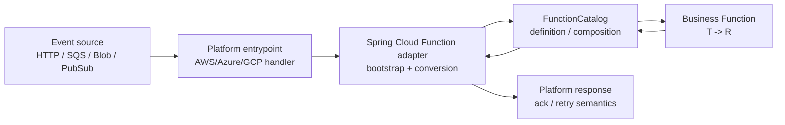
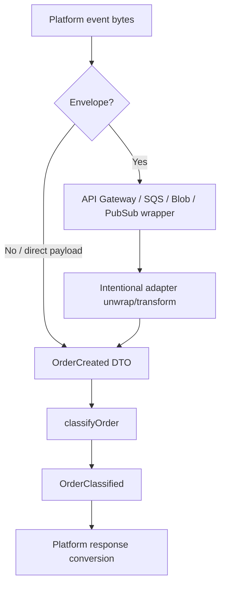

# Migrating Deprecated Serverless Handlers

## 1. The Problem: Same `FunctionInvoker` Name, Opposite Upgrade Directions

A team has pure Java business logic written with Spring Cloud Function:

```java
@Bean
Function<String, String> uppercase() {
    return text -> text.toUpperCase(Locale.ROOT);
}
```

The team previously deployed this function to both AWS Lambda and Azure Functions. After several library upgrades, the system may still run using the legacy handlers, yet runs into deprecations, brittle dependencies, or packaging and context-initialization limitations.

What makes this tricky is that **you cannot find-and-replace every `FunctionInvoker` occurrence the same way**:

- **AWS Lambda:** Spring Cloud Function recommends the unified handler `org.springframework.cloud.function.adapter.aws.FunctionInvoker`. Older AWS handlers such as `SpringBootRequestHandler`, `SpringBootApiGatewayRequestHandler`, or `SpringBootKinesisEventHandler` were marked deprecated in earlier API versions; new applications should choose `FunctionInvoker` when the contract fits.
- **Azure Functions:** the pattern of **extending** `org.springframework.cloud.function.adapter.azure.FunctionInvoker` and calling `handleRequest(...)` is itself the **deprecated legacy model**. The current integration pattern writes methods with Azure trigger annotations on a Spring-managed class (such as `@Component`), injecting Spring beans or `FunctionCatalog`.
- **Google Cloud Functions:** current documentation still describes the `org.springframework.cloud.function.adapter.gcp.GcfJarLauncher` entry point. Do not assume this entry point is deprecated merely because AWS and Azure also had handler migrations.

The names look similar, yet live in **different packages and platforms**. Identify the exact vendor, adapter artifact, handler FQN, and invocation mechanism before editing anything.

This lesson belongs to the **Upgrades** chapter in the **SPRING_CLOUD_FUNCTION** module. The long-term goal is keeping `Supplier`, `Function`, and `Consumer` discoverable via `FunctionCatalog`, composition, and message conversion so they remain reusable across HTTP, events, or serverless, while isolating platform-specific deployment glue.

After this lesson, you will be able to inventory handlers, pick the right replacement path for AWS/Azure/GCP, preserve event/response contracts, configure function selection, packaging, and runtimes, write before–after regression tests, and roll out with safe rollback.

## 2. First: Deprecated Does Not Mean Removed, and Cite Exact Sources

Four statuses to distinguish:

| Status | Meaning | Action required |
| --- | --- | --- |
| **Recommended** | Approach favored by current documentation | Use for new deployments and consider for migrations |
| **Deprecated** | API/model may still exist, but should not be expanded further | Inventory, read replacement guide, and plan migration |
| **Removed/unsupported** | API is absent or unmaintained in the target version range | Migrate before upgrading |
| **Unknown** | No evidence of deprecation on the platform/version in use | Verify; do not guess a status |

Reliable evidence includes **version-matched API references/Javadoc**, release announcements, official adapter docs, and tested runtime behavior.

### Orientation Table as of November 24, 2026

| Platform | Legacy handler/pattern to check | Documented approach | Scope of conclusion |
| --- | --- | --- | --- |
| AWS Lambda | `SpringBootRequestHandler` and legacy API Gateway/Kinesis subclasses | `org.springframework.cloud.function.adapter.aws.FunctionInvoker` | Legacy specialized handlers are listed deprecated in AWS 3.x API; new handler is recommended by current docs |
| AWS Lambda | `SpringBootStreamHandler` seen in very old examples | Consider `FunctionInvoker` when replacing/standardizing deployments | Do not claim every version deleted `SpringBootStreamHandler` |
| Azure Functions | `org.springframework.cloud.function.adapter.azure.FunctionInvoker` via `extends`/`handleRequest` | `@Component` + Azure `@FunctionName`/trigger method + inject bean or `FunctionCatalog` | Azure docs explicitly mark **legacy FunctionInvoker deprecated** |
| Azure HTTP full Spring Web app | Custom Azure annotation handlers per Web endpoint | Consider `spring-cloud-function-adapter-azure-web` if suitable | A separate option, not mandatory for functional apps |
| Google Cloud Functions | `GcfJarLauncher` in deployment guides | `GcfJarLauncher` remains documented in Function 5.1.0 docs | No basis to call it deprecated based on AWS/Azure changes |

**Sources:** [AWS adapter](https://docs.spring.io/spring-cloud-function/reference/adapters/aws-intro.html), [AWS adapter deprecated API 3.2.2](https://javadoc.io/static/org.springframework.cloud/spring-cloud-function-adapter-aws/3.2.2/deprecated-list.html), [Azure adapter](https://docs.spring.io/spring-cloud-function/reference/adapters/azure-intro.html), [Azure legacy sample](https://github.com/spring-cloud/spring-cloud-function/blob/main/spring-cloud-function-samples/function-sample-azure/README.adoc), [GCP adapter](https://docs.spring.io/spring-cloud-function/reference/adapters/gcp-intro.html).

**Version note:** AWS and GCP docs currently show Function 5.1.0; the public Azure adapter page accessed while authoring still carried version label 5.0.5. Always cross-check the artifact and Javadoc of your **target upgrade branch** before asserting every API signature stayed identical.

## 3. Separate Four Layers When Migrating Serverless Handlers



**Layer 1 — Business function:** `Function<OrderCreated,OrderClassified>` or `Consumer<OrderCreated>` understands only domain rules; avoid pulling entire Lambda/Azure SDKs directly into order-processing functions.

**Layer 2 — Catalog and conversion:** Spring Cloud Function manages function definitions, lookups, and message/POJO conversions when supported by the adapter.

**Layer 3 — Platform adapter:** AWS `FunctionInvoker`, Azure Java Worker integration, or GCP `GcfJarLauncher` receives platform events, initializes the context, and invokes the function.

**Layer 4 — Platform runtime:** Java managed runtime, `host.json`/`function.json`, event source mappings, IAM/RBAC, timeouts, memory, deployment artifact, and retry semantics.

Changing the handler alters **only part** of this chain. Swapping handlers without verifying type conversion, headers, batch failures, or packaging can leave a deployment starting cleanly while returning wrong data.

### Pinpoint the Boundary When Failures Happen

| Failure | Layer to inspect |
| --- | --- |
| Handler class not found | Handler FQN, dependencies, JAR/ZIP layout |
| `Function` not found | `FunctionCatalog`, Spring context, `definition` |
| Event JSON becomes `Map` instead of DTO | Adapter conversion, generic types |
| Azure trigger not registered | Annotations, Azure build plugin, `function.json` |
| SQS record processed yet reappears | Event source retries, visibility timeout, idempotency |
| Business result is right, yet HTTP 502 | Envelope/status/header adapter, API Gateway integration |
| Slow cold start / OOM | Spring context, Java runtime, memory, dependencies |
| Runs locally, fails to deploy | Runtime packaging/manifest/config/permissions |

## 4. Capture a Baseline Before Changing Handlers

Before modifying Java code or IaC, record:

```text
PLATFORM=<aws-lambda | azure-functions | gcp-functions>
BOOT_VERSION=<resolved version>
CLOUD_BOM=<release train>
FUNCTION_VERSION=<resolved artifact>
ADAPTER_ARTIFACT=<group:artifact:version>
HANDLER_FQN=<configured entrypoint>
FUNCTION_DEFINITION=<actual selected bean>
JAVA_BYTECODE_TARGET=<release>
DEPLOY_RUNTIME=<runtime id>
ARTIFACT_DIGEST=<sha256>
EVENT_SOURCE=<api-gateway | sqs | blob | http | pubsub ...>
INPUT_EVENT_SCHEMA=<schema name/version>
OUTPUT_CONTRACT=<status/body/headers/batch result>
RETRY_POLICY=<source and attempts>
PERMISSIONS=<IAM/RBAC scoped to function>
```

Tokens inside `<...>` are **placeholders**, not pre-populated values. Add cold-start p95/p99, memory usage, throughput, exception rate, producer/consumer compatibility, and downstream call diagrams.

### Decision Matrix

1. **Running on AWS?** Check for legacy `SpringBoot...` handlers or custom classes extending `RequestHandler` solely to forward to `FunctionCatalog`. If present, evaluate switching the entrypoint to AWS `FunctionInvoker`.
2. **Running on Azure?** If a class `extends ...azure.FunctionInvoker` and calls `handleRequest(...)`, migrate to a Spring-managed annotated handler; do not switch to AWS `FunctionInvoker`.
3. **Running on GCP?** Check the required platform entrypoint, GCF version, and Google Functions Framework. Do not replace `GcfJarLauncher` out of confusion with Azure.
4. **Is the app mainly multi-controller Spring MVC?** You may need a serverless Java container or Azure Web Adapter instead of shoehorning the entire app into a single `Function<String,String>`.
5. **Are there special batch/event-envelope triggers?** Preserve SDK event types and partial-failure contracts rather than blindly simplifying to a single DTO.

## 5. Reusable Business Code Sample Across Every Platform

Place business logic in the Spring Boot application rather than writing separate cloud-specific handler classes that duplicate the same business rules:

```java
package com.example.orders;

import java.util.Locale;
import java.util.function.Function;

import org.springframework.boot.SpringApplication;
import org.springframework.boot.autoconfigure.SpringBootApplication;
import org.springframework.context.annotation.Bean;

@SpringBootApplication
public class OrdersFunctionApplication {

    public static void main(String[] args) {
        SpringApplication.run(OrdersFunctionApplication.class, args);
    }

    public record OrderCreated(
            String eventId,
            String orderId,
            long totalInCents) {}

    public record OrderClassified(
            String eventId,
            String orderId,
            String priority) {}

    @Bean
    Function<OrderCreated, OrderClassified> classifyOrder() {
        return order -> {
            if (order.eventId() == null ||
                    order.eventId().isBlank() ||
                    order.orderId() == null ||
                    order.orderId().isBlank() ||
                    order.totalInCents() < 0) {
                throw new IllegalArgumentException(
                        "Invalid OrderCreated");
            }

            return new OrderClassified(
                    order.eventId(),
                    order.orderId(),
                    order.totalInCents() >= 100_000L
                            ? "PRIORITY" : "STANDARD");
        };
    }

    @Bean
    Function<String, String> uppercase() {
        return text -> text.toUpperCase(Locale.ROOT);
    }
}
```

`classifyOrder` depends only on domain types and can be tested as plain Java. AWS/Azure/GCP handlers receive inputs, locate the bean through `FunctionCatalog`, and invoke it. When **two function beans** exist, configure `definition` **explicitly** instead of relying on fallback selection rules across `Function`/`Consumer`/`Supplier`.

### Contract Fixtures

Input:

```json
{"eventId":"evt-101","orderId":"ORD-101","totalInCents":150000}
```

Business output:

```json
{"eventId":"evt-101","orderId":"ORD-101","priority":"PRIORITY"}
```

Save fixtures as **business contracts**. Depending on the event source, actual JSON reaching Lambda/Azure may sit inside an **envelope** (such as SQS `Records` or API Gateway `body`). Do not write flawed tests assuming every trigger sends raw `OrderCreated`.

## 6. AWS — From Legacy `SpringBoot` Handlers to `FunctionInvoker`

### 6.1. Signs of Legacy Handler Usage

A long-lived AWS Lambda project might configure:

```text
org.springframework.cloud.function.adapter.aws.SpringBootStreamHandler
org.springframework.cloud.function.adapter.aws.SpringBootRequestHandler
org.springframework.cloud.function.adapter.aws.SpringBootApiGatewayRequestHandler
org.springframework.cloud.function.adapter.aws.SpringBootKinesisEventHandler
```

AWS 3.x APIs marked `SpringBootRequestHandler` and specialized API Gateway/Kinesis handlers as deprecated, directing users toward `FunctionInvoker`. `SpringBootStreamHandler` is a frequently seen legacy handler; verify the exact status of the class in your running version rather than assuming it was deleted.

A legacy pattern:

```java
// MIGRATION PATTERN ILLUSTRATION ONLY; DO NOT USE FOR NEW PROJECTS.
public class OldOrdersHandler
        extends org.springframework.cloud.function.adapter.aws
                .SpringBootRequestHandler<
                    OrdersFunctionApplication.OrderCreated,
                    OrdersFunctionApplication.OrderClassified> {
}
```

Some projects also override `handleRequest(...)`, construct a Spring context or JSON mapper manually, or embed business rules straight inside the handler. When migrating, extract business rules into beans and remove unnecessary platform wrappers.

### 6.2. Current Approach: AWS `FunctionInvoker`

In `spring-cloud-function-adapter-aws`, AWS `FunctionInvoker` is the built-in handler currently **recommended** by the docs:

```text
org.springframework.cloud.function.adapter.aws.FunctionInvoker
```

In AWS Console/CLI setups, documentation also shows the method-reference form:

```text
org.springframework.cloud.function.adapter.aws.FunctionInvoker::handleRequest
```

Depending on the configuration and packaging accepted by AWS, use the **exact handler expression you tested**; in AWS SAM, official docs use the class FQN `org.springframework.cloud.function.adapter.aws.FunctionInvoker`.

Advantages of this approach:

- No need to write boilerplate Java `RequestHandler` classes just to forward JSON.
- `FunctionCatalog` locates the selected `Supplier`, `Function`, or `Consumer`.
- Supports composition, routing, and conversion driven by functional signatures.
- Business functions do not need to import AWS Lambda `Context` unless SDK specifics require it.
- Multiple AWS Lambda resources can point to the same artifact while choosing **distinct definitions and IAM permissions**.

**Do not assume** `FunctionInvoker` automatically reproduces every legacy event contract. API Gateway response envelopes, S3 events, SQS batch acknowledgements, or raw `InputStream` flows must be tested individually.

## 7. AWS — Dependencies and IaC Before–After

When the app uses a compatible Boot parent/Cloud BOM, declare the AWS adapter **without manually pinning a version**:

```xml
<dependency>
    <groupId>org.springframework.cloud</groupId>
    <artifactId>spring-cloud-function-adapter-aws</artifactId>
</dependency>
```

An AWS SAM template after migration:

```yaml
AWSTemplateFormatVersion: '2010-09-09'
Transform: AWS::Serverless-2016-10-31

Resources:
  ClassifyOrderLambda:
    Type: AWS::Serverless::Function
    Properties:
      Handler: org.springframework.cloud.function.adapter.aws.FunctionInvoker
      Runtime: java21
      MemorySize: 512
      Timeout: 30
      CodeUri: target/orders-function-aws.jar
      Environment:
        Variables:
          spring_cloud_function_definition: classifyOrder
```

**Field breakdown:**

- `Handler` specifies the **AWS entrypoint**, not a `@Bean` name.
- `spring_cloud_function_definition` is the Spring Cloud Function environment variable selecting the `classifyOrder` bean.
- `Runtime: java21` specifies AWS's Java managed runtime; it is not the Spring Cloud Function or Boot version.
- `CodeUri` is an **illustrative artifact path**. You must build the matching file via a proper packaging pipeline; it does not appear automatically just by adding the dependency.
- `MemorySize` and `Timeout` require tuning for real load and cold starts rather than guessing from the old handler.

### 7.1. Two Lambda Resources, One Artifact, Two Business Functions

```yaml
Resources:
  ClassifyOrderLambda:
    Type: AWS::Serverless::Function
    Properties:
      Handler: org.springframework.cloud.function.adapter.aws.FunctionInvoker
      Runtime: java21
      CodeUri: target/orders-function-aws.jar
      Environment:
        Variables:
          spring_cloud_function_definition: classifyOrder

  UppercaseLambda:
    Type: AWS::Serverless::Function
    Properties:
      Handler: org.springframework.cloud.function.adapter.aws.FunctionInvoker
      Runtime: java21
      CodeUri: target/orders-function-aws.jar
      Environment:
        Variables:
          spring_cloud_function_definition: uppercase
```

This snippet omits IAM roles, events, networking, and app-specific settings to focus on **handler and definition**; real SAM templates must declare appropriate permissions and triggers.

Sharing an artifact does not force both Lambdas to share concurrency, memory, or IAM roles: each resource can be configured independently. When functions access S3/DynamoDB, apply least privilege rather than granting one broad role just because multiple beans live in the same JAR.

## 8. AWS — Packaging: Updating the Handler Without Updating the JAR Fails

This is a common pitfall: a JAR launched with `java -jar` is not automatically laid out right for AWS Lambda class loading.

AWS adapter documentation describes a **shaded JAR** layout and sometimes produces an AWS-specific JAR with the `aws` classifier. A standard Spring Boot executable JAR with nested libraries (`BOOT-INF/lib`) does not always align with Lambda handler classpath loading.

```text
source code
   |
   +--> Boot executable JAR (local/server)
   |
   +--> AWS deployable shaded JAR / ZIP
          |
          +--> Lambda FunctionInvoker on classpath
          +--> Spring context / bean configuration
          +--> META-INF services + auto-configuration metadata
          +--> deployment-appropriate dependencies
```

### 8.1. Build Items to Verify

- Resolved versions of Spring Boot, Spring Cloud BOM, Function, and the AWS adapter.
- Maven Shade Plugin or Gradle Shadow Plugin produces an artifact matching the **target version's** sample layout.
- Manifest `Start-Class` or `MAIN_CLASS` so the adapter locates the Spring Boot entrypoint.
- `META-INF/spring.factories` and `META-INF/spring/org.springframework.boot.autoconfigure.AutoConfiguration.imports` metadata merged properly during shading.
- Service provider resources not overwritten when merging JARs.
- No unused HTTP/Web/Stream starters accidentally left in that launch a server or register extra function beans.
- Artifact digest in IaC matches the exact artifact uploaded.

### 8.2. Why Not Provide One Fixed Shade POM for All Boot Versions?

Boot 3 and Boot 4 differ in dependencies, classpath structure, auto-configuration, and plugins. An older Shade Plugin snippet may miss transformers or reference an incompatible plugin version. Start from the **sample matching your target Function/Boot branch**, inspect the dependency graph, and run invocation tests on the **built JAR**. Copying `<shadedClassifierName>aws</shadedClassifierName>` alone is not enough.

### 8.3. Where Is the Main Class Resolved From?

Per AWS adapter docs, the Function runtime can locate the entry class from the `Start-Class` manifest attribute written by Spring Boot tooling; if absent, `MAIN_CLASS` can be supplied via environment/system property when supported by the adapter.

Do not confuse:

```text
MAIN_CLASS = com.example.orders.OrdersFunctionApplication
spring_cloud_function_definition = classifyOrder
Handler = org.springframework.cloud.function.adapter.aws.FunctionInvoker
```

These three values belong to **three separate scopes**: Spring configuration class, business bean definition, and Lambda entrypoint.

## 9. AWS — Event Shapes and Headers After Changing Handlers

A simple string typed into the AWS Lambda test console differs from real events sent by API Gateway, SQS, S3, or Kinesis.

### 9.1. Functions Accepting POJOs Directly

If a trigger passes a body shaped like `OrderCreated`, `FunctionInvoker` can convert the raw event into the DTO using the signature:

```java
Function<OrderCreated, OrderClassified>
```

However, API Gateway proxy events usually include fields like `headers`, `requestContext`, `body`, and `isBase64Encoded`. Never assume a proxy body is unwrapped identically to a raw JSON test. Some contracts work better with AWS event SDK types or a dedicated adapter layer.

### 9.2. Keeping AWS Event Objects When Needed

AWS `FunctionInvoker` docs permit functions using AWS-specific types such as:

```java
@Bean
Function<S3Event, String> processS3Event() { /* ... */ }

@Bean
Function<SQSEvent, SQSBatchResponse> processSQSEvent() { /* ... */ }
```

These are **illustrative signatures**, requiring matching `aws-lambda-java-events` dependencies and real method bodies. When handling SQS **partial batch failures**, you cannot simply swap the handler and blindly keep a `Consumer<String>`.

### 9.3. Contract Table by Trigger

| Trigger | Typical incoming data | What to test |
| --- | --- | --- |
| Lambda direct invocation | JSON value or event object | POJO type conversion, error output |
| API Gateway proxy | Proxy event with body, headers, and status semantics | Envelope, base64, status, CORS, headers |
| SQS event source mapping | Batch records | Per-record idempotency, partial failures, visibility timeout |
| S3 notification | Bucket/key/event metadata | Event type, key decoding, permissions |
| Kinesis | Records/partition/shard sequence | Checkpoints/retries, ordering, batch processing |
| SNS/EventBridge | Envelope and event detail | Type/schema validation and metadata |

**Do not conflate HTTP client retries with SQS/Kinesis retries.** Each event source has its own policy; changing the handler does not replace error/recovery design.

## 10. AWS — Static Routing and Dynamic Routing

### 10.1. Static Routing for Multiple Independent Lambdas

AWS docs recommend setting the env var:

```text
spring_cloud_function_definition=classifyOrder
```

so each Lambda resource chooses its own target function. For function composition:

```text
spring_cloud_function_definition=normalizeOrder|classifyOrder
```

is valid only when two type-compatible beans exist; `|` represents composition and does not create two independent invocations or an intermediate queue/topic.

When `definition` is omitted and multiple function beans exist, the framework may apply default lookup or `RoutingFunction` logic depending on version. That is a **fallback**, not a safe production contract for side effects.

### 10.2. Dynamic Routing Inside One Lambda

When one Lambda resource must handle multiple operations, you can use `RoutingFunction`/`MessageRoutingCallback` or headers as documented by Spring Cloud Function.

However, **never let untrusted clients choose bean names directly**. A caller-controlled `spring.cloud.function.definition` header can turn into an unintended path invoking internal side-effecting beans.

Recommended deployment pattern:

```text
External operation = ORDER_CLASSIFY
        |
        v
Server-owned allowlist:
  ORDER_CLASSIFY -> classifyOrder
  UPPERCASE     -> uppercase
        |
        v
FunctionCatalog lookup (approved name)
```

Enforce authorization for each operation. When one Lambda handles multiple business actions with different IAM needs, **multiple Lambda resources sharing one JAR with separate roles** is often safer and scales more cleanly than a single router holding every permission.

## 11. Azure — Understanding That Legacy `FunctionInvoker` Differs from AWS

In the Azure adapter, current documentation includes a **`FunctionInvoker (deprecated)`** section and explicitly notes the legacy model will no longer be supported going forward.

The legacy pattern typically looks like:

```java
// LEGACY AZURE: illustrative pattern to recognize in existing code.
public class UppercaseHandler
        extends org.springframework.cloud.function.adapter.azure
                .FunctionInvoker<Message<String>, String> {

    @FunctionName("uppercase")
    public String execute(
            @HttpTrigger(
                name = "req",
                methods = { HttpMethod.POST },
                authLevel = AuthorizationLevel.FUNCTION)
                    HttpRequestMessage<Optional<String>> request,
            ExecutionContext context) {

        Message<String> message = MessageBuilder
                .withPayload(request.getBody().orElse(""))
                .build();

        return handleRequest(message, context);
    }
}
```

This snippet is intentionally labeled **legacy** so you can spot the `extends FunctionInvoker` + `handleRequest(...)` pattern. It is not code to introduce in new projects.

**Critical distinction:**

```text
AWS  -> org.springframework.cloud.function.adapter.aws.FunctionInvoker
        => recommended handler.

Azure -> org.springframework.cloud.function.adapter.azure.FunctionInvoker
        => deprecated legacy programming model.
```

You cannot run a repo-wide find-and-replace on `FunctionInvoker` without checking the FQN. Nor can you swap an Azure handler to the AWS class expecting Azure Java Worker to understand an AWS entrypoint.

## 12. Azure — New Pattern: Annotated Handler as a Spring Component

Azure Java Functions defines triggers and bindings via Java annotations; the Azure Maven/Gradle plugin processes them to generate metadata (such as `function.json`). Spring Cloud Function Azure adapter **4.0.0+** integrates with Azure Java Worker so handler classes are Spring components with dependency injection.

New pattern:

```java
package com.example.orders.azure;

import java.util.Optional;
import java.util.function.Function;

import com.microsoft.azure.functions.ExecutionContext;
import com.microsoft.azure.functions.HttpMethod;
import com.microsoft.azure.functions.HttpRequestMessage;
import com.microsoft.azure.functions.annotation.AuthorizationLevel;
import com.microsoft.azure.functions.annotation.FunctionName;
import com.microsoft.azure.functions.annotation.HttpTrigger;

import org.springframework.cloud.function.context.FunctionCatalog;
import org.springframework.stereotype.Component;

@Component
public class UppercaseAzureHandler {

    private final FunctionCatalog functionCatalog;

    public UppercaseAzureHandler(FunctionCatalog functionCatalog) {
        this.functionCatalog = functionCatalog;
    }

    @FunctionName("uppercase")
    public String execute(
            @HttpTrigger(
                name = "req",
                methods = { HttpMethod.POST },
                authLevel = AuthorizationLevel.FUNCTION)
                    HttpRequestMessage<Optional<String>> request,
            ExecutionContext context) {

        @SuppressWarnings("unchecked")
        Function<String, String> uppercase =
                functionCatalog.lookup(
                        Function.class, "uppercase");

        if (uppercase == null) {
            throw new IllegalStateException(
                    "Missing function: uppercase");
        }

        String input = request.getBody().orElse("");
        String output = uppercase.apply(input);

        context.getLogger().info("Azure function invoked");
        return output;
    }
}
```

This matches the pattern shown in the Azure adapter docs: `@Component`, a `@FunctionName` method, `@HttpTrigger`, and an injected `FunctionCatalog`. `AuthorizationLevel.FUNCTION` is used instead of `ANONYMOUS` to avoid exposing an unauthenticated public endpoint by default; production deployments still require Entra ID/API gateway or matching auth policies.

### 12.1. Why Still Use `FunctionCatalog`?

You can inject directly:

```java
@Autowired
Function<String, String> uppercase;
```

and call `uppercase.apply(...)`. However, documentation distinguishes a **plain Spring bean** from a normalized function in **`FunctionCatalog`**. When composition, conversion/wrappers, or name-based lookup is needed, use `FunctionCatalog`; verify actual types when wrappers accept `Message<?>`.

### 12.2. Extending an Adapter Class Is No Longer Required

In the new pattern, handlers neither `extends ...azure.FunctionInvoker` nor call the legacy adapter's `handleRequest(...)`. The Azure-annotated method is the platform entrypoint; Spring DI supplies business functions or `FunctionCatalog`.

This is **not** replacing annotations with an AWS handler. Annotations like `@FunctionName` and `@HttpTrigger` remain essential so the Azure plugin generates binding metadata.

## 13. Azure — Packaging, Metadata, and Runtime Differ from AWS

An Azure migration is incomplete if you only edit Java classes. Azure Functions requires:

- A compatible `spring-cloud-function-adapter-azure` version, documented as 4.0.0+ for DI integration.
- The Azure Maven/Gradle plugin to process `@FunctionName`/trigger bindings and build the proper package layout.
- `function.json` per Azure function, plus `host.json` for host settings as needed.
- Proper identification of the Spring Boot main/start class.
- Compatible Java runtime and Azure Functions host version.
- Properly configured application settings, secrets, storage, and triggers/outputs.

### Maven Dependency

```xml
<dependency>
    <groupId>org.springframework.cloud</groupId>
    <artifactId>spring-cloud-function-adapter-azure</artifactId>
</dependency>
```

Its version is managed by the Spring Cloud BOM. When using the Azure plugin, choose the plugin version and Java runtime support per Azure's guidance. Never copy an ancient plugin version just because a legacy sample POM still had it.

### Packaging and Local Run Commands from Azure Adapter Docs

```bash
# Commands for learners to run inside their own Azure project.
./mvnw clean package
./mvnw azure-functions:run

# With the Azure Functions Gradle plugin:
./gradlew azureFunctionsPackage
./gradlew azureFunctionsRun
```

These commands **were not executed while authoring this lesson**. Testing requires Azure Functions Core Tools, a compatible JDK, and needed local settings; never commit real keys to version control.

### 13.1. Why Not Deploy a Plain Boot Executable JAR?

The Azure Functions Java Worker expects a **package layout** produced by Azure build tooling, not just a `BOOT-INF/lib`-style Spring Boot fat JAR. Azure adapter docs specify packaging adjustments away from Boot's default repackaging—often disabling or reconfiguring the Spring Boot plugin depending on the project.

If the JAR builds yet Azure finds no functions, check:

1. `function.json` was generated for `@FunctionName`.
2. The main class is packaged and specified.
3. The Spring Cloud Function Azure adapter dependency is inside the deployment artifact.
4. The Azure plugin and Functions Worker runtime match the Java version.
5. The host has permissions to read event sources/triggers.
6. Logs for classloader or DI errors.

### 13.2. Main Class Differs from Handler Class

```text
Spring main class:
  com.example.orders.OrdersFunctionApplication

Azure annotation handler:
  com.example.orders.azure.UppercaseAzureHandler

Business bean:
  uppercase

Generated Azure function name:
  uppercase
```

Each layer has a distinct role; never configure `MAIN_CLASS=uppercase` or set the handler FQN to `OrdersFunctionApplication` without an appropriate adapter path.

## 14. Azure — HTTP Trigger, Blob, Timer, Kafka: Preserve the Binding Contract

An Azure function may read from `@HttpTrigger`, `@BlobTrigger`, `@TimerTrigger`, Kafka triggers, or output bindings. Moving from legacy `FunctionInvoker` to a DI handler requires preserving **trigger/binding annotations and operational parameters**, not just the Java method name.

Example HTTP trigger:

```java
@FunctionName("uppercase")
public String execute(
    @HttpTrigger(name = "req",
                 methods = {HttpMethod.POST},
                 authLevel = AuthorizationLevel.FUNCTION)
        HttpRequestMessage<Optional<String>> request,
    ExecutionContext context) {
    // Spring-managed handler calls FunctionCatalog here.
}
```

Items to compare before and after:

| Contract | Baseline example to capture |
| --- | --- |
| Azure function name | `uppercase` in `@FunctionName` |
| Route + method | HTTP POST path, route prefix, and status |
| Auth level | `FUNCTION`, `ANONYMOUS`, or other policy |
| Input binding | Queue, blob, timer schedule, Kafka config |
| Output binding | Destination, output type, transaction/error policy |
| Metadata | `ExecutionContext`, invocation ID, and message headers |
| Retry behavior | Azure host settings and trigger-specific policies |
| Package | `function.json`/`host.json`, dependency layout |

### 14.1. Azure `ExecutionContext` When Tracing Is Needed

Documentation mentions `AzureFunctionUtil.enhanceInputIfNecessary(...)` to attach `ExecutionContext` to a `Message` header when the business function needs context. **Do not force** vendor-specific context into every bean; usually it is cleaner for the handler to extract the invocation ID and pass a clearly contracted correlation ID.

Example at the adapter layer:

```java
String invocationId = context.getInvocationId();
// Forward only a valid ID; avoid passing the entire Azure context
// into business payloads unless genuinely required.
```

To stay reusable across HTTP/Kafka/AWS, the business layer should accept domain DTOs or app-level metadata rather than coupling tightly to `ExecutionContext`.

### 14.2. Azure Web Adapter Is a Separate Option

If an application consists primarily of Spring MVC/HTTP endpoints, Azure docs also offer `spring-cloud-function-adapter-azure-web`. That adapter targets hosting a Spring Web application on an Azure `HttpTrigger`; it does not mean a `Function<String,String>` should switch to the Azure Web Adapter.

Choose by architecture: single-responsibility functional beans with platform triggers → Azure DI adapter; Spring Web apps needing controllers and routes preserved → evaluate Azure Web Adapter.

## 15. Google Cloud Functions — No Mandatory Equivalent Migration

GCP still documents the `spring-cloud-function-adapter-gcp` adapter and entrypoint:

```text
org.springframework.cloud.function.adapter.gcp.GcfJarLauncher
```

Maven snippet:

```xml
<dependency>
    <groupId>org.springframework.cloud</groupId>
    <artifactId>spring-cloud-function-adapter-gcp</artifactId>
</dependency>
```

The Google Functions Framework plugin can configure:

```xml
<configuration>
    <functionTarget>
        org.springframework.cloud.function.adapter.gcp.GcfJarLauncher
    </functionTarget>
</configuration>
```

### Distinguish Three Cases

1. **Already using `GcfJarLauncher` per current docs:** do not change it simply by copying AWS/Azure advice.
2. **Changing GCF generation/runtime or Cloud Run functions:** verify event format (HTTP/CloudEvents), Java runtime, deploy CLI, and adapter compatibility on the platform.
3. **Maintaining an older custom Google handler:** check its exact source/Javadoc to confirm whether it is deprecated rather than guessing from its name.

GCP docs contain sample commands reflecting older Java runtimes at their time of writing; do not treat `--runtime java11` in an old sample as the runtime to pick for new deployments in 2026. Check the cloud provider's supported runtimes alongside your target Spring Boot JDK requirements.

## 16. Mistake: Updating the Entrypoint While Forgetting Function Selection

### 16.1. Three Easily Confused Names

```text
Lambda handler:
    org.springframework.cloud.function.adapter.aws.FunctionInvoker

Azure function name:
    uppercase  (from @FunctionName)

Spring functional definition:
    uppercase  (@Bean Function name)
```

On AWS, the AWS runtime invokes the handler; Spring Cloud Function picks the function bean via `spring.cloud.function.definition`. On Azure, the Java Worker invokes the `@FunctionName`-annotated method, and the handler uses DI/`FunctionCatalog` to call the bean.

**You cannot** change `Handler: OldOrdersHandler` to `Handler: uppercase` in the AWS Lambda Java managed runtime and expect AWS to invoke `@Bean uppercase` directly. Those are two different runtime layers.

### 16.2. Select the Function Explicitly When Multiple Beans Exist

```yaml
spring:
  cloud:
    function:
      definition: classifyOrder
```

or via AWS environment variable:

```text
spring_cloud_function_definition=classifyOrder
```

If the same Spring app defines both `classifyOrder` and `uppercase`, single-function fallback can break when another bean or dependency is added. Explicit `definition` reduces wrong-function risk in production.

### 16.3. Composition Must Be Type-Compatible

```java
@Bean
Function<String, String> normalize() {
    return String::trim;
}

@Bean
Function<String, String> uppercase() {
    return String::toUpperCase;
}
```

You can select:

```properties
spring.cloud.function.definition=normalize|uppercase
```

Composition does not give the AWS/Azure runtime multiple entrypoints; it is a **logical pipeline**. If input/output generic types are incompatible, fix the contract rather than trying to force conversion by changing handlers.

## 17. Message Conversion: Plain JSON Differs from Serverless Event Envelopes

Like HTTP and Spring Cloud Stream, serverless runtimes have two data layers:

- **Platform event:** schema emitted by AWS/Azure/GCP containing metadata and wrappers.
- **Business payload:** domain DTO (`OrderCreated`) nested inside the event or representing the whole event depending on trigger.



Migrating a handler can shift **where** JSON is decoded or **which metadata** survives. Never treat deserialization into a `Map` as equivalent to deserialization into `OrderCreated` simply because no exception was thrown.

### 17.1. Example Event Envelope

```json
{
  "Records": [
    {
      "messageId": "msg-101",
      "body": "{\"eventId\":\"evt-101\",\"orderId\":\"ORD-101\",\"totalInCents\":150000}"
    }
  ]
}
```

This is a **condensed snippet** illustrating an SQS event envelope. Real AWS events include many more fields. A business bean `Function<OrderCreated,OrderClassified>` is not automatically a batch function processing `Records`. Maintain an intentional transformation pipeline and enforce idempotency.

### 17.2. Headers and Metadata Are Not Preserved Identically

- `AWS Context` supplies request IDs and invocation context.
- `Azure ExecutionContext` supplies invocation metadata.
- `GCP HTTP/CloudEvent` carries its own metadata.
- `Spring Message<T>` carries payload + headers, yet not every adapter maps metadata identically.

When correlation is needed, define a **common contract** such as `eventId`/`correlationId` and let the adapter layer extract and validate it. Never copy raw credentials, routing headers, or execution context objects into outputs.

## 18. Distinguishing Success Responses, Retries, and Acks by Event Source

| Trigger | What does "success" usually mean? | What to check on error |
| --- | --- | --- |
| AWS API Gateway → Lambda | Lambda returns matching response/integration format | HTTP status, body/envelope, gateway retry/client policy |
| AWS SQS → Lambda | Batch/records evaluated by runtime per event source policy | Visibility timeout, retries, DLQ, partial batch response |
| AWS Kinesis → Lambda | Batch/checkpoint progress per event source mapping | Shard ordering, batch failures, retry window |
| Azure HTTP Trigger | HTTP response from Azure function | Auth level, status, headers, gateway |
| Azure Blob/Queue/Kafka trigger | Azure host processes trigger and retries per extension | Checkpointing/poison handling, `host.json`, retry policy |
| GCP HTTP function | HTTP response per Functions Framework/platform | Response status/body, client retries |
| GCP Pub/Sub/CloudEvent | Platform event delivery semantics | Ack/retry/redelivery and duplicate side effects |

**Do not copy Spring Cloud Stream retry/DLQ settings into AWS/Azure/GCP assuming they take effect.** Even with the same `Function<OrderCreated,OrderClassified>`, platform adapters follow **event-source** ack and retry semantics.

### Idempotency Protects You During Handler Migrations

A common failure sequence:

```text
1. Lambda processes evt-101 and writes to the database.
2. Handler/runtime crashes before acknowledging invocation.
3. Event source redelivers evt-101.
4. Database is written a second time if deduplication is missing.
```

Therefore, keep event IDs stable and enforce idempotency inside business transactions when changing handlers. A new handler never guarantees exactly-once effects against databases, emails, or external APIs.

## 19. Testing: Same Business Fixtures, Real Target Adapters

### 19.1. Pure Function Unit Test

```java
import static org.junit.jupiter.api.Assertions.assertEquals;
import org.junit.jupiter.api.Test;

class OrdersFunctionTest {

    @Test
    void classifiesPriority() {
        var application = new OrdersFunctionApplication();
        var function = application.classifyOrder();

        var output = function.apply(
                new OrdersFunctionApplication.OrderCreated(
                        "evt-101", "ORD-101", 150_000L));

        assertEquals("PRIORITY", output.priority());
        assertEquals("ORD-101", output.orderId());
    }
}
```

This tests the **business rule**; it does not prove the AWS or Azure handler is discovered or that JSON converts properly.

### 19.2. `FunctionCatalog` Lookup and Composition Test

In the target Spring context:

```java
import static org.junit.jupiter.api.Assertions.assertNotNull;

import java.util.function.Function;
import org.junit.jupiter.api.Test;
import org.springframework.beans.factory.annotation.Autowired;
import org.springframework.boot.test.context.SpringBootTest;
import org.springframework.cloud.function.context.FunctionCatalog;

@SpringBootTest
class CatalogLookupTest {

    @Autowired
    FunctionCatalog catalog;

    @Test
    void resolvesApprovedFunction() {
        Function<?, ?> function =
                catalog.lookup(Function.class, "classifyOrder");

        assertNotNull(function);
    }
}
```

This test requires the target Spring Cloud Function dependency. Do not assert that the wrapper's runtime class equals the original bean's class; the catalog may return a wrapper carrying conversion semantics.

### 19.3. Adapter Integration Tests

**AWS:** use the AWS Lambda runtime environment or compatible local runner to invoke the **exact AWS artifact** with the `FunctionInvoker` handler and sample JSON events. Verify outputs, cold starts, handler selection, event envelopes, and errors.

**Azure:** run Azure Functions Core Tools against the package built by the Azure plugin; verify `function.json`, trigger annotations, Spring DI, function name, HTTP status/body, event sources, and error routes.

**GCP:** test `GcfJarLauncher` via Functions Framework using the properly structured artifact; verify HTTP/CloudEvent contracts and runtime.

A green Java unit test cannot replace **platform invocation**. Always test the exact artifact your CI pipeline ships to the cloud.

## 20. Regression Test Matrix for Handler Migrations

| Test ID | Scenario | Expectation |
| --- | --- | --- |
| SRV-01 | Target artifact startup | Handler class loads; Spring context and beans exist |
| SRV-02 | Single functional bean | Intended definition selected |
| SRV-03 | Multiple beans | No unintended function invoked |
| SRV-04 | Valid composition | Correct order and typed output |
| SRV-05 | Valid JSON POJO | Converter builds exact DTO |
| SRV-06 | Missing field / wrong type JSON | Rejected with zero side effects |
| SRV-07 | Header/context metadata | Correlation ID mapped per contract |
| SRV-08 | API Gateway envelope | Status/body/headers match format |
| SRV-09 | SQS batch with one failing record | Partial batch failure semantics hold |
| SRV-10 | SQS/queue redelivery | Duplicate event blocked |
| SRV-11 | Azure `@FunctionName` registration | `function.json` and trigger match |
| SRV-12 | Azure DI bootstrap | `@Component` receives bean injections |
| SRV-13 | GCP `GcfJarLauncher` | Launcher locates intended bean |
| SRV-14 | IAM/RBAC least privilege | No excess permissions granted |
| SRV-15 | Secret/config injection | Secrets neither logged nor echoed |
| SRV-16 | Cold-start/timeouts | p95/p99 and memory within budget |
| SRV-17 | Concurrency/batch load | No duplicate side effects or ordering bugs |
| SRV-18 | Invalid route | Internal beans never invoked |
| SRV-19 | Deployment rollback | Old artifact still parses event schema |
| SRV-20 | Production-like canary | Metrics/logs and alerts active |

### What Should Match Strictly?

- **Exact match:** event schemas, target functions, IAM/auth policies, side-effect states, queues/topics/triggers.
- **Within threshold:** cold-start latency, throughput, memory, cost.
- **Allowable approved changes:** internal log formatting/stack traces, tightened serialization security policies, runtime metrics.

Never compare raw stack traces as golden contracts; they vary across JVM versions without changing business behavior. Likewise, never take a passing direct-JSON test as proof that an SQS batch handler works.

## 21. Phased Migration Workflow

### Phase A — Inventory and Classify Handlers

- Record exact handler FQN and adapter artifact.
- Verify deprecation status using version-accurate sources.
- Extract business rules out of legacy handlers if embedded in wrappers.
- Document business event/response schemas, headers, and routing.
- Record entrypoint and deployed Java runtime.
- Document event source mappings, batch sizes, retry/ack rules, DLQs, and permissions.
- Save baseline artifact digests + config for rollback.

### Phase B — Build the Target Artifact

- Pick compatible Boot and Spring Cloud BOMs.
- Use the platform-specific adapter: AWS, Azure, or GCP; never mix packages.
- AWS: switch entrypoint to `aws.FunctionInvoker` and select the business function explicitly.
- Azure: write `@Component` + annotated trigger methods; inject `FunctionCatalog` or business beans, dropping `extends azure.FunctionInvoker`.
- GCP: keep `GcfJarLauncher` if it is the official target entrypoint.
- Choose platform-appropriate packaging rather than blindly deploying a standard Spring Boot executable JAR to Azure/AWS.
- Align Java compiler target and cloud runtime with provider-supported runtimes.

### Phase C — Verify on Staging

1. Unit-test business functions.
2. Test `FunctionCatalog` lookup and composition.
3. Test adapter/bootstrap using the real deployable artifact.
4. Test schemas/bodies/headers/context and event envelopes.
5. Test parse errors, timeouts, downstream outages, and partial batch failures.
6. Test idempotency on event redelivery.
7. Test IAM/RBAC, auth, secrets, and routing allowlists.
8. Measure memory, cold start, latency, and concurrency.

### Phase D — Canary and Rollback

- Deploy new alias/version (AWS) or deployment slot/traffic split appropriate for Azure/GCP capabilities.
- Route a bounded traffic share using approved event fixtures.
- Retain old artifacts and matching configs for rollback.
- Monitor handler initialization failures, conversion errors, event-source backlogs, redeliveries, partial failures, DLQs, and business metrics.
- For rollback, account for **emitted events and committed side effects**; keep schemas backward compatible.
- Never roll back to an artifact with critical security vulnerabilities without approved risk review and mitigations.

## 22. Common Migration Issues

| Symptom | Possible cause | Resolution |
| --- | --- | --- |
| AWS reports handler class not found | Stale FQN, missing adapter, or unshaded JAR | Verify AWS handler and artifact layout |
| AWS uses `FunctionInvoker` yet calls wrong function | Missing `definition` with multiple beans | Set `spring_cloud_function_definition` |
| AWS JSON becomes `Map` instead of POJO | Overly broad signature, event envelope, or converter | Typed contract + invocation integration test |
| AWS SQS reports success despite failed record | Swallowed exception or wrong partial-batch response | Implement per-record failure reporting and test event mapping |
| AWS timeouts after upgrade | Higher cold start, packaging, or dependency bloat | Profile and tune Boot context, runtime, memory |
| Azure compiles yet shows zero functions | Missing `@FunctionName` or Azure plugin didn't run | Check annotations and `function.json` |
| Azure `@Autowired` is null | Wrong adapter version/DI bootstrap or component scan | Use DI-capable Azure adapter; test with Core Tools |
| Azure handler still extends legacy `FunctionInvoker` | Programming model not migrated | Refactor to `@Component` + annotated method |
| Azure function name duplicated or wrong | `@FunctionName` mismatches metadata/mapping | Inspect generated bindings |
| GCP mistakenly switched to AWS handler | Confused `FunctionInvoker` across vendors | Keep `GcfJarLauncher` per GCP docs |
| Runtime throws `UnsupportedClassVersionError` | Compile target newer than runtime JVM | Align build JDK and managed runtime |
| JSON exception before business function | Converter or SDK event type mismatch | Verify event schema and generic types |
| Auth differs from baseline | Azure `authLevel` or AWS IAM/API Gateway changed | Contract security tests |
| High retries and DB duplicates | Changed handler without idempotency | Stable event ID + transactional deduplication |
| Rollback breaks consumers on new events | Non-backward-compatible event schema | Version event contracts and compatibility windows |
| Works locally in Java, fails on cloud | Tests skipped cloud artifact/packaging | Run platform integration tests on real artifact |

Consistent debugging order:

**Platform → adapter artifact/version → handler FQN → packaging/classpath → Spring main class → `FunctionCatalog` bean/definition → event envelope & conversion → invocation → result/headers → platform retry/ack → deployment permissions.**

## 23. Hands-On Exercises

### Exercise 1: Distinguish Two `FunctionInvoker` Classes

Evaluate these two imports:

```java
org.springframework.cloud.function.adapter.aws.FunctionInvoker
org.springframework.cloud.function.adapter.azure.FunctionInvoker
```

Which one is currently recommended by AWS docs? Which one is the deprecated legacy model in Azure docs? Why can a find-and-replace ignoring FQNs cause severe failures?

### Exercise 2: From AWS `SpringBootRequestHandler` to `FunctionInvoker`

A legacy Lambda uses `OldOrdersHandler extends SpringBootRequestHandler<OrderCreated,OrderClassified>`. Rewrite the architecture showing the `Function<OrderCreated,OrderClassified>` bean, Maven adapter dependency, AWS SAM `Handler`, and `spring_cloud_function_definition`. List contract tests required before rollback can be considered safe.

### Exercise 3: `FunctionCatalog` Inside an Azure Annotated Handler

A legacy Azure class `extends azure.FunctionInvoker` and calls `handleRequest`. Convert it into a `@Component`, inject `FunctionCatalog`, and call `catalog.lookup(Function.class, "uppercase")` inside a `@FunctionName("uppercase")` method. What metadata must the Azure plugin still generate?

### Exercise 4: Why Cannot One Package Be Reused Unconditionally?

Why might a Spring Boot executable JAR run locally yet fail to load the handler on AWS Lambda? Why does Azure Functions require its own package layout? Do `Start-Class`, `MAIN_CLASS`, and `@FunctionName` serve the same role?

### Exercise 5: AWS SQS Batch Trigger

An `SQSEvent` contains three records, and the second record fails. Design a partial-batch failure, retry, and idempotency policy to avoid writing record one to the database twice. Why doesn't swapping the handler solve this automatically?

### Exercise 6: Do Not Change GCP by Guesswork

An application uses `GcfJarLauncher`. Consult the target version docs to verify the right entrypoint and runtime. Explain why deprecating Azure's legacy `FunctionInvoker` gives zero justification for changing the GCP launcher.

### Exercise 7: Two Lambdas, One Artifact

You have two beans, `classifyOrder` and `uppercase`. Write two AWS SAM resources sharing `aws.FunctionInvoker` while selecting distinct definitions. Why should IAM permissions, memory, and concurrency often be configured separately?

### Exercise 8: Before–After Golden Tests

Design fixtures for direct HTTP, API Gateway envelope, SQS event, and Azure HTTP trigger. For each fixture, specify input payload, handler, functional bean, output contract, error route, and idempotency key.

### Exercise 9: Rollback After a New Deployment

A canary emitted a new event schema to a queue. If you roll the function back to an older version that does not understand the new schema, what happens? Propose a compatibility window, versioned events, and replay controls.

### Self-Assessment Questions

1. Do Spring Cloud Function AWS `FunctionInvoker` and Azure `FunctionInvoker` share the same recommendation status?
2. Does deprecated mean the class was deleted?
3. Once an AWS handler switches to `FunctionInvoker`, what actually selects the function name?
4. Why must an app with multiple `@Bean Function` beans configure `definition` explicitly?
5. Is the AWS managed Java runtime version determined by the Cloud BOM?
6. Why can a shaded JAR and a Spring Boot executable JAR differ?
7. Are Azure `@FunctionName`/`@HttpTrigger` still needed in the DI-based programming model?
8. What does Azure `@Component` solve when removing `extends FunctionInvoker`?
9. When should you inject a bean directly vs. injecting `FunctionCatalog`?
10. Can `GcfJarLauncher` be replaced with an AWS handler just because both use Spring Cloud Function?
11. Why won't a business function with a typed POJO automatically receive an SQS batch event?
12. Does a successful Lambda response guarantee exactly-once database side effects?
13. Why is a plain Java test insufficient to prove an Azure package registered its triggers?
14. Which data must be preserved when migrating HTTP/API Gateway handlers?
15. On rollback, do already-published events and executed side effects vanish automatically?

## 24. Summary

**Migrating deprecated serverless handlers** is a **platform adapter** migration, not a mandate to rewrite all business logic:

- **AWS Lambda:** current guidance uses `org.springframework.cloud.function.adapter.aws.FunctionInvoker`, replacing legacy `SpringBoot` handlers deprecated in older branches where appropriate. Verify handler FQN, selected definition, JSON event contracts, packaging, and runtime.
- **Azure Functions:** extending `org.springframework.cloud.function.adapter.azure.FunctionInvoker` is deprecated; migrate to a Spring `@Component` class with Azure trigger annotations using dependency injection or `FunctionCatalog`.
- **Google Cloud Functions:** current docs still describe `org.springframework.cloud.function.adapter.gcp.GcfJarLauncher`; do not mark it deprecated or switch handlers by guesswork.
- **`FunctionCatalog` and typed business beans:** keep `Supplier`, `Function`, and `Consumer` platform-independent so the same logic remains reusable across HTTP, events, or serverless.
- **Never skip operational boundaries:** event envelopes, content conversion, partial batch failures, retries/acks, idempotency, IAM, JDK runtimes, cold starts, and artifact layouts must each be verified explicitly.

An effective roadmap is **inventory handlers/adapters/versions → pick the platform-accurate migration → preserve business functions → update entrypoint and packaging → run golden/negative tests on the real platform → canary and controlled rollback**.

### References

- [Spring Cloud Function — AWS Lambda adapter, FunctionInvoker, routing, and JAR layout](https://docs.spring.io/spring-cloud-function/reference/adapters/aws-intro.html)
- [Spring Cloud Function AWS 3.2.2 Javadoc — Deprecated API](https://javadoc.io/static/org.springframework.cloud/spring-cloud-function-adapter-aws/3.2.2/deprecated-list.html)
- [Spring Cloud Function — Microsoft Azure adapter, DI integration, and legacy FunctionInvoker](https://docs.spring.io/spring-cloud-function/reference/adapters/azure-intro.html)
- [Spring Cloud Function — Azure legacy sample and migration note](https://github.com/spring-cloud/spring-cloud-function/blob/main/spring-cloud-function-samples/function-sample-azure/README.adoc)
- [Spring Cloud Function — Google Cloud Functions adapter](https://docs.spring.io/spring-cloud-function/reference/adapters/gcp-intro.html)
- [Spring Cloud Function — Programming model and FunctionCatalog](https://docs.spring.io/spring-cloud-function/reference/spring-cloud-function/programming-model.html)
- [Spring Cloud Function — Reference Documentation](https://docs.spring.io/spring-cloud-function/reference/)
- [AWS Lambda — Define Lambda function handler in Java](https://docs.aws.amazon.com/lambda/latest/dg/java-handler.html)
- [AWS Lambda — SQS event source mapping](https://docs.aws.amazon.com/lambda/latest/dg/with-sqs.html)
- [AWS Lambda — Java runtimes](https://docs.aws.amazon.com/lambda/latest/dg/lambda-runtimes.html)
- [Azure Functions — Java developer guide](https://learn.microsoft.com/en-us/azure/azure-functions/functions-reference-java)
- [Azure Functions — Java Functions Triggers and Bindings](https://learn.microsoft.com/en-us/azure/azure-functions/functions-triggers-bindings)
- [Google Cloud Functions — Functions Framework for Java](https://github.com/GoogleCloudPlatform/functions-framework-java)
