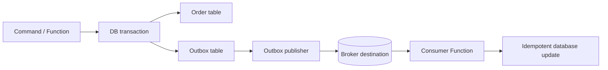
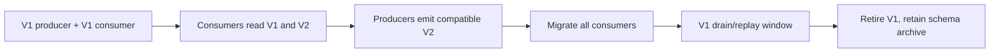

# Keeping Function Names, Composed Definitions, and Event Contracts Stable

## 1. Why Can Renaming One Java Method Break an Entire Event Flow?

A service receives `OrderCreated` events, normalizes the data, and classifies orders. Business logic is written using Spring Cloud Function:

```java
@Bean
Function<OrderCreated, OrderClassified> classifyOrder() {
    return order -> new OrderClassified(
            order.orderId(),
            order.totalInCents() >= 100_000L
                    ? "PRIORITY" : "STANDARD");
}
```

Spring Cloud Stream binds the function to topic `orders.created`; results are published to `orders.classified`. The application may be upgraded, repackaged, refactored across classes, have methods renamed, or add a `normalizeOrder` step. Looking only at Java code, those edits seem internal. Yet the function name may be referenced in:

- `FunctionCatalog.lookup("classifyOrder")`.
- `spring.cloud.function.definition`.
- Implicit binding names like `classifyOrder-in-0` and `classifyOrder-out-0`.
- Destination, consumer group, retry, and binder-specific configurations.
- Web adapter URLs, Lambda function definitions, or routing rules.
- Dashboards, alerts, log queries, deployment manifests, and runbooks.

Meanwhile, the **event contract** has its own lifecycle: event names, schemas, event IDs, headers, destinations/topics, and producer/consumer compatibility rules. Renaming a function does not require changing the event type; changing a Java record does not authorize changing the wire schema.

This lesson belongs to the **Upgrades** chapter of the **SPRING_CLOUD_FUNCTION** module. The module's goal is developing reusable logic with `Supplier`, `Function`, `Consumer`, `FunctionCatalog`, composition, and message conversion independent of calling protocols. This lesson focuses on keeping **function names, composed definitions, and event contracts** stable during upgrades.

After this lesson, you will know how to separate bean names, function definitions, binding names, destinations, and event types; lock down public names; modify compositions safely; evolve schemas; sequence producer/consumer deployments compatibly; and test reading historical events before rollout.

## 2. Five Identity Layers to Keep Separate

A Spring Cloud Function + Spring Cloud Stream pipeline puts multiple names together in configuration, yet they are not a single shared identifier.

| Layer | Example | Used by | Is it an event contract? |
| --- | --- | --- | --- |
| **Bean/function name** | `classifyOrder` | Spring, `FunctionCatalog`, routing | No |
| **Function definition** | `normalizeOrder|classifyOrder` | Spring Cloud Function/Stream, adapters | No; it is pipeline configuration |
| **Binding name** | `classifyOrder-in-0` | Spring Cloud Stream per-port config | No |
| **Destination** | `orders.created.v1` | Kafka topic, Rabbit exchange/queue, or broker | Part of operational topology; affects consumers |
| **Event type/schema** | `com.acme.orders.order-created.v1` | Producers, consumers, registries, and independent services | **Yes** |
| **Event identity** | `source + id` | Deduplication, tracing, audit | **Yes** |

An easily confused example:

```text
@Bean name:          classifyOrder
Function definition: normalizeOrder|classifyOrder
Input binding:       normalizeOrder|classifyOrder-in-0
Destination:         orders.created.v1
Event type:          com.acme.orders.order-created.v1
Event identity:      source=urn:acme:orders, id=evt-101
```

You can rename a Java method while keeping the bean name. You can adjust an internal composition while keeping binding aliases and destinations. You can refactor a DTO class while still emitting the same event schema. And you can introduce an event schema v2 without renaming the function.

**Design rule:** treat function names and bindings as internal configuration APIs; treat destinations, event types, schemas, and event identities as integration contracts managed jointly with producers and consumers.

## 3. Function Names Are Part of Application Configuration

Spring Cloud Function registers eligible `Supplier`, `Function`, and `Consumer` beans in `FunctionCatalog`. When looking up through the catalog, the application receives a framework-wrapped function supporting conversion and composition. Fetching the raw bean directly from `ApplicationContext` does not necessarily pass through those wrappers.

Example:

```java
@Bean
Function<String, String> uppercase() {
    return String::toUpperCase;
}
```

The function name is normally derived from the bean name (`uppercase`). Other places reference this name:

```java
FunctionCatalog catalog =
        applicationContext.getBean(FunctionCatalog.class);
Function<?, ?> function = catalog.lookup("uppercase");
```

```yaml
spring:
  cloud:
    function:
      definition: uppercase
```

Consequently, renaming the method:

```java
@Bean
Function<String, String> toUpperCaseText() {
    return String::toUpperCase;
}
```

can remove `uppercase` from the catalog and break old definitions, routing rules, or bindings.

### 3.1. Keep the Bean Name When Renaming the Java Method

To rename a method for clearer code while keeping the configuration contract, specify the bean name explicitly:

```java
@Bean("classifyOrder")
Function<OrderCreated, OrderClassified> classifyOrderV2() {
    return order -> new OrderClassified(
            order.orderId(),
            order.totalInCents() >= 100_000L
                    ? "PRIORITY" : "STANDARD");
}
```

The internal method name is `classifyOrderV2`, while the published bean name stays `classifyOrder`. This stabilizes lookup names without locking Java method names forever.

**Note:** bean names must be unique in the Spring context. Do not register a second bean with the same name for "compatibility"; check aliases, bean overriding policies, and the actual registered function list.

### 3.2. Naming Conventions to Follow

- Use stable, domain-meaningful names: `classifyOrder`, `normalizeAddress`, `publishInvoice`.
- Avoid embedding library or release-train versions: `function5`, `boot42Handler`.
- Do not rename functions merely to match class or method renames.
- Avoid multiple indistinguishable functions doing the same job.
- Never rely on component-scan order or autodiscovery to pick a function.
- Never use a Java class name as the public event type if polyglot producers/consumers exist.

A good function name states **what processing happens**; an event type states **what domain event occurred**. The two concepts are related, yet do not need identical names.

## 4. Declare `function.definition` Explicitly

Spring Cloud Function can auto-discover a function when an application contains only one functional bean. In that case, certain lookup paths may still resolve the bean even with an empty or mismatched name. That convenience suits tiny apps, not long-term deployment contracts.

Spring Cloud Function documentation recommends setting `spring.cloud.function.definition` when integrating with other frameworks such as Spring Cloud Stream.

```yaml
spring:
  cloud:
    function:
      definition: classifyOrder
```

When multiple functions exist, an explicit declaration determines which bean adapters use. To enforce strict name-only lookups, disable single-function fallback:

```yaml
spring:
  cloud:
    function:
      definition: classifyOrder
      single-function-fallback-enabled: false
```

This setting does not replace authorization or routing policies; it simply clarifies catalog lookup behavior.

### 4.1. Filtering Functions Excluded from the Catalog

The application context might hold Java functional beans not meant as public business APIs. Add those bean names to:

```yaml
spring:
  cloud:
    function:
      ineligible-definitions: internalFunction,debugFunction
```

Use this only when genuinely necessary. Better yet, separate public functions from ordinary helper/service beans cleanly. Never rely on `ineligible-definitions` as the sole defense protecting a sensitive endpoint.

### 4.2. Verifying Function Names During Upgrades

A catalog regression test:

```java
import static org.junit.jupiter.api.Assertions.assertNotNull;

import java.util.function.Function;
import org.junit.jupiter.api.Test;
import org.springframework.beans.factory.annotation.Autowired;
import org.springframework.boot.test.context.SpringBootTest;
import org.springframework.cloud.function.context.FunctionCatalog;

@SpringBootTest
class FunctionNameContractTest {

    @Autowired
    FunctionCatalog catalog;

    @Test
    void publicFunctionNameRemainsAvailable() {
        Function<?, ?> function =
                catalog.lookup(Function.class, "classifyOrder");

        assertNotNull(function);
    }
}
```

This test confirms the function name resolves. Pair it with invocation tests verifying input/output types and business behavior; `assertNotNull` alone is insufficient.

## 5. Composition Is a Pipeline Definition, Not an Event Name

Spring Cloud Function lets you declare composition using `|` or commas in `spring.cloud.function.definition`.

Example:

```java
@Bean
Function<OrderCreated, OrderCreated> normalizeOrder() {
    return order -> new OrderCreated(
            order.orderId().trim(),
            order.totalInCents(),
            order.currency());
}

@Bean
Function<OrderCreated, OrderClassified> classifyOrder() {
    return order -> new OrderClassified(
            order.orderId(),
            order.totalInCents(),
            order.totalInCents() >= 100_000L
                    ? "PRIORITY" : "STANDARD");
}
```

Configuration:

```yaml
spring:
  cloud:
    function:
      definition: normalizeOrder|classifyOrder
```

The output type of `normalizeOrder` must match the input type of `classifyOrder`. `FunctionCatalog` supports composition and framework conversion; avoid relying on conversion to paper over an unclear type contract.

### 5.1. Distinguish the Separators

| Syntax | Meaning in its supported context |
| --- | --- |
| `normalizeOrder|classifyOrder` | One pipeline: output of the first feeds the second |
| `normalizeOrder,classifyOrder` | Alternative composition syntax supported by Spring Cloud Function |
| `normalizeOrder;classifyOrder` | Two independent functions bound separately by Spring Cloud Stream |

Example with semicolons:

```yaml
spring:
  cloud:
    function:
      definition: normalizeOrder;classifyOrder
```

Two independent functions receive separate bindings. `classifyOrder` **does not automatically receive** `normalizeOrder`'s output merely because both appear in `definition`. They must be connected via a broker destination or an intentional composition.

### 5.2. Changing Composition Can Change Binding Names

When `definition` is `normalizeOrder|classifyOrder`, logical bindings are normally generated from the definition, such as:

- `normalizeOrder|classifyOrder-in-0`
- `normalizeOrder|classifyOrder-out-0`

If you change it to `validateOrder|normalizeOrder|classifyOrder`, the logical binding names change to reflect the new definition. Properties referencing the old implicit names will not automatically follow the new composition.

**Never use a composition string as an event type.** An event type should describe the business event—such as `com.acme.orders.order-classified.v1`—never `normalizeOrder|classifyOrder`.

### 5.3. Composition Does Not Create Broker Boundaries

Composition is an in-process pipeline within a single application invocation. It does not create:

- Intermediate Kafka topics.
- RabbitMQ exchanges or queues.
- Independent transactions per function step.
- Per-step retry policies.
- Checkpoints or durable state between two functions.
- A new public event contract.

If step one writes to a database and step two throws an exception, composition does not automatically roll back the database. When durable boundaries are needed, design separate destinations, outboxes, or workflows with explicit retry and idempotency controls.

## 6. Implicit Binding Names in Spring Cloud Stream

Spring Cloud Stream derives binding names from the function bean name and input/output positions.

Basic rule:

```text
Input:  <functionName>-in-<index>
Output: <functionName>-out-<index>
```

For example, with:

```java
@Bean
Function<String, String> uppercase() {
    return String::toUpperCase;
}
```

the default bindings are:

| Binding | Role |
| --- | --- |
| `uppercase-in-0` | Input |
| `uppercase-out-0` | Output |

Configuration:

```yaml
spring:
  cloud:
    function:
      definition: uppercase
    stream:
      bindings:
        uppercase-in-0:
          destination: text.raw
          group: text-workers
        uppercase-out-0:
          destination: text.uppercase
```

The binding name is an application **configuration key**. The `destination` is the broker resource name. Renaming a function bean changes the binding name, yet you do not necessarily have to change the topic/exchange as long as `destination` stays intact and configuration is updated consistently.

### 6.1. Functions with Multiple Inputs/Outputs

For functions with multiple inputs or outputs, indices are part of the binding contract:

```java
@Bean
Function<Tuple2<Flux<Order>, Flux<Customer>>,
         Tuple2<Flux<EnrichedOrder>, Flux<RejectedOrder>>> enrich() {
    return input -> {
        // Illustrative example; join logic omitted.
        return Tuples.of(
                input.getT1().map(order ->
                        new EnrichedOrder(order.id())),
                input.getT1().filter(order ->
                        order.id() == null)
                        .map(order -> new RejectedOrder("MISSING_ID")));
    };
}
```

This illustrates cardinality only: a function with two inputs and two outputs receives matching indexed bindings. Changing the signature or tuple order can shift the meaning or count of `-in-0`, `-in-1`, `-out-0`, and `-out-1`.

Never reorder inputs/outputs during an upgrade without a migration plan. Two bindings with identical Java types can still represent distinct business streams.

### 6.2. Binding Name and Destination Are Not the Same

```yaml
spring:
  cloud:
    stream:
      bindings:
        classifyOrder-in-0:
          destination: orders.created.v1
          group: order-classifiers
```

- `classifyOrder-in-0`: binding name in application configuration.
- `orders.created.v1`: destination on the broker.
- `order-classifiers`: consumer group or queue group per binder.

Renaming `classifyOrder-in-0` does not rename the topic. Changing `destination` moves the consumer to a different broker resource, affecting backlog, offsets, retention, queues, and consumer groups.

## 7. Binding Aliases to Cushion Function or Composition Changes

Spring Cloud Stream lets you map implicit binding names to explicit binding names:

`spring.cloud.stream.function.bindings.<implicit-name>=<explicit-name>`

Example:

```yaml
spring:
  cloud:
    function:
      definition: normalizeOrder|classifyOrder
    stream:
      function:
        bindings:
          "normalizeOrder|classifyOrder-in-0": ordersInput
          "normalizeOrder|classifyOrder-out-0": ordersOutput
      bindings:
        ordersInput:
          destination: orders.created.v1
          group: order-classifiers
          content-type: application/json
        ordersOutput:
          destination: orders.classified.v1
          content-type: application/json
```

Once mapped:

- Implicit binding: `normalizeOrder|classifyOrder-in-0`.
- Explicit binding: `ordersInput`.
- All subsequent binding properties must reference `ordersInput`.

### 7.1. An Alias Is a Mapping Layer, Not a New Function Name

An alias does not rename the bean in `FunctionCatalog`, alter the event type, or change the destination. It simply maps a logical binding to a more readable config key.

Spring Cloud Stream docs warn that aliases add indirection: when operators inspect `spring.cloud.stream.bindings.ordersInput.*`, they must trace the alias back to see which function owns it. Avoid creating aliases for every binding unnecessarily.

### 7.2. When Are Aliases Helpful?

- Long compositions where implicit binding names contain multiple functions.
- Keeping clean, consistent config keys across multiple profiles.
- Migrating from legacy channel-based naming to the functional model.
- Decoupling internal function names from binder configuration keys.

### 7.3. When Should You Avoid Overusing Them?

- Aliasing solely to avoid typing a short name.
- Aliasing in ways that obscure which function owns a destination for operators.
- Sharing one alias key across multiple functions without clear ownership.
- Changing both aliases and destinations in the same release without topology tests.

**Recommendation:** prefer implicit binding names when they are short, clear, and stable. Use aliases purposefully for compositions or migrations, and manage mappings as part of your configuration contract.

## 8. Renaming Functions Safely Step by Step

Suppose baseline is:

```java
@Bean
Function<OrderCreated, OrderClassified> classifyOrder() {
    return this::classify;
}
```

Target wants to rename the method to `classifyOrderV2` while preserving bindings and consumer configs.

### Option A — Keep the Old Bean Name

```java
@Bean("classifyOrder")
Function<OrderCreated, OrderClassified> classifyOrderV2() {
    return this::classify;
}
```

Advantage: `FunctionCatalog` lookups and binding names continue using `classifyOrder`. This is usually the simplest option when only renaming a method or refactoring code.

### Option B — Change the Function Name and Update Bindings in Lockstep

If you want the new bean name to be `classifyOrderV2`, update everything together:

- `spring.cloud.function.definition`.
- Implicit binding names `classifyOrderV2-in-0`/`classifyOrderV2-out-0`.
- Alias mappings if used.
- Catalog lookup tests.
- Dashboards, log queries, alerts, and deployment manifests.
- Runbooks and internal callers referencing the function name.

Keep the destination and event type unchanged if the business contract did not change. Never rename a topic just because a Java method changed names.

### 8.1. Do Not Run Two Functions Writing to the Same Destination Unintentionally

A migration attempt might leave both `classifyOrder` and `classifyOrderV2` bound to `orders.created.v1`. If they use different consumer groups, **both may process the same event** and execute side effects twice.

If you want shadow traffic:

- Use a separate consumer group.
- Disable real side effects or write to an isolated comparison sink.
- Ensure downstream idempotency.
- Define clearly which consumer is authorized to emit official outputs.
- Provide a kill switch to halt shadow processing.

Never treat parallel deployment as a "safe migration" if it accidentally sends duplicate emails, creates duplicate invoices, or double-charges customers.

## 9. Event Contracts Are Independent of Functions and Java Classes

An event contract must define at least:

- **Event type/name:** which business event occurred.
- **Schema:** fields, types, nullability, defaults, and semantics.
- **Event identity:** how new events are distinguished from redeliveries.
- **Source/producer:** which service created the event.
- **Destination/routing:** where the event is published.
- **Headers/metadata:** content type, correlation ID, partition key, and schema reference.
- **Compatibility policy:** which schema versions old/new consumers can read.

Example business event:

```json
{
  "eventType": "ORDER_CREATED",
  "schemaVersion": 1,
  "eventId": "evt-101",
  "occurredAt": "2026-11-24T09:30:00Z",
  "data": {
    "orderId": "ORD-101",
    "totalInCents": 150000,
    "currency": "VND"
  }
}
```

This event may be serialized via Java records, Kotlin data classes, JSON Schema, Avro, or Protobuf. **Java class names are not the schema contract.** If you rename `OrderCreated` to `NewOrderEvent`, polyglot producers and consumers must still agree on the published event type and payload schema.

### 9.1. Do Not Equate Application Version with Event Version

| Version | Example | Meaning |
| --- | --- | --- |
| Application version | `orders-service 2.4.0` | Deployed code version |
| Spring Cloud Function version | `5.1.0` | Dependency version |
| Function definition | `normalizeOrder|classifyOrder` | Configured pipeline |
| Event schema version | `1` or schema registry version `7` | Wire payload structure |
| Event type version | `com.acme.orders.order-created.v1` | Published event contract |

A Boot or Function upgrade does not force incrementing the event schema version. Conversely, an event schema change may require a new event version even while the app stays on the same Spring Cloud Function dependency.

## 10. Standardizing Event Metadata with CloudEvents

CloudEvents is a CNCF specification for describing event metadata uniformly. Core attributes include:

| Attribute | Meaning |
| --- | --- |
| `specversion` | CloudEvents specification version |
| `id` | Event identifier unique within `source` |
| `source` | Origin producing the event |
| `type` | Event type |
| `subject` | Subject the event pertains to, if applicable |
| `time` | Occurrence timestamp |
| `datacontenttype` | Content type of `data` |
| `dataschema` | URI of schema describing `data`, if applicable |
| `data` | Business payload |

JSON CloudEvent example:

```json
{
  "specversion": "1.0",
  "id": "evt-101",
  "source": "urn:acme:orders",
  "type": "com.acme.orders.order-created.v1",
  "subject": "orders/ORD-101",
  "time": "2026-11-24T09:30:00Z",
  "datacontenttype": "application/json",
  "dataschema": "https://schemas.acme.example/orders/order-created/1",
  "data": {
    "orderId": "ORD-101",
    "totalInCents": 150000,
    "currency": "VND"
  }
}
```

**Do not confuse `specversion` with schema version.** `specversion: 1.0` means the envelope conforms to CloudEvents 1.0; it does not say whether the `OrderCreated` payload is schema v1 or v2. Payload schema version can be expressed via `dataschema` or a versioned event type convention.

### 10.1. Event IDs Must Remain Stable Across Redeliveries

CloudEvents defines event identity via `source` and `id`; consumers can use that pair to deduplicate. When the same event is retried or redelivered, the producer must not generate a fresh `id` on each retry.

Never use the current timestamp or a random UUID generated **on every retry** as an idempotency key. When a producer retries publishing, it must preserve the original event identity.

### 10.2. Never Use a Function Name as the CloudEvents `type`

Poor design:

```json
{
  "type": "normalizeOrder|classifyOrder",
  "data": { "orderId": "ORD-101" }
}
```

Better design:

```json
{
  "type": "com.acme.orders.order-classified.v1",
  "data": {
    "orderId": "ORD-101",
    "priority": "PRIORITY"
  }
}
```

Your pipeline may grow from two functions to three, yet the event stays `order-classified` as long as its business meaning is unchanged. Event types should state **what happened**, not expose internal processing implementation details.

## 11. Schema Evolution: Adding Fields Is Easier Than Changing Field Meanings

Treat an event schema as a contract between independently deployable producers and consumers. Common changes:

| Change | Risk | Recommended handling |
| --- | --- | --- |
| Add optional field with clear default/null | Usually easier to keep compatible | Test old and new readers per format |
| Add required field without default | Old consumers or historical data may fail | Add as optional first, migrate, then enforce |
| Remove an active field | Old consumers may break | Deprecate, measure usage, migrate consumers |
| Rename a field | Often equivalent to remove + add | Keep the old field during transition |
| Change integer to string | Breaking | New event/schema version or new field |
| Change currency unit from dollars to cents | Semantically breaking even though type stays numeric | New field with explicit unit name and migration |
| Add an enum value | Strict enum consumers may fail | Design unknown/default handling |
| Change event type semantics | Consumers receive same type with different meaning | Create a new event type |
| Change timestamp/local time | Timezone skew and event ordering bugs | Use explicit format and timezone, typically UTC |
| Change key/partition strategy | Affects ordering and distribution | Test topology and consumer state |

### 11.1. Adding an Optional Field

Illustrative v1 JSON Schema:

```json
{
  "type": "object",
  "required": ["orderId", "totalInCents", "currency"],
  "properties": {
    "orderId": { "type": "string" },
    "totalInCents": { "type": "integer" },
    "currency": { "type": "string" }
  },
  "additionalProperties": false
}
```

V2 adds an optional `salesChannel`:

```json
{
  "type": "object",
  "required": ["orderId", "totalInCents", "currency"],
  "properties": {
    "orderId": { "type": "string" },
    "totalInCents": { "type": "integer" },
    "currency": { "type": "string" },
    "salesChannel": {
      "type": ["string", "null"],
      "default": null
    }
  },
  "additionalProperties": false
}
```

This is an illustrative JSON Schema example. Real compatibility also depends on JSON Schema dialect, registry compatibility policy, and how serializers/deserializers interpret defaults, optionals, and unknown fields. Do not assume every JSON Schema registry evaluates compatibility between these two schemas identically.

### 11.2. Semantic Changes Are More Dangerous Than Type Changes

Suppose `totalInCents` always represented **minor currency units**, and a new producer begins sending whole-unit currency amounts. Both are integers; the JSON parser succeeds. Consumers silently miscalculate by 100x with zero exceptions.

Therefore, schema contracts must specify **meaning, units, ranges, timezones, and nullability rules**, not just primitive data types. A semantic shift often calls for a new event type or schema even when field names and types stay unchanged.

## 12. Backward, Forward, Full, and Transitive Compatibility

Schema registries such as Confluent enforce compatibility policies checking new schemas against registered schemas. Common modes:

| Mode | High-level meaning | Typical rollout order |
| --- | --- | --- |
| `BACKWARD` | New consumer can read data written under the latest prior schema | Upgrade consumers first, then producers |
| `BACKWARD_TRANSITIVE` | New consumer can read data across all prior registered schemas | Upgrade consumers first; protects long-lived data |
| `FORWARD` | Old consumer can read data written under the new schema | Upgrade producers first; upgrade consumers after old data drains |
| `FORWARD_TRANSITIVE` | Old consumers can read data from newer schemas across the checked history | Must preserve compatibility across all covered versions |
| `FULL` | Both backward and forward compatible with the immediately prior version | Allows more independent producer/consumer deploys |
| `FULL_TRANSITIVE` | Bidirectional compatibility across all registered schemas | Suits multi-generation long-term compatibility |

These are high-level definitions. Exact rules differ across **Avro, Protobuf, and JSON Schema**, registries, and compatibility settings. JSON Schema, for instance, depends on how `additionalProperties`, `required`, and strict/lenient rules are evaluated. Always run your actual registry's compatibility check rather than relying on a summary table.

### 12.1. Example of `BACKWARD`

Suppose v1 has `orderId` and `totalInCents`. V2 adds optional `salesChannel`. A v2 consumer must read v1 messages lacking `salesChannel`.

Typical sequence:

1. Deploy consumers able to read both v1 and v2 messages.
2. Wait until new consumers are ready across all subscribed groups.
3. Begin producing v2 with the new field.
4. Monitor conversion/validation and consumer errors.
5. Drop v1 support only after retention/replay windows expire and all consumers have upgraded.

### 12.2. Example of `FORWARD`

If a new schema drops a field that old consumers still require, old consumers may fail on new events. Under a forward-compatible policy, producers can emit the new schema while old consumers keep reading; consumers upgrade afterward once older data no longer poses issues per system policy.

There is no single rollout order fitting every mode. Check both the compatibility policy and **data currently sitting in the broker**, not just the latest schema.

### 12.3. Transitive Matters for Long-Retention Topics

A new schema may be compatible with its immediate predecessor yet unreadable against an older historical schema. `BACKWARD` usually checks only against the immediately prior version; `BACKWARD_TRANSITIVE` checks the entire history.

If a topic has long retention, full replays from offset zero, archives, or new consumers reading years of data, transitive compatibility can be essential. Never assume a registry enforces transitivity just because the mode name contains `BACKWARD`.

## 13. Event Type, Schema Version, and Destination Version

Three common approaches for managing event evolution:

### Approach A — Keep Event Type, Bump Schema Reference/Version

Example:

```json
{
  "type": "com.acme.orders.order-created",
  "dataschema": "https://schemas.acme.example/orders/order-created/2",
  "data": {
    "orderId": "ORD-101",
    "totalInCents": 150000,
    "salesChannel": "WEB"
  }
}
```

Works well when event semantics remain unchanged and schema edits satisfy the compatibility policy. Consumers use the schema version to decode accurately.

### Approach B — Introduce Event Type v2 for Breaking Semantics

```json
{
  "type": "com.acme.orders.order-created.v2",
  "data": {
    "orderId": "ORD-101",
    "amount": {
      "value": "1500.00",
      "currency": "VND"
    }
  }
}
```

Use when semantics or payloads cannot safely stay compatible with v1 consumers. Consumers can handle both v1 and v2 during transition.

### Approach C — New Destination/Topic

Example:

```text
orders.created.v1
orders.created.v2
```

A new topic isolates consumers, retention, and replays, but requires a dual-publish or bridge plan. Changing topics alone does not solve event compatibility; payloads still require clear schemas and semantics.

### 13.1. Choosing an Approach by Magnitude of Change

| Change | Event type | Schema | Destination |
| --- | --- | --- | --- |
| Add optional field, semantics unchanged | Can keep | V2 | Can keep |
| Add metadata without changing event meaning | Usually keep | Keep or bump per registry | Usually keep |
| Rename field with mapping | Can keep during migration | V2/compatibility strategy | Can keep |
| Change payload units/meaning | Prefer type v2 | Breaking v2 | Consider topic v2 |
| Change routing/retention/ownership | Can keep event type | Can keep | Evaluate new destination |
| Change internal function implementation | Keep | Keep | Keep if contract unchanged |

Do not bump event versions merely because a function was renamed; conversely, do not keep the same event version if payload semantics changed incompatibly.

## 14. CloudEvents `source` and `id`: Building Proper Idempotency

With CloudEvents, `(source, id)` uniquely identifies an event. Consumers can record this pair in a deduplication table:

```sql
CREATE TABLE processed_event (
    consumer_name VARCHAR(120) NOT NULL,
    event_source VARCHAR(300) NOT NULL,
    event_id VARCHAR(200) NOT NULL,
    processed_at TIMESTAMP NOT NULL,
    PRIMARY KEY (consumer_name, event_source, event_id)
);
```

Inside the same database transaction as the business side effect:

```text
BEGIN

  Try INSERT processed_event(consumer_name, source, id)

  If primary key already exists:
      event already processed -> skip duplicate side effect

  If new event:
      update business state

COMMIT

After transaction commits:
  let binder/platform acknowledge the message per its mechanism
```

Handle unique-key conflicts cleanly. Writing the dedupe marker and business state in two separate transactions still leaves a crash window. If the side effect calls an external API or sends email, pair with idempotency keys or outbox/downstream deduplication.

**Never generate a new event ID per retry.** Redeliveries of the same event must keep the original identity so consumers recognize duplicates.

## 15. Outbox Keeps Database and Event State Consistent

An error-prone flow:

```text
1. Write order to database.
2. Publish OrderCreated to broker.
3. Process crashes between steps 1 and 2.
```

If the DB commits while publishing fails, business state exists without an event. If publishing succeeds while the DB transaction rolls back, consumers receive an event for state that never existed.

The **Transactional Outbox** pattern solves this by writing business changes and outbound events in the same database transaction; a separate publisher reads the outbox table and delivers events to the broker.



The outbox publisher may republish if broker confirmation is uncertain, so consumers still require idempotency. An outbox does not create magical end-to-end exactly-once delivery, yet eliminates the dual-write gap between database commits and event publishing.

### 15.1. Do Not Attach an Outbox Blindly Inside Every Function

An in-process composition `normalizeOrder|classifyOrder` is not an independent transaction boundary. When emitting `OrderClassified`, decide where results and outbox rows are committed within the right business transaction. Do not slap a publisher after every pipeline step assuming consistency follows automatically.

## 16. Sample Configuration Keeping Function Names and Bindings Stable

Suppose you have two functions:

```java
@Bean("normalizeOrder")
Function<OrderCreated, OrderCreated> normalizeOrder() {
    return order -> new OrderCreated(
            order.orderId().trim(),
            order.totalInCents(),
            order.currency());
}

@Bean("classifyOrder")
Function<OrderCreated, OrderClassified> classifyOrder() {
    return order -> new OrderClassified(
            order.orderId(),
            order.totalInCents(),
            order.totalInCents() >= 100_000L
                    ? "PRIORITY" : "STANDARD");
}
```

Composition configuration:

```yaml
spring:
  cloud:
    function:
      definition: normalizeOrder|classifyOrder
    stream:
      function:
        bindings:
          "normalizeOrder|classifyOrder-in-0": ordersInput
          "normalizeOrder|classifyOrder-out-0": ordersOutput
      bindings:
        ordersInput:
          destination: orders.created.v1
          group: order-classifiers
          content-type: application/json
        ordersOutput:
          destination: orders.classified.v1
          content-type: application/json
```

When changing internal logic inside `normalizeOrder`, as long as input/output types and semantics remain compatible, names and destinations stay intact. When prepending `validateOrder` to the composition:

```yaml
spring:
  cloud:
    function:
      definition: validateOrder|normalizeOrder|classifyOrder
```

update the implicit binding aliases to match:

```yaml
spring:
  cloud:
    stream:
      function:
        bindings:
          "validateOrder|normalizeOrder|classifyOrder-in-0": ordersInput
          "validateOrder|normalizeOrder|classifyOrder-out-0": ordersOutput
```

All properties under `ordersInput`/`ordersOutput` retain their explicit names. Test startup bindings and topology to confirm the new mapping works.

**Note:** YAML keys containing `|` must be quoted as shown. If a binding name contains dots or other special characters, follow Spring Boot property-binding quoting/bracket rules.

## 17. Name Destinations After the Domain, Not the Function Method

A tightly coupled design:

```yaml
spring:
  cloud:
    stream:
      bindings:
        classifyOrder-out-0:
          destination: classifyOrderV2Output
```

Here the destination mirrors the Java method name. Refactoring the function tempts renaming the topic/exchange too.

A domain-oriented design:

```yaml
spring:
  cloud:
    stream:
      bindings:
        classifyOrder-out-0:
          destination: orders.classified.v1
```

The destination represents the business data stream. `classifyOrder`, `classifyOrderV2`, or a composition can publish to that destination as long as the contract holds.

### 17.1. When Should a Destination Change?

- Event semantics or ownership changed.
- A breaking version needs isolation during a transition window.
- Retention, partitioning, access policies, or data classification differ.
- Consumer migration needs a dedicated read stream.
- Dual-publishing is needed to compare v1 vs. v2.

Never rename a topic just because a package, class, or method was renamed. Equally, never keep an old topic if new payloads break active consumers.

## 18. Content Type and Headers Are Part of the Wire Contract

Spring Cloud Stream selects a `MessageConverter` using content-type metadata. Per documentation, `contentType` can come from:

1. Message headers.
2. Binding property `spring.cloud.stream.bindings.<binding>.content-type`.
3. Default `application/json` if neither source specifies one.

Example:

```yaml
spring:
  cloud:
    stream:
      bindings:
        ordersInput:
          content-type: application/json
        ordersOutput:
          content-type: application/json
```

A payload may deserialize into a Java object yet still violate contract if a header claims `text/plain`, the schema version differs, or a native serializer/deserializer replaces framework conversion.

### 18.1. Choose Stable Metadata

| Metadata | Recommendation |
| --- | --- |
| `contentType` | Explicitly declare JSON/Avro/Protobuf or matching media type |
| `eventType` | Stable business event name |
| `schemaVersion`/`dataschema` | Managed version/schema reference |
| `eventId` | ID stable across retries and replays |
| `correlationId` | Tracks workflow/request; does not replace event identity |
| Partition key | Chosen for ordering/scale requirements, not function names |
| Timestamp | Consistent UTC/format convention |

Never repurpose the `spring.cloud.function.definition` header as an event type. That header is an invocation-routing instruction; an event type is a domain description. When messages arrive from external sources, never allow untrusted producers to pick arbitrary target functions.

## 19. Producer/Consumer Migration Using Expand–Migrate–Contract

A safe event-contract change usually follows three phases:

### Phase 1 — Expand

- New consumers can read both old payloads and expanded payloads.
- Producers keep emitting the old schema or start adding compatible optional fields.
- Do not delete existing fields.
- Do not change the meaning of active fields.
- Emit metrics showing which consumers still rely on old fields.

### Phase 2 — Migrate

- Deploy consumers capable of handling both shapes.
- Test replaying historical data.
- Switch producers to the new fields/schema once all required consumers are ready.
- If introducing a v2 topic/type, dual-publish or bridge for a bounded period.
- Monitor error rates, backlog, DLQ, and consumers still on the old contract.

### Phase 3 — Contract

- Remove v1 fields/events only after all consumers have migrated and retention/replay windows no longer require reading them.
- Decommission dual-publishing/bridging after reconciliation.
- Retain schema archives and version docs for replay and audit.
- Remove old aliases/configs once confirmed no deployment still references them.



This diagram shows a backward-compatible rollout. Under a `FORWARD` compatibility policy, the sequence can differ. Determine your compatibility policy before deciding who upgrades first.

## 20. When Breaking Changes Are Unavoidable: Create an Explicit v2 Contract

Suppose v1 is:

```json
{
  "orderId": "ORD-101",
  "totalInCents": 150000,
  "currency": "VND"
}
```

V2 replaces `totalInCents` with an `amount` object containing a decimal string and currency:

```json
{
  "orderId": "ORD-101",
  "amount": {
    "value": "1500.00",
    "currency": "VND"
  }
}
```

This is not an additive change. V1 consumers cannot understand `amount` by default. Options include:

- New event type: `com.acme.orders.order-created.v2`.
- New schema and schema reference.
- New destination `orders.created.v2` when isolation is needed.
- Consumer adapters translating both v1/v2 into a unified internal model.
- Dual-publishing during migration if producers/consumers prevent duplicate side effects.
- Scheduled v1 sunset with telemetry and accountable owners.

### 20.1. Adapters Keep Domain Functions Stable

An adapter can map either `OrderCreatedV1` or `OrderCreatedV2` into an internal model:

```java
record OrderCommand(
        String orderId,
        long amountInMinorUnits,
        String currency) {}

OrderCommand fromV1(OrderCreatedV1 event) {
    return new OrderCommand(
            event.orderId(),
            event.totalInCents(),
            event.currency());
}

OrderCommand fromV2(OrderCreatedV2 event) {
    return new OrderCommand(
            event.orderId(),
            toMinorUnits(event.amount()),
            event.amount().currency());
}
```

The business function accepts a single `OrderCommand`. Schema translation sits at the adapter/application boundary, avoiding duplicating business rules per event version.

**Note:** `toMinorUnits` must handle scale, rounding, and currency exponents accurately. Never cast `double` to `long` for monetary values without strict conversion rules.

## 21. Function Composition and Event Contracts Must Be Tested Independently

These are two distinct test categories:

- **Composition test:** functions compose in order, input/output types align, and business outputs match.
- **Event contract test:** producers emit valid schemas/headers, and consumers read every committed version.

A composition test does not prove event JSON works with legacy consumers. A contract test does not prove a function pipeline executes steps in the right order.

### 21.1. Testing Composition via `FunctionCatalog`

```java
import static org.junit.jupiter.api.Assertions.assertNotNull;

import java.util.function.Function;
import org.junit.jupiter.api.Test;
import org.springframework.beans.factory.annotation.Autowired;
import org.springframework.boot.test.context.SpringBootTest;
import org.springframework.cloud.function.context.FunctionCatalog;

@SpringBootTest
class OrderCompositionTest {

    @Autowired
    FunctionCatalog catalog;

    @Test
    void composedDefinitionIsAvailable() {
        Function<?, ?> function = catalog.lookup(
                Function.class,
                "normalizeOrder|classifyOrder");

        assertNotNull(function);
    }
}
```

Supplement this with invocation tests using realistic payloads. `FunctionCatalog` returns wrappers capable of conversion; do not require the wrapper class to equal the raw bean class.

### 21.2. Testing Binding Names and Destinations

Using the Spring Cloud Stream test binder or broker integration tests:

- Verify binding `normalizeOrder|classifyOrder-in-0` is created.
- Verify alias `ordersInput` maps to the right input binding.
- Verify destination is `orders.created.v1`.
- Verify output flows to `orders.classified.v1`.
- Verify group remains `order-classifiers`.
- Verify no stale or unintended bindings are created.
- Re-run all binding tests whenever composition changes.

The test binder verifies framework wiring; Kafka/Rabbit integration tests are required to validate partitions, offsets, queue topology, native codecs, and broker-specific semantics.

## 22. Contract Tests for Schemas and Consumers

An event contract suite should include:

| Test | Purpose |
| --- | --- |
| Producer emits v1 | Verify fields, types, headers, event type, and event ID |
| Producer emits v2 | Verify new schema and unchanged legacy semantics |
| Consumer reads v1 | New consumer still parses historical events |
| Consumer reads v2 | New consumer parses new events |
| Old consumer reads v2 | Required only when forward/full policy promises it |
| Unknown field | Verify ignore vs. reject policy |
| Missing optional field | Verify default/null semantics |
| Unknown enum value | Must not crash unexpectedly |
| Duplicate event | Verify idempotency |
| Replay historical events | Archived schemas/decoders still work |
| Registry compatibility | New schema passes configured registry policy |
| Event ordering | Keys/partitions and consumer concurrency preserve invariants |

### 22.1. Schema Compatibility Checks in CI

When using Confluent Schema Registry, compatibility modes can be set globally or per subject. CI should submit candidate schemas to the registry's compatibility endpoint before publishing. Never assume the registry defaults to `BACKWARD`; inspect the subject's active setting.

Modes include:

- `BACKWARD`, `BACKWARD_TRANSITIVE`.
- `FORWARD`, `FORWARD_TRANSITIVE`.
- `FULL`, `FULL_TRANSITIVE`.
- `NONE` — disables compatibility checks; govern tightly if ever used.

Schema Registry checks structural format rules; it cannot verify business semantics stayed intact. An integer field can switch from dollars to cents and still pass schema compatibility.

### 22.2. Consumer-Driven Contracts

Critical consumers should provide test fixtures or contract assertions executed by producers in CI. This is especially valuable when producer and consumer teams deploy on independent cadences.

Do not store only the newest JSON sample. Retain fixtures for every schema version still inside your retention/replay window, along with historical read tests.

## 23. Name and Schema Changes You Should Not Bundle into One Release

A single upgrade might touch:

- Java method name.
- Bean name.
- Adding a function to a composition.
- Binding alias.
- Topic name.
- JSON fields.
- Event type.
- Consumer group.
- Partition key.

Changing everything at once makes diagnosing a silent consumer nearly impossible—you won't know if the culprit is catalog lookup, binding, broker topology, or schema conversion.

### Change Separation Matrix

| Change | Safe to do independently? | Mandatory test |
| --- | --- | --- |
| Rename method, keep bean name | Yes | `FunctionCatalog` lookup |
| Rename bean | Yes, requires migration | Definition, binding names, routing |
| Change composition | Better isolated | Function invocation and binding aliases |
| Change binding alias | Yes | Effective binding config |
| Change destination | Needs dedicated migration | Broker topology, backlog, offsets |
| Add optional field | Usually yes | Schema compatibility and old consumers |
| Change field type/semantics | Breaking; version separately | Consumer/producer migration |
| Change event type | Separate contract release | Routing, subscriptions, replay |
| Change consumer group | Separate operational change | Offset/queue identity, duplicate side effects |
| Change partition key | Separate operational change | Ordering, distribution, stateful consumers |

### 23.1. Every Change Needs an Owner and Evidence

Document clearly:
- Who owns the function name?
- Who owns the destination?
- Who approves the event schema?
- Which consumers depend on the contract?
- How long is v1 retained?
- Who monitors backlog/DLQ and replays?
- Can a rolled-back version still read newer events?

Names and schemas do not stay stable through "informal conventions"; they require clear ownership and review gates.

## 24. Runtime Observability to Detect Drift

A deployment can compile cleanly yet fail to wire expected bindings. Monitor:

| Signal | What it tells you |
| --- | --- |
| `FunctionCatalog` lookup failures | Wrong function name or definition |
| Binding creation/startup logs | Were implicit/aliased bindings created properly? |
| Destination/group metrics | Is the consumer connected to the right topic/queue/group? |
| Schema registry rejections | Did a candidate schema violate compatibility policy? |
| Conversion failures | Content type or payload schema mismatch? |
| Unknown event type counts | Is the consumer receiving unsupported events? |
| Duplicate event counts | Abnormal redelivery or deduplication failures? |
| DLQ/DLT growth | Persistent producer/consumer contract mismatch? |
| Consumer lag/queue depth | Did migration slow or stall consumption? |
| Event age | Are v1 events still active inside retention? |
| Outbox pending count | Is event publishing lagging? |

Never log full payloads containing sensitive data solely to debug schema issues. Log event IDs, sources, types, schema references, sanitized correlation IDs, and error categories.

## 25. Common Upgrade Failures

| Symptom | Possible cause | Resolution |
| --- | --- | --- |
| `FunctionCatalog.lookup` fails to find function | Bean renamed or marked ineligible | Keep bean name / explicit definition; test catalog |
| Stream no longer creates old binding | Function name or composition changed | Check implicit binding names and aliases |
| Property in right YAML key has no effect | New alias changed binding key | Check `spring.cloud.stream.function.bindings.*` |
| New function runs, yet topic stays empty | Different destination/group or missing binding | Verify runtime destination and broker |
| Two functions process the same event | Two definitions/consumer groups bound to same destination | Audit topology and side effects |
| Composition fails to run | Incompatible output/input types | Fix signatures or add explicit adapter conversion |
| `|` misparsed in YAML | Unquoted key or shell parsing | Quote keys/properties and test bindings |
| Renaming function breaks dashboards | Metrics/tags keyed by bean name | Keep alias or update dashboards |
| New consumer fails on old events | Schema not backward compatible | Consumer dual-read or v2 migration |
| Old consumer fails on new events | Schema not forward compatible | Upgrade consumers first or keep v1 |
| Event processed twice after deploy | Retry/redelivery without idempotency | Use stable `(source,id)` / event ID |
| Historical replay fails to decode | V1 schema/decoder deleted prematurely | Archive schemas and test historical fixtures |
| New topic receives no data | Producer still publishes to old topic | Dual-publish/bridge and verify producers |
| Outbox replays repeatedly | Publisher crashed after send before marking sent | Consumer idempotency and outbox state machine |
| Adding field breaks strict consumer | Unknown fields rejected | Upgrade consumers first or version contract |
| Event type uses Java class name | Package/class rename broke polyglot consumers | Use implementation-independent event types |
| Changing consumer group re-reads history | New group has fresh offset/queue state | Plan offset/queue migration and deduplication |

Helpful debugging order:

**Function bean name → `FunctionCatalog` → definition/composition → binding name/alias → destination/group → serializer/content type → event type/schema → consumer compatibility → idempotency/replay.**

## 26. Safe Upgrade Checklist

### Before Editing Code

- [ ] List all exposed `Supplier`, `Function`, and `Consumer` beans.
- [ ] Record function names and all `FunctionCatalog.lookup` call sites.
- [ ] Record `spring.cloud.function.definition` for every profile/runtime.
- [ ] Document composition order and input/output signatures per step.
- [ ] Record implicit binding names and alias mappings.
- [ ] Record destinations, groups, partition keys, retention, and binder types.
- [ ] Record event types, schema versions, content types, and header contracts.
- [ ] List all producers and consumers using each event.
- [ ] Record event retention/replay windows and schema registry compatibility modes.

### When Making Changes

- [ ] If renaming only a Java method, keep an explicit bean name where needed.
- [ ] If renaming a function, update definition, bindings, routing, and tests together.
- [ ] If changing composition, check type compatibility and binding aliases.
- [ ] Do not rename destinations merely because a function was renamed.
- [ ] Do not use function names as event types.
- [ ] Add optional fields only when permitted by compatibility policy.
- [ ] For breaking schemas, create a new event/schema version or new topic with a migration plan.
- [ ] Keep event IDs/`source` stable across retries and replays.
- [ ] Ensure consumers are idempotent and producers use an outbox when DB–broker consistency is required.

### Before Rollout

- [ ] `FunctionCatalog` lookup and composition tests pass.
- [ ] Binding creation and destination tests pass.
- [ ] Schema registry compatibility checks pass.
- [ ] Consumers read every event version still inside retention.
- [ ] Producer/consumer rollout order matches backward/forward/full policy.
- [ ] Broker integration tests and replay tests pass.
- [ ] Dashboards and alerts updated if function/binding names changed.
- [ ] Canary, rollback artifact, and schema compatibility window prepared.
- [ ] Owner and end date defined for any dual-publish/bridge.

## 27. Hands-On Exercises

### Exercise 1: Rename a Method While Keeping the Function Name

A `classifyOrder()` bean method needs to be renamed to `classifyOrderV2()` to match refactored code. Environments still set `spring.cloud.function.definition=classifyOrder`.

**Task:** write the `@Bean` annotation preserving the old bean name, write a `FunctionCatalog.lookup` test, and explain why renaming the method does not require changing bindings or destinations.

### Exercise 2: New Composition Changes the Binding Name

Baseline:

```yaml
spring:
  cloud:
    function:
      definition: normalizeOrder|classifyOrder
```

The target prepends `validateOrder` to the pipeline. List the old and new implicit binding names, then write alias mappings preserving `ordersInput` and `ordersOutput`. Name the tests required to verify the mapping.

### Exercise 3: Distinguish `|` and `;`

An application has two functions, `uppercase` and `reverse`. Explain the difference between:

```yaml
spring.cloud.function.definition: uppercase|reverse
```

and:

```yaml
spring.cloud.function.definition: uppercase;reverse
```

Why does the second configuration not automatically pipe `uppercase`'s output into `reverse`?

### Exercise 4: Function Name vs. Event Type

A team publishes events with `type=com.acme.orders.classifyOrder`. Later they replace the function with `classifyOrderV2`, while the business meaning remains "order classified."

Propose a more stable event type. Explain why a function name is not an event name.

### Exercise 5: Adding an Optional Field

Schema v1 has `orderId`, `totalInCents`, and `currency`. Schema v2 adds an optional `salesChannel`.

Do the following:
- Write v1 and v2 payloads.
- Specify how the new consumer handles messages lacking `salesChannel`.
- Choose a compatibility policy matching the rollout order.
- Design a test replaying v1 messages.

### Exercise 6: Breaking Change in Currency Units

A producer replaces `totalInCents` with `amount.value` as a decimal string. Explain why the schema is no longer compatible, propose a v2 event, and show how a consumer can read both v1 and v2 during transition.

### Exercise 7: CloudEvents Identity

An event `evt-101` from `urn:acme:orders` is redelivered by the broker three times. Identify its event identity, write the deduplication key, and explain why you must never generate a fresh UUID on each retry.

### Exercise 8: Choosing Upgrade Order

Suppose a registry enforces `BACKWARD` compatibility: new consumers can read old schemas, yet old consumers might fail on new schemas. Propose the deployment order for consumers and producers plus prerequisites before producers begin emitting v2.

### Exercise 9: Changing Consumer Group

A team renames `order-classifiers` to `order-classifiers-v2` while reading the same destination. Predict the risks of re-reading historical data and running duplicate side effects. Propose tests and deduplication safeguards.

### Exercise 10: Composition Is Not a Transaction Boundary

`normalizeOrder|classifyOrder|publishOrder` runs inside one application. `classifyOrder` writes to the DB, and `publishOrder` fails. Why doesn't composition automatically roll back the DB? Propose an outbox and idempotency design.

### Self-Assessment Questions

1. How does a bean/function name differ from a function definition?
2. Does `FunctionCatalog.lookup` involve wrappers or just return the raw bean?
3. Why should you declare `spring.cloud.function.definition` even when an app has only one function?
4. What do `|` and `,` signify? How does `;` differ?
5. By what rule are implicit binding names generated?
6. Does a binding alias change the bean name or destination?
7. Does renaming a function force renaming the Kafka topic?
8. Why shouldn't Java class names be used as event types?
9. How does CloudEvents `specversion` differ from an event schema version?
10. What is `(source,id)` used for?
11. How does backward compatibility affect the upgrade order of consumers vs. producers?
12. What problem does transitive compatibility solve for historical data?
13. Why can an integer-to-integer change still be semantically breaking?
14. When do you need an event type v2 or topic v2?
15. Why doesn't composition create transaction/retry boundaries between steps?
16. What gap between DB and broker does an outbox solve?
17. Why do consumers still need idempotency when producers use an outbox?
18. Which tests prove bindings and event contracts remained intact after an upgrade?

## 28. Summary

Keeping function names, compositions, and event contracts stable requires separating these identity layers:

- **Bean/function name:** used by `FunctionCatalog` and often part of public application configuration.
- **Function definition:** selects a function or composition; `|` and `,` form a pipeline, while `;` picks independent functions where supported.
- **Binding name:** a Spring Cloud Stream config port name, typically `<function>-in|out-<index>`; aliases reduce coupling while adding indirection.
- **Destination:** a broker topic/queue/exchange that should be named after the domain and migrated independently.
- **Event type/schema/identity:** the contract between producers and consumers, decoupled from Java method or class names.
- **Schema evolution:** requires explicit compatibility policies and rollout order; backward, forward, full, and transitive are not interchangeable.
- **Idempotency and outbox:** protect side effects and the DB–broker boundary across retries, redeliveries, and rollbacks.

A safe workflow is **capture baseline → lock function names and definitions → verify binding aliases/destinations → define event contracts/schemas → run compatibility and historical tests → upgrade consumers/producers per policy → canary, observe, and conclude migration cleanly**.

By keeping `Supplier`, `Function`, and `Consumer` protocol-independent, the same business logic remains reusable over HTTP, events, or serverless. Yet that reuse stays durable only when **configuration, destinations, and event contracts have dedicated owners, versions, and regression tests**.

### References

- [Spring Cloud Function 5.1.0 — Programming Model, FunctionCatalog, and Composition](https://docs.spring.io/spring-cloud-function/reference/spring-cloud-function/programming-model.html)
- [Spring Cloud Stream 5.1 — Producing and Consuming Messages, Multiple Functions, and Composition](https://docs.spring.io/spring-cloud-stream/reference/spring-cloud-stream/producing-and-consuming-messages.html)
- [Spring Cloud Stream 5.0 — Functional Binding Names](https://docs.spring.io/spring-cloud-stream/reference/spring-cloud-stream/functional-binding-names.html)
- [Spring Cloud Stream — Binding and Binding Names](https://docs.spring.io/spring-cloud-stream/reference/spring-cloud-stream/binding-names.html)
- [Spring Cloud Stream — Binding Properties](https://docs.spring.io/spring-cloud-stream/reference/spring-cloud-stream/binding-properties.html)
- [Spring Cloud Stream — Mechanics and Content-Type](https://docs.spring.io/spring-cloud-stream/reference/spring-cloud-stream/mechanics.html)
- [CloudEvents Specification 1.0.2](https://github.com/cloudevents/spec/blob/v1.0.2/cloudevents/spec.md)
- [CloudEvents — CNCF project](https://cloudevents.io/)
- [Confluent Schema Registry — Schema Evolution and Compatibility](https://docs.confluent.io/platform/current/schema-registry/fundamentals/schema-evolution.html)
- [Confluent Schema Registry — Manage Schemas and Compatibility](https://docs.confluent.io/platform/current/schema-registry/schema.html)
- [Confluent Schema Registry — Compatibility Configuration](https://docs.confluent.io/platform/8.4/schema-registry/installation/config.html)
- [Spring for Apache Kafka — Transactions](https://docs.spring.io/spring-kafka/reference/kafka/transactions.html)
- [Transactional Outbox Pattern — Microservices.io](https://microservices.io/patterns/data/transactional-outbox.html)
