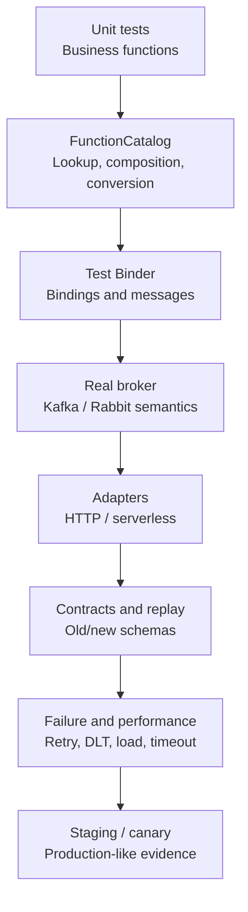
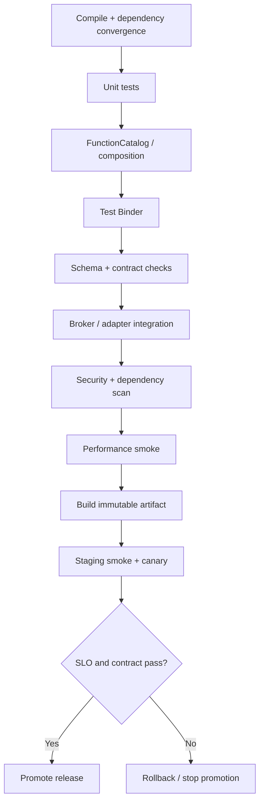

# Regression Testing and Version Rollback Planning

## 1. An Upgrade Is Only Safe When You Know How to Detect Failures and Roll Back

A Spring Cloud Function service processes order-created events. Its `classifyOrder` function reads JSON, classifies the order, and emits the result to a broker. The team upgrades Spring Boot, Spring Cloud Function, and Spring Cloud Stream; the build succeeds, the app deploys, and the health endpoint reports `UP`. Yet once real traffic arrives, some older JSON events fail to convert; the output binding points to the wrong destination; failed messages are dropped instead of reaching the dead-letter queue (DLQ); consumers process duplicates on broker redelivery; and p99 latency spikes.

Worse still, the new version already committed Kafka offsets and wrote to the database before the bug was caught. Rolling back the JAR does not restore prior data state.

**Regression testing** proves committed behaviors still hold on the new version. **Rollback planning** defines how to shift traffic back to a stable artifact when operational criteria fail while protecting data, messages, and already-executed side effects.

This lesson belongs to the **Upgrades** chapter of the **SPRING_CLOUD_FUNCTION** module. The module builds reusable business logic with `Supplier`, `Function`, and `Consumer`, using `FunctionCatalog`, composition, and message conversion to deploy the same function across HTTP, events, or serverless. Consequently, tests must cover pure functions, adapters, brokers, schemas, and runtimes.

After this lesson, you will be able to design layered test suites, create golden fixtures, verify `FunctionCatalog`/bindings/conversions, simulate failures and redeliveries, evaluate performance, set canary gates, and author rollback runbooks covering code, configuration, databases, and event streams.

## 2. Four Testing Goals to Keep Separate

| Goal | Question to answer | Evidence |
| --- | --- | --- |
| Business correctness | Does the same business input yield the same result? | Function unit tests |
| Integration correctness | Does Spring locate the right function, convert payloads, and bind the right ports? | `FunctionCatalog`, Test Binder, HTTP integration |
| Compatibility | Can the new version read historical data and preserve output contracts? | Schema/contract tests, replay fixtures |
| Operational safety | When failures happen, do retries, DLQ, timeouts, and rollback behave properly? | Broker/runtime tests, failure injection, canary |

A test checking `Function<String,String>` returns `HELLO` proves only string transformation. It does not prove `spring.cloud.function.definition` selects the right bean, JSON conversion matches production, Kafka destinations stayed unchanged, the DLQ catches failed messages, or a rolled-back older version can read newer messages.

Tie each test to a specific risk. Avoid writing redundant tests repeating the same transformation without adding integration or operational evidence.

## 3. Capture a Baseline Before Upgrading

Regression testing is impossible without knowing pre-upgrade behavior. Record a baseline from the currently stable running artifact:

```yaml
application:
  service: orders-function
  release: 2.8.4
  imageDigest: sha256:BASELINE_DIGEST
  javaRuntime: BASELINE_JAVA_RUNTIME

spring:
  bootVersion: BASELINE_BOOT
  cloudReleaseTrain: BASELINE_CLOUD_TRAIN
  functionVersion: BASELINE_FUNCTION
  streamVersion: BASELINE_STREAM
  functionDefinition: normalizeOrder|classifyOrder

bindings:
  input:
    name: normalizeOrder|classifyOrder-in-0
    destination: orders.created.v1
    group: order-classifiers
    contentType: application/json
  output:
    name: normalizeOrder|classifyOrder-out-0
    destination: orders.classified.v1
    contentType: application/json
```

`BASELINE_*` placeholders come from your live system. Also record retry/backoff, DLQ, ack/offset settings, partition keys, batch sizes, concurrency, HTTP/serverless entrypoints, event schemas, database migrations, and p95/p99 metrics. Capture resolved dependencies and deployed image digests; a version in a parent POM does not prove what binary is running.

## 4. Organize the Test Suite in Layers



Unit tests run fast and focus on business logic. `FunctionCatalog` tests verify framework lookup and composition. Test Binder tests verify in-JVM wiring and conversion. Broker tests verify real middleware. Adapter tests verify HTTP/serverless envelopes. Contract/replay tests verify data across versions. Failure/performance tests verify retries, duplicates, timeouts, and throughput.

Not every minor edit requires running every end-to-end suite. Yet upgrading frameworks or changing adapters, converters, or binders demands expanding coverage across the matching test layers.

## 5. Unit Tests for Pure Functions

Keep business logic independent of HTTP, Kafka, and cloud SDKs:

```java
import java.util.function.Function;

public class OrderFunctions {

    public record OrderCreated(
            String eventId, String orderId, long totalInCents) {}

    public record OrderClassified(
            String eventId, String orderId, String priority) {}

    public Function<OrderCreated, OrderClassified> classifyOrder() {
        return order -> {
            if (order.eventId() == null || order.eventId().isBlank()) {
                throw new IllegalArgumentException("eventId is required");
            }
            if (order.orderId() == null || order.orderId().isBlank()) {
                throw new IllegalArgumentException("orderId is required");
            }
            if (order.totalInCents() < 0) {
                throw new IllegalArgumentException("amount must be non-negative");
            }
            return new OrderClassified(
                    order.eventId(),
                    order.orderId(),
                    order.totalInCents() >= 100_000L
                            ? "PRIORITY" : "STANDARD");
        };
    }
}
```

Test:

```java
import static org.junit.jupiter.api.Assertions.assertEquals;
import static org.junit.jupiter.api.Assertions.assertThrows;

import org.junit.jupiter.api.Test;

class OrderFunctionsTest {

    private final OrderFunctions functions = new OrderFunctions();

    @Test
    void classifiesLargeOrderAsPriority() {
        var result = functions.classifyOrder().apply(
                new OrderFunctions.OrderCreated(
                        "evt-101", "ORD-101", 150_000L));

        assertEquals("PRIORITY", result.priority());
        assertEquals("ORD-101", result.orderId());
        assertEquals("evt-101", result.eventId());
    }

    @Test
    void rejectsNegativeAmount() {
        var input = new OrderFunctions.OrderCreated(
                "evt-102", "ORD-102", -1L);

        assertThrows(IllegalArgumentException.class,
                () -> functions.classifyOrder().apply(input));
    }
}
```

Cover valid inputs, business thresholds, null/blank fields, negative/large numbers, unsupported enums, headers/metadata if used, and ensuring side effects execute only after validation. Unit tests should call the real function, stubbing only external collaborators like repositories, clocks, or HTTP clients.

## 6. `FunctionCatalog` Regression: Names and Composition Must Not Drift

Spring Cloud Function normalizes functional beans through `FunctionCatalog`. Looking up via the catalog can return a wrapper supporting conversion and composition; pulling the raw bean from `ApplicationContext` is not guaranteed to match.

```java
@SpringBootTest
class FunctionCatalogRegressionTest {

    @Autowired
    FunctionCatalog catalog;

    @Test
    void publicFunctionStillExists() {
        Function<?, ?> function =
                catalog.lookup(Function.class, "classifyOrder");
        assertNotNull(function);
    }

    @Test
    void composedDefinitionStillInvokesInOrder() {
        @SuppressWarnings("unchecked")
        Function<OrderCreated, OrderClassified> function =
                (Function<OrderCreated, OrderClassified>) catalog.lookup(
                        Function.class,
                        "normalizeOrder|classifyOrder");

        assertNotNull(function);
        var result = function.apply(
                new OrderCreated("evt-101", " ORD-101 ", 150_000L));

        assertEquals("ORD-101", result.orderId());
        assertEquals("PRIORITY", result.priority());
    }
}
```

This is an illustrative template; import DTOs from your real test package. Assertions should lock down function names, definitions, composition order, input/output types, routing policy, and non-exported internal functions. A successful lookup alone is insufficient; invoke the function and compare outputs against fixtures.

## 7. Golden Fixtures: Keep Identical Datasets Before and After

A golden fixture is a reviewed input and expected output pair stored in version control:

```json
{
  "id": "order-created-priority-001",
  "input": {
    "eventId": "evt-101",
    "orderId": "ORD-101",
    "totalInCents": 150000
  },
  "expected": {
    "eventId": "evt-101",
    "orderId": "ORD-101",
    "priority": "PRIORITY"
  }
}
```

A solid fixture suite covers happy paths, boundary values, invalid payloads, historical events, new schemas, unknown fields, headers, duplicates, out-of-order events, poison messages, and batches containing a failing record.

Never update expected outputs merely to make tests green. When new outputs differ from baseline, require a documented business reason, explicit approval, and a test describing the intended change.

## 8. Testing Message Conversion and Headers

When signatures, content types, or converters change, identical JSON bytes can deserialize differently. Verify:

- `application/json` constructs the exact DTO.
- Missing fields and wrong field types obey policy.
- Correlation IDs are preserved.
- Routing headers are never trusted unintentionally.
- Output content type matches the payload.
- Credentials and internal headers are never echoed.
- Binder-native serializers/deserializers are not bypassed in tests.

Example:

```java
@Test
void preservesCorrelationAndDropsSensitiveHeader() {
    Message<String> input = MessageBuilder
            .withPayload("hello")
            .setHeader("x-correlation-id", "req-789")
            .setHeader("authorization", "Bearer test-only")
            .build();

    Message<String> output = function.apply(input);

    assertEquals("req-789",
            output.getHeaders().get("x-correlation-id"));
    assertNull(output.getHeaders().get("authorization"));
}
```

The token above is a mock string. When testing the HTTP adapter, send requests against the live endpoint to verify the adapter and gateway do not echo restricted headers; a function unit test cannot prove that.

## 9. Test Binder: Verifying Bindings Inside the JVM

Spring Cloud Stream provides the Spring Integration Test Binder to test apps without a live broker. It exposes `InputDestination` and `OutputDestination` to send/receive messages by binding.

Maven dependency:

```xml
<dependency>
    <groupId>org.springframework.cloud</groupId>
    <artifactId>spring-cloud-stream-test-binder</artifactId>
    <scope>test</scope>
</dependency>
```

Example test using current Test Binder APIs:

```java
@SpringBootTest(classes = OrderStreamTest.TestApplication.class,
        properties = "spring.cloud.function.definition=classifyOrder")
class OrderStreamTest {

    @Autowired
    InputDestination input;

    @Autowired
    OutputDestination output;

    @Test
    void transformsOrderMessage() {
        byte[] payload = """
                {"eventId":"evt-101","orderId":"ORD-101","totalInCents":150000}
                """.getBytes(StandardCharsets.UTF_8);

        input.send(new GenericMessage<>(payload), "classifyOrder-in-0");

        Message<byte[]> result =
                output.receive(1_000, "classifyOrder-out-0");

        assertNotNull(result);
        assertThat(new String(result.getPayload(), StandardCharsets.UTF_8))
                .contains("\"priority\":\"PRIORITY\"");
    }

    @SpringBootApplication
    @EnableTestBinder
    static class TestApplication {
        @Bean
        Function<OrderCreated, OrderClassified> classifyOrder() {
            return order -> new OrderClassified(
                    order.eventId(), order.orderId(),
                    order.totalInCents() >= 100_000L
                            ? "PRIORITY" : "STANDARD");
        }
    }
}
```

Annotation names and imports must match your resolved Stream/BOM version. Current 5.1 docs use `@EnableTestBinder`; older branches may use `@Import(TestChannelBinderConfiguration.class)`.

The Test Binder verifies Spring context, binding names, conversions, and pipelines inside the JVM. It does **not** verify Kafka partitions/offsets/rebalances, Rabbit exchanges/acks, broker ACLs/TLS, native codecs, real retry/DLQ behavior, or retention/replay.

### 9.1. Do Not Accidentally Mix the Test Binder with Broker Binders

When the Test Binder sits on the test classpath, Stream may select it for bindings across the module. When certain tests need a real broker, isolate broker integration tests into a separate test module/profile or exclude test-binder auto-configuration per your version's docs. Never run tests believing they hit Kafka when messages only travel through in-memory channels.

## 10. Broker Integration Tests: Verifying Real Middleware

For Kafka, use `spring-kafka-test`/embedded Kafka or Testcontainers depending on needs. Spring Kafka currently provides an embedded KRaft broker; Testcontainers runs the real backend inside a container.

A Kafka test should verify that producers send to the expected topic/key/headers, consumer groups receive messages, partition keys maintain ordering, deserializers produce the intended DTOs, commits/acks match configuration, retry/DLT work, and restarts neither drop nor duplicate side effects.

For RabbitMQ, verify exchanges, routing keys, queues, bindings, ack/nack, requeue, DLQ, and TTL. Never take Kafka test results as proof for the Rabbit binder.

### 10.1. Kafka Offsets Are State You Must Control

In tests, use dedicated topics per scenario or control consumer offsets explicitly. If a consumer starts after the producer already sent a record, `auto.offset.reset=latest` can skip the fixture; `earliest` is usually better for fresh test fixtures. Spring Kafka test utilities provide helpers to set up consumers and consume records.

Never share topics or consumer groups across parallel tests without data isolation; tests can steal each other's messages.

## 11. HTTP and Serverless Adapter Integration Tests

When exposing a function over HTTP, test through a real server:

```java
@SpringBootTest(webEnvironment = SpringBootTest.WebEnvironment.RANDOM_PORT)
class FunctionHttpRegressionTest {

    @Autowired
    TestRestTemplate rest;

    @Test
    void returnsClassifiedOrder() {
        HttpHeaders headers = new HttpHeaders();
        headers.setContentType(MediaType.APPLICATION_JSON);
        headers.setAccept(List.of(MediaType.APPLICATION_JSON));

        String body = """
                {"eventId":"evt-101","orderId":"ORD-101","totalInCents":150000}
                """;

        ResponseEntity<String> response = rest.postForEntity(
                "/classifyOrder",
                new HttpEntity<>(body, headers),
                String.class);

        assertEquals(HttpStatus.OK, response.getStatusCode());
        assertThat(response.getBody()).contains("\"priority\":\"PRIORITY\"");
    }
}
```

Verify status, body, content type, headers, and error contracts. For serverless, test the handler/adapter with real provider event envelopes such as API Gateway/SQS or Azure triggers; calling the Java function directly does not prove the cloud handler loads your artifact.

**Transaction note:** `@SpringBootTest(webEnvironment = RANDOM_PORT)` runs the client and server on separate threads and transactions. Annotating the test with `@Transactional` will not roll back transactions already committed by the server. Clean up data explicitly, use isolated databases/containers, or reset state intentionally.

## 12. Contract Tests for Producers and Consumers

A function can pass internal checks while a producer emits events that break downstream consumers' schemas. Contract tests pin down message bodies, headers, destinations, and triggers.

Illustrative contract example:

```yaml
description: Order classified event
label: order_classified_v1
input:
  triggeredBy: publishClassifiedOrder()
outputMessage:
  sentTo: orders.classified.v1
  headers:
    contentType: application/json
    eventType: com.acme.orders.order-classified.v1
  body:
    eventId: evt-101
    orderId: ORD-101
    priority: PRIORITY
```

Actual syntax must match your Spring Cloud Contract DSL and version. The goal is locking down the producer-consumer agreement rather than duplicating full business logic inside contracts.

Test bidirectional compatibility:

| Producer | Consumer | Question |
| --- | --- | --- |
| Old | New | Can the new consumer still read historical messages? |
| New | Old | Can the old consumer parse new payloads? |
| New | New | Does the target contract hold? |
| Old | Old | Is the baseline reproducible? |

If a consumer rolls back to the old version, newer data already emitted by producers must still be processed or isolated per the migration plan.

## 13. Testing Failures, Retries, and Dead Letters

Spring Cloud Stream error handling depends on the binder and programming model. For imperative message handlers, exceptions may propagate to the binder for retries; once retries exhaust, error handling drops, requeues, or routes to a DLQ depending on configuration. Never rely on assumed defaults; configure and test explicitly.

| Scenario | Expectation |
| --- | --- |
| Transient error once, succeeds next | Retries within configured limits |
| Permanent/validation error | No infinite retries; rejected or routed to DLT |
| Temporary broker disconnect | No loss of broker-acknowledged messages |
| Consumer crashes mid-processing | Controlled redelivery with idempotency |
| DLT unavailable | Alerting and clear recovery path |
| Poison message | Does not stall an entire partition/queue indefinitely |
| Custom error handler | Does not accidentally disable binder DLQ/error handling |

### 13.1. Custom `ErrorMessage` Handlers Can Replace Defaults

Spring Cloud Stream documents that a custom `Consumer<ErrorMessage>` can supersede framework/binder error handlers; when configuring a custom handler, do not assume DLQ still works identically to before. Write tests proving error messages are handled properly and verifying whether records reach the DLT.

### 13.2. Reactive Functions Have a Different Error Model

`Function<Flux<T>, Flux<R>>` is not an imperative message handler in the same sense. `RetryTemplate`/DLQ settings for imperative handlers do not automatically apply identically to reactive streams. Use Reactor operators like `retryWhen` and test resubscription, cancellation, backpressure, side effects, and ordering.

## 14. Duplicate, Idempotency, and Replay Tests

Brokers and event sources can redeliver messages. Tests must simulate the same event identity arriving multiple times:

```json
{
  "source": "urn:acme:orders",
  "id": "evt-101",
  "type": "com.acme.orders.order-created.v1",
  "data": {
    "orderId": "ORD-101",
    "totalInCents": 150000
  }
}
```

Consumers should use `(source,id)` or a stable contracted event ID as the deduplication key. Send `evt-101` once and assert the side effect; resend the same event and assert no second side effect occurs; then send `evt-102` and assert the new event is still processed.

Also test process crashes after DB commit but before broker ack/commit. If the dedupe marker and side effect are not in the same transaction, tests should expose that crash window.

### 14.1. Historical Replay

Select historical events still inside the retention/replay window. Replay them in a test environment or isolated consumer group, verifying the target consumer parses legacy schemas, maintains ordering/partitioning keys, never skips new events due to dedupe bugs, writes side effects only to sandbox storage, and sends invalid events to the DLT.

Never replay directly against production solely to test rollback readiness. Use fixtures, cloned topics, or isolated environments.

## 15. Testing Databases and Outboxes for Rollback

An upgrade may change database schemas, write new data shapes, or add outbox states. Rolling back application code does not automatically undo those changes.

Database tests must verify:
- The old version reads rows written by the new version.
- New defaults or nulls do not crash old code.
- Adding columns or indexes does not break old queries.
- The rolled-back application starts and runs against the expanded schema.
- Already-published outbox records are not re-emitted as duplicate side effects.
- Idempotency tables retain keys and constraints across migrations.
- Migrations do not drop data still needed by the old artifact.

### 15.1. Expand–Migrate–Contract

1. **Expand:** add columns/tables/indexes in a way the old code keeps running.
2. **Migrate:** deploy new code, dual-read/write or backfill.
3. **Contract:** drop old columns/fields only after all consumers and the rollback window no longer need them.

Never run destructive migrations before confirming old artifacts no longer depend on the legacy schema. When a change deleted data or altered semantics irreversibly, recovery may require a roll-forward fix or backup restore rather than simply redeploying the old JAR.

## 16. Performance and Resource Testing

A framework upgrade can preserve functional outputs while increasing cold starts, heap usage, CPU, or latency.

| Metric | What to watch |
| --- | --- |
| Startup/cold-start | Time from process launch until ready |
| p50/p95/p99 latency | How much tail latency increased |
| Throughput | Messages/second or requests/second |
| Error rate | 4xx/5xx, conversion failures, function exceptions |
| CPU/heap/GC | Overhead from converters, reflection, or context init |
| Queue lag/backlog | Whether consumers keep pace with producers |
| Retry/DLT rate | Any rise in transient or permanent failures |
| Connection pools | Risk of exhausting Kafka/DB/HTTP pools |
| Batch/concurrency | Ordering changes or downstream pressure |

Run load tests with production-like payloads: realistic JSON sizes, batch record counts, headers, old/new schemas, and error rates. Testing solely with `"hello"` does not represent production workloads.

Example team-defined thresholds:

```yaml
releaseGate:
  errorRate:
    maxIncreasePercent: 0.5
  latencyP99:
    maxRegressionPercent: 15
  consumerLag:
    maxAgeSeconds: 60
  deadLetter:
    unexpectedIncrease: 0
  businessInvariant:
    duplicateOrderCount: 0
```

These are examples, not Spring defaults. Base thresholds on SLOs, volume, and business risk. Under low traffic, require minimum request counts and long enough observation windows to avoid false positives.

## 17. CI Pipeline: Enforce Gates Before Publishing or Deploying



Gates should cover unit/`FunctionCatalog`, Test Binder, schema compatibility, broker integration, HTTP/serverless tests, security scans, performance smoke tests, artifact digests, runbooks, and alarms.

Never rebuild the artifact after staging verification and deploy a different binary to production. If a rebuild is unavoidable, re-run verification and record the new digest.

## 18. Preparing Rollback Artifacts and Configuration

| Component | Must preserve |
| --- | --- |
| Application artifact | Image digest/JAR checksum and source revision |
| Runtime | Java runtime, container base image, or Lambda runtime |
| Spring config | Active profiles, env vars, Config Server revision |
| Function definition | Definition, routing policy, binding names |
| Broker topology | Destinations, groups, partitions, queue bindings |
| Schema | Schema versions, registry subjects, compatibility modes |
| Database | Migration version, backup/restore point |
| Secrets | Secret versions/references (never store plaintext) |
| Deployment | Release ID, traffic weights, previous stable revision |
| Observability | Dashboards, alarms, trace/log queries, release markers |

Old artifacts must still exist and remain deployable. Never rely on a mutable `latest` tag that can be overwritten. Store digests, provenance, dependency locks/effective POMs, and runtime configs.

A rollback plan must specify which binary runs, which config accompanies it, which function definition is active, which destinations/groups are used, and whether the old version can parse newer messages and schemas.

## 19. Canary and Blue/Green: Rolling Out Gradually for Visibility

- **Canary:** a subset of traffic/events goes to the new version while the rest stays on the stable version.
- **Blue/green:** two isolated environments are prepared; traffic switches from old to new in controlled steps.
- **Rolling:** instances are replaced incrementally; old and new versions run concurrently.

During rolling or canary overlap, old and new versions must remain compatible with the same event schemas, database schemas, and shared resources.

### 19.1. Special Considerations for Kafka Consumers

There is no universal traffic-percentage slider for arbitrary Kafka consumers:

- When old and new instances share the **same consumer group**, partitions are divided across instances; records go to whichever instance owns a partition via rebalance—not an arbitrary percentage split.
- When old and new instances use **two separate consumer groups**, each group gets its own event stream; the new version may reprocess the entire topic depending on offset policy. This acts as shadow processing and must never duplicate real side effects.
- When true percentage-based event canarying is needed, design explicit routing, partitions, topics, or sampling strategies.
- Changing consumer groups alters offset state; never treat it as a harmless tweak.

Shadow consumers should write results to isolated comparison sinks rather than sending emails, issuing invoices, charging cards, or publishing official events.

## 20. AWS Lambda Canary via Weighted Aliases

AWS Lambda supports aliases pointing to two published versions with weighted traffic splitting. Both versions must meet Lambda requirements, including identical execution roles and compatible DLQ configs; aliases cannot point to `$LATEST`. Distribution is probabilistic, so low traffic volumes can diverge from configured weights.

AWS SAM example:

```yaml
Resources:
  ClassifyOrder:
    Type: AWS::Serverless::Function
    Properties:
      Handler: org.springframework.cloud.function.adapter.aws.FunctionInvoker
      Runtime: java21
      CodeUri: target/orders-function-aws.jar
      AutoPublishAlias: live
      DeploymentPreference:
        Type: Canary10Percent10Minutes
        Alarms:
          - !Ref FunctionErrorAlarm
          - !Ref FunctionLatencyAlarm
        Hooks:
          PreTraffic: !Ref PreTrafficValidation
          PostTraffic: !Ref PostTrafficValidation
```

This is an illustrative template. Runtimes, handlers, alarms, and hooks must match your deployed artifact and adapter.

AWS SAM integrated with CodeDeploy creates aliases, shifts traffic on canary/linear schedules, and rolls back automatically if alarms or pre/post traffic hooks fail. Do not treat AWS weighted aliases as a universal pattern for Kafka consumers or Azure/GCP.

## 21. Define Rollback Triggers Before Deploying

| Signal | Example trigger | Action |
| --- | --- | --- |
| Error rate | Breaches SLO over a sustained window | Halt traffic ramp and evaluate rollback |
| p99 latency | Exceeds baseline threshold | Halt promotion |
| Conversion failures | Unusual spike for an event type | Halt consumer/producer rollout |
| DLT/DLQ | Grows beyond allowable threshold | Stop traffic or quarantine events |
| Consumer lag | Growing continuously without catching up | Scale back rollout or roll back |
| Duplicate side effects | Any duplicate order/payment detected | Roll back immediately and reconcile |
| Data invariant | Totals/states mismatch | Halt writes and declare incident |
| Crash/OOM | Restarts or memory above threshold | Roll back version |
| Security regression | Wrong header/route/auth behavior | Halt rollout |
| Schema incompatibility | Old consumer fails on new events | Halt producer upgrade |

Tune thresholds and windows to traffic volume. Percentage-only alarms on tiny sample sizes trigger false positives; excessively long averaging windows detect failures too late.

## 22. Rollback Runbook: Halt Expansion, Restore Traffic, Reconcile State

1. **Stop promotion:** halt traffic increases or new-version scaling.
2. **Freeze producers if needed:** stop emitting schemas/events that older consumers cannot parse.
3. **Shift traffic:** repoint aliases/routes to the stable version or revert deployment groups to the prior revision.
4. **Restore compatible configuration:** apply saved function definitions, bindings, secret references, and runtime configs.
5. **Check consumers:** verify consumer groups, offsets, backlog, DLT, and subscriptions.
6. **Check databases:** identify executed migrations, committed side effects, and pending outbox rows.
7. **Reconcile:** replay or emit compensating actions per approved procedures.
8. **Verify invariants:** record counts, event IDs, business states, and downstream consistency.
9. **Observe:** monitor error rates, lag, latency, and DLT post-rollback.
10. **Preserve evidence:** archive release IDs, logs, traces, offsets, event IDs, and timelines.

Never reset Kafka offsets or delete consumer groups in a runbook without exact topic/partition/time scope and approval. Those actions can trigger massive replays or skip data.

## 23. Rolling Back Code Does Not Roll Back Kafka Offsets

Suppose the new version reads `evt-101`, writes to the DB, and commits its offset. Later, you discover the classification output was wrong. Redeploying the old version does **not** rewind the Kafka offset before `evt-101`.

| State at rollback | Consequence |
| --- | --- |
| Offset already committed | Old version resumes from after that record |
| Offset uncommitted | Broker may redeliver the record |
| New consumer group | May apply offset-reset policy and reprocess large ranges |
| DLT holds failed records | Requires a dedicated replay/reprocess workflow |
| Events published to another topic | Do not vanish when rolling back the producer |

If committed events must be reprocessed, plan explicitly: republish targeted records to a retry topic, replay with an isolated consumer group, or perform a scoped offset reset. Kafka requires consumer instances to be inactive during offset resets and the command must scope topics explicitly; reprocessing can re-run side effects.

**Before replaying**, verify idempotency and current state. Never reset offsets for an entire consumer group just because one record produced bad output.

## 24. Rollback Does Not Undo External Side Effects

A function may update databases, send emails, call payment gateways, emit events, dispatch partner commands, or adjust inventory. When code rolls back, executed actions remain.

| Side effect | Recovery approach |
| --- | --- |
| Committed DB update | Inspect commits; apply corrective migration if already committed |
| Sent email | Send correction notice if appropriate; emails cannot be unsent |
| Captured payment | Trigger refund/void per business workflow |
| Published event | Emit correction/compensation event or update consumers |
| Deducted inventory | Reconciliation/compensation transaction |
| Unpublished outbox row | Keep state and let publisher continue per policy |
| Written cache entry | Invalidate/rebuild by key and version |

For critical side effects, design idempotency keys and compensation workflows up front. Do not wait until an emergency rollback to discover there is no reconciliation path.

## 25. Database Rollback: Prefer Roll-Forward When Migrations Are Destructive

A new release adds a `priority_reason` column and writes to it. If you roll back code, the older version may keep running cleanly with the extra column present. Yet if the new release dropped `order_status` or changed column types incompatibly, the older version may fail to start.

- Run additive migrations first.
- Keep code compatible with both old and new schemas during transition.
- Make backfills rerunnable with checkpoints.
- Drop old columns only after the rollback window closes.
- Never bundle destructive migrations with application rollouts.
- Rehearse backups/restores with realistic RTO/RPO targets.
- When reverting a schema safely is impossible, prefer a roll-forward corrective migration.

Code rollback and database rollback are separate decisions. You can keep the expanded database schema while deploying older compatible code.

## 26. Replay and DLQ/DLT: Verify Before Using as Recovery

A DLQ/DLT preserves failed messages for investigation, auditing, or reprocessing. It does not fix data by itself.

Replay procedure:
1. Identify the root failure cause and offending version.
2. Verify event schemas and content types.
3. Fix the consumer or introduce a translation adapter.
4. Filter which events are eligible for replay.
5. Preserve original event identities.
6. Choose the target/retry destination and throttle replay rate.
7. Dry-run or replay in staging first.
8. Confirm consumers are idempotent.
9. Monitor success/failure counts and remaining DLT depth.
10. Reconcile side effects before closing the incident.

Never dump an entire DLQ back into the main topic without knowing whether some records already succeeded before crashing. Uncontrolled replays can trigger duplicate emails, payments, or orders.

## 27. Rollback Rehearsal Scenarios

**Scenario A — Converter regression:** baseline reads JSON v1; the new version requires a newly mandatory field. Send v1 fixtures, verify conversion failures, alarms, and canary halt; roll back code and verify consumers resume reading.

**Scenario B — Duplicate side effect:** a consumer writes to the DB and gets killed before ack/commit. The broker redelivers the same event ID. Verify idempotency blocks a second side effect; inspect offsets and event audits.

**Scenario C — DLT spike:** send a poison message, verify retries/backoff, DLT routing, and alarms. Fix the parser and replay the single event through the controlled workflow.

**Scenario D — Database schema:** apply an additive migration, run the new version, then roll back code. Verify the old version runs cleanly against the expanded schema without dropping the new column.

**Scenario E — Kafka offsets:** let a consumer process and commit a record, roll back consumer code, and verify rollback does not automatically reprocess the committed record. If replay is needed, execute via an isolated test topic/group with deduplication.

A rehearsal is complete only when the team restores traffic, proves data consistency, and knows exactly which events need replay or compensation.

## 28. Pre- and Post-Upgrade Regression Matrix

| ID | Test | What to prove |
| --- | --- | --- |
| REG-01 | `FunctionCatalog` lookup | Function names still resolve |
| REG-02 | Composition | Step order and type compatibility |
| REG-03 | JSON conversion v1 | Target consumer parses historical events |
| REG-04 | JSON conversion v2 | New schema works properly |
| REG-05 | HTTP endpoint | Method/path/status honor contract |
| REG-06 | Binding names | Input/output bindings match |
| REG-07 | Consumer group | Offsets/assignments planned cleanly |
| REG-08 | Header mapping | Metadata neither lost nor leaked |
| REG-09 | Transient retries | Attempts/backoff match policy |
| REG-10 | Permanent failure | DLT/DLQ captures message |
| REG-11 | Duplicate delivery | Zero duplicate side effects |
| REG-12 | Historical replay | Target reads events still in retention |
| REG-13 | Outbox | Retries never emit duplicate business events |
| REG-14 | Broker restart | Clean recovery |
| REG-15 | Concurrency | Ordering and invariants preserved |
| REG-16 | Performance | p95/p99 within SLO |
| REG-17 | Serverless handler | Event envelopes/handlers match |
| REG-18 | Rollback artifact | Old artifact deploys cleanly |
| REG-19 | Database rollback | Old version runs on current schema |
| REG-20 | Canary alarms | Halts/rolls back on SLO breach |

Archive test results alongside commit hashes and artifact digests. A single `all tests passed` log line is insufficient for investigating a later release incident.

## 29. Case Study: Upgrading an Order Classification Service

Baseline:
- Function definition: `normalizeOrder|classifyOrder`.
- Input destination: `orders.created.v1`.
- Output destination: `orders.classified.v1`.
- Consumer group: `order-classifiers`.
- Event schema: `order-created.v1`.
- DLQ: `orders.created.dlt`.

**Step 1 — Lock baseline:** capture JAR/image digest, resolved dependency tree, definitions, bindings, destinations, group, schema fixtures, and metrics.

**Step 2 — Unit/catalog tests:** verify function names, composition, business rules, and error handling.

**Step 3 — Test Binder:** send golden JSON fixtures into `classifyOrder-in-0`; assert output, content type, and headers.

**Step 4 — Broker integration:** use a Kafka test broker/container; verify topics, groups, partitions, offsets, retries, DLT, and redelivery.

**Step 5 — Contracts/replay:** replay v1 events; verify the target reads historical fixtures. If a new schema is breaking, execute the v2 migration plan before canary.

**Step 6 — Failure/performance:** kill the consumer after DB write, send poison messages, simulate transient broker unavailability, and measure p95/p99. Verify idempotency, outbox, retries, and alarms.

**Step 7 — Canary:** route a slice of workload to the target via an appropriate mechanism. Watch error rates, DLT, lag, duplicate counts, conversion errors, and business invariants.

**Step 8 — Rollback rehearsal:** halt rollout, shift traffic back to the old artifact, keep destinations/schemas compatible, inspect committed offsets/events, run controlled replay/compensation, and reconcile order tables, outbox rows, and event counts.

Never treat redeploying the old JAR as the end of an incident. Prove business state consistency before closing.

## 30. Pre-Production Upgrade Sign-Off Checklist

### Testing and Compatibility
- [ ] Unit tests for critical business functions.
- [ ] `FunctionCatalog` lookup and composition tests.
- [ ] Test Binder checks for bindings and conversions.
- [ ] Broker integration tests for active Kafka/Rabbit setups.
- [ ] HTTP/serverless adapter integration tests.
- [ ] Producer/consumer contract tests.
- [ ] Historical event replay tests.
- [ ] Duplicate/idempotency tests.
- [ ] Retry/DLT and poison-message tests.
- [ ] Load, latency, cold-start, and resource tests.

### Rollback Readiness
- [ ] Old artifact preserved by immutable digest.
- [ ] Old configuration and secret references recorded.
- [ ] Function definitions and binding topology restorable.
- [ ] Database schema remains compatible with old artifact.
- [ ] New events readable by old consumers or isolated by version routing.
- [ ] Offset, consumer group, and replay plans documented.
- [ ] DLT/DLQ reprocessing procedure verified.
- [ ] Side effects guarded by idempotency or compensation.
- [ ] Canary alarms and rollback triggers tested.
- [ ] Runbook specifies owner, execution permissions, and post-rollback verification steps.

### Post-Rollout
- [ ] Monitor error rate, p99, lag, DLT, and conversion failures.
- [ ] Monitor business invariants and duplicate events.
- [ ] Maintain compatibility window for old events and schemas.
- [ ] Reconcile outbox and downstream systems.
- [ ] Record release marker and canary metrics.
- [ ] Delete old artifacts, schemas, and configs only after the rollback window closes.

## 31. Hands-On Exercises

### Exercise 1: Designing Test Layers

A `classifyOrder` function runs over HTTP and Kafka. Categorize tests across unit, `FunctionCatalog`, Test Binder, broker integration, HTTP adapter, and contracts. Which risk does each test mitigate?

### Exercise 2: What Does the Test Binder Miss?

`InputDestination`/`OutputDestination` tests pass, yet production Kafka fails to publish to the DLT. Name at least five possible causes and design matching broker integration tests.

### Exercise 3: Converter Regression

Baseline reads `OrderCreatedV1`; the target switches converters and rejects missing `currency` fields. Create fixtures, negative tests, contract tests, and canary halt criteria.

### Exercise 4: Retries and Side Effects

A function writes to a DB and then calls a partner API; an API timeout throws an exception. The binder retries three times. Design idempotency and tests proving DB/API side effects do not duplicate.

### Exercise 5: Reactive Error Handling

A `Function<Flux<Order>,Flux<Result>>` uses `retryWhen`. Why can't imperative retry tests serve as evidence? Design tests covering resubscription and cancellation.

### Exercise 6: Kafka Rollback

The new version processes `evt-101` and commits its offset, then bad output is discovered. What does redeploying old code do to that offset? Outline a controlled replay plan and duplicate risks.

### Exercise 7: Database Migration

The new version adds a column and writes data. Why can rolling back code remain safe? Give an example of a destructive migration that breaks code rollback, and show how expand–migrate–contract prevents it.

### Exercise 8: Lambda Canary

An AWS Lambda uses `FunctionInvoker`. Describe weighted aliases, pre/post traffic hooks, alarms, and rollback criteria. Why can low live traffic diverge from configured alias weights?

### Exercise 9: Shadow Consumers

You want to run the new version alongside the old version to compare Kafka outputs. Contrast sharing one consumer group vs. using a separate group; design shadow output handling to avoid doubling side effects.

### Exercise 10: Rollback Runbook

Write a runbook for an incident where p99 latency doubles, DLT spikes, and some orders are recorded twice. Specify the order of halting rollout, restoring traffic, checking offsets, deduplicating, compensating, and verifying data consistency.

### Self-Assessment Questions

1. What does a function unit test prove, and what does it fail to prove?
2. Why must you test through `FunctionCatalog`?
3. Which parts of Spring Cloud Stream does the Test Binder simulate?
4. Why doesn't the Test Binder replace broker integration tests?
5. Does `@SpringBootTest(RANDOM_PORT)` roll back server transactions when the test method has `@Transactional`?
6. Which test proves HTTP headers map accurately?
7. Why capture golden fixtures from the baseline?
8. When are producer/consumer contract tests required?
9. How do imperative retries differ from reactive retries?
10. How can a custom `Consumer<ErrorMessage>` affect DLQ behavior?
11. Why do duplicate deliveries require idempotency?
12. What gap between DB and broker does an outbox solve?
13. Why doesn't rolling back code reset Kafka offsets?
14. Why can changing a consumer group cause historical events to be re-read?
15. When should you replay vs. emit a compensation event?
16. Why doesn't redeploying an old JAR undo side effects?
17. Which migrations can prevent rolled-back code from running?
18. How do canary and blue/green deployments differ?
19. Why don't Kafka consumers have weighted traffic splitting like Lambda aliases by default?
20. Which metrics should trigger canary halts or rollbacks?
21. Why use immutable artifact digests instead of the `latest` tag?
22. When is a rollback rehearsal considered complete?

## 32. Summary

Regression testing and version rollback planning are two halves of one upgrade strategy:

- **Unit tests** protect pure business logic in `Supplier`, `Function`, and `Consumer`.
- **`FunctionCatalog` tests** protect function names, compositions, wrappers, and conversions.
- **Test Binder** verifies in-JVM wiring and bindings; broker integration tests verify real Kafka/Rabbit semantics.
- **Adapter/contract tests** protect HTTP contracts, event schemas, headers, and serverless invocations.
- **Failure/replay tests** prove retries, DLQ, idempotency, outboxes, and duplicate handling.
- **Performance tests** confirm latency, throughput, cold starts, and resource budgets.
- **Canary/blue-green** limits blast radius when introducing new versions to live traffic.
- **Rollback** restores code, configs, and traffic while still reconciling databases, offsets, emitted events, and committed side effects.

A safe process is **capture baseline → build golden fixtures → run layered tests → verify brokers/adapters/schemas → measure performance and failures → build immutable artifacts → canary with alarms → roll back on SLO breach → replay/compensate and reconcile state**.

Spring Cloud Function lets you reuse the same business function across HTTP, events, and serverless. Yet protocol independence does not make retries, acknowledgements, offsets, transactions, or rollbacks identical across adapters. Every boundary needs its own tests and runbooks. An upgrade is truly complete only when the team proves **the new version works properly and the prior stable version can be restored without losing or duplicating business state**.

### References

- [Spring Cloud Function — Testing Functional Applications and FunctionCatalog](https://docs.spring.io/spring-cloud-function/docs/current/reference/html/spring-cloud-function.html)
- [Spring Cloud Stream — Spring Integration Test Binder](https://docs.spring.io/spring-cloud-stream/reference/spring-cloud-stream/spring_integration_test_binder.html)
- [Spring Cloud Stream — Error Handling, Retry, and DLQ](https://docs.spring.io/spring-cloud-stream/reference/spring-cloud-stream/overview-error-handling.html)
- [Spring Boot — Testing Spring Boot Applications](https://docs.spring.io/spring-boot/reference/testing/spring-boot-applications.html)
- [Spring Boot — Testcontainers](https://docs.spring.io/spring-boot/reference/testing/testcontainers.html)
- [Spring Kafka — Testing Applications and Embedded Kafka](https://docs.spring.io/spring-kafka/reference/testing.html)
- [Spring Kafka — Transactions](https://docs.spring.io/spring-kafka/reference/kafka/transactions.html)
- [Spring Cloud Contract — Messaging Contracts](https://docs.spring.io/spring-cloud-contract/reference/project-features-messaging.html)
- [Apache Kafka — Consumer groups and offset reset](https://kafka.apache.org/42/operations/basic-kafka-operations/)
- [AWS Lambda — Weighted alias routing and canary](https://docs.aws.amazon.com/lambda/latest/dg/configuring-alias-routing.html)
- [AWS SAM — Gradual deployments, hooks, alarms, and rollback](https://docs.aws.amazon.com/serverless-application-model/latest/developerguide/automating-updates-to-serverless-apps.html)
- [AWS CodeDeploy — Lambda deployment steps and rollback](https://docs.aws.amazon.com/codedeploy/latest/userguide/deployment-steps-lambda.html)
