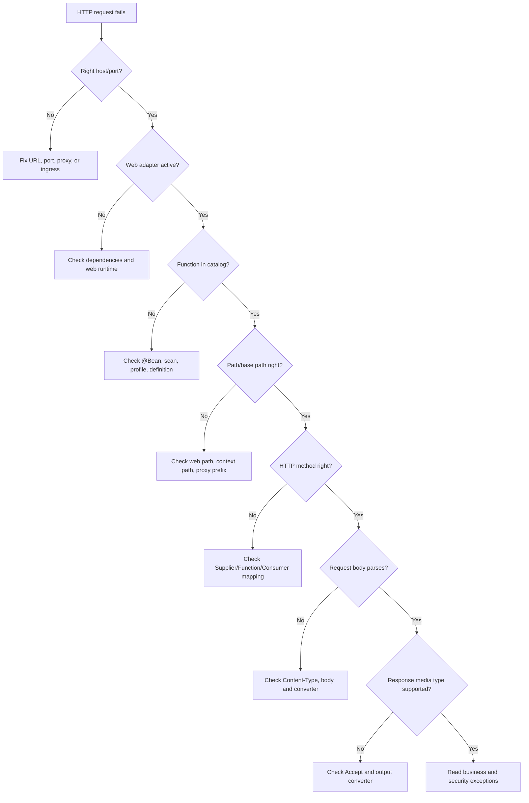

# HTTP Returns Wrong Path, Method, or Content Type

## Learning Objectives

Spring Cloud Function lets you write business logic as `Supplier<O>`, `Function<I,O>`, and `Consumer<I>`, register them in the Spring context, and look them up via `FunctionCatalog`. Adding the Web adapter allows those functional beans to be invoked over HTTP without writing a dedicated controller for each function. Yet for a request to reach the right function, the application must align **path, HTTP method, function definition, and content type**.

This lesson enables you to:

- Identify the conditions under which the Spring Cloud Function Web adapter auto-exposes functional beans as HTTP endpoints.
- Determine the right URL when an application has one or multiple beans in `FunctionCatalog`.
- Distinguish Function Web base paths, servlet context paths, and paths added by reverse proxies.
- Choose the right HTTP method for `Supplier`, `Function`, and `Consumer`; customize method mappings when needed.
- Distinguish request `Content-Type` from response `Accept`.
- Understand how `MessageConverter` converts JSON, text, and byte arrays into function parameter types.
- Interpret 404, 405, 406, 415, 400, 401/403, and 500 errors at the exact layer where they occur.
- Test HTTP endpoints using `curl`, `MockMvc`, or `TestRestTemplate`; verify `FunctionCatalog` separately.

**Scope:** this lesson focuses on `spring-cloud-function-web` in a standalone Spring Boot HTTP application. The Web adapter provides lightweight endpoints for exposing stateless functions; it does not replace all of Spring MVC/WebFlux or a full CRUD REST API. If your project also has custom controllers, gateways, servlet context paths, or ingress/proxies, inspect those routing layers too.

## 1. Confirm the Web Adapter Is Enabled

Spring Cloud Function does not automatically turn every Spring Boot app into an HTTP API merely because a `Function` bean exists. The app needs the Web adapter dependency and a compatible web runtime.

Either dependency declaration works:

```xml
<dependency>
    <groupId>org.springframework.cloud</groupId>
    <artifactId>spring-cloud-function-web</artifactId>
</dependency>
```

Or use the starter bundling optional dependencies:

```xml
<dependency>
    <groupId>org.springframework.cloud</groupId>
    <artifactId>spring-cloud-starter-function-web</artifactId>
</dependency>
```

If declaring `spring-cloud-function-web` directly, an MVC application also needs the web runtime, for example:

```xml
<dependency>
    <groupId>org.springframework.boot</groupId>
    <artifactId>spring-boot-starter-web</artifactId>
</dependency>
```

Spring Cloud Function's web configuration activates when the module is included in a Spring Boot app with appropriate web support (current docs describe MVC support). Manage versions via a Spring Cloud BOM compatible with your project's Spring Boot version; do not copy isolated versions from unrelated samples.

### 1.1. Functional Bean Examples

```java
import java.util.Locale;
import java.util.function.Consumer;
import java.util.function.Function;
import java.util.function.Supplier;
import org.springframework.boot.SpringApplication;
import org.springframework.boot.autoconfigure.SpringBootApplication;
import org.springframework.context.annotation.Bean;

@SpringBootApplication
public class FunctionHttpApplication {

    @Bean
    public Function<String, String> uppercase() {
        return value -> value.toUpperCase(Locale.ROOT);
    }

    @Bean
    public Function<Person, Person> normalizePerson() {
        return person -> new Person(
                person.name().trim().toUpperCase(Locale.ROOT),
                person.age());
    }

    @Bean
    public Supplier<String> healthText() {
        return () -> "UP";
    }

    @Bean
    public Consumer<String> auditMessage() {
        return value -> System.out.println("AUDIT: " + value);
    }

    public static void main(String[] args) {
        SpringApplication.run(FunctionHttpApplication.class, args);
    }
}
```

`Person` is the application DTO:

```java
public record Person(String name, int age) {
}
```

Place `Person` in its own `Person.java` file if declared as a public record. The functions above are registered in `FunctionCatalog`; the Web adapter uses bean names as function names in URLs.

### 1.2. Check the Catalog Before Checking URLs

If dependencies are present yet endpoints do not appear, verify the beans are actually registered:

```java
@Autowired
FunctionCatalog catalog;

void printFunctions() {
    System.out.println(catalog.getNames(null));
}
```

Or enable Spring Boot Actuator and expose the `functions` endpoint:

```properties
management.endpoints.web.exposure.include=health,info,functions
```

Then query:

```text
GET /actuator/functions
```

This endpoint displays the catalog's functions, suppliers, and consumers along with their input/output types. Expose Actuator only in line with your application's security policy; never open internal metadata to the Internet just for debugging.

If the catalog lacks the bean name you want to call, check `@Bean`, component scanning, profiles, auto-configuration conditions, and whether the bean genuinely implements `Supplier`, `Function`, or `Consumer`. Changing the URL cannot fix an unregistered bean.

## 2. URL Rules and Function Names

With the Web adapter, endpoints live under the root path `/` by default. The function name is normally part of the URL:

```text
http://localhost:8080/{functionName}
```

Examples:

```text
POST http://localhost:8080/uppercase
POST http://localhost:8080/normalizePerson
GET  http://localhost:8080/healthText
POST http://localhost:8080/auditMessage
```

The URL name must match the function name registered in the catalog. With `@Bean("normalize")`, the function name is `normalize`, not necessarily the Java class or method name.

### 2.1. Single Function vs. Multiple Functions Have Different Root Rules

| Catalog setup | How to invoke |
| --- | --- |
| Only one functional bean | Can call `/{functionName}` or root `/` |
| Multiple functional beans | Call each bean via `/{functionName}` |
| `spring.cloud.function.definition=foo|bar` | Composition `foo|bar` is mapped to root `/` |
| `spring.cloud.function.definition=foo;bar` | Exports only `foo` and `bar`; does not map a composition to root |

Example with a sole `uppercase` bean:

```bash
curl -i -X POST http://localhost:8080/uppercase -H "Content-Type: text/plain" -H "Accept: text/plain" --data "hello"
```

The root path also invokes the lone bean:

```bash
curl -i -X POST http://localhost:8080/ -H "Content-Type: text/plain" -H "Accept: text/plain" --data "hello"
```

When multiple beans exist, do not assume `/` will pick your desired function. You can set an explicit definition:

```properties
spring.cloud.function.definition=normalizePerson
```

To compose two functions:

```properties
spring.cloud.function.definition=uppercase|reverse
```

When hitting root, Spring Cloud Function invokes the declared composition. You can use a comma instead of a pipe in the URL:

```text
POST /uppercase,reverse
```

Pipe `|` is valid in URLs but can be awkward to type in some shells or require URL encoding; commas are often easier when calling directly.

### 2.2. Function Filtering

When the catalog contains multiple beans but you want to expose only specific ones, list them separated by semicolons:

```properties
spring.cloud.function.definition=uppercase;normalizePerson
```

Then only the listed functions are exported. No composition is mapped to the root path.

To export a composition plus another function:

```properties
spring.cloud.function.definition=uppercase|reverse;normalizePerson
```

Check exact function names and delimiters carefully. `|` denotes composition; `;` separates independent definitions to export. Mixing them up can cause URLs not to resolve as intended.

### 2.3. Changing the Web Adapter Base Path

Set a dedicated base path:

```properties
spring.cloud.function.web.path=/functions
```

Then:

```text
POST /functions/uppercase
GET  /functions/healthText
```

Function Web's base path differs from:

- `server.servlet.context-path`: prefix for the entire servlet application.
- `spring.mvc.servlet.path`: Spring MVC servlet mapping.
- Prefixes or path rewrites added by API gateways, ingress controllers, reverse proxies, or load balancers.

Example:

```properties
server.servlet.context-path=/orders
spring.cloud.function.web.path=/functions
```

The application URL becomes:

```text
POST /orders/functions/uppercase
```

If a proxy exposes `/api/orders` publicly and rewrites it to `/orders`, verify the **post-rewrite** request path reaching the app. Do not add or strip prefixes by guessing.

## 3. Choosing the Right HTTP Method for Supplier, Function, and Consumer

The Web adapter defines default method mappings by functional bean kind:

| Bean kind | HTTP method | Path | Typical outcome |
| --- | --- | --- | --- |
| `Supplier<O>` | GET | `/{supplier}` | Returns item produced by supplier, 200 OK |
| `Function<I,O>` | POST or PUT | `/{function}` | Returns function output, 200 OK |
| `Function<I,O>` | GET | `/{function}/{item}` | Converts path item into input and returns output, 200 OK |
| `Consumer<I>` | POST or PUT | `/{consumer}` | Passes body to consumer, echoes input, 202 Accepted |
| `Consumer<I>` | DELETE | `/{consumer}` | Invokes consumer per contract, 204 No Content |

Example calling a supplier:

```bash
curl -i http://localhost:8080/healthText
```

Example calling a function with POST:

```bash
curl -i -X POST http://localhost:8080/uppercase -H "Content-Type: text/plain" -H "Accept: text/plain" --data "hello"
```

Example calling a function with GET and path item:

```bash
curl -i http://localhost:8080/uppercase/hello
```

Example sending a message to a consumer:

```bash
curl -i -X POST http://localhost:8080/auditMessage -H "Content-Type: text/plain" --data "order-created"
```

Consumers typically return 202 and echo the request body. With DELETE, the adapter returns 204 No Content. This is Function Web's default contract; if an application needs rich CRUD responses, per-resource validation, status/location headers, or custom routes, consider writing dedicated Spring MVC/WebFlux controllers.

### 3.1. Customizing Method Mappings as Needed

You can bind functions to HTTP methods via properties:

```properties
spring.cloud.function.http.GET=healthText;findOrder
spring.cloud.function.http.POST=createOrder;updateOrder
spring.cloud.function.http.DELETE=deleteOrder
```

Delimiter rules remain the same as function definitions:

- `;` lists multiple functions for the method.
- `|` composes multiple functions into one definition.

Example:

```properties
spring.cloud.function.http.POST=validateOrder|saveOrder
spring.cloud.function.http.GET=findOrder;listOrders
```

After changing mappings, test both allowed and disallowed methods. If `createOrder` is configured only for POST, a PUT request should not be assumed to share the same contract.

### 3.2. GET Path Items Differ from Query Parameters

Spring Cloud Function supports passing a simple input via the path:

```text
GET /uppercase/hello
```

Query parameters are placed into a message header named `http_request_param`, whose value is a `Map` of parameters. If the function needs to read them, its input signature must accept `Message`:

```java
import java.util.Map;
import java.util.function.Function;
import org.springframework.messaging.Message;

@Bean
public Function<Message<String>, String> greet() {
    return message -> {
        Map<?, ?> params = (Map<?, ?>) message.getHeaders()
                .get("http_request_param");
        Object name = params == null ? null : params.get("name");
        return "Hello " + (name == null ? message.getPayload() : name);
    };
}
```

Example:

```text
GET /greet/Ada?name=Grace
```

In real applications, prefer using the `HeaderUtils.HTTP_REQUEST_PARAM` constant to avoid hardcoding the header name. Do not expect query parameters to automatically populate body DTO fields.

## 4. Distinguish Content-Type and Accept

This is the most common reason a request with the right URL and method still fails conversion.

| Header | Who does it describe? | Question |
| --- | --- | --- |
| **`Content-Type`** | Client sending the request | What format is the request body in? |
| **`Accept`** | Client sending the request | What format does the client want the response in? |

Example:

```http
POST /normalizePerson HTTP/1.1
Content-Type: application/json
Accept: application/json

{"name":"  ada  ","age":37}
```

`Content-Type: application/json` indicates the request body is JSON. `Accept: application/json` indicates the client wants JSON back. The two headers serve distinct roles; do not tweak `Accept` to fix request-body parsing errors.

### 4.1. Match Content-Type to Function Input

Spring Cloud Function uses the function's parameter type together with `contentType` to select a converter:

| Function input | Request body | Content-Type to send |
| --- | --- | --- |
| `String` | Plain text like `hello` | `text/plain` |
| DTO/record like `Person` | JSON object | `application/json` |
| `byte[]` | Binary data | `application/octet-stream` |
| `Message<T>` | Payload and metadata | Matches payload media type; HTTP headers map into message |

Common converters in Spring Cloud Function:

- **JsonMessageConverter:** converts JSON payloads to POJOs/records and back; uses Jackson by default or Gson if configured.
- **ByteArrayMessageConverter:** passes `byte[]` for `application/octet-stream`.
- **StringMessageConverter:** converts payloads to `String` for `text/plain`.

Example function taking `Person`:

```java
@Bean
public Function<Person, Person> normalizePerson() {
    return person -> new Person(
            person.name().trim().toUpperCase(Locale.ROOT),
            person.age());
}
```

Call with JSON:

```bash
curl -i -X POST http://localhost:8080/normalizePerson -H "Content-Type: application/json" -H "Accept: application/json" --data "{\"name\":\"  ada  \",\"age\":37}"
```

If you send body `hello` while declaring `Content-Type: application/json`, the converter tries reading the body as JSON. The bug is in the request format, not the function name.

### 4.2. Default Content-Type Does Not Replace an Explicit Contract

When a request omits a content type, Spring Cloud Function may default to `application/json` when choosing a `MessageConverter`. That does not mean every body is JSON or that clients can omit the header.

For production APIs, always send explicit `Content-Type` headers. Example:

```bash
curl -i -X POST http://localhost:8080/uppercase -H "Content-Type: text/plain" -H "Accept: text/plain" --data "hello"
```

If the function takes a JSON DTO, send `application/json`; if it takes text, send `text/plain`. Do not rely on client auto-detection or guess from URL extensions.

### 4.3. Accept Determines the Response Representation

A client can request:

```http
Accept: application/json
```

or:

```http
Accept: text/plain
```

For functions returning a single value, the response is typically formatted according to the output type and available converters. For multi-item results or reactive streams, clients can request **Server-Sent Events**:

```bash
curl -N -H "Accept: text/event-stream" http://localhost:8080/numberStream
```

Use `text/event-stream` only when the function/endpoint genuinely returns a multi-value stream. Do not set an SSE `Accept` header for a single DTO expecting the adapter to turn it into a stream.

### 4.4. Content-Type and Java Type Must Both Align

Content type hints the converter; it does not replace the function's parameter type. Examples:

- `application/json` + `Function<Person, Person>`: JSON converts into `Person`.
- `text/plain` + `Function<String, String>`: text converts into `String`.
- `application/octet-stream` + `Function<byte[], byte[]>`: bytes pass through.

If a function takes `Person` while the client sends `text/plain`, the framework cannot invent `name` and `age` fields. If a function takes `String` while the client sends a JSON object, decide explicitly whether you want raw JSON text or a parsed DTO.

### 4.5. When Is a Custom MessageConverter Needed?

If your API uses a custom media type such as `application/vnd.example.order-v1+json` or a specialized binary payload that built-in converters cannot parse, you can register a custom converter bean. Spring Cloud Function prepends custom converters to the stack so they take priority over defaults.

Sketch for a custom media type:

```java
import org.springframework.context.annotation.Bean;
import org.springframework.context.annotation.Configuration;
import org.springframework.messaging.Message;
import org.springframework.messaging.converter.AbstractMessageConverter;
import org.springframework.messaging.converter.MessageConverter;
import org.springframework.util.MimeType;

@Configuration
class ConverterConfiguration {

    @Bean
    MessageConverter orderMessageConverter() {
        return new OrderMessageConverter();
    }
}

class OrderMessageConverter extends AbstractMessageConverter {

    public OrderMessageConverter() {
        super(new MimeType("application", "vnd.example.order-v1+json"));
    }

    @Override
    protected boolean supports(Class<?> targetClass) {
        return Order.class.isAssignableFrom(targetClass);
    }

    @Override
    protected Object convertFromInternal(
            Message<?> message,
            Class<?> targetClass,
            Object conversionHint) {
        // Parse payload according to Order's custom schema.
        // parseOrder(...) is a helper implemented by the application.
        return parseOrder(message.getPayload(), targetClass);
    }
}
```

`Order`, `parseOrder`, and error handling belong to your application implementation. For two-way converters, also implement object-to-`Message` conversion logic. Add a custom converter only once the media type and schema are settled; never use one to mask requests arriving with the wrong `Content-Type`.

## 5. Message Headers and Responses

When a function or consumer accepts/returns `Message<?>`, incoming HTTP headers map into message headers, and outgoing message headers can map back into HTTP response headers. The `Message` payload becomes the response body; if there is no body or the body is null, the adapter may emit an empty string.

Example:

```java
import org.springframework.messaging.support.MessageBuilder;

@Bean
public Function<Message<String>, Message<String>> annotate() {
    return input -> MessageBuilder
            .withPayload(input.getPayload().toUpperCase(Locale.ROOT))
            .setHeader("x-function-result", "normalized")
            .build();
}
```

Call:

```bash
curl -i -X POST http://localhost:8080/annotate -H "Content-Type: text/plain" -H "Accept: text/plain" -H "x-request-id: req-42" --data "hello"
```

Certain HTTP request headers are copied to response headers by default. You can suppress unwanted headers using:

```properties
spring.cloud.function.http.ignored-headers=authorization,cookie,x-internal-token
```

Never reflect sensitive headers back in responses. Review header propagation policies whenever functions accept `Message` or sit behind gateways.

## 6. Diagnosing by HTTP Status

Status codes indicate which layer likely rejected the request, though exception handlers, Spring Boot versions, servlet containers, security filters, and reverse proxies can alter responses. Always read the response body and server logs to find the root cause.

| Status | Typical symptom | First check |
| --- | --- | --- |
| **404 Not Found** | URL/base path/function name could not resolve | `spring.cloud.function.web.path`, context path, function catalog, definition/filter, proxy rewrite |
| **405 Method Not Allowed** | URL matches a route, HTTP method disallowed | `Supplier`/`Function`/`Consumer` mapping and `spring.cloud.function.http.<method>` |
| **406 Not Acceptable** | Client asked for an unsupported response media type | `Accept`, output type, response converter |
| **415 Unsupported Media Type** | Request `Content-Type` unsupported at boundary/converter | `Content-Type`, input type, converter, and actual body |
| **400 Bad Request** | Malformed JSON, missing required field, or parse/validation failure | Request body, DTO, Jackson error, and validation |
| **401 Unauthorized** | Unauthenticated or invalid token/credentials | Security filters, `Authorization` header, auth config |
| **403 Forbidden** | Authenticated yet lacking permission | Spring Security rules, roles/authorities, gateway policy |
| **413 Payload Too Large** | Body exceeds server/proxy/runtime limits | Max request size at each layer |
| **500 Internal Server Error** | Function threw an exception, dependency or business logic failed | Root cause in application logs |
| **502/503/504** | Proxy/upstream unreachable, service unready, or timeout | Gateway/ingress, port, health, timeouts, and upstream logs |

**Do not diagnose from status code alone:** an internal `MessageConverter` error in Spring Cloud Function may map to different responses depending on the adapter and exception handling. If status is 500 yet the stack trace reports it cannot convert `String` to `Person`, fix content type, body, or target type before altering business logic.

### 6.1. When Receiving 404

Check in order:

1. Do host and port point to the right instance?
2. Are `spring-cloud-function-web` or its starter present at runtime?
3. Was base path changed via `spring.cloud.function.web.path`?
4. Is `server.servlet.context-path` or a servlet path configured?
5. Is a reverse proxy adding, stripping, or mis-rewriting prefixes?
6. Does the function name appear in `FunctionCatalog`?
7. Does `spring.cloud.function.definition` filter that bean out of the Web adapter?
8. Does the URL use the right bean name, composition, and delimiters?

Watch out for the single-function catalog case: the function name in the path can be optional. Once multiple functions or filtering are enabled, export rules change. Consequently, a non-existent URL might fall back per definition in certain configurations; inspect the catalog and properties before assuming a 404 route bug.

### 6.2. When Receiving 405

Check the functional bean kind:

- `Supplier` defaults to GET.
- `Function` defaults to POST or PUT.
- `Consumer` defaults to POST/PUT; DELETE follows the 204 contract.

If a client sends GET with a JSON body to invoke a `Function`, switch to POST/PUT or configure explicit method mappings. If using `spring.cloud.function.http.POST`, confirm the function name is listed in that property.

### 6.3. When Receiving 406 or 415

Inspect the two headers separately:

- **415:** the request sent a body in an unsupported media type or mismatched input type.
- **406:** the response cannot match the client's `Accept` media type.

JSON request example:

```bash
curl -i -X POST http://localhost:8080/normalizePerson -H "Content-Type: application/json" -H "Accept: application/json" --data "{\"name\":\"Ada\",\"age\":37}"
```

Text request example:

```bash
curl -i -X POST http://localhost:8080/uppercase -H "Content-Type: text/plain" -H "Accept: text/plain" --data "hello"
```

If those two commands succeed while your real client fails, diff the client's raw HTTP request against the working request: method, path, `Content-Type`, `Accept`, body bytes, and proxy headers.

## 7. Common Mix-Ups

| Mix-up | Consequence | Fix |
| --- | --- | --- |
| Calling `/function` when bean is named `normalizePerson` | Fails to resolve the right function | Use the bean name or configured definition |
| Changing `spring.cloud.function.web.path` while client hits old root | 404 | Update URL to match the new base path |
| Forgetting `server.servlet.context-path` | Request lacks prefix | Combine context path and Function Web path |
| Multiple beans exist, calling `/` with no definition | Fails to select intended function | Call `/{beanName}` or set definition |
| Setting `spring.cloud.function.definition=foo;bar` and calling root | No root composition | Call specific function URLs; use `|` for composition |
| Sending JSON with `Content-Type: text/plain` | Converter sees wrong format | Send `application/json` |
| Sending plain text with `Content-Type: application/json` | JSON parser errors | Send `text/plain` or format valid JSON string |
| Setting only `Accept` and omitting `Content-Type` | Request body remains untyped | Set both headers as needed |
| Calling a `Supplier` with POST | Wrong default method | Use GET or configure custom method mapping |
| Calling a `Consumer` expecting a business object response | `Consumer` has no output payload | Use `Function` if a return value is needed |
| Using path item to pass a multi-field DTO | Only a single path argument exists | Send a POST/PUT JSON body |
| Function returns `Flux` while client expects one JSON object | Streaming response mismatch | Use appropriate `Accept` or collect into a single value |
| Bean exists in source, absent from catalog | Function not registered | Check component scan, profiles, and bean conditions |
| Direct function test passes, HTTP fails | Web adapter/conversion untested | Add HTTP integration tests |

## 8. Testing Endpoints with MockMvc

HTTP-layer tests verify URL, method, headers, conversion, and response in a single run. The examples below use Spring MVC and `MockMvc`.

### 8.1. Test Dependency

```xml
<dependency>
    <groupId>org.springframework.boot</groupId>
    <artifactId>spring-boot-starter-test</artifactId>
    <scope>test</scope>
</dependency>
```

The application must include the Web adapter and compatible MVC runtime in the test context. If your project uses WebFlux, confirm reactive web adapter support in your version before choosing `WebTestClient`; do not assume switching test clients alone activates the Web adapter.

### 8.2. Testing a Function with text/plain

```java
import org.springframework.boot.test.autoconfigure.web.servlet.AutoConfigureMockMvc;
import org.springframework.boot.test.context.SpringBootTest;
import org.springframework.beans.factory.annotation.Autowired;
import org.springframework.http.MediaType;
import org.springframework.test.web.servlet.MockMvc;
import org.junit.jupiter.api.Test;

import static org.springframework.test.web.servlet.request.MockMvcRequestBuilders.post;
import static org.springframework.test.web.servlet.request.MockMvcRequestBuilders.get;
import static org.springframework.test.web.servlet.request.MockMvcRequestBuilders.delete;
import static org.springframework.test.web.servlet.result.MockMvcResultMatchers.content;
import static org.springframework.test.web.servlet.result.MockMvcResultMatchers.status;

@SpringBootTest
@AutoConfigureMockMvc
class FunctionHttpTests {

    @Autowired
    MockMvc mvc;

    @Test
    void postsTextToNamedFunction() throws Exception {
        mvc.perform(post("/uppercase")
                .contentType(MediaType.TEXT_PLAIN)
                .accept(MediaType.TEXT_PLAIN)
                .content("hello"))
            .andExpect(status().isOk())
            .andExpect(content().string("HELLO"));
    }
}
```

The test methods in sections 8.3–8.5 belong inside the `FunctionHttpTests` class above (or a separate test class with equivalent configuration and imports). When using `jsonPath`, add static import `MockMvcResultMatchers.jsonPath`.

This test simultaneously verifies:

- The Web adapter is active.
- URL `/uppercase` maps to the intended function.
- POST is supported for the `Function`.
- Text body converts to `String`.
- Response body is written properly.

### 8.3. Testing a JSON DTO

```java
@Test
void postsJsonToPersonFunction() throws Exception {
    mvc.perform(post("/normalizePerson")
            .contentType(MediaType.APPLICATION_JSON)
            .accept(MediaType.APPLICATION_JSON)
            .content("""
                {"name":"  ada  ","age":37}
                """))
        .andExpect(status().isOk())
        .andExpect(jsonPath("$.name").value("ADA"))
        .andExpect(jsonPath("$.age").value(37));
}
```

Text blocks require Java 15+. On older Java versions, use escaped JSON strings or load fixtures from `src/test/resources`.

### 8.4. Testing Methods and Paths

```java
@Test
void supplierUsesGet() throws Exception {
    mvc.perform(get("/healthText"))
        .andExpect(status().isOk())
        .andExpect(content().string("UP"));
}

@Test
void unknownFunctionPathIsNotExported() throws Exception {
    mvc.perform(post("/notExported")
            .contentType(MediaType.TEXT_PLAIN)
            .content("hello"))
        .andExpect(status().isNotFound());
}
```

A 404 test must run with multiple functions in the catalog or explicit filtering so `notExported` is genuinely unmapped. With a single function, the path name can be ignored; with a root definition, an unmapped URL may fall back to that definition. Design tests around your application's actual catalog.

A 405 test needs an existing path paired with a method disallowed by the configured mapping:

```java
@Test
void supplierDoesNotUsePostByDefault() throws Exception {
    mvc.perform(post("/healthText"))
        .andExpect(status().isMethodNotAllowed());
}
```

If custom method mappings are configured, adjust expectations accordingly.

### 8.5. Testing a Consumer

```java
@Test
void consumerAcceptsPost() throws Exception {
    mvc.perform(post("/auditMessage")
            .contentType(MediaType.TEXT_PLAIN)
            .content("order-created"))
        .andExpect(status().isAccepted())
        .andExpect(content().string("order-created"));
}

@Test
void consumerDeleteReturnsNoContent() throws Exception {
    mvc.perform(delete("/auditMessage")
            .contentType(MediaType.TEXT_PLAIN)
            .content("order-42"))
        .andExpect(status().isNoContent());
}
```

In production tests, do not rely on `System.out.println` as proof of side effects. Inject a mock/fake service and verify the consumer called it with the exact payload.

## 9. Testing Over a Real HTTP Port

`MockMvc` tests the MVC pipeline inside the test context. An integration test starting an embedded server on a random port also verifies real networking and URLs.

```java
import org.springframework.boot.test.context.SpringBootTest;
import org.springframework.beans.factory.annotation.Autowired;
import org.springframework.boot.test.web.client.TestRestTemplate;
import org.springframework.http.HttpEntity;
import org.springframework.http.HttpHeaders;
import org.springframework.http.HttpMethod;
import org.springframework.http.HttpStatus;
import org.springframework.http.MediaType;
import org.springframework.http.ResponseEntity;
import org.junit.jupiter.api.Test;

import java.util.List;

import static org.junit.jupiter.api.Assertions.assertEquals;

@SpringBootTest(webEnvironment = SpringBootTest.WebEnvironment.RANDOM_PORT)
class FunctionHttpIntegrationTest {

    @Autowired
    TestRestTemplate rest;

    @Test
    void invokesFunctionOverHttp() {
        HttpHeaders headers = new HttpHeaders();
        headers.setContentType(MediaType.TEXT_PLAIN);
        headers.setAccept(List.of(MediaType.TEXT_PLAIN));

        HttpEntity<String> request =
                new HttpEntity<>("hello", headers);

        ResponseEntity<String> response = rest.exchange(
                "/uppercase",
                HttpMethod.POST,
                request,
                String.class);

        assertEquals(HttpStatus.OK, response.getStatusCode());
        assertEquals("HELLO", response.getBody());
    }
}
```

This fits when you want to verify server port, context path, and full web startup configuration. For WebFlux/reactive applications, use `WebTestClient`.

## 10. Inspecting with curl and Comparing Real Requests

### 10.1. Print Response Headers and Status

Always pass `-i` while diagnosing:

```bash
curl -i -X POST http://localhost:8080/uppercase -H "Content-Type: text/plain" -H "Accept: text/plain" --data "hello"
```

To print only the status code:

```bash
curl -sS -o response.txt -w "%{http_code}\n" -X POST http://localhost:8080/uppercase -H "Content-Type: text/plain" --data "hello"
```

If using PowerShell, invoke `curl.exe` explicitly to avoid the `curl` alias pointing to `Invoke-WebRequest` on some versions:

```powershell
curl.exe -i -X POST http://localhost:8080/uppercase -H "Content-Type: text/plain" -H "Accept: text/plain" --data "hello"
```

### 10.2. Send JSON Accurately

```bash
curl -i -X POST http://localhost:8080/normalizePerson -H "Content-Type: application/json" -H "Accept: application/json" --data '{"name":"Ada","age":37}'
```

When using PowerShell, watch JSON quoting carefully. You can wrap the JSON body in single quotes with `curl.exe`:

```powershell
curl.exe -i -X POST http://localhost:8080/normalizePerson -H "Content-Type: application/json" -H "Accept: application/json" --data '{"name":"Ada","age":37}'
```

### 10.3. Send the Same Body with Different Content-Types

Try:

```bash
curl -i -X POST http://localhost:8080/normalizePerson -H "Content-Type: text/plain" --data '{"name":"Ada","age":37}'
```

Then switch to:

```bash
curl -i -X POST http://localhost:8080/normalizePerson -H "Content-Type: application/json" --data '{"name":"Ada","age":37}'
```

Compare responses and logs. Identical body bytes with different metadata cause converters to follow different execution paths.

## 11. Reading Logs and Observing Conversion

When status codes leave the root cause unclear, check logs around the request timestamp:

- Request method and URI as received by the server.
- Resolved function name/definition.
- Payload type before and after conversion.
- `contentType` on the Spring `Message`.
- Exceptions from Jackson, `MessageConverter`, or the function.
- Correlation/request ID linking request and response.

Never log full request/response bodies by default. Payloads can hold passwords, tokens, personal data, or sensitive business secrets. When debugging, log content type, payload class, size, function name, and correlation ID; reproduce issues using synthetic fixtures.

### 11.1. Check Catalog and Endpoint Mappings

If Actuator is enabled:

```properties
management.endpoints.web.exposure.include=health,info,functions
```

Query:

```bash
curl -i http://localhost:8080/actuator/functions
```

If the bean is in the catalog yet the endpoint fails, check:

- Was the bean filtered out by `definition` export settings?
- Did Function Web's base path change?
- Are controllers, security filters, or gateway mappings conflicting?
- Does the function have the right `Supplier`, `Function`, or `Consumer` kind?
- Does the request use the right method and content type?

### 11.2. Inspect Message Headers

If a function takes `Message<T>`, you can log selectively:

```java
import org.slf4j.Logger;
import org.slf4j.LoggerFactory;
import java.util.function.Function;
import org.springframework.messaging.Message;

private static final Logger log = LoggerFactory.getLogger(MyFunctionConfiguration.class);

@Bean
public Function<Message<String>, String> inspectRequest() {
    return message -> {
        Object contentType = message.getHeaders().get("contentType");
        Object requestId = message.getHeaders().get("x-request-id");
        log.info("contentType={}, requestId={}", contentType, requestId);
        return message.getPayload();
    };
}
```

In practice, HTTP `Content-Type` headers often map to the `contentType` message header; HTTP header casing may also be normalized depending on the environment. Inspect actual runtime values rather than assuming exact header spelling.

## 12. Distinguish Spring Cloud Function Web from REST Controllers

Function Web auto-publishes functional beans as endpoints using uniform conventions. That fits stateless and serverless-style functions. It does not natively cover everything needed for:

- Resource-oriented routes like `/orders/{id}` supporting multiple methods per resource.
- Distinct request/response DTOs per complex route.
- Detailed API-specific validation/error response contracts.
- Custom versioning, pagination, HATEOAS, or OpenAPI design.
- Distinct authorization policies per route.

When you need those capabilities, write Spring MVC/WebFlux controllers that delegate to your function beans or business services. Avoid conflicting routes with Function Web and make URL ownership explicit.

Example controller delegating to a service:

```java
@RestController
@RequestMapping("/api/orders")
class OrderController {

    private final OrderService orderService;

    OrderController(OrderService orderService) {
        this.orderService = orderService;
    }

    @PostMapping
    ResponseEntity<OrderView> create(@Valid @RequestBody CreateOrder request) {
        OrderView result = orderService.create(request);
        return ResponseEntity.status(HttpStatus.CREATED).body(result);
    }
}
```

Here the controller owns the HTTP resource contract, while functions/services keep reusable business logic.

## 13. Quick Diagnostic Workflow

When a client reports an endpoint error, step through in order:

1. **Verify host/port:** request reaches the right application and instance.
2. **Verify adapter:** Web dependency and web runtime are active.
3. **Verify catalog:** function name exists in `FunctionCatalog`.
4. **Verify base path:** combine Function Web path, servlet context path, and proxy prefix.
5. **Verify function mapping:** single bean, multiple beans, root definition, or filtering.
6. **Verify method:** `Supplier` GET, `Function` POST/PUT, `Consumer` POST/PUT/DELETE per mapping.
7. **Verify Content-Type:** matches body format and input Java type.
8. **Verify Accept:** matches output representation or SSE.
9. **Verify converter:** JSON, text, byte array, or custom converter.
10. **Read exceptions/logs:** separate routing, parsing, conversion, security, and business errors.
11. **Reproduce with fixtures:** use identical body/headers/path in `curl` and integration tests.
12. **Add regression tests:** keep tests covering the fixed method/path/content type.



## 14. Hands-On Exercises

### Exercise 1 — Calling a Function Over HTTP

Create `Function<String, String> uppercase`. Start the app with the Web adapter, call `POST /uppercase` with `text/plain`. Try calling root `/` and explain when the function name in the path is optional.

### Exercise 2 — Fixing a JSON Error

Create `Function<Person, Person> normalizePerson`. Send valid JSON with `application/json`, then send the same body with `text/plain`. Compare logs, responses, and error types.

### Exercise 3 — Method Mapping

Create one `Supplier`, one `Function`, and one `Consumer`. Call each endpoint using GET, POST, PUT, and DELETE. Record methods/statuses under default contracts, then override mappings using `spring.cloud.function.http.<method>`.

### Exercise 4 — Multiple Functions in the Catalog

Register `uppercase` and `normalizePerson`. Call each named path; then try `spring.cloud.function.definition=uppercase|reverse` and `uppercase;normalizePerson`. Explain the difference between composition and filtering.

### Exercise 5 — Content Negotiation

Send a JSON request with `Accept: application/json`, then change `Accept` to an unsupported media type. Observe the response status code and chosen converter. Repeat with a function returning `Flux<String>` and `Accept: text/event-stream`.

### Exercise 6 — Regression Tests

Write `MockMvc` tests for:

- POST function with `text/plain`.
- POST function with `application/json`.
- GET supplier.
- POST consumer returning 202.
- Unexported function path returning 404.
- Disallowed method returning 405.

Ensure the 404 test runs with a multi-function catalog or filtering to avoid the single-function optional-path rule.

### Self-Check Questions

1. **Under what path does the Web adapter publish functions by default?** Root `/`, normally with the function name in the path; the base path can be changed via `spring.cloud.function.web.path`.
2. **Does a sole function require its name in the URL?** No; the name can be omitted.
3. **Which HTTP methods do `Function` and `Consumer` accept by default?** `Function` accepts POST/PUT; `Consumer` accepts POST/PUT and DELETE.
4. **Which HTTP method does `Supplier` use by default?** GET.
5. **What does `Content-Type` describe?** The format of the request body.
6. **What does `Accept` describe?** The response representation desired by the client.
7. **Does `Content-Type: application/json` automatically turn every body into a DTO?** No; target Java type and converter must also align.
8. **When should you use `text/plain`?** When sending plain text to a `String`-accepting function or text-based contract.
9. **When should you use `application/octet-stream`?** When transmitting byte-array/binary payloads.
10. **How do 404 and 405 differ?** 404 means the route could not resolve; 405 means the route exists but the HTTP method is disallowed.
11. **How do 406 and 415 differ?** 406 relates to `Accept`/response representation; 415 relates to `Content-Type`/request body.
12. **Why is testing `FunctionCatalog` alone insufficient?** It does not test HTTP paths, methods, headers, or converters.

## 15. Summary and References

When HTTP returns wrong results in Spring Cloud Function, trace the chain **Web adapter → FunctionCatalog → URL/base path → HTTP method → Content-Type/Accept → MessageConverter → function logic**. A valid URL still fails if the HTTP method mismatches the functional bean kind; a valid method still fails if a JSON body is sent as `text/plain` or the client restricts responses with an incompatible `Accept` header.

Use `FunctionCatalog` to confirm the function exists, inspect `spring.cloud.function.definition` and `spring.cloud.function.web.path` to verify mappings, and reproduce with `curl` using explicit headers. Finally, keep HTTP-layer regression tests verifying path, method, conversion, and response together.

Official documentation:

- [Spring Cloud Function — Standalone Web Applications](https://docs.spring.io/spring-cloud-function/reference/spring-cloud-function/standalone-web-applications.html): Web dependencies, endpoint paths/methods, function mapping/filtering, HTTP headers, and method customization.
- [Spring Cloud Function — Programming Model](https://docs.spring.io/spring-cloud-function/reference/spring-cloud-function/programming-model.html): `FunctionCatalog`, type conversion, and `MessageConverter`s.
- [Spring Cloud Function — Testing Functional Applications](https://docs.spring.io/spring-cloud-function/reference/functional.html): HTTP integration testing with Spring Boot Test and `TestRestTemplate`.
- [Spring Framework — HTTP Message Conversion](https://docs.spring.io/spring-framework/reference/web/webmvc/message-converters.html): HTTP message converters, JSON, String, and byte arrays.
- [Spring Boot — Externalized Configuration](https://docs.spring.io/spring-boot/reference/features/external-config.html): property configuration via files, environment variables, and command line.

**Version note:** endpoint mappings, starter dependencies, and converter behavior can vary across releases. Spring Cloud Function maintains multiple stable release trains; always consult documentation matching your application's release train. The status codes listed in diagnostics are common indicators and do not replace reading actual exceptions and logs. This content completes the Knowledge drafting step and does not replace a subsequent Content QA / specialist review pass.
