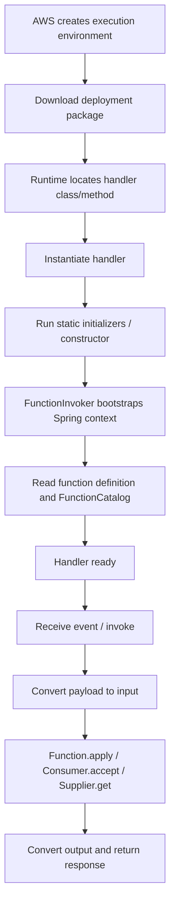

# Serverless Handler Fails to Initialize the Application Class

## 1. Scenario: Lambda Errors Before the Function Processes Any Event

A product team has a Spring Boot application declaring its business logic as a `Function<OrderRequest, OrderResult>` bean. They package the application as a JAR to deploy to a serverless environment. Upon invoking it, the platform reports that the handler failed to initialize the application class; logs may show errors such as:

- `ClassNotFoundException` or a message stating the handler could not be found.
- `NoClassDefFoundError` when Spring begins creating the context.
- `BeanCreationException` while initializing configuration or a dependent bean.
- `IllegalStateException` because no main class or function definition was found.
- `Task timed out` or `INIT_REPORT ... Status: timeout` before the handler processes an event.

These messages are often lumped together as "serverless cannot run Spring." Yet they occur at **different lifecycle stages**. Fixing the wrong layer can complicate configuration without resolving the root cause.

In the **Spring Cloud Function** (`SPRING_CLOUD_FUNCTION`) module, business logic is organized using `Supplier<T>`, `Function<T,R>`, and `Consumer<T>`, looked up via `FunctionCatalog`, composed, and message-converted, then triggered through an appropriate adapter. This lesson focuses on **AWS Lambda with the Spring Cloud Function AWS adapter** to diagnose handler and application initialization failures. Other serverless platforms have their own handler contracts, runtimes, and bootstrap lifecycles; do not blindly apply AWS configuration to Azure Functions, Google Cloud Functions, or custom runtimes.

**Distinguish two questions:**

1. **Can the runtime locate and instantiate the handler?** This covers class loading, verifying the handler interface/method, and instantiating it.
2. **Can the handler bootstrap the Spring ApplicationContext and find the function?** This covers Spring bootstrapping, bean registration, selecting the function in the catalog, and preparing converters.

If both steps succeed, any subsequent error reading the event or calling `apply()` is an **invocation/conversion/logic** failure, not an application-class initialization failure.

## 2. AWS Lambda Startup Stage Model

A typical Java Lambda follows this flow:



This diagram lays out the diagnostic layers; exact instantiation timing can vary across Lambda runtimes and adapters. In AWS Lambda, downloading code, bootstrapping the runtime, and running initialization code belong to the **Init phase**; only afterward comes the **Invoke phase**. An execution environment may be reused across subsequent invocations (warm starts), so static state and singleton beans can persist across calls.

| Stage | Activity | Common failures |
| --- | --- | --- |
| **Package/deploy** | Download the right ZIP/JAR or image. | Wrong artifact, missing files, wrong architecture. |
| **Handler resolution** | Locate the configured class/method. | Wrong FQCN, handler method, class absent from JAR. |
| **Handler construction** | Create instance, run static initializers/constructor. | Constructor exception, missing dependency, static init error. |
| **Spring bootstrap** | Determine main class, create and refresh context. | Wrong `MAIN_CLASS`, missing config/bean/dependency, `@PostConstruct` error. |
| **Function selection** | Look up definition in `FunctionCatalog`. | Wrong function name, missing bean, multiple functions without explicit selection. |
| **Invocation** | Read event, convert input, call function. | Wrong payload/schema/content type, business error. |
| **Output** | Serialize result per adapter contract. | Unserializable DTO, response mismatches trigger format. |

### 2.1. Cold Start vs. Warm Invocation

A **cold start** creates a fresh execution environment, downloads code, and runs initialization. A **warm invocation** usually reuses an already-initialized environment, so constructors, static initializers, and Spring context creation do not necessarily re-run.

This has two diagnostic implications:

- Failures occurring only on the first call typically involve Init/bootstrap, cold-start timeouts, or dependency connections opened during startup.
- Failures appearing only on the second or later invocations often involve shared state, expired connections, thread-unsafe code, or stale data retained between calls.

Avoid creating clients, database connections, or fetching secrets on every `Function.apply()` call if they can be reused safely; conversely, never place per-request side effects inside static initializers or handler constructors.

## 3. What Does `FunctionInvoker` Do?

For the AWS adapter, Spring Cloud Function provides a generic handler:

```text
org.springframework.cloud.function.adapter.aws.FunctionInvoker
```

This handler implements AWS `RequestStreamHandler`, accepting input/output streams and `Context`. It decouples business functions from specifics of API Gateway, S3, SQS, or other event sources; the adapter converts the payload into the expected input type and invokes the function.

In current implementations, `FunctionInvoker` follows these primary steps:

1. Determine the application's **start class** from packaging/startup metadata.
2. Start the Spring context according to the detected application type (e.g., an `ApplicationContextInitializer`-based app or a standard Spring Boot app).
3. Obtain `FunctionCatalog` and the JSON mapper from the context.
4. Read `spring.cloud.function.definition` if no function definition was provided upfront.
5. Look up the function in the catalog; if no specific function is chosen, the adapter may use `RoutingFunction` to route using routing metadata.
6. For each event, construct a message from the input stream, invoke the function wrapper, and serialize the output.

Therefore, when the handler class is found yet logs show errors building the Spring context, inspect **main class, bean definitions, auto-configuration, properties, and dependencies**. When the context starts cleanly yet reports the function cannot be found, inspect **function name/definition and catalog registration**.

### 3.1. Choose the Right Handler Entry Point

Current Spring Cloud Function AWS documentation instructs using:

```text
org.springframework.cloud.function.adapter.aws.FunctionInvoker::handleRequest
```

Some SAM/IaC templates specify the class directly:

```yaml
Handler: org.springframework.cloud.function.adapter.aws.FunctionInvoker
```

`FunctionInvoker` implements `RequestStreamHandler`, so the handler setting can be written as the handler class in runtime/IaC config or as a method reference accepted by your deployment tool. **Do not replace it with a bean name like `uppercase` or `quoteOrder`** when intending to use the generic `FunctionInvoker`; the target function is chosen via Spring Cloud Function definition/routing.

If writing a custom handler instead of `FunctionInvoker`, ensure the class has a constructor and method/interface conforming to the AWS Java runtime. A class with a `handleRequest` method that neither implements a handler interface nor uses the right method-reference format may not be recognized by the runtime.

### 3.2. Handler Class and Main Application Class Are Two Different Layers

| Setting | Example | Responsibility |
| --- | --- | --- |
| AWS Lambda handler | `org.springframework.cloud.function.adapter.aws.FunctionInvoker` | Entry point invoked by Lambda. |
| Spring Boot main class | `com.example.OrderFunctionApplication` | Class holding Spring application configuration/entry point. |
| Function bean name | `quoteOrder` | Business function looked up by `FunctionCatalog`. |
| Function definition | `quoteOrder` or `normalizeOrder|validateOrder` | Function/pipeline selected for invocation. |

Do not use the FQCN of your `@SpringBootApplication` as the Lambda handler when using `FunctionInvoker`. Conversely, configuring the handler correctly without locating the main class still prevents the Spring context from initializing.

### 3.3. Do Not Confuse the Functional Adapter with Spring Boot Web on Lambda

There are two common ways to run Spring on AWS Lambda:

| Application style | Appropriate handler/adapter | Invocation model |
| --- | --- | --- |
| Spring Cloud Function with `Supplier`/`Function`/`Consumer` | `org.springframework.cloud.function.adapter.aws.FunctionInvoker` | Lambda event converts directly to function input. |
| Spring Boot Web with `@RestController`/HTTP endpoints | AWS Serverless Java Container, e.g. `SpringDelegatingLambdaContainerHandler` for Spring Boot 3 | API Gateway request converts to a servlet/web request. |

If the app is actually Spring Boot Web yet configured with `FunctionInvoker`, the adapter may fail to find a matching function or fail to serve controllers. Conversely, using Serverless Java Container for a pure function app adds an unnecessary web layer. Pick the handler by **application model**, not solely because the project uses Spring Boot.

### 3.4. Native Images Use Custom Runtimes

If the package is a GraalVM native executable rather than a Java JAR, Lambda requires an appropriate custom runtime/bootstrap. In that model, a Java handler class like `FunctionInvoker` is not invoked as an entry point by a JVM runtime; a bootstrap script launches the native executable against the Lambda Runtime API. Do not mix Java managed runtime settings with native/custom runtime packages.

## 4. Init Phase and INIT_REPORT Messages

AWS Lambda runs the **Init phase** to initialize extensions, runtime, and static/function setup. For standard on-demand execution environments, Init has a 10-second limit; if it does not finish, Lambda may retry initialization when the first invocation arrives, bounded by the function timeout. Provisioned Concurrency, SnapStart, and Lambda Managed Instances follow different timing rules and may permit longer initialization windows.

When code crashes or times out during the Init phase, Lambda can write an `INIT_REPORT` entry to CloudWatch Logs. Example:

```text
INIT_REPORT Init Duration: 1236.04 ms Phase: init Status: timeout
```

Or:

```text
INIT_REPORT Init Duration: 1236.04 ms Phase: init Status: error Error Type: Extension.Crash
```

Not every successful init prints `INIT_REPORT` in ordinary logs; SnapStart and Provisioned Concurrency follow separate reporting rules. Thus, **not seeing `INIT_REPORT` does not prove the Spring context initialized cleanly**.

### 4.1. Read Logs by Phase

| Signal | Analysis direction |
| --- | --- |
| No application logs; runtime says handler not found | Verify handler setting, package, and classpath first. |
| Logs start, then `BeanCreationException` stack trace before `START` | Spring bootstrap failure during Init. |
| `INIT_REPORT ... Status: timeout` | Initialization timed out; look for blocking work in constructors, static init, or context refresh. |
| `START` appears, then JSON/conversion error | Handler entered invocation; inspect payload and converters. |
| `START`/`END` present, wrong output | Inspect function definition, business logic, and serialization. |
| `REPORT` with `Status: timeout` during invocation | Function processing exceeded timeout; not necessarily a context issue. |

For every failure, capture **RequestId**, timestamp, function version/alias, and the top of the stack trace. Outermost exceptions like `Failed to load ApplicationContext` are only wrappers; the most actionable clue usually sits deeper in `Caused by`.

## 5. Inspect the Handler and Deployment Package

If the runtime could not instantiate `FunctionInvoker`, Spring never had a chance to start. Inspect handler configuration and the JAR before examining business beans.

### 5.1. Verify the AWS Adapter Dependency

The project needs Spring Cloud Function's AWS adapter:

```xml
<dependency>
    <groupId>org.springframework.cloud</groupId>
    <artifactId>spring-cloud-function-adapter-aws</artifactId>
</dependency>
```

Manage its version through a Spring Cloud BOM compatible with your Spring Boot version. Do not pick an adapter version mismatched with `spring-cloud-function-context` or Spring Boot just to silence a class-not-found error.

If deployment specifies `FunctionInvoker` yet the artifact omits `spring-cloud-function-adapter-aws`, the runtime cannot locate the handler class. A similar failure occurs when misconfiguring the handler to a Web or Stream class absent from the AWS package.

### 5.2. AWS Lambda Needs a Self-Contained Artifact

Spring Cloud Function AWS documentation notes that Lambda packages typically require a **shaded JAR** containing application code and required runtime dependencies. A standalone Spring Boot executable JAR is not necessarily the right artifact to upload to AWS Lambda. Sample projects often produce two JARs: one AWS classifier artifact and one standalone Boot executable JAR.

Check:

- The uploaded JAR is the AWS-classified artifact (if the build produces separate outputs).
- `org/springframework/cloud/function/adapter/aws/FunctionInvoker.class` is present.
- Spring Boot, Spring Cloud Function, and required runtime dependency classes are packaged.
- `spring-cloud-function-context` or JSON/message converter libraries were not accidentally excluded.
- Unused Web/Stream adapters are omitted from the Lambda artifact; extra dependencies bloat package size and complicate auto-configuration.

Example inspecting JAR contents:

```bash
jar tf target/order-functions-1.0.0-aws.jar
```

Filter key entries (on a shell with `grep`):

```bash
jar tf target/order-functions-1.0.0-aws.jar \
  | grep -E 'FunctionInvoker.class|FunctionConfiguration.class|META-INF/MANIFEST.MF'
```

Substitute your actual artifact and class names. If `FunctionInvoker.class` is missing, inspect the dependency tree and uploaded file; do not edit function bean names to fix this.

### 5.3. Inspect Spring Metadata When Shading JARs

When merging multiple dependencies into one JAR, metadata files at identical paths can overwrite one another unless the shade plugin merges/appends them properly. A Spring app can lose auto-configuration or schema metadata even while classes remain inside the archive.

Resources to verify depending on dependencies/versions include:

| Resource | Role |
| --- | --- |
| `META-INF/spring.factories` | Certain Spring/Boot registration mechanisms, depending on version. |
| `META-INF/spring/org.springframework.boot.autoconfigure.AutoConfiguration.imports` | Auto-configuration list in modern Spring Boot. |
| `META-INF/spring.handlers` and `META-INF/spring.schemas` | Namespace/schema metadata for libraries that use them. |
| `META-INF/spring.components` | Component index metadata when used. |
| `META-INF/services/*` | Java SPI/provider discovery. |
| `META-INF/MANIFEST.MF` | Manifest, including main/start class metadata when configured. |

Spring Cloud Function AWS reference provides Maven Shade transformer examples for Spring metadata. Exact configuration depends on Spring Boot and plugin versions; **do not copy transformers verbatim from an older sample into a newer project without checking**. If libraries rely on Java `ServiceLoader`, merge service provider files appropriately too.

### 5.4. Check the Manifest and Main Class

Spring Cloud Function looks up the main class from the `Start-Class` manifest attribute when generated by Spring Boot tooling. If the manifest lacks `Start-Class`, the AWS adapter documentation allows specifying the `MAIN_CLASS` environment variable or system property.

Inspect the manifest:

```bash
unzip -p target/order-functions-1.0.0-aws.jar META-INF/MANIFEST.MF
```

Look for entries like:

```text
Main-Class: ...
Start-Class: com.example.OrderFunctionApplication
```

If `Start-Class` is missing, declare the full main class:

```text
MAIN_CLASS=com.example.OrderFunctionApplication
```

The class must exist in the deployment package with exact package/casing and valid Spring configuration. `MAIN_CLASS` is not the AWS handler name; it tells Spring Cloud Function **which Spring application to bootstrap**.

## 6. Distinguish Handler Resolution Failures from Spring Bootstrap Failures

| Symptom | Suspected layer | First check |
| --- | --- | --- |
| Handler class not found | AWS handler resolution | Handler setting, AWS adapter in JAR, package path. |
| `NoSuchMethodException` or invalid handler method | Handler contract | Method/interface matching AWS runtime and `aws-lambda-java-core` version. |
| `NoClassDefFoundError` for Spring/adapter class | Deployment dependencies | Shaded JAR, dependency scopes, version conflicts. |
| Start/main class not found | Spring bootstrap entry point | Manifest `Start-Class` or `MAIN_CLASS`. |
| `BeanDefinitionStoreException` | Reading config/metadata | Spring resources overwritten during shading, bad config. |
| `BeanCreationException` | Bean instantiation | Read root cause, properties, constructors, init callbacks, network/secrets. |
| `NoSuchBeanDefinitionException` | Dependency injection | Component scan, configuration imports, profiles/conditions, bean type. |
| `FunctionCatalog` lookup misses name | Function selection | Functional bean registration and `definition` setting. |
| Function found, event conversion fails | Invocation | Event shape, generic signature, content type, converters. |

**Do not treat every `NoClassDefFoundError` as a missing handler.** Read the exact class name in the exception. Missing `FunctionInvoker` is an adapter/package issue; missing a JDBC driver or application class is usually a bootstrap dependency issue; missing a DTO during deserialization may surface only at invocation.

### 6.1. Read Caused by from Outside In

Example:

```text
Runtime.InitError: Error loading class ...
  caused by: org.springframework.beans.factory.BeanCreationException
    caused by: java.lang.IllegalStateException: Missing SHIPPING_API_URL
```

The outermost error says the handler failed to load; the root cause pinpoints a missing property. The proper fix is supplying the property/secret or handling missing config intentionally in the bean, not changing the handler class.

## 7. Failures Resolving the Main Class and Initializing ApplicationContext

`FunctionInvoker` must locate the application's start class before creating the Spring context. If the JAR lacks a proper manifest or the main class is missing from the package, the context cannot initialize.

### 7.1. Verify Start-Class and MAIN_CLASS

Checklist:

1. Locate the `@SpringBootApplication` class or configuration/initializer class used to bootstrap the app.
2. Confirm that class is compiled into the AWS artifact.
3. Verify the manifest contains `Start-Class` with the exact FQCN.
4. If missing from the manifest, set `MAIN_CLASS` in Lambda configuration.
5. Never set `MAIN_CLASS` to `org.springframework.cloud.function.adapter.aws.FunctionInvoker`; that is the handler, not the source application.

Illustrative source class:

```java
package com.example.orders;

import org.springframework.boot.SpringApplication;
import org.springframework.boot.autoconfigure.SpringBootApplication;

@SpringBootApplication
public class OrderFunctionApplication {
    public static void main(String[] args) {
        SpringApplication.run(OrderFunctionApplication.class, args);
    }
}
```

In an AWS app using `FunctionInvoker`, the Lambda runtime invokes the adapter handler; `main()` is not the Lambda handler method. `OrderFunctionApplication` supplies Spring configuration. Do not invoke `main()` directly from the handler setting.

### 7.2. Profiles, Properties, and Environment Variables

A bean may require configuration during context refresh:

```java
@Bean
ShippingClient shippingClient(
        @Value("${shipping.api-url}") String apiUrl) {
    return new ShippingClient(apiUrl);
}
```

If `shipping.api-url` is missing, the context can fail immediately during Init. Locally, the property might come from `application.yml` or a developer environment variable; on Lambda, environment variables must be declared in function configuration or IaC.

Under Spring Boot relaxed binding, the property:

```properties
spring.cloud.function.definition=quoteOrder
```

can be specified in AWS Lambda environment variables as:

```text
spring_cloud_function_definition=quoteOrder
```

AWS disallows dots in environment variable names; Spring Boot supports mapping names via underscores. Use exact names and values in deployment configuration. Do not confuse the function-selection property with `MAIN_CLASS`.

### 7.3. Secrets and External Connections During Startup

A bean that opens a database connection or calls an API inside a constructor or `@PostConstruct` can crash the entire context if:

- Secrets were not granted to the execution role or environment variables are absent.
- VPC/subnet/security groups block database or API access.
- DNS, TLS certificates, proxies, or endpoints are unreachable.
- Connection timeouts exceed the Init phase limit.
- An external service suffers transient errors while Lambda spins up the environment.

Extract the root cause from the stack trace, check IAM permissions and network paths, then decide whether connections should be eager at startup or lazy per invocation. Never log secret values while diagnosing.

### 7.4. Avoid Packaging Unnecessary Web Servers in the Lambda Adapter

`FunctionInvoker` boots the application in non-web mode and disables Spring Cloud Function Web export during bootstrap. Lambda invokes the handler per event stream; it does not need an HTTP server listening on a port like a standalone Boot Web app.

If your package pulls in unused Web/Stream adapters, consider excluding them from the AWS artifact following your release's build guide. Never exclude dependencies your function actually needs; check the dependency tree and final JAR after changes.

## 8. Function Bean Exists in JAR, Yet FunctionInvoker Fails to Pick It

Once the Spring context initializes cleanly, `FunctionInvoker` needs a function definition to invoke. If the app contains only one function, the framework may pick a default. When multiple `Supplier`/`Function`/`Consumer` beans exist, never rely on implicit selection order.

Suppose an app defines:

```java
@Configuration(proxyBeanMethods = false)
class OrderFunctions {
    @Bean
    Function<OrderRequest, OrderResult> quoteOrder() {
        return request -> new OrderResult(request.orderId(), "QUOTED");
    }

    @Bean
    Function<OrderRequest, OrderResult> cancelOrder() {
        return request -> new OrderResult(request.orderId(), "CANCELLED");
    }
}
```

This is an illustrative snippet; real projects need `OrderRequest` and `OrderResult` records matching the contract. With multiple functions, Lambda configuration should explicitly select which function to invoke.

### 8.1. Select the Function via Environment Variable

Spring property:

```properties
spring.cloud.function.definition=quoteOrder
```

In AWS Lambda, declare the environment variable using Spring Boot relaxed binding:

```yaml
Environment:
  Variables:
    spring_cloud_function_definition: quoteOrder
```

This fits deploying one multi-function artifact as **two separate Lambdas**:

| Lambda | Environment variable |
| --- | --- |
| `QuoteOrderFunction` | `spring_cloud_function_definition=quoteOrder` |
| `CancelOrderFunction` | `spring_cloud_function_definition=cancelOrder` |

Both Lambdas can share the same JAR while having separate IAM permissions, timeouts, memory, concurrency, and event sources. This is often cleaner when operations have distinct access requirements or traffic profiles.

### 8.2. Do Not Rely on Default Routing with Multiple Functions

When no definition is declared, Spring Cloud Function searches for a default function; AWS docs describe checking `Function` first, then `Consumer`, and finally `Supplier`. With multiple functions, `FunctionInvoker` may delegate to `RoutingFunction` and expect routing instructions from message headers or routing expressions.

This means:

- The context may start cleanly yet invoke a different business function than expected.
- Bean names in `FunctionCatalog` are not necessarily AWS Lambda handler names.
- A single function may be auto-selected today, yet adding a second bean later alters default behavior.
- Compositions like `normalizeOrder|validateOrder` require exact names, order, and compatible input/output types.

**Recommendation:** for production Lambdas, declare `spring.cloud.function.definition` explicitly per deployment. If deliberately routing multiple functions inside one Lambda, design explicit routing callbacks/headers, restrict allowed function names, and test with realistic events.

### 8.3. One Lambda Handling Multiple Functions

To let one Lambda dispatch to multiple functions based on events, use message-header routing or `MessagingRoutingCallback`. Ensure routes come from trusted, validated sources; never let external events freely pick arbitrary internal function names, especially side-effecting `Consumer`s.

Illustrative static routing configuration:

```yaml
spring:
  cloud:
    function:
      definition: quoteOrder
```

This is static selection for a single deployment. When dynamic per-event routing is needed, use the routing mechanism supported by your Spring Cloud Function release; do not assume merely adding a `functionName` field to JSON activates routing automatically.

### 8.4. Deferring FunctionInvoker Initialization

In adapter versions that support it, the environment variable:

```text
FUNCTION_INVOKER_LATE_INITIALIZATION=true
```

instructs `FunctionInvoker` to defer Spring context creation until the first request instead of running it inside the handler constructor. This shifts **when** bootstrapping occurs:

- It can help the runtime complete initial handler setup faster.
- Startup cost moves onto the first invocation, making the first request slower.
- Bean, dependency, or function definition bugs still exist; they simply surface later.
- The first invocation's timeout can still be exceeded.

Use this only when supported by your adapter version and with a clear reason. Never use this flag to hide an overly slow context startup or a broken dependency.

## 9. Distinguish Initialization Errors from Event Conversion Errors

`FunctionInvoker` reads the raw input stream and converts the payload based on the function's declared input type. Example:

```java
@Bean
Function<OrderRequest, OrderResult> quoteOrder() {
    return request -> new OrderResult(request.orderId(), "QUOTED");
}
```

With a concrete typed signature, the adapter attempts to convert the input stream into `OrderRequest`. If generic types cannot be resolved (e.g., `Function<?, ?>`), Spring Cloud Function may convert the payload into a generic `Map`. If the function accepts `InputStream`, the adapter can pass the raw stream directly without conversion.

Separate these cases:

| Symptom | Phase | Possible cause |
| --- | --- | --- |
| Spring context fails to initialize | Init | Handler, main class, beans, dependencies, or properties. |
| Function definition not found | Init/Function selection | Wrong bean name, missing functional bean, or catalog registration. |
| JSON fails to deserialize into DTO | Invoke | Payload shape, fields/types, converter, content type. |
| Function receives `Map` instead of DTO | Invoke | Unresolved generic signature or overly broad function declaration. |
| Function runs, throws `NullPointerException` | Invoke | Event payload missing fields or logic lacks input validation. |
| Output fails serialization | Invoke/output | Unserializable DTO/type or response violates trigger contract. |

### 9.1. API Gateway Events Are Not Always Direct Business JSON

When Lambda is invoked via API Gateway proxy integration, the payload may be an envelope containing path, headers, query parameters, `body`, and other metadata. The function must either accept the corresponding AWS event type or use an integration/adapter extracting `body` per contract.

If a function declares `Function<OrderRequest, OrderResult>` while the actual event is an API Gateway proxy event, the converter cannot reliably guess to unwrap `body` and parse it as `OrderRequest` in every scenario. Inspect a sample event and pick one option:

- Accept the matching AWS event type and extract/validate `body` explicitly.
- Use an integration contract delivering the business JSON directly when supported by the adapter/trigger.
- Accept `InputStream` or `Map` if raw payload handling is genuinely required, owning schema validation explicitly.

### 9.2. S3, SQS, and Kinesis Events Have Their Own Envelopes

A function handling S3 events can declare `S3Event`; an SQS function can use `SQSEvent` or its corresponding batch response type. Never try deserializing those envelopes into an order DTO simply because another business function uses that DTO.

Example:

```java
@Bean
Function<S3Event, String> processUpload() {
    return event -> {
        // Inspect bucket/key and run business logic here.
        return "received";
    };
}
```

AWS event types require matching dependencies and compatible versions. If the function needs no AWS-specific details, consider translating the event into a domain/command object at the boundary so core business logic stays decoupled from adapters.

## 10. Common Errors and Remediation Table

| Message / signal | Layer | Common cause | Action |
| --- | --- | --- | --- |
| Handler class not found | Handler resolution | Wrong handler name or missing AWS adapter in JAR. | Use `FunctionInvoker`, verify JAR and handler config. |
| `NoClassDefFoundError` for `FunctionInvoker` | Packaging | Uploaded artifact lacks `spring-cloud-function-adapter-aws`. | Build the proper classifier/shaded JAR. |
| `NoClassDefFoundError` for Spring/Jackson class | Dependency | Excluded dependency, wrong scope, or broken shading. | Check dependency tree and JAR contents. |
| `ClassNotFoundException` for main class | Spring bootstrap | Manifest lacks `Start-Class` or wrong `MAIN_CLASS`. | Verify FQCN and manifest. |
| `BeanCreationException` | Context refresh | Bean init, property, secret, network, or dependency error. | Read root cause, check config/IAM/VPC. |
| `NoSuchBeanDefinitionException` | Dependency injection | Component scan/import/profile/condition skipped needed bean. | Check packages, `@Configuration`, `@Profile`, conditions. |
| `FunctionCatalog` cannot find function | Function selection | Wrong definition or unregistered function. | Set `spring_cloud_function_definition` accurately. |
| Function found, event conversion fails | Invocation | Event shape, generic signature, content type, converters. | Inspect sample event and input contract. |
| `INIT_REPORT ... timeout` | Init | Context startup too slow or external call hung. | Time init callbacks, increase memory/timeout appropriately, reduce eager I/O. |
| `REPORT ... Status: timeout` | Invoke | Business logic or downstream call too slow. | Profile invocation, configure client timeouts, optimize work. |
| Local test passes, Lambda fails | Runtime/package/config | Java runtime, architecture, environment, IAM, VPC, or artifact differs. | Match package and runtime closer to prod, inspect Lambda logs. |

Never change the handler, main class, JAR classifier, and function definition simultaneously. Change one configuration group at a time so you can observe which layer shifts.

## 11. Step-by-Step Diagnostic Procedure

When assigned a ticket saying "serverless handler fails to initialize application", proceed in order. Gather concrete evidence at each step before advancing to the next.

### Step 1 — Record Runtime and Handler Settings

Collect:

- Provider/runtime (e.g., AWS Lambda Java 21), architecture (`x86_64`/`arm64`), memory, timeout.
- Handler value in Lambda configuration or IaC.
- Function version/alias being invoked.
- Package format: shaded JAR, ZIP with dependencies, container image, or custom runtime.
- Failure timing: Init, Restore (if using SnapStart), or Invoke.

Compare the configured handler against the actual artifact. For the Spring Cloud Function AWS adapter, check `FunctionInvoker`; if using a custom handler, verify class/interface/method against AWS Java runtime requirements.

### Step 2 — Inspect the Uploaded Artifact

1. Rebuild from the exact commit and profile.
2. Verify path and checksum of the produced JAR/ZIP.
3. Run `jar tf` to confirm handler class, main class, and function implementation exist.
4. Check `Start-Class` in the manifest.
5. Confirm required Spring metadata files were not overwritten during shading.
6. Compare the local artifact against what IaC/CI actually uploaded.

Do not trust only the filename in the console. Two identically named JARs built by different pipelines or profiles can hold different contents.

### Step 3 — Check Main Class and Spring Bootstrap

Once handler resolution succeeds:

- Locate the first exception in Init logs.
- Read the entire `Caused by` chain down to the deepest root cause.
- Verify `Start-Class` or `MAIN_CLASS`.
- Verify profiles, properties, secrets, IAM roles, and network access.
- Check whether any bean opens external connections or performs I/O in constructors or `@PostConstruct`.

If the context fails to refresh, the function catalog is not the first thing to fix.

### Step 4 — Check Function Registration and Definition

Once the Spring context initializes:

- List functional beans registered in the source context.
- Compare bean names against `spring.cloud.function.definition`.
- If multiple functions exist, explicitly set the definition for the Lambda.
- If using composition, confirm step names and output/input type compatibility.
- Check `FunctionInvoker` logs showing which function is being located and lookup results.

Never put a class FQCN in place of a function bean name, or an AWS handler name in place of a definition.

### Step 5 — Check Event Conversion and Invocation

Once both handler and function selection succeed:

1. Capture a sample event with sensitive data redacted.
2. Confirm the event matches the trigger's shape (API Gateway, S3, SQS, Kinesis, EventBridge, etc.).
3. Compare against the function's generic input type.
4. Check JSON fields, enums, dates/times, numbers, and nulls.
5. Invoke the function with a minimal verifiable input.
6. Check output serialization and response contract.

Failures at this step should not be "fixed" by altering the main class or handler.

### Step 6 — Check Resource Limits and External Dependencies

For Init or invocation timeouts:

- Measure context creation time and each init callback.
- Measure DNS, TLS handshakes, database pools, HTTP clients, and secret lookups.
- Check Lambda memory/CPU allocation; in Lambda, higher memory can also allocate more CPU.
- Separate Init duration from event-processing duration.
- Ensure client timeouts stay below the total Lambda timeout with bounded retries.

If running inside a VPC, check routes, subnets, security groups, NAT/VPC endpoints, and DNS. A Spring context can fail if a bean eagerly connects to an unreachable service.

## 12. Reproducing Locally and Testing by Layer

### 12.1. Unit Test the Function Without AWS

Keep business logic decoupled from the handler:

```java
package com.example.orders;

import java.util.function.Function;
import org.junit.jupiter.api.Test;

import static org.junit.jupiter.api.Assertions.assertEquals;

final class QuoteOrderFunction implements Function<OrderRequest, OrderResult> {
    @Override
    public OrderResult apply(OrderRequest request) {
        return new OrderResult(request.orderId(), "QUOTED");
    }
}

class QuoteOrderFunctionTest {
    private final Function<OrderRequest, OrderResult> quoteOrder =
            new QuoteOrderFunction();

    @Test
    void quotesOrder() {
        OrderResult result = quoteOrder.apply(
                new OrderRequest("ORD-204"));
        assertEquals("ORD-204", result.orderId());
        assertEquals("QUOTED", result.status());
    }
}
```

This is an illustrative test; your project needs `OrderRequest` and `OrderResult` records matching the real contract. Unit tests verify business logic, **not** handler classes, manifests, or Spring context packaging.

### 12.2. Context Test Verifying FunctionCatalog

A Spring Boot test can verify the bean is registered in the source application:

```java
package com.example.orders;

import java.util.function.Function;

import org.junit.jupiter.api.Test;
import org.springframework.beans.factory.annotation.Autowired;
import org.springframework.boot.test.context.SpringBootTest;
import org.springframework.cloud.function.context.FunctionCatalog;

import static org.junit.jupiter.api.Assertions.assertNotNull;

@SpringBootTest
class FunctionCatalogSmokeTest {
    @Autowired
    FunctionCatalog catalog;

    @Test
    void findsQuoteOrder() {
        Function<OrderRequest, OrderResult> function =
                catalog.lookup("quoteOrder");
        assertNotNull(function);
        OrderResult result =
                function.apply(new OrderRequest("ORD-204"));
        assertNotNull(result);
    }
}
```

This test exercises **the source application's Spring context**. It does not test `FunctionInvoker`, AWS handler settings, the shaded JAR, or AWS-supplied environment variables. Maintain a separate integration test for the built package.

### 12.3. Inspect the Built JAR

Example commands:

```bash
mvn clean package
jar tf target/order-functions-1.0.0-aws.jar
unzip -p target/order-functions-1.0.0-aws.jar META-INF/MANIFEST.MF
```

Substitute your project's real output for `order-functions-1.0.0-aws.jar`. If using Gradle, verify the task producing the shaded artifact and classifier. If CI produces multiple JARs, make sure IaC points to **the AWS artifact**, not the standalone Boot JAR.

### 12.4. Use AWS SAM Local When Supported by the Project

For projects with an AWS SAM template and SAM CLI, you can simulate invocations:

```bash
sam local invoke QuoteOrderFunction --event events/order.json
```

Replace the logical resource name and event file per your template. Local containers catch many packaging, handler, and event-conversion bugs, though they do not fully replicate production AWS IAM, VPC, DNS, secrets, timeouts, and runtime behavior. Still test in the target AWS environment.

### 12.5. Invoke the Deployed Function

Once package and config are verified, invoke the function via AWS CLI:

```bash
aws lambda invoke \
  --function-name quote-order \
  --cli-binary-format raw-in-base64-out \
  --payload fileb://events/order.json \
  response.json
```

This assumes AWS CLI v2, valid invoke permissions, and matching event JSON. Inspect both `response.json` and CloudWatch Logs; transport-level success does not guarantee the business result is right.

## 13. Late Initialization and Cold-Start Optimization

Do not optimize cold starts before knowing why the context is failing. Once functional errors are resolved, measure timings and optimize systematically.

### 13.1. FUNCTION_INVOKER_LATE_INITIALIZATION

In AWS adapter releases that support it, `FUNCTION_INVOKER_LATE_INITIALIZATION` defers `FunctionInvoker`'s Spring context initialization until the first request. This can shift how Init time is accounted for, yet it does not eliminate bootstrap work.

Check:

- Does the first invocation have enough timeout to initialize the context and handle the event?
- Does Lambda repeat failures on cold invocations?
- Is cold-start latency acceptable?
- Is the underlying issue startup duration or a bean that cannot be instantiated?

If the context fails due to a missing property or dependency, deferring initialization simply moves the failure to the first invocation.

### 13.2. Reduce Work During Initialization

Measures to consider after profiling:

- Use functional bean registration (`ApplicationContextInitializer`/`GenericApplicationContext.registerBean`) when suitable to reduce component scanning and bean creation overhead.
- Avoid creating large connection pools or calling multiple external APIs in constructors unless required.
- Initialize shared clients once when safe, with explicit connection timeouts.
- Avoid running migrations, heavy data preloads, or long synchronous tasks in `@PostConstruct`.
- Keep only genuinely needed dependencies in the AWS JAR; drop unused Web/Stream adapters.
- Benchmark Lambda memory settings; higher memory allocations often scale CPU power as well, though cost changes too.

Never turn an operation that must complete before event handling into async fire-and-forget solely to speed up Init. Doing so risks processing events before dependencies are ready.

### 13.3. SnapStart and Provisioned Concurrency

AWS Lambda offers cold-start mitigations such as SnapStart or Provisioned Concurrency depending on runtime/region support and constraints. These alter when execution environments are created and how snapshots/initialization run.

With SnapStart, verify resources created during Init are safe to restore from a snapshot; connections, credentials, random state, and threads should not always persist unchanged across snapshots. Consult runtime hooks documentation and test post-restore behavior. Neither feature **fixes wrong handler classes, main classes, bean creation errors, or function definitions**.

## 14. Common Mistakes When Troubleshooting

| Misguided fix | Why it misses the root cause | Appropriate fix |
| --- | --- | --- |
| Setting handler to the function bean name | Handler is the runtime entry point; bean name is function selection. | Use `FunctionInvoker` and configure `definition` separately. |
| Setting `MAIN_CLASS` to `FunctionInvoker` | `MAIN_CLASS` is the Spring application to bootstrap. | Point to the application's main/configuration class. |
| Uploading an arbitrary Boot JAR | AWS adapter requires specific packaging/layout; standalone Boot JAR may fail. | Build and upload the proper shaded AWS JAR per sample/profile. |
| Enabling bean overriding | Masks bean name collisions and causes wrong function selection. | Fix configurations/bean names and inspect catalog. |
| Blindly stripping dependencies to shrink size | Can drop adapters, converters, or auto-configuration. | Inspect dependency tree and built JAR contents. |
| Raising timeouts to mask hung connections | Network/retry bugs remain and startup grows slower. | Measure root cause, set client timeouts, check VPC/IAM. |
| Using late initialization to bypass startup bugs | Errors simply shift to the first invocation. | Fix bean/context errors first, then tune timing. |
| Relying solely on passing local Spring tests | Tests skip handler settings, JAR shading, and Lambda runtime. | Add package verification and SAM/AWS integration tests. |
| Sending differently shaped events and editing Spring beans | The mismatch may be an API Gateway/SQS envelope or JSON format. | Save real events, inspect type conversion and contracts. |

## 15. Sample Remediation Workflow: From Init Failure to Successful Invocation

Suppose CloudWatch logs `INIT_REPORT ... Status: error` and the stack trace shows the main class cannot be found:

1. Confirm the AWS handler points to `org.springframework.cloud.function.adapter.aws.FunctionInvoker`.
2. Download the exact AWS shaded JAR from CI and verify `FunctionInvoker` exists inside the archive.
3. Read the manifest; if `Start-Class` is missing, determine the Spring application's FQCN.
4. Configure `MAIN_CLASS` in Lambda environment variables, or fix the build so the manifest includes `Start-Class`.
5. Redeploy the right artifact and check Init logs.
6. Once the context refreshes cleanly, verify the function bean has the exact expected name.
7. With multiple functions, set `spring_cloud_function_definition` to the intended function.
8. Send a sample event matching the contract; verify conversion and output.
9. Re-test with events from the real trigger (API Gateway, S3, SQS, etc.) in a test environment.
10. Monitor Init Duration, invocation duration, error rates, and memory post-fix.

If the actual root cause is a `BeanCreationException` from a missing secret or database error, replace steps 3–4 with inspecting properties, IAM, VPC, and client timeouts. Workflows must start from the **real root cause in logs**, not a rigid checklist applied blindly to every exception.

## 16. Minimal Lambda Configuration Example

Illustrative SAM configuration for an application with two function beans:

```yaml
AWSTemplateFormatVersion: '2010-09-09'
Transform: AWS::Serverless-2016-10-31

Resources:
  QuoteOrderFunction:
    Type: AWS::Serverless::Function
    Properties:
      Runtime: java21
      Handler: org.springframework.cloud.function.adapter.aws.FunctionInvoker
      CodeUri: target/order-functions-1.0.0-aws.jar
      MemorySize: 1024
      Timeout: 30
      Environment:
        Variables:
          spring_cloud_function_definition: quoteOrder
```

This is a **condensed template**; IAM roles, event sources, architecture, VPC, tracing, and other deployment attributes depend on your system. The Java runtime must match the bytecode and dependencies built by your project. Do not copy artifact or handler names verbatim if your POM produces different filenames.

### 16.1. Cross-Check Configuration and Artifact

| Configuration field | Must match |
| --- | --- |
| `Runtime` | AWS-supported Java runtime compatible with bytecode/dependencies. |
| `Handler` | `FunctionInvoker` or custom handler class matching the contract. |
| `CodeUri` | The exact built AWS shaded JAR/ZIP. |
| `spring_cloud_function_definition` | Function bean/definition name registered in the catalog. |
| `Timeout` | Maximum Init/Invoke budget per runtime and function rules. |
| `MemorySize` | Sufficient memory for Spring context, dependencies, and event workload. |

### 16.2. If the Manifest Lacks Start-Class

You can also configure:

```yaml
Environment:
  Variables:
    MAIN_CLASS: com.example.orders.OrderFunctionApplication
    spring_cloud_function_definition: quoteOrder
```

Do not add `MAIN_CLASS` if the manifest already defines the right start class, unless an explicit override is intended. Conflicting configuration sources make diagnostics harder.

## 17. Deciding Whether an Error Belongs to Init or Invoke

Use this decision tree after reading CloudWatch Logs:

```text
Lambda reports error
   |
   v
Can runtime locate the handler class?
   |
   +-- No --> Handler setting / AWS adapter / artifact / classpath
   |
   v
Was the handler instance created?
   |
   +-- No --> Constructor / static initializer / dependencies
   |
   v
Did the Spring context refresh succeed?
   |
   +-- No --> MAIN_CLASS / config / beans / secrets / network / timeout
   |
   v
Does FunctionCatalog have the function definition?
   |
   +-- No --> Bean registration / spring.cloud.function.definition
   |
   v
Does the function receive properly typed input?
   |
   +-- No --> Event envelope / JSON / converter / generic signature
   |
   v
Does the function run and serialize output cleanly?
   |
   +-- No --> Business exception / downstream / output converter
   |
   v
Invocation completes
```

This tree aids initial triage; some failures overlap (for instance, a lazy bean initializing only on the first invocation). Use real stack traces and logs to pinpoint **the earliest failing moment**, not just the final error message.

## 18. Safety During Initialization and Function Operation

### 18.1. Avoid Unnecessary Side Effects in Constructors

Constructors and static initializers run before the function sees any event. Avoid:

- Sending emails/messages or creating orders during init.
- Running migrations or massive data preloads without timeouts.
- Spawning background threads lacking clear lifecycle/cleanup.
- Calling external APIs without connect/read timeouts.
- Logging secrets, tokens, or entire events carrying personal data.

Initialization can repeat whenever Lambda creates a new execution environment. Design init to be idempotent and safe to retry.

### 18.2. Warm Environments Are Not Durable Business State Storage

Lambda may reuse execution environments, yet it never guarantees an instance persists across all invocations. Never store order state, idempotency keys, or critical workflow state solely in static fields or singleton beans. Use databases, durable stores, or proper idempotency mechanisms.

### 18.3. Least Privilege and Routing

Sharing one JAR across multiple Lambdas does not mean they should share identical permissions. For instance, an S3-reading function and a DynamoDB-writing function need distinct IAM policies. Splitting Lambdas per function definition clarifies permissions and event sources.

If one Lambda uses dynamic routing, allow only approved functions. Never let untrusted clients or events supply arbitrary function names or routing expressions that could trigger unintended internal `Consumer`s.

## 19. References and Applicability Limits

Cross-check the exact Spring Cloud Function, Spring Boot, and AWS runtime versions in use:

- [Spring Cloud Function — AWS Lambda adapter](https://docs.spring.io/spring-cloud-function/reference/adapters/aws-intro.html): `FunctionInvoker` handler, routing, type conversion, JAR layout, `Start-Class`/`MAIN_CLASS`, late initialization, and deployment.
- [Spring Cloud Function — FunctionInvoker source](https://github.com/spring-cloud/spring-cloud-function/blob/main/spring-cloud-function-adapters/spring-cloud-function-adapter-aws/src/main/java/org/springframework/cloud/function/adapter/aws/FunctionInvoker.java): context startup flow, function lookup, and `FUNCTION_INVOKER_LATE_INITIALIZATION` in current source.
- [AWS Lambda — Java handler](https://docs.aws.amazon.com/lambda/latest/dg/java-handler.html): handler interfaces/methods, class initialization, and how the runtime invokes Java handlers.
- [AWS Lambda — Execution environment lifecycle](https://docs.aws.amazon.com/lambda/latest/dg/lambda-runtime-environment.html): Init, Invoke, Shutdown, `INIT_REPORT`, and Init-phase errors.

Environment variables, handler formats, and build plugins can change between releases. Custom runtimes, container images, or other serverless adapters have their own entry points; consult that adapter's documentation instead of assuming AWS Java Lambda settings apply everywhere.

## 20. Conclusion

**A serverless handler failing to initialize the application class must be diagnosed stage by stage: handler resolution → handler construction → Spring bootstrap → function selection → event conversion → invocation.** For AWS Lambda, `FunctionInvoker` is Spring Cloud Function's generic handler; it identifies the start class, builds the Spring context, retrieves `FunctionCatalog`, and invokes the selected function. A handler/packaging failure is fundamentally different from a bean-creation, function-definition, or payload-conversion failure.

An effective workflow is to **verify the handler and artifact first, trace the Init-phase root cause, check main class and Spring configuration, confirm the function definition, and only then inspect events and inputs/outputs**. When context startup takes too long, profile each init callback and external connection before reaching for late initialization or cold-start tuning. Once you isolate the failing layer, fixes become targeted rather than random edits to handlers, JARs, beans, or event contracts.
