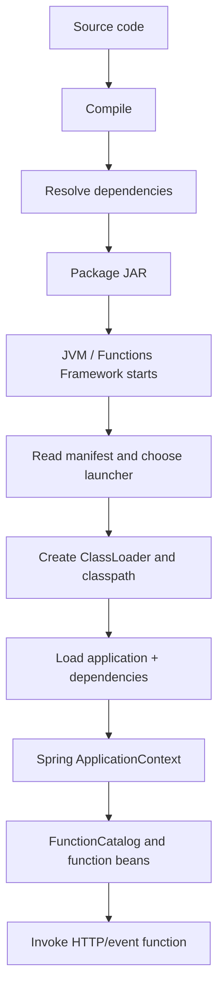
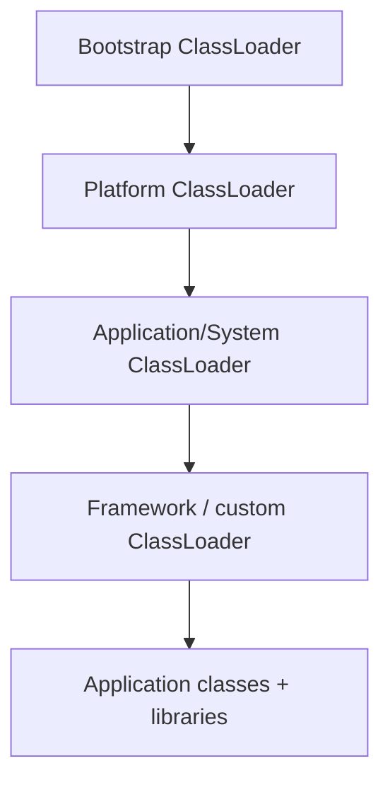
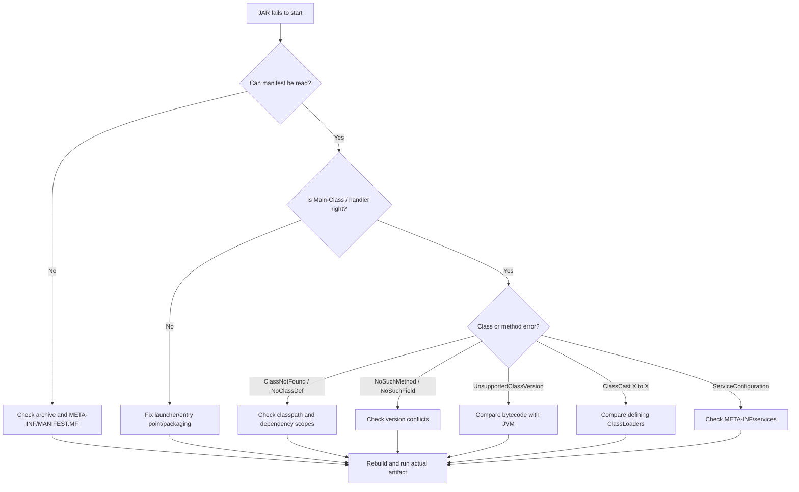

# JAR Loading Failure Due to ClassLoader, Manifest, or Dependencies

## Learning Objectives

In Java, an application does not run simply because a JAR file exists or Maven reports `BUILD SUCCESS`. The JVM must also locate the right startup class, read classes and resources inside the archive, load all required dependencies, and link compatible API versions. With **Spring Cloud Function**, this process also involves adapters and `FunctionCatalog`: an application may compile and even pass IDE tests, yet fail when run as a JAR or via Functions Framework because the entry point, classpath, or packaging format differs.

This lesson helps you:

- Understand the roles of **ClassLoader**, parent delegation, classpath, and class identity.
- Distinguish `ClassNotFoundException`, `NoClassDefFoundError`, `UnsupportedClassVersionError`, `NoSuchMethodError`, `ClassCastException`, and related errors.
- Read `META-INF/MANIFEST.MF`, identifying `Main-Class`, `Start-Class`, `Class-Path`, and launchers.
- Distinguish a **plain JAR**, a **Spring Boot executable JAR**, and a **JAR packaged for the Spring Cloud Function GCP adapter**.
- Inspect JAR files and dependency graphs using `jar tf`, `unzip -p`, `mvn dependency:tree`, `jdeps`, `javap`, and JVM class-loading logs.
- Resolve failures caused by dependency scopes, version conflicts, duplicate classes, missing service providers, or omitted libraries.
- Build an evidence-based diagnostic workflow starting from the actual artifact before editing Maven config or code.

**Module context:** Spring Cloud Function packages business logic as `Supplier`, `Function`, and `Consumer`, enabling lookup/composition via `FunctionCatalog` and reuse over HTTP, events, or serverless. When loading a JAR, verify not only business classes, but also the Spring Boot launcher, Spring Cloud Function runtime, protocol adapters, and runtime-required dependencies.

## 1. Why Does a JAR Build Cleanly Yet Fail at Runtime?

Build pipelines and runtime execution involve different steps:



A successful Maven `package` proves primarily that build steps finished under current configuration. It **does not automatically prove** that:

- The final JAR contains the exact class named as the entry point.
- The launcher understands how classes and dependencies are stored in the archive.
- All runtime-required dependencies are present.
- Packaged libraries share compatible versions.
- Resources like `META-INF/services`, config files, or Spring metadata were preserved.
- The runtime JVM can execute the bytecode of every dependency.
- Google Functions Framework invokes the right adapter handler.

For example, unit tests in an IDE use a classpath assembled by Maven/IDE from `target/classes` and the local repository. When running `java -jar target/app.jar`, the JVM uses **the artifact's manifest and launcher**. If the JAR does not package dependencies in the expected format, those two runs can behave completely differently.

## 2. Identify the JAR Type Before Inspecting

There is no single JAR layout for all Java applications. Files sharing the `.jar` extension can belong to three distinct formats.

### 2.1. Plain JAR

A plain JAR typically places application classes at the root:

```text
order-function.jar
├── META-INF/
│   └── MANIFEST.MF
└── com/
    └── example/
        └── OrderApplication.class
```

Libraries may reside **outside the JAR** and be supplied via classpath:

```text
lib/
├── spring-context.jar
├── spring-cloud-function-context.jar
└── other-library.jar
order-function.jar
```

Run with:

```bash
java -cp "order-function.jar:lib/*" com.example.OrderApplication
```

On Windows, the classpath separator is a semicolon:

```powershell
java -cp "order-function.jar;lib/*" com.example.OrderApplication
```

If a plain JAR defines `Main-Class` and an appropriate `Class-Path`, it can run via `java -jar order-function.jar`. Manifest paths are relative URLs resolved from the location of the JAR containing the manifest; never expect libraries to sit in an arbitrary directory on a target machine.

### 2.2. Spring Boot Executable JAR

Spring Boot packages dependencies as **nested JARs**. Typical structure:

```text
order-service.jar
├── META-INF/
│   └── MANIFEST.MF
├── org/springframework/boot/loader/
│   └── ... launcher classes ...
└── BOOT-INF/
    ├── classes/
    │   └── com/example/OrderApplication.class
    └── lib/
        ├── spring-boot-*.jar
        ├── spring-context-*.jar
        ├── spring-cloud-function-context-*.jar
        └── other-library.jar
```

Two common manifest attributes:

```text
Main-Class: org.springframework.boot.loader.launch.JarLauncher
Start-Class: com.example.OrderApplication
```

- `Main-Class` is the **Spring Boot launcher**. This launcher constructs a ClassLoader capable of reading libraries inside `BOOT-INF/lib/`.
- `Start-Class` is the application class containing `main(...)`, typically placed in `BOOT-INF/classes/`.
- `JarLauncher` locates classes and resources in nested JAR positions according to Spring Boot conventions.

From Spring Boot **3.2 onward** (including 3.2/3.3/3.4/3.5 and 4.x), the launcher name is `org.springframework.boot.loader.launch.JarLauncher`. Spring Boot 3.0/3.1 and Boot 2.x use `org.springframework.boot.loader.JarLauncher`. **Always verify the Spring Boot version of your artifact** rather than copying a launcher name from another project.

Run this JAR type with:

```bash
java -jar order-service.jar
```

Do not substitute `java -cp order-service.jar com.example.OrderApplication`. Standard Java classpaths do not automatically read nested dependency JARs inside `BOOT-INF/lib/`; the Spring Boot launcher handles that.

### 2.3. JAR Packaged for the Spring Cloud Function GCP Adapter

The Spring Cloud Function GCP adapter has **its own packaging mechanism**. Spring Cloud Function documentation instructs:

1. Add `org.springframework.cloud:spring-cloud-function-adapter-gcp` as an application dependency.
2. Add this adapter as a **dependency of `spring-boot-maven-plugin`** so the plugin formats the JAR for the GCP adapter.
3. Set `outputDirectory` such as `target/deploy`.
4. Add the Google Functions Framework Maven plugin for local runs with `functionTarget` set to `org.springframework.cloud.function.adapter.gcp.GcfJarLauncher`.
5. When deploying under this adapter model, Google Functions Framework's Java entry point is `GcfJarLauncher`; the business function is still selected via Spring Cloud Function.

Maven fragment per documentation:

```xml
<plugin>
    <groupId>org.springframework.boot</groupId>
    <artifactId>spring-boot-maven-plugin</artifactId>
    <configuration>
        <outputDirectory>target/deploy</outputDirectory>
    </configuration>
    <dependencies>
        <dependency>
            <groupId>org.springframework.cloud</groupId>
            <artifactId>spring-cloud-function-adapter-gcp</artifactId>
        </dependency>
    </dependencies>
</plugin>
```

Google Functions Framework plugin for local runs:

```xml
<plugin>
    <groupId>com.google.cloud.functions</groupId>
    <artifactId>function-maven-plugin</artifactId>
    <version>COMPATIBLE_PLUGIN_VERSION</version>
    <configuration>
        <functionTarget>org.springframework.cloud.function.adapter.gcp.GcfJarLauncher</functionTarget>
        <port>8080</port>
    </configuration>
</plugin>
```

`COMPATIBLE_PLUGIN_VERSION` is a placeholder; pick a version compatible with your project's Java, Spring Boot, Spring Cloud Function, and Google Functions Framework versions. Spring Cloud Function docs currently show `0.9.1` as an example, though that should not be assumed to be the latest or compatible with every JDK.

**Manifest note:** in the GCP adapter guide, the source manifest may declare `Main-Class` as the Spring application class:

```text
Manifest-Version: 1.0
Main-Class: com.example.OrderApplication

```

This follows the **GCP adapter packaging convention**. Do not mechanically force Spring Boot executable JAR `JarLauncher`/`Start-Class` manifest expectations onto an artifact transformed by the adapter. Follow your version's guide and inspect the final JAR in `target/deploy`.

| Artifact type | Startup class / attribute | How it runs / host |
| --- | --- | --- |
| Plain JAR | `Main-Class` is the app class if run with `java -jar` | JVM with external dependency classpath |
| Spring Boot executable JAR | `Main-Class=JarLauncher`, `Start-Class=Application` | `java -jar` so launcher loads nested JARs |
| Spring Cloud Function GCP adapter package | Per adapter manifest/packaging; GCF handler is `GcfJarLauncher` | Google Functions Framework / GCP per adapter guide |

## 3. What Does the Manifest Control?

The manifest lives at:

```text
META-INF/MANIFEST.MF
```

It is the JAR's metadata file. Key attributes include:

| Attribute | Meaning | Failure when wrong |
| --- | --- | --- |
| `Manifest-Version` | Manifest syntax version | Tools may warn or reject invalid manifests |
| `Main-Class` | Entry-point class for `java -jar` | `no main manifest attribute`, `ClassNotFoundException`, main not found |
| `Start-Class` | Application class invoked by Spring Boot launcher | Boot launcher cannot find the application class |
| `Class-Path` | Relative URLs to external libraries in plain JARs | Missing dependencies if paths are wrong or JARs moved |
| `Multi-Release` | Marks a multi-release JAR | JVM may pick unexpected class versions if metadata is wrong |

### 3.1. `Main-Class` Is Not Always the Application Class

For a plain Java JAR:

```text
Main-Class: com.example.OrderApplication
```

For a Spring Boot executable JAR:

```text
Main-Class: org.springframework.boot.loader.launch.JarLauncher
Start-Class: com.example.OrderApplication
```

For the GCP adapter, follow the adapter configuration. In that setup, there is also the **Functions Framework target**:

```text
org.springframework.cloud.function.adapter.gcp.GcfJarLauncher
```

Never equate `Main-Class`, `Start-Class`, Maven plugin `functionTarget`, and Google Cloud CLI `--entry-point`. They are consumed by different startup layers.

### 3.2. `Class-Path` Does Not Replace the Nested-JAR Launcher

A plain JAR manifest can declare:

```text
Manifest-Version: 1.0
Main-Class: com.example.OrderApplication
Class-Path: lib/spring-context.jar lib/spring-core.jar

```

Standard JAR `Class-Path` accepts space-separated relative URLs. By contrast, a Spring Boot executable JAR **does not need** to list every `BOOT-INF/lib/` dependency in `Class-Path`: the launcher reads the nested JAR layout to construct its classpath.

Adding `Class-Path: BOOT-INF/lib/spring-context.jar` to a plain JAR and running `java -jar` does not magically turn it into a Spring Boot executable JAR. Conversely, removing or replacing the Boot JAR launcher prevents nested libraries from loading.

### 3.3. Manifest Formatting Rules

A manifest is not an arbitrary properties file:

- Use `Name: value` lines and terminate the main section with a blank line.
- Attribute names must follow the JAR specification syntax.
- Long lines must be **wrapped** properly using a continuation line starting with a single space.
- UTF-8 content and line endings must be written cleanly.
- If editing manually, inspect the manifest **after building**, because Maven/Gradle plugins may rewrite the manifest during package/repackage.

An improperly wrapped manifest can cause the JVM to misread class names or attribute values. Do not inspect `src/main/resources/META-INF/MANIFEST.MF` alone and assume the final artifact contains that exact content.

## 4. How Does ClassLoader Work?

A `ClassLoader` locates bytecode data and defines `Class` objects. Whenever one class references another, the JVM uses class loading to locate and link the target definition.

The standard model is **parent delegation**:



Under the default `ClassLoader.loadClass(...)` behavior, a loader typically:

1. Checks whether the class was already loaded.
2. Delegates to its parent loader.
3. Only if the parent cannot find it does the current loader search for the class.

Frameworks can create custom `ClassLoader`s to read nested JARs, plugins, modules, or dynamically loaded code. Consequently, the same class name can exist across multiple sources and behave differently depending on which loader defined it.

### 4.1. Class Identity Consists of Name Plus Defining ClassLoader

A class is not identified solely by its fully qualified name such as `com.example.OrderEvent`. The JVM binds every class to the **defining ClassLoader** that defined it.

If two different `ClassLoader`s both load `com.example.OrderEvent`, the JVM treats them as two incompatible types:

```text
com.example.OrderEvent @ AppClassLoader
com.example.OrderEvent @ PluginClassLoader
```

This causes a notorious, confusing error:

```text
ClassCastException:
com.example.OrderEvent cannot be cast to com.example.OrderEvent
```

Both class names are identical, yet their loaders differ. This commonly happens when an app duplicates a library across plugins, uses inconsistent shading/relocation, or isolates API classes from implementation classes across custom ClassLoaders.

### 4.2. Thread Context ClassLoader (TCCL)

Some APIs load classes not from the caller class's loader, but from the **thread context ClassLoader**. Mechanisms like `ServiceLoader`, certain logging libraries, JDBC drivers, or framework plugins can depend on TCCL.

Check it:

```java
ClassLoader definingLoader = OrderService.class.getClassLoader();
ClassLoader contextLoader =
        Thread.currentThread().getContextClassLoader();

System.out.println("Defining loader = " + definingLoader);
System.out.println("Context loader = " + contextLoader);
System.out.println("Parent = " +
        (contextLoader == null ? null : contextLoader.getParent()));
```

Never mutate the global TCCL blindly to silence errors. When a library needs a specific loader, identify **which API loads the class/resource** and configure it cleanly at the integration boundary.

### 4.3. Inspect the Source of a Loaded Class at Runtime

Helper snippet:

```java
import java.security.CodeSource;

static void printClassOrigin(Class<?> type) {
    ClassLoader loader = type.getClassLoader();
    CodeSource source = type.getProtectionDomain().getCodeSource();

    System.out.println("Class = " + type.getName());
    System.out.println("Loader = " + loader);
    System.out.println("Code source = "
            + (source == null ? null : source.getLocation()));
}
```

Invoke:

```java
printClassOrigin(OrderService.class);
printClassOrigin(org.springframework.context.ApplicationContext.class);
printClassOrigin(
        org.springframework.cloud.function.context.FunctionCatalog.class);
```

If a class was loaded by the bootstrap/platform loader or its code source is unknown, `CodeSource` may be `null`; that is not automatically an error. Compare loaders and locations across the suspect classes.

## 5. Distinguishing Class-Loading Errors via Stack Traces

Not every exception containing the word "Class" means a missing JAR. Read **the first exception** and the deepest meaningful `Caused by`.

| Exception/Error | Meaning | Common causes |
| --- | --- | --- |
| `ClassNotFoundException` | Code explicitly asked to load a class by name, loader couldn't find it | `Class.forName`, reflection, typo in class name, or missing classpath entry |
| `NoClassDefFoundError` | JVM needed a class definition during linking/execution, couldn't find or define it | Missing runtime dependency, or earlier static initialization failure |
| `UnsupportedClassVersionError` | Class bytecode is newer than the JVM supports | Built with a newer JDK than runtime |
| `ClassFormatError` | Class file content is malformed | Corrupt JAR, broken bytecode transform, buggy packaging tool |
| `NoSuchMethodError` | Class is present, yet lacks the method signature compiled against | Incompatible compile vs. runtime dependency versions |
| `NoSuchFieldError` | Referenced field missing on runtime class | Version mismatch |
| `AbstractMethodError` | Runtime implementation omits an abstract method expected by caller | API/implementation version skew |
| `IncompatibleClassChangeError` | Class/interface/static/instance structure violates bytecode expectations | Library broke binary compatibility |
| `ClassCastException` | Object cannot be cast to requested type | Wrong type, or identical class name loaded by different ClassLoaders |
| `ServiceConfigurationError` | `ServiceLoader` failed to read or instantiate a provider | Lost `META-INF/services`, missing provider class, or constructor failure |
| `ExceptionInInitializerError` | Static initializer or static field initialization threw an exception | Config/driver/secret/native-lib failure during static init |

### 5.1. `ClassNotFoundException` vs. `NoClassDefFoundError`

**`ClassNotFoundException`** typically happens when code explicitly calls:

```java
Class<?> type = Class.forName("com.example.OptionalAdapter");
```

For example, Spring or a framework references a class name from configuration, yet the module containing that adapter is absent from the runtime classpath.

**`NoClassDefFoundError`** typically happens when the JVM needs a class to resolve bytecode or load a superclass/interface, yet that class cannot be defined. You might see:

```text
java.lang.NoClassDefFoundError: org/springframework/...
Caused by: java.lang.ClassNotFoundException: org.springframework....
```

Another case: the class is present, yet **its initial static initialization failed**. The JVM throws `ExceptionInInitializerError` on the first attempt, and later references report `NoClassDefFoundError: Could not initialize class ...`. When encountering that message, locate **the first error in the logs** rather than hunting only for a missing JAR.

### 5.2. `NoSuchMethodError` Is Not a Missing Classpath Entry

Suppose you compile against library version A having:

```java
library.parse(input, options);
```

Yet at runtime, library version B loads having only:

```java
library.parse(input);
```

The `library` class is still found, so it is not `ClassNotFoundException`. When bytecode calls the absent method, the JVM throws `NoSuchMethodError`.

Fix this by **aligning dependency versions** via your BOM / release train and inspecting the dependency graph—not by dropping a random same-named JAR into `lib`.

### 5.3. `UnsupportedClassVersionError`

Example:

```text
UnsupportedClassVersionError:
... class file version 65.0,
this runtime only recognizes up to 61.0
```

Major version 65 corresponds to Java 21; 61 corresponds to Java 17. This means **the running JVM is older than the compiled bytecode**.

Fix by either:

- Running on a newer JDK capable of executing the bytecode; or
- Rebuilding with `--release` targeting the runtime JVM version.

Do not confuse this with missing dependencies: adding JARs will not make an older JVM understand newer bytecode.

## 6. Missing or Mis-Scoped Dependencies in Maven

Maven dependency scopes determine when a library is included:

| Scope | Compile | Test | Runtime | Notes |
| --- | --- | --- | --- | --- |
| `compile` (default) | Yes | Yes | Yes | Standard application libraries |
| `provided` | Yes | Yes | Not packaged in runtime artifact by default | Runtime container must supply it |
| `runtime` | Not on main compile classpath | Yes | Yes | Drivers/implementations needed only at runtime |
| `test` | No | Yes | No | Excluded from production runtime |
| `system` | Yes | Yes | Yes via local path | Discouraged due to machine-specific paths |

Buggy example:

```xml
<dependency>
    <groupId>org.springframework.cloud</groupId>
    <artifactId>spring-cloud-function-context</artifactId>
    <version>VERSION</version>
    <scope>test</scope>
</dependency>
```

Tests pass because the test classpath includes the dependency, yet the runtime artifact omits it. If the application needs `FunctionCatalog` at runtime, `test` scope is wrong.

Other common mistakes:

- Marking an adapter library `provided` when the runtime does not supply it.
- Relying on an `optional` dependency from another module that does not propagate transitively.
- An `<exclusion>` accidentally stripping a needed dependency.
- Declaring a dependency inside a Maven profile inactive during release builds.
- Declaring `spring-cloud-function-adapter-gcp` solely as a **plugin dependency** while omitting it from application dependencies (or vice versa), leaving the packaging plugin and runtime code with mismatched classpaths.

### 6.1. Inspect the Actual Dependency Graph

Command:

```bash
mvn dependency:tree
```

Filter by library group:

```bash
mvn dependency:tree -Dincludes=org.springframework.cloud,org.springframework.boot
```

Show conflicted/omitted dependencies:

```bash
mvn dependency:tree -Dverbose
```

Inspect the POM after parent, BOM, and profile resolution:

```bash
mvn help:effective-pom
```

Check for used-undeclared or unused-declared dependencies:

```bash
mvn dependency:analyze
```

`dependency:analyze` can report false positives for reflection, annotation scanning, service loaders, or dynamically loaded framework APIs. Cross-check results against runtime logs rather than deleting dependencies blindly just because the plugin flags them unused.

### 6.2. Keep Spring Boot and Spring Cloud Function Versions Compatible

In a Spring application, modules must be managed via a coherent release train / BOM. Avoid pinning individual Spring module versions manually:

```xml
<dependencyManagement>
    <dependencies>
        <dependency>
            <groupId>org.springframework.cloud</groupId>
            <artifactId>spring-cloud-dependencies</artifactId>
            <version>COMPATIBLE_SPRING_CLOUD_VERSION</version>
            <type>pom</type>
            <scope>import</scope>
        </dependency>
    </dependencies>
</dependencyManagement>
```

`COMPATIBLE_SPRING_CLOUD_VERSION` is a placeholder; choose a release train compatible with your project's Spring Boot version. If `spring-cloud-function-context`, `spring-cloud-function-adapter-gcp`, and other modules resolve to mismatched versions, errors surface as `NoSuchMethodError`, `NoSuchFieldError`, or Spring startup failures.

**Do not "fix" this by hardcoding every version in `pom.xml`.** First inspect the BOM, dependency mediation, and which dependencies actually end up inside the final artifact.

## 7. Duplicate Dependencies or Classes Loaded from the Wrong JAR

Maven can encounter multiple versions of the same artifact. Normally Maven picks one via dependency mediation; however, duplicates still slip in when:

- A shaded JAR bundles classes from another library.
- Libraries were manually copied into a runtime directory.
- A plugin or container injects another version.
- Multiple plugins/modules maintain separate `ClassLoader`s.
- A fat JAR merges incompatible archives.

When two versions of `spring-core` or a duplicated API class coexist, errors may stay hidden at startup and surface only when a specific method runs or an object crosses a `ClassLoader` boundary.

### 7.1. Find Classes Appearing in Multiple Dependencies

Check the dependency graph:

```bash
mvn dependency:tree -Dverbose -Dincludes=org.springframework:spring-core
```

Inspect the packaged JAR contents:

```bash
jar tf target/order-service.jar
```

For Spring Boot JARs, filter nested libraries:

```bash
jar tf target/order-service.jar | grep 'BOOT-INF/lib/'
```

If the same library appears under multiple names or versions, trace which dependency pulled each copy in. If a class is embedded inside a shaded JAR, inspect that JAR directly.

### 7.2. Error `X cannot be cast to X`

Example:

```text
com.example.OrderEvent cannot be cast to com.example.OrderEvent
```

Check:

1. Both objects share a binary class name, yet which loaders defined them?
2. Is the class packaged in both the main app and a plugin?
3. Was an API/interface duplicated across multiple classloaders?
4. Did a plugin library mutate the Thread Context ClassLoader?

The usual fix is **moving shared APIs to a parent/shared classloader**, removing duplicate classes from plugins, or unifying on one defining source. Do not paper over it with `Object` casts or reflection when classloader boundaries are broken.

## 8. Resources and ServiceLoader Also Depend on ClassLoader

`.class` files are not the only things that go missing. Spring and many libraries rely on `META-INF` resources for discovery:

- `META-INF/services/<fully-qualified-interface>` for Java `ServiceLoader`.
- Spring factories / auto-configuration metadata depending on version.
- Config files, schemas, message bundles, or library-bundled resources.

`ServiceLoader` example:

```java
import java.util.ServiceLoader;

ServiceLoader<PaymentProvider> providers =
        ServiceLoader.load(
                PaymentProvider.class,
                Thread.currentThread().getContextClassLoader());

for (PaymentProvider provider : providers) {
    System.out.println(provider.getClass().getName());
}
```

If a JAR contains the provider class yet lacks its `META-INF/services` file, the provider will not be discovered. This frequently occurs when a **shaded/uber JAR** merges dependencies without merging service descriptors.

When using Maven Shade Plugin, configure an appropriate transformer such as `ServicesResourceTransformer`:

```xml
<plugin>
    <groupId>org.apache.maven.plugins</groupId>
    <artifactId>maven-shade-plugin</artifactId>
    <version>COMPATIBLE_SHADE_VERSION</version>
    <executions>
        <execution>
            <phase>package</phase>
            <goals>
                <goal>shade</goal>
            </goals>
            <configuration>
                <transformers>
                    <transformer implementation="org.apache.maven.plugins.shade.resource.ServicesResourceTransformer"/>
                </transformers>
            </configuration>
        </execution>
    </executions>
</plugin>
```

`COMPATIBLE_SHADE_VERSION` is a placeholder. This snippet applies to **uber JARs built with Shade Plugin**, not as default configuration to add to every Spring Boot executable JAR. Spring Boot executable JARs keep nested dependency JARs intact rather than flattening every class into one archive.

## 9. Inspect the Artifact Instead of Guessing from Source Code

When failures happen only after packaging, inspect **the exact file being executed**. Do not stop at `target/classes` or `mvn dependency:tree`.

### 9.1. List Entries Inside the JAR

Linux/macOS:

```bash
jar tf target/order-service.jar | head -80
jar tf target/order-service.jar | grep -E 'MANIFEST.MF|OrderApplication.class|BOOT-INF/lib|GcfJarLauncher'
```

Windows PowerShell:

```powershell
jar tf target/order-service.jar | Select-Object -First 80
jar tf target/order-service.jar | Select-String 'MANIFEST.MF|OrderApplication.class|BOOT-INF/lib|GcfJarLauncher'
```

Verify:

- Does `META-INF/MANIFEST.MF` exist?
- Is the application class in the expected path for this artifact format?
- If it is a Spring Boot JAR, do `BOOT-INF/classes/` and `BOOT-INF/lib/` exist?
- If it is a GCP adapter package, do classes and metadata match that adapter version's layout?
- Is the dependency holding the missing class from the stack trace actually inside the artifact or runtime classpath?

### 9.2. Read the Manifest Inside the Artifact

Linux/macOS or Git Bash:

```bash
unzip -p target/order-service.jar META-INF/MANIFEST.MF
```

PowerShell if `unzip` is available:

```powershell
unzip -p target/order-service.jar META-INF/MANIFEST.MF
```

Without `unzip`, extract into a temporary directory:

```powershell
New-Item -ItemType Directory -Force .\inspect-jar | Out-Null
Push-Location .\inspect-jar
jar xf ..\target\order-service.jar META-INF/MANIFEST.MF
Get-Content .\META-INF\MANIFEST.MF
Pop-Location
```

Never inspect only a source manifest file and assume it matches the final manifest. Repackaging and adapter plugins rewrite or regenerate manifests.

### 9.3. Find a Missing Class Inside the JAR

Suppose the stack trace reports missing:

```text
org.springframework.cloud.function.context.FunctionCatalog
```

For a plain JAR, inspect classes in the classpath dependencies. For a Spring Boot executable JAR, locate the nested dependency first:

```bash
jar tf target/order-service.jar | grep 'BOOT-INF/lib/spring-cloud-function'
```

Then extract the nested dependency to inspect it:

```bash
unzip -p target/order-service.jar BOOT-INF/lib/spring-cloud-function-context-VERSION.jar > function-context.jar
jar tf function-context.jar | grep 'FunctionCatalog.class'
```

Replace `VERSION` with the actual filename from the previous command. If the dependency is absent from `BOOT-INF/lib`, revisit scopes, exclusions, and packaging plugins.

For GCP adapter packages, do not assume dependencies always sit in `BOOT-INF/lib`; run `jar tf` to observe the actual layout and inspect the right nested JAR.

### 9.4. Check Class Version and Bytecode

```bash
javap -verbose -classpath target/classes com.example.OrderApplication
```

Look for `major version` in the output. For a class inside a dependency JAR:

```bash
javap -verbose -classpath path/to/library.jar com.example.SomeType
```

If multiple versions of the same class exist on the classpath, inspect each artifact so you do not inspect a different copy than the one loaded at runtime.

## 10. ClassLoader and Dependency Diagnostic Tools

### 10.1. Log Classes Loaded by the JVM

JDK 9+:

```bash
java -Xlog:class+load=info -jar target/order-service.jar
```

JDK 8:

```bash
java -verbose:class -jar target/order-service.jar
```

The log shows which source loaded each class. Filter for suspect class names such as `org.springframework.core.SpringVersion`, `FunctionCatalog`, or classes appearing in `Caused by`.

For JVMs inside containers or serverless runtimes, pass JVM options via platform-supported runtime settings or environment variables. Do not assume `JAVA_TOOL_OPTIONS` can be set arbitrarily in every managed environment; verify your runtime's contract.

### 10.2. Use `jdeps` to Check Bytecode Dependencies

Example:

```bash
jdeps --recursive --summary target/order-service.jar
```

Or:

```bash
jdeps --multi-release 17 --ignore-missing-deps --recursive target/order-service.jar
```

`jdeps` analyzes dependencies at the bytecode level. On Spring Boot executable JARs containing nested JARs, its output may not cover nested dependencies inside the archive; extract nested classes/JARs or run it directly against the dependency JARs. Nor does it catch every class loaded via reflection, `ServiceLoader`, or config names.

### 10.3. Check Runtime Versions

Diagnostic snippet:

```java
System.out.println("Java = " + System.getProperty("java.version"));
System.out.println("VM = " + System.getProperty("java.vm.name"));
System.out.println("App loader = " +
        ClassLoader.getSystemClassLoader());
System.out.println("Thread context loader = " +
        Thread.currentThread().getContextClassLoader());
```

You can also print:

```java
System.out.println(
        org.springframework.core.SpringVersion.getVersion());
System.out.println(
        org.springframework.boot.SpringBootVersion.getVersion());
```

Use those APIs only once the classes themselves resolve. If `SpringVersion` fails to load, rely on JVM class-loading logs or archive inspection before adding this snippet.

## 11. Step-by-Step Diagnostic Workflow

When troubleshooting a JAR-loading failure, follow these steps in order:

1. **Record the artifact and launch command:** JAR path, Java version, and whether running `java -jar`, `java -cp`, `mvn function:run`, or a Google handler.
2. **Read the first exception:** class/method/resource name and the full `Caused by` chain.
3. **Identify the JAR type:** plain, Spring Boot executable, or GCP adapter package.
4. **Inspect the artifact manifest:** `Main-Class`, `Start-Class`, and related attributes.
5. **Check the entry-point class:** does it exist in the archive/classpath with the exact FQCN?
6. **Inspect the dependency graph:** scopes, version mediation, exclusions, optionals, and profiles.
7. **Inspect artifact contents:** nested libs, classes/resources, `META-INF/services`, manifest, and config files.
8. **Observe JVM class-loading logs:** from which JAR and by which loader was the class loaded?
9. **Compare bytecode vs. runtime:** build JDK, compiler release target, and executing JVM.
10. **Fix one root cause at a time**, rebuild the artifact, and re-run using the exact failing command.



## 12. Common Scenarios in Spring Cloud Function

### 12.1. Missing `FunctionCatalog`

Symptoms:

```text
ClassNotFoundException:
org.springframework.cloud.function.context.FunctionCatalog
```

Or:

```text
NoClassDefFoundError:
org/springframework/cloud/function/context/FunctionCatalog
```

Check:

- Is `spring-cloud-function-context` in runtime dependencies?
- Was it mistakenly given `test` or `provided` scope?
- Do the GCP/Web/Stream adapters resolve compatible versions?
- Is the dependency present inside the final JAR?

If IDE tests pass while `java -jar` fails, compare the test classpath against the artifact's nested libs.

### 12.2. Cannot Find `GcfJarLauncher`

Symptoms:

```text
ClassNotFoundException:
org.springframework.cloud.function.adapter.gcp.GcfJarLauncher
```

Common causes:

- Missing `spring-cloud-function-adapter-gcp`.
- Dependency exists only on the plugin yet not on the local invoker/runtime classpath needed.
- Packaging plugin is not configured per the GCP adapter guide.
- Running the wrong JAR from `target/` instead of the artifact produced in `target/deploy/`.
- Incompatible adapter / Functions Framework versions.

Inspect both the dependency tree and final JAR file. Spring Cloud Function documentation requires the adapter dependency in `spring-boot-maven-plugin` so the plugin packages the expected layout, with `functionTarget` set to `GcfJarLauncher` for local Functions Framework.

### 12.3. Cannot Find the Spring Application Class

Symptoms:

```text
ClassNotFoundException: com.example.OrderApplication
```

Check:

- Do `Main-Class` or `Start-Class` match the exact package and class name?
- Is the class in `BOOT-INF/classes/com/example/` (Boot JAR) or the root (plain JAR)?
- Was the wrong module or wrong artifact built?
- Did a Maven profile exclude sources/modules from packaging?
- Does the GCP adapter source manifest specify the right application class?

Do not switch to `Main-Class: GcfJarLauncher` just because Google's launcher could not find the application class. Identify the artifact type and the adapter's manifest conventions first.

### 12.4. `NoSuchMethodError` in Spring Framework

Symptoms:

```text
java.lang.NoSuchMethodError:
org.springframework....someMethod(...)
```

This is typically a version mismatch: compiled against one version yet loaded with another at runtime. Inspect:

```bash
mvn dependency:tree -Dverbose -Dincludes=org.springframework
```

Then:

- Use compatible Spring Boot parent/BOM and Spring Cloud BOM.
- Remove unnecessary version overrides.
- Check for skew between plugin dependencies and application dependencies.
- Check for manually copied JARs or container/runtime-supplied libraries.

### 12.5. `ServiceConfigurationError` or Auto-Configuration Not Running

Implementation classes may exist while provider/metadata files were lost using Shade Plugin. Check:

```bash
jar tf target/order-service.jar | grep 'META-INF/services/'
```

To merge multiple provider files in an uber JAR, configure `ServicesResourceTransformer`. For Spring Boot executable JARs, avoid flattening nested JARs unnecessarily; leaving dependencies nested normally preserves metadata better.

### 12.6. Local Functions Framework Works, GCP Deployment Fails

The local plugin may run off the Maven classpath and project sources, whereas deployment runs **the packaged artifact**. Therefore:

- `mvn function:run` succeeding does not prove the deployed JAR has the right layout.
- Inspect files in `target/deploy`, manifests, classpaths, and dependencies.
- Confirm Google Functions Framework's Java entry point matches `GcfJarLauncher` for your GCP adapter version.
- Confirm the cloud Java runtime is not older than your compiled bytecode.
- Do not infer GCP adapter settings from Spring Cloud Function Web adapter configurations.

## 13. Minimal Maven Configuration Example and What to Check

This is a **directional fragment**, not a complete POM:

```xml
<dependencies>
    <dependency>
        <groupId>org.springframework.cloud</groupId>
        <artifactId>spring-cloud-function-context</artifactId>
    </dependency>
    <dependency>
        <groupId>org.springframework.cloud</groupId>
        <artifactId>spring-cloud-function-adapter-gcp</artifactId>
    </dependency>
</dependencies>

<build>
    <plugins>
        <plugin>
            <groupId>org.springframework.boot</groupId>
            <artifactId>spring-boot-maven-plugin</artifactId>
            <configuration>
                <outputDirectory>target/deploy</outputDirectory>
            </configuration>
            <dependencies>
                <dependency>
                    <groupId>org.springframework.cloud</groupId>
                    <artifactId>spring-cloud-function-adapter-gcp</artifactId>
                </dependency>
            </dependencies>
        </plugin>

        <plugin>
            <groupId>com.google.cloud.functions</groupId>
            <artifactId>function-maven-plugin</artifactId>
            <version>COMPATIBLE_PLUGIN_VERSION</version>
            <configuration>
                <functionTarget>org.springframework.cloud.function.adapter.gcp.GcfJarLauncher</functionTarget>
                <port>8080</port>
            </configuration>
        </plugin>
    </plugins>
</build>
```

Build:

```bash
mvn clean package
```

Inspect:

```bash
mvn dependency:tree -Dverbose
jar tf target/deploy/order-function.jar
unzip -p target/deploy/order-function.jar META-INF/MANIFEST.MF
```

`order-function.jar` is just an example filename; use the actual file created in `target/deploy`. If no JAR appears there, check the effective POM, Spring Boot Maven plugin execution, active module, and Maven logs. Never copy random `target/*.jar` files into the deploy directory.

Run locally:

```bash
mvn function:run
curl -i -X POST http://localhost:8080/ -H "Content-Type: text/plain" --data-binary "hello"
```

When targeting the GCP adapter, confirm the function target and manifest match the adapter guide. Do not assume every Spring Cloud Function version uses identical Maven/manifest settings.

## 14. Checklist Before Concluding a JAR Is Broken

| Check | Question | Evidence |
| --- | --- | --- |
| Artifact | Are you running the exact JAR meant for deployment? | Path, checksum/build ID |
| JAR format | Plain, Boot executable, or GCP adapter package? | `jar tf` and layout |
| Manifest | Are `Main-Class`/`Start-Class`/attributes right? | `unzip -p ... META-INF/MANIFEST.MF` |
| Launcher | Is the launcher present in the archive/classpath? | `jar tf`, `ClassNotFoundException` |
| Application class | Is the application class in the right place? | `jar tf`, FQCN |
| Dependencies | Is the missing library in the runtime graph? | `mvn dependency:tree`, archive inspection |
| Scope | Is a dependency marked `test`/`provided`? | Effective POM / dependency tree |
| Versions | Are there Spring/Boot/adapter conflicts? | Verbose dependency tree, BOM |
| Resources | Are `META-INF/services` and configs intact? | `jar tf`, resource contents |
| ClassLoader | From where and by which loader was the class loaded? | `-Xlog:class+load=info`, `CodeSource` |
| Bytecode | Does the JVM support the class file version? | `javap -verbose`, `java -version` |
| Runtime | Do local and production share classpath/Java versions? | Startup logs and runtime metadata |
| Function | Are `FunctionCatalog`/beans initialized? | Spring logs, catalog tests |
| GCP handler | Does the entry point match adapter/trigger? | `functionTarget`, `--entry-point`, runtime config |

## 15. Hands-On Exercises

### Exercise 1 — Identify the JAR

Build a Spring Boot executable JAR and run:

```bash
jar tf target/app.jar
unzip -p target/app.jar META-INF/MANIFEST.MF
```

Locate `OrderApplication.class`, Spring libraries, and `Main-Class`/`Start-Class`. Explain why `java -cp app.jar com.example.OrderApplication` cannot substitute for `java -jar app.jar`.

### Exercise 2 — Missing Runtime Dependency

Put a runtime-needed dependency into `test` scope. Run unit tests, then build and run the executable JAR. Record the first exception. Restore the proper scope and confirm the class appears inside the artifact.

### Exercise 3 — Version Mismatch

Introduce two dependencies with mismatched API compatibility (in a sandbox project only), and observe `NoSuchMethodError` or `NoSuchFieldError`. Use `mvn dependency:tree -Dverbose` to trace which version won, then align versions using a BOM.

### Exercise 4 — Inspect ClassLoader

Print `Class.getClassLoader()` and `ProtectionDomain.getCodeSource()` for an application class and a Spring class. Enable `-Xlog:class+load=info` and compare logs. Explain the difference between defining loader and thread context loader.

### Exercise 5 — Verify Spring Cloud Function GCP Packaging

Add `spring-cloud-function-adapter-gcp` to application dependencies and as a plugin dependency of `spring-boot-maven-plugin`. Build, inspect `target/deploy`, the manifest, and `functionTarget`. Explain the distinct roles of `GcfJarLauncher` and the bean name chosen by `FunctionCatalog`.

### Exercise 6 — ServiceLoader

Create a `PaymentProvider` interface and provider implementation declared in `META-INF/services`. Build an experimental uber JAR using Shade Plugin. Observe the error when omitting the service transformer, then add `ServicesResourceTransformer` and verify the provider is discovered.

### Self-Check Questions

1. **How does a plain JAR differ from a Spring Boot executable JAR?** A plain JAR usually needs external classpath dependencies; a Boot JAR embeds nested libraries and requires a Boot launcher.
2. **In a Boot executable JAR, what is `Main-Class` typically?** The `JarLauncher` matching your Boot version.
3. **What is `Start-Class`?** The application class containing `main` invoked by the launcher.
4. **Why doesn't `java -cp app.jar` automatically read `BOOT-INF/lib`?** Standard classpaths do not load nested JARs; the Spring Boot launcher handles that layout.
5. **When does `ClassNotFoundException` typically occur?** When code/APIs explicitly request loading a class by name and the loader cannot find it.
6. **How does `NoClassDefFoundError` differ?** The JVM cannot resolve/define a required class during linking or execution, often due to missing runtime dependencies or an earlier initialization failure.
7. **What does `NoSuchMethodError` indicate?** The class is present, yet the runtime version lacks the method expected by compiled bytecode.
8. **What can cause `ClassCastException: X cannot be cast to X`?** Two classes with the same name defined by two different `ClassLoader`s.
9. **Why is a passing `mvn test` run not enough?** The test classpath can differ from the runtime artifact; test-scoped dependencies are not packaged.
10. **Which Java target does the GCP adapter use per Spring Cloud Function docs?** `org.springframework.cloud.function.adapter.gcp.GcfJarLauncher`, when using a supported adapter version.
11. **Why must you inspect the manifest inside the final JAR?** Plugins can regenerate or modify the manifest during packaging.
12. **Which resource should you check for `ServiceConfigurationError`?** `META-INF/services` and the provider class.

## 16. Summary and References

To resolve **JAR loading failures due to ClassLoader, manifest, or dependencies**, identify **the artifact type first**. Plain JARs, Spring Boot executable JARs, and Spring Cloud Function GCP adapter packages arrange classes, dependencies, and entry points differently. For Spring Boot, `JarLauncher` builds a ClassLoader reading nested JARs under `BOOT-INF/lib`; for the GCP adapter, `spring-cloud-function-adapter-gcp` customizes packaging and Google Functions Framework uses `GcfJarLauncher` as the function target per its guide.

Next, read the first exception, inspect the manifest and JAR contents, check scopes and versions in the dependency graph, examine JVM class-loading logs, and verify bytecode matches the runtime JVM. **Never add random JARs to mask failures**: fix the true root cause in entry point, layout, dependencies, or classloaders, then re-test the exact artifact destined for production.

Official documentation:

- [Spring Boot — Launching Executable Jars](https://docs.spring.io/spring-boot/specification/executable-jar/launching.html): launchers, `Main-Class`, `Start-Class`, and nested JAR loaders.
- [Spring Boot — Nested JARs](https://docs.spring.io/spring-boot/specification/executable-jar/nested-jars.html): `BOOT-INF/classes`, `BOOT-INF/lib` layout, classpath index, and layer index.
- [Spring Cloud Function — Google Cloud Functions adapter](https://docs.spring.io/spring-cloud-function/docs/current/reference/html/gcp.html): `spring-cloud-function-adapter-gcp` dependency, packaging plugin, `GcfJarLauncher`, local Functions Framework, and `target/deploy`.
- [Java SE — ClassLoader API](https://docs.oracle.com/en/java/javase/26/docs/api/java.base/java/lang/ClassLoader.html): delegation, `loadClass`, `findClass`, resource lookup, and class loader identity.
- [Java SE — JAR File Specification](https://docs.oracle.com/en/java/javase/17/docs/specs/jar/jar.html): manifest, `Main-Class`, `Class-Path`, service metadata, and archive format.
- [Java Language Specification — Execution](https://docs.oracle.com/en/java/javase/26/docs/specs/jls26.pdf): loading, linking, initialization, and `LinkageError`.
- [Apache Maven — Dependency Convergence](https://maven.apache.org/plugins/maven-shade-plugin/dependency-convergence.html): spotting dependency version conflicts.

**Note:** Spring Boot, Spring Cloud Function, GCP adapter, Functions Framework, and JDK versions affect launchers, packaging, and dependency graphs. Examples use placeholders whenever a single version cannot fit every project; always verify against your actual BOM and artifact before applying. This lesson completes STEP 4 content drafting and does not replace subsequent build verification or specialist Content QA passes.
