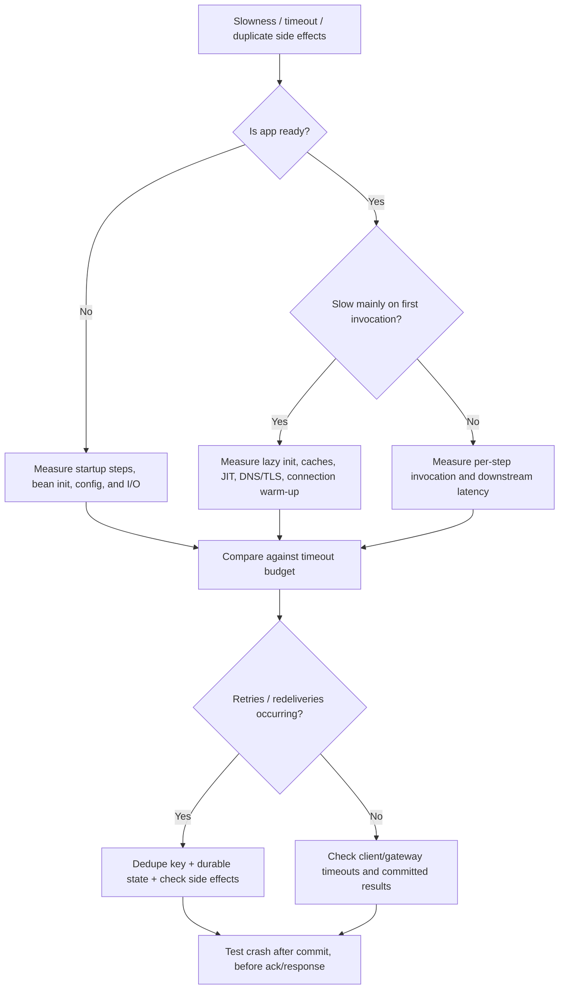

# Diagnosing Long Startup, Timeouts, or Duplicate Side Effects in Spring Cloud Function

## 1. The Problem: The Same Function Can Be Slow or Re-Invoked Across Multiple Layers

**Spring Cloud Function (SCF)** structures business logic as `Supplier<O>`, `Function<I, O>`, and `Consumer<I>` beans. `FunctionCatalog` registers, composes, and converts inputs/outputs, enabling reuse of the same logic across **HTTP, event streams, or serverless runtimes**.

This model decouples business code from protocols, yet **does not erase differences in lifecycle and execution timing**. A `Function<OrderCommand, OrderReceipt>` may:

- Run smoothly inside a long-lived Spring Boot HTTP server.
- Take far longer on the first call after a process/JVM or serverless environment spins up (**cold start**).
- Exceed processing deadlines of an HTTP client, gateway, or serverless platform (**timeout**) even while backend code finishes committing side effects.
- Be re-sent by a client, broker, or platform (**retry/redelivery**), creating duplicate database rows or calling external APIs twice if code is not idempotent.

These are not three isolated bugs; they often form a **cascading failure chain**:

```text
Slow cold start
    -> Request expires at gateway/client
    -> Client or event source retries
    -> Same business operation runs a second time
    -> Database gets two rows / customer charged twice / email sent twice
```

**Diagnostic goal:** identify which phase consumed time, who enforced the timeout, who triggered retries, and whether side effects had already completed before the request was deemed failed.

### After This Lesson, Learners Will Be Able To

1. Distinguish **startup**, **cold-start initialization**, **first invocation**, **warm invocation**, and **downstream latency**.
2. Read timing timelines and pinpoint the right timeout layer: client, gateway, server, function platform, broker, database, or remote API.
3. Measure Spring Boot startup via `ApplicationReadyEvent`, `BufferingApplicationStartup`, Actuator, and per-invocation traces.
4. Spot common sources of repeated side effects: `@PostConstruct`, `CommandLineRunner`, `Supplier`, retries, redeliveries, and concurrency.
5. Run an HTTP experiment comparing two functions: one **non-idempotent** and one performing **in-memory deduplication**.
6. Understand why `ConcurrentHashMap` is only a demo, whereas production requires **idempotency keys + durable state + unique constraints/transactions + outbox**.
7. Author runbooks and test scenarios where timeouts happen after side effects have already occurred.

## 2. Distinguish Five Key Timing Milestones

### 2.1. Application Startup

For a long-running Spring Boot application, startup typically includes:

```text
OS creates process / starts JVM
  -> SpringApplication.run()
  -> load configuration, create ApplicationContext
  -> scan/initialize beans, auto-configuration, conversions
  -> create FunctionCatalog and functional beans
  -> initialize web server and configured connections/dependencies
  -> ApplicationReadyEvent
  -> ready to serve traffic
```

**Not everything happens before `ApplicationReadyEvent`.** Lazy initialization, deferred SDK client connections, TLS handshakes, JIT compilation, or cache warm-up can still make **the first request** slow after the app reports ready.

### 2.2. Serverless Cold-Start Initialization

Some serverless platforms scale to zero or spin up new execution environments under load spikes. On AWS Lambda with Java, cold start can include downloading code, booting the JVM, and initializing the Spring context before the handler processes an event. SCF supplies the Lambda adapter, yet **cold-start duration still depends on the platform, dependencies, memory/CPU allocation, and initialization code**.

**Do not conflate:**

- A cold start of an execution environment is **not** an ordinary HTTP request to an already-running Spring Boot server.
- Lambda synchronous invocations, asynchronous invocations, and event-source mappings follow **different retry rules**.
- A warm instance does not guarantee subsequent calls stay fast: thread pools, GC, DB pools, networking, and concurrent load all vary.

### 2.3. First Invocation vs. Warm Invocation

Immediately after Spring Boot reports **ready**, the very first request may still pay costs for:

- JIT compilation and deferred class loading.
- Establishing database/HTTP connections, TLS handshakes, DNS resolution.
- Initializing serializers, validation metadata, or caches.
- Instantiating lazy beans, function wrappers, or converters.
- Fetching metadata/secrets depending on application configuration.

Measure **startup duration** and **first-request latency** separately instead of lumping them together as "startup".

### 2.4. Business Processing Time

`Function.apply()` duration can encompass several steps:

```text
HTTP/event decode
 -> conversion -> FunctionCatalog lookup/composition
 -> business logic
 -> DB transaction
 -> external payment/email/HTTP call
 -> response encoding/acknowledgement
```

In compositions like `normalize|validate|persist`, measure each step to see whether the bottleneck is conversion, validation, or `persist`'s side effects. A function that runs fast standalone is not guaranteed to stay fast in a pipeline with remote I/O.

### 2.5. When the Client Actually Receives the Result

**The server committed data** and **the client received 200 OK** are two distinct events. Between them lie networks, reverse proxies, serialization, and connections that can drop.

| Milestone | Event | Where to observe? |
| --- | --- | --- |
| T0 | Client initiates request | HTTP client/tracing |
| T1 | Gateway forwards request | Gateway/access logs |
| T2 | Handler/function starts | Server trace + invocation ID |
| T3 | DB commit or external side effect completes | DB audit/transaction logs |
| T4 | Server produces response | Application/server metrics |
| T5 | Client receives response or times out | Client logs |
| T6 | Retry/redelivery occurs | Client/broker/platform logs |

If `T3 < T5` yet the client times out before receiving the response, **retries can create duplicate side effects**. Assuming "the client timed out so the transaction definitely rolled back" is false.

## 3. Symptoms and Causes: Initial Triage Table

| Symptom | Primary suspect | What to verify |
| --- | --- | --- |
| First request after deploy is slow; subsequent ones are fast | Cold start, lazy init, JIT, initial connections | Separate startup and first-invocation duration |
| Process takes ages to start before any traffic arrives | Bean init, classpath, DI, remote config, DB migrations | Startup steps, bean initialization, pre-ready logs |
| Lambda cold invocation slow, warm invocations fast | JVM/Spring init + runtime/platform overhead | Init duration, handler duration, memory/CPU |
| Gateway returns HTTP 504 yet app logs show success | Gateway deadline shorter than server processing | Compare timestamps, transaction commits, client deadlines |
| Client gets 408/timeout with zero server logs | Request never reached server; DNS/TLS/connect/network | Trace ID across gateway and client |
| Same order processed twice after a timeout | HTTP retry or broker redelivery lacking idempotency | Correlation key, attempt ID, transactions, and acks |
| Welcome email resent on every scale-out | Side effect inside `@PostConstruct` or `CommandLineRunner` | Instance count and lifecycle hooks |
| Consumer re-receives event after calling external API | Ack/offset uncommitted or connection dropped post-side-effect | Broker delivery/ack offsets and external response |
| Timeouts spike under high load | Thread starvation, pool exhaustion, queues, backpressure | Pools, concurrency, GC, CPU, memory, queue depth |
| Raising timeouts reduces errors, duplicates persist | Retries and non-idempotent side effects | Inspect duplicate logic independently of timeout |

### Diagnostic Branching Diagram



## 4. Measuring Spring Boot Startup Properly

### 4.1. Basic Milestone: ApplicationReadyEvent

In Spring Boot, `ApplicationReadyEvent` fires when the application is ready to serve requests. On compatible Spring Boot releases, `event.getTimeTaken()` returns the startup duration recorded by Spring Boot (possibly `null` if unavailable).

```java
import java.time.Duration;
import org.springframework.boot.context.event.ApplicationReadyEvent;
import org.springframework.context.event.EventListener;
import org.springframework.stereotype.Component;

@Component
class StartupLogger {

    @EventListener
    public void onReady(ApplicationReadyEvent event) {
        Duration elapsed = event.getTimeTaken();
        System.out.println("BOOT_READY startupMs=" +
                (elapsed == null ? "unknown" : elapsed.toMillis()));
    }
}
```

This figure measures Spring Boot's internal metric; it is **not identical** to total wall-clock time from platform resource allocation until the user receives the first response.

### 4.2. BufferingApplicationStartup to See Individual Startup Steps

Spring Boot provides `BufferingApplicationStartup` to record startup steps. Example:

```java
import org.springframework.boot.SpringApplication;
import org.springframework.boot.autoconfigure.SpringBootApplication;
import org.springframework.boot.context.metrics.buffering.BufferingApplicationStartup;

@SpringBootApplication
public class DiagnosticApplication {
    public static void main(String[] args) {
        SpringApplication application =
                new SpringApplication(DiagnosticApplication.class);
        application.setApplicationStartup(
                new BufferingApplicationStartup(2048));
        application.run(args);
    }
}
```

If you add Spring Boot Actuator and **explicitly** expose the `startup` endpoint, you can inspect startup steps at `/actuator/startup` in test environments. Example configuration:

```properties
management.endpoints.web.exposure.include=health,info,startup
```

Check:

```bash
curl -i 'http://localhost:8080/actuator/health'
curl -i 'http://localhost:8080/actuator/startup'
```

**Security warning:** never expose Actuator endpoints to the public Internet. Restrict them via Spring Security, management networks, or dev profiles. Startup details can reveal internal application structure; enable only when appropriate and avoid holding unnecessary buffers in production.

### 4.3. Milestones Outside Spring Boot

During serverless cold starts, collect **platform-level** data too:

- When was the container/process created?
- How long was the init duration (if reported by the platform)?
- When did the handler/function begin executing?
- What were handler duration, billed duration, and timeout settings?
- Was the execution environment fresh or reused?
- How many environments spun up concurrently during a traffic burst?

On AWS Lambda, Lambda logs and metrics separate init cost from invocation time. Never measure cold start solely by timing an HTTP `curl`; that includes networking, gateways, and external hops.

### 4.4. Distinguish Readiness and Liveness

- **Liveness:** is the process alive or wedged badly enough to require a restart?
- **Readiness:** is it ready for traffic, including genuinely mandatory dependencies?
- **Startup:** is it still initializing and needing extra startup grace time?

A readiness check that passes too early sends gateway traffic before functions, converters, or DBs are ready. Conversely, tying readiness to a flaky remote service causes unnecessary restarts and traffic churn. Design probes around deployment semantics rather than hiding infinite startup hangs.

## 5. Why Can Spring Cloud Function Take Long to Start?

SCF integrates Spring Boot, `FunctionCatalog`, conversions, and adapters. Common causes to inspect:

| Cause category | Examples | How to verify |
| --- | --- | --- |
| Too many dependencies | Unused web, messaging, cloud SDK, observability starters | Dependency graph and startup steps; do **not** delete blindly |
| Bean initialization | Constructors/`FactoryBean`s allocating heavy resources | `ApplicationStartup`, thread dumps, sampling |
| Startup networking | Secret fetches, config/metadata servers, DB pings, DNS/TLS | Separate DNS/connect/read timeouts, trace network |
| Schema migrations | Flyway/Liquibase running before ready | Migration logs and DB locks |
| Pool/client creation | Connection pools, TLS handshakes, SDK clients | Time-to-first-connect and pool metrics |
| Scanning/auto-configuration | Broad packages/configs and conditional beans | Startup steps, condition evaluation report |
| Serverless mode | Artifact download, JVM init, Spring context init | Platform cold-init metrics |
| CPU/memory/GC | Starved CPU or undersized/oversized heap causing GC | CPU throttling, GC, heap, allocation profiling |
| Lazy initialization | Speeds startup but initializes beans on first request | Compare startup vs. first-invocation p95/p99 |
| Composition/conversion | `FunctionCatalog` wrappers, JSON conversion, `Message` metadata | Trace first call, converter overhead |
| External bottlenecks | Gateways, proxies, DNS, or shared infrastructure | Compare client/server/infra timestamps |

### 5.1. Optimize Based on Measurements

1. **Measure a baseline**: startup p50/p95, cold-init, first-response latency, warm latency, and CPU/memory.
2. **Find the slowest step**: specific bean, remote call, migration, or SDK initialization.
3. **Trim non-essential startup work**: avoid long network calls, huge index builds, or loading thousands of records at boot.
4. **Pick right-sized dependencies**: use SCF context alone when HTTP auto-export is unneeded; avoid pulling a full web stack into a lightweight event adapter out of convenience.
5. **Evaluate platform features**: e.g., AWS Lambda SnapStart when runtime and state handling allow, memory/CPU tuning, Java AOT/native image per release train.
6. **Re-benchmark in a production-like environment**, especially cold vs. warm and scale-out bursts.

**No single SCF property guarantees fast startup everywhere.** For instance, `spring.main.lazy-initialization=true` reduces initial boot steps while **shifting the cost onto the first request**, where timeouts can be even harsher.

### 5.2. Caution with SnapStart, Snapshots, and Prewarming

Pre-initialized environment snapshots cut cold starts, yet **never assume connections, tokens, secrets, PRNG state, or external handles remain valid after restore**. Follow platform snapshot/restore guidelines, refresh credentials/clients when needed, and verify ID uniqueness. Never generate a single idempotency key inside a static initializer and reuse it across invocations.

## 6. Timeouts: One Invocation Involves Multiple Countdowns

A single request can cross:

```text
Client
 -> DNS/TLS/connect deadline
 -> API Gateway / Load Balancer / Ingress timeout
 -> HTTP server / servlet thread / reactive timeout
 -> FunctionCatalog + business logic
 -> DB query/transaction timeout
 -> External HTTP client timeout
 -> Event ack / platform invocation deadline
```

These are **independent time budgets**. If the gateway stops waiting before the function finishes, the client receives 504 while the server keeps running.

| Layer | Typical timeout | Guaranteed to stop business work on expiry? |
| --- | --- | --- |
| HTTP client | Connect timeout, read/response timeout | No; the client may simply stop waiting |
| Gateway/Ingress | Upstream response timeout | No; backend may continue running |
| Spring MVC/WebFlux | Async processing / server-specific limits | Cannot assume all side effects rolled back |
| Serverless invocation | Platform deadline | Environment may freeze/reset per platform; completed external side effects remain |
| DB | Statement/transaction timeout | Check actual DB, isolation, and commits |
| HTTP client inside function | Downstream connect/read timeout | Downstream may have processed while response was lost |
| Broker consumer | Visibility timeout, ack deadline, max poll interval | Message may redeliver if unacknowledged |
| Scheduler/Retry library | Retry duration, backoff, max attempts | Can execute multiple times for one logical request |

### 6.1. Design an Intentional Timeout Budget

Illustrative example (not SCF defaults):

```text
Client max wait:               5.0 seconds
Gateway upstream wait:         4.5 seconds
Application processing budget: 4.0 seconds
Downstream HTTP read timeout:  2.0 seconds
DB statement timeout:          1.5 seconds
```

Real budgets must account for network/serialization and whether calls are **sequential or parallel**. You cannot simply sum timeouts for an SLA: an external call might sit inside a DB transaction, retries multiply elapsed time, and queue wait plus startup can consume the entire deadline.

**Rule:** timeouts must reflect business deadlines and safe cancellation behavior. Do not crank every timeout up to an enormous value just to "stop seeing errors"; that prolongs waits, pins threads/connections, and makes duplicate retries harder to spot.

### 6.2. Timeout Does Not Mean Cancellation

In synchronous Java code, dropping an HTTP connection rarely stops threads executing business logic immediately. In Reactor `Flux`/`Mono`, cancellation propagates up the pipeline, yet blocking I/O or already-dispatched external side effects still may not abort.

If a remote service **already accepted payment** and the function's HTTP client times out, retrying payment without an idempotency key is high risk.

### 6.3. Classify Errors Accurately

- `408 Request Timeout`: server timed out waiting to receive the request in HTTP semantics.
- `504 Gateway Timeout`: gateway/proxy did not receive a timely upstream response.
- HTTP client timeouts often raise client-side exceptions with **no HTTP status**.
- A `500` from a function may stem from a downstream exception, not necessarily startup.
- A `202 Accepted` does not prove side effects completed or a message was durably stored.

Correlate logs, traces, and metrics on **both sides** to establish whether the request arrived, the function started, and side effects ran.

## 7. Why Can Retries or Redeliveries Cause Duplicate Side Effects?

Consider:

```java
@Bean
Function<OrderCommand, OrderReceipt> submitOrder() {
    return command -> {
        paymentService.charge(command.orderId());
        emailService.sendReceipt(command.orderId());
        return new OrderReceipt(command.orderId(), "OK");
    };
}
```

*Conceptual counterexample:* `paymentService`/`emailService` are undeclared; it illustrates the hazard rather than being a standalone runnable program.

Incident timeline:

```text
Attempt 1:
  10:00:00  Event/HTTP request for order-42
  10:00:01  paymentService.charge() SUCCEEDS
  10:00:03  HTTP response/ack fails to reach client/broker
  10:00:04  Client/broker treats as timeout, retries

Attempt 2:
  10:00:05  Same order-42 invoked again
  10:00:06  paymentService.charge() runs AGAIN
  10:00:07  Customer charged twice
```

This happens even when attempt 1 **finished its critical business step**. The failure sits in **the gap between committing the side effect and confirming the result**.

### 7.1. Different Sources of Retries

| Source | Why it re-invokes | Notes |
| --- | --- | --- |
| HTTP client/browser/mobile app | Timeouts, dropped connections, user double-clicks | Request ID may change; **business key** must stay stable |
| API gateway/reverse proxy | Upstream retry policy | Retry only operations with safe contracts |
| Resilience4j/Spring Retry | Exception/timeout/bulkhead policies | Must know whether the function has side effects |
| AWS Lambda asynchronous invocation | Function error/timeout or duplicate delivery | Per AWS docs, automatic retries are configurable; differs from synchronous invocations |
| SQS/Lambda event source mapping | Visibility timeout, batch failures | May redeliver already-processed messages depending on ack/batch behavior |
| Kafka consumer | Rebalances, crash before offset commit, retries | At-least-once delivery at app level can duplicate side effects |
| Scheduler/`Supplier` | Cron triggers, polling, multiple instances | Never equate scheduled invocations with once-only business transactions |
| Scale-out platform | Multiple environments pulling work concurrently | Shared dedupe state must work cross-instance |

**There is no single retry policy across all serverless adapters.** For example, AWS Lambda synchronous invocations normally leave retries to the client/invoker, whereas asynchronous invocations have built-in Lambda retries. Inspect your specific event source, retry settings, dead-letter/on-failure destinations, and time limits.

### 7.2. Never Put Once-Only Side Effects in Lifecycle Hooks

These snippets are dangerous if they perform **work that must run strictly once across the system**:

```java
@PostConstruct
void onInit() {
    sendWelcomeEmailToAllCustomers();
}

@Bean
CommandLineRunner startupJob() {
    return args -> billingService.chargeMonthlyFees();
}
```

*Both snippets are illustrative counterexamples with undeclared services.*

Every process or execution environment runs its own init hooks on boot, cold start, scale-out, or redeploy. They are **not** a distributed once-only scheduler. When migrations or scheduled jobs are required, use a job coordinator, durable lock, leader-elected scheduler, or dedicated workflow engine.

### 7.3. Suppliers Do Not Run Once by Default

`Supplier<T>` defines how to **supply data when invoked**; invocation count depends on HTTP adapters, schedulers, Spring Cloud Stream pollers, or serverless platforms. A `Supplier` with non-idempotent side effects can be called repeatedly and create duplicate data without explicit guards.

## 8. Java Demo: Observing Duplicates and Deduplicating Within One JVM

This example **is runnable** on a compatible Spring Boot / SCF HTTP adapter using Java 17+. It defines two beans:

- `unsafeSubmit`: increments a counter on **every invocation**.
- `demoSafeSubmit`: uses `ConcurrentHashMap.compute()` to process **each `requestId` once within the same live JVM**.

The goal is teaching how to observe retries. **Never use an in-memory map as a production solution** because it loses state on restart, is not shared across instances, and is not atomic with databases or external payment gateways.

### 8.1. Maven Dependencies

In a Spring Boot project with a compatible Spring Cloud BOM, add:

```xml
<dependencies>
    <dependency>
        <groupId>org.springframework.cloud</groupId>
        <artifactId>spring-cloud-starter-function-web</artifactId>
    </dependency>
    <dependency>
        <groupId>org.springframework.boot</groupId>
        <artifactId>spring-boot-starter-actuator</artifactId>
    </dependency>
</dependencies>
```

Align Java, Spring Boot, and Spring Cloud versions with your chosen BOM. Never force the latest version of a single starter onto an older release train.

### 8.2. Complete Java Source

Create `src/main/java/demo/DiagnosticsApplication.java`:

```java
package demo;

import java.time.Duration;
import java.util.concurrent.ConcurrentHashMap;
import java.util.concurrent.ConcurrentMap;
import java.util.concurrent.atomic.AtomicInteger;
import java.util.function.Function;

import org.springframework.boot.SpringApplication;
import org.springframework.boot.autoconfigure.SpringBootApplication;
import org.springframework.boot.context.event.ApplicationReadyEvent;
import org.springframework.context.annotation.Bean;
import org.springframework.context.event.EventListener;
import org.springframework.stereotype.Component;

@SpringBootApplication
public class DiagnosticsApplication {

    public static void main(String[] args) {
        SpringApplication.run(DiagnosticsApplication.class, args);
    }

    @Bean
    public Function<OrderCommand, OrderReceipt> unsafeSubmit(
            InMemoryLedger ledger) {
        return command -> ledger.recordUnsafe(command);
    }

    @Bean
    public Function<OrderCommand, OrderReceipt> demoSafeSubmit(
            InMemoryLedger ledger) {
        return command -> ledger.recordOnceInThisJvm(command);
    }
}

record OrderCommand(
        String requestId, String orderId, int quantity) {}

record OrderReceipt(
        String orderId, String status, int effectSequence) {}

record StoredOrder(
        OrderCommand original, OrderReceipt receipt) {}

@Component
class InMemoryLedger {

    private final AtomicInteger effectCount = new AtomicInteger();
    private final ConcurrentMap<String, StoredOrder> processed =
            new ConcurrentHashMap<>();

    public OrderReceipt recordUnsafe(OrderCommand command) {
        validate(command);
        int sequence = effectCount.incrementAndGet();
        System.out.println("UNSAFE_EFFECT order=" + command.orderId()
                + " sequence=" + sequence);
        return new OrderReceipt(
                command.orderId(), "UNSAFE_RECORDED", sequence);
    }

    public OrderReceipt recordOnceInThisJvm(OrderCommand command) {
        validate(command);

        StoredOrder stored = processed.compute(
                command.requestId(), (key, existing) -> {
                    if (existing != null) {
                        if (!existing.original().equals(command)) {
                            throw new IllegalArgumentException(
                                    "Request ID reused for different data");
                        }
                        return existing;
                    }

                    int sequence = effectCount.incrementAndGet();
                    System.out.println("DEMO_EFFECT order=" +
                            command.orderId() +
                            " sequence=" + sequence);

                    return new StoredOrder(
                            command,
                            new OrderReceipt(
                                    command.orderId(),
                                    "RECORDED_IN_MEMORY",
                                    sequence));
                });

        return stored.receipt();
    }

    private static void validate(OrderCommand command) {
        if (command == null
                || command.requestId() == null
                || command.requestId().isBlank()
                || command.orderId() == null
                || command.orderId().isBlank()
                || command.quantity() <= 0) {
            throw new IllegalArgumentException(
                    "requestId, orderId and quantity are required");
        }
    }

    @EventListener
    public void onReady(ApplicationReadyEvent event) {
        Duration elapsed = event.getTimeTaken();
        System.out.println("BOOT_READY startupMs=" +
                (elapsed == null ? "unknown" : elapsed.toMillis()));
    }
}
```

**Technical notes:**

1. `unsafeSubmit` triggers `UNSAFE_EFFECT` on every call, even with identical request bodies.
2. `demoSafeSubmit` uses `ConcurrentHashMap.compute()` to serialize updates for **the same key inside this JVM**. Reusing a key with a different payload is rejected so two distinct commands are not treated as identical.
3. `effectSequence` is an illustrative counter, **not a real transaction ID**; `effectCount` is shared across both beans.
4. `System.out.println()` statements observe side effects in the experiment and are **not** durable logging.
5. If the JVM restarts, `processed` starts empty; across two pods or Lambda environments, each instance holds a separate map.
6. If an external side effect failed mid-`compute()`, retries can still produce side effects. This mechanism does **not** guarantee database/payment atomicity.
7. SCF HTTP adapter and Spring Boot may map `IllegalArgumentException` to different statuses without custom HTTP error mapping; do not assume it always returns 400.

### 8.3. Calling Both Endpoints

Start the app:

```bash
mvn spring-boot:run
```

Assuming the server runs on `http://localhost:8080`. The commands below use Bash; in PowerShell invoke `curl.exe`.

```bash
# Call 1: unsafe.
curl -i -X POST 'http://localhost:8080/unsafeSubmit' \
  -H 'Content-Type: application/json' \
  -H 'Accept: application/json' \
  --data '{"requestId":"req-100","orderId":"ord-42","quantity":2}'

# Call 2: same request, unsafe records another side effect.
curl -i -X POST 'http://localhost:8080/unsafeSubmit' \
  -H 'Content-Type: application/json' \
  -H 'Accept: application/json' \
  --data '{"requestId":"req-100","orderId":"ord-42","quantity":2}'

# Call 1: in-JVM deduplication.
curl -i -X POST 'http://localhost:8080/demoSafeSubmit' \
  -H 'Content-Type: application/json' \
  -H 'Accept: application/json' \
  --data '{"requestId":"req-200","orderId":"ord-42","quantity":2}'

# Call 2: same key and payload, returns the previous receipt.
curl -i -X POST 'http://localhost:8080/demoSafeSubmit' \
  -H 'Content-Type: application/json' \
  -H 'Accept: application/json' \
  --data '{"requestId":"req-200","orderId":"ord-42","quantity":2}'
```

The two `unsafeSubmit` responses show incrementing `effectSequence` values, e.g.:

```json
{"orderId":"ord-42","status":"UNSAFE_RECORDED","effectSequence":1}
```

and:

```json
{"orderId":"ord-42","status":"UNSAFE_RECORDED","effectSequence":2}
```

Whereas `demoSafeSubmit` returns **the same `effectSequence`** for both requests sharing the same key/payload while the process stays alive.

### 8.4. Reusing a Key with Mismatched Data

```bash
curl -i -X POST 'http://localhost:8080/demoSafeSubmit' \
  -H 'Content-Type: application/json' \
  --data '{"requestId":"req-200","orderId":"ord-43","quantity":5}'
```

Because `req-200` is already bound to `ord-42`, `InMemoryLedger` rejects the request reusing the key with a different payload. In a production API, you might standardize on **409 Conflict** here; since this auto-exported SCF example defines no `@ControllerAdvice`, the exact status depends on adapter exception mapping.

### 8.5. Restart Test Exposes the Limitation

Stop the application, restart it, and call `/demoSafeSubmit` with `req-200` again. Because the map starts empty, `DEMO_EFFECT` prints again and the counter restarts. This proves **in-JVM state cannot prevent duplicates across restarts or cold starts**.

## 9. Durable Idempotency: Options for Production

For payments, order creation, or event publishing, you need a design that resists retries **across multiple instances and restarts**.

### 9.1. Define Idempotency Keys by Business Semantics

- **HTTP:** client sends an `Idempotency-Key` kept stable across all retries of **the same command**; server scopes it by user/tenant, endpoint, and payload fingerprint.
- **Events:** use `eventId`, business transaction ID, or a stable producer-assigned identifier; never use a delivery attempt ID that changes on each attempt.
- **Scheduled jobs:** bind keys to the processing window, e.g., `billing:2026-11:customer-42`, rather than minting a fresh UUID every run.
- **Suppliers:** if producing side effects, attach an identifier representing the business operation/window rather than assuming every poll is a brand-new action.

Keys must be unique within their **scope**, bounded in length/format, retention-controlled, and **free of raw secrets/PII**. If a client reuses a key with a different payload, return a conflict error per HTTP contract (typically 409) or the matching message-handling policy.

### 9.2. Durable State Table

Illustrative PostgreSQL schema:

```sql
CREATE TABLE processed_operations (
    tenant_id      VARCHAR(64) NOT NULL,
    operation_type VARCHAR(64) NOT NULL,
    idempotency_key VARCHAR(128) NOT NULL,
    request_hash   VARCHAR(128) NOT NULL,
    status         VARCHAR(24) NOT NULL,
    response_json  JSONB,
    updated_at     TIMESTAMPTZ NOT NULL DEFAULT now(),
    PRIMARY KEY (tenant_id, operation_type, idempotency_key)
);
```

Define explicit states such as:

```text
NEW
  -> PROCESSING
     -> SUCCEEDED  (result committed)
     -> FAILED_RETRYABLE (safe to retry)
     -> FAILED_FINAL (do not retry)
```

**Never mark `SUCCEEDED` before external side effects actually complete.** Likewise, avoid holding a DB transaction open across slow remote network calls unless your architecture explicitly manages locks and timeouts.

### 9.3. Conceptual Transaction Protocol

```text
1. Receive command with (tenant, operation, idempotencyKey).
2. Compute payload fingerprint (excluding fields that vary across retries).
3. Inside transaction: INSERT new key guarded by unique constraint.
4. If key already exists:
     - different hash -> Conflict / execute no side effect;
     - SUCCEEDED -> return stored result or confirm already processed;
     - PROCESSING -> do not run concurrently; return in-progress status
       or coordinate safe wait/lease;
     - FAILED_* -> follow retry policy.
5. When modifying data in the same database:
     - write business record and mark SUCCEEDED in the same transaction.
6. When calling external systems:
     - write outbox event/command inside the transaction;
     - worker delivers event with idempotency key downstream;
     - downstream deduplicates if needed;
     - record completion state, handle retries and reconciliation.
7. Acknowledge message / return contract success only after durable state
   has committed.
```

**Atomicity warning:** a unique constraint only prevents **concurrent claims of the same key**; it does not magically make a database and an external payment/email provider atomic. When the external system offers an idempotency API, pass **the same key** to it. When it does not, use outbox, reconciliation, and sometimes compensation workflows; end-to-end "exactly once" across separate systems cannot come from a local DB transaction alone.

### 9.4. Example Claim Statement

PostgreSQL supports:

```sql
INSERT INTO processed_operations (
    tenant_id, operation_type, idempotency_key,
    request_hash, status
)
VALUES ('t-42', 'CREATE_ORDER', 'req-100',
        'sha256-of-canonical-command', 'PROCESSING')
ON CONFLICT DO NOTHING;
```

After this statement, **check the inserted row count**. If zero rows were inserted, read the existing row under an appropriate transaction and locking rule, then execute the duplicate/conflict branch. This SQL is illustrative, not the full transaction protocol. Do not mistake `ON CONFLICT DO NOTHING` alone for a complete deduplication state machine.

### 9.5. Transactional Outbox

When business logic must update the database **and** publish an event:

```text
Single DB transaction:
  - INSERT order / UPDATE status
  - INSERT outbox_event (eventId, orderId, payload)
  - UPDATE processed_operations = SUCCEEDED
COMMIT

Separate worker:
  - read unsent outbox events
  - publish to broker/downstream
  - mark sent once confirmed
  - retry on failure (downstream also dedupes by eventId)
```

Outbox eliminates the "DB committed yet crashed before publishing event" window, though an event can still **be sent more than once** if the worker crashes after the broker accepts it and before marking it sent. Consumers still need idempotency. Track metrics for outbox backlog, oldest item age, and retry counts.

## 10. Place Retries Properly Without Triggering Retry Storms

Poorly configured retries can worsen overload incidents.

### 10.1. When Should You Retry?

| Failure type | Guidance |
| --- | --- |
| Connect timeout before sending request | Safe to retry per policy, still verify request status |
| Read timeout after sending POST payment | Do not retry blindly; use idempotency key and query status |
| Downstream HTTP 429 | Honor `Retry-After` if present, backoff + jitter, cap attempts |
| Transient HTTP 503 | Budgeted retries if operation is idempotent; add circuit breakers |
| Invalid JSON / 400 validation error | Never retry identical payload without fixing input |
| Business conflict 409 | Domain-dependent; usually reconcile or issue new request |
| Event failure after external side effect | Deduplicate before side effect on redelivery |
| Startup timeout because instance isn't ready | Fix readiness/scaling/initialization; don't just raise retries |

### 10.2. Backoff and Bounds

Policy design:

- **Max attempts** and total retry duration stay within the caller's deadline.
- **Exponential backoff + jitter** prevents synchronized client retry waves.
- **Circuit breakers/bulkheads** shield overloaded downstreams.
- **Retry only appropriate errors** (transient), never unrecoverable validation or conflict errors.
- **Preserve the idempotency key** identically across attempts.
- **DLQ/on-failure destinations** capture exhausted events with controlled replay tooling.

Log each retry with a **fresh attempt ID** while keeping the original **business operation key** so you can trace how many executions occurred for one logical transaction.

### 10.3. Do Not Replace Retries with Thread Sleep Inside Functions

Avoid `Thread.sleep(5000)` to "wait for the network to recover", especially in reactive pipelines or tight concurrency budgets. That merely wastes threads and time budgets. In Reactor, use reactive retry operators with non-blocking external calls; for blocking I/O, use appropriate executors/schedulers and explicit timeouts.

## 11. What Should Logs, Metrics, and Traces Contain?

A structured log template sufficient for tracing:

```json
{
  "event": "function.invoke",
  "function": "submitOrder",
  "operationKeyHash": "a1b2c3...",
  "attemptId": "attempt-7",
  "instanceId": "instance-2",
  "coldStart": false,
  "stage": "db_commit",
  "durationMs": 320,
  "outcome": "succeeded"
}
```

**Never log raw payloads containing PII, payment cards, secrets, or sensitive idempotency tokens.** Use hashed/HMAC keys where designed, and avoid high-cardinality metric labels.

| Signal | Purpose |
| --- | --- |
| Startup duration p50/p95 | Track time until application readiness |
| Cold-start count / init duration | Track frequency and cost of environment spin-ups |
| First-invocation vs. warm duration | Detect lazy init / JIT / connection warm-up |
| Function invocation p50/p95/p99 | Track runtime latency variance |
| Timeout rate per layer | Separate client/gateway/platform/DB/downstream |
| Retry count by source | Distinguish client retries from broker redeliveries |
| Duplicate suppressed count | Track prevented duplicate operations |
| Idempotency conflict count | Detect key reuse with mismatched payloads |
| In-progress age / stuck operations | Spot operations stuck in `PROCESSING` |
| Outbox backlog / oldest age | Catch undelivered events piling up |
| Database commit / error duration | Spot transaction bottlenecks |
| CPU, GC, thread/pool queues | Measure saturation rather than latency alone |

### 11.1. Propagate Context Across Layers

Across HTTP + `FunctionCatalog` + event adapters, one request may involve several IDs:

- **Trace ID:** links spans across HTTP, DB, and downstream services.
- **Request/attempt ID:** identifies one concrete execution attempt.
- **Business operation/idempotency key:** identifies the logical operation whose effect must apply once.
- **Message/event ID:** identifies the producer-emitted event.
- **Instance/environment ID:** distinguishes process/pod/Lambda environments.

Do not treat these IDs as interchangeable. One business operation can have **many attempt IDs** while sharing **one stable operation key**.

### 11.2. Measure Before and After Every Side Effect

Example log sequence:

```text
invoke.start  operation=req-100 attempt=1
db.begin
db.commit   operation=req-100
http.write.start
http.write.failed connection_reset

invoke.start  operation=req-100 attempt=2
dedupe.hit   operation=req-100 status=SUCCEEDED
invoke.end   operation=req-100 duplicate=true
```

This timeline proves the connection dropped **after the DB commit**, so attempt 2 must return the stored result instead of writing again.

## 12. Adapter-Specific Diagnostics

### 12.1. SCF HTTP Adapter

Common symptoms:

- Wrong function/definition name in URL causing 404 or unintended fallback.
- Function parsing JSON slowly due to converters, validation, or downstream calls.
- Client times out before 200 OK while the function finishes writing to the DB.
- Gateway unexpectedly retries POST requests.

Check:

1. URL, method, `spring.cloud.function.definition`, and `spring.cloud.function.web.path`.
2. Input `Content-Type` and response `Accept`.
3. Server logs confirming the intended function ran.
4. Gateway timeout and retry policies.
5. Transaction commit timing relative to network disconnects.
6. Stability of the business key across retries.

### 12.2. Spring Cloud Stream / Event Adapters

For event sources, monitor:

- Consumer groups, partitions, offsets/acks, and rebalances.
- Batch success/failure handling, dead-letter queues, and poison messages.
- Retry backoff and max attempts in the corresponding binder/broker.
- `Supplier` polling intervals or scheduling behavior if emitting events.
- Whether side effects committed before message acknowledgment.

**Never copy a Kafka binder retry config blindly to RabbitMQ, AWS SQS, or another adapter.** Delivery semantics and offset/visibility tracking are platform-specific. At minimum, side-effecting consumers must tolerate **redelivery**.

### 12.3. AWS Lambda / Serverless Adapters

SCF AWS Lambda docs outline optimization paths: **SnapStart** where eligible, memory/CPU tuning, placing SDK clients where they are safely reused, and trimming Spring initialization via functional bean registration.

Diagnostics:

- Separate cold initialization time from handler invocation time.
- Review memory/CPU, artifact size, runtime, and dependencies.
- Determine whether invocation is synchronous, asynchronous, or event-source mapped.
- For asynchronous invocations, inspect `MaximumRetryAttempts`, maximum event age, and on-failure destinations.
- If the platform resets execution environments after timeouts, assume local memory is lost; never rely on `static` variables for idempotency.
- For reused SDK clients, handle stale connections/tokens per platform guidance.

**Do not hardcode one retry number across all Lambda invocation types.** Per AWS documentation, asynchronous function errors may retry twice by default; synchronous invocations leave retries to callers/invokers, while SQS/Kinesis/EventBridge enforce source-specific policies.

## 13. First 15-Minute Incident Runbook

**Goal:** identify the slow layer, preserve evidence, and stop duplicate side effects while investigating.

1. **Record incident facts:** UTC timestamp, deployed version, environment, adapter kind, endpoint/function definition, errors/statuses, error rate, and instance count.
2. **Stop ongoing harm:** if double charges or duplicate emails are occurring, consider pausing that specific side-effecting flow or throttling retries safely; never delete data/batches impulsively.
3. **Construct a timeline keyed by operation key:** client request, gateway, `function.start`, DB/external commit, response/ack, and retry attempts.
4. **Break down latency:** startup/cold init, first invocation, business logic, downstream calls, response/ack.
5. **Compare timeouts:** client, gateway, serverless, DB, broker visibility/ack.
6. **Check saturation signals:** CPU throttling, GC, thread/connection pools, queue depth, DB locks.
7. **Locate the retry source:** client, gateway, framework retry, message broker, or platform.
8. **Verify durable state:** did one or multiple transactions commit, and did external side effects execute?
9. **Verify idempotency:** stable key, unique constraints, `SUCCEEDED` state, conflicts, and race conditions.
10. **Apply the targeted fix:** optimize init, align timeout budgets, fix downstream bottlenecks, add dedupe/outbox, or fix routing/retries.
11. **Monitor post-change:** timeout p95/p99, duplicate rate, error rate, outbox backlog, cold/warm latency.
12. **Document postmortem:** root cause, evidence, and regression tests to prevent recurrence.

### Four Questions to Answer Before Retrying a Side-Effecting Operation

- Is there evidence of a **DB commit or external success**?
- Is a stable **idempotency key** attached?
- Does the downstream offer an idempotent API or **status-query capability**?
- Is there a reconciliation/compensation plan if two attempts both succeed?

If you cannot answer those, **do not blindly retry** a payment, email, or order side effect simply because HTTP timed out.

## 14. Mandatory Regression Test Suite

| Test case | How to simulate | What to verify |
| --- | --- | --- |
| Startup after deploy | Restart container/process | Ready duration, zero unexpected side effects |
| Cold vs. warm | Spin up fresh environment then call again | p95/first invocation separated from startup |
| Two identical requests | Send same key twice | One logical business effect, same receipt |
| Same key, different payload | Send different order/quantity with existing key | Conflict, no new side effect runs |
| Concurrent requests, same key | Parallel requests | Only one valid claim via unique constraint |
| Restart between requests | Kill process while keeping DB | Dedupe still works (in-memory demo would fail) |
| Timeout **before** DB commit | Inject delay then time out | Safe retry per state machine |
| Timeout **after** DB commit, before response | Inject fault/disconnect after commit | Retry returns stored result without second write |
| Crash after DB commit, before event publish | Use outbox | Event remains for worker to send |
| Crash after broker accept, before outbox ack | Restart worker | Downstream deduplicates duplicate event |
| Broker redelivery | Leave a succeeded event unacked | Consumer does not repeat side effects |
| Multi-instance scale-out | Send same key to two pods | Shared durable store blocks duplicates |
| Remote payment timeout | Downstream processes without returning response | No unconditional recharge |
| High-load latency | Bounded load test | Pools/concurrency and timeout budgets hold |
| Bad input | Malformed DTO | Validation error is not retried |
| Multi-instance `Supplier`/scheduler | Multiple pollers/instances | No duplicate business batch created for the window |

### 14.1. Using curl to Observe Latency

Bash:

```bash
curl -s -o /dev/null \
  -w 'HTTP %{http_code} total=%{time_total}s connect=%{time_connect}s ttfb=%{time_starttransfer}s\n' \
  -X POST 'http://localhost:8080/demoSafeSubmit' \
  -H 'Content-Type: application/json' \
  --data '{"requestId":"req-300","orderId":"ord-99","quantity":1}'
```

- `time_connect`: time to establish TCP connection (does not isolate all TLS/DNS layers uniformly).
- `time_starttransfer`: request start to first response byte; **not** solely Java `Function.apply()` duration.
- `time_total`: total client-measured duration.

Compare against server traces to tell whether latency sits before, inside, or after the business function. When benchmarking, run multiple requests and inspect the distribution; a single sample is easily skewed by JIT/GC/network noise.

### 14.2. Client Timeout Tests Do Not Mean Server Rollback

```bash
# Intentionally cap client wait to 1 second.
# Meaningful only when backend is configured to simulate > 1 second work.
curl -i --max-time 1 -X POST \
  'http://localhost:8080/demoSafeSubmit' \
  -H 'Content-Type: application/json' \
  --data '{"requestId":"req-timeout","orderId":"ord-100","quantity":1}'
```

**Note:** the demo bean in section 8 executes very fast, so this command **will not trigger a timeout by itself**. To test realistically, use a delayed test double, network fault injection, or a test proxy in a test environment rather than slowing down production code. After forcing a timeout, inspect committed state before retrying the same key.

## 15. Anti-Patterns to Avoid

| Anti-pattern | Why it is wrong | Use instead |
| --- | --- | --- |
| Raising all timeouts sky-high | Hides root causes, pins resources, stretches waits | Profile each layer, define a timeout budget |
| Treating `spring.main.lazy-initialization=true` as a cold-start cure-all | Shifts cost onto first invocation | Benchmark both startup and first-request latency |
| Retrying every exception | Validation/conflict errors cannot self-heal | Retry by error class with backoff/jitter and deadlines |
| Generating a fresh UUID per retry for the same action | Deduplication cannot recognize duplicates | Keep key stable per business operation |
| Using `static Set`/`ConcurrentHashMap` for prod dedupe | Lost on restart, unshared across instances | Durable Database/Redis strategy matching SLA |
| Marking `SUCCEEDED` before side effects finish | Returns false success when external call fails | Transaction state + outbox/reconciliation |
| Writing DB and publishing to broker without outbox | Crash window drops events | Transactional outbox + consumer idempotency |
| Charging/emailing inside `@PostConstruct` | Re-runs on every cold start / scale-out | Job/workflow with durable locks or claims |
| Treating HTTP 504 as DB rollback | Backend may already have committed | Inspect transactions and operation key |
| Treating `202 Accepted` as durable completion | 202 is only an HTTP acceptance contract | Track jobs/acks/durability separately |
| Logging only trace ID without business key | Hard to link multiple attempts to one business action | Correlate with hashed business key and attempt ID |
| Assuming one "exactly-once" consumer covers both DB and remote APIs | Cross-system atomicity does not exist automatically | Downstream dedupe + outbox/reconciliation |
| Opening Actuator startup endpoint to Internet | Exposes internal initialization details | Secure with auth / management network |
| Disabling all retries when duplicates occur | Drops work hit by transient failures | Add idempotency first, then tune controlled retries |

## 16. Practice Exercises

1. Distinguish Spring Boot startup, Lambda cold start, first invocation, and warm invocation. Why can those four numbers differ?
2. A gateway times out after 3 seconds, the backend commits DB at 4 seconds, and the client retries at 5 seconds. Draw the timeline and identify the duplicate risk.
3. What does `ApplicationReadyEvent.getTimeTaken()` measure? Why does it not equal the total latency an HTTP client sees on its first request?
4. What does `BufferingApplicationStartup` help diagnose? Should `/actuator/startup` be exposed publicly?
5. Why can lazy initialization reduce startup duration while increasing first-request latency?
6. In the demo code, why do two calls to `unsafeSubmit` return two different `effectSequence` values?
7. Why does `demoSafeSubmit` return the same receipt inside one JVM yet fail to guarantee idempotency after a restart?
8. Given the same `requestId` with two different `orderId`s, what should the server do and why?
9. An external payment service times out after a charge succeeded. Propose a safe retry/reconciliation flow.
10. Distinguish client HTTP retries, AWS Lambda asynchronous retries, and Kafka redeliveries. Does a single retry-attempts setting govern all of them?
11. Explain why `@PostConstruct` is unsuitable for running a system-wide once-only side-effecting batch.
12. Design an idempotency schema scoped by tenant, operation type, key, request hash, and status; why is the unique constraint essential?
13. An outbox worker publishes an event successfully yet crashes before marking it sent. What must the consumer do?
14. Why are `Flux` cancellation or HTTP client disconnects insufficient to prove a database transaction or remote call rolled back?
15. When throughput drops, propose metrics to distinguish CPU saturation, DB pool starvation, and a retry storm.
16. List at least five tests required before changing timeout or retry policies in an order-processing system.
17. Draft a runbook for users receiving two identical emails after a deployment; which IDs and timestamps must be collected?
18. When the same function runs over both HTTP and Spring Cloud Stream, separate the responsibilities of the core function, HTTP boundary, and event consumer for dedupe, acks, and retries.

## Official References

- [Spring Cloud Function — AWS Lambda Adapter](https://docs.spring.io/spring-cloud-function/reference/adapters/aws-intro.html): JVM/Spring context cold starts, memory tuning, SnapStart, SDK clients, and functional registration.
- [Spring Cloud Function — Programming Model](https://docs.spring.io/spring-cloud-function/reference/spring-cloud-function/programming-model.html): `FunctionCatalog`, composition, reactive functions, conversions, and integration.
- [Spring Cloud Function — Standalone Web Applications](https://docs.spring.io/spring-cloud-function/reference/spring-cloud-function/standalone-web-applications.html): exporting functions over HTTP, method/response semantics, and adapter behavior.
- [Spring Boot — SpringApplication and ApplicationStartup](https://docs.spring.io/spring-boot/reference/features/spring-application.html): `ApplicationReadyEvent`, `BufferingApplicationStartup`, and `FlightRecorderApplicationStartup`.
- [Spring Boot Actuator — Application Startup](https://docs.spring.io/spring-boot/api/rest/actuator/startup.html): viewing startup steps at `/actuator/startup` when configured.
- [AWS Lambda — Asynchronous invocation error handling](https://docs.aws.amazon.com/lambda/latest/dg/invocation-async-error-handling.html): retries on errors/timeouts and potential duplicate events.
- [AWS Lambda — Understanding retry behavior](https://docs.aws.amazon.com/lambda/latest/dg/invocation-retries.html): distinguishing synchronous, asynchronous, and event-source retries.
- [Spring for Apache Kafka — Exactly Once Semantics](https://docs.spring.io/spring-kafka/reference/kafka/exactly-once.html): scope of exactly-once in Kafka processing and limits when external side effects exist.
- [Spring Framework — Transaction Management](https://docs.spring.io/spring-framework/reference/data-access/transaction.html): transaction boundaries, rollbacks, and commits.
- [PostgreSQL — INSERT and ON CONFLICT](https://www.postgresql.org/docs/current/sql-insert.html): unique conflict handling in idempotency tables.
- [RFC 9110 — HTTP Semantics](https://www.rfc-editor.org/rfc/rfc9110.html): HTTP timeouts/statuses, retries/idempotent methods, and response semantics.

> **Takeaway:** *Slow startup* does not mean *a slow function*; *a timeout* does not prove *side effects never happened*; *retries* do not guarantee *once-only execution*. Always **measure the exact timing milestones**, **know who sets deadlines and retries**, and design **durable idempotency** for every critical side effect. Keep core functions reusable across HTTP, events, and serverless, while verifying delivery, acks, and timeouts **per adapter**.
