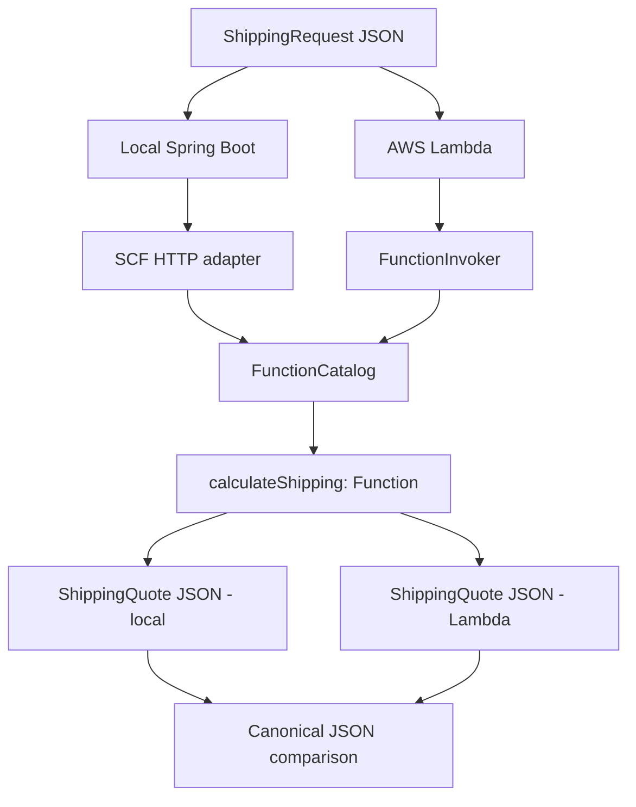

# Hands-On: Deploying Business Logic to a Serverless Adapter and Comparing Results

## 1. Lab Objectives

Spring Cloud Function (SCF) separates **business logic** from the invocation protocol. A **Function<I,O>** bean can be exposed over HTTP when running Spring Boot or invoked by a serverless adapter such as AWS Lambda. When switching adapters, you keep the function and data contract intact; initialization, packaging, routing, access permissions, timeouts, retries, and operational observability change according to the platform.

In this lab, you will deploy a shipping-quote function:

- Receive a **ShippingRequest** containing destination, weight, and express-delivery flag.
- Calculate the fee using a deterministic rule with no external service calls.
- Return a **ShippingQuote** as JSON.
- Run the same function via the SCF HTTP adapter locally.
- Package and deploy the same function via the **AWS Lambda adapter**.
- Send the exact same JSON event to both environments and compare the outputs.
- Observe cold starts, warm invocations, errors, IAM permissions, and retry semantics.

### Testing Diagram



### Completion Criteria

| Code | Requirement | Evidence |
| --- | --- | --- |
| LAB-01 | Pure business function independent of AWS | **Function<ShippingRequest, ShippingQuote>** |
| LAB-02 | Local HTTP invokes the function | POST **/functions/calculateShipping** |
| LAB-03 | AWS Lambda invokes the same function | **FunctionInvoker** handler |
| LAB-04 | Identical event produces identical business output | Normalized JSON comparison |
| LAB-05 | No business code changes needed to switch adapters | Same source revision and function bean |
| LAB-06 | Knows how to select a function when multiple beans exist | **spring_cloud_function_definition** |
| LAB-07 | Reads Lambda logs and metrics | CloudWatch **REPORT**, **Init Duration**, **Duration** |
| LAB-08 | Distinguishes function errors from caller/event-source retries | Direct test and event-source analysis |
| LAB-09 | Least-privilege permissions and resource cleanup process | IAM role, SAM stack, cleanup |

**Scope:** the lab uses AWS Lambda Java 21 and direct invocation via AWS CLI. API Gateway, SQS, and S3 are not required to complete it. When attaching API Gateway or an event source, payload shapes and retry contracts differ; the end of the lesson shows how to extend it.

## 2. Environment Setup

### 2.1. Required Tools

- JDK 17 or higher; the Lambda runtime in this example is Java 21.
- Maven 3.9+ or Maven Wrapper.
- AWS CLI v2 with configured profile/credentials.
- AWS SAM CLI for template-based deployment.
- An AWS account and region permitted to create Lambda functions.
- **curl** and **jq** for local invocation, JSON normalization, and comparison.

Verify tools:

```bash
java -version
mvn -version
aws --version
sam --version
aws sts get-caller-identity
```

The last command confirms which identity AWS CLI is using. Never share outputs containing account IDs or organization details in public documentation.

### 2.2. Choosing a Release Train

Spring Boot, Spring Cloud, and Spring Cloud Function must belong to compatible versions. Use the Spring Cloud BOM to manage dependencies; never pin arbitrary versions on **spring-cloud-function-adapter-aws** or **spring-cloud-starter-function-web**.

Before deploying, check:

1. Your project's Spring Boot parent version.
2. The matching Spring Cloud release train.
3. The SCF AWS adapter version in the BOM.
4. Java runtimes supported by AWS Lambda.
5. The official AWS sample POM for the exact SCF line you are using.

Spring Cloud Function documentation currently targets Lambda Java 21 and **FunctionInvoker**. If your organization standardizes on a different runtime, check the compatibility matrix and runtime support before switching.

## 3. Designing the Shared Data Contract

### 3.1. Input Event

Create **event.json**:

```json
{
  "destination": "HCMC",
  "weightKg": 2.5,
  "express": true
}
```

This is the function's **business payload**. It contains no API Gateway proxy envelope, SQS Records, or S3 notification wrapper.

### 3.2. Pricing Rules

To enable exact comparison between the two adapters, the function applies deterministic rules:

- Destinations **HCMC**, **HANOI**, or **DANANG**: base fee 18,000 VND.
- Other destinations: base fee 30,000 VND.
- Weight component: 6,500 VND per kg.
- Express delivery: 12,000 VND surcharge.
- Weight must be greater than 0 and not exceed 30 kg.
- Destination is trimmed and uppercased.

For the sample event, the expected fee is:

\[
18,000 + (2.5 \times 6,500) + 12,000 = 46,250\ \text{VND}
\]

This is a simulated rule set for the lab, not a real shipping tariff.

### 3.3. DTOs

Create **src/main/java/demo/ShippingRequest.java**:

```java
package demo;

import java.math.BigDecimal;

public record ShippingRequest(
        String destination,
        BigDecimal weightKg,
        boolean express) {}
```

Create **src/main/java/demo/ShippingQuote.java**:

```java
package demo;

import java.math.BigDecimal;

public record ShippingQuote(
        String destination,
        BigDecimal weightKg,
        String serviceLevel,
        BigDecimal totalFeeVnd,
        String currency,
        String ruleVersion) {}
```

Keep DTOs in the shared business package. They must not depend on **com.amazonaws.***, API Gateway, SQS, or Lambda context classes.

## 4. Writing a Single Business Function

Create **src/main/java/demo/ShippingFunctionApplication.java**:

```java
package demo;

import java.math.BigDecimal;
import java.math.RoundingMode;
import java.util.Locale;
import java.util.Set;
import java.util.function.Function;

import org.springframework.boot.SpringApplication;
import org.springframework.boot.autoconfigure.SpringBootApplication;
import org.springframework.context.annotation.Bean;

@SpringBootApplication
public class ShippingFunctionApplication {

    private static final Set<String> INNER_CITIES =
            Set.of("HCMC", "HANOI", "DANANG");

    public static void main(String[] args) {
        SpringApplication.run(
                ShippingFunctionApplication.class, args);
    }

    @Bean
    public Function<ShippingRequest, ShippingQuote> calculateShipping() {
        return request -> {
            validate(request);

            String destination = request.destination()
                    .trim()
                    .toUpperCase(Locale.ROOT);

            BigDecimal baseFee = INNER_CITIES.contains(destination)
                    ? new BigDecimal("18000.00")
                    : new BigDecimal("30000.00");

            BigDecimal weightFee = request.weightKg()
                    .multiply(new BigDecimal("6500.00"));

            BigDecimal expressFee = request.express()
                    ? new BigDecimal("12000.00")
                    : BigDecimal.ZERO;

            BigDecimal total = baseFee
                    .add(weightFee)
                    .add(expressFee)
                    .setScale(2, RoundingMode.HALF_UP);

            return new ShippingQuote(
                    destination,
                    request.weightKg(),
                    request.express() ? "EXPRESS" : "STANDARD",
                    total,
                    "VND",
                    "shipping-v1");
        };
    }

    private static void validate(ShippingRequest request) {
        if (request == null
                || request.destination() == null
                || request.destination().isBlank()
                || request.weightKg() == null
                || request.weightKg().compareTo(BigDecimal.ZERO) <= 0
                || request.weightKg().compareTo(
                        new BigDecimal("30.00")) > 0) {
            throw new IllegalArgumentException(
                    "Destination and weight between 0 and 30 kg are required");
        }
    }
}
```

### 4.1. Why Does the Function Not Know Where It Is Running?

The function only accepts **ShippingRequest** and returns **ShippingQuote**. It does not:

- Read **APIGatewayProxyRequestEvent**.
- Fetch AWS credentials.
- Start an HTTP server itself.
- Read Lambda environment variables.
- Call **Context.getAwsRequestId()**.
- Decide retry or acknowledgment behavior itself.

The adapter receives the event, converts data into the Java type declared by the function, invokes the function, and transforms the result into the runtime's expected output. That is what enables business code to run unchanged in another environment.

### 4.2. Why Use BigDecimal?

Shipping fees are monetary amounts. **BigDecimal** avoids binary floating-point representation errors common with **double**. Use string-based constructors for monetary constants and specify explicit scale and rounding so results remain consistent across runs.

## 5. Configuring Two Adapters for the Same Source Code

### 5.1. Shared Dependencies

In **pom.xml**, the shared dependencies section can include:

```xml
<dependencies>
    <dependency>
        <groupId>org.springframework.boot</groupId>
        <artifactId>spring-boot-starter</artifactId>
    </dependency>

    <dependency>
        <groupId>org.springframework.cloud</groupId>
        <artifactId>spring-cloud-function-context</artifactId>
    </dependency>

    <dependency>
        <groupId>org.springframework.boot</groupId>
        <artifactId>spring-boot-starter-test</artifactId>
        <scope>test</scope>
    </dependency>
</dependencies>
```

Declare the Spring Boot parent and Spring Cloud BOM at the top of the POM according to your project's release train.

### 5.2. Profiles for Local HTTP and AWS Lambda

Local execution requires the SCF web adapter; Lambda requires the SCF AWS adapter. Maven profiles keep both adapters from being bundled into the same runtime artifact.

```xml
<profiles>
    <profile>
        <id>local</id>
        <activation>
            <activeByDefault>true</activeByDefault>
        </activation>
        <dependencies>
            <dependency>
                <groupId>org.springframework.cloud</groupId>
                <artifactId>spring-cloud-starter-function-web</artifactId>
            </dependency>
        </dependencies>
    </profile>

    <profile>
        <id>aws</id>
        <dependencies>
            <dependency>
                <groupId>org.springframework.cloud</groupId>
                <artifactId>spring-cloud-function-adapter-aws</artifactId>
            </dependency>
        </dependencies>
    </profile>
</profiles>
```

When activating the **aws** profile, Maven does not automatically activate the **local** profile marked with **activeByDefault**. That keeps the local web adapter out of the Lambda artifact.

**AWS packaging requires extra configuration:** Lambda needs a shaded deployment JAR that preserves Spring metadata. Spring Cloud Function provides an official Maven sample producing an artifact with classifier **aws**; copy the matching **maven-shade-plugin**, resource transformers, and thin-layout configuration from the sample for your exact release train. Never upload an ordinary Spring Boot executable JAR in place of a shaded Lambda JAR. The JAR layout is part of the adapter, not merely a filename convention.

Reference sample: [Spring Cloud Function AWS sample](https://github.com/spring-cloud/spring-cloud-function/tree/main/spring-cloud-function-samples/function-sample-aws).

### 5.3. Local Configuration

Create **src/main/resources/application.properties**:

```properties
spring.application.name=shipping-function
server.port=8080

spring.cloud.function.web.path=/functions
```

With a single function, the HTTP adapter exposes it by function name on the path. The lab's URL is:

**POST http://localhost:8080/functions/calculateShipping**

Because the lab has only one function, you do not need to set **spring.cloud.function.definition** locally. When a project has multiple functions, that property can specify which functions or compositions are mapped at the root path; semicolons list multiple functions, while pipes compose functions sequentially.

### 5.4. Lambda Configuration

When running on AWS Lambda, the adapter uses **FunctionInvoker**. The property selecting the function can be supplied via an environment variable:

**spring_cloud_function_definition=calculateShipping**

The environment variable uses underscores in place of the dots in **spring.cloud.function.definition**. Explicitly declaring the function avoids ambiguity if additional **Function**, **Consumer**, or **Supplier** beans are added later.

## 6. Running and Testing the Local HTTP Adapter

### 6.1. Starting the App

In the project directory:

```bash
mvn -Plocal spring-boot:run
```

Verify the application is listening on port 8080.

### 6.2. Invoking the Function over HTTP

With the **event.json** file created earlier:

```bash
curl -sS \
  -X POST 'http://localhost:8080/functions/calculateShipping' \
  -H 'Content-Type: application/json' \
  -H 'Accept: application/json' \
  --data-binary @event.json \
  -o local-result.json
```

View the result:

```bash
cat local-result.json
```

Expected business output:

```json
{
  "destination": "HCMC",
  "weightKg": 2.5,
  "serviceLevel": "EXPRESS",
  "totalFeeVnd": 46250.00,
  "currency": "VND",
  "ruleVersion": "shipping-v1"
}
```

Field order and JSON whitespace may vary, but values must be equivalent. Keep **local-result.json** for the comparison step.

### 6.3. Testing the Function Directly via FunctionCatalog

You can add a JUnit test to confirm Spring registers the function:

Create **src/test/java/demo/ShippingFunctionTest.java**:

```java
package demo;

import java.math.BigDecimal;
import java.util.function.Function;

import org.junit.jupiter.api.Test;
import org.springframework.beans.factory.annotation.Autowired;
import org.springframework.boot.test.context.SpringBootTest;
import org.springframework.cloud.function.context.FunctionCatalog;

import static org.junit.jupiter.api.Assertions.assertEquals;
import static org.junit.jupiter.api.Assertions.assertNotNull;

@SpringBootTest
class ShippingFunctionTest {

    @Autowired
    FunctionCatalog catalog;

    @Test
    void calculatesExpectedQuote() {
        Function<ShippingRequest, ShippingQuote> function =
                catalog.lookup(Function.class, "calculateShipping");

        assertNotNull(function);

        ShippingQuote quote = function.apply(
                new ShippingRequest(
                        "HCMC",
                        new BigDecimal("2.5"),
                        true));

        assertEquals("HCMC", quote.destination());
        assertEquals(
                new BigDecimal("46250.00"),
                quote.totalFeeVnd());
        assertEquals("EXPRESS", quote.serviceLevel());
    }
}
```

Run the test:

```bash
mvn -Plocal -Dtest=ShippingFunctionTest test
```

This test verifies the function in the Spring context and its business output. It does not yet prove the HTTP adapter or Lambda adapter works; those two invocation paths must be tested separately.

## 7. Packaging for AWS Lambda

### 7.1. Adding the AWS Adapter

The **aws** profile requires the dependency:

```xml
<dependency>
    <groupId>org.springframework.cloud</groupId>
    <artifactId>spring-cloud-function-adapter-aws</artifactId>
</dependency>
```

**FunctionInvoker** is the generic Lambda handler provided by Spring Cloud Function. It implements AWS's request stream handler and converts the input stream into the function's declared input type. For **Function<ShippingRequest, ShippingQuote>**, the adapter attempts to convert input JSON into **ShippingRequest** and serialize **ShippingQuote** to output.

### 7.2. Building the Lambda Deployment Artifact

Use the build configuration from the official AWS sample and run:

```bash
mvn -Paws clean package
```

With the Maven sample producing classifier **aws**, the artifact typically looks like:

```text
target/
  shipping-function-0.0.1-SNAPSHOT-aws.jar
```

The actual filename depends on **artifactId**, **version**, and POM configuration. Verify the file exists before deploying.

Things to verify in the JAR:

- **org/springframework/cloud/function/adapter/aws/FunctionInvoker.class** is present.
- The manifest contains **Start-Class** pointing to **ShippingFunctionApplication**, or **MAIN_CLASS** is configured if the project lacks **Start-Class**.
- Spring metadata resources were properly merged during shading.
- The AWS artifact does not pull in unnecessary web/stream adapters.
- The package size fits within Lambda deployment limits.

**Never just rename a file:** a JAR missing dependencies or stripped of Spring metadata may build cleanly yet fail when Lambda initializes the Spring context.

### 7.3. Inspecting the Artifact

Use the JDK **jar** tool:

```bash
jar tf target/shipping-function-0.0.1-SNAPSHOT-aws.jar
```

Look for key classes and resources in the output. You can inspect the manifest:

```bash
jar xf target/shipping-function-0.0.1-SNAPSHOT-aws.jar META-INF/MANIFEST.MF
cat META-INF/MANIFEST.MF
```

If **Start-Class** is missing, configure **MAIN_CLASS** per the SCF AWS adapter guide. Do not guess the main class from the artifact name.

## 8. Creating the Lambda with AWS SAM

### 8.1. Deployment Template

Create **template.yaml** at the project root:

```yaml
AWSTemplateFormatVersion: '2010-09-09'
Transform: AWS::Serverless-2016-10-31
Description: Spring Cloud Function shipping quote lab

Resources:
  ShippingQuoteFunction:
    Type: AWS::Serverless::Function
    Properties:
      FunctionName: scf-shipping-quote-lab
      Runtime: java21
      Handler: org.springframework.cloud.function.adapter.aws.FunctionInvoker
      CodeUri: target/shipping-function-0.0.1-SNAPSHOT-aws.jar
      MemorySize: 1024
      Timeout: 15
      Architectures:
        - x86_64
      Environment:
        Variables:
          spring_cloud_function_definition: calculateShipping
      Policies:
        - AWSLambdaBasicExecutionRole
```

These settings are starting values for the lab, not optimal for every workload:

- **Runtime:** Java 21.
- **Handler:** `FunctionInvoker`.
- **MemorySize:** 1024 MB, tunable after measurement.
- **Timeout:** 15 seconds, which should match your actual latency budget.
- **AWSLambdaBasicExecutionRole:** basic permissions to write CloudWatch Logs.
- **spring_cloud_function_definition:** selects the business function.

The function does not call S3, DynamoDB, or other AWS services, so the execution role needs no extra permissions for those services. If business logic later accesses AWS resources, grant only the specific actions and resources needed—never attach **AdministratorAccess**.

### 8.2. Build and Deploy

After Maven builds the artifact:

```bash
sam build --template-file template.yaml
sam deploy --guided
```

During guided deployment:

1. Select the AWS profile and region.
2. Name the CloudFormation stack.
3. Confirm the IAM permissions SAM needs to create.
4. Review the template changeset before deploying.
5. Save the deployment configuration according to your team's workflow.

SAM creates the Lambda function and execution role defined in the template. Note the function name, region, and stack name for testing and cleanup.

### 8.3. Verifying Configuration After Deployment

```bash
aws lambda get-function-configuration \
  --function-name scf-shipping-quote-lab
```

Verify the fields:

- **State** is `Active`.
- **Runtime** is `java21`.
- **Handler** points to `FunctionInvoker`.
- **Timeout** and **MemorySize** match your configuration.
- Environment variables include **spring_cloud_function_definition=calculateShipping**.
- The role is the stack's execution role with only required permissions.

## 9. Sending the Same Event to AWS Lambda

### 9.1. Direct Invocation

Use the exact **event.json** sent to local HTTP:

```bash
aws lambda invoke \
  --function-name scf-shipping-quote-lab \
  --invocation-type RequestResponse \
  --payload fileb://event.json \
  lambda-result.json
```

AWS CLI prints invocation metadata to the terminal; the function's output is written to **lambda-result.json**.

Read the response:

```bash
cat lambda-result.json
```

The expected business result has identical values:

```json
{
  "destination": "HCMC",
  "weightKg": 2.5,
  "serviceLevel": "EXPRESS",
  "totalFeeVnd": 46250.00,
  "currency": "VND",
  "ruleVersion": "shipping-v1"
}
```

If the invocation fails, inspect **FunctionError** in the metadata, the response file, and CloudWatch Logs. With direct Lambda calls, do not assume the output is always wrapped in an HTTP response envelope.

### 9.2. Comparing Canonicalized JSON

Use **jq** to sort fields before diffing:

```bash
jq -S . local-result.json > local-canonical.json
jq -S . lambda-result.json > lambda-canonical.json
diff -u local-canonical.json lambda-canonical.json
```

If **diff** prints no output and exits with code 0, both normalized JSON files are identical.

On PowerShell, you can parse and re-serialize:

```powershell
$local = Get-Content -Raw local-result.json | ConvertFrom-Json
$lambda = Get-Content -Raw lambda-result.json | ConvertFrom-Json

$localJson = $local | ConvertTo-Json -Depth 20 -Compress
$lambdaJson = $lambda | ConvertTo-Json -Depth 20 -Compress

$localJson
$lambdaJson
```

Compare field values in the PowerShell output; for automated diffing, write both canonical strings to files and run a diff tool.

### 9.3. Comparison Table

| Aspect | Local HTTP | AWS Lambda |
| --- | --- | --- |
| Input | JSON request body | JSON invocation payload |
| Entry point | SCF web adapter | `FunctionInvoker` |
| Function lookup | `FunctionCatalog` | `FunctionCatalog` via `FunctionInvoker` |
| Business function | `calculateShipping` | `calculateShipping` |
| Input conversion | HTTP message converter | Lambda adapter input conversion |
| Output | HTTP response body | Lambda invocation result |
| Runtime | Local JVM | JVM inside Lambda execution environment |
| Scaling | By server/process | By Lambda concurrency |
| Startup | Spring Boot process startup | Execution environment cold initialization |
| Retries | Client/gateway policy | Caller, async invocation, or event-source policy |

**Fair comparison conditions:** same source revision, same business payload, same rule version, and no external data changes between calls. If Lambda uses different environment variables or configuration, record those alongside the results.

## 10. Moving the Same Function to Other Event Sources

This lab uses direct Lambda invocation so the payload is simply **ShippingRequest**. When Lambda is triggered by another AWS service, the payload may be wrapped in a service-specific event envelope.

For example:

- API Gateway sends an HTTP proxy event with headers, path, and body.
- S3 sends an **S3Event** containing bucket/object records.
- SQS sends an **SQSEvent** containing a batch of records.
- Kinesis delivers records by batch/shard.

If the function declares **ShippingRequest** as input, do not assume an **SQSEvent** or API Gateway proxy event will automatically turn into **ShippingRequest**. Choose one of two approaches:

1. Write an adapter/normalizer that accepts the specific event and translates it into the business DTO.
2. Declare a function accepting the corresponding AWS event type if business logic genuinely needs service-specific metadata.

For S3 or SQS, the Spring Cloud Function AWS adapter supports functions with the corresponding input types:

```java
@Bean
public Function<S3Event, String> processUpload() {
    return event -> {
        // Convert the event into a business command.
        return "received";
    };
}
```

```java
@Bean
public Function<SQSEvent, SQSBatchResponse> processBatch() {
    return event -> processRecordsAndBuildBatchResponse(event);
}
```

In the SQS example, **processRecordsAndBuildBatchResponse** is an application helper: it processes each record and constructs an **SQSBatchResponse** listing failed items per the Lambda contract. These examples require a compatible version of **aws-lambda-java-events**. Do not add AWS event dependencies to your core business module if the core logic does not need AWS details.

## 11. Comparing Error and Retry Semantics

### 11.1. Validation Errors

Try sending an invalid event:

```json
{
  "destination": "HCMC",
  "weightKg": 0,
  "express": true
}
```

Over HTTP, the exception may be translated into an HTTP error by the web runtime. On Lambda, the function error is returned to the invoker and reflected in Lambda metadata/responses. The two adapters do not necessarily produce the same status code or error envelope.

The business contract must agree on:

- Which inputs are valid?
- What schema does a success output follow?
- What business error codes do validation failures carry?
- Should clients or event producers retry this error?
- How are transient and permanent errors distinguished?

If you need a uniform error schema across multiple adapters, define an error model and perform mapping at each adapter boundary. Never force the business function to depend on HTTP status codes or Lambda exception wrappers.

### 11.2. Direct Invoke Does Not Automatically Retry Function Errors

With synchronous direct Lambda invocation, the caller is responsible for deciding whether to retry. If retried, the function may have run completely, partially, or not at all; side effects must therefore be designed to be idempotent.

With asynchronous invocation, Lambda retries function errors twice by default. With event source mappings from queues or streams, retry/redelivery depends on source type, batching, visibility timeout, offsets, and redrive policies. API Gateway typically returns errors synchronously to the caller rather than applying async invocation retry policies.

Never apply direct-invoke retry assumptions to SQS, Kinesis, or async invocations.

### 11.3. Pure Functions vs. Side Effects

**calculateShipping** only computes a quote and does not write to a database, send emails, or charge payments. Hence, the same input always yields the same quote in this lab.

If you replace the function with logic that has side effects:

- Use a stable idempotency key for the same operation.
- Persist the key and result durably in a shared store or database.
- Use unique constraints to block duplicate claims.
- Ensure retries after commit return the stored result.
- For events, acknowledge only after required state has committed.
- Use outbox/reconciliation patterns when coordinating a database and external systems.

Memory inside a Lambda execution environment may persist across warm invocations, but it is not a durable state store. Multiple execution environments hold separate state and can be recycled at any moment.

## 12. Observing Cold Starts, Warm Invocations, and Cost

### 12.1. Reading CloudWatch REPORT

Lambda writes runtime logs to CloudWatch Logs. For Java, the **REPORT** line may include:

- **Duration:** handler execution time.
- **Billed Duration:** billed time slice.
- **Memory Size:** allocated memory.
- **Max Memory Used:** peak memory usage observed.
- **Init Duration:** runtime/application initialization time on cold starts.
- **RequestId:** invocation identifier.

Format illustration only, **not actual lab measurements**:

```text
REPORT RequestId: abc...
Duration: 84.12 ms
Billed Duration: 700 ms
Memory Size: 1024 MB
Max Memory Used: 180 MB
Init Duration: 615.30 ms
```

View logs:

```bash
aws logs tail /aws/lambda/scf-shipping-quote-lab \
  --since 1h \
  --follow
```

If the log group does not appear yet, verify that the function has been invoked and the execution role has permissions to write logs.

### 12.2. Comparing First Invocation and Warm Invocations

Invoke multiple times:

```bash
for n in 1 2 3 4 5; do
  aws lambda invoke \
    --function-name scf-shipping-quote-lab \
    --payload fileb://event.json \
    "lambda-result-$n.json"
done
```

Then inspect **REPORT** lines in CloudWatch:

| Metric | Meaning |
| --- | --- |
| Init Duration | Initialization cost of a fresh execution environment |
| Duration | Handler execution duration |
| Billed Duration | Billed duration unit |
| Max Memory Used | Peak memory consumption observed |
| Local curl `time_total` | Client-observed local duration including network/HTTP adapter |

There is no guarantee five calls reuse the exact same execution environment. Lambda may spin up additional environments under concurrency or reuse a warm one. An invocation lacking **Init Duration** in its log does not prove the function is cold-start-free under all workloads.

### 12.3. Comparing Latency Properly

| Measurement | Includes | Excludes |
| --- | --- | --- |
| Local curl `time_total` | HTTP client, loopback network, adapter, and function | AWS provisioning/cold start |
| Lambda Duration | Handler execution | Client round-trip from user's machine |
| Lambda Init Duration | Runtime/application initialization | Full client wait time |
| Lambda Billed Duration | Billed duration increment | Not end-to-end latency |
| API Gateway latency | Gateway and request path metrics | Not solely the business function |

To evaluate performance:

1. Run multiple local iterations under identical conditions.
2. Invoke Lambda enough times to observe both init and warm executions.
3. Record **Duration**, **Init Duration**, memory, and request counts.
4. Compare p50/p95/p99 on the same workload.
5. Test multiple memory and concurrency settings.
6. Explicitly note whether cold start, provisioned concurrency, or SnapStart was enabled.

Never compare a single **curl `time_total`** number against a single **Duration** line and declare one adapter faster; the two measurements cover different scopes.

### 12.4. Optimizing Once You Have Measurements

Options to explore:

- Reduce work during Spring initialization and **@PostConstruct**.
- Avoid opening unnecessary remote connections during startup.
- Initialize reusable clients at execution-environment scope when appropriate.
- Tune memory to balance CPU allocation, latency, and cost.
- Evaluate SnapStart or provisioned concurrency based on traffic patterns.
- Consider native images/custom runtimes when measured gains justify operational complexity.

Never optimize on intuition alone. Re-measure every runtime or packaging change against the same workload.

## 13. Permissions and Security in Serverless Deployments

Distinguish two types of permissions:

- **Execution role:** permissions used by code inside Lambda to write logs or access AWS resources.
- **Invoke permission:** permissions granting a user or another service the right to invoke the Lambda.

This lab needs only basic CloudWatch Logs permissions. If the function accesses S3 or DynamoDB, grant exact actions on exact resource ARNs. To let API Gateway, SQS, or S3 invoke the function, configure the corresponding resource-based policy or event source mapping.

Never:

- Attach **AdministratorAccess** to the execution role.
- Hardcode static access keys in source code.
- Put secrets inside committed **application.properties** files.
- Expose side-effecting functions publicly without authorization and rate limiting.
- Log sensitive payloads to CloudWatch Logs.

When secrets are required, use AWS Secrets Manager or an organization-approved secret store; environment variables should not become a dumping ground for arbitrary credentials.

## 14. Release, Rollback, and Resource Cleanup

### 14.1. Before Shifting Traffic

- [ ] Build the AWS artifact using the right profile.
- [ ] Verify **FunctionInvoker** and **Start-Class**.
- [ ] Verify runtime, handler, memory, and timeout.
- [ ] Verify the environment variable selects the intended function.
- [ ] Verify the execution role holds only required permissions.
- [ ] Confirm direct invocation with the sample event returns the expected result.
- [ ] Confirm validation-error events are handled properly.
- [ ] Confirm CloudWatch Logs receives logs.
- [ ] Confirm local and Lambda canonical JSON comparisons match.
- [ ] Verify retries/idempotency if the function has side effects.

### 14.2. Rollback

In production, use published Lambda versions and aliases for controlled traffic shifting. Retain the previous stable version, monitor error rates and latency after release, and point the alias back to the old version if issues arise.

Never overwrite a function serving live traffic with an un-smoketested artifact. Record artifact versions, commit SHAs, and deployed templates so releases are reproducible.

### 14.3. Cleaning Up the Lab

After finishing and saving results, delete the SAM stack:

```bash
sam delete --stack-name <stack-name> --region <region>
```

Replace **<stack-name>** and **<region>** with the actual values used during deployment. Confirm the stack and lab Lambda have been deleted; avoid accidentally deleting shared account resources.

## 15. Runbook When Local and Lambda Results Differ

| Symptom | What to Check |
| --- | --- |
| Local works, Lambda fails to start | Handler, runtime, shaded JAR, `Start-Class`, Spring metadata |
| `FunctionInvoker` cannot find function | `spring_cloud_function_definition`, bean name, function catalog |
| Lambda receives `Map` instead of DTO | Generic type declaration, event JSON shape, converter |
| Local URL returns 404 | `spring.cloud.function.web.path`, function name, web adapter dependency |
| Lambda returns `FunctionError` | CloudWatch stack trace, validation, conversion, dependencies |
| JSON outputs differ | Actual input, environment/config, decimal scale, rule version |
| First invoke is slow | `Init Duration`, Spring startup, classpath, and initialization |
| Warm invoke is still slow | `Duration`, CPU/memory, downstream dependencies |
| Retries create duplicates | Idempotency key, shared store, transaction, and retry source |
| Fails only on SQS/S3 trigger | Event schema, batch semantics, permissions, retry/DLQ |

### 15.1. Lambda Cannot Find the Function

Check:

1. Is there one function bean or multiple beans?
2. Is the **@Bean** method named **calculateShipping**?
3. Is the environment variable spelled **spring_cloud_function_definition**?
4. Are there stray characters or whitespace in the value?
5. Was the artifact built from the expected commit?
6. Does **Start-Class** point to **ShippingFunctionApplication**?

### 15.2. Lambda Fails to Convert JSON into the DTO

Verify the payload is pure business JSON:

```json
{
  "destination": "HCMC",
  "weightKg": 2.5,
  "express": true
}
```

If you send an API Gateway proxy event or SQS event, the function receives a different event shape. Declare the matching input type or add an adapter that translates the event into the business command.

### 15.3. Lambda Errors While Local Works

Compare:

- Local JDK vs. Lambda Java runtime.
- Any dependency missing from the shaded JAR?
- Were any Spring resources overwritten during shading?
- Does code read files from the local working directory that do not exist on Lambda?
- Does it depend on unconfigured local environment variables?
- Does it call networks/services unreachable from the Lambda role or VPC?

Never grant broad IAM permissions to mask a configuration bug. Identify the exact missing resource and action and apply the minimal policy.

## 16. Extension Exercises

1. Add a **normalizeDestination** function and compose it with **calculateShipping** in `FunctionCatalog`.
2. Run the composition through both the HTTP adapter and Lambda with identical inputs.
3. Change the function to **Function<Message<ShippingRequest>, Message<ShippingQuote>>**; verify how headers propagate over HTTP.
4. Write a function accepting **S3Event** and converting object metadata into a business command.
5. Write a consumer processing **SQSEvent** and returning a partial batch response when specific records fail.
6. Resend the same event ID twice and prove the consumer produces no duplicate side effects.
7. Use PostgreSQL or DynamoDB to persist idempotency keys durably.
8. Simulate a Lambda crash after database commit and before event acknowledgment.
9. Create an API Gateway endpoint and distinguish API Gateway proxy events from direct invocation payloads.
10. Benchmark cold/warm starts across multiple memory settings.
11. Enable SnapStart or provisioned concurrency in a test environment and compare **Init Duration**.
12. Use Lambda aliases for canary releases and rollbacks.
13. Write a contract test ensuring the **ShippingQuote** schema stays identical between local and Lambda.
14. Build a CI pipeline that produces both artifacts from the same source revision, runs local HTTP smoke tests, and deploys to an integration environment.

## Official References

- [Spring Cloud Function — AWS Lambda Adapter](https://docs.spring.io/spring-cloud-function/reference/adapters/aws-intro.html): `spring-cloud-function-adapter-aws` dependency, `FunctionInvoker`, packaging, routing, and deployment.
- [Spring Cloud Function — Standalone Web Applications](https://docs.spring.io/spring-cloud-function/reference/spring-cloud-function/standalone-web-applications.html): HTTP function mapping, `spring.cloud.function.web.path`, composition, and filtering.
- [Spring Cloud Function — Official AWS Sample](https://github.com/spring-cloud/spring-cloud-function/tree/main/spring-cloud-function-samples/function-sample-aws): Maven build and AWS deployment artifact.
- [AWS Lambda — Building Java Functions](https://docs.aws.amazon.com/lambda/latest/dg/lambda-java.html): Java runtime, handler, deployment package, and context.
- [AWS Lambda — Retry Behavior](https://docs.aws.amazon.com/lambda/latest/dg/invocation-retries.html): direct, asynchronous, and event-source retry semantics.
- [AWS Lambda — Environment Variables](https://docs.aws.amazon.com/lambda/latest/dg/configuration-envvars.html): runtime environment variables and configuration.
- [AWS Lambda — Java Logging](https://docs.aws.amazon.com/lambda/latest/dg/java-logging.html): CloudWatch Logs and `REPORT` fields.
- [AWS SAM — Deploy Serverless Applications](https://docs.aws.amazon.com/serverless-application-model/latest/developerguide/serverless-deploying.html): building, deploying, and managing stacks.
- [AWS IAM — Lambda Execution Role](https://docs.aws.amazon.com/lambda/latest/dg/lambda-intro-execution-role.html): function permissions when accessing AWS resources.

> **Takeaway:** A serverless adapter changes how a function is initialized, triggered, converted, authorized, and retried. Keep the **business function platform-independent**, send **the same business payload** to both local and Lambda, compare canonicalized **business outputs**, and measure cold starts, warm durations, and error behavior separately for each adapter.
