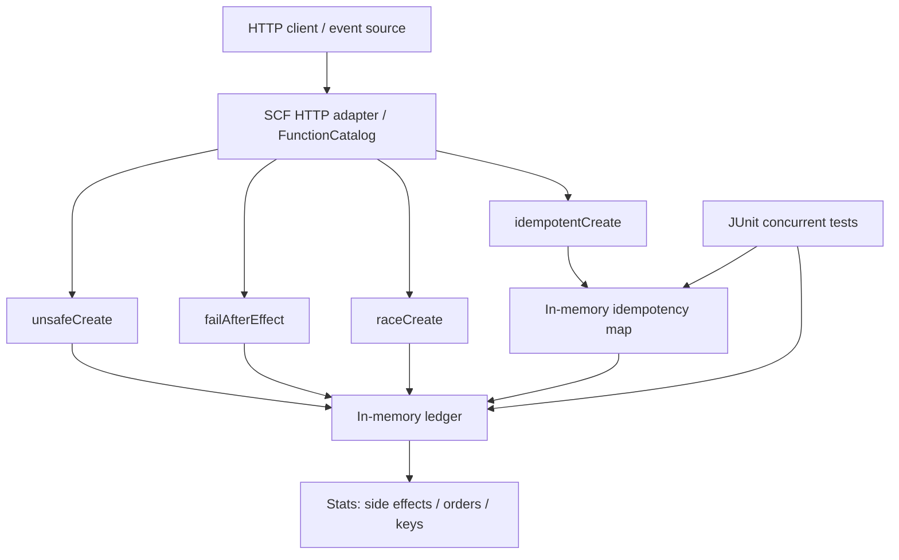

# Hands-On: Simulating Failures, Duplicate Inputs, and Concurrent Invocations in Spring Cloud Function

## 1. Lab Objectives

**Spring Cloud Function (SCF)** lets you build business logic with `Supplier<T>`, `Function<I,O>`, and `Consumer<T>`, register them in `FunctionCatalog`, and invoke them over HTTP, events, or serverless runtimes. The same function can be invoked repeatedly, concurrently by multiple requests, or across multiple adapters that each implement their own retry mechanisms.

This hands-on lab simulates three scenarios that occur frequently in real systems:

1. **Resubmitting the same request:** a client times out or a user clicks twice, causing the function to record data twice.
2. **Failure after a side effect:** the function wrote data, but returning the response failed; retrying writes another record.
3. **Race condition:** two concurrent invocations both observe "does not exist yet" and both create a record.

Next, you will implement an in-JVM deduplication version using `ConcurrentHashMap` to see concurrency controlled within **a single JVM**, write JUnit tests for concurrent scenarios, and design a production solution using idempotency keys, unique constraints, and a transactional outbox.

### Hands-On Architecture Diagram



### Expected Outcomes

| Code | Outcome | Evidence |
| --- | --- | --- |
| LAB-01 | Two `unsafe` calls with the same data create two side effects | `effectCount` increases by 2 |
| LAB-02 | Failure after writing does not mean data was not written | Retrying increments side effects again |
| LAB-03 | Check-then-act can create duplicates under concurrency | Multiple effects for the same order ID |
| LAB-04 | Same idempotency key and payload produce one effect in the JVM | Callers receive the same receipt |
| LAB-05 | Reusing a key with a different payload is rejected | Conflict; effect count does not increase |
| LAB-06 | JUnit verifies concurrency behavior | Test suite passes |
| LAB-07 | Understands in-memory limitations | Restart or scale-out loses deduplication |
| LAB-08 | Has a production design | Durable keys, transactions, outbox, and downstream dedupe |

**Scope:** the sample application uses an in-memory ledger with no real database or payment gateway. This is a learning environment running on localhost. Never expose these failure-simulation endpoints to the public Internet or use them for real orders.

## 2. Setting Up the Spring Cloud Function Project

### 2.1. Tools

- Java 17 or higher.
- Maven 3.9+ or Maven Wrapper.
- IDE or editor.
- Bash/Git Bash/WSL terminal; on PowerShell, use `curl.exe` and adjust parallel execution commands accordingly.
- A machine capable of running multiple concurrent HTTP requests.

Use a compatible Spring Boot and Spring Cloud BOM pair. Never pick individual starter versions arbitrarily. If your project already has a parent/BOM, keep the release train your project uses and add only the required dependencies.

### 2.2. Dependencies

The project needs the SCF HTTP adapter and JUnit:

```xml
<dependencies>
    <dependency>
        <groupId>org.springframework.cloud</groupId>
        <artifactId>spring-cloud-starter-function-web</artifactId>
    </dependency>

    <dependency>
        <groupId>org.springframework.boot</groupId>
        <artifactId>spring-boot-starter-test</artifactId>
        <scope>test</scope>
    </dependency>
</dependencies>
```

The versions of both dependencies are managed by the compatible Spring Boot parent and Spring Cloud BOM. Do not pin arbitrary versions directly on the starters.

### 2.3. Project Structure

Create the lab project with this layout:

```text
scf-duplicate-lab/
├── pom.xml
└── src/
    ├── main/
    │   ├── java/demo/
    │   │   ├── DuplicateLabApplication.java
    │   │   ├── OrderCommand.java
    │   │   ├── OrderReceipt.java
    │   │   ├── LedgerStats.java
    │   │   └── OrderLedger.java
    │   └── resources/
    │       └── application.properties
    └── test/
        └── java/demo/
            └── OrderLedgerTest.java
```

These files belong to the **learner-created practice project**, not this documentation module.

## 3. Defining the Payload of an Operation

An order-creation request in this lab has three fields:

- `requestId`: a stable identifier for one logical business attempt; retries of the same operation must keep the same value.
- `orderId`: the business order identifier.
- `quantity`: quantity to create.

Example:

```json
{
  "requestId": "req-100",
  "orderId": "order-42",
  "quantity": 2
}
```

Two concepts must be kept distinct:

| Identifier | Meaning | Can Differ Across Retries? |
| --- | --- | --- |
| Request/attempt ID | One specific transmission attempt, for logs and traces | Yes |
| Idempotency key / operation key | One logical business operation that must not run twice | **No** |
| Order ID | The business resource being created or updated | Per business domain |

In this lab, `requestId` acts as the idempotency key. In production, keys typically require scoping by tenant, operation type, and caller; never assume an arbitrary UUID alone suffices.

### 3.1. Why Is orderId Alone Not Enough?

A system may permit several different operations on the same order—such as creation, shipping address updates, payment capture, or refunds. Therefore, an idempotency key should identify **a command**, not merely the resource.

Conversely, if the business rule states "an `orderId` may only be created once," enforce a database unique constraint on order ID as well. Idempotency keys and unique business keys prevent two different classes of duplicates.

## 4. Writing the Application and Functional Beans

### 4.1. DuplicateLabApplication.java

Create `src/main/java/demo/DuplicateLabApplication.java`:

```java
package demo;

import java.util.function.Function;
import java.util.function.Supplier;

import org.springframework.boot.SpringApplication;
import org.springframework.boot.autoconfigure.SpringBootApplication;
import org.springframework.context.annotation.Bean;

@SpringBootApplication
public class DuplicateLabApplication {

    public static void main(String[] args) {
        SpringApplication.run(
                DuplicateLabApplication.class, args);
    }

    // Every invocation records a new side effect.
    @Bean
    public Function<OrderCommand, OrderReceipt> unsafeCreate(
            OrderLedger ledger) {
        return ledger::unsafeCreate;
    }

    // Simulates a non-atomic check-then-act.
    @Bean
    public Function<OrderCommand, OrderReceipt> raceCreate(
            OrderLedger ledger) {
        return ledger::raceCreate;
    }

    // Records side effect, then intentionally throws on the first invocation.
    @Bean
    public Function<OrderCommand, OrderReceipt> failAfterEffect(
            OrderLedger ledger) {
        return ledger::failAfterEffect;
    }

    // Deduplicates the same requestId within a single JVM.
    @Bean
    public Function<OrderCommand, OrderReceipt> idempotentCreate(
            OrderLedger ledger) {
        return ledger::idempotentCreate;
    }

    // Reads statistics to observe results.
    @Bean
    public Supplier<LedgerStats> stats(OrderLedger ledger) {
        return ledger::stats;
    }
}
```

Five beans are explicitly named so SCF can look them up via `FunctionCatalog` and the HTTP adapter. The first four are `Function` beans accepting JSON; `stats` is a `Supplier` requiring no request body.

### 4.2. Data Records

Create three public records, each in its own file in package `demo`.

`src/main/java/demo/OrderCommand.java`:

```java
package demo;

public record OrderCommand(
        String requestId, String orderId, int quantity) {}
```

`src/main/java/demo/OrderReceipt.java`:

```java
package demo;

public record OrderReceipt(
        String requestId,
        String orderId,
        int quantity,
        int effectSequence,
        String strategy) {}
```

`src/main/java/demo/LedgerStats.java`:

```java
package demo;

import java.util.List;

public record LedgerStats(
        int sideEffectCount,
        int orderCount,
        int idempotencyKeyCount,
        List<OrderReceipt> effectHistory) {}
```

`StoredRequest` is purely an internal ledger type, declared package-private inside `OrderLedger.java` in the next section.

## 5. Simulating Three Unsafe Processing Patterns

### 5.1. OrderLedger.java

Create the class in `src/main/java/demo/OrderLedger.java`:

```java
package demo;

import java.util.concurrent.ConcurrentHashMap;
import java.util.concurrent.ConcurrentLinkedQueue;
import java.util.concurrent.ConcurrentMap;
import java.util.concurrent.CountDownLatch;
import java.util.concurrent.TimeUnit;
import java.util.concurrent.atomic.AtomicBoolean;
import java.util.concurrent.atomic.AtomicInteger;

import org.springframework.stereotype.Component;

@Component
public class OrderLedger {

    private final AtomicInteger effectSequence =
            new AtomicInteger();

    // One current record per order ID.
    private final ConcurrentMap<String, OrderReceipt> orders =
            new ConcurrentHashMap<>();

    // Records every side effect that occurred, including duplicates.
    private final ConcurrentLinkedQueue<OrderReceipt> effects =
            new ConcurrentLinkedQueue<>();

    // Demo idempotency table, existing only in this JVM.
    private final ConcurrentMap<String, StoredRequest> processed =
            new ConcurrentHashMap<>();

    // Each order ID gets a dedicated race window for this lab.
    private final ConcurrentMap<String, CountDownLatch> raceWindows =
            new ConcurrentHashMap<>();

    // Only the first failAfterEffect invocation fails after recording.
    private final AtomicBoolean failFirstAfterEffect =
            new AtomicBoolean(true);

    public OrderReceipt unsafeCreate(OrderCommand command) {
        validate(command);
        return recordSideEffect(command, "UNSAFE");
    }

    public OrderReceipt raceCreate(OrderCommand command) {
        validate(command);

        OrderReceipt existing = orders.get(command.orderId());
        if (existing != null) {
            return existing;
        }

        // Wait for up to 8 invocations with the same order ID to reach the race window.
        // If fewer than 8 arrive within 1000 ms, waiting invocations proceed anyway.
        CountDownLatch window = raceWindows.computeIfAbsent(
                command.orderId(), ignored -> new CountDownLatch(8));
        window.countDown();
        try {
            window.await(1000, TimeUnit.MILLISECONDS);
        }
        catch (InterruptedException exception) {
            Thread.currentThread().interrupt();
            throw new IllegalStateException(
                    "Interrupted during race demonstration", exception);
        }

        // Two threads can both reach here and both create a side effect.
        return recordSideEffect(command, "RACE");
    }

    public OrderReceipt failAfterEffect(OrderCommand command) {
        validate(command);

        // Side effect occurs before the function returns a response.
        OrderReceipt receipt =
                recordSideEffect(command, "FAIL_AFTER_EFFECT");

        if (failFirstAfterEffect.compareAndSet(true, false)) {
            throw new SimulatedFailureException(
                    "Simulated response failure after side effect");
        }

        return receipt;
    }

    public OrderReceipt idempotentCreate(OrderCommand command) {
        validate(command);

        StoredRequest stored = processed.compute(
                command.requestId(),
                (key, existing) -> {

                    if (existing != null) {
                        if (!existing.command().equals(command)) {
                            throw new IdempotencyConflictException(
                                    "Same requestId used with different payload");
                        }
                        return existing;
                    }

                    // In this demo, this only writes to local memory.
                    OrderReceipt receipt =
                            recordSideEffect(command, "IDEMPOTENT");

                    return new StoredRequest(command, receipt);
                });

        return stored.receipt();
    }

    private OrderReceipt recordSideEffect(
            OrderCommand command, String strategy) {

        int sequence = effectSequence.incrementAndGet();

        OrderReceipt receipt = new OrderReceipt(
                command.requestId(),
                command.orderId(),
                command.quantity(),
                sequence,
                strategy);

        effects.add(receipt);
        orders.put(command.orderId(), receipt);

        System.out.printf(
                "SIDE_EFFECT sequence=%d requestId=%s orderId=%s strategy=%s%n",
                sequence,
                command.requestId(),
                command.orderId(),
                strategy);

        return receipt;
    }

    public LedgerStats stats() {
        return new LedgerStats(
                effectSequence.get(),
                orders.size(),
                processed.size(),
                java.util.List.copyOf(effects));
    }

    private static void validate(OrderCommand command) {
        if (command == null
                || command.requestId() == null
                || command.requestId().isBlank()
                || command.orderId() == null
                || command.orderId().isBlank()
                || command.quantity() <= 0) {
            throw new IllegalArgumentException(
                    "requestId, orderId and positive quantity are required");
        }
    }

    public int effectCount() {
        return effectSequence.get();
    }

    public int orderCount() {
        return orders.size();
    }

    public int idempotencyKeyCount() {
        return processed.size();
    }
}

record StoredRequest(
        OrderCommand command,
        OrderReceipt receipt) {}

class SimulatedFailureException extends RuntimeException {
    SimulatedFailureException(String message) {
        super(message);
    }
}

class IdempotencyConflictException extends RuntimeException {
    IdempotencyConflictException(String message) {
        super(message);
    }
}
```

**File note:** Java permits only one top-level `public` class in a file of the same name. The exception classes in this example are package-private; if you want wider reuse, move them into separate files and declare them `public`.

### 5.2. Comparing the Strategies

| Function | Behavior | Failure Mode Simulated |
| --- | --- | --- |
| `unsafeCreate` | Writes a side effect on every call | Retries create duplicates |
| `raceCreate` | Reads map, waits at race window, then writes | Non-atomic check-then-act |
| `failAfterEffect` | Writes successfully, then throws once | Client sees an error even though the side effect occurred |
| `idempotentCreate` | Uses `compute()` keyed by request ID | Same key/payload writes only once per JVM |
| `stats` | Returns counts of effects, orders, and keys | Observes experiment outcomes |

### 5.3. Why Doesn't ConcurrentHashMap Save raceCreate?

`orders` is a `ConcurrentHashMap`, yet the simplified pseudocode below is still non-atomic:

```java
if (orders.get(orderId) == null) {
    waitAtRaceWindow();
    orders.put(orderId, newOrder);
}
```

Each individual `get()` and `put()` call is thread-safe. However, **the combined check-then-write sequence** does not execute as a single atomic operation. Two threads can both read `null`, both conclude the order does not exist, and both execute the side effect.

That is why "using a concurrent collection" **does not mean** "the business operation is thread-safe."

## 6. Configuring SCF HTTP Endpoints

Create `src/main/resources/application.properties`:

```properties
spring.application.name=scf-duplicate-lab
server.port=8080
server.address=127.0.0.1

spring.cloud.function.web.path=/functions

# Functions exposed via POST.
spring.cloud.function.http.POST=unsafeCreate;raceCreate;failAfterEffect;idempotentCreate

# Supplier for reading statistics exposed via GET.
spring.cloud.function.http.GET=stats
```

What these settings mean:

- `web.path` prefixes endpoints with `/functions`.
- `;` lists independent functions mapped to `POST`.
- `stats` is a `Supplier`, so it is invoked via `GET`.
- Beans are exported only according to the configured mappings.
- `server.address=127.0.0.1` binds the server to the lab machine's loopback interface.

**Do not expose this configuration to the Internet.** These endpoints intentionally contain duplicate-creating behavior and simulated failures. If used in a shared team environment, add authentication/authorization, rate limiting, and network restrictions before allowing access.

### 6.1. Expected Endpoints

| HTTP | URL | Function | Input |
| --- | --- | --- | --- |
| POST | `/functions/unsafeCreate` | `unsafeCreate` | JSON `OrderCommand` |
| POST | `/functions/raceCreate` | `raceCreate` | JSON `OrderCommand` |
| POST | `/functions/failAfterEffect` | `failAfterEffect` | JSON `OrderCommand` |
| POST | `/functions/idempotentCreate` | `idempotentCreate` | JSON `OrderCommand` |
| GET | `/functions/stats` | `stats` | No body |

If your release train has different HTTP mapping behavior, inspect startup logs and write integration tests against the adapter itself; never assume a URL works just because the bean exists in the Spring context.

## 7. Running the Application and Observing Initial State

Run:

```bash
mvn spring-boot:run
```

Open a second terminal and query the `Supplier`:

```bash
curl -i 'http://localhost:8080/functions/stats'
```

Expected initial output:

```json
{
  "sideEffectCount": 0,
  "orderCount": 0,
  "idempotencyKeyCount": 0,
  "effectHistory": []
}
```

JSON fields may be formatted or ordered differently. Throughout the lab, use `stats` to observe side-effect counts. To reset to an empty state, stop and restart the JVM; **this itself demonstrates the limitation of in-memory state**.

## 8. Practice A — Resubmitting the Same Request and Creating Duplicates

### 8.1. Calling unsafeCreate the First Time

```bash
curl -i -X POST 'http://localhost:8080/functions/unsafeCreate' \
  -H 'Content-Type: application/json' \
  -H 'Accept: application/json' \
  --data '{"requestId":"req-100","orderId":"order-100","quantity":2}'
```

Typical response:

```json
{
  "requestId": "req-100",
  "orderId": "order-100",
  "quantity": 2,
  "effectSequence": 1,
  "strategy": "UNSAFE"
}
```

### 8.2. Resending the Exact Same Request Body

```bash
curl -i -X POST 'http://localhost:8080/functions/unsafeCreate' \
  -H 'Content-Type: application/json' \
  -H 'Accept: application/json' \
  --data '{"requestId":"req-100","orderId":"order-100","quantity":2}'
```

The function does not remember `requestId`, so the second call creates another side effect. `effectSequence` increments from 1 to 2.

Check stats:

```bash
curl -sS 'http://localhost:8080/functions/stats'
```

Values to observe:

| Metric | Value After Two Requests |
| --- | ---: |
| `sideEffectCount` | 2 |
| `orderCount` | 1 |
| `idempotencyKeyCount` | 0 |

Why is `orderCount` only 1? The current map is keyed by `orderId`, and the second write overwrites the previous entry. Yet the `effects` queue and counter still recorded **two side effects**. This illustrates why counting current records alone is insufficient to detect double execution.

### 8.3. Real-World Incident Parallels

A request can already record an order or payment while the client fails to receive a response due to:

- A read timeout or gateway timeout.
- Dropped network connection between server and client.
- Client process restart.
- User double-clicking the submit button.
- A retry policy resending a `POST` after a network error.

Without idempotency in the function, resending the request can create a second order or charge a customer twice.

## 9. Practice B — Failure After the Side Effect Completes

### 9.1. Restart Before This Experiment

`failAfterEffect` is designed so **only the very first invocation of this bean** records data and throws an exception. Stop and restart the application if you already tested this endpoint earlier.

### 9.2. Sending the First Request

```bash
curl -i -X POST 'http://localhost:8080/functions/failAfterEffect' \
  -H 'Content-Type: application/json' \
  --data '{"requestId":"req-fail-1","orderId":"order-fail-1","quantity":1}'
```

The function executes in order:

```text
1. validate request
2. increment effectSequence
3. record receipt into effects queue and orders map
4. throw SimulatedFailureException
5. HTTP adapter returns an error instead of a success business response
```

The exact HTTP status depends on the SCF HTTP adapter/web runtime exception handling. What matters is that **the side effect happened before the exception**.

### 9.3. Checking State After the Error

```bash
curl -sS 'http://localhost:8080/functions/stats'
```

You will see `sideEffectCount` incremented even though the client just received an error. This proves that an HTTP error **does not prove** data was not written.

### 9.4. Retrying the Same Request

```bash
curl -i -X POST 'http://localhost:8080/functions/failAfterEffect' \
  -H 'Content-Type: application/json' \
  --data '{"requestId":"req-fail-1","orderId":"order-fail-1","quantity":1}'
```

This time the simulated exception no longer triggers. The function records a second side effect. Check `/functions/stats`: `sideEffectCount` increased by one more.

### 9.5. Experiment Conclusion

| Moment | What the Client Sees | Ledger State |
| --- | --- | --- |
| First request | HTTP error | Side effect #1 already happened |
| Retry | HTTP success | Side effect #2 happened |
| Summary | One logical request | Two side effects recorded |

In a system with database transactions, outcomes vary depending on **commit timing** and transaction boundaries. If an exception occurs before commit, the transaction can roll back. If commit already succeeded and then sending the response failed, a retry can still duplicate work. If an external payment or email API was called, rolling back the DB **cannot automatically undo** external side effects.

## 10. Practice C — Simulating a Race Condition with Concurrent Invocations

### 10.1. Sequential Calls Do Not Trigger the Race

If you call `raceCreate` sequentially:

```bash
curl -sS -X POST 'http://localhost:8080/functions/raceCreate' \
  -H 'Content-Type: application/json' \
  --data '{"requestId":"race-1","orderId":"order-race-1","quantity":1}'

curl -sS -X POST 'http://localhost:8080/functions/raceCreate' \
  -H 'Content-Type: application/json' \
  --data '{"requestId":"race-2","orderId":"order-race-1","quantity":1}'
```

The first request records the order. The second request sees the order already exists and returns the existing receipt. This is why sequential-only tests **fail to catch** race conditions.

### 10.2. Sending Eight Concurrent Requests

Restart the application or choose an unused `orderId`. Using Bash:

```bash
for n in 1 2 3 4 5 6 7 8; do
  curl -sS -o "/tmp/race-$n.json" \
    -X POST 'http://localhost:8080/functions/raceCreate' \
    -H 'Content-Type: application/json' \
    --data "{\"requestId\":\"race-$n\",\"orderId\":\"order-race-parallel\",\"quantity\":1}" &
done
wait
```

All eight requests share the **same order ID** but use different request IDs. They can all read `orders.get(orderId) == null` before any of them writes data. After the check, a per-order-ID `CountDownLatch` waits for up to 8 invocations or 1,000 ms, giving concurrent requests a chance to enter the same race window.

Check stats:

```bash
curl -sS 'http://localhost:8080/functions/stats'
```

If the requests arrive within the same race window, `sideEffectCount` can increase by eight while `orderCount` increases by one. Exact numbers depend on the OS scheduler and machine; if fewer than eight occur, retry with a fresh order ID and higher concurrency.

**Note:** each request writes to its own output file to avoid overwriting output. Inspect `/tmp/race-1.json` through `/tmp/race-8.json` once the command finishes. On PowerShell, use `Start-Job`, `ForEach-Object -Parallel` (PowerShell 7+), or a load-testing tool.

### 10.3. Why Can Data Be Duplicated?

`raceCreate` executes this sequence:

```text
Thread A                         Thread B
--------                         --------
get(order-1) -> null
                                 get(order-1) -> null
wait at race window              wait at race window
record side effect #1
                                 record side effect #2
put(order-1, receipt-1)
                                 put(order-1, receipt-2)
```

The final map holds only one receipt, yet two side effects executed. If the side effect sends money or an email, having only one entry left in the map **does not erase the duplicate external action**.

### 10.4. Why Is synchronized Not a System-Wide Solution?

You could add `synchronized` or a lock on an object to serialize threads inside one JVM. However:

- Two pods have two separate monitors/locks.
- Two Lambda execution environments have separate memory spaces.
- Process restarts wipe out in-memory state.
- An in-JVM lock does not coordinate transactions with a database or payment API.

In production, uniqueness must be enforced in a **shared store across instances**, typically via a database unique constraint, atomic claim, or appropriate distributed coordination.

## 11. Practice D — Deduplicating with ConcurrentHashMap in One JVM

### 11.1. Calling idempotentCreate the First Time

Use a fresh key:

```bash
curl -i -X POST 'http://localhost:8080/functions/idempotentCreate' \
  -H 'Content-Type: application/json' \
  -H 'Accept: application/json' \
  --data '{"requestId":"idem-100","orderId":"order-idem-100","quantity":2}'
```

The function uses:

```java
processed.compute(requestId, (key, existing) -> {
    if (existing != null) {
        return existing;
    }
    return createAndStore(command);
});
```

`ConcurrentHashMap.compute()` updates a key in the map atomically. Two threads sharing the same `requestId` will not both create new entries inside this callback.

### 11.2. Resending the Same Key and Same Payload

```bash
curl -i -X POST 'http://localhost:8080/functions/idempotentCreate' \
  -H 'Content-Type: application/json' \
  -H 'Accept: application/json' \
  --data '{"requestId":"idem-100","orderId":"order-idem-100","quantity":2}'
```

The response returns the stored receipt with the same `effectSequence`. Check `/functions/stats`: `sideEffectCount` did not increase.

### 11.3. Sending Multiple Concurrent Requests with the Same Key

Restart the app or pick a new key. Send eight requests with the same payload:

```bash
for n in 1 2 3 4 5 6 7 8; do
  curl -sS -o "/tmp/idem-$n.json" \
    -X POST 'http://localhost:8080/functions/idempotentCreate' \
    -H 'Content-Type: application/json' \
    --data '{"requestId":"idem-parallel-1","orderId":"order-idem-parallel","quantity":3}' &
done
wait
```

Inspect the responses in `/tmp/idem-*.json`: requests with the same key and payload must return the exact same receipt. `sideEffectCount` increases only once for that operation.

### 11.4. Reusing the Same Key with a Different Payload

```bash
curl -i -X POST 'http://localhost:8080/functions/idempotentCreate' \
  -H 'Content-Type: application/json' \
  --data '{"requestId":"idem-100","orderId":"order-other","quantity":9}'
```

The function throws `IdempotencyConflictException` because key `idem-100` is already bound to a different payload. Check stats: side effects **did not increase**.

The default SCF HTTP adapter may map exceptions depending on the web runtime. In production, the HTTP boundary should translate this conflict into **409 Conflict** with a stable error body, or a messaging adapter should apply the appropriate error/retry policy. Never leave clients guessing business state from stack traces.

### 11.5. Why Is This Only a Demo?

`processed` is an in-heap `ConcurrentHashMap`:

- JVM restart: the map is empty.
- Scaling from one to multiple pods: each pod has its own map.
- Serverless spins up a new execution environment: the map is not shared.
- Process crashes after an external side effect: the map entry may be lost even though the external action completed.
- Entries in the map are not committed atomically with a database transaction.
- The map lacks TTL, quotas, or production cleanup mechanisms.

Therefore, **do not use** this snippet to prevent double charges, duplicate orders, or duplicate emails in real systems. It demonstrates only the principles of key-based deduplication and single-process concurrency.

## 12. Writing JUnit Tests for Duplicates and Concurrency

The tests below call `OrderLedger` directly to focus on concurrency logic. They do **not** replace HTTP integration tests or database transaction tests.

### 12.1. OrderLedgerTest.java

Create `src/test/java/demo/OrderLedgerTest.java`:

```java
package demo;

import static org.junit.jupiter.api.Assertions.assertEquals;
import static org.junit.jupiter.api.Assertions.assertThrows;
import static org.junit.jupiter.api.Assertions.assertTrue;

import java.util.ArrayList;
import java.util.List;
import java.util.concurrent.CountDownLatch;
import java.util.concurrent.ExecutorService;
import java.util.concurrent.Executors;
import java.util.concurrent.Future;
import java.util.concurrent.TimeUnit;
import java.util.concurrent.atomic.AtomicInteger;

import org.junit.jupiter.api.Test;

class OrderLedgerTest {

    @Test
    void unsafeCreateRecordsEachInvocation() {
        OrderLedger ledger = new OrderLedger();
        OrderCommand command =
                new OrderCommand("req-1", "order-1", 1);

        ledger.unsafeCreate(command);
        ledger.unsafeCreate(command);

        assertEquals(2, ledger.effectCount());
        assertEquals(1, ledger.orderCount());
    }

    @Test
    void failureAfterEffectDoesNotUndoTheEffect() {
        OrderLedger ledger = new OrderLedger();
        OrderCommand command =
                new OrderCommand("req-2", "order-2", 1);

        assertThrows(
                SimulatedFailureException.class,
                () -> ledger.failAfterEffect(command));

        assertEquals(1, ledger.effectCount());

        ledger.failAfterEffect(command);

        assertEquals(2, ledger.effectCount());
    }

    @Test
    void sameKeyAndPayloadCreatesOnlyOneEffectConcurrently()
            throws Exception {

        OrderLedger ledger = new OrderLedger();
        OrderCommand command =
                new OrderCommand("idem-1", "order-3", 2);

        List<OrderReceipt> receipts = runConcurrently(
                12, () -> ledger.idempotentCreate(command));

        assertEquals(12, receipts.size());
        assertEquals(1, ledger.effectCount());

        assertTrue(receipts.stream().allMatch(
                receipt -> receipt.equals(receipts.get(0))));
    }

    @Test
    void sameKeyWithDifferentPayloadIsRejected() {
        OrderLedger ledger = new OrderLedger();

        ledger.idempotentCreate(
                new OrderCommand("idem-2", "order-4", 1));

        assertThrows(
                IdempotencyConflictException.class,
                () -> ledger.idempotentCreate(
                        new OrderCommand("idem-2", "order-5", 9)));

        assertEquals(1, ledger.effectCount());
    }

    @Test
    void checkThenActCanDuplicateUnderConcurrency()
            throws Exception {

        OrderLedger ledger = new OrderLedger();
        AtomicInteger requestSequence = new AtomicInteger();

        List<OrderReceipt> receipts = runConcurrently(
                8,
                () -> ledger.raceCreate(
                        new OrderCommand(
                                "race-" + requestSequence.incrementAndGet(),
                                "order-race",
                                1)));

        assertEquals(8, receipts.size());
        assertTrue(ledger.effectCount() > 1,
                "Race demonstration should create duplicate effects");
    }

    private static <T> List<T> runConcurrently(
            int workers,
            java.util.concurrent.Callable<T> action)
            throws Exception {

        ExecutorService pool =
                Executors.newFixedThreadPool(workers);
        CountDownLatch ready = new CountDownLatch(workers);
        CountDownLatch start = new CountDownLatch(1);
        List<Future<T>> futures = new ArrayList<>();

        try {
            for (int i = 0; i < workers; i++) {
                futures.add(pool.submit(() -> {
                    ready.countDown();

                    if (!start.await(5, TimeUnit.SECONDS)) {
                        throw new IllegalStateException(
                                "Start signal timed out");
                    }

                    return action.call();
                }));
            }

            if (!ready.await(5, TimeUnit.SECONDS)) {
                throw new IllegalStateException(
                        "Workers did not become ready");
            }

            start.countDown();

            List<T> results = new ArrayList<>();
            for (Future<T> future : futures) {
                results.add(future.get(5, TimeUnit.SECONDS));
            }
            return results;
        }
        finally {
            start.countDown();
            pool.shutdownNow();
            pool.awaitTermination(5, TimeUnit.SECONDS);
        }
    }
}
```

The test uses `AtomicInteger` to generate distinct request IDs while staying Java 17 compatible.

### 12.2. Running the Tests

```bash
mvn -B -ntp test
```

The tests prove:

- `unsafeCreate` records a side effect on every call.
- An exception after a side effect does not roll back in-memory state.
- `idempotentCreate` handles concurrent calls with the same key/payload inside one JVM.
- Reusing a key with a different payload is rejected.
- Check-then-act can produce duplicates under concurrency.

`raceCreate` uses a bounded 1,000 ms race window and a per-order-ID latch so concurrent invocations reliably pass through the check together. `raceWindows` retains one latch per order ID, so that map is also strictly for the lab and lacks production cleanup policies. Never bring this latch into production as a business synchronization mechanism.

## 13. Moving from In-JVM Demo to Production Idempotency

### 13.1. Persisting Keys Durably with a Unique Constraint

An illustrative PostgreSQL table:

```sql
CREATE TABLE processed_operations (
    tenant_id        VARCHAR(64) NOT NULL,
    operation_type   VARCHAR(64) NOT NULL,
    idempotency_key  VARCHAR(128) NOT NULL,
    request_hash     VARCHAR(128) NOT NULL,
    status           VARCHAR(24) NOT NULL,
    response_json    JSONB,
    created_at       TIMESTAMPTZ NOT NULL DEFAULT now(),
    updated_at       TIMESTAMPTZ NOT NULL DEFAULT now(),
    PRIMARY KEY (
        tenant_id,
        operation_type,
        idempotency_key
    )
);
```

The primary key guarantees at most one claim per tenant, operation type, and idempotency key. `request_hash` detects clients reusing the same key with a different payload.

### 13.2. Processing States

A simple state machine:

```text
NEW
  |
  v
PROCESSING
  |----------------------|
  v                      v
SUCCEEDED          FAILED_RETRYABLE
                         |
                         v
                    PROCESSING

FAILED_FINAL: do not auto-retry
```

Meaning:

- `NEW`: no worker has claimed it yet.
- `PROCESSING`: a worker is processing it; requires a lease/timeout or dead-worker detection.
- `SUCCEEDED`: result is committed; retries with the same key return the stored result.
- `FAILED_RETRYABLE`: can be retried according to policy.
- `FAILED_FINAL`: requires data repair or manual intervention; never auto-retry indefinitely.

### 13.3. Claiming an Operation via Unique Key

Illustrative SQL:

```sql
INSERT INTO processed_operations (
    tenant_id,
    operation_type,
    idempotency_key,
    request_hash,
    status
)
VALUES (
    'tenant-42',
    'CREATE_ORDER',
    'req-100',
    'sha256-of-canonical-request',
    'PROCESSING'
)
ON CONFLICT DO NOTHING;
```

After this statement, the application must check the number of inserted rows. If no row was inserted, read the existing row and compare:

1. Matching hash, status `SUCCEEDED`: return the stored response.
2. Different hash: return a conflict per contract.
3. Status `PROCESSING`: return an in-progress status or wait up to a bounded deadline.
4. Failed status: apply the designed retry/compensation policy.

`ON CONFLICT DO NOTHING` alone does not constitute a complete idempotency protocol. You still need transactions, concurrent-claim handling, and recovery for stuck states.

### 13.4. Database Transactions

If the entire operation updates **the same single database**, you can persist the business record and mark the operation succeeded inside **one transaction**:

```text
BEGIN;

  INSERT INTO processed_operations (...)
  VALUES (...)
  ON CONFLICT DO NOTHING;

  -- If the claim succeeded:
  INSERT INTO orders (...);
  UPDATE processed_operations
     SET status = 'SUCCEEDED',
         response_json = ...
   WHERE ...;

COMMIT;
```

Handle the failed-claim branch properly and enforce appropriate unique constraints on business records. If the transaction rolls back, both the order and the idempotency record inside the transaction roll back together consistently.

### 13.5. External Side Effects and Transactional Outbox

A database transaction **cannot atomically commit** alongside an external payment API or email service. A common architecture is:

```text
DB Transaction:
  - claim idempotency key
  - create order
  - write outbox event
  - store response/result
COMMIT

Outbox worker:
  - read unsent events
  - publish to broker or downstream API
  - reuse the same event/idempotency key
  - retry with backoff
  - record delivery state

Consumer:
  - dedupe by event ID
  - apply side effect in its own transaction
  - record processed result
```

A worker can publish an event successfully and crash before marking the outbox row as sent; thus, events may still be delivered more than once. **Outbox does not magically create end-to-end exactly-once semantics across all systems**; consumers and downstream services still require idempotency and reconciliation.

### 13.6. Propagating Keys to External Systems

If a payment API supports `Idempotency-Key`, pass the exact same stable key on every retry of that operation. Never generate a new key per attempt. If downstream lacks idempotency support, query status by transaction ID, reconcile, or run compensation; never assume a timeout means downstream did not process the request.

## 14. Applying These Lessons to HTTP, Events, and Serverless

| Adapter | Retry Source | Stable Identifier to Keep | Controls Needed |
| --- | --- | --- | --- |
| HTTP | Client, gateway, mobile retry | Per-command `Idempotency-Key` | HTTP contract, durable key, response replay |
| Kafka | Redelivery, rebalance, crash before offset commit | Event ID or business operation ID | Consumer dedupe, offset/transactions, DLQ |
| RabbitMQ | Nack/requeue, connection drop | Message ID / business key | Ack after commit, dedupe |
| AWS Lambda async | Platform retries on invocation failure | Event / business ID | Retry settings, idempotency, failure destination |
| SQS/Lambda | Visibility timeout and redelivery | Message ID / business key | Visibility timeout, partial batch failure, dedupe |
| Scheduler/Supplier | Multiple pollers/instances running the same job interval | Per-interval/tenant job key | Distributed claim/lock, unique constraint |

Delivery semantics depend on the broker and invocation mode. Never apply a Kafka retry configuration blindly to SQS or every Lambda event source. **The same function** can be reused; each adapter is responsible for its own delivery semantics, acknowledgments, timeouts, and permissions.

### 14.1. Never Generate a Random Request ID per Attempt

Wrong example:

```text
Attempt 1: requestId = UUID-A
Attempt 2: requestId = UUID-B
Attempt 3: requestId = UUID-C
```

If each retry uses a fresh key, the idempotency layer treats them as three separate operations. Correct example:

```text
Business operation: create order-42
Idempotency key:    create-order-42-2026-11-24

Attempt 1: key = create-order-42-2026-11-24
Attempt 2: key = create-order-42-2026-11-24
Attempt 3: key = create-order-42-2026-11-24
```

Keys must be generated and stored by the caller/producer or derived deterministically from the business command, depending on the contract. Never embed the current date into a key if retries crossing midnight belong to the same operation.

## 15. Diagnostics and Runbook for Duplicate Data

When receiving a report that "one request created two orders," follow this sequence:

1. Identify the **business operation key**, order ID, and tenant.
2. Gather trace IDs, request/attempt IDs, and event IDs for every execution.
3. Reconstruct the timeline: request arrival, function start, DB commit, external response, HTTP response/ack, and retries.
4. Check client/gateway retry policies, broker redeliveries, consumer acks/offsets, and platform timeouts.
5. Cross-check DB transaction logs, unique constraints, and external system audit logs.
6. Verify whether the same operation key carried identical payload hashes.
7. Look for check-then-act patterns, JVM-local locks, or side effects inside lifecycle hooks.
8. Pause or throttle the duplicate-producing path if harm is ongoing; preserve evidence and durable state.
9. Reconcile duplicates using business workflows; never delete rows ad hoc because it can desynchronize payments or events.
10. Add regression tests reproducing timeout-after-commit, concurrent same-key calls, and restart/scale-out before re-enabling retries.

### Questions You Must Answer

- At what exact moment did the side effect commit?
- Were multiple request/attempt IDs used for a single business operation?
- Are stable keys and unique constraints in place?
- Did the retry originate from the client, gateway, framework, broker, or serverless platform?
- Did two instances process the same operation concurrently?
- Was the result persisted so retries can replay it?
- Does the external service support idempotency or status lookup?

Never conclude "the user clicked twice" without checking gateway/broker retries and internal race conditions.

## 16. Testing Checklist Before Enabling Retries or Scale-Out

- [ ] Do two sequential requests with the same payload create duplicates?
- [ ] Is a failure after side effect and before response simulated?
- [ ] Does retrying with the same key return the stored result?
- [ ] Is reusing the same key with a different payload rejected?
- [ ] Do two concurrent requests with the same key produce only one effect?
- [ ] Do two concurrent requests with different keys but the same business ID get caught by unique constraints?
- [ ] Does idempotency state survive process restarts?
- [ ] Do multiple pods/instances share a durable store?
- [ ] Is redelivery safe after a crash between DB commit and broker ack?
- [ ] Does consumer dedupe work after a crash between broker delivery and outbox update?
- [ ] Are external API timeouts covered by reconciliation?
- [ ] Do idempotency records have appropriate TTL/retention and deletion policies?
- [ ] Are duplicate-suppressed, conflict, and stuck `PROCESSING` metrics monitored?
- [ ] Do load tests include realistic concurrency and retries?
- [ ] Do negative tests prove side effects do not execute when requests are rejected?

## 17. Practice Exercises

1. Call `unsafeCreate` twice with the same body. Why does `sideEffectCount` increase by two while `orderCount` may increase by only one?
2. Call `failAfterEffect`. Why does an HTTP error not prove the side effect rolled back?
3. Send eight parallel requests to `raceCreate` with the same order ID. Draw a timeline where two threads both read `null`.
4. Why does `ConcurrentHashMap` not make a `get()` followed by `put()` sequence atomic?
5. Call `idempotentCreate` with the same key and payload. Why is the effect recorded only once inside a single JVM?
6. Reuse the key with a different order ID or quantity. Why must it be rejected?
7. Restart the JVM after processing a key. What happens to the map and why?
8. Scale to two instances with separate memory. Why is in-memory deduplication insufficient?
9. Why should you never call a payment API inside a `ConcurrentHashMap.compute()` callback?
10. Design a unique constraint covering tenant + operation + idempotency key.
11. Describe a stuck `PROCESSING` state if a worker crashes; what lease/recovery mechanism is needed?
12. Why can a transactional outbox still deliver the same event multiple times?
13. A client retries a `POST` after a read timeout: which key must be preserved and which state must be queried?
14. Compare HTTP retries, Kafka redelivery, and Lambda asynchronous retries.
15. A `Supplier` is polled by two instances simultaneously. How do you prevent generating the same batch twice?
16. Propose a test proving an external side effect is not executed twice when the server commits and then loses the connection.
17. If a downstream service does not support idempotency keys, design reconciliation or compensation.
18. List the metrics and log fields needed to investigate duplicates without logging sensitive payloads or secrets.

## Official References

- [Spring Cloud Function — Programming Model](https://docs.spring.io/spring-cloud-function/reference/spring-cloud-function/programming-model.html): `Supplier`, `Function`, `Consumer`, `FunctionCatalog`, composition, and conversion.
- [Spring Cloud Function — Standalone Web Applications](https://docs.spring.io/spring-cloud-function/reference/spring-cloud-function/standalone-web-applications.html): exporting functional beans over HTTP, mappings, and adapter behavior.
- [Java — ConcurrentHashMap](https://docs.oracle.com/en/java/javase/17/docs/api/java.base/java/util/concurrent/ConcurrentHashMap.html): semantics of `compute`, `putIfAbsent`, and concurrent per-key operations.
- [Java — CountDownLatch](https://docs.oracle.com/en/java/javase/17/docs/api/java.base/java/util/concurrent/CountDownLatch.html): synchronizing multiple threads in tests.
- [PostgreSQL — INSERT](https://www.postgresql.org/docs/current/sql-insert.html): unique constraints and `ON CONFLICT`.
- [Spring Framework — Transaction Management](https://docs.spring.io/spring-framework/reference/data-access/transaction.html): transaction boundaries and rollbacks.
- [Spring for Apache Kafka — Exactly Once Semantics](https://docs.spring.io/spring-kafka/reference/kafka/exactly-once.html): scope and limits of exactly-once in Kafka.
- [AWS Lambda — Asynchronous invocation error handling](https://docs.aws.amazon.com/lambda/latest/dg/invocation-async-error-handling.html): retries and duplicate events.
- [AWS Lambda — Understanding retry behavior](https://docs.aws.amazon.com/lambda/latest/dg/invocation-retries.html): differences between synchronous, asynchronous, and event-source retries.
- [Microservices.io — Idempotent Consumer](https://microservices.io/patterns/communication-style/idempotent-consumer.html): consumer pattern for handling duplicate messages.
- [Microservices.io — Transactional Outbox](https://microservices.io/patterns/data/transactional-outbox.html): persisting business updates and events in the same transaction.

> **Takeaway:** A failed invocation does not mean a side effect did not occur; a thread-safe collection does not make a check-then-act sequence atomic; and an in-JVM map cannot protect multiple instances. Identify operations with **stable idempotency keys**, enforce uniqueness in a **shared durable store**, test post-commit failures and concurrency, and design acknowledgments and retries tailored to HTTP, events, and serverless.
