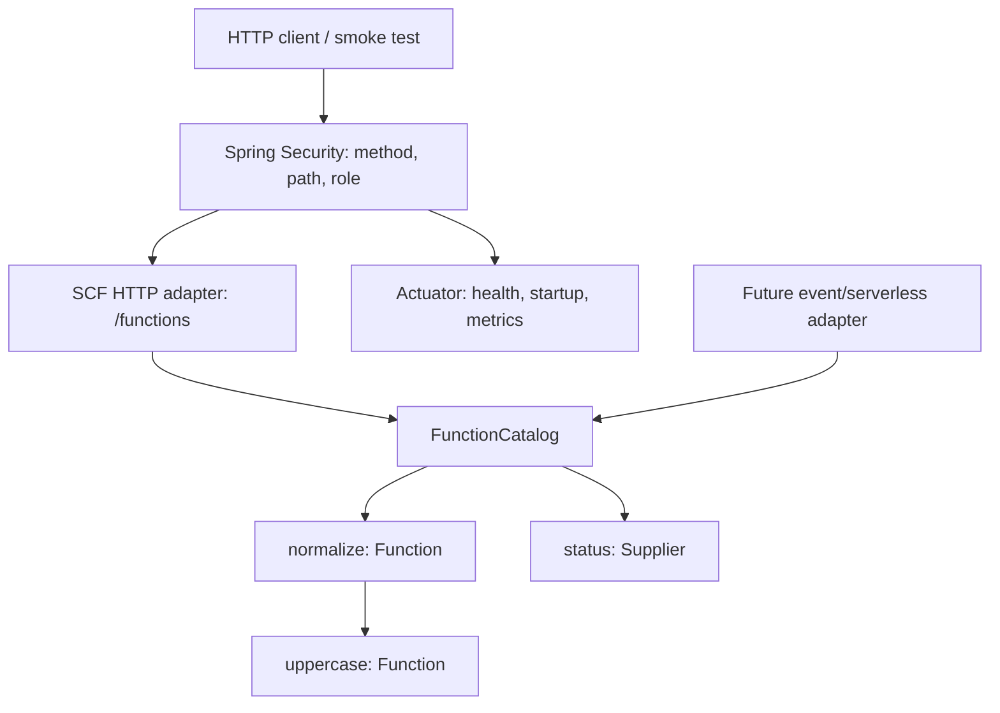

# Hands-On: Measuring Startup, Securing Entry Points, and Completing Deployment Testing for Spring Cloud Function

## 1. Scenario and Lab Objectives

A **Spring Cloud Function (SCF)** service may be small in business scope yet still requires secure deployment. Logic is written with `Supplier<O>`, `Function<I,O>`, and `Consumer<I>`, and managed via `FunctionCatalog`. The same logic can be invoked from **HTTP, events, or serverless**; each adapter introduces its own startup lifecycle, access controls, timeouts, and execution semantics.

You are tasked with hardening the **scf-practice** demo service to satisfy these requirements:

- Provide a `normalize|uppercase` text-processing pipeline and a `Supplier` reporting service status.
- Measure Spring Boot readiness time, inspect startup steps, and measure real request latency.
- Expose only the pipeline and the `Supplier`, keeping internal beans unexposed as HTTP endpoints.
- Require callers invoking functions to authenticate; allow only operators to read startup/metrics.
- Provide unit tests, negative HTTP tests, post-deploy smoke tests, and a rollback plan.

### Architecture



**Key message:** HTTP authorization **does not automatically protect** broker consumers or Lambda handlers. When reusing functions in those environments, you must apply dedicated identity, permissions, and retry policies.

### Completion Criteria

| Code | Requirement | Evidence |
| --- | --- | --- |
| AC-01 | Logs Spring Boot startup duration | `BOOT_READY startupMs=...` |
| AC-02 | OPS can read startup steps; caller is denied | `/actuator/startup` returns 200/403 by role |
| AC-03 | Separately measures first request vs. warm requests | `curl -w` output and function timer |
| AC-04 | Composition returns expected text | POST `/functions/normalize,uppercase` → `HELLO WORLD` |
| AC-05 | Supplier returns status | GET `/functions/status` → JSON |
| AC-06 | Functions reject anonymous callers | 401 with lab Basic Auth |
| AC-07 | OPS account does not implicitly get permission to call functions | 403 |
| AC-08 | Internal beans, unmapped routes, and wrong HTTP methods are blocked | 403 for authenticated users |
| AC-09 | Probes, automated tests, and smoke tests all work | Health/readiness, test reports, exit codes |
| AC-10 | Has rollout/rollback procedure and leaks no secrets | Deployment checklist |

This lesson uses **Spring MVC + SCF HTTP adapter**, `Spring Security`, and `Spring Boot Actuator` for a **local or isolated staging lab**. There is no real database or payment logic. All Maven/Docker/Kubernetes commands are instructions for learners to run in their practice project; authoring this lesson does not imply running the application.

## 2. Setup and Choosing the Right Spring Boot/Spring Cloud Release Train

### 2.1. Tools

- Java 17 or higher; the Docker example uses JRE 21.
- Maven 3.9+ or Maven Wrapper.
- `curl` and a Bash/Git Bash/WSL terminal; on PowerShell, adjust line continuations and use `curl.exe`.
- Optional: Docker and Kubernetes to practice deployment.

**Compatibility:** Spring Cloud **2025.1.x** is compatible with Spring Boot **4.0.x/4.1.x** in supported releases; Spring Cloud **2025.0.x** targets Spring Boot **3.5.x**. Corresponding Spring Cloud Function versions may differ across lines. Never mix Spring Cloud 2025.0.x with Boot 4.x. Before a real deployment, verify the **latest organization-approved security patches** and the official compatibility matrix.

### 2.2. Reference POM

Use Spring Initializr or create `pom.xml` in your **own lab project**. Example pairing Spring Boot 4.1.2 and Spring Cloud 2025.1.5:

```xml
<project xmlns="http://maven.apache.org/POM/4.0.0"
         xmlns:xsi="http://www.w3.org/2001/XMLSchema-instance"
         xsi:schemaLocation="http://maven.apache.org/POM/4.0.0 https://maven.apache.org/xsd/maven-4.0.0.xsd">
    <modelVersion>4.0.0</modelVersion>

    <parent>
        <groupId>org.springframework.boot</groupId>
        <artifactId>spring-boot-starter-parent</artifactId>
        <version>4.1.2</version>
        <relativePath/>
    </parent>
    <groupId>demo</groupId>
    <artifactId>scf-practice</artifactId>
    <version>0.0.1-SNAPSHOT</version>
    <properties>
        <java.version>17</java.version>
        <spring-cloud.version>2025.1.5</spring-cloud.version>
    </properties>
    <dependencyManagement>
        <dependencies>
            <dependency>
                <groupId>org.springframework.cloud</groupId>
                <artifactId>spring-cloud-dependencies</artifactId>
                <version>${spring-cloud.version}</version>
                <type>pom</type>
                <scope>import</scope>
            </dependency>
        </dependencies>
    </dependencyManagement>
    <dependencies>
        <dependency>
            <groupId>org.springframework.cloud</groupId>
            <artifactId>spring-cloud-starter-function-web</artifactId>
        </dependency>
        <dependency>
            <groupId>org.springframework.boot</groupId>
            <artifactId>spring-boot-starter-actuator</artifactId>
        </dependency>
        <dependency>
            <groupId>org.springframework.boot</groupId>
            <artifactId>spring-boot-starter-security</artifactId>
        </dependency>
        <dependency>
            <groupId>org.springframework.boot</groupId>
            <artifactId>spring-boot-starter-test</artifactId>
            <scope>test</scope>
        </dependency>
        <dependency>
            <groupId>org.springframework.security</groupId>
            <artifactId>spring-security-test</artifactId>
            <scope>test</scope>
        </dependency>
    </dependencies>
    <build>
        <plugins>
            <plugin>
                <groupId>org.springframework.boot</groupId>
                <artifactId>spring-boot-maven-plugin</artifactId>
            </plugin>
        </plugins>
    </build>
</project>
```

This is **a learning version pair**, not a recommendation to pin forever in production. Newer SCF/Boot patches may be released, and dependency compatibility or test packages can change across generations.

### 2.3. Project Structure

```text
scf-practice/
├── pom.xml
└── src/
    ├── main/
    │   ├── java/demo/
    │   │   ├── PracticeApplication.java
    │   │   └── LabSecurityConfig.java
    │   └── resources/application.properties
    └── test/java/demo/CatalogBehaviorTest.java
```

## 3. Writing Functional Beans and Measuring Startup Time

### 3.1. PracticeApplication.java

Create `src/main/java/demo/PracticeApplication.java`:

```java
package demo;

import java.time.Duration;
import java.util.Locale;
import java.util.concurrent.TimeUnit;
import java.util.function.Function;
import java.util.function.Supplier;

import org.slf4j.Logger;
import org.slf4j.LoggerFactory;
import org.springframework.boot.SpringApplication;
import org.springframework.boot.autoconfigure.SpringBootApplication;
import org.springframework.boot.context.event.ApplicationReadyEvent;
import org.springframework.boot.context.metrics.buffering.BufferingApplicationStartup;
import org.springframework.context.annotation.Bean;
import org.springframework.context.event.EventListener;
import org.springframework.stereotype.Component;

import io.micrometer.core.instrument.MeterRegistry;
import io.micrometer.core.instrument.Timer;

@SpringBootApplication
public class PracticeApplication {

    public static void main(String[] args) {
        SpringApplication app =
                new SpringApplication(PracticeApplication.class);

        // Buffer startup steps so Actuator can expose them to OPS.
        app.setApplicationStartup(
                new BufferingApplicationStartup(2048));
        app.run(args);
    }

    @Bean
    public Function<String, String> normalize(
            MeterRegistry registry) {

        Timer timer = Timer.builder("lab.normalize.duration")
                .description("Duration of normalization")
                .register(registry);

        return input -> {
            long begin = System.nanoTime();
            try {
                if (input == null) {
                    throw new IllegalArgumentException(
                            "Input cannot be null");
                }
                return input.trim().replaceAll("\\s+", " ");
            }
            finally {
                timer.record(
                        System.nanoTime() - begin,
                        TimeUnit.NANOSECONDS);
            }
        };
    }

    @Bean
    public Function<String, String> uppercase() {
        return input -> input.toUpperCase(Locale.ROOT);
    }

    @Bean
    public Supplier<ServiceStatus> status() {
        return () -> new ServiceStatus(
                "READY", "SPRING_CLOUD_FUNCTION");
    }

    // Still a functional bean, but not exposed standalone.
    @Bean
    public Function<String, String> internalOnly() {
        return text -> "INTERNAL:" + text;
    }
}

record ServiceStatus(String state, String service) {}

@Component
class StartupEvents {

    private static final Logger log =
            LoggerFactory.getLogger(StartupEvents.class);

    @EventListener
    public void onReady(ApplicationReadyEvent event) {
        Duration elapsed = event.getTimeTaken();

        log.info("BOOT_READY startupMs={}",
                elapsed == null ?
                        "unknown" : elapsed.toMillis());
    }
}
```

**Analysis:**

- `normalize` and `uppercase` are `Function<String,String>`, with compatible types for chaining via `FunctionCatalog`.
- `status` is a `Supplier<ServiceStatus>`, suitable for a GET endpoint producing JSON.
- `internalOnly` enables negative security testing; it exists in the catalog, but should not be exposed over HTTP.
- `ApplicationReadyEvent` marks when the application is ready; it does **not** measure total container/serverless execution environment provisioning time.
- `BufferingApplicationStartup` records startup steps; Actuator and endpoint exposure configuration are required to read them.
- `Timer` measures only `normalize` execution; it excludes network, serialization, Spring Security, and the rest of the composition.
- `System.nanoTime()` is suited for measuring elapsed intervals inside the JVM; do not use wall-clock timestamps for short durations when the system clock can be adjusted.
- Never attach user IDs, raw payloads, or trace IDs as **metric tags** because they cause high cardinality.

### 3.2. Distinguishing Measurement Scopes

| Metric | Scope | Do Not Infer |
| --- | --- | --- |
| `BOOT_READY startupMs` | Startup duration recorded by Spring Boot | Time until client receives first request |
| `/actuator/startup` | Spring context initialization steps | Full VM/container provisioning cost |
| `lab.normalize.duration` | Duration inside a single functional bean | End-to-end HTTP latency |
| `curl time_starttransfer` | Time to first response byte | Function duration alone |
| `curl time_total` | Total client-observed duration | Only startup or only server CPU |
| Platform cold start | Reported by serverless environment logs/metrics | Latency distribution of warm requests |

## 4. Exporting Only the Required Functions

Create `src/main/resources/application.properties`:

```properties
spring.application.name=scf-practice
server.port=8080

# SCF HTTP adapter and function filtering.
spring.cloud.function.web.path=/functions
spring.cloud.function.definition=normalize|uppercase;status

# Do not echo credentials/client secrets back in responses by default.
spring.cloud.function.http.ignored-headers=Authorization,Cookie,X-Internal-Token

# Actuator and startup/readiness probes.
management.endpoints.web.exposure.include=health,metrics,startup
management.endpoint.health.probes.enabled=true
management.endpoint.health.probes.add-additional-paths=true

# Both environment variables must be set at runtime.
lab.auth.caller-password=${LAB_CALLER_PASSWORD}
lab.auth.ops-password=${LAB_OPS_PASSWORD}
```

### 4.1. Understanding definition

```text
normalize|uppercase;status
         |         ;
         |         +-- item 2: status
         +------------ item 1: normalize then uppercase
```

- `|`: chains two functions in order.
- `;`: lists **two** items published by the HTTP adapter.
- The composition gets URL `POST /functions/normalize,uppercase`.
- The Supplier gets URL `GET /functions/status`.
- Individual beans `normalize`, `uppercase`, and `internalOnly` are **not** automatically exported as standalone endpoints.
- Multi-item filtering mode **does not automatically map the root** `/functions`.

**Do not mistake filtering for security.** Even if the HTTP adapter omits routes by bean name, you still need authorization protecting URLs, methods, and any alternate routing paths. The `ignored-headers` property only suppresses default header propagation; functions or proxies could still explicitly add response headers. Enforce secret checks across the entire boundary.

### 4.2. Securing Actuator

`health` can be exposed to probes with limited details. `metrics` and `startup` can leak system internals; they must have dedicated security rules. When an application defines its own `SecurityFilterChain`, explicitly protect exposed actuator endpoints rather than relying on default security auto-configuration.

## 5. Securing Entry Points with Spring Security

This lab uses two distinct roles:

- **FUNCTION_CALLER:** permitted only to invoke the POST composition and GET Supplier.
- **OPS:** permitted only to read startup/metrics, with no default permission to invoke functions.

Health probes allow unauthenticated `GET` requests. All other URLs and methods are rejected with `denyAll`.

### 5.1. LabSecurityConfig.java

Create `src/main/java/demo/LabSecurityConfig.java`:

```java
package demo;

import jakarta.servlet.DispatcherType;

import org.springframework.beans.factory.annotation.Value;
import org.springframework.context.annotation.Bean;
import org.springframework.context.annotation.Configuration;
import org.springframework.http.HttpMethod;
import org.springframework.security.config.Customizer;
import org.springframework.security.config.annotation.web.builders.HttpSecurity;
import org.springframework.security.config.http.SessionCreationPolicy;
import org.springframework.security.core.userdetails.User;
import org.springframework.security.core.userdetails.UserDetailsService;
import org.springframework.security.crypto.bcrypt.BCryptPasswordEncoder;
import org.springframework.security.crypto.password.PasswordEncoder;
import org.springframework.security.provisioning.InMemoryUserDetailsManager;
import org.springframework.security.web.SecurityFilterChain;

@Configuration
class LabSecurityConfig {

    @Bean
    PasswordEncoder passwordEncoder() {
        return new BCryptPasswordEncoder();
    }

    @Bean
    UserDetailsService users(
            @Value("${lab.auth.caller-password}")
            String callerPassword,
            @Value("${lab.auth.ops-password}")
            String opsPassword,
            PasswordEncoder encoder) {

        if (callerPassword.isBlank() || opsPassword.isBlank()) {
            throw new IllegalArgumentException(
                    "LAB_CALLER_PASSWORD and LAB_OPS_PASSWORD required");
        }

        return new InMemoryUserDetailsManager(
            User.withUsername("caller")
                .password(encoder.encode(callerPassword))
                .roles("FUNCTION_CALLER")
                .build(),
            User.withUsername("ops")
                .password(encoder.encode(opsPassword))
                .roles("OPS")
                .build()
        );
    }

    @Bean
    SecurityFilterChain webSecurity(HttpSecurity http)
            throws Exception {

        http
            // Strictly for this stateless lab with no browser sessions.
            .csrf(csrf -> csrf.disable())
            .sessionManagement(session ->
                session.sessionCreationPolicy(
                    SessionCreationPolicy.STATELESS))
            .authorizeHttpRequests(auth -> auth
                .dispatcherTypeMatchers(
                    DispatcherType.ERROR).permitAll()

                .requestMatchers(
                    HttpMethod.GET,
                    "/actuator/health",
                    "/actuator/health/**",
                    "/livez",
                    "/readyz"
                ).permitAll()

                .requestMatchers(
                    HttpMethod.POST,
                    "/functions/normalize,uppercase"
                ).hasRole("FUNCTION_CALLER")
                .requestMatchers(
                    HttpMethod.GET,
                    "/functions/status"
                ).hasRole("FUNCTION_CALLER")

                .requestMatchers(
                    HttpMethod.GET,
                    "/actuator/startup",
                    "/actuator/metrics",
                    "/actuator/metrics/**"
                ).hasRole("OPS")

                .anyRequest().denyAll()
            )
            .httpBasic(Customizer.withDefaults());

        return http.build();
    }
}
```

### 5.2. Reading the Security Rules

| Rule | Meaning |
| --- | --- |
| `hasRole("FUNCTION_CALLER")` | Requires `ROLE_FUNCTION_CALLER` authority |
| `hasRole("OPS")` | Requires `ROLE_OPS` authority |
| `HttpMethod.POST + /functions/normalize,uppercase` | Opens only this composition over POST |
| `HttpMethod.GET + /functions/status` | Opens only the Supplier over GET |
| `/actuator/startup`, `/actuator/metrics` | Readable only by operators |
| `.anyRequest().denyAll()` | Blocks all remaining routes and methods |
| `DispatcherType.ERROR` | Allows error dispatches without turning them into unexpected 403s |

Distinguish **authentication** (identifying who is calling) from **authorization** (what that caller is allowed to do). Spring Security protects HTTP entry points; it does not replace event-producer authentication or serverless IAM.

### 5.3. Warnings About Passwords and CSRF

`InMemoryUserDetailsManager` and HTTP Basic here are strictly for **localhost labs or isolated staging**. Passwords are read from environment variables and BCrypt-encoded inside `UserDetailsService`; never hardcode real secrets in the repository.

This example disables CSRF assuming clients are **non-browser, stateless without session/cookies**, and requests are issued intentionally by test runners. **Never copy CSRF-disabled configuration to APIs using browser sessions or Basic Auth where browsers might attach credentials automatically.** Production requires TLS, a secret manager, OAuth2/JWT/mTLS or proper identity mechanisms, security reviews, and rate limiting.

Additionally, `curl -u` can expose plaintext credentials in process arguments on shared hosts. Use it only in controlled lab environments; in CI/production, use secret injection and safer authentication delivery. Never enable `set -x` in scripts holding passwords.

### 5.4. Starting Up

Bash:

```bash
export LAB_CALLER_PASSWORD='replace-with-lab-secret-one'
export LAB_OPS_PASSWORD='replace-with-different-lab-secret-two'

mvn spring-boot:run
```

The two strings above are **illustrative placeholders; never use them as production secrets**. On PowerShell, set `$env:LAB_CALLER_PASSWORD = '...'` and similarly for OPS.

When the application is ready, you should see `BOOT_READY startupMs=...`. If the environment variables are omitted, the application should **fail fast** instead of booting with weak default passwords.

## 6. Practice A — Measuring Startup

### 6.1. Checking Actuator Startup

```bash
# Public health can be called by probes without authentication.
curl -i 'http://localhost:8080/actuator/health'

# OPS can view startup steps.
curl -i -u "ops:$LAB_OPS_PASSWORD" \
  'http://localhost:8080/actuator/startup'

# Caller cannot view startup steps.
curl -i -u "caller:$LAB_CALLER_PASSWORD" \
  'http://localhost:8080/actuator/startup'
```

Expected when healthy: health `200`, OPS startup `200`, caller startup `403`. Never expose `/actuator/startup` on the public Internet because it reveals internal application structure diagnostics.

If the startup endpoint is missing or empty:

1. Was `setApplicationStartup(new BufferingApplicationStartup(...))` called **before** `run()`?
2. Is `spring-boot-starter-actuator` included?
3. Is the `startup` endpoint exposed?
4. Does the authenticated user have role `OPS`, and is the management port/path different?
5. Is a proxy rewriting URLs or a custom policy blocking it?

### 6.2. Measuring Timing from the Client

```bash
curl -sS -o /dev/null \
  -w 'http=%{http_code} connect=%{time_connect}s ttfb=%{time_starttransfer}s total=%{time_total}s\n' \
  -u "caller:$LAB_CALLER_PASSWORD" \
  -X POST 'http://localhost:8080/functions/normalize,uppercase' \
  -H 'Content-Type: text/plain' \
  -H 'Accept: text/plain' \
  --data '  hello   world  '
```

- `time_connect`: TCP connection phase from the client's perspective, excluding full DNS/TLS.
- `time_starttransfer`: from request start to the first response byte.
- `time_total`: total time the client waits to receive the full response.
- `lab.normalize.duration`: execution time of `normalize` code alone (see Section 6.4).

Example output format (values are **not actual measurements**):

```text
http=200 connect=0.003s ttfb=0.042s total=0.043s
```

### 6.3. Comparing the First Request vs. Warm Requests

After restarting the application, measure at least the first request, then repeat:

```bash
for n in 1 2 3 4 5 6 7 8 9 10; do
  curl -sS -o /dev/null \
    -w "run=$n status=%{http_code} total=%{time_total}s\n" \
    -u "caller:$LAB_CALLER_PASSWORD" \
    -X POST 'http://localhost:8080/functions/normalize,uppercase' \
    -H 'Content-Type: text/plain' \
    --data '  hello   world  '
done
```

Record a table:

| Measurement Group | Metric to Save | Purpose |
| --- | --- | --- |
| App startup | `BOOT_READY startupMs` | Compare `ApplicationContext` creation cost |
| First request after ready | `time_total` | Surface JIT, lazy init, converters, connection setup |
| Warm requests | `total` values for runs 2–10 | Observe latency distribution |
| Function timer | `lab.normalize.duration` | Determine if `normalize` itself is slow |
| Multiple cold starts | Multiple **fresh process starts** | Measure cold-start distribution rather than extrapolating from one JVM |

**Never treat 10 requests to the same JVM as 10 cold starts.** A slow first request may stem from TLS, DNS, JIT, lazy beans, thread scheduling, or networking. Measure across multiple restarts and correlate server-side traces before optimizing.

### 6.4. Inspecting the Micrometer Timer

After at least one invocation:

```bash
curl -i -u "ops:$LAB_OPS_PASSWORD" \
  'http://localhost:8080/actuator/metrics/lab.normalize.duration'
```

Timers typically display measurements such as `COUNT`, `TOTAL_TIME`, and `MAX` depending on configuration. If the metric is missing, confirm the function was invoked, the meter name matches, and the Actuator/Micrometer registry is active.

### 6.5. Startup Diagnostic Table

| Symptom | What to Check First |
| --- | --- |
| Slow before `BOOT_READY` | Bean initialization, remote config, dependencies, CPU, DB migrations |
| Ready quickly but slow first request | JIT, lazy initialization, converters, pools, DNS/TLS |
| Fast function timer but slow `curl` | Security/auth, proxies, network, serialization, queuing |
| Slow serverless cold start | Platform init, image pull, JVM/Spring startup, memory/CPU |
| Latency increases under load | GC, thread/DB pools, downstream calls, CPU throttling |

Never treat `spring.main.lazy-initialization=true` as a silver bullet: it can shift startup cost onto the first request and increase timeout risk.

## 7. Practice B — Protecting HTTP Endpoints

### 7.1. Access Control Matrix

| Request | Anonymous | Caller | OPS |
| --- | --- | --- | --- |
| GET `/actuator/health` | 200 when UP | 200 | 200 |
| GET `/readyz` | 200 when ready | 200 | 200 |
| POST `/functions/normalize,uppercase` | **401** | **200** | **403** |
| GET `/functions/status` | **401** | **200** | **403** |
| GET `/actuator/startup` | **401** | **403** | **200** |
| GET `/actuator/metrics` | **401** | **403** | **200** |
| POST `/functions/internalOnly` | Maybe 401/403 | **403** | **403** |
| POST `/functions/normalize` | Maybe 401/403 | **403** | **403** |
| PUT `/functions/normalize,uppercase` | Maybe 401/403 | **403** | **403** |
| GET `/functions` | Maybe 401/403 | **403** | **403** |

For URLs matched by `denyAll`, the filter chain can reject the request **before** MVC resolves a handler. Thus, authenticated callers usually receive `403`, not necessarily `404`/`405`. For anonymous requests to role-protected routes, the Basic authentication entry point normally returns `401`.

### 7.2. Valid Request to the Composition

```bash
curl -i -u "caller:$LAB_CALLER_PASSWORD" \
  -X POST 'http://localhost:8080/functions/normalize,uppercase' \
  -H 'Content-Type: text/plain' \
  -H 'Accept: text/plain' \
  --data '  hello   world  '
```

Expected body:

```text
HELLO WORLD
```

`normalize` collapses extra whitespace, then `uppercase` converts to uppercase. Normal success HTTP status is `200 OK`.

### 7.3. Valid Request to the Supplier

```bash
curl -i -u "caller:$LAB_CALLER_PASSWORD" \
  -H 'Accept: application/json' \
  'http://localhost:8080/functions/status'
```

Expected body:

```json
{"state":"READY","service":"SPRING_CLOUD_FUNCTION"}
```

JSON field ordering and whitespace may vary; integration tests should parse JSON.

### 7.4. Negative Test Cases

```bash
# Unauthenticated -> 401.
curl -i -X POST \
  'http://localhost:8080/functions/normalize,uppercase' \
  -H 'Content-Type: text/plain' --data 'hello'

# OPS cannot invoke functions -> 403.
curl -i -u "ops:$LAB_OPS_PASSWORD" \
  -X POST 'http://localhost:8080/functions/normalize,uppercase' \
  -H 'Content-Type: text/plain' --data 'hello'

# Caller cannot inspect startup -> 403.
curl -i -u "caller:$LAB_CALLER_PASSWORD" \
  'http://localhost:8080/actuator/startup'

# Internal bean is not exposed -> 403.
curl -i -u "caller:$LAB_CALLER_PASSWORD" \
  -X POST 'http://localhost:8080/functions/internalOnly' \
  -H 'Content-Type: text/plain' --data 'hello'

# Individual component of composition is not exposed -> 403.
curl -i -u "caller:$LAB_CALLER_PASSWORD" \
  -X POST 'http://localhost:8080/functions/normalize' \
  -H 'Content-Type: text/plain' --data 'hello'

# Wrong HTTP method -> 403.
curl -i -u "caller:$LAB_CALLER_PASSWORD" \
  -X PUT 'http://localhost:8080/functions/normalize,uppercase' \
  -H 'Content-Type: text/plain' --data 'hello'

# Root path is not automatically opened -> 403.
curl -i -u "caller:$LAB_CALLER_PASSWORD" \
  'http://localhost:8080/functions'
```

**Do not look only at status codes:** check logs or spies to verify that forbidden functions **actually did not run**, even behind proxies, routers, or HTTP fallbacks. A 403 HTTP response does not prove all other adapters are blocked.

### 7.5. Mismatched Path Prefixes and Header Routing

If you change `spring.cloud.function.web.path`, update Spring Security `requestMatchers`, ingress/gateway rules, and smoke tests simultaneously. Never allow external users to pass arbitrary `FunctionCatalog.lookup(name)` targets or steer `functionRouter` to sensitive functions via headers without an allowlist and authorization.

## 8. Practice C — Testing FunctionCatalog and the HTTP Boundary

### 8.1. Catalog Tests with JUnit

Create `src/test/java/demo/CatalogBehaviorTest.java`:

```java
package demo;

import java.util.function.Function;

import org.junit.jupiter.api.Test;
import org.springframework.beans.factory.annotation.Autowired;
import org.springframework.boot.test.context.SpringBootTest;
import org.springframework.cloud.function.context.FunctionCatalog;

import static org.junit.jupiter.api.Assertions.assertEquals;
import static org.junit.jupiter.api.Assertions.assertNotNull;

@SpringBootTest(properties = {
    "lab.auth.caller-password=local-test-caller",
    "lab.auth.ops-password=local-test-ops"
})
class CatalogBehaviorTest {

    @Autowired
    FunctionCatalog catalog;

    @Test
    void compositionWorks() {
        Function<String, String> composition =
                catalog.lookup(Function.class,
                        "normalize|uppercase");

        assertNotNull(composition);
        assertEquals("HELLO WORLD",
                composition.apply("  hello   world  "));
    }

    @Test
    void internalBeanStillExists() {
        Function<String, String> internal =
                catalog.lookup(Function.class, "internalOnly");

        assertNotNull(internal);
        assertEquals("INTERNAL:abc", internal.apply("abc"));
    }
}
```

Run tests:

```bash
mvn -B -ntp test
```

This test verifies **catalog logic**; it does not yet prove Spring Security blocks HTTP calls properly. In Boot 4, some test auto-configuration packages differ from Boot 3; avoid copying `@AutoConfigureMockMvc` blindly from older lines without checking the documentation. HTTP tests can run against a live server or `MockMvc` with the security filter chain active.

### 8.2. What Must HTTP Tests Verify?

- Caller POSTs the composition successfully and gets the properly normalized/uppercased body.
- Caller GETs the Supplier successfully with expected JSON.
- Anonymous callers cannot access exposed functions.
- OPS cannot invoke functions; callers cannot access startup/metrics.
- Internal beans, undeclared paths, and invalid methods are all blocked.
- `health`/`readyz` work before and after rollout.
- Credentials are never echoed in responses or logs.
- Profile or gateway changes do not inadvertently expose functions.

A unit test like `uppercase().apply("hello")` is never enough to prove HTTP entry points are protected.

### 8.3. Measuring Coverage Across Layers

| Layer | What to Test |
| --- | --- |
| Functional core | String transformations, null/invalid inputs, composition order |
| FunctionCatalog | Lookup by name/function, composition, type conversion |
| HTTP adapter | Body, `Content-Type`, `Accept`, path, method |
| Spring Security | 200/401/403, role/method matchers, `denyAll` |
| Actuator | Health/probes; startup and metrics restricted to OPS |
| Deployment | Secrets, image, startup/readiness, path rewrites |
| Event/serverless extensions | IAM/broker permissions, retries, dedupe, timeouts |

## 9. Writing Smoke Tests for Staging and Deployment

### 9.1. Bash Script

Create `scripts/smoke.sh` in your **lab project**, not in the documentation module:

```bash
#!/usr/bin/env bash
set -euo pipefail

BASE_URL="${BASE_URL:-http://localhost:8080}"
: "${LAB_CALLER_PASSWORD:?caller password missing}"
: "${LAB_OPS_PASSWORD:?ops password missing}"

tmp="$(mktemp)"
trap 'rm -f "$tmp"' EXIT

check_status() {
    local expected="$1"
    shift
    local actual
    actual="$(curl -sS -o "$tmp" -w '%{http_code}' "$@")"
    if [[ "$actual" != "$expected" ]]; then
        printf 'FAIL: expected %s, got %s\n' \
            "$expected" "$actual" >&2
        exit 1
    fi
    printf 'PASS HTTP %s\n' "$expected"
}

check_status 200 "$BASE_URL/actuator/health"

check_status 200 \
  -u "caller:$LAB_CALLER_PASSWORD" \
  -X POST "$BASE_URL/functions/normalize,uppercase" \
  -H 'Content-Type: text/plain' \
  -H 'Accept: text/plain' \
  --data '  hello   world  '

if [[ "$(cat "$tmp")" != "HELLO WORLD" ]]; then
    echo 'FAIL: wrong composition body' >&2
    exit 1
fi

check_status 401 \
  -X POST "$BASE_URL/functions/normalize,uppercase" \
  -H 'Content-Type: text/plain' --data 'hello'

check_status 403 \
  -u "ops:$LAB_OPS_PASSWORD" \
  -X POST "$BASE_URL/functions/normalize,uppercase" \
  -H 'Content-Type: text/plain' --data 'hello'

check_status 403 \
  -u "caller:$LAB_CALLER_PASSWORD" \
  "$BASE_URL/actuator/startup"

check_status 200 \
  -u "ops:$LAB_OPS_PASSWORD" \
  "$BASE_URL/actuator/startup"

check_status 403 \
  -u "caller:$LAB_CALLER_PASSWORD" \
  -X POST "$BASE_URL/functions/internalOnly" \
  -H 'Content-Type: text/plain' --data 'hello'

check_status 403 \
  -u "caller:$LAB_CALLER_PASSWORD" \
  -X PUT "$BASE_URL/functions/normalize,uppercase" \
  -H 'Content-Type: text/plain' --data 'hello'

check_status 200 "$BASE_URL/readyz"

check_status 200 \
  -u "caller:$LAB_CALLER_PASSWORD" \
  -H 'Accept: application/json' \
  "$BASE_URL/functions/status"

grep -q '"state":"READY"' "$tmp" || {
    echo 'FAIL: incorrect status JSON' >&2
    exit 1
}

echo 'SMOKE_PASS'
```

### 9.2. Explaining the Script and Its Limits

- `set -euo pipefail` aborts on failed commands or missing required variables.
- `mktemp` and `trap` create a temporary response file and delete it on exit.
- `curl -w` prints only the HTTP status code without dumping full bodies, avoiding data leaks in CI logs.
- The final `grep` checks a simple JSON substring; a more robust test should **parse JSON** instead of comparing literal formatting.
- The script does **not** prove every URL or security threat is safe; it is a minimum deployment gate.
- `curl -u` places passwords in process arguments: acceptable in an isolated lab, whereas production CI should use secret injection and stronger authentication methods.
- If staging uses gateway path rewrites or different auth, adapt smoke tests to the **actual API contract** rather than weakening the server to make an abnormal check pass.

Run:

```bash
bash scripts/smoke.sh
```

`SMOKE_PASS` prints only when every check succeeds. Any non-zero exit code must **fail the pipeline and halt traffic shifting**.

## 10. Containers and Readiness Checks During Rollout

### 10.1. Illustrative Dockerfile

```dockerfile
FROM eclipse-temurin:21-jre
WORKDIR /app
COPY target/scf-practice-0.0.1-SNAPSHOT.jar /app/app.jar
USER 10001
EXPOSE 8080
ENTRYPOINT ["java", "-jar", "/app/app.jar"]
```

Build and run in the lab environment:

```bash
mvn -B -ntp clean verify
docker build -t scf-practice:lab .
docker run --rm -p 8080:8080 \
  -e LAB_CALLER_PASSWORD \
  -e LAB_OPS_PASSWORD \
  scf-practice:lab
```

To use `-e VAR`, the shell must already export those variables. The container runs with a numeric non-root user; verify file and runtime filesystem permissions during real deployments. Production should **pin base images by digest**, scan OS/JVM/dependencies, generate SBOMs, and never rely on floating unverified tags.

### 10.2. How Do Readiness, Liveness, and Startup Probes Differ?

- **Startup probe:** prevents liveness checks from restarting the app prematurely while the JVM and Spring are still initializing.
- **Liveness probe:** evaluates whether the process is healthy enough to keep running or needs a restart.
- **Readiness probe:** decides whether the instance is ready to receive live traffic.
- **Startup duration:** startup timing reported by Spring Boot/the platform, not the wait duration of a probe.

Setting `management.endpoint.health.probes.add-additional-paths=true` exposes `/livez` and `/readyz` on the **main server port** when health probes are enabled. This is especially handy when Actuator uses a separate management port.

### 10.3. Sample Kubernetes Deployment

```yaml
apiVersion: apps/v1
kind: Deployment
metadata:
  name: scf-practice
spec:
  replicas: 2
  selector:
    matchLabels:
      app: scf-practice
  template:
    metadata:
      labels:
        app: scf-practice
    spec:
      containers:
        - name: app
          image: registry.example.com/scf-practice:replace-with-digest
          ports:
            - containerPort: 8080
              name: http
          env:
            - name: LAB_CALLER_PASSWORD
              valueFrom:
                secretKeyRef:
                  name: scf-practice-auth
                  key: caller-password
            - name: LAB_OPS_PASSWORD
              valueFrom:
                secretKeyRef:
                  name: scf-practice-auth
                  key: ops-password
          startupProbe:
            httpGet:
              path: /livez
              port: 8080
            periodSeconds: 5
            failureThreshold: 30
          readinessProbe:
            httpGet:
              path: /readyz
              port: 8080
            periodSeconds: 5
            failureThreshold: 3
          livenessProbe:
            httpGet:
              path: /livez
              port: 8080
            periodSeconds: 10
            failureThreshold: 3
          resources:
            requests:
              cpu: "100m"
              memory: "256Mi"
            limits:
              memory: "512Mi"
```

**This is a template that must be completed** with real Secrets, Services, image digests, namespaces, registry access, NetworkPolicies, and environment-specific CI/CD. Probe budgets and resource figures are illustrative only. Base them on **measured p95/p99 startup** and memory/GC profiles rather than copying blindly into production.

### 10.4. A Deployment Is Marked Ready Only When

1. The process starts and logs `BOOT_READY`.
2. The startup probe passes initialization.
3. The readiness probe returns healthy on the traffic-serving port.
4. Secrets are provisioned properly with no weak password fallbacks.
5. Smoke tests pass through the actual public ingress and authentication layer.
6. Error rates, timeouts, and p95 latency stay within defined thresholds.
7. No internal functions or sensitive Actuator endpoints are reachable outside policy.

If probes receive 401/403, inspect the matchers for `/readyz` or `/actuator/health/readiness`; **never disable all of Spring Security**.

## 11. Pre-Deployment CI/CD Gates

| Gate | Task | Failure Condition |
| --- | --- | --- |
| Dependency/SBOM | Verify Spring Boot/Cloud BOM and scan for CVEs | Version mismatch or security policy violation |
| Compile/test | `mvn -B -ntp clean verify` | Build or tests fail |
| Catalog test | Lookup/composition and data types | Incorrect output |
| HTTP security integration | 200/401/403, roles, paths/methods | Any sensitive endpoint exposed |
| Image build | Build non-root, pin digest | Image fails to run or version unidentifiable |
| Staging deploy | Secrets, readiness/startup | App fails to become ready |
| Smoke test | Allowed and forbidden routes | Any test case fails |
| Performance | Startup, cold vs. warm, p95/p99 | Exceeds SLO or timeout budget |
| Progressive rollout | Canary/rolling monitoring error rate | Error spike or auth bypass |
| Rollback | Retain previous image/config version | Unable to roll back when needed |

Reference command sequence:

```bash
mvn -B -ntp clean verify
docker build -t scf-practice:build-123 .

# Push image and deploy to staging via CI/CD.
# Once ready and secrets are mounted:
BASE_URL='https://staging.example.com' bash scripts/smoke.sh
```

No single deployment command is safe for every cluster. Pipelines must manage registry credentials, image digests, approvals, rollout health, and rollbacks according to organizational policy.

### Conditions Requiring Immediate Rollout Halt

- Credentials or passwords committed to source or printed in CI logs.
- Anonymous users can invoke protected functions.
- Caller accounts can read startup/metrics, or OPS can invoke functions outside its role.
- `internalOnly` is reachable over HTTP.
- `/readyz` fails or reports ready before required dependencies are ready.
- Startup p95 exceeds the `startupProbe` budget.
- Smoke tests are disabled just to "make the release window."
- Dependencies carry critical unaddressed advisories violating policy.
- Rollback target image version cannot be identified.

## 12. Deployment Troubleshooting Runbook

### 12.1. Slow Startup, Continuous Process Restarts

1. Inspect container logs and Kubernetes events: crash, `OOMKilled`, or probe timeout?
2. Did `BOOT_READY` appear? If not, which startup step is taking too long?
3. Check CPU throttling, heap/GC, thread counts, resource limits, and image pulls.
4. Are environment secrets, remote configs, DNS/DB, or TLS handshakes stalling?
5. Does `startupProbe` budget match the real cold-start distribution?
6. If ready quickly yet the first request is slow, check lazy init, JIT, and connection pools.

Never crank up every timeout without finding the root cause. Client or gateway timeouts do not guarantee the backend aborted work or rolled back side effects.

### 12.2. HTTP Returns 401/403/404/405

| Status | First Suspect |
| --- | --- |
| 401 | Missing/wrong credentials or Basic challenge |
| 403 | Authenticated, but wrong role, method/path, or `denyAll` |
| 404 | Function not exported by SCF, wrong prefix/definition, or gateway rewrite |
| 405 | Handler exists but HTTP method unsupported; security may reject earlier with 403 |
| 406 | `Accept` incompatible with response |
| 415 | `Content-Type` incompatible with input |
| 500 | Function exception, conversion error, or bean/config failure |
| 503 | Readiness failure or upstream unavailable |
| 504 | Gateway timed out waiting for response; backend may still be running |

Correlate HTTP status codes with logs and traces. Blocked requests may return `403` instead of `404`/`405` because the security filter runs **before** handler mapping.

### 12.3. Actuator Missing startup/metrics

- Is the Actuator dependency present?
- Was `BufferingApplicationStartup` configured before `run()`?
- Are `startup`/`metrics` exposed and does the user hold role `OPS`?
- Has the function been invoked yet to emit `lab.normalize.duration`?
- Is there a separate management port/path or gateway rewrite?
- Are metrics filters or registries disabling meters?

### 12.4. Smoke Tests Pass on Localhost but Fail Through Gateway

Compare the URL **the client sees** with the URL **the backend receives**. Check TLS termination, forwarded headers, path rewrites, response caching, user identity, and auth/authorization policies at both layers. Never change `anyRequest().denyAll()` to `permitAll()` just to make a test pass.

## 13. Moving the Same Functions to Events or Serverless

SCF keeps `normalize` and `uppercase` **independent of HTTP**:

```text
HTTP text body
  -> normalize -> uppercase -> HTTP response

Event payload
  -> normalize -> uppercase -> output event

Serverless event
  -> adapter -> normalize -> uppercase -> platform result
```

However, reusing functions does **not** automatically carry over:

- Spring Security HTTP `SecurityFilterChain` to broker/Lambda IAM.
- HTTP statuses/headers to message acknowledgments.
- Client timeouts to broker visibility timeouts.
- `FunctionCatalog` HTTP path compositions to event-source binding names/configs.
- HTTP retry safety to consumer idempotency.

When using dynamic routing features like `functionRouter`, never let untrusted clients pass arbitrary target function names in headers or message payloads. Enforce an allowlist and authorization in the appropriate adapter.

## 14. Lab Completion Checklist

- [ ] POM uses a compatible Spring Boot/Spring Cloud BOM; security patches checked.
- [ ] App boots with env secrets present and fails fast when missing.
- [ ] Logs `BOOT_READY startupMs=...` and populates `/actuator/startup`.
- [ ] OPS can read startup/metrics; caller and anonymous cannot.
- [ ] Measured first and warm requests and recorded real results.
- [ ] Micrometer timer `lab.normalize.duration` works.
- [ ] Caller POSTing composition returns `HELLO WORLD`.
- [ ] Caller GETting Supplier returns valid JSON.
- [ ] Anonymous callers cannot invoke published functions.
- [ ] OPS cannot invoke functions; caller cannot access operational endpoints.
- [ ] Internal beans, undeclared routes, and wrong HTTP methods are blocked.
- [ ] Readiness/liveness endpoints serve as probes.
- [ ] JUnit catalog tests, HTTP/security tests, and smoke script pass.
- [ ] No credentials or sensitive responses appear in logs.
- [ ] Non-root container, startup/readiness probes, and resource limits verified.
- [ ] Image digest, performance gates, and rollback plan exist.
- [ ] Understands HTTP security must be re-implemented separately for event/serverless adapters.

### Self-Check Questions

1. Why is `BOOT_READY` not equal to `curl time_total`?
2. Why are both `BufferingApplicationStartup` **and** Actuator exposure configuration required?
3. What does `normalize|uppercase;status` mean? How does it differ from `normalize;uppercase;status`?
4. Why does `internalOnly` exist in the catalog yet remain unexposed over HTTP?
5. Why keep `denyAll` even when SCF function filtering is enabled?
6. Why should `OPS` not automatically be allowed to invoke every function?
7. When a user receives `403` instead of `405` on a wrong HTTP method, which layer must you inspect?
8. Why must `curl -u` be used cautiously in production CI?
9. Why should the readiness probe run on the traffic-serving port?
10. Is a slow first request guaranteed to be a cold start?
11. When changing `web.path`, which configurations and tests must be updated?
12. If an event consumer receives the same message twice, does an HTTP `SecurityFilterChain` prevent duplicates?
13. Propose at least 5 negative tests to run before a production rollout.
14. If smoke tests pass on localhost yet fail through ingress, what evidence will you gather?
15. State conditions under which a release must be rolled back immediately.

## Official References

- [Spring Cloud Function — Standalone Web Applications](https://docs.spring.io/spring-cloud-function/reference/spring-cloud-function/standalone-web-applications.html): HTTP function mapping, composition, filtering, `web.path`.
- [Spring Cloud Function — Programming Model](https://docs.spring.io/spring-cloud-function/reference/spring-cloud-function/programming-model.html): `Supplier`, `Function`, `Consumer`, `FunctionCatalog`.
- [Spring Cloud — Release Train Compatibility](https://spring.io/projects/spring-cloud/): selecting compatible Spring Boot/Spring Cloud BOM pairs.
- [Spring Boot — SpringApplication and Startup](https://docs.spring.io/spring-boot/reference/features/spring-application.html): `ApplicationReadyEvent`, `BufferingApplicationStartup`.
- [Spring Boot Actuator — Endpoints and Probes](https://docs.spring.io/spring-boot/reference/actuator/endpoints.html): health, metrics, startup, readiness/liveness, endpoint exposure.
- [Spring Security — Authorize HTTP Requests](https://docs.spring.io/spring-security/reference/servlet/authorization/authorize-http-requests.html): `SecurityFilterChain`, request/method matchers, `denyAll`.
- [Spring Security — HTTP Basic](https://docs.spring.io/spring-security/reference/servlet/authentication/passwords/basic.html): Basic authentication.
- [Micrometer — Timers](https://docs.micrometer.io/micrometer/reference/concepts/timers.html): `Timer` and duration measurement.
- [Kubernetes — Liveness, Readiness and Startup Probes](https://kubernetes.io/docs/tasks/configure-pod-container/configure-liveness-readiness-startup-probes/): probe semantics and failure thresholds.
- [Spring Boot — Testing](https://docs.spring.io/spring-boot/reference/testing/spring-boot-applications.html): `@SpringBootTest`, integration testing.
- [OWASP — Secrets Management](https://cheatsheetseries.owasp.org/cheatsheets/Secrets_Management_Cheat_Sheet.html): protecting passwords and tokens in runtime and CI.

> **Takeaway:** Completing a Spring Cloud Function service goes beyond calling a function. You must **measure startup and latency**, **restrict exported HTTP functions**, **authorize by method and path**, **deny remaining routes by default**, and **test both valid and rejected requests** in the deployment environment. Core functions remain protocol-independent; security, timeouts, and retries must be tailored specifically for HTTP, event, or serverless adapters.
