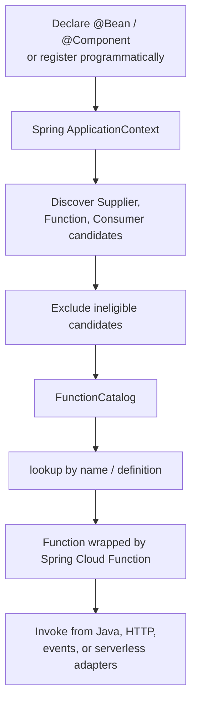

# Mechanism for Discovering and Registering Functional Beans

**Chapter:** FunctionCatalog  
**Technology:** Spring Cloud Function (`SPRING_CLOUD_FUNCTION`)

Spring Cloud Function allows packaging business logic into shared Java functions, independent of the invocation protocol. A function can be used from Java code, invoked over HTTP, connected to an event system using Spring Cloud Stream, or deployed in a serverless environment through an appropriate adapter. The connection point between business functions and the execution environment is **`FunctionCatalog`**.

After this lesson, you will be able to:

- Explain how a `Supplier`, `Function`, or `Consumer` becomes a **functional bean**.
- Distinguish between registering a bean in `ApplicationContext` and looking up a function via `FunctionCatalog`.
- Declare, name, look up, filter, and explicitly register functional beans.
- Identify why a function exists in source code but cannot be found in the catalog.

## 1. What Is a Functional Bean and Why Is a Discovery Mechanism Needed?

In Java, the three core interfaces in the `java.util.function` package represent three roles:

| Interface | Typical Signature | Business Meaning | Example |
| --- | --- | --- | --- |
| `Supplier<O>` | `O get()` | Produces or provides data without accepting arguments | Generate an order code |
| `Function<I, O>` | `O apply(I input)` | Accepts data and returns a result | Normalize an order code |
| `Consumer<I>` | `void accept(I input)` | Accepts data for processing without returning a value | Write an audit log |

A Java object implementing the interfaces above is **not automatically** a Spring bean. It is only managed by Spring when declared with `@Bean`, discovered via component scanning such as `@Component`, or registered into the application context through an equivalent mechanism.

A **functional bean** is a Spring bean with a matching functional type. Spring Cloud Function uses those beans as candidates to expose through `FunctionCatalog`. As a result, HTTP adapters or event adapters only need to know the **function name** instead of directly depending on the class containing the business logic.

For example, a `Function<String, String>` named `normalize` can be:

1. Invoked directly when testing Java code.
2. Looked up by name in `FunctionCatalog`.
3. Selected as a message-handling function via `spring.cloud.function.definition=normalize`.
4. Exposed as an HTTP endpoint when the application includes Spring Cloud Function Web and the corresponding configuration.

All four approaches target the same piece of logic; the transport or adapter determines how data is received and returned.

## 2. From a Spring Bean to a Function in FunctionCatalog

`ApplicationContext` is where Spring manages beans, lifecycles, and dependency injection. `FunctionCatalog` is the **name-based lookup mechanism** for functions supported by Spring Cloud Function; the catalog also provides wrappers to perform capabilities such as data type conversion or composition.

`FunctionCatalog` identifies functional beans in the application context and performs **lazy registration**: a candidate can be recognized from its bean definition, while creating the function representation managed by Spring Cloud Function can occur when `lookup(...)` is called. Therefore, you should not assume that every bean is copied and wrapped upfront at application startup.



A typical lookup flow:

1. Spring initializes configuration, component scanning, and bean definitions.
2. Spring Cloud Function identifies functional beans eligible to participate in the catalog. The framework also automatically excludes certain infrastructure beans not meant for business logic.
3. Application code or an adapter requests a function by name, such as `catalog.lookup("normalize")`.
4. The catalog finds the appropriate bean, determines input/output type information, and creates a function representation capable of adapting to the invocation environment.
5. The caller uses the looked-up function. Adapters are responsible for mapping HTTP requests, messages, or serverless invocations to the function model.

**Important distinction:** `applicationContext.getBean("normalize")` retrieves the bean you wrote; `catalog.lookup("normalize")` retrieves the function representation managed by Spring Cloud Function. Spring Cloud Function's wrapping and composition mechanisms operate through the catalog path.

## 3. Most Common Approach: Automatic Discovery via @Bean

The following example uses Spring Boot integrated with Spring Cloud Function. We declare three types of functional beans, add a second processing function to demonstrate composition, and then query the catalog.

```java
import java.util.Locale;
import java.util.function.Consumer;
import java.util.function.Function;
import java.util.function.Supplier;

import org.springframework.boot.ApplicationRunner;
import org.springframework.boot.SpringApplication;
import org.springframework.boot.autoconfigure.SpringBootApplication;
import org.springframework.cloud.function.context.FunctionCatalog;
import org.springframework.context.annotation.Bean;

@SpringBootApplication
public class FunctionCatalogDemo {

    public static void main(String[] args) {
        SpringApplication.run(FunctionCatalogDemo.class, args);
    }

    @Bean
    public Supplier<String> newOrderCode() {
        return () -> "ord-42";
    }

    @Bean
    public Function<String, String> normalize() {
        return value -> value.trim().toUpperCase(Locale.ROOT);
    }

    @Bean
    public Function<String, String> addPrefix() {
        return value -> "ID-" + value;
    }

    @Bean
    public Consumer<String> audit() {
        return value -> System.out.println("Audit: " + value);
    }

    @Bean
    public ApplicationRunner inspectCatalog(FunctionCatalog catalog) {
        return args -> {
            System.out.println("Catalog names: " + catalog.getNames(null));

            Function<String, String> function =
                catalog.lookup(Function.class, "normalize");
            if (function == null) {
                throw new IllegalStateException("Missing function: normalize");
            }

            System.out.println(function.apply("  ord-42  "));
            // ORD-42
        };
    }
}
```

**Prerequisites for running the example:** the application requires Spring Boot and a Spring Cloud Function dependency compatible with the Spring Boot version in use (for example, the `spring-cloud-function-context` module via your project's dependency configuration). Because the example only queries the catalog, no HTTP adapter needs to be installed.

In the code above:

- `@Bean` causes Spring to register beans with the default name matching the method name: `newOrderCode`, `normalize`, `addPrefix`, `audit`.
- The declared types `Supplier<String>`, `Function<String, String>`, and `Consumer<String>` provide the information Spring Cloud Function needs to identify candidates and infer data types.
- `ApplicationRunner` is injected with `FunctionCatalog` and looks up `normalize` after the application starts.
- `catalog.getNames(null)` lists the available function names according to the catalog API. Depending on configuration and version, the list may also include infrastructure functions such as `functionRouter`; you should not assert that the list equals only the exact four names you declared.

### 3.1. Explicit Bean Naming

The standard lookup name is the **bean name**, so you can assign a stable name:

```java
@Bean("normalizeOrderCode")
public Function<String, String> normalize() {
    return value -> value.trim().toUpperCase(Locale.ROOT);
}
```

In this case, the name to look up is `normalizeOrderCode`, even though the Java method name remains `normalize`.

When multiple teams or adapters reference the same function, intentional naming helps prevent breaking configuration simply because a Java method was renamed.

### 3.2. Discovering @Component Classes Implementing Function

Besides `@Bean`, a class scanned and managed by Spring can also become a functional bean:

```java
import java.util.function.Function;
import org.springframework.stereotype.Component;

@Component("calculateLength")
public class CalculateLength implements Function<String, Integer> {

    @Override
    public Integer apply(String value) {
        return value.length();
    }
}
```

If this class is within component scanning scope, `calculateLength` is the bean name for catalog lookup. If the class is outside scanning scope or not registered into the context, merely having `implements Function` is **not enough** for it to appear in the catalog.

These are two **alternative** ways to create beans. You should not both declare the same object via `@Component` and create another bean with the same name via `@Bean`.

## 4. Explicit Registration with FunctionRegistration

Declaring `@Bean` is convenient in standard Spring Boot applications. Spring Cloud Function also supports initializing applications using **functional bean registration**, allowing beans to be registered directly into `GenericApplicationContext` instead of declaring beans via annotations.

With manual declaration, Spring may not fully infer generic types from lambda expressions due to **type erasure**. `FunctionRegistration` wraps the function along with input and output type metadata, helping the catalog know how to wrap and convert data accurately.

The example below is **an independent alternative application**, not combined with the `FunctionCatalogDemo` class from the previous section:

```java
import java.util.Locale;
import java.util.function.Function;

import org.springframework.boot.SpringBootConfiguration;
import org.springframework.cloud.function.context.FunctionRegistration;
import org.springframework.cloud.function.context.FunctionalSpringApplication;
import org.springframework.cloud.function.context.catalog.FunctionTypeUtils;
import org.springframework.context.ApplicationContextInitializer;
import org.springframework.context.support.GenericApplicationContext;

@SpringBootConfiguration
public class ManualFunctionApp
        implements ApplicationContextInitializer<GenericApplicationContext> {

    public static void main(String[] args) {
        FunctionalSpringApplication.run(ManualFunctionApp.class, args);
    }

    @Override
    public void initialize(GenericApplicationContext context) {
        Function<String, String> normalize =
            value -> value.trim().toUpperCase(Locale.ROOT);

        context.registerBean(
            "normalize",
            FunctionRegistration.class,
            () -> new FunctionRegistration<>(normalize)
                .type(FunctionTypeUtils.functionType(
                    String.class, String.class))
        );
    }
}
```

In this example:

1. `FunctionalSpringApplication` starts an application configured with functional bean registration.
2. `ApplicationContextInitializer` executes the bean registration code.
3. `context.registerBean(...)` adds a `FunctionRegistration` bean named `normalize`.
4. `type(...)` describes the `String → String` signature, preserving type information that might not be inferable from the lambda class alone.
5. Spring Cloud Function can discover this registration and serve lookups by name.

| Aspect | `@Bean` / `@Component` | `FunctionRegistration` with functional startup |
| --- | --- | --- |
| Registration with Spring | Via annotations and configuration/scanning | Via `context.registerBean(...)` calls |
| Generic type info | Usually inferred from explicit declared signatures | Should be explicitly supplied via `type(...)` when needed |
| Configuration style | Convenient in standard Spring Boot apps | Useful for minimal apps or controlled registration |
| Final lookup | Via `FunctionCatalog` | Via `FunctionCatalog` |

There is no need to use `FunctionRegistration` for every function. If `@Bean public Function<String, String> normalize()` is already discovered properly by Spring, prefer that simpler declaration.

## 5. Listing and Looking Up the Right Function Type

`FunctionCatalog` provides key operations:

```java
// List names of available functional beans and functions:
Set<String> allNames = catalog.getNames(null);

// Query only names of type Function:
Set<String> functionNames = catalog.getNames(Function.class);

// Look up a specific function:
Function<String, String> normalize =
    catalog.lookup(Function.class, "normalize");

// Chain two Functions using composition syntax:
Function<String, String> pipeline =
    catalog.lookup(Function.class, "normalize|addPrefix");

String result = pipeline.apply("  ord-42  "); // ID-ORD-42
```

This snippet assumes you already have a `catalog` variable injected by Spring along with the two beans `normalize` and `addPrefix` from the previous example. To use `Set`, import `java.util.Set`.

**Always check the lookup result:** if a definition is invalid, a bean is not recognized, or it has been excluded from the catalog, the call may not return a matching function. Never call `apply(...)` on an unchecked result in production code.

### 5.1. Function Name and Function Definition Are Two Distinct Concepts

- **Function name**: the name of a single functional bean, for example `normalize`.
- **Function definition**: a description of the function to use, which can be a single name or a composition chain, for example `normalize|addPrefix`.

Configuring for an environment that uses an adapter:

```yaml
spring:
  cloud:
    function:
      definition: normalize|addPrefix
```

With this definition, `normalize` executes first, and its result is passed into `addPrefix`. The two functions must have compatible output/input types. `Supplier` and `Consumer` also have their own composition rules; you cannot arbitrarily chain every kind of function.

**Note:** setting `spring.cloud.function.definition` is how you **select a function or composition for an adapter** such as Spring Cloud Stream; this property itself does not turn a Java object that has not been registered with Spring into a functional bean.

### 5.2. Behavior When the Catalog Contains Only One Function

When there is only one eligible functional bean, Spring Cloud Function has a *single-function fallback* mechanism: a lookup without a name or with a non-matching name may still map to the single function. This behavior is convenient for small applications but can easily mask typos in function names.

You can disable this behavior so that lookups require an exact name:

```properties
spring.cloud.function.single-function-fallback-enabled=false
```

When using Spring Cloud Stream or deploying multiple functions, explicitly declare `spring.cloud.function.definition` to avoid relying on the fallback rule.

## 6. Filtering Out Candidates You Do Not Want in the Catalog

A Spring `ApplicationContext` may contain `Function` beans used internally by libraries rather than business functions intended for exposure through Spring Cloud Function. The framework already excludes several infrastructure cases; you can additionally declare **ineligible bean definition names**:

```properties
spring.cloud.function.ineligible-definitions=internalTransformer,legacyAudit
```

The difference between these two properties is often confused:

| Configuration | Purpose | Example |
| --- | --- | --- |
| `spring.cloud.function.ineligible-definitions` | Excludes candidates from catalog registration/lookup | `internalTransformer,legacyAudit` |
| `spring.cloud.function.definition` | Selects a function or composition for an integration environment | `normalize|addPrefix` |

Having a function in the catalog **does not mean** it is always exposed as an HTTP endpoint or bound to a message binding. Each adapter has its own rules and configuration for exposing functions. Conversely, for an adapter to use a function, that function must first exist and be discoverable by the catalog.

If you need to restrict HTTP endpoints, refer to the export/filter rules of Spring Cloud Function Web. Do not use `ineligible-definitions` as a substitute for authentication, authorization, or API security policies.

## 7. What Role Do Data Types and Wrappers Play?

When Spring Cloud Function looks up a functional bean, the catalog provides a processed representation so that adapters can use it uniformly. Type information such as `Function<OrderCreated, Receipt>` is critical because an adapter may need to convert a payload received from JSON or a message into `OrderCreated` before invoking the function and converting the result back.

Example business function signature:

```java
record OrderCreated(String orderId, long amount) {}
record Receipt(String orderId, boolean accepted) {}

@Bean
public Function<OrderCreated, Receipt> validateOrder() {
    return order -> new Receipt(
        order.orderId(),
        order.amount() > 0
    );
}
```

A signature with concrete generics enables the framework to infer `OrderCreated` as input and `Receipt` as output. How JSON or messages are actually received depends on the adapter and data conversion configuration; the Java function itself does not need to know about HTTP requests or brokers.

Spring Cloud Function also supports reactive types, such as `Function<Flux<OrderCreated>, Flux<Receipt>>`. Be sure to distinguish **one event per invocation** in an imperative function from **a stream of data** in a reactive function. This lesson focuses only on how those beans are identified and registered; the reactive invocation model has additional requirements for stream handling.

## 8. Verifying the Discovery Process

### 8.1. Direct Testing with FunctionCatalog

With the `FunctionCatalogDemo` class from section 3 and appropriate Spring Boot/JUnit 5 test dependencies, you can verify lookup and composition:

```java
import static org.junit.jupiter.api.Assertions.*;

import java.util.function.Function;
import org.junit.jupiter.api.Test;
import org.springframework.beans.factory.annotation.Autowired;
import org.springframework.boot.test.context.SpringBootTest;
import org.springframework.cloud.function.context.FunctionCatalog;

@SpringBootTest(classes = FunctionCatalogDemo.class)
class FunctionCatalogDemoTest {

    @Autowired
    private FunctionCatalog catalog;

    @Test
    void detectsAndComposesFunctions() {
        assertTrue(catalog.getNames(Function.class).contains("normalize"));
        assertTrue(catalog.getNames(Function.class).contains("addPrefix"));

        Function<String, String> operation =
            catalog.lookup(Function.class, "normalize|addPrefix");

        assertNotNull(operation);
        assertEquals("ID-ORD-42", operation.apply("  ord-42  "));
    }
}
```

This test simultaneously proves that the beans are discovered by name, the catalog returns an invocable function, and the composition order is correct. There is no need to start an HTTP server or message broker to test logic at the catalog layer.

### 8.2. Observing the Catalog at Runtime

A lightweight diagnostic approach is to print `catalog.getNames(null)` or `catalog.getNames(Function.class)` in administrative or test code. If Spring Boot Actuator and the `functions` endpoint are configured according to your version's documentation, you can also inspect the function list via Actuator. Be sure to control exposure of management endpoints in production environments.

### 8.3. Common Errors

| Symptom | Likely Cause to Check | Resolution |
| --- | --- | --- |
| `lookup("myFunction")` cannot find the function | Bean name differs from expected, typo, or name not registered | Check `getNames(null)` and the name in `@Bean`/`@Component` |
| Class `implements Function` but does not appear | Object is not a Spring bean or lies outside component scanning | Declare `@Bean`/`@Component` in proper scope or register manually |
| Function exists in context but cannot be looked up | Bean marked ineligible or excluded by filter config | Check `spring.cloud.function.ineligible-definitions` |
| JSON/message conversion to Java type fails or is wrong | Lost type metadata due to raw type, `Object` declaration, or unregistered lambda type | Keep concrete generic signatures or use `FunctionRegistration.type(...)` |
| Composition returns wrong result or fails | Wrong function order, incompatible output and input types | Verify that `a|b` executes `a` before `b` |
| Typo in name still invokes a function | Catalog has only one function and single-function fallback is enabled | Use explicit names and consider disabling fallback |
| Present in catalog but no HTTP endpoint | Missing HTTP adapter or function not exported | Check dependencies, web adapter configuration, and `spring.cloud.function.definition` |

## 9. Hands-On Practice

Suppose the order system already has `normalize` and `addPrefix`. Try the following:

1. Add a bean `Function<String, Integer> codeLength` that returns the string length.
2. Query `catalog.getNames(Function.class)` to verify that `codeLength` appears in the catalog.
3. Look up the composition `normalize|addPrefix|codeLength` and predict the output for `"  ord-42  "`. The expected answer is `9` because `"ID-ORD-42"` has 9 characters.
4. Rename the `codeLength` bean to `measureCodeLength` using `@Bean("measureCodeLength")`, then observe why the old definition is no longer valid.
5. Configure `spring.cloud.function.ineligible-definitions=measureCodeLength` and check whether that function can still be looked up.

**Comprehension check:** When a Java function works fine via `applicationContext.getBean(...)` but cannot be found via `FunctionCatalog`, which area should you investigate first? Check the bean type, bean name, scan scope, and the ineligible list before modifying the HTTP adapter or message broker.

## 10. Key Takeaways

- **Spring manages beans; FunctionCatalog manages function discovery and lookup** for Spring Cloud Function.
- `@Bean` and `@Component` are common ways for a `Supplier`, `Function`, or `Consumer` to be discovered; registering candidates into the catalog happens lazily on demand.
- `FunctionRegistration` is useful for manual registration when input/output type metadata needs to be preserved.
- The bean name serves as the contract referenced by the catalog, composition, and adapters; the `definition` property determines which function is used in an integration context.
- Checking `catalog.getNames(...)` and `lookup(...)` is the first step when troubleshooting function discovery issues.

### References

- [Spring Cloud Function — Programming Model](https://docs.spring.io/spring-cloud-function/reference/spring-cloud-function/programming-model.html): functional beans, lazy registration, `FunctionCatalog`, filtering, and composition.
- [Spring Cloud Function — Functional Bean Definitions](https://docs.spring.io/spring-cloud-function/reference/functional.html): registering functional beans with `FunctionRegistration`, catalog inspection, and testing.
- [Spring Cloud Function — Standalone Web Applications](https://docs.spring.io/spring-cloud-function/reference/spring-cloud-function/standalone-web-applications.html): rules for exporting functions over HTTP.
