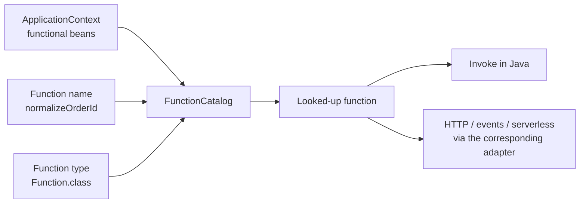

# Looking Up Functions by Name and Type in FunctionCatalog

**Chapter:** FunctionCatalog  
**Module:** Spring Cloud Function (`SPRING_CLOUD_FUNCTION`)

Spring Cloud Function allows writing business logic as `Supplier`, `Function`, and `Consumer` beans for reuse regardless of how they are invoked. The same function can be used in Java code, from an HTTP adapter, an event system, or a serverless environment. Rather than requiring callers to know a concrete Java class, **`FunctionCatalog`** provides a mechanism to find functions by **name** and by **functional interface type**.

This lesson focuses on the lookup operation: selecting the right function, distinguishing the three function kinds, understanding runtime type-checking limits, handling lookup failures, and applying this in an application.

## 1. Why Look Up Functions Instead of Calling Beans Directly?

Suppose an order system has three tasks:

- Generate an order ID: `Supplier<String>`.
- Normalize the ID: `Function<String, String>`.
- Record the processed ID: `Consumer<String>`.

Business code could call each Spring bean directly. However, an HTTP adapter or event listener is typically configured only by a function name, such as `normalizeOrderId`. `FunctionCatalog` turns that name into a usable function object. The catalog is also where Spring Cloud Function applies supporting mechanisms such as function wrapping, data type adaptation, and function composition when needed.



**Distinction:** `ApplicationContext.getBean("normalizeOrderId")` retrieves a Spring bean. `FunctionCatalog.lookup(...)` retrieves a function according to the Spring Cloud Function model; the returned representation may be wrapped and further processed by the framework. When building integrations, look up via the catalog so you share the same semantics as the adapters.

## 2. Essential API

Key operations of `org.springframework.cloud.function.context.FunctionCatalog`:

| Operation | Meaning | Scenario |
| --- | --- | --- |
| `catalog.lookup("normalizeOrderId")` | Look up by name or function definition | Name is known without constraining type in the call |
| `catalog.lookup(Function.class, "normalizeOrderId")` | Look up with type `Function` | Need a function accepting input and returning a result |
| `catalog.lookup(Supplier.class, "newOrderId")` | Look up with type `Supplier` | Need a function that supplies data |
| `catalog.lookup(Consumer.class, "auditOrderId")` | Look up with type `Consumer` | Need a function that consumes data for processing |
| `catalog.getNames(null)` | List function names available for lookup in the catalog | Discovery and diagnostics |
| `catalog.getNames(Function.class)` | List names by functional interface type | Inspect candidates in the `Function` group |

Two points to remember:

1. **Name** identifies *which function*, for example `normalizeOrderId`. By default, when declared via `@Bean`, the bean name is the method name; it can be set explicitly with `@Bean("...")`.
2. **Type** determines *how the function is invoked*: `Supplier` uses `get()`, `Function` uses `apply(input)`, and `Consumer` uses `accept(input)`.

The `Function.class` argument only checks the interface group at the class level. It **does not fully verify** the generic type parameters `String`, `Integer`, or DTO types declared on your Java variable.

## 3. Complete Example: Declaring and Finding All Three Function Types

The following example uses a Spring Boot application with Spring Cloud Function context and compatible dependency versions. It requires no HTTP adapter or message broker because all operations run directly through `FunctionCatalog`.

```java
import java.util.Locale;
import java.util.Set;
import java.util.function.Consumer;
import java.util.function.Function;
import java.util.function.Supplier;

import org.springframework.boot.ApplicationRunner;
import org.springframework.boot.SpringApplication;
import org.springframework.boot.autoconfigure.SpringBootApplication;
import org.springframework.cloud.function.context.FunctionCatalog;
import org.springframework.context.annotation.Bean;

@SpringBootApplication
public class CatalogLookupApplication {

    public static void main(String[] args) {
        SpringApplication.run(CatalogLookupApplication.class, args);
    }

    @Bean("newOrderId")
    public Supplier<String> newOrderId() {
        return () -> "ord-42";
    }

    @Bean("normalizeOrderId")
    public Function<String, String> normalizeOrderId() {
        return value -> value.trim().toUpperCase(Locale.ROOT);
    }

    @Bean("orderIdLength")
    public Function<String, Integer> orderIdLength() {
        return String::length;
    }

    @Bean("auditOrderId")
    public Consumer<String> auditOrderId() {
        return value -> System.out.println("AUDIT " + value);
    }

    @Bean
    public ApplicationRunner demonstrateLookup(FunctionCatalog catalog) {
        return args -> {
            Set<String> functionNames = catalog.getNames(Function.class);
            System.out.println("Functions: " + functionNames);

            Supplier<String> supplier =
                catalog.lookup(Supplier.class, "newOrderId");
            Function<String, String> normalizer =
                catalog.lookup(Function.class, "normalizeOrderId");
            Consumer<String> auditor =
                catalog.lookup(Consumer.class, "auditOrderId");

            if (supplier == null || normalizer == null || auditor == null) {
                throw new IllegalStateException(
                    "Missing one or more registered functions");
            }

            String rawId = supplier.get();
            String normalizedId = normalizer.apply(rawId);
            auditor.accept(normalizedId);

            System.out.println(normalizedId); // ORD-42
        };
    }
}
```

**Analysis:**

- `@Bean("newOrderId")` causes Spring to register a bean with the exact name `newOrderId`; the catalog can find that bean by name.
- `lookup(Supplier.class, "newOrderId")` returns an object on which you can call `get()` with no arguments.
- `lookup(Function.class, "normalizeOrderId")` returns an object on which you can call `apply(String)`; the sample result is `ORD-42`.
- `lookup(Consumer.class, "auditOrderId")` returns an object on which you can call `accept(String)`; a `Consumer` itself returns no value.
- `orderIdLength` is also a `Function`, but its output is `Integer`. Belonging to the `Function` group does not mean all functions in the group share the same input/output types.

`catalog.getNames(Function.class)` should contain `normalizeOrderId` and `orderIdLength`. Do not assert exact equality against a fixed set of names because the catalog may contain functions from other configurations and libraries.

### 3.1. Declaring a Spring Bean Is the First Prerequisite

A Java object that merely `implements Function` is not enough for lookup. Spring must manage that object as a bean via `@Bean`, `@Component` within scanning scope, or an explicit registration mechanism supported by Spring Cloud Function.

For example, if you write:

```java
Function<String, String> temporary =
    value -> value.trim().toUpperCase(Locale.ROOT);
```

then the `temporary` variable does not automatically appear in the catalog. By contrast, methods annotated with `@Bean` in the sample application are registered by Spring and can be discovered as catalog candidates.

## 4. Lookup by Name: Method Name, Bean Name, and Definition

### 4.1. Default Name and Explicit Name

```java
@Bean
public Function<String, String> trimText() {
    return String::trim;
}

@Bean("normalizeCustomerCode")
public Function<String, String> normalizeCode() {
    return value -> value.trim().toUpperCase(Locale.ROOT);
}
```

With these declarations:

| Declaration | Name Used for Lookup |
| --- | --- |
| `@Bean` on method `trimText()` | `trimText` |
| `@Bean("normalizeCustomerCode")` on `normalizeCode()` | `normalizeCustomerCode` |

Do not infer lookup names from class names or generic types. In the second example, `normalizeCode` is only the Java method name, while the bean name has been set to `normalizeCustomerCode`.

### 4.2. Using Lookup with Only a Name

When the caller already knows the function contract, you can use the overload without passing a type:

```java
Function<String, String> normalize =
    catalog.lookup("normalizeOrderId");

if (normalize == null) {
    throw new IllegalStateException("Function not found");
}
System.out.println(normalize.apply("  ord-42  ")); // ORD-42
```

In this example, the `catalog` variable is already injected and the `normalizeOrderId` bean is registered as in section 3. The compiler infers the expected generic type from the target variable, but that type is **not proof** that the actual bean is `Function<String, String>`. Mismatches in function kind or data types can cause runtime errors.

Therefore, when a system handles multiple types of functional beans, the overload with a type parameter is more readable and expresses intent more clearly:

```java
Function<String, String> normalize =
    catalog.lookup(Function.class, "normalizeOrderId");
```

### 4.3. Looking Up an Entire Function Chain

The second parameter of `lookup` is called the *function definition*. Beyond a single bean name, a definition can express composition using `|`:

```java
@Bean("addOrderPrefix")
public Function<String, String> addOrderPrefix() {
    return value -> "ID-" + value;
}
```

After registering the bean above, calling code uses:

```java
Function<String, String> pipeline =
    catalog.lookup(
        Function.class, "normalizeOrderId|addOrderPrefix");

if (pipeline == null) {
    throw new IllegalStateException("Pipeline not found");
}

String result = pipeline.apply("  ord-42  ");
// ID-ORD-42
```

The catalog executes `normalizeOrderId` first and passes its output into `addOrderPrefix`. Data types between chained functions must be compatible. This is a **definition**, not necessarily the name of a single bean; `getNames(Function.class)` is normally used to inspect registered function names, not to list every possible composition string that could be formed.

## 5. Lookup by Function Type: Supplier, Function, Consumer

### 5.1. Supplier: No Input

```java
Supplier<String> producer =
    catalog.lookup(Supplier.class, "newOrderId");
if (producer == null) {
    throw new IllegalStateException("Supplier not found");
}
String generated = producer.get();
```

A `Supplier<T>` takes **no** parameters and provides `T`. It is suitable for data-generation or event-producing functions. Each call to `get()` can yield a different result depending on the logic; it is not assumed to be pure or immutable.

### 5.2. Function: Has Input and Output

```java
Function<String, Integer> counter =
    catalog.lookup(Function.class, "orderIdLength");
if (counter == null) {
    throw new IllegalStateException("Function not found");
}
int characters = counter.apply("ORD-42"); // 6
```

`Function<T, R>` takes `T` and returns `R`. When looking up with `Function.class`, the catalog filters by **interface kind**; the `<String, Integer>` on the Java variable still needs to match the bean's actual signature.

### 5.3. Consumer: Has Input, No Result

```java
Consumer<String> audit =
    catalog.lookup(Consumer.class, "auditOrderId");
if (audit == null) {
    throw new IllegalStateException("Consumer not found");
}
audit.accept("ORD-42");
```

`Consumer<T>` only accepts `T` and performs an action, such as logging or sending an event. You cannot call `apply(...)` or expect a return value from it.

| Type to Find | Lookup Call | Invocation |
| --- | --- | --- |
| `Supplier<T>` | `catalog.lookup(Supplier.class, "name")` | `supplier.get()` |
| `Function<T, R>` | `catalog.lookup(Function.class, "name")` | `function.apply(input)` |
| `Consumer<T>` | `catalog.lookup(Consumer.class, "name")` | `consumer.accept(input)` |

**Note on type safety:** `Supplier.class`, `Function.class`, and `Consumer.class` cannot carry full generic type information at runtime due to Java's *type erasure*. When working with DTOs, JSON, messages, or composition, declare concrete generic signatures directly on the bean so Spring Cloud Function has enough metadata to infer and convert types.

## 6. Discovering Names Before Lookup

Instead of guessing names, inspect the catalog's listing:

```java
Set<String> allNames = catalog.getNames(null);
Set<String> suppliers = catalog.getNames(Supplier.class);
Set<String> functions = catalog.getNames(Function.class);
Set<String> consumers = catalog.getNames(Consumer.class);

System.out.println("All: " + allNames);
System.out.println("Suppliers: " + suppliers);
System.out.println("Functions: " + functions);
System.out.println("Consumers: " + consumers);
```

The examples in this section use `import java.util.Set`. In the sample application from section 3, you can expect:

- `suppliers` contains `newOrderId`.
- `functions` contains `normalizeOrderId` and `orderIdLength`.
- `consumers` contains `auditOrderId`.

The returned sets are listings for **discovery and verification**, not a guarantee that the catalog contains only the names listed here. Do not rely on the element order of `Set`, and do not assume every name is exposed as an endpoint or message binding.

### Example: Checking Preconditions Before Use

```java
String functionName = "normalizeOrderId";

if (!catalog.getNames(Function.class).contains(functionName)) {
    throw new IllegalArgumentException(
        "Unknown Function: " + functionName);
}

Function<String, String> function =
    catalog.lookup(Function.class, functionName);

if (function == null) {
    throw new IllegalStateException(
        "Function was listed but lookup failed: " + functionName);
}

String value = function.apply("  ord-42  ");
```

Checking `getNames(...)` is useful for diagnostics and supporting function-selection UIs. However, in systems where configuration or beans may change across lifecycles, the lookup step must still handle the case where the function cannot be retrieved. The list of names is also **not an authorization mechanism**.

## 7. Real-World Case: Selecting a Processing Function by Configuration

A service needs to choose between two handlers sharing the same `Function<String, String>` contract, such as normalizing an ID or adding a prefix. We only accept names explicitly defined by the application.

Assuming `normalizeOrderId` and `addOrderPrefix` beans are already registered, the service class can be written as:

```java
import java.util.Set;
import java.util.function.Function;
import org.springframework.cloud.function.context.FunctionCatalog;
import org.springframework.stereotype.Service;

@Service
public class OrderIdProcessor {

    private static final Set<String> ALLOWED_HANDLERS =
        Set.of("normalizeOrderId", "addOrderPrefix");

    private final FunctionCatalog catalog;

    public OrderIdProcessor(FunctionCatalog catalog) {
        this.catalog = catalog;
    }

    public String process(String handlerName, String rawOrderId) {
        if (!ALLOWED_HANDLERS.contains(handlerName)) {
            throw new IllegalArgumentException(
                "Unsupported handler: " + handlerName);
        }

        Function<String, String> handler =
            catalog.lookup(Function.class, handlerName);

        if (handler == null) {
            throw new IllegalStateException(
                "Handler is not registered: " + handlerName);
        }

        return handler.apply(rawOrderId);
    }
}
```

Here, `OrderIdProcessor` depends on the `FunctionCatalog` contract and the agreed function names; it does not depend directly on each function's implementation class. If an HTTP controller, message listener, or serverless adapter needs the same logic, those components can use a similar service or connect to the appropriate function definition.

The `ALLOWED_HANDLERS` set prevents executing an arbitrary function in the catalog simply because an external caller passed an arbitrary name. Name filtering here serves business selection; system authentication and authorization requirements must still be handled separately.

### 7.1. Difference Between lookup and spring.cloud.function.definition

```yaml
spring:
  cloud:
    function:
      definition: normalizeOrderId
```

The `spring.cloud.function.definition` property tells an adapter which function or composition should be used by default in an integration context. By contrast, `catalog.lookup(Function.class, "normalizeOrderId")` is an active Java call that looks up a function at runtime.

Both share the same identifier names but serve different purposes:

| Scenario | Usage |
| --- | --- |
| Java code needs to invoke a specific function | `catalog.lookup(...)` |
| Java code needs to inspect available functions | `catalog.getNames(...)` |
| Adapter needs to select a function to bind | `spring.cloud.function.definition` per the adapter's documentation |

Configuring `definition` alone does not turn an ordinary Java object into a Spring functional bean. The function must still be declared or registered properly.

## 8. Handling Not-Found or Wrong-Type Cases

A failed lookup can result from a non-existent name, an unregistered bean, selecting the wrong function type, or configuration differences. For application code paths, check for `null` and handle runtime/type-conversion errors at the appropriate layer.

**Type mismatch example:**

```java
// orderIdLength is actually Function<String, Integer>.
Function<String, String> incorrectlyTyped =
    catalog.lookup(Function.class, "orderIdLength");

// Unsafe: Function.class does not verify String as the return type.
// Using it as Function<String, String> may cause runtime errors.
```

This illustrative snippet is intentionally **not executed**. It demonstrates that assigning a variable with the desired generic parameters cannot replace checking the bean's actual contract.

### 8.1. Single-Function Fallback

In some configurations or versions, when the catalog contains only **one** eligible function, the *single-function fallback* mechanism can select that sole function even when the caller provides an inexact name. Consequently, testing an invalid name in an application with only one function is not a reliable test of name-matching rules.

You can configure lookups to require a matching name rather than relying on the fallback when your version supports the property:

```properties
spring.cloud.function.single-function-fallback-enabled=false
```

In multi-function projects, use clear names and specify `spring.cloud.function.definition` for each adapter as needed. When upgrading versions, recheck the corresponding configuration documentation.

### 8.2. Quick Diagnostic Table

| Symptom | What to Verify | Resolution |
| --- | --- | --- |
| Name not shown in `getNames(null)` | Bean is not managed by Spring or outside component scan scope | Declare `@Bean` or `@Component` and verify scan configuration |
| Expected name not found | `@Bean("explicitName")` makes lookup name differ from method name | Use the exact bean name |
| Present in catalog but wrong type lookup | Used `Supplier.class` for a `Function` bean, or vice versa | Check the bean type and pass the matching interface |
| Lookup succeeds but invocation fails with type error | Expected generic types differ from the bean's actual signature | Verify the real `Function<I, O>`, `Supplier<O>`, or `Consumer<I>` |
| Validly declared bean is missing | Bean excluded from eligible candidates | Check `spring.cloud.function.ineligible-definitions` |
| Typo in name still executes a function | Environment has only one function and fallback is active | Disable fallback if supported and verify exact names |
| Found via catalog but no HTTP URL | Web adapter not declared or function not exported | Check dependencies and HTTP adapter configuration |

In particular, a function having a name in the catalog **does not automatically mean** it has an HTTP endpoint, a broker consumer binding, or a serverless entry point. Adapters establish those bindings according to their own configuration and lifecycle.

## 9. Properly Testing Lookup Behavior

With the `CatalogLookupApplication` class in section 3 and a compatible `spring-boot-starter-test` dependency, you can write a JUnit 5 test:

```java
import static org.junit.jupiter.api.Assertions.*;

import java.util.function.Consumer;
import java.util.function.Function;
import java.util.function.Supplier;

import org.junit.jupiter.api.Test;
import org.springframework.beans.factory.annotation.Autowired;
import org.springframework.boot.test.context.SpringBootTest;
import org.springframework.cloud.function.context.FunctionCatalog;

@SpringBootTest(classes = CatalogLookupApplication.class)
class CatalogLookupApplicationTest {

    @Autowired
    private FunctionCatalog catalog;

    @Test
    void findsFunctionsByNameAndType() {
        assertTrue(catalog.getNames(Function.class)
                          .contains("normalizeOrderId"));
        assertTrue(catalog.getNames(Supplier.class)
                          .contains("newOrderId"));
        assertTrue(catalog.getNames(Consumer.class)
                          .contains("auditOrderId"));

        Supplier<String> supplier =
            catalog.lookup(Supplier.class, "newOrderId");
        Function<String, String> normalize =
            catalog.lookup(Function.class, "normalizeOrderId");
        Consumer<String> audit =
            catalog.lookup(Consumer.class, "auditOrderId");

        assertNotNull(supplier);
        assertNotNull(normalize);
        assertNotNull(audit);

        String result = normalize.apply(supplier.get());
        assertEquals("ORD-42", result);
        assertDoesNotThrow(() -> audit.accept(result));
    }

    @Test
    void distinguishesFunctionsWithDifferentOutputTypes() {
        Function<String, Integer> length =
            catalog.lookup(Function.class, "orderIdLength");

        assertNotNull(length);
        assertEquals(6, length.apply("ORD-42"));
    }
}
```

The test above verifies **the lookup contract and invocation of the result**, without depending on name listing order or the number of infrastructure beans. Because HTTP and brokers are not involved, testing at the catalog layer catches name and type errors before adding adapters.

## 10. Hands-On Practice

1. Add a `@Bean("reverseOrderId")` of type `Function<String, String>` that reverses a string. Verify this name appears in `catalog.getNames(Function.class)` and invoke it using `lookup(Function.class, "reverseOrderId")`.
2. Try looking up `newOrderId` with `Supplier.class`, then compare that with requesting `Function.class`. Observe the actual behavior and explain why the correct type must be specified.
3. Add a `Function<String, Integer>` that counts string length; explain why `Function.class` is not sufficient to guarantee a `String` return type.
4. Write the composition `normalizeOrderId|reverseOrderId`. With input `"  ord-42  "`, the expected result is `"24-DRO"`.
5. Rename `reverseOrderId` to `@Bean("reverseCode")`, then update the `lookup` calls and function definitions referencing it.

**Open question:** If an application has dozens of functional beans, is an API that allows users to enter any name to execute a function safe? Design an allowlist of callable functions, type checks, authorization controls, and lookup error handling.

## 11. Summary

- `FunctionCatalog.lookup("name")` finds a function by name/definition; the overloads `lookup(Supplier.class / Function.class / Consumer.class, "name")` explicitly express the required kind.
- `getNames(null)` and `getNames(type)` are useful for name discovery and diagnostics, but are not a fixed contract on ordering or adapter export scope.
- The lookup name is the Spring **bean name**; explicit naming via `@Bean("name")` keeps configuration stable.
- The interface class does not fully verify generic parameters. Callers must know the actual input/output contract, especially when working with DTOs or messages.
- After lookup, check the result and call `get()`, `apply(input)`, or `accept(input)` accordingly. This model is the foundation for reusing one function across HTTP, event, or serverless adapters.

**Further reading:** [Spring Cloud Function Reference Guide — Programming Model](https://docs.spring.io/spring-cloud-function/reference/spring-cloud-function/programming-model.html), covering `FunctionCatalog`, functional bean signatures, lookup mechanics, and composition.
