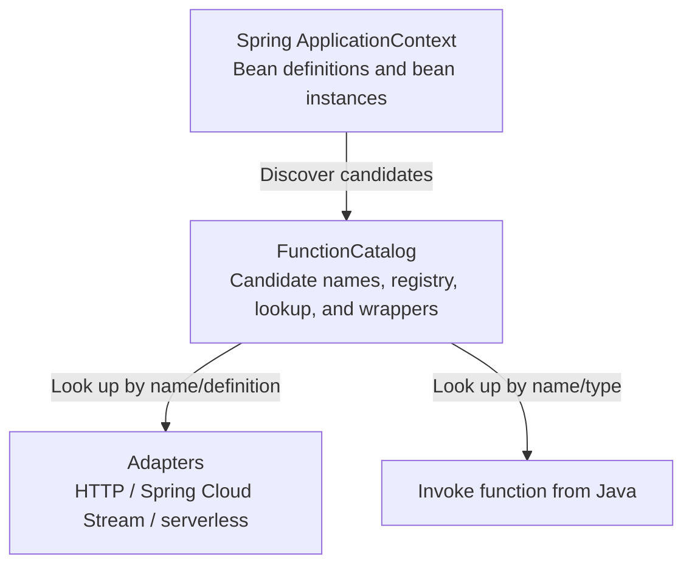
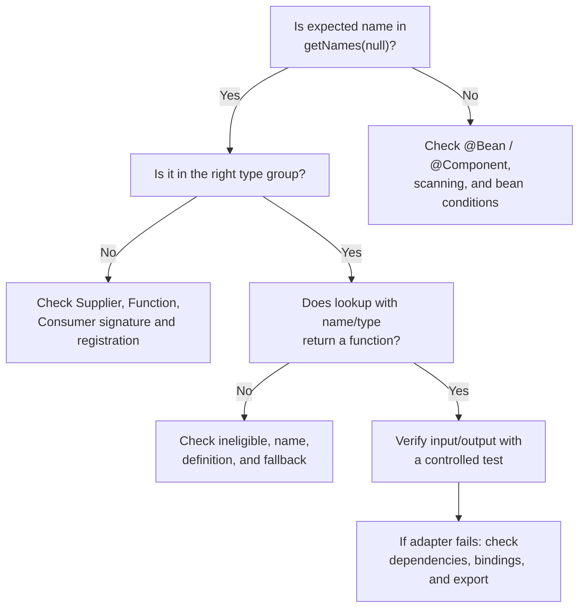

# Listing Function Names and Inspecting Catalog Contents

**Chapter:** FunctionCatalog  
**Module:** Spring Cloud Function (`SPRING_CLOUD_FUNCTION`)

When a Spring Cloud Function application has many `Supplier`, `Function`, and `Consumer` beans, developers need to know **which functions the application has recognized**, **which names are used for lookup**, and **whether the looked-up function matches the expected contract**. This is the job of `FunctionCatalog` inspection.

Spring Cloud Function allows writing reusable business logic independent of the invocation protocol. A single function can serve Java code, HTTP, event processing via Spring Cloud Stream, or serverless environments. Before connecting an adapter, inspecting the catalog is a quick way to verify that the business function is truly ready at the Spring Cloud Function layer.

After this lesson, you will be able to:

1. List all function names and list them by `Supplier`, `Function`, and `Consumer` type.
2. Use `size()`, `getNames(...)`, and `lookup(...)` appropriately, understanding each operation's limits.
3. Inspect function kind and data type metadata via Spring Boot Actuator when configured.
4. Cross-reference the catalog with `ApplicationContext` and diagnose cases where the name list does not match expectations.
5. Write automated tests for the function catalog that the application is expected to provide.

## 1. What Do "Catalog Contents" Include?

`FunctionCatalog` is the interface used to look up functional beans managed by Spring Cloud Function. The catalog identifies functional beans from Spring's `ApplicationContext` and can wrap them to support type conversion, composition, and adapter integration. Function registration/wrapping can happen **lazily on demand** during lookup, so you should not view the catalog as a static `Map<String, Object>` pre-populated with every function at all times.

There are several distinct layers of information:

| Question | How to Check | Meaning |
| --- | --- | --- |
| Which function names does the application know? | `catalog.getNames(null)` | List of names recognized from the catalog and context |
| Which names belong to the `Function` group? | `catalog.getNames(Function.class)` | Names grouped by functional interface type |
| What size does the catalog report? | `catalog.size()` | Reference metric for registrations/candidates |
| Can a specific name be looked up as a function? | `catalog.lookup(Function.class, "name")` | Verifies the actual lookup path |
| What input/output types does the function declare? | `/actuator/functions` if enabled | Function kind and type metadata reported by the endpoint |
| Does HTTP or a message broker use the function? | Adapter configuration and state | Cannot be concluded from `getNames(...)` alone |

**Distinguishing three layers:**



- A Java `Function` only appears when properly registered with Spring; declaring a local lambda variable does not automatically add it to the catalog.
- A listed name **does not guarantee** that lookup will succeed in all cases: some candidates may be excluded from the lookup path or registered in a special manner.
- A resolvable name **does not automatically mean** the function already has an HTTP endpoint or message binding; adapters still require matching dependencies and configuration.

## 2. APIs for Inspecting the Catalog

The `org.springframework.cloud.function.context.FunctionCatalog` interface supports commonly used operations:

```java
// Assume catalog has been injected by Spring into the application.

int reportedSize = catalog.size();

Set<String> allNames = catalog.getNames(null);
Set<String> suppliers = catalog.getNames(Supplier.class);
Set<String> functions = catalog.getNames(Function.class);
Set<String> consumers = catalog.getNames(Consumer.class);

Function<String, String> normalize =
    catalog.lookup(Function.class, "normalizeOrderCode");
```

The snippet above requires imports for `java.util.Set`, `java.util.function.Supplier`, `Function`, and `Consumer`.

### 2.1. getNames(null): Listing All Names

`catalog.getNames(null)` returns a `Set<String>` of names recognized by the catalog. A `Set` does not guarantee iteration order, so when logging or comparing outputs, **sort before displaying**.

The actual list may include function names provided by libraries or the framework, such as `functionRouter`. Do not assume that every name in `getNames(null)` is a `@Bean` method you wrote yourself.

### 2.2. getNames(type): Listing by Type

Instead of filtering by name prefixes or suffixes, pass the interface class:

```java
catalog.getNames(Supplier.class);
catalog.getNames(Function.class);
catalog.getNames(Consumer.class);
```

In standard Spring Cloud Function usage, these arguments split names into three functional groups. However, how a special registration is reflected across groups can depend on the registration method, version, and underlying registry. To confirm which contract a specific name implements, **look it up with the expected type and perform a controlled test invocation**.

`getNames(Function.class)` does not provide enough generic type detail to distinguish `Function<String, String>` from `Function<String, Integer>`. Both are `Function`.

### 2.3. size(): A Reference Metric, Not an Exact Inventory

The documentation provides `catalog.size()` to observe catalog size. Due to lazy registration and how the registry counts candidates, this number can be **approximate**; in addition, one registration may carry multiple names (aliases), and a composition name is not an independent bean.

Therefore, do not write business rules such as:

```java
// Avoid using this relationship as a strict requirement:
// catalog.size() == catalog.getNames(null).size()
```

To ensure the system has its required functions, check the **expected names** and verify `lookup` succeeds for each name. Use `size()` as an observational aid, not as a count of exported APIs.

## 3. Practical Example: Printing the Function Catalog on Startup

The example below is a standalone Spring Boot application using Spring Cloud Function context compatible with the project's Spring Boot version. No HTTP adapter or message broker is needed yet.

```java
import java.util.Locale;
import java.util.Set;
import java.util.function.Consumer;
import java.util.function.Function;
import java.util.function.Supplier;

import org.springframework.boot.ApplicationRunner;
import org.springframework.boot.SpringApplication;
import org.springframework.boot.autoconfigure.SpringBootApplication;
import org.springframework.cloud.function.context.FunctionCatalog;
import org.springframework.context.annotation.Bean;

@SpringBootApplication
public class CatalogInspectionApplication {

    public static void main(String[] args) {
        SpringApplication.run(CatalogInspectionApplication.class, args);
    }

    @Bean
    public Supplier<String> newOrderCode() {
        return () -> "ord-42";
    }

    @Bean
    public Function<String, String> normalizeOrderCode() {
        return value -> value.trim().toUpperCase(Locale.ROOT);
    }

    @Bean
    public Function<String, Integer> countCharacters() {
        return String::length;
    }

    @Bean
    public Consumer<String> auditOrderCode() {
        return value -> System.out.println("AUDIT: " + value);
    }

    @Bean
    public ApplicationRunner reportCatalog(FunctionCatalog catalog) {
        return args -> {
            System.out.println("Reported size: " + catalog.size());
            printNames("All", catalog.getNames(null));
            printNames("Suppliers", catalog.getNames(Supplier.class));
            printNames("Functions", catalog.getNames(Function.class));
            printNames("Consumers", catalog.getNames(Consumer.class));
        };
    }

    private static void printNames(String group, Set<String> names) {
        System.out.println(group + ":");
        names.stream()
            .sorted()
            .forEach(name -> System.out.println("  - " + name));
    }
}
```

**Results to verify:**

| Call Group | Expected Business Names |
| --- | --- |
| `getNames(Supplier.class)` | `newOrderCode` |
| `getNames(Function.class)` | `normalizeOrderCode`, `countCharacters` |
| `getNames(Consumer.class)` | `auditOrderCode` |
| `getNames(null)` | All four business names above |

In real environments, these lists may contain additional names. Thus, simply check that the **expected names are contained**, rather than requiring the returned set to equal an exact four-element set.

The example also shows that the catalog classifies functions by interface type rather than output type: `normalizeOrderCode` and `countCharacters` both belong to the `Function` group even though one returns `String` and the other returns `Integer`.

### 3.1. Which Bean Name Is Listed?

By default, the method:

```java
@Bean
public Function<String, String> normalizeOrderCode() {
    return value -> value.trim().toUpperCase(Locale.ROOT);
}
```

creates a bean named `normalizeOrderCode`.

If named explicitly:

```java
@Bean("normalizeOrder")
public Function<String, String> normalizeOrderCode() {
    return value -> value.trim().toUpperCase(Locale.ROOT);
}
```

then the lookup name and expected catalog name is `normalizeOrder`. This snippet illustrates **an alternative way to declare** the previous bean, not a requirement to create two duplicate beans at the same time.

In integrated applications, choose clear and stable names because those names are often referenced via `spring.cloud.function.definition` or adapter configurations.

## 4. From "Name in the List" to "Function Actually Works"

`getNames(...)` indicates that a name is recognized; for deeper verification, look up the function and validate its behavioral contract. For example, using the beans in section 3:

```java
Function<String, String> normalize =
    catalog.lookup(Function.class, "normalizeOrderCode");
if (normalize == null) {
    throw new IllegalStateException(
        "Catalog cannot resolve normalizeOrderCode");
}
String normalized = normalize.apply("  ord-42  ");
System.out.println(normalized); // ORD-42

Function<String, Integer> counter =
    catalog.lookup(Function.class, "countCharacters");
if (counter == null) {
    throw new IllegalStateException(
        "Catalog cannot resolve countCharacters");
}
System.out.println(counter.apply(normalized)); // 6
```

Merely checking `normalize != null` is also insufficient if the goal is to prove the business output is correct; tests should use clear inputs and expected outputs.

### 4.1. Lookup by Interface Type, Not by Generics

For example:

```java
Function<String, Integer> counter =
    catalog.lookup(Function.class, "countCharacters");
```

The `Function.class` argument indicates this is a **Function**. It does not carry `String` and `Integer` at runtime due to Java *type erasure*. Therefore, declaring:

```java
// Unsafe: countCharacters actually returns Integer.
Function<String, String> wrongType =
    catalog.lookup(Function.class, "countCharacters");
```

may compile but lead to type errors at runtime. You should verify the bean signature or type metadata managed by Spring Cloud Function, especially when working with DTOs and JSON messages.

### 4.2. Do Not Use Production Values to Test Consumers

A `Consumer` often has side effects such as sending emails, writing to a database, or publishing events. To verify it exists in the catalog, you can look it up and check that the returned value is non-null; if you need to call `accept(...)`, use a test environment with safely mocked or substituted dependencies.

```java
Consumer<String> audit =
    catalog.lookup(Consumer.class, "auditOrderCode");
if (audit == null) {
    throw new IllegalStateException("Missing auditOrderCode");
}
// Only call audit.accept(...) in a demo or controlled test.
```

Similarly, a `Supplier` may generate data or call external systems, so `get()` is not necessarily a side-effect-free read operation either.

## 5. Observing Metadata via Spring Boot Actuator

In addition to the Java API, Spring Cloud Function supports the **`/actuator/functions`** endpoint to inspect functions exposed in the catalog along with their type metadata. This is useful when diagnosing from outside the application process.

### 5.1. Preparing Dependencies

The application needs Spring Cloud Function along with Spring Boot Actuator and a compatible web stack (MVC or WebFlux). For a Maven project, add the following Spring Boot dependencies using your project's dependency version management:

```xml
<dependency>
    <groupId>org.springframework.boot</groupId>
    <artifactId>spring-boot-starter-actuator</artifactId>
</dependency>

<dependency>
    <groupId>org.springframework.boot</groupId>
    <artifactId>spring-boot-starter-web</artifactId>
</dependency>
```

These two dependencies **do not replace** the Spring Cloud Function dependency already in the application. If the project already uses WebFlux, use the appropriate web stack rather than adding both MVC and WebFlux.

In `application.yml`, enable endpoint exposure:

```yaml
management:
  endpoints:
    web:
      exposure:
        include: health,info,functions
```

With the sample application running on localhost, query:

```bash
curl http://localhost:8080/actuator/functions
```

Depending on the version, configuration, and beans in the context, the response may have a structure **similar to this illustrative example**:

```json
{
  "newOrderCode": {
    "type": "SUPPLIER",
    "output-type": "string"
  },
  "normalizeOrderCode": {
    "type": "FUNCTION",
    "input-type": "string",
    "output-type": "string"
  },
  "countCharacters": {
    "type": "FUNCTION",
    "input-type": "string",
    "output-type": "integer"
  },
  "auditOrderCode": {
    "type": "CONSUMER",
    "input-type": "string"
  }
}
```

This is illustrative data, not fixed output: the response may include additional functions such as `functionRouter`, format type names differently, or vary field ordering across versions.

### 5.2. How to Read the Endpoint Output

| Field | Meaning |
| --- | --- |
| JSON key name, e.g. `normalizeOrderCode` | Function name listed by the endpoint |
| `type` | Function kind: `SUPPLIER`, `FUNCTION`, `CONSUMER` |
| `input-type` | Detected input type, if the function takes input |
| `output-type` | Detected output type, if the function produces output |

A `Supplier` usually has no `input-type`, and a `Consumer` usually has no `output-type`. For functions using `Message<T>`, complex DTOs, or reactive types, how the endpoint displays metadata may differ from the simple string example.

**Operational note:** Actuator endpoints are for observability and management. Expose only necessary endpoints and apply appropriate security protections before using them in externally accessible environments. Seeing a function in the list does not prove that it can be invoked via the same URL.

### 5.3. Distinguishing the Actuator Endpoint from Function Invocation Endpoints

| Access Path | Purpose |
| --- | --- |
| `GET /actuator/functions` | Observe function names/metadata (if the endpoint is enabled) |
| Function endpoints exported by Spring Cloud Function Web | Invoke business logic over HTTP, depending on web adapter and configuration |
| Message bindings in Spring Cloud Stream | Connect functions to brokers and bindings, depending on stream adapter |

An application with only Spring Cloud Function context installed can still inspect `getNames(...)` and `lookup(...)` in Java code, even without a web stack or exposed endpoints.

## 6. Why Might getNames(), size(), and lookup() Differ from Expectations?

The catalog combines information from the Spring context and Spring Cloud Function's registry. Part of registration may occur lazily when a function is looked up; some framework support beans are also `Function` instances. Additionally, `FunctionRegistration` and special functional registrations can affect how names and types are reflected.

This leads to three principles when inspecting:

1. **Use getNames to observe candidates, not as proof of execution.** Only when `lookup` returns an appropriate function do you know the lookup path works.
2. **Use size as a supporting metric.** Do not require it to equal the name count or HTTP endpoint count; registrations, aliases, and compositions are distinct concepts.
3. **Separate the Spring catalog from the exported scope.** `spring.cloud.function.definition` selects functions/compositions for adapters; it is not an API to "list all beans" and does not create new beans.

### 6.1. Cross-Referencing ApplicationContext When Debugging

In an application containing the `normalizeOrderCode` bean:

```java
// Assume ApplicationContext context and FunctionCatalog catalog
// have already been injected.

String[] beanNames =
    context.getBeanNamesForType(Function.class);
Set<String> functionNames =
    catalog.getNames(Function.class);
```

These two lists answer **two different questions**: Spring knows which beans have type `Function`, while Spring Cloud Function knows which function names are available via the catalog interface. Do not assume the two sets are always identical; filtering, registration, and adapters can affect what is observed.

If `getBeanNamesForType(Function.class)` does not contain the expected name, check `@Bean`, component scanning, conditional bean creation, and Spring configuration first. If the context has the bean but the catalog cannot look it up, check the bean type, name, filtering mechanisms, and lookup path.

### 6.2. Function Definition and Composition Are Not Name Listings

For example, if you have two compatible beans `normalizeOrderCode` and `addPrefix`:

```properties
spring.cloud.function.definition=normalizeOrderCode|addPrefix
```

The `definition` property selects the processing chain for an adapter. You can look up the chain:

```java
Function<String, String> composed =
    catalog.lookup(
        Function.class, "normalizeOrderCode|addPrefix");
```

but you should not expect `getNames(Function.class)` to contain a bean literally named `normalizeOrderCode|addPrefix`. The catalog of registered names and the combinations that can be composed from them are two different sets of information.

### 6.3. Single Function and Fallback Rules

Spring Cloud Function has a *single-function fallback* mechanism: if only one eligible functional bean exists, a lookup missing a name or using a non-matching name may still select that sole function. This is convenient for small applications but can hide typos during testing.

When your version supports it and you want to require an exact name:

```properties
spring.cloud.function.single-function-fallback-enabled=false
```

Keep at least two functions in tests verifying name-selection errors, or explicitly disable fallback. Do not conclude a name is registered just because `lookup("typo-name")` returns a result in a single-function application.

## 7. Diagnosing with a Repeatable Workflow

When a function does not appear in the list or an adapter cannot invoke it, check in order:



| Symptom | Cause to Consider | Next Step |
| --- | --- | --- |
| `getNames(null)` lacks the function | Spring bean not registered, class outside scan scope, conditional config unmet | Check bean names and definitions in `ApplicationContext` |
| Name in general list, missing from `Function` group | Function is a `Supplier`/`Consumer` or registered via another mechanism | Check actual type and registration method |
| Name exists but `lookup(...)` returns nothing | Wrong name/definition, excluded by `ineligible-definitions`, or incompatible registration path | Try exact name, check filters and configuration |
| `lookup(...)` returns function but invocation throws type error | Declared generics and input/output data types are incompatible | Check actual signature and conversion metadata |
| `getNames(...)` includes unexpected names | Beans from libraries, framework, or `functionRouter` | Distinguish infrastructure names from business names |
| `size()` does not equal number of names | Counting registrations/candidates vs. aliases differs | Do not assert equality between these two values in tests |
| `GET /actuator/functions` returns 404 | Missing Actuator/web stack, endpoint not exposed, or unsupported in current config | Check dependencies and `management.endpoints.web.exposure.include` |
| Catalog has function, but HTTP or broker cannot invoke it | Adapter, export, binding, or `definition` not configured | Check adapter configuration; the catalog is only one layer |

**Tip when reading logs:** print sorted name sets and record the name/type you expect. Do not log sensitive payloads or real business data just to confirm catalog contents.

## 8. Automated Testing: Important Catalog Entries Must Remain Stable

Catalog checks are a useful form of **contract test**: when someone renames a bean, removes a configuration, or changes registration, the test catches it before adapters stop invoking the function.

With the `CatalogInspectionApplication` class in section 3 and compatible Spring Boot Test/JUnit 5 dependencies:

```java
import static org.junit.jupiter.api.Assertions.*;

import java.util.Set;
import java.util.function.Consumer;
import java.util.function.Function;
import java.util.function.Supplier;

import org.junit.jupiter.api.Test;
import org.springframework.beans.factory.annotation.Autowired;
import org.springframework.boot.test.context.SpringBootTest;
import org.springframework.cloud.function.context.FunctionCatalog;

@SpringBootTest(classes = CatalogInspectionApplication.class)
class CatalogInspectionApplicationTest {

    @Autowired
    private FunctionCatalog catalog;

    @Test
    void catalogContainsRequiredBusinessFunctions() {
        Set<String> names = catalog.getNames(null);

        assertTrue(names.containsAll(Set.of(
            "newOrderCode",
            "normalizeOrderCode",
            "countCharacters",
            "auditOrderCode"
        )));
        assertTrue(
            catalog.getNames(Supplier.class).contains("newOrderCode"));
        assertTrue(
            catalog.getNames(Function.class).contains("normalizeOrderCode"));
        assertTrue(
            catalog.getNames(Function.class).contains("countCharacters"));
        assertTrue(
            catalog.getNames(Consumer.class).contains("auditOrderCode"));
    }

    @Test
    void lookupProducesExpectedResults() {
        Function<String, String> normalize =
            catalog.lookup(Function.class, "normalizeOrderCode");
        Function<String, Integer> count =
            catalog.lookup(Function.class, "countCharacters");

        assertNotNull(normalize);
        assertNotNull(count);

        String result = normalize.apply("  ord-42  ");
        assertEquals("ORD-42", result);
        assertEquals(6, count.apply(result).intValue());
    }

    @Test
    void otherKindsAreResolvable() {
        Supplier<String> supplier =
            catalog.lookup(Supplier.class, "newOrderCode");
        Consumer<String> consumer =
            catalog.lookup(Consumer.class, "auditOrderCode");

        assertNotNull(supplier);
        assertNotNull(consumer);
    }
}
```

This test **does not compare** `getNames(null)` against an exact set of four names, because the framework may add auxiliary functions. It also avoids asserting `catalog.size() == 4` or invoking `Consumer.accept(...)` where invocation might cause side effects.

## 9. Real-World Scenario: Catalog Looks Right, but the Endpoint Does Not Work

A team implements an order-code normalization function:

```java
@Bean
public Function<String, String> normalizeOrderCode() {
    return value -> value.trim().toUpperCase(Locale.ROOT);
}
```

In Java, they see `normalizeOrderCode` in `getNames(Function.class)` and `lookup(Function.class, "normalizeOrderCode")` succeeds. However, they call the HTTP endpoint and receive a 404 error.

How to investigate:

1. **Confirmed the catalog layer works.** Do not change the function logic just because the endpoint does not exist.
2. **Check the HTTP adapter**: does the project include Spring Cloud Function Web and a compatible web stack, and is there any export configuration or function definition restriction?
3. **Check HTTP path/method configuration** according to the actual adapter version.
4. **Distinguish the inspection endpoint from the invocation endpoint**: `GET /actuator/functions` only provides observational metadata, not a request to execute `normalizeOrderCode`.

Conversely, if `getNames(...)` lacks the function, verify that the bean is created and registered properly by Spring before investigating the HTTP layer. Separating layers avoids editing the wrong business logic.

## 10. Practice Exercises

1. Run the application in section 3 and print the lists from `getNames(null)`, `getNames(Supplier.class)`, `getNames(Function.class)`, and `getNames(Consumer.class)`. Confirm the business names appear in the right groups.
2. Add `@Bean("maskOrderCode")` of type `Function<String, String>` that replaces the last three characters with `***`. Use `getNames(Function.class)` to confirm the new name and `lookup` to verify behavior.
3. Rename `maskOrderCode` to `redactOrderCode` and update the tests. Observe how contract tests checking names catch changes that could break adapter configuration.
4. Add another `Function<String, Integer>` bean. Compare the information from `getNames(Function.class)` with the `input-type`/`output-type` metadata at `/actuator/functions` when the endpoint is enabled.
5. Compare `size()` with the number of names in `getNames(null)`. Record your observations, but do not write a test asserting the two values must be equal.
6. Verify with `lookup(...)` that `normalizeOrderCode` works, then configure the HTTP adapter. If HTTP fails, investigate the adapter layer before modifying the bean.

## 11. Key Takeaways

- `catalog.getNames(null)` lists function names recognized by the catalog; `catalog.getNames(type)` groups by interface type.
- `catalog.size()` is a reference metric; it does not necessarily equal the number of names or exported endpoints.
- **A name list alone is not enough to prove functionality is ready**: use `lookup(...)` and test behavior with controlled inputs.
- Generic information like `Function<String, Integer>` cannot be inferred from `Function.class` alone; the Actuator endpoint can help inspect type metadata when enabled.
- The Spring bean layer, `FunctionCatalog` layer, and adapter layer serve different purposes. Checking the right layer shortens troubleshooting time when the same function is exposed via HTTP, events, or serverless.

### References

- [Spring Cloud Function — Functional Bean Definitions: Function visualization and control](https://docs.spring.io/spring-cloud-function/reference/functional.html): `size()`, `getNames(null)`, and the Actuator `functions` endpoint.
- [Spring Cloud Function — Programming Model](https://docs.spring.io/spring-cloud-function/reference/spring-cloud-function/programming-model.html): functional beans, `FunctionCatalog`, lookup, metadata, and function definitions.
