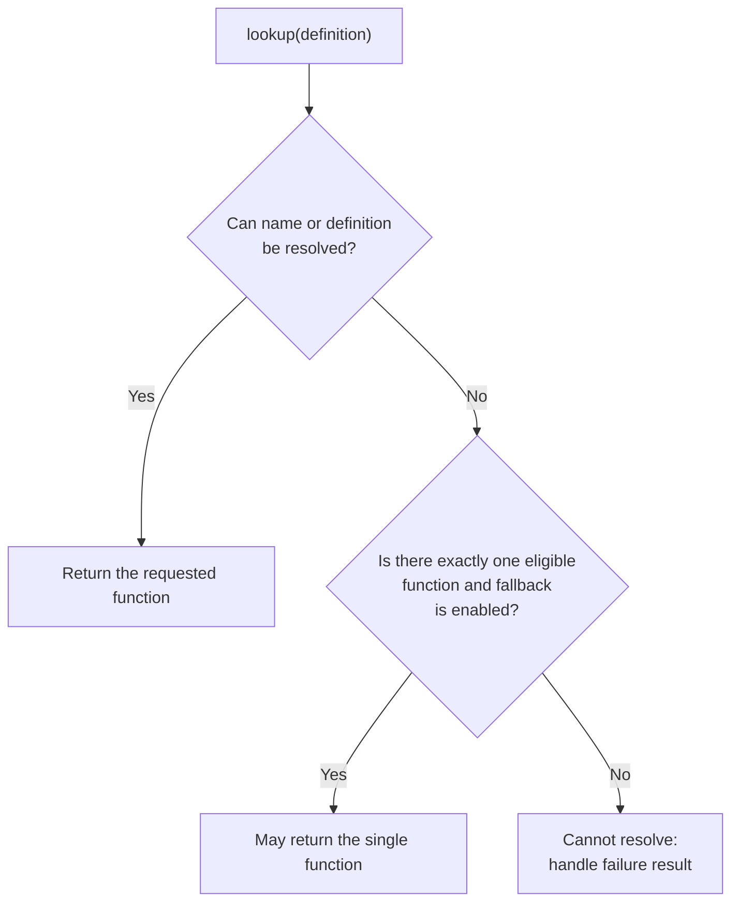

# Lookup Rules When There Is One Function vs. Multiple Functions

**Chapter:** FunctionCatalog  
**Module:** Spring Cloud Function (`SPRING_CLOUD_FUNCTION`)

Spring Cloud Function allows packaging business logic into `Supplier`, `Function`, and `Consumer` beans, and then reusing that logic across Java code, HTTP, events, or serverless environments. A central component of this model is `FunctionCatalog`: the place where adapters and application code look up functions by **name** or **function definition**.

There is one rule that often causes confusion: **if the catalog contains only a single eligible functional bean, Spring Cloud Function may return that sole function even when the lookup name is empty or does not match**. When multiple functions exist, the application must explicitly specify which function or function chain to use. Understanding this rule prevents situations where a small prototype works, only for the old configuration or lookup call to behave differently once a second function is added.

After this lesson, you will be able to:

- Predict `lookup(...)` behavior with one or multiple functional beans.
- Distinguish exact-name lookup from the *single-function fallback* mechanism.
- Disable the fallback when you need to catch naming mistakes early.
- Explicitly declare `spring.cloud.function.definition` for applications using adapters.
- Write examples and tests for both single-function and multi-function modes.

## 1. Concepts to Align On

A **functional bean** is a Spring bean belonging to the functional model supported by Spring Cloud Function, typically:

| Interface | Method Used | Example |
| --- | --- | --- |
| `Supplier<O>` | `O get()` | Generate an order code |
| `Function<I, O>` | `O apply(I input)` | Normalize an order code |
| `Consumer<I>` | `void accept(I input)` | Write an audit log |

Beans declared via `@Bean`, `@Component` within scanning scope, or a compatible Spring registration mechanism can be discovered by Spring Cloud Function. `FunctionCatalog` supports looking them up by name and provides a framework-processed function representation suitable for composition and type-adaptation mechanisms.

For example, the following bean has the default name `normalizeOrderCode`:

```java
@Bean
public Function<String, String> normalizeOrderCode() {
    return input -> input.trim().toUpperCase(Locale.ROOT);
}
```

If you specify `@Bean("normalize")`, the name used to find the function is `normalize`, even though the Java method name remains `normalizeOrderCode`.

**Scope of "one function":** the fallback rule refers to **one available functional candidate** in the catalog; it does not mean the application has only one Spring bean of any kind. A `DataSource`, a regular service, or an `ApplicationRunner` does not count as a functional bean. Conversely, one `Supplier` plus one `Consumer` equals **two** functional beans, even though there is only one of each interface.

The framework may also include infrastructure functions, such as `functionRouter`, and may exclude ineligible functional beans. Therefore, when determining whether the single-function or multi-function case applies, inspect the actual **eligible functions** rather than counting methods in a class.

## 2. Overview: How One Function Differs from Multiple Functions

Suppose the `normalizeOrderCode` bean is registered. By default, Spring Cloud Function enables **single-function fallback** when only one eligible function exists.

| Lookup Call | Only `normalizeOrderCode`, fallback enabled | With `addPrefix` also added |
| --- | --- | --- |
| `lookup("normalizeOrderCode")` | Finds the exact function | Finds the exact function |
| `lookup("")` | May return the single function | Do not expect a default function |
| `lookup(null)` | May return the single function | Do not expect a default function |
| `lookup("nonExistentName")` | May return `normalizeOrderCode` | Requested name cannot be found; must handle failure |
| `lookup("addPrefix")` | Since it does not exist, fallback may return the sole function | Finds `addPrefix` accurately |
| `lookup("normalizeOrderCode|addPrefix")` | Bean `addPrefix` does not exist yet; cannot rely on lookup to get the intended two-function composition | Can create the composition when both types are compatible |

In this table, `lookup(...)` represents the untyped overload. In Java code, you can also use `lookup(Function.class, "normalizeOrderCode")` to specify the expected interface type.

**Core takeaway:** fallback allows a call with a **wrong name to still execute the single function's logic**. This does not prove the wrong name was registered. Once a second function is added, fallback is no longer a reliable way to choose a function, and old configuration mistakes surface.



This diagram illustrates the selection principle, not the entire internal source code. When a definition is a composition chain, verify every component actually exists under the expected name; do not rely on fallback to "heal" a mistyped composition.

## 3. When There Is Only One Function: How Does Fallback Work?

According to the Spring Cloud Function documentation, assuming `uppercase` is the sole functional bean, all of the following calls can map to it under default behavior:

```java
Function<String, String> byName = catalog.lookup("uppercase");
Function<String, String> byEmpty = catalog.lookup("");
Function<String, String> byNull = catalog.lookup((String) null);
Function<String, String> byOtherName = catalog.lookup("foo");
```

In this snippet, `catalog` is an instance of `FunctionCatalog`. We cast `(String) null` to make clear this calls the overload accepting a *function definition*. The generic parameters on the target variables assume the actual signature is `Function<String, String>`.

With a single bean, all four lookups can retrieve the same business logic. This is convenient when an execution environment only needs a single entry point and no function name is specified. However, calling `lookup("foo")` **does not prove** the catalog contains a bean named `foo`.

### 3.1. The Problem: Misspelled Name Still Passes Tests

Suppose a developer writes:

```java
// Typo: the actual bean is named normalizeOrderCode.
Function<String, String> normalize =
    catalog.lookup(Function.class, "normaliseOrderCode");

String value = normalize.apply("  ord-42  ");
```

When only one function exists and fallback is enabled, this code can run successfully and produce `ORD-42`. Later, when the application adds another `Function` or `Consumer` bean, looking up the misspelled name no longer resolves the same way; the code may receive `null` or fail during execution.

Therefore:

1. Always use exact, stable names for functional beans.
2. Look up with explicit names and check the result before calling `apply/get/accept`.
3. For applications that need to catch naming errors early, consider disabling fallback across all environments.

### 3.2. Disabling Fallback via Configuration

Set the property:

```properties
spring.cloud.function.single-function-fallback-enabled=false
```

Or in `application.yml`:

```yaml
spring:
  cloud:
    function:
      single-function-fallback-enabled: false
```

When this setting is active, the catalog requires lookups to use a valid function name, even when only one functional bean exists.

For example:

```java
Function<String, String> found =
    catalog.lookup(Function.class, "normalizeOrderCode");

Function<String, String> missing =
    catalog.lookup(Function.class, "normaliseOrderCode");

// With a bean named normalizeOrderCode and fallback disabled:
// found != null; missing == null.
```

Leaving fallback enabled is not a bug in itself. It is an intentional Spring Cloud Function feature; choosing to enable or disable it depends on compatibility needs and whether an unmatched lookup name should be tolerated.

## 4. When Multiple Functions Exist: Explicit Selection Is Required

Suppose we register:

```java
@Bean
public Function<String, String> normalizeOrderCode() {
    return input -> input.trim().toUpperCase(Locale.ROOT);
}

@Bean
public Function<String, String> addPrefix() {
    return input -> "ID-" + input;
}
```

There are now **two** `Function<String, String>` beans. To use either one:

```java
Function<String, String> normalize =
    catalog.lookup(Function.class, "normalizeOrderCode");

Function<String, String> prefix =
    catalog.lookup(Function.class, "addPrefix");

if (normalize == null || prefix == null) {
    throw new IllegalStateException("Required function is missing");
}

System.out.println(normalize.apply("  ord-42  ")); // ORD-42
System.out.println(prefix.apply("ORD-42"));         // ID-ORD-42
```

Having two beans of the same `Function` group and same data types **gives the catalog no reason to automatically pick** one as the default. In particular, never write business code that relies on `lookup("")` or an arbitrary name when multiple functions exist.

### 4.1. Looking Up by Type Cannot Pick One Among Multiple Functions

The API call:

```java
Function<String, String> selected =
    catalog.lookup(Function.class, "normalizeOrderCode");
```

carries two pieces of information:

- `Function.class`: requests the functional interface group.
- `"normalizeOrderCode"`: requests the exact name/definition.

Passing `Function.class` alone cannot express the intent "choose normalization rather than prefixing." A catalog can hold many `Function<?, ?>` beans, and Java's *type erasure* also means `Function.class` does not guarantee the `String → String` generic signature.

The same applies when the application has different function kinds. If there is one `Supplier` and one `Consumer`, those are still multiple functional beans; do not assume there is "a single function" merely because each interface appears once.

### 4.2. Selecting a Composition Chain to Run Multiple Functions Sequentially

Spring Cloud Function supports using a function definition:

```java
Function<String, String> pipeline =
    catalog.lookup(
        Function.class, "normalizeOrderCode|addPrefix");

if (pipeline == null) {
    throw new IllegalStateException("Composition not found");
}

System.out.println(pipeline.apply("  ord-42  "));
// ID-ORD-42
```

The `|` symbol specifies the order: run `normalizeOrderCode`, then pass the result into `addPrefix`. This is a **definition combining two functions** and does not require declaring an additional Java bean literally named `normalizeOrderCode|addPrefix`.

A composition is only valid when its components can be chained in terms of data types and execution model. If a component name is misspelled, fix the definition; do not treat fallback as a self-healing mechanism for broken compositions.

## 5. Runnable Example for Both Modes Using Spring Profiles

The standalone example below uses a Spring Boot application with Spring Cloud Function context compatible with Spring Boot. In the default profile, there is only one business function; activating the `many` profile adds a second function.

```java
import java.util.Locale;
import java.util.function.Function;

import org.springframework.boot.ApplicationRunner;
import org.springframework.boot.SpringApplication;
import org.springframework.boot.autoconfigure.SpringBootApplication;
import org.springframework.cloud.function.context.FunctionCatalog;
import org.springframework.context.annotation.Bean;
import org.springframework.context.annotation.Profile;

@SpringBootApplication
public class LookupRulesApplication {

    public static void main(String[] args) {
        SpringApplication.run(LookupRulesApplication.class, args);
    }

    @Bean("normalizeOrderCode")
    public Function<String, String> normalizeOrderCode() {
        return input -> input.trim().toUpperCase(Locale.ROOT);
    }

    @Bean("addPrefix")
    @Profile("many")
    public Function<String, String> addPrefix() {
        return input -> "ID-" + input;
    }

    @Bean
    public ApplicationRunner showLookupRules(FunctionCatalog catalog) {
        return args -> {
            System.out.println(
                "Available functions: " + catalog.getNames(Function.class));

            Function<String, String> named =
                catalog.lookup(Function.class, "normalizeOrderCode");
            Function<String, String> unknown =
                catalog.lookup(Function.class, "unknownName");

            if (named == null) {
                throw new IllegalStateException("normalizeOrderCode missing");
            }

            System.out.println(
                "Exact name: " + named.apply("  ord-42  "));
            System.out.println(
                "Unknown name resolved: " + (unknown != null));

            if (catalog.getNames(Function.class).contains("addPrefix")) {
                Function<String, String> pipeline =
                    catalog.lookup(
                        Function.class, "normalizeOrderCode|addPrefix");

                if (pipeline != null) {
                    System.out.println(
                        "Composition: " + pipeline.apply("  ord-42  "));
                }
            }
        };
    }
}
```

**How to run and what to expect:**

| Startup Configuration | Business Functional Beans | Expectation for `unknownName` with fallback enabled |
| --- | --- | --- |
| Without `many` profile | `normalizeOrderCode` | May map to the single function |
| With `--spring.profiles.active=many` | `normalizeOrderCode`, `addPrefix` | Cannot resolve a non-existent name |
| Without `many`, with `single-function-fallback-enabled=false` | `normalizeOrderCode` | Cannot resolve a non-existent name |

Additional infrastructure names may appear in `getNames(Function.class)`. This example aims to examine **business** beans and fallback behavior; when verifying, print the actual catalog instead of assuming the list contains only one or two elements.

When the `many` profile is active, you can also request:

```java
Function<String, String> selected =
    catalog.lookup(Function.class, "addPrefix");
```

This is an intentional lookup; it does not depend on how many functions are in the catalog.

## 6. How Does spring.cloud.function.definition Select a Function for Adapters?

`FunctionCatalog.lookup(...)` is an API called from Java. In integration scenarios, adapters typically receive the function identifier via the property:

```properties
spring.cloud.function.definition=normalizeOrderCode
```

Or declare a composition:

```properties
spring.cloud.function.definition=normalizeOrderCode|addPrefix
```

This property describes **the function or function chain selected for an integration context**. It does not create new beans, does not remove remaining beans from `ApplicationContext`, and does not replace functional bean registration.

| Context | With One Function | With Multiple Functions |
| --- | --- | --- |
| Java code calling catalog | Fallback applies for empty/wrong names if enabled | Look up by exact name or composition |
| Spring Cloud Stream | May select the single function by adapter default rules, but declaring `definition` is recommended | Must specify the appropriate function definition/bindings per design |
| Spring Cloud Function Web | Path mapping depends on web adapter rules and configuration | Use names/definitions per web adapter export rules |
| Serverless adapter | Selection depends on entry point and adapter | Specify definition or routing per deployment guide |

**Practical recommendation:** with Spring Cloud Stream, the Spring Cloud Function documentation recommends **always setting `spring.cloud.function.definition`**, even if the application currently has only one function. This preserves configuration intent when new functions are added later.

Example with Spring Cloud Stream:

```yaml
spring:
  cloud:
    function:
      definition: normalizeOrderCode
```

When chaining two functions:

```yaml
spring:
  cloud:
    function:
      definition: normalizeOrderCode|addPrefix
```

For HTTP, event, or serverless adapters, also inspect dependencies, mappings, bindings, and specific routing rules. You cannot conclude from a single `lookup("unknownName")` call that an HTTP route or event binding with the same name will have identical fallback behavior.

## 7. Do Not Confuse Single-Function Fallback with Function Routing

Spring Cloud Function also features **routing**, typically via the infrastructure function `functionRouter`. A router is a function responsible for choosing a target handler based on routing information such as headers or configuration, depending on the scenario.

| Feature | Single-Function Fallback | Function Routing |
| --- | --- | --- |
| Purpose | Use the sole function when lookup name is empty/unmatched | Select a target function based on a routing decision |
| Key condition | Only one eligible functional bean exists and fallback is enabled | A router exists along with configuration/rules determining routes |
| How it is controlled | `spring.cloud.function.single-function-fallback-enabled` | Function definition, routing expression, headers, or adapter callbacks |
| Use with multiple functions? | Do not rely on it to pick a function arbitrarily | Can be used to dispatch across multiple functions |

When using a router, developers must still define the rules for selecting target functions. Having `functionRouter` in the catalog **does not** mean every invalid name will automatically route to one of your business functions.

Only accept routing control data from trusted sources and restrict the set of allowed target functions if the system accepts external requests.

## 8. Inspecting the Catalog and Handling Lookup Failures

You can list names using:

```java
Set<String> all = catalog.getNames(null);
Set<String> functions = catalog.getNames(Function.class);
Set<String> suppliers = catalog.getNames(Supplier.class);
Set<String> consumers = catalog.getNames(Consumer.class);
```

This snippet requires importing `java.util.Set` along with the three corresponding functional interfaces.

### 8.1. Why getNames Does Not Replace lookup

`getNames(...)` lets you inspect recognized function names, whereas `lookup(...)` actually resolves a name/definition into a usable function.

In **single-function mode with fallback enabled**, `unknownName` may **not appear in** `getNames(null)`, yet `lookup("unknownName")` still returns the single function. Therefore, never infer backward that `lookup("unknownName") != null` proves a bean named `unknownName` exists.

If you build a selection UI or an API that dispatches by function name, validate the name against an application **allowlist**, rather than accepting any string that happens to resolve:

```java
import java.util.Set;
import java.util.function.Function;
import org.springframework.cloud.function.context.FunctionCatalog;

public final class NamedFunctionService {

    private static final Set<String> ALLOWED =
        Set.of("normalizeOrderCode", "addPrefix");

    private final FunctionCatalog catalog;

    public NamedFunctionService(FunctionCatalog catalog) {
        this.catalog = catalog;
    }

    public String process(String name, String input) {
        if (!ALLOWED.contains(name)) {
            throw new IllegalArgumentException("Unknown handler: " + name);
        }

        Function<String, String> handler =
            catalog.lookup(Function.class, name);

        if (handler == null) {
            throw new IllegalStateException(
                "Handler is not registered: " + name);
        }

        return handler.apply(input);
    }
}
```

This is an example Java class receiving `FunctionCatalog` via its constructor; in a Spring application, it can be declared as a service if needed. Name filtering avoids picking the wrong function via fallback and limits which functions may be called. Authentication/authorization for external callers remains a separate responsibility.

### 8.2. Diagnostic Checklist

| Symptom | What to Check |
| --- | --- |
| Wrong name still invokes a function | Is there only one eligible function and is fallback enabled? |
| After adding a second bean, old lookup fails | Was it relying on an empty, placeholder, or misspelled name? |
| `lookup("normalizeOrderCode")` finds nothing | Actual `@Bean` name, component scan scope, ineligible config, function kind |
| Multiple functions of same kind and adapter cannot pick one | `spring.cloud.function.definition` and adapter configuration |
| Correct name but data processed incorrectly | Generic contract, message conversion, composition order |
| `functionRouter` appears in the list | Distinguish infrastructure router from business functions |
| Test only checks `lookup("typo") != null` | Use exact names, verify via `getNames`, or disable fallback |

## 9. Writing Tests for Both One Function and Multiple Functions

The `LookupRulesApplication` class in section 5 allows testing the same logic in both contexts. The following tests assume the project already has compatible Spring Boot Test and JUnit 5 dependencies.

### 9.1. Testing One Function with Fallback Disabled to Catch Name Errors

```java
import static org.junit.jupiter.api.Assertions.*;

import java.util.function.Function;
import org.junit.jupiter.api.Test;
import org.springframework.beans.factory.annotation.Autowired;
import org.springframework.boot.test.context.SpringBootTest;
import org.springframework.cloud.function.context.FunctionCatalog;

@SpringBootTest(
    classes = LookupRulesApplication.class,
    properties =
        "spring.cloud.function.single-function-fallback-enabled=false"
)
class SingleFunctionStrictLookupTest {

    @Autowired
    private FunctionCatalog catalog;

    @Test
    void requiresCorrectName() {
        Function<String, String> correct =
            catalog.lookup(Function.class, "normalizeOrderCode");
        Function<String, String> wrong =
            catalog.lookup(Function.class, "normaliseOrderCode");

        assertNotNull(correct);
        assertEquals("ORD-42", correct.apply("  ord-42  "));
        assertNull(wrong);
    }
}
```

This test intentionally disables fallback to prevent a wrong name from returning the sole function. Ensure the `many` profile is **not** active in this test context.

### 9.2. Testing When the many Profile Has Two Functions

```java
import static org.junit.jupiter.api.Assertions.*;

import java.util.function.Function;
import org.junit.jupiter.api.Test;
import org.springframework.beans.factory.annotation.Autowired;
import org.springframework.boot.test.context.SpringBootTest;
import org.springframework.cloud.function.context.FunctionCatalog;
import org.springframework.test.context.ActiveProfiles;

@ActiveProfiles("many")
@SpringBootTest(classes = LookupRulesApplication.class)
class MultipleFunctionsLookupTest {

    @Autowired
    private FunctionCatalog catalog;

    @Test
    void resolvesExactNamesAndComposition() {
        assertTrue(
            catalog.getNames(Function.class).contains("normalizeOrderCode"));
        assertTrue(
            catalog.getNames(Function.class).contains("addPrefix"));

        Function<String, String> normalizer =
            catalog.lookup(Function.class, "normalizeOrderCode");
        Function<String, String> prefix =
            catalog.lookup(Function.class, "addPrefix");
        Function<String, String> pipeline =
            catalog.lookup(
                Function.class, "normalizeOrderCode|addPrefix");

        assertNotNull(normalizer);
        assertNotNull(prefix);
        assertNotNull(pipeline);
        assertEquals("ORD-42", normalizer.apply("  ord-42  "));
        assertEquals("ID-ORD-42", prefix.apply("ORD-42"));
        assertEquals("ID-ORD-42", pipeline.apply("  ord-42  "));
    }
}
```

The two tests can live in two separate Java files in the same package as the application. They focus on **intended names and behavior**, without requiring `getNames(Function.class)` to contain only one or two elements since infrastructure beans may appear.

A separate test for default fallback can verify `lookup("typo")` works when only one function exists; however, for long-lived application code, tests requiring exact names are usually more valuable.

## 10. Real-World Scenario: From a Single-Function PoC to a Multi-Event Processing Service

Initially, a service only has:

```java
@Bean
public Function<String, String> normalizeOrderCode() {
    return s -> s.trim().toUpperCase(Locale.ROOT);
}
```

When connecting to an adapter, the development team omits `spring.cloud.function.definition` because the service has only one function. In the test environment, default function selection works fine.

A few weeks later, the team adds:

```java
@Bean
public Consumer<String> auditOrderCode() {
    return id -> System.out.println("AUDIT: " + id);
}
```

Now the application has two functional beans, even though there is only **one `Function`** and **one `Consumer`**. If the adapter previously relied on guessing "the only function," the configuration becomes ambiguous. The fix is to explicitly specify the input-processing function:

```properties
spring.cloud.function.definition=normalizeOrderCode
```

If auditing needs to be handled as a branch or a composition, design the flow to match the signatures and adapter rather than assuming `Consumer` will automatically run after `Function` just because both exist in the catalog.

**Lesson from this scenario:** Spring Cloud Function's reusability comes from functional contracts and function selection; explicit function selection configuration keeps the same logic stable as an application grows from one function to many.

## 11. Exercises and Self-Check Questions

1. Create an application with only `Function<String, String> normalizeOrderCode`. With fallback enabled, try `lookup("normalizeOrderCode")`, `lookup("")`, and `lookup("typo")`. Use `getNames(null)` to distinguish the actual bean name from names accepted via fallback.
2. Set `spring.cloud.function.single-function-fallback-enabled=false` and run again. Explain the different result for `lookup("typo")`.
3. Add a `Supplier<String> newOrderCode` bean. How many functional beans exist now? Is an unnamed lookup still a stable way to select a function?
4. Enable the `many` profile in the section 5 example. Look up `normalizeOrderCode` and `addPrefix` individually; then use the definition `normalizeOrderCode|addPrefix`.
5. Intentionally misspell one component in a composition, observe the lookup result, and fix the name. Why should fallback not be used as an error-handling strategy for compositions?
6. Write a test that requires the application to have two business names in the catalog, instead of asserting `catalog.size() == 2`.

### Short Interview Question

**Q:** Why can `catalog.lookup("missingName")` return a function in a test environment yet fail after deployment?

**A:** The test environment may have only one functional bean with *single-function fallback* enabled, causing the catalog to return that sole function despite the wrong name. The deployed environment has additional functional beans, so fallback no longer serves as a valid selection mechanism. You should use exact names/definitions, inspect the catalog, and configure adapters explicitly.

## 12. Key Takeaways

- **One function:** when default fallback is enabled, an empty string, `null`, or a different name may map to the sole function.
- **Multiple functions:** lookup must rely on an exact name or a valid definition; do not count on the framework guessing which function to choose.
- `spring.cloud.function.single-function-fallback-enabled=false` enforces valid names even in single-function applications.
- `spring.cloud.function.definition` should be explicitly declared for adapters, especially Spring Cloud Stream; this property does not register beans for Spring.
- To verify names properly, combine `getNames(...)`, `lookup(...)`, behavioral tests, and distinguish business functional beans from infrastructure/routing functions.

### References

- [Spring Cloud Function — Programming Model](https://docs.spring.io/spring-cloud-function/reference/spring-cloud-function/programming-model.html): the *Function definition* section explaining lookup with empty/arbitrary names when only one function exists, disabling fallback, and configuring function definitions.
- [Spring Cloud Function — Functional Bean Definitions](https://docs.spring.io/spring-cloud-function/reference/functional.html): inspecting the catalog via `getNames(null)`, `size()`, and observability tools.
