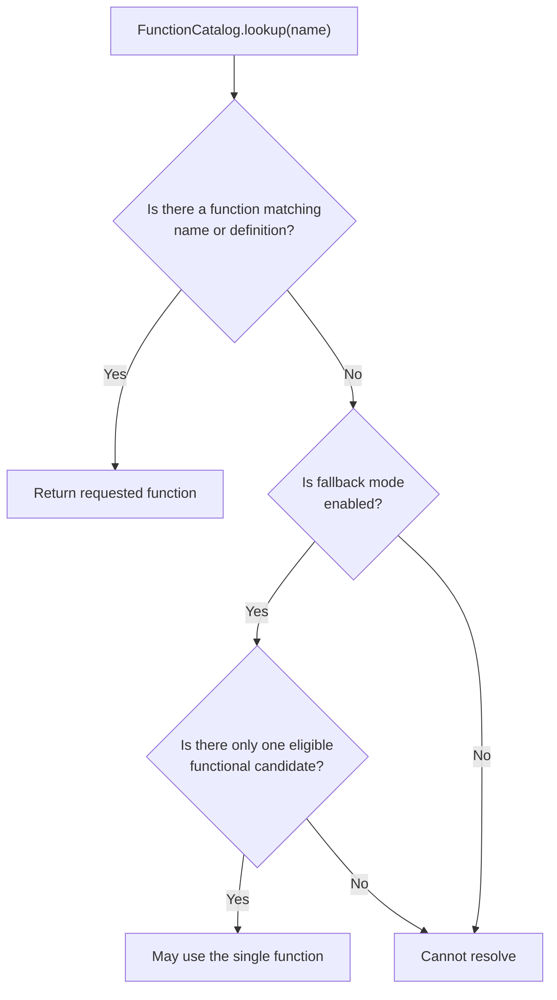
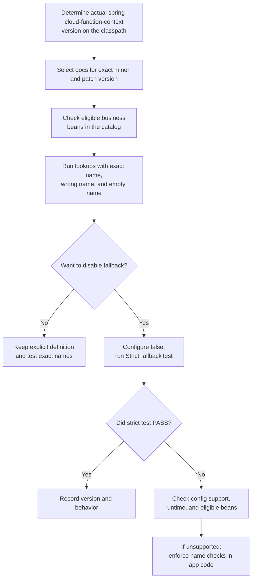

# Comparing Single-Function Fallback Mode Across Versions

**Chapter:** FunctionCatalog  
**Module:** Spring Cloud Function (`SPRING_CLOUD_FUNCTION`)

Spring Cloud Function helps decouple business logic into `Supplier`, `Function`, and `Consumer` beans for reuse via Java invocations, HTTP, events, or serverless environments. `FunctionCatalog` provides a lookup point for these functions by name. A special behavior of the catalog is **single-function fallback**: if only one eligible function exists, looking up with an empty name or a non-matching name may still return that function.

**Problem to solve:** the fallback rule is documented across multiple Spring Cloud Function release lines, but **the ability to disable fallback via configuration must be checked against the specific version**. Just because a property appears in newer documentation does not mean older versions understand that property.

This lesson focuses on reading version-specific documentation, verifying actual runtime behavior, and writing code that does not inadvertently depend on fallback. This is essential knowledge when scaling an application from one function to multiple functions, or when adapters such as Spring Cloud Stream need to select the right handler function.

After this lesson, you will be able to:

1. Explain the conditions and impact of single-function fallback.
2. Distinguish **documented behavior** from **verified configuration support** in each version.
3. Design a test experiment to verify lookups with valid, invalid, and empty names.
4. Test the actual effect of `spring.cloud.function.single-function-fallback-enabled=false`.
5. Write a strict lookup path that works even if the version in use does not yet support the fallback toggle.

## 1. What Is Single-Function Fallback?

In a Spring application, functional beans are typically:

| Type | Signature | Example |
| --- | --- | --- |
| `Supplier<O>` | `O get()` | Supply an order code |
| `Function<I, O>` | `O apply(I input)` | Normalize a code |
| `Consumer<I>` | `void accept(I input)` | Record an event |

Suppose the application has only one functional bean:

```java
@Bean
public Function<String, String> normalizeOrderCode() {
    return value -> value.trim().toUpperCase(Locale.ROOT);
}
```

The function is registered by Spring under the name `normalizeOrderCode`. When fallback is enabled, the following calls **may all resolve to that sole function**:

```java
Function<String, String> byExactName =
    catalog.lookup(Function.class, "normalizeOrderCode");

Function<String, String> byEmptyName =
    catalog.lookup(Function.class, "");

Function<String, String> byMissingName =
    catalog.lookup(Function.class, "notRegistered");

Function<String, String> byNullName =
    catalog.lookup(Function.class, (String) null);
```

In this example, `catalog` is a Spring-injected `FunctionCatalog`. Casting `(String) null` disambiguates the overload taking a name/definition.

When `byMissingName` is non-null, **do not conclude** that a Spring bean named `notRegistered` exists. The framework may have selected the sole function as a fallback.

Thus, fallback is a **selection rule when information is missing**, not an alias-creation or name-registration mechanism.

### 1.1. Understanding the "Only One Function" Condition Accurately

"One function" refers solely to **eligible functional candidates in the catalog**, not the total number of beans in `ApplicationContext`. An application with hundreds of services, repositories, and configuration beans can still have only one business `Function` recognized by the catalog.

Conversely, one `Function` and one `Consumer` generally count as **two** functional beans, even though each interface group appears only once.

The system may also contain infrastructure functions such as `functionRouter`. Catalog implementations have rules for identifying and filtering special functions; therefore, do not infer the number of eligible functions simply by counting all names returned by `getNames(null)`.

### 1.2. Distinguishing Fallback from Exact Lookup



The diagram illustrates the principle. Details of name resolution, system configuration, infrastructure functions, and composition may vary by release; actual behavior should always be verified against the artifact your application runs.

## 2. Why Must You Compare by Version?

A project using Spring Cloud Function 4.x might read an online guide updated for 5.x. If you immediately copy `single-function-fallback-enabled=false` into your config when your project's version **has not been verified to support it**, the application may continue falling back even though the property is present in the config file. Do not treat the presence of a YAML line as proof that lookup behavior has changed.

To compare properly, keep three factors separate:

1. **The actual runtime version of the dependency** `spring-cloud-function-context`, not just the intended Spring Boot or Spring Cloud BOM version.
2. **Default lookup behavior** when only one functional bean exists.
3. **Whether fallback can be disabled**, if that version supports it, along with a test proving the setting takes effect.

### 2.1. Official Documentation Comparison Table

The following table compares **inspected reference documentation versions**. "Not mentioned" means the *Function definition* section of that branch's documentation **does not explicitly list this toggle**; it **does not prove** that every artifact in that release line lacks the feature.

| Documentation Version | Single-Function Fallback | Fallback-Disable Property in Function Definition Section | Safe Conclusion |
| --- | --- | --- | --- |
| `4.0.4` | Describes lookup with empty or other names | Not mentioned | Verify on the running artifact before relying on the config option |
| `4.1.6` | Described | Not mentioned | Do not assume options from 5.x docs are supported |
| `4.2.4` | Described | Not mentioned | Verify specifically on the patch version in use |
| `4.3.4` | Described | Not mentioned | Verify specifically on the patch version in use |
| `5.0.6` | Described | **Mentions** `single-function-fallback-enabled=false` | Can be configured and verified with a wrong-name lookup |
| `5.1.0` | Described | **Mentions** the property above | Can be configured and verified with a wrong-name lookup |

**Reference sources:** [Spring Cloud Function 4.0.4](https://docs.spring.io/spring-cloud-function/docs/4.0.4/reference/html/spring-cloud-function.html), [4.1](https://docs.spring.io/spring-cloud-function/reference/4.1/spring-cloud-function/programming-model.html), [4.2](https://docs.spring.io/spring-cloud-function/reference/4.2/spring-cloud-function/programming-model.html), [4.3](https://docs.spring.io/spring-cloud-function/reference/4.3/spring-cloud-function/programming-model.html), [5.0](https://docs.spring.io/spring-cloud-function/reference/5.0/spring-cloud-function/programming-model.html), and [5.1](https://docs.spring.io/spring-cloud-function/reference/5.1/spring-cloud-function/programming-model.html).

Branch documentation pages may be updated to newer patch versions over time. Therefore, this table is a **documentation comparison for the versions shown in the left column**, not a claim about *every* patch in a release line.

### 2.2. Context Behind the Need to Disable Fallback

An issue reported on the Spring Cloud Function project on **May 19, 2026**, [issue #1391](https://github.com/spring-cloud/spring-cloud-function/issues/1391), described a Spring Cloud Stream application accidentally binding an error-handling function incorrectly: when the catalog had only one function, looking up a non-existent name still returned that sole function. This masked a configuration mistake instead of reporting a missing function.

That issue illustrates why a strict lookup mode is needed. However, the issue creation date **does not by itself identify** the first patch release containing the configuration property. To determine exactly which version includes the option, inspect the source/tags or test against that version's dependency.

### 2.3. Do Not Infer the Function Version from "Spring Cloud"

Spring Cloud is an umbrella of projects using a release train/BOM. Spring Cloud Function has its **own artifact version**. Check the resolved dependency of:

```text
org.springframework.cloud:spring-cloud-function-context
```

With Maven, inspect the dependency tree:

```bash
mvn dependency:tree -Dincludes=org.springframework.cloud:spring-cloud-function-context
```

With Gradle:

```bash
./gradlew dependencyInsight --dependency spring-cloud-function-context --configuration runtimeClasspath
```

Run the appropriate command in your actual project, read the resolved version, and consult the documentation for that exact version. If the application is multi-module, check the runnable module and the deployed runtime classpath.

## 3. Behavior Matrix to Verify

Assume `normalizeOrderCode` is the sole functional bean, and `addPrefix` appears only in multi-function mode. The following results are **test expectations**:

| Call | One Function, Fallback Enabled | One Function, Fallback Disabled **and Supported by Version** | Two Functions |
| --- | --- | --- | --- |
| `lookup("normalizeOrderCode")` | `normalizeOrderCode` function | `normalizeOrderCode` function | `normalizeOrderCode` function |
| `lookup("")` | May return the single function | Must not auto-select for empty name | No reliable default selection |
| `lookup((String) null)` | May return the single function | Must not auto-select for empty name | No reliable default selection |
| `lookup("notRegistered")` | May return the single function | Cannot resolve wrong name | Cannot resolve wrong name |
| `lookup("addPrefix")` | May return the single function even though bean does not exist | Cannot resolve unregistered bean | Finds `addPrefix` accurately |

Here "cannot resolve" is usually represented by `null` when lookup finds nothing; paths with custom validation or adapters may throw exceptions instead. Therefore, test code must check the result and handle errors accordingly, never calling `apply(...)` directly on an unchecked result.

**Do not use a wrong name to prove a bean exists.** When fallback is enabled, `lookup("notRegistered") != null` is not proof that a bean named `notRegistered` exists. Use `getNames(...)`, declared bean names, and an exact-name lookup.

## 4. Spring Boot Example That Switches Between One and Two Functions

The standalone example below allows comparing modes with the same source code. It requires compatible Spring Boot and Spring Cloud Function context dependencies; no HTTP adapter or message broker is needed yet.

### 4.1. Application Configuration and Functional Beans

```java
import java.util.Locale;
import java.util.Set;
import java.util.function.Function;

import org.springframework.boot.ApplicationRunner;
import org.springframework.boot.SpringApplication;
import org.springframework.boot.autoconfigure.SpringBootApplication;
import org.springframework.cloud.function.context.FunctionCatalog;
import org.springframework.context.annotation.Bean;
import org.springframework.context.annotation.Profile;

@SpringBootApplication
public class VersionedFallbackApplication {

    public static void main(String[] args) {
        SpringApplication.run(VersionedFallbackApplication.class, args);
    }

    @Bean("normalizeOrderCode")
    public Function<String, String> normalizeOrderCode() {
        return input -> input.trim().toUpperCase(Locale.ROOT);
    }

    @Bean("addPrefix")
    @Profile("many")
    public Function<String, String> addPrefix() {
        return input -> "ID-" + input;
    }

    @Bean
    public ApplicationRunner inspect(FunctionCatalog catalog) {
        return args -> {
            Set<String> names = catalog.getNames(Function.class);
            System.out.println("Function names: " + names);

            check(catalog, "normalizeOrderCode");
            check(catalog, "notRegistered");
            check(catalog, "");
        };
    }

    private static void check(FunctionCatalog catalog, String name) {
        Function<String, String> function =
            catalog.lookup(Function.class, name);

        System.out.println(
            "lookup('" + name + "') found: " + (function != null));

        if (function != null) {
            System.out.println(
                "result: " + function.apply("  ord-42  "));
        }
    }
}
```

**Note:** the illustrative code intentionally performs a lookup with a wrong name to observe fallback. In business applications, validate the name before allowing function execution.

### 4.2. Three Run Configurations

**Case A — one function, default configuration:**

```properties
# Do not activate the many profile
# Do not set single-function-fallback-enabled
```

Here `normalizeOrderCode` is the sole business bean. In versions whose docs describe fallback, a wrong or empty name may still return that function.

**Case B — two functions:**

```properties
spring.profiles.active=many
```

The catalog has `normalizeOrderCode` and `addPrefix`. A wrong name cannot serve as a way to select one of the two functions. Look up `normalizeOrderCode` or `addPrefix` by exact name.

**Case C — one function, strict name requirement:**

```properties
spring.cloud.function.single-function-fallback-enabled=false
```

Apply the expectation "wrong name does not resolve" **only after confirming the version supports this property**. If an older version ignores the property, output will still resemble Case A. In that situation, the flaw lies in the compatibility assumption, not in the `normalizeOrderCode` bean.

### 4.3. Observation Criteria

When running each configuration, record:

1. The actual `spring-cloud-function-context` version.
2. The names in `catalog.getNames(Function.class)`.
3. Whether `lookup("normalizeOrderCode")` returns the right result.
4. Whether `lookup("notRegistered")` returns `null`, returns another function, or throws an exception.
5. The result of `lookup("")` and the effect of the `many` profile.

Do not assume from a single run on another version that the current version will behave identically. When upgrading, repeat the same matrix to detect changes.

## 5. JUnit Tests Confirming Version-Specific Fallback Support

You can use Spring Boot Test and JUnit 5 to turn the comparison into repeatable checks. The three test classes below are **three separate Java files** in the same package as `VersionedFallbackApplication`.

### 5.1. Default Fallback When Only One Function Exists

```java
import static org.junit.jupiter.api.Assertions.*;

import java.util.function.Function;
import org.junit.jupiter.api.Test;
import org.springframework.beans.factory.annotation.Autowired;
import org.springframework.boot.test.context.SpringBootTest;
import org.springframework.cloud.function.context.FunctionCatalog;

@SpringBootTest(classes = VersionedFallbackApplication.class)
class DefaultFallbackTest {

    @Autowired
    FunctionCatalog catalog;

    @Test
    void missingNameMayResolveToOnlyBusinessFunction() {
        assertTrue(catalog.getNames(Function.class)
                .contains("normalizeOrderCode"));

        Function<String, String> correct =
            catalog.lookup(Function.class, "normalizeOrderCode");
        Function<String, String> missing =
            catalog.lookup(Function.class, "notRegistered");

        assertNotNull(correct);
        assertNotNull(missing);
        assertEquals("ORD-42", missing.apply("  ord-42  "));
    }
}
```

This test demonstrates the documented fallback behavior. If another business functional bean is present at runtime via auto-configuration or an added library, the "only one eligible function" condition no longer holds; in that case, adjust the test fixture to be more isolated rather than prematurely concluding the version changed behavior.

### 5.2. Testing the Fallback-Disable Property

```java
import static org.junit.jupiter.api.Assertions.*;

import java.util.function.Function;
import org.junit.jupiter.api.Test;
import org.springframework.beans.factory.annotation.Autowired;
import org.springframework.boot.test.context.SpringBootTest;
import org.springframework.cloud.function.context.FunctionCatalog;

@SpringBootTest(
    classes = VersionedFallbackApplication.class,
    properties = {
        "spring.cloud.function.single-function-fallback-enabled=false"
    }
)
class StrictFallbackTest {

    @Autowired
    FunctionCatalog catalog;

    @Test
    void rejectsAnUnregisteredName() {
        Function<String, String> correct =
            catalog.lookup(Function.class, "normalizeOrderCode");
        Function<String, String> wrong =
            catalog.lookup(Function.class, "notRegistered");

        assertNotNull(correct);
        assertEquals("ORD-42", correct.apply("  ord-42  "));
        assertNull(wrong);
    }
}
```

**How to read the result:** if `StrictFallbackTest` fails because `wrong` is non-null while `DefaultFallbackTest` passes, one likely possibility to check is that your Spring Cloud Function version does not apply that property yet. Also verify effective configuration values, how the context initializes, and which beans are actually registered.

Do not treat this test as automatic proof for every 4.x release; it is written to **verify the specific version your project uses**.

### 5.3. Adding a Second Function

```java
import static org.junit.jupiter.api.Assertions.*;

import java.util.function.Function;
import org.junit.jupiter.api.Test;
import org.springframework.beans.factory.annotation.Autowired;
import org.springframework.boot.test.context.SpringBootTest;
import org.springframework.cloud.function.context.FunctionCatalog;
import org.springframework.test.context.ActiveProfiles;

@ActiveProfiles("many")
@SpringBootTest(classes = VersionedFallbackApplication.class)
class MultipleFunctionLookupTest {

    @Autowired
    FunctionCatalog catalog;

    @Test
    void requiresSpecificFunctionDefinition() {
        assertTrue(catalog.getNames(Function.class)
                .contains("normalizeOrderCode"));
        assertTrue(catalog.getNames(Function.class)
                .contains("addPrefix"));

        Function<String, String> normalize =
            catalog.lookup(Function.class, "normalizeOrderCode");
        Function<String, String> prefix =
            catalog.lookup(Function.class, "addPrefix");
        Function<String, String> missing =
            catalog.lookup(Function.class, "notRegistered");

        assertNotNull(normalize);
        assertNotNull(prefix);
        assertNull(missing);

        assertEquals("ORD-42", normalize.apply("  ord-42  "));
        assertEquals("ID-ORD-42", prefix.apply("ORD-42"));
    }
}
```

This test verifies that the catalog finds both names and that a non-existent name does not resolve to either function. The test condition is independent of whether the fallback-disable toggle exists.

### 5.4. Test Matrix to Keep When Upgrading

| Test | Condition | Goal |
| --- | --- | --- |
| `DefaultFallbackTest` | One function, toggle unset | Confirm default fallback is active |
| `StrictFallbackTest` | One function, toggle set to `false` | Confirm the version actually applies the toggle |
| `MultipleFunctionLookupTest` | Two functions, explicit names | Confirm lookup does not guess a function when multiple candidates exist |

When switching between versions, use the **same input data**, the same bean names, and the same three checks. Record the actual dependency version alongside the run result; a "PASS" result without an accompanying version is hard to reuse later.

## 6. Strict Lookup Solution Compatible with Older Versions Too

If the project cannot upgrade yet or has not confirmed support for `single-function-fallback-enabled`, you can still enforce strict lookup in **application code you own**. The approach is to verify that the requested name belongs to an allowed set and is present in the catalog before calling `lookup(...)`.

```java
import java.util.Set;
import java.util.function.Function;

import org.springframework.cloud.function.context.FunctionCatalog;

public final class StrictFunctionDispatcher {

    private static final Set<String> ALLOWED_NAMES =
        Set.of("normalizeOrderCode", "addPrefix");

    private final FunctionCatalog catalog;

    public StrictFunctionDispatcher(FunctionCatalog catalog) {
        this.catalog = catalog;
    }

    public String invoke(String requestedName, String input) {
        if (requestedName == null || !ALLOWED_NAMES.contains(requestedName)) {
            throw new IllegalArgumentException(
                "Unsupported function: " + requestedName);
        }

        Set<String> availableNames = catalog.getNames(Function.class);
        if (!availableNames.contains(requestedName)) {
            throw new IllegalStateException(
                "Function is not registered: " + requestedName);
        }

        Function<String, String> function =
            catalog.lookup(Function.class, requestedName);
        if (function == null) {
            throw new IllegalStateException(
                "Lookup failed: " + requestedName);
        }

        return function.apply(input);
    }
}
```

**Why does this avoid confusion?** For a request with `"notRegistered"`, the name-checking layer rejects it before `lookup(...)` has a chance to use fallback. Even if the catalog has only one bean, business code must still pass one of the allowed names that is actually registered in the catalog.

This solution only protects **calls routed through `StrictFunctionDispatcher`**. It does not alter the global behavior of Spring Cloud Function or standalone adapters, so you still need proper name configuration for HTTP, Stream, and serverless adapters.

Do not turn every name from `getNames(null)` into the set of functions external users are allowed to call. The catalog may contain infrastructure functions or internal handlers; access rights must be decided by the application's contract.

## 7. Impact on HTTP, Events, and Serverless

### 7.1. spring.cloud.function.definition

When an adapter needs to choose a function, identify it explicitly:

```yaml
spring:
  cloud:
    function:
      definition: normalizeOrderCode
```

With two validly composable functions:

```yaml
spring:
  cloud:
    function:
      definition: normalizeOrderCode|addPrefix
```

The `spring.cloud.function.definition` property is the **contract for selecting a function or composition** for an integration context. It does not create a new Spring bean and does not guarantee that an older version supports the single-function fallback disable toggle.

### 7.2. Why Do Adapters Need Separate Testing?

| Invocation Path | What Is Verified by Testing `FunctionCatalog.lookup` | What Still Needs Testing at the Adapter |
| --- | --- | --- |
| Direct Java | Catalog finds and returns a function by name/type | How application code validates names, handles errors, and types |
| Spring Cloud Function Web | Function exists in the catalog | Web dependency, paths, HTTP methods, and export rules |
| Spring Cloud Stream | A function matching the definition exists | Bindings, binder, channel names, and function definition selection |
| Serverless | Function can be found by the catalog | Cloud adapter, entry point, event mapping, and deployment config |

Spring Cloud Function documentation recommends explicitly setting `spring.cloud.function.definition` when integrating Spring Cloud Stream, even when only one function currently exists. When a second function is added, the configuration already has an explicit name and relies less on default guessing.

**Do not conflate properties:** Spring Cloud Stream's `spring.cloud.stream.function.autodetect` controls auto-detection/auto-binding in Stream; it is **different from** Spring Cloud Function's `spring.cloud.function.single-function-fallback-enabled`. Disabling Stream autodetect is not proof that `FunctionCatalog` lookup has switched to strict mode.

### 7.3. A Version-Dependent Error Scenario

Suppose an older environment has one function `normalizeOrderCode`. An adapter configuration accidentally misspells the name as `normalizeOderCode` (missing the `r`). With fallback enabled, lookup may return `normalizeOrderCode` and mask the mistake.

When upgrading or adding features:

1. The catalog may gain another candidate, so the misspelled lookup is no longer rescued by fallback.
2. Or the team enables the fallback-disable toggle in a newer version, immediately exposing the misspelled name.
3. In either case, fix the configuration to the **actual bean name**: `normalizeOrderCode`.

Do not work around this by creating an unnecessary bean alias just to preserve a misspelled name in configuration. Fix the naming contract between the bean and adapter, then add tests.

## 8. Verification Workflow Before and After Upgrading



Practical workflow:

1. Check the resolved dependency; avoid inferring the version from the parent POM or another framework's banner.
2. List `catalog.getNames(null)` and `catalog.getNames(Function.class)`.
3. Ensure the fixture has only one functional bean when testing default fallback.
4. Invoke exact, wrong, and empty names, clearly recording `null`/non-`null`/exceptions.
5. If strict configuration is desired, set the property per your version's documentation and rerun in a fresh context.
6. Test relevant adapters with an explicit `spring.cloud.function.definition`.
7. Save results alongside the artifact version for comparison on the next upgrade.

### 8.1. Common Reasoning Pitfalls

| Premature Conclusion | Issue | How to Verify |
| --- | --- | --- |
| "The YAML line is there, so fallback is definitely off." | Older versions may not support the property or config may not apply | Run `StrictFallbackTest` on the version in use |
| "Wrong-name lookup returned a function, so that name exists." | May just be fallback to the sole function | Check `getNames(null)` and actual bean names |
| "There is only one Function, so the catalog has only one function." | Eligible `Supplier` or `Consumer` beans may also exist | Inspect all three functional interface groups |
| "All 4.x versions behave like 5.x." | Versions differ in features and documented properties | Check the specific patch version and test behavior |
| "getNames includes functionRouter, so fallback must be off." | Infrastructure router functions may be handled specially | Read your version's rules and test in practice |
| "Disabling Stream autodetect disables lookup fallback." | These are two separate components/properties | Test `FunctionCatalog.lookup` separately |
| "Java unit tests prove HTTP works." | The HTTP adapter also requires its own mapping/export rules | Run corresponding HTTP/Stream/serverless integration tests |

## 9. Hands-On Exercises

**Exercise 1 — Establish a baseline:** use `VersionedFallbackApplication` without the `many` profile enabled. Run lookups with `normalizeOrderCode`, `notRegistered`, and an empty string. Record the names from `getNames(null)` and explain why a name absent from the list can still return a result.

**Exercise 2 — Compare two versions:** pick two Spring Cloud Function versions supported by your learning environment. Run `DefaultFallbackTest` and `StrictFallbackTest` on each, recording the exact artifact version and PASS/FAIL status. If the strict test fails, do not jump to conclusions before checking configuration and eligible beans.

**Exercise 3 — Effect of adding a function:** activate the `many` profile and run `MultipleFunctionLookupTest`. Try calling `lookup("notRegistered")`, then fix it to `lookup("addPrefix")`. Compare with the single-function environment.

**Exercise 4 — Protect business code:** use `StrictFunctionDispatcher`. Test the three names `normalizeOrderCode`, `addPrefix`, and `notRegistered` with and without the `many` profile. Why does routing through the dispatcher preserve name enforcement even when default fallback is active?

**Exercise 5 — Adapters:** add `spring.cloud.function.definition=normalizeOrderCode` to your integration configuration. Then add the `addPrefix` bean and verify whether the adapter still selects `normalizeOrderCode` properly.

### Self-Check Questions

1. Does "fallback is described in the 4.2 docs" prove that the 4.2 version in use understands `single-function-fallback-enabled=false`? **No.** Those are two separate claims that must be verified independently.
2. What should you do if you need strict lookup on a version not confirmed to have the toggle? **Validate the name against an allowlist and `getNames(...)` before lookup in application code; continue configuring adapters with explicit names.**
3. Why must you retest after adding a `Consumer` bean? Because the count of functional candidates may change, altering whether fallback applies.
4. What problem does `spring.cloud.function.definition` solve? It specifies the function/composition for adapters to use; it does not directly register beans and does not replace verifying fallback-toggle support.

## 10. Key Takeaways

- **Single-function fallback behavior** is documented across multiple Spring Cloud Function releases: lookups with an empty or wrong name may return the sole function.
- **The ability to disable fallback must be compared by version:** official docs for 5.0.6 and 5.1.0 list `spring.cloud.function.single-function-fallback-enabled=false`; docs for 4.0–4.3 compared above do not mention this toggle in the corresponding section.
- **"Not documented" does not mean "definitely absent from code."** Rely on the resolved artifact version and integration tests to draw conclusions.
- When selecting functions for HTTP, Stream, and serverless adapters, configure explicit names/definitions so behavior remains stable as the application grows from one to multiple functional beans.
- When strict lookup is needed without certainty that the version supports the toggle, validate names via an allowlist and catalog checks before calling `lookup(...)` in code you control.

### References

- [Spring Cloud Function 4.0.4 — Function definition](https://docs.spring.io/spring-cloud-function/docs/4.0.4/reference/html/spring-cloud-function.html).
- [Spring Cloud Function 4.1 — Programming model](https://docs.spring.io/spring-cloud-function/reference/4.1/spring-cloud-function/programming-model.html).
- [Spring Cloud Function 4.2 — Programming model](https://docs.spring.io/spring-cloud-function/reference/4.2/spring-cloud-function/programming-model.html).
- [Spring Cloud Function 4.3 — Programming model](https://docs.spring.io/spring-cloud-function/reference/4.3/spring-cloud-function/programming-model.html).
- [Spring Cloud Function 5.0 — Programming model](https://docs.spring.io/spring-cloud-function/reference/5.0/spring-cloud-function/programming-model.html).
- [Spring Cloud Function 5.1 — Programming model](https://docs.spring.io/spring-cloud-function/reference/5.1/spring-cloud-function/programming-model.html).
- [Spring Cloud Function issue #1391 — request for configuration to disable single-function fallback](https://github.com/spring-cloud/spring-cloud-function/issues/1391).
