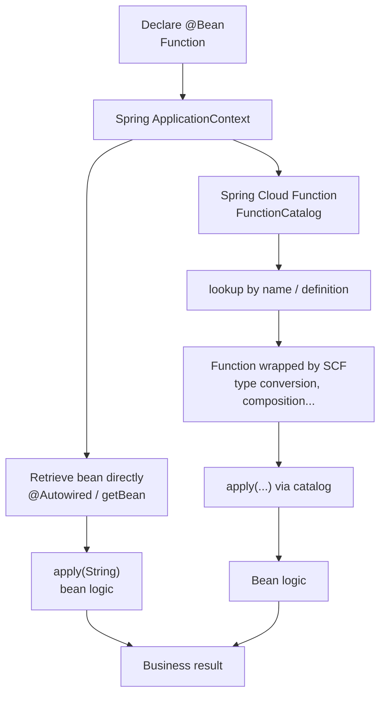
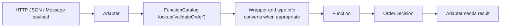
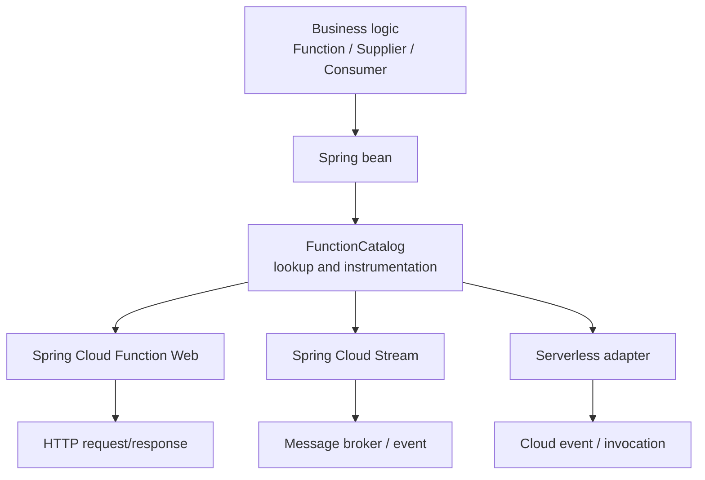

# Distinguishing Direct Bean Invocation from Invocation via FunctionCatalog

**Chapter:** FunctionCatalog  
**Module:** Spring Cloud Function (`SPRING_CLOUD_FUNCTION`)

Spring Cloud Function allows writing business logic as `Supplier`, `Function`, and `Consumer` beans, and then reusing that same logic via Java code, HTTP, event systems, or serverless environments. Because these functions are Spring beans, they can be invoked via **two paths**: retrieving them directly from Spring's `ApplicationContext`, or looking them up through **`FunctionCatalog`**.

The two paths can produce the **same business output** for a simple input, yet they are not equivalent in framework capabilities. According to the official documentation, retrieving a bean directly gives you the declared bean; looking it up via the catalog gives you a function representation **instrumented/wrapped** by Spring Cloud Function to provide additional capabilities such as type conversion and composition.

After this lesson, you will be able to:

1. Distinguish a **Spring bean** from a **function managed by FunctionCatalog**.
2. Compare output, lookup behavior, data types, composition, and error handling between the two paths.
3. Identify when to use direct dependency injection and when to use `FunctionCatalog`.
4. Understand the catalog's role in HTTP, Spring Cloud Stream, and serverless paths.
5. Write code and tests that demonstrate the differences without depending on internal framework classes.

## 1. Two Invocation Paths from the Same Functional Bean

Suppose the application declares:

```java
@Bean("normalizeOrderCode")
public Function<String, String> normalizeOrderCode() {
    return value -> value.trim().toUpperCase(Locale.ROOT);
}
```

This Java function takes a `String` and returns a normalized `String`. Once Spring manages it as a bean, you can:

**Approach A — retrieve the bean directly:**

```java
import java.util.function.Function;
import org.springframework.beans.factory.annotation.Qualifier;
import org.springframework.stereotype.Component;

@Component
public class DirectCaller {
    private final Function<String, String> direct;

    public DirectCaller(
            @Qualifier("normalizeOrderCode")
            Function<String, String> direct) {
        this.direct = direct;
    }

    public String normalize(String input) {
        return direct.apply(input);
    }
}

// Sample call: directCaller.normalize("  ord-42  ") returns ORD-42.
```

**Approach B — look up via the catalog:**

```java
Function<String, String> viaCatalog =
    catalog.lookup(Function.class, "normalizeOrderCode");

if (viaCatalog == null) {
    throw new IllegalStateException("Function not found");
}

String output = viaCatalog.apply("  ord-42  "); // ORD-42
```

In this example, both produce `ORD-42` because the input is already of type `String`, and the logic itself is simply `trim` and `toUpperCase`. **Having two identical outputs does not mean the two paths have the same features.**



This diagram is a conceptual model. A bean provided directly by Spring may still go through standard Spring proxies such as AOP; what is distinguished here is **the extra processing layer specific to Spring Cloud Function when looking up via the catalog**.

## 2. ApplicationContext and FunctionCatalog Serve Different Purposes

`ApplicationContext` manages all kinds of Spring beans: services, repositories, configurations, HTTP controllers, and functional beans. It provides dependency injection, lifecycle management, scoping, and standard Spring capabilities.

`FunctionCatalog` focuses on **functional beans** and function definitions, enabling multiple environments to invoke a shared function model. According to Spring Cloud Function documentation, eligible `Supplier`, `Function`, and `Consumer` beans are discovered from the context and can be registered/wrapped lazily when looked up.

| Criterion | Direct Bean Call | Call via `FunctionCatalog` |
| --- | --- | --- |
| Entry point | `@Autowired`, constructor injection, `ApplicationContext.getBean(...)` | `catalog.lookup(...)` |
| Returned object | Bean provided by Spring as declared, possibly with a Spring proxy | Function representation wrapped by Spring Cloud Function |
| Function selection | By Spring bean name/type or injection with `@Qualifier` | By function name or *function definition* |
| Business invocation | `get()`, `apply(...)`, `accept(...)` | Uses the same corresponding functional methods |
| Type conversion by Spring Cloud Function | Not automatically provided just by calling the bean directly | Can be applied by the wrapper when types/metadata match |
| Composition via `a|b` definition | Write composition code manually in Java | Catalog can resolve compositions |
| Serving HTTP/Stream/serverless adapters | Adapters wanting SCF features must build appropriate integration paths | Standard path for adapters to look up/instrument functions |
| Primary dependencies | Spring beans and Java contracts | Spring Cloud Function context, catalog, and function contracts |

**Do not confuse them:** `FunctionCatalog` does not replace all of `ApplicationContext`. The catalog leverages Spring's bean management and adds function-oriented lookup and processing. Nor should you conclude that every call through the catalog triggers data conversion; if the input already matches the expected type and no composition is involved, behavior can closely resemble direct invocation.

## 3. Spring Boot Example: Both Paths in the Same Application

The following example is a standalone application. Assume the project already uses Spring Boot and a compatible Spring Cloud Function context dependency; no HTTP adapter or message broker is needed yet.

```java
import java.util.Locale;
import java.util.function.Function;

import org.springframework.beans.factory.annotation.Qualifier;
import org.springframework.boot.ApplicationRunner;
import org.springframework.boot.SpringApplication;
import org.springframework.boot.autoconfigure.SpringBootApplication;
import org.springframework.cloud.function.context.FunctionCatalog;
import org.springframework.context.annotation.Bean;

@SpringBootApplication
public class DirectVsCatalogApplication {

    public static void main(String[] args) {
        SpringApplication.run(DirectVsCatalogApplication.class, args);
    }

    @Bean("normalizeOrderCode")
    public Function<String, String> normalizeOrderCode() {
        return value -> value.trim().toUpperCase(Locale.ROOT);
    }

    @Bean("addPrefix")
    public Function<String, String> addPrefix() {
        return value -> "ID-" + value;
    }

    @Bean
    public ApplicationRunner compareCalls(
            @Qualifier("normalizeOrderCode")
            Function<String, String> direct,
            FunctionCatalog catalog) {
        return args -> {
            String input = "  ord-42  ";

            String directResult = direct.apply(input);

            Function<String, String> catalogFunction =
                catalog.lookup(Function.class, "normalizeOrderCode");
            if (catalogFunction == null) {
                throw new IllegalStateException(
                    "Missing normalizeOrderCode");
            }

            String catalogResult = catalogFunction.apply(input);

            System.out.println("Direct:  " + directResult);
            System.out.println("Catalog: " + catalogResult);
            // Both print ORD-42 for a String input.
        };
    }
}
```

Analysis:

- The `direct` parameter is injected by Spring using `@Qualifier("normalizeOrderCode")`, meaning it uses the bean directly via injection.
- `FunctionCatalog` is also injected by Spring, but `catalog.lookup(Function.class, "normalizeOrderCode")` performs a **function lookup through Spring Cloud Function**.
- Both are invoked with `apply(input)` because both implement the `Function<String, String>` contract.
- There are **two** `Function` beans so we do not rely on single-function fallback. If a name is misspelled, the catalog should not guess the intended business function.

### 3.1. Retrieving a Bean Directly via ApplicationContext

Beyond injecting with `@Qualifier`, code can retrieve a bean by name:

```java
// Assume ApplicationContext context has been injected.
Function<?, ?> bean =
    context.getBean("normalizeOrderCode", Function.class);
```

`Function<?, ?>` reminds you that when querying only by `Function.class`, Java does not verify `String` as the parameter and return types. For application code with a clear contract, constructor injection with `@Qualifier` and full generic types is usually easier to read.

For example, `getBean(...)` requires the bean to exist in the Spring context and match the requested type; if missing, Spring typically throws an exception such as `NoSuchBeanDefinitionException`. Meanwhile, the catalog has its own lookup and fallback rules analyzed in later sections.

### 3.2. Should You Compare direct == viaCatalog?

**No.** Spring Cloud Function may wrap/instrument the looked-up bean. Therefore, never rely on object identity `direct == catalogFunction` as a stable contract. Nor should you cast `catalogFunction` to a concrete implementation class to call custom methods.

Test **the business contract and outputs**. If you need to access service-specific APIs outside `Function`, inject that service using standard Spring injection.

## 4. Most Practical Difference: Wrappers and Type Conversion

A Java function has a concrete type:

```java
Function<String, String> normalize = value ->
    value.trim().toUpperCase(Locale.ROOT);
```

When called directly:

```java
String result = normalize.apply("  ord-42  ");
```

Java requires you to supply an input matching the function's contract. No Spring Cloud Function conversion layer runs just because the object is a Spring bean.

In HTTP or event environments, the input may initially be a **byte array**, a **message**, JSON, or an object carrying metadata. The adapter needs to decode/convert data into the type the function actually accepts. That is where wrappers and type metadata managed by Spring Cloud Function come into play.

### 4.1. Separating Transport Data from Business Data

For example, business logic that only accepts DTOs:

```java
record OrderRequest(String orderId, long amount) {}
record OrderDecision(String orderId, boolean accepted) {}

@Bean("validateOrder")
public Function<OrderRequest, OrderDecision> validateOrder() {
    return order -> new OrderDecision(
        order.orderId(),
        order.amount() > 0
    );
}
```

**Direct bean path:** calling code must construct a properly typed `OrderRequest` itself before calling `apply(...)`:

```java
OrderRequest request = new OrderRequest("ORD-42", 1500);
OrderDecision decision = directValidator.apply(request);
```

Here `directValidator` is the `Function<OrderRequest, OrderDecision>` bean injected by Spring.

**Catalog/adapters path:** an adapter can receive a request/message, use the `OrderRequest` type metadata and appropriate converters, and then call the wrapper for `validateOrder`. Spring Cloud Function supports this mechanism, though successful conversion also depends on media types, converter configuration, payload, and version.



Do not assume `lookup(...)` starts an HTTP server, decodes any JSON automatically, or connects to a broker on its own. The corresponding adapters and dependencies are still prerequisites. The catalog provides the function model and supporting capabilities for them.

### 4.2. Messages and Headers Are Not Always Returned As-Is

Spring Cloud Function supports receiving/returning Spring `Message<?>`, payload conversion, and header management where supported by the model and adapters. Some functions explicitly declare `Function<Message<T>, Message<R>>` to work with business headers, while functions typed `Function<T, R>` may not need to know about message envelopes.

Therefore, **do not cast every catalog result to `Message<?>`** and do not assume the output is always a raw payload. The actual data type depends on the function signature, input type, configuration, and invocation path.

Example of a bean that needs to read a header:

```java
import java.util.function.Function;
import org.springframework.messaging.Message;
import org.springframework.context.annotation.Bean;

@Bean("inspectSource")
public Function<Message<String>, String> inspectSource() {
    return message -> {
        String source = String.valueOf(
            message.getHeaders().getOrDefault("source", "unknown"));
        return source + ":" + message.getPayload();
    };
}
```

In the `inspectSource` example, the bean **already accepts `Message` itself**, so direct Java callers can pass a constructed `Message<String>`. The distinct advantage of the catalog is that its wrapper carries capabilities tailored to the Spring Cloud Function ecosystem; it is not the case that only the catalog can pass a `Message` object to a Java function.

### 4.3. Keeping Generic Metadata Clear

The signature `@Bean public Function<OrderRequest, OrderDecision> validateOrder()` helps Spring Cloud Function infer input/output types. If you register a lambda manually or use a raw `Function` type without supplying type info, conversion may not work as expected.

When using Spring Cloud Function's functional bean registration mechanism, `FunctionRegistration` can attach type metadata explicitly. However, for Spring Boot applications using `@Bean` with concrete generics, re-registering solely to get catalog lookup is usually unnecessary.

## 5. Second Difference: Composition via Function Definition

Suppose the application has two beans:

```java
@Bean("normalizeOrderCode")
public Function<String, String> normalizeOrderCode() {
    return value -> value.trim().toUpperCase(Locale.ROOT);
}

@Bean("addPrefix")
public Function<String, String> addPrefix() {
    return value -> "ID-" + value;
}
```

If you retrieve the two beans directly, you must **compose them manually**:

```java
// directNormalize and directAddPrefix are two injected beans.
Function<String, String> manual =
    directNormalize.andThen(directAddPrefix);

System.out.println(manual.apply("  ord-42  "));
// ID-ORD-42
```

Through the catalog, you can express the sequence using a **function definition**:

```java
Function<String, String> composed =
    catalog.lookup(
        Function.class, "normalizeOrderCode|addPrefix");

if (composed == null) {
    throw new IllegalStateException("Composition not found");
}

System.out.println(composed.apply("  ord-42  "));
// ID-ORD-42
```

Both approaches compose functions, yet they **differ in where configuration lives**:

- Composing directly in Java with `andThen(...)` or `compose(...)` requires references to the function objects.
- The catalog resolves `normalizeOrderCode|addPrefix` by name and applies Spring Cloud Function's composition rules.
- Defining by name fits adapters configured via `spring.cloud.function.definition`, for example:

```yaml
spring:
  cloud:
    function:
      definition: normalizeOrderCode|addPrefix
```

`spring.cloud.function.definition` does not create a new Spring bean with this name; it **selects a function or composition** for the integration environment. Composition requires compatible input/output types between steps, and has additional rules for `Supplier`, `Consumer`, and reactive functions.

## 6. Third Difference: Lookup, Naming, and Error Handling

Direct calls from `ApplicationContext` follow Spring's bean-retrieval rules. Calls via `FunctionCatalog` follow Spring Cloud Function's function-definition rules, including fallback behavior in certain configurations.

| Scenario | Direct Spring Bean | FunctionCatalog |
| --- | --- | --- |
| Exact bean name | `getBean("normalizeOrderCode")` returns the matching bean | `lookup("normalizeOrderCode")` looks up the function by name |
| Non-existent bean name | `getBean(...)` typically throws `NoSuchBeanDefinitionException` | Lookup normally fails to resolve; may fall back if only one function exists and fallback is enabled |
| Multiple beans of same type | Unqualified injection may fail with ambiguity | Uses name/definition to select a function unambiguously |
| Composition request `a|b` | Not a standard bean name; must compose manually | Can be resolved into a valid composition |
| Inspecting candidate names | `getBeanNamesForType(Function.class)` | `getNames(Function.class)` or `getNames(null)` |

### 6.1. Single-Function Fallback Can Mask Wrong Names

Spring Cloud Function has a **single-function fallback** mechanism: when only one eligible functional bean exists and fallback is enabled, an empty or wrong name may still map to that sole function.

For example, if only the `normalizeOrderCode` bean exists, `catalog.lookup("normaliseOrderCode")` may return that function. This does not mean Spring registered another bean under the misspelled name.

In versions supporting the property below, fallback can be disabled:

```properties
spring.cloud.function.single-function-fallback-enabled=false
```

Check the documentation for your exact runtime version; if an older version does not support it, having the config line alone is not proof that the behavior is disabled.

**Practical point:** if strict name matching is required, verify `getNames(Function.class).contains(name)` against an application allowlist before lookup, and always check the lookup result. Do not rely on a wrong-name lookup returning non-`null`.

### 6.2. Distinguishing getBeanNamesForType from getNames

`ApplicationContext.getBeanNamesForType(Function.class)` asks Spring which beans have type `Function`. `catalog.getNames(Function.class)` asks Spring Cloud Function which function names are recognized for that kind.

The two sets **do not have to be equal**: the catalog may filter candidates, use custom registrations, or include infrastructure functions; `BeanFactory` may hold Java `Function` beans not intended as functional endpoints.

One setting that affects catalog candidates is:

```properties
spring.cloud.function.ineligible-definitions=internalTransform
```

This property excludes candidates from the catalog by name; it is **not** an HTTP authorization policy. If a function does not appear, inspect component scanning scope, bean names, interface type, and filter settings before altering business logic.

## 7. Should You Call Beans Directly in Integrated Applications?

There is no rule that "every invocation must go through the catalog." The right choice depends on what the caller needs.

**Use the bean directly when:**

- A service in the same application needs to call a Java function whose type is already known, via explicit dependency injection.
- The logic does not need SCF composition or adaptation, and the caller already holds properly typed data.
- You want to unit test `Function<T, R>` logic independently of Spring Cloud Function by instantiating lambdas or Java objects.

**Use FunctionCatalog when:**

- You need to select functions by name, configuration, or function definition.
- You need Spring Cloud Function's wrapping layer and a unified representation for adapters.
- You need composition via definition strings.
- You are writing integrations or tests close to how Spring Cloud Stream, Spring Cloud Function Web, or serverless adapters resolve functions.

In real architectures, an application can use both: regular services call beans directly to stay simple, while adapters use the catalog to handle messages/protocols and function definitions. **There is no need to replace every dependency injection with string-based lookup.**

### 7.1. Catalog and Adapters Have Different Responsibilities



The catalog provides a **shared function contract**, while each adapter handles concrete details such as HTTP paths, message bindings, payloads, entry points, and deployment settings. Having a function in the catalog does not guarantee automatic HTTP endpoint exposure or event bindings.

### 7.2. The Three Interfaces: Supplier, Function, and Consumer

The same principle applies to all three kinds:

```java
Supplier<String> supplier =
    catalog.lookup(Supplier.class, "newOrderCode");
Function<String, String> function =
    catalog.lookup(Function.class, "normalizeOrderCode");
Consumer<String> consumer =
    catalog.lookup(Consumer.class, "auditOrderCode");
```

This snippet assumes beans with matching names and types exist along with the `catalog` variable. After checking for non-`null`:

- `Supplier` is called with `get()`.
- `Function` is called with `apply(input)`.
- `Consumer` is called with `accept(input)`.

Using `Supplier.class`, `Function.class`, or `Consumer.class` only specifies the interface kind; it **does not fully verify generic types** such as `String` or DTOs. Type metadata from the declared signature remains critical for conversion.

## 8. Tests Proving Similarities and Differences

With `DirectVsCatalogApplication` from section 3, you can write a JUnit 5 test once compatible Spring Boot Test dependencies are declared. This test verifies **identical results for a properly typed String input**, while also verifying **composition lookup by function definition**.

```java
import static org.junit.jupiter.api.Assertions.*;

import java.util.function.Function;
import org.junit.jupiter.api.Test;
import org.springframework.beans.factory.annotation.Autowired;
import org.springframework.beans.factory.annotation.Qualifier;
import org.springframework.boot.test.context.SpringBootTest;
import org.springframework.cloud.function.context.FunctionCatalog;

@SpringBootTest(classes = DirectVsCatalogApplication.class)
class DirectVsCatalogApplicationTest {

    @Autowired
    @Qualifier("normalizeOrderCode")
    Function<String, String> directNormalize;

    @Autowired
    @Qualifier("addPrefix")
    Function<String, String> directAddPrefix;

    @Autowired
    FunctionCatalog catalog;

    @Test
    void sameBusinessResultForTypedInput() {
        Function<String, String> wrapped =
            catalog.lookup(Function.class, "normalizeOrderCode");

        assertNotNull(wrapped);
        assertEquals("ORD-42",
            directNormalize.apply("  ord-42  "));
        assertEquals("ORD-42",
            wrapped.apply("  ord-42  "));
    }

    @Test
    void compositionViaJavaOrCatalog() {
        Function<String, String> manual =
            directNormalize.andThen(directAddPrefix);
        Function<String, String> catalogComposition =
            catalog.lookup(
                Function.class, "normalizeOrderCode|addPrefix");

        assertNotNull(catalogComposition);
        assertEquals("ID-ORD-42",
            manual.apply("  ord-42  "));
        assertEquals("ID-ORD-42",
            catalogComposition.apply("  ord-42  "));
    }

    @Test
    void catalogListsTheRegisteredFunctions() {
        assertTrue(catalog.getNames(Function.class)
            .contains("normalizeOrderCode"));
        assertTrue(catalog.getNames(Function.class)
            .contains("addPrefix"));
    }
}
```

The test focuses on **observable behavior**. It does not assert that the wrapper and bean are the exact same object instance, nor does it assume the catalog contains only two names since the framework may add infrastructure functions.

Testing JSON or `Message<?>` conversion requires real adapter/converter configuration and appropriate test payloads. Do not infer that conversion has been verified from the `String → String` test above alone.

## 9. Common Errors and Misconceptions

| Claim or Symptom | Analysis | Resolution |
| --- | --- | --- |
| "Direct calls return the same result as the catalog, so both are identical." | With properly typed inputs, the wrapper may not need to transform anything | Compare lookup, conversion, and composition needs |
| "For FunctionCatalog to work, I must create an HTTP endpoint." | The catalog can run in a Java app with no web adapter | Test using Java or Spring Boot Test |
| "Calling the bean directly also accepts JSON automatically like HTTP." | A Java bean only knows the input type declared by the function | Convert JSON in the adapter or appropriate caller layer |
| "I can cast the wrapper back to my lambda/bean class." | The wrapper does not promise to preserve the bean's concrete class/identity | Use the `Function`/`Supplier`/`Consumer` interface |
| "Wrong-name lookup returned non-null, so that name is registered." | May be due to single-function fallback | Check `getNames(...)` and fallback configuration |
| "getNames must match getBeanNamesForType." | The two APIs have different filtering/registration scopes | Check ineligible candidates and registration |
| "`a|b` is a Spring bean with that literal name." | It may be a definition for function composition | Look up compositions via `FunctionCatalog` |
| "Having a name in the catalog guarantees HTTP works." | HTTP adapter/export is a separate layer | Check dependencies, function definitions, and mappings |
| "All catalog conversions automatically succeed." | Depends on metadata, payload, converters, and runtime | Write integration tests with real message types |

## 10. Hands-On Exercises

1. Use the application in section 3. Invoke `normalizeOrderCode` via dependency injection and via `catalog.lookup(...)`. Compare the results for `"  ord-42  "`.
2. Create a `Function<String, Integer> countCharacters` bean. Invoke it directly with `"ORD-42"`, then look it up via the catalog. Why is `Function.class` not enough to verify the return type is `Integer`?
3. Chain `normalizeOrderCode.andThen(addPrefix)` in Java code. Compare with `catalog.lookup(Function.class, "normalizeOrderCode|addPrefix")` in terms of output, configuration style, and reusability across adapters.
4. Add a `Function<OrderRequest, OrderDecision> validateOrder` bean. Write a direct unit test with `new OrderRequest(...)`, then design an integration test over HTTP or a message converter to verify data conversion when using an adapter.
5. Try a wrong lookup name when only one functional bean exists and when multiple beans exist. Explain single-function fallback and why Spring's `getBean(...)` follows different rules.
6. Remove the HTTP adapter configuration, keep the Spring Cloud Function context, and run the test in section 8. Why does `FunctionCatalog.lookup(...)` still work?

### Interview Question

**Q:** Should we replace every `@Autowired Function<T, R>` call with `FunctionCatalog.lookup(...)`?

**A:** No. Calling a bean directly is appropriate when code within the same application already knows the function and data types, especially for isolated logic unit tests. The catalog is appropriate when you need lookup by name/definition, composition, and Spring Cloud Function's extra processing capabilities, especially at HTTP, event, and serverless boundaries. Both paths can yield the same business output while carrying different integration contracts.

## 11. Key Takeaways

- **ApplicationContext returns the declared Spring bean; FunctionCatalog returns the function representation managed and wrapped by Spring Cloud Function.**
- For simple `String → String` cases, both calls can produce the same output; **the difference lies in integration semantics** such as conversion, composition, and lookup by function definition.
- Direct calls use Java contracts and dependency injection; the catalog looks up by name/type and supports composition so multiple adapters can reuse the same function.
- Never rely on object identity, casting to an implementation class, or a single simple output check to conclude two objects are identical.
- To verify conversion, write integration tests with real payloads/messages and converters; to test pure business logic, direct unit tests are usually sufficient.

### References

- [Spring Cloud Function — Programming Model](https://docs.spring.io/spring-cloud-function/reference/spring-cloud-function/programming-model.html): directly explains the difference between retrieving a bean from `ApplicationContext` and looking up a wrapper via `FunctionCatalog`; includes additional examples of composition and type conversion.
- [Spring Cloud Function — Functional Bean Definitions](https://docs.spring.io/spring-cloud-function/reference/functional.html): illustrates testing functions via `FunctionCatalog` and catalog inspection methods.
